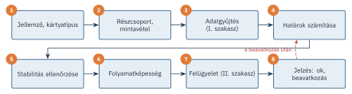
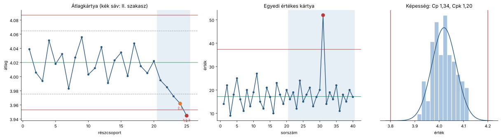

# Kontrollkártya (SPC) {#sec-kontrollkartya}

::: {.cel title="Eszközkártya"}
- **Mire való?** Egy folyamatjellemző időbeli stabilitásának figyelése: a véletlen ingadozás elkülönítése a különleges (azonosítható) okoktól, a beavatkozás jelzése, és stabil folyamatra a folyamatképesség (Cp, Cpk) számítása.
- **Tanulási eredmény:** az eszközlap feldolgozása után képes leszel kiválasztani a megfelelő kontrollkártyát, kiszámítani a határokat, és a jelzési szabályokkal elkülöníteni a különleges okokat a véletlen ingadozástól.
- **V-lépés:** 9. Üzemeltetés és folyamatos fejlesztés; a DMAIC szabályozási lépése; a próbaüzemben a stabilitás igazolása.
- **Bemenet:** időrendben gyűjtött mérési eredmények (részcsoportokban vagy egyenként), a tűréshatárok, a mintavételi terv.
- **Kimenet:** kontrollkártya középvonallal és beavatkozási határokkal, a jelzések listája, képességindexek, beavatkozási szabályok.
- **Időigény:** a kártya felállítása 1–2 óra; a felügyelet folyamatos, mintavételenként néhány perc.
- **Kézikönyv:** [25. fejezet](../../kezikonyv/fejezetek/25-uzemeltetes.html), 25.4. szakasz.
- **Továbbolvasás:** [@goldberg1994toolbox, 7.14. szakasz].
:::

## Mikor használd?

- **Ha egy kritikus jellemzőt folyamatosan gyártanak vagy mérnek**, és a változást még a hibás termék előtt fel kell ismerni [@montgomery2020sqc].
- **Fejlesztés után**, hogy a javulás fennmaradjon (a DMAIC szabályozási lépése) ([-@sec-pdca-8d-dmaic]. eszközlap).
- **A képességindex számítása előtt**: a Cp és Cpk csak stabil folyamatra értelmezhető [@montgomery2020sqc].
- **Szolgáltatási és menedzsmentmutatókra is** (napi várakozás, átfutás, hibás rendelések aránya), egyedi értékes vagy arányra vonatkozó kártyával.
- **Kevésbé alkalmas**, ha az adatok erősen autokorreláltak (például egymást követő ciklusok folyamatos folyamatban) vagy trendet mutatnak természetüknél fogva; ilyenkor módosított módszerek kellenek [@montgomery2020sqc].

## Lépések

{#fig-lepesek-kontrollkartya width=100%}

1. **Válaszd ki a jellemzőt és a kártyatípust.** Mért érték részcsoportokban: átlag- és terjedelemkártya (X̄–R); egyenként: egyedi értékes és mozgóterjedelem-kártya (I-MR); hibás arány: p-kártya; hibaszám: c- vagy u-kártya [@montgomery2020sqc].
2. **Határozd meg a részcsoportot és a mintavételt.** A részcsoporton belül csak véletlen ingadozás legyen (például öt egymást követő darab), a részcsoportok között a folyamat változásai látszódjanak.
3. **Gyűjts adatot egy stabil időszakból** (I. szakasz), legalább 20–25 részcsoportot.
4. **Számold ki a határokat**: középvonal ± 3σ; X̄–R kártyán $\bar{\bar{x}} \pm A_2\bar{R}$, a terjedelemre $D_3\bar{R}$ és $D_4\bar{R}$ [@montgomery2020sqc].
5. **Ellenőrizd a stabilitást.** Ha az I. szakaszban jelzés van, keresd meg és szüntesd meg az okát, hagyd ki a pontot, és számold újra a határokat.
6. **Számold ki a folyamatképességet** a tűréshatárokkal (Cp, Cpk).
7. **Felügyeld a folyamatot** (II. szakasz) a rögzített határokkal és a jelzési szabályokkal.
8. **Jelzésnél keresd meg az okot, és avatkozz be**; rögzítsd az okot és az intézkedést a kártyán.

A jelzési szabályok (Western Electric-szabályok) [@montgomery2020sqc]: (1) egy pont a ±3σ határon kívül; (2) három egymást követő pontból kettő ugyanazon az oldalon a 2σ-n túl; (3) öt egymást követő pontból négy ugyanazon az oldalon az 1σ-n túl; (4) nyolc egymást követő pont a középvonal ugyanazon oldalán.

## Kidolgozott példa: a KoboCella nyomatéka és a ForgácsTech várakozásai

**Átlag- és terjedelemkártya.** A KoboCella csavarozó egysége óránként öt egymást követő kötés nyomatékát rögzíti ([25. fejezet](../../kezikonyv/fejezetek/25-uzemeltetes.html)). Az első 20 részcsoportból a középvonal 4,020 Nm, $\bar{R} = 0{,}116$ Nm, $\hat{\sigma} = 0{,}116/2{,}326 = 0{,}050$ Nm, a határok 3,953 és 4,087 Nm. Az I. szakaszban nincs jelzés. A II. szakaszban az átlag csökkenni kezd; a 24. részcsoportnál a 2. és a 3. szabály jelez, a 25. pont a határ alá esik ([-@fig-kontrollkartya]. ábra). A rétegzés egy új csavartételre vezetett ([-@sec-hisztogram-szoras]. eszközlap).

**Képesség.** A 4,0 ± 0,2 Nm tűrésre $C_p = 1{,}34$, $C_{pk} = 1{,}20$, a teljes szórással $P_p = 1{,}37$, $P_{pk} = 1{,}24$. A $C_{pk}$ azért marad Montgomery 1,33-as ajánlott minimuma alatt [@montgomery2020sqc], mert a középérték 0,02 Nm-rel a tűrésmező közepe fölött van; beállítás után a $C_{pk}$ a $C_p$-hez közelít.

**Egyedi értékes kártya.** A ForgácsTech a DMAIC-projekt után a napi anyagra várást követi. Az első 20 nap átlaga 17,2 perc, a mozgó terjedelmek átlaga 7,58 perc, $\hat{\sigma} = 7{,}58/1{,}128 = 6{,}72$ perc, a felső határ 37,4 perc (az alsó határ negatív lenne, ezért 0). A 31. nap 52 perce a határ fölött van: a vizsgálat szerint egy beszállító késése okozta, különleges ok, nem a folyamat romlása.

{#fig-kontrollkartya width=100%}

**Tanulságok:**

- **A futási szabályok korábban jeleznek.** A 24. részcsoportnál még minden pont a határokon belül volt, de a 2. és a 3. szabály már jelezte az elmozdulást.
- **Az I. szakasznak stabilnak kell lennie.** Ha a határokat egy instabil időszakból számolják, a kártya a rendellenességet „normálisnak” tanulja meg.
- **A határ nem a tűrés.** A beavatkozási határok a folyamat ingadozásából, a tűréshatárok a követelményből származnak; a kettőt nem szabad összekeverni.
- **A különleges okot meg kell nevezni.** A 31. napi kiugrás nem a fejlesztés kudarca; a kártyán rögzített ok segít elkerülni a felesleges beavatkozást.

## Sablon és notebook

- [kontrollkartya_sablon.xlsx](../sablonok/kontrollkartya_sablon.xlsx): „X–R” lap (legfeljebb 50 részcsoport, 2–10 mérés, választható I. szakasz, a négy jelzési szabály és a terjedelem automatikus ellenőrzése, átlag- és terjedelemkártya), „Egyedi (I-MR)” lap (legfeljebb 100 érték, nemnegatív alsó határ választható), „Képesség” lap (Cp, Cpk, Pp, Ppk, értékelés) és „Állandók” lap. A KoboCella és a ForgácsTech példájával kitöltve.
- [kontrollkartya.ipynb](../notebookok/kontrollkartya.ipynb) · [Megnyitás Google Colabban](kontrollkartya.ipynb): határok, jelzési szabályok, képesség normális eloszlással és a tűrésen kívüli arány becslésével (a [-@fig-kontrollkartya]. ábra így készült).

## Előnyök és korlátok

| Előnyök | Korlátok |
|:--|:--|
| Elválasztja a véletlen ingadozást a különleges okoktól; a felesleges beavatkozást is megelőzi [@shewhart1931] | Csak a változást jelzi, az okot nem; az okot más eszközökkel kell megtalálni [@montgomery2020sqc] |
| A futási szabályok a határátlépés előtt is jeleznek | Több szabály együtt több téves jelzést is ad |
| Egyszerű, a műhelyben kézzel is vezethető | Független, közel normális eloszlású adatokat feltételez; autokorreláció esetén félrevezet [@montgomery2020sqc] |
| A képességindexekkel a tűréshez viszonyított teljesítmény is mérhető | A képességindex csak stabil folyamatra és megfelelő mintára értelmes; kis mintán bizonytalan |

: A kontrollkártya előnyei és korlátai. {tbl-colwidths="[50,50]"}

::: {.hiba}
- **Tűréshatár a beavatkozási határ helyén.** Ilyenkor a kártya csak a selejtet jelzi, a változást nem.
- **A határok folyamatos újraszámolása.** Ha minden új adattal újraszámolják a határokat, a lassú elmozdulás „beleolvad” a határokba.
- **Beavatkozás minden kiugró pontra az ok keresése nélkül.** A folyamat „állítgatása” a véletlen ingadozásra növeli a szórást.
- **Képességindex instabil folyamatra.** Az eredmény nem jelzi előre a jövőbeli teljesítményt.
- **Rossz részcsoport.** Ha a részcsoporton belül eltérő gépek vagy fészkek adatai keverednek, a határok túl szélesek lesznek.
:::

## Mintapromptok

::: {.prompt title="Mintaprompt: kártyatípus és mintavételi terv"}
```text
A folyamat és a jellemző: [LEÍRÁS, MÉRÉSI MÓD, GYAKORISÁG, A TERMELÉS
ÜTEME, A FONTOS ZAVARÓ TÉNYEZŐK].
Feladat: javasolj kontrollkártya-típust, részcsoportméretet és
mintavételi gyakoriságot, indoklással. Írd le, milyen zavaró tényezők
keveredhetnek a részcsoporton belül, és hogyan kerülhető el. Jelöld,
ha az adatok autokorreláltak lehetnek. Határokat ne számolj.
```
:::

::: {.prompt title="Mintaprompt: jelzés kivizsgálása"}
```text
A kontrollkártya jelzése: [RÉSZCSOPORT, SZABÁLY, ÉRTÉKEK]; a jelzés
körüli események: [MŰSZAKVÁLTÁS, ANYAGTÉTEL, KARBANTARTÁS, BEÁLLÍTÁS].
Feladat: sorold fel a lehetséges különleges okokat, és mindegyikhez
azt az adatot vagy rétegzést, amellyel igazolható vagy elvethető.
Ne állapíts meg okot bizonyíték nélkül, és ne javasolj beavatkozást,
amíg az ok nem ismert.
```
:::

## Feladat

::: {.projekt title="Választható feladat: kontrollkártya"}
Válassz egy kritikus jellemzőt vagy üzemi mutatót a projektedből. Határozd meg a kártyatípust, a részcsoportot és a mintavételt; valós vagy szimulált adatokkal (legalább 25 részcsoport vagy 30 érték) állítsd fel a kártyát a sablonnal, ellenőrizd a stabilitást, és ha van tűrés, számold ki a képességindexeket. Írd le, ki és hogyan reagál egy jelzésre.
:::
