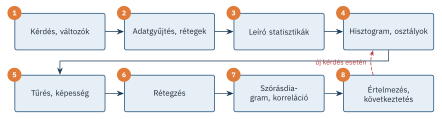
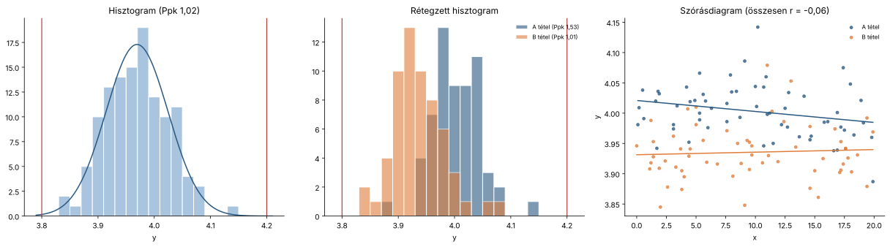

# Hisztogram, szórás- és rétegzett diagram {#sec-hisztogram-szoras}

::: {.cel title="Eszközkártya"}
- **Mire való?** Egy mért jellemző eloszlásának megjelenítése és értékelése a tűrésmezőben (hisztogram), az adatok csoportosítása a különbségek feltárására (rétegzés), és két változó kapcsolatának vizsgálata (szórásdiagram, korreláció, regresszió).
- **Tanulási eredmény:** az eszközlap feldolgozása után képes leszel hisztogrammal értékelni egy jellemző eloszlását a tűrésmezőben, kiszámítani a folyamatképességi indexeket, és szórásdiagrammal és rétegzéssel vizsgálni az okokat.
- **V-lépés:** 9. Üzemeltetés és folyamatos fejlesztés; a verifikáció mérési adatainak és a beérkező anyagok vizsgálatára is.
- **Bemenet:** mérési adatok (legalább 50–100 érték a hisztogramhoz), a rétegző jellemző (tétel, gép, műszak), egy vagy több lehetséges magyarázó változó, a tűréshatárok.
- **Kimenet:** hisztogram, leíró statisztikák és képességindexek összesen és rétegenként, szórásdiagram korrelációval és regressziós egyenessel, következtetések.
- **Időigény:** meglévő adatokból 30–60 perc.
- **Kézikönyv:** [25. fejezet](../../kezikonyv/fejezetek/25-uzemeltetes.html), 25.3–25.4. szakasz.
- **Továbbolvasás:** [@goldberg1994toolbox, 5.1., 5.5. és 5.7. szakasz].
:::

## Mikor használd?

- **Ha egy jellemző eloszlására vagy a tűréshez viszonyított helyzetére vagy kíváncsi**: középre esik-e, mekkora a szórása, van-e kiugró érték vagy több csúcs [@montgomery2020sqc].
- **Ha az adatok több forrásból származnak** (tételek, gépek, műszakok, beszállítók): a rétegzés megmutatja, honnan ered a különbség [@ishikawa1982].
- **Ha egy lehetséges ok és a hatás kapcsolatát kell vizsgálni**: szórásdiagram, korreláció, regresszió [@montgomery2020sqc].
- **A kontrollkártya jelzése után**, az ok keresésére ([-@sec-kontrollkartya]. eszközlap).
- **Kevésbé alkalmas** időbeli változás kimutatására (arra a kontrollkártya való), és a korreláció nem bizonyít ok-okozati kapcsolatot [@montgomery2020sqc].

## Lépések

{#fig-lepesek-hisztogram-szoras width=100%}

1. **Fogalmazd meg a kérdést, és válaszd meg a változókat**: mi a vizsgált jellemző (Y), mi a rétegző jellemző, mi a lehetséges magyarázó változó (X).
2. **Gyűjts adatokat a rétegek jelölésével.** A réteget az adatgyűjtéskor kell rögzíteni; utólag ritkán pótolható.
3. **Számold ki a leíró statisztikákat**: átlag, szórás, medián, minimum, maximum.
4. **Rajzold meg a hisztogramot.** Az osztályok száma ökölszabályként a mintaelemszám négyzetgyöke körül legyen; az osztályszélesség egyenlő.
5. **Vesd össze a tűréssel**: hol van a középérték, mekkora a tartalék a tűréshatárokig (Pp, Ppk).
6. **Rétegezz**: rajzold meg rétegenként a hisztogramot, és hasonlítsd össze a rétegek átlagát és szórását.
7. **Vizsgáld meg a kapcsolatot szórásdiagrammal**, összesen és rétegenként: korreláció, a meredekség és konfidenciaintervalluma.
8. **Értelmezd az eredményt**, és jelöld, mit kell még igazolni (a korrelációt kísérlettel vagy műszaki vizsgálattal).

## Kidolgozott példa: két csavartétel a KoboCellánál

A kontrollkártya jelzése után a csapat két csavartétellel (A: a korábbi gyártóhelyről, B: az új gyártóhelyről) tételenként 60 próbacsavarozást végzett, és rögzítette, hány csavarozás volt már az adott bitbetéttel ([-@sec-kontrollkartya]. eszközlap). Az eredményeket a [-@tbl-hisztogram-kobo]. táblázat és a [-@fig-hisztogram-szoras]. ábra mutatja.

| | Összesen | A tétel | B tétel |
|:--|--:|--:|--:|
| n | 120 | 60 | 60 |
| átlag [Nm] | 3,969 | 4,003 | 3,935 |
| szórás [Nm] | 0,055 | 0,043 | 0,045 |
| Pp | 1,20 | 1,55 | 1,49 |
| Ppk | 1,02 | 1,53 | 1,01 |
| korreláció a bitbetét használatával (r) | −0,06 | −0,25 | 0,06 |

: A két csavartétel nyomatéka és a bitbetét használatával való kapcsolata. {#tbl-hisztogram-kobo tbl-colwidths="[46,18,18,18]"}

{#fig-hisztogram-szoras width=100%}

**Tanulságok:**

- **A rétegzés két keskeny eloszlást tárt fel.** Az összesített hisztogram széles, de egyetlen csúcsú; csak a rétegzés mutatja meg, hogy a B tétel átlaga 0,068 Nm-rel kisebb (Welch-féle t-próba, p < 0,001).
- **Az összesített képességindex félrevezető.** A Ppk összesen 1,02, az A tételnél 1,53: a gyenge összesített érték a tételek közötti különbségből ered, nem a folyamat szórásából.
- **A kopás hatása kicsi.** Az A tételnél a nyomaték ezer csavarozásonként kb. 0,002 Nm-rel csökken (határeset p-érték), ami összhangban van a kétlépcsős stratégiára végzett kísérlettel (kézikönyv [18. fejezet](../../kezikonyv/fejezetek/18-robusztus.html)); a tételhatás ennek sokszorosa.
- **A korreláció nem ok.** A tétel és a nyomaték kapcsolatát a beszállítóval közösen végzett bevonatvizsgálat igazolta.

## Sablon és notebook

- [hisztogram_szoras_sablon.xlsx](../sablonok/hisztogram_szoras_sablon.xlsx): „Adatok” (legfeljebb 300 sor: réteg, X, Y), „Statisztika” (leíró statisztikák és Pp, Ppk összesen és legfeljebb három rétegre), „Hisztogram” (választható osztályhatárok, összesített és rétegzett hisztogram, a tűrésen kívüli osztályok jelölése) és „Szórásdiagram” lap (korreláció, meredekség, tengelymetszet, r², a korreláció p-értéke összesen és rétegenként). A KoboCella példájával kitöltve.
- [hisztogram_szoras.ipynb](../notebookok/hisztogram_szoras.ipynb) · [Megnyitás Google Colabban](hisztogram_szoras.ipynb): hisztogram normális illesztéssel és normalitásvizsgálattal, rétegenkénti statisztikák és a rétegek összevetése, regresszió a meredekség konfidenciaintervallumával (a [-@fig-hisztogram-szoras]. ábra így készült).

## Előnyök és korlátok

| Előnyök | Korlátok |
|:--|:--|
| A hisztogram egy pillantással mutatja az eloszlás alakját, helyzetét és a tűréshez viszonyított tartalékot [@montgomery2020sqc] | Kis mintán és rossz osztályválasztással félrevezető alakot mutathat |
| A rétegzés egyszerűen elkülöníti a források hatását [@ishikawa1982] | Csak az adatgyűjtéskor rögzített rétegek vizsgálhatók |
| A szórásdiagram a kapcsolat alakját és a kiugró értékeket is mutatja [@montgomery2020sqc] | A korreláció nem bizonyít okságot; egy harmadik változó látszólagos kapcsolatot okozhat [@montgomery2020sqc] |
| Kevés eszközzel, táblázatkezelőben is elvégezhető | Az időbeli változást nem mutatja; a hisztogram egy stabil folyamatról szól |

: A hisztogram, a rétegzés és a szórásdiagram előnyei és korlátai. {tbl-colwidths="[50,50]"}

::: {.hiba}
- **Összekevert rétegek.** A több forrásból származó adatok közös hisztogramja elfedheti a különbségeket, vagy hamis „széles” eloszlást mutat.
- **Instabil folyamat hisztogramja.** Ha a folyamat közben elmozdult, a hisztogram a két állapot keverékét mutatja; előbb a kontrollkártyát kell megnézni.
- **Korreláció mint ok.** A korrelációt kísérlettel vagy műszaki vizsgálattal kell megerősíteni.
- **Túl kevés vagy túl sok osztály.** Az előbbi elmossa, az utóbbi zajossá teszi az alakot.
:::

## Mintapromptok

::: {.prompt title="Mintaprompt: rétegzési terv"}
```text
A vizsgált jellemző és a probléma: [LEÍRÁS]. A folyamatban szereplő
lehetséges források: [GÉPEK, MŰSZAKOK, TÉTELEK, BESZÁLLÍTÓK, KEZELŐK].
Feladat: javasolj rétegző jellemzőket és lehetséges magyarázó
változókat, mindegyikhez azt, hogy milyen különbséget vagy kapcsolatot
várnánk, ha ez lenne az ok, és hogyan kell az adatgyűjtéskor rögzíteni.
Jelöld, melyik vizsgálathoz kell kísérlet a megfigyelés helyett.
```
:::

::: {.prompt title="Mintaprompt: eredmények értelmezése"}
```text
Leíró statisztikák és képességindexek rétegenként: [TÁBLÁZAT];
korreláció és regresszió: [TÁBLÁZAT].
Feladat: írj rövid értelmezést: mi a különbség a rétegek között, mennyire
biztos ez, mekkora a magyarázó változó hatása a rétegek különbségéhez
képest, és mit kell még igazolni. Ne állíts ok-okozati kapcsolatot csak
a korreláció alapján; a számokat ne változtasd meg.
```
:::

## Feladat

::: {.projekt title="Választható feladat: eloszlás és rétegzés"}
Gyűjts vagy szimulálj legalább 60 mérési eredményt egy jellemzőre a projektedből, legalább két réteggel és egy lehetséges magyarázó változóval. Készíts összesített és rétegzett hisztogramot, számold ki a képességindexeket, és vizsgáld meg a kapcsolatot szórásdiagrammal. Fogalmazd meg, mit bizonyítanak az adatok, és mit nem.
:::
