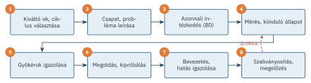

# PDCA, 8D és DMAIC {#sec-pdca-8d-dmaic}

::: {.cel title="Eszközkártya"}
- **Mire való?** A folyamatos fejlesztés szervezett ciklusainak vezetése és dokumentálása: PDCA kisebb, gyorsan ismételhető fejlesztésekhez, 8D reklamációk és súlyos hibák csapatban végzett kezeléséhez, DMAIC krónikus, adatokkal mérhető teljesítményhiányok felszámolásához.
- **Tanulási eredmény:** az eszközlap feldolgozása után képes leszel kiválasztani a problémához illő fejlesztési ciklust (PDCA, 8D, DMAIC), és annak lépései szerint dokumentálni egy fejlesztést.
- **V-lépés:** 9. Üzemeltetés és folyamatos fejlesztés; a verifikációs és validációs eltérések kezelésére is.
- **Bemenet:** a probléma vagy fejlesztési lehetőség mérhető leírása, adatok, a folyamatot ismerő csapat, a döntéshozó támogatása.
- **Kimenet:** kitöltött PDCA-lap, 8D-jelentés vagy DMAIC-projektlap, intézkedési terv, a hatás igazolása, a változás rögzítése (szabvány, eljárás, FMEA, követelmény).
- **Időigény:** PDCA napok–hetek; 8D néhány hét; DMAIC néhány hónap.
- **Kézikönyv:** [25. fejezet](../../kezikonyv/fejezetek/25-uzemeltetes.html), 25.5. szakasz.
:::

## Mikor használd?

- **PDCA**, ha egy fejlesztési ötlet kis léptékben gyorsan kipróbálható, és a hatása rövid idő alatt mérhető [@deming1986].
- **8D**, ha reklamáció vagy súlyos hiba érkezik, és az ügyfelet azonnal védeni kell, miközben a gyökérokot is meg kell szüntetni [@vda2018_8d].
- **DMAIC**, ha egy teljesítményhiány tartósan fennáll, adatokkal mérhető, és az oka nem nyilvánvaló [@schroeder2008; @montgomery2020sqc].
- **Mindhármat**, ha a változás eredményét rögzíteni kell: a bevált megoldásnak be kell kerülnie a szabványokba, az eljárásokba és a tervezési dokumentumokba (FMEA, követelmények).
- **Nem alkalmas** a ciklusok egyike sem arra, hogy egy már ismert megoldás bevezetését „projektként” utólag igazolja; ilyenkor elég egy egyszerű változáskezelés ([-@sec-konfiguracio]. eszközlap).

## Lépések

{#fig-lepesek-pdca-8d-dmaic width=100%}

1. **Döntsd el, melyik ciklus illik a helyzethez** (kiváltó ok, lépték, sürgősség, adatok).
2. **Állítsd össze a csapatot, és írd le a problémát mérhetően**: mi, hol, mikor, mekkora, és mi *nem* érintett (8D: D1–D2; DMAIC: meghatározás).
3. **Ha az ügyfelet védeni kell, tegyél azonnali intézkedést** (8D: D3), és igazold a hatékonyságát.
4. **Mérd a kiinduló állapotot** megbízható adatokkal (DMAIC: mérés).
5. **Tárd fel és igazold a gyökérokot** ([-@sec-halszalka]. eszközlap; 8D: D4; DMAIC: elemzés).
6. **Válaszd ki és próbáld ki a megoldást** kis léptékben (PDCA: P–D; 8D: D5; DMAIC: fejlesztés).
7. **Vezesd be, és igazold a hatást** a kiinduló állapothoz mért adatokkal (PDCA: C; 8D: D6).
8. **Rögzítsd a változást, és előzd meg a megismétlődést**: szabványosítás, eljárás, képzés, FMEA, kontrollkártya (PDCA: A; 8D: D7–D8; DMAIC: szabályozás) ([-@sec-kontrollkartya]. eszközlap).

## Kidolgozott példák

**PDCA: a KoboCella hibanyugtázása.** A validáció első hetében a kezelők műszakonként átlagosan 14-szer mentek a cella mögé nyugtázni ([24. fejezet](../../kezikonyv/fejezetek/24-validacio.html)). Terv: második nyugtázó gomb a kezelői oldalon, a biztonsági mérnök jóváhagyásával; végrehajtás: egyhetes próba egy műszakban; ellenőrzés: a cella mögé menetelek száma 0, a hibaelhárítás átlagos ideje 95 s-ról 52 s-ra csökkent; beavatkozás: szabványosítás mindkét műszakra, az interfész-dokumentáció, a kezelési útmutató és a feladatelemzés frissítése.

**8D: a VárosiBringa téli zárhibái.** Három hét alatt 12 bejelentés érkezett, hogy a dokkoló nem zárt; mind a négy érintett állomás árnyékos volt, az esetek hidegben, reggel történtek ([25. fejezet](../../kezikonyv/fejezetek/25-uzemeltetes.html)). A [-@tbl-8d-bringa]. táblázat a lépéseket foglalja össze.

| Lépés | Tartalom |
|:--|:--|
| D1 csapat | rendszermérnök (vezető), üzemeltetési vezető, a beszállító szervizmérnöke, diszpécser, ügyfélszolgálat |
| D2 probléma | 12 eset, 4 árnyékos állomás, 6–9 óra, −3 °C alatt; nem érintett: a napos állomások és a nappali órák |
| D3 azonnali intézkedés | az alkalmazás ellenőrzi a zár állapotát, és a szomszédos dokkolóhoz irányít; reggeli állomásellenőrzés |
| D4 gyökérok | hűtőkamrás teszt: −5 °C alatt a kenőanyag besűrűsödik (10/10 hiba), +5 °C-on 0/10 |
| D5 megoldás | alacsony hőmérsékleten is működő kenőanyag, erősebb zárnyelvrugó; elvetve: fűtött zár |
| D6 bevezetés, igazolás | −15 °C-ig 20/20 sikeres zárás; két állomáson két hét hiba nélkül; ezután mind a 300 dokkoló |
| D7 megelőzés | FMEA-frissítés, kenőanyag-specifikáció, téli ellenőrzőlista, tanulság a beszerzési követelményekhez |
| D8 lezárás | lezáró megbeszélés, archiválás, a csapat elismerése |

: A VárosiBringa 8D-jelentésének összefoglalása. {#tbl-8d-bringa tbl-colwidths="[24,76]"}

**DMAIC: a ForgácsTech anyagra várása.** Meghatározás: havi 1120 perc, cél legfeljebb 400 perc; mérés: MES-napló; elemzés: Pareto-diagram, ok-okozati diagram, 5 miért ([-@sec-pareto-diagram]., [-@sec-halszalka]. eszközlap); fejlesztés: anyag-ellenőrzés átsoroláskor, kétóránkénti anyagkiadás az ütemterv alapján, egy hónapos próba két gépen; szabályozás: napi egyedi értékes kontrollkártya. A havi anyagra várás 1120 percről 380 percre csökkent.

**Tanulságok:**

- **A probléma leírása a fél megoldás.** A 8D D2 lépésében a „mi nem érintett” (napos állomások, nappali órák) mutatott a hőmérsékletre.
- **Az azonnali intézkedés nem megoldás.** A reggeli állomásellenőrzés megvédte az ügyfeleket, de költséges volt; tartóssá válva elfedte volna a gyökérokot.
- **A gyökérok igazolása kísérlettel a legerősebb.** A hűtőkamrás teszt a hibát ki- és bekapcsolta.
- **A ciklus a rögzítéssel zárul.** Mindhárom példában a tervezési dokumentumok (ICD, FMEA, specifikáció, HTA) is frissültek: a fejlesztés tanulsága így a következő rendszerbe is eljut.

## Sablon

A ciklusok dokumentálására egy közös munkafüzet szolgál; a számítások egyszerűek, ezért ehhez az eszközhöz nem tartozik notebook. A statisztikai elemzésekhez a Pareto-diagram, az ok-okozati diagram, a kontrollkártya és a hisztogram eszközlapjának notebookjai használhatók.

- [pdca_8d_dmaic_sablon.xlsx](../sablonok/pdca_8d_dmaic_sablon.xlsx): „PDCA-lap” (egylapos, A3-szemléletű összefoglaló), „8D-jelentés” (D1–D8 tartalommal, felelőssel, határidővel, állapottal és a késések jelzésével egy értékelési dátumhoz képest), „DMAIC-projektlap” (projektlap, fázisok fő kérdésekkel, eszközökkel, kimenetekkel és fázislezáró ellenőrző kérdésekkel, a mérőszám alakulása diagrammal) és „Intézkedések” lap (közös intézkedési terv a lejárt határidők és a hatékonyság-ellenőrzés nélkül lezárt intézkedések jelzésével). A három példával kitöltve.

## Előnyök és korlátok

| Előnyök | Korlátok |
|:--|:--|
| Egységes, átlátható logika: probléma, gyökérok, megoldás, igazolás, rögzítés [@deming1986] | A ciklus formává üresedhet: a lapot kitöltik, a gyökérokot nem igazolják |
| A 8D az ügyfél azonnali védelmét elválasztja a tartós megoldástól [@vda2018_8d] | A 8D egy problémára összpontosít; a rendszerszintű, több okú problémákra kevésbé alkalmas |
| A DMAIC adatvezérelt, a szervezeti struktúrával (képzett projektvezetők) együtt hatékony [@schroeder2008] | A DMAIC erőforrás-igényes; kis problémákra túlméretezett |
| A dokumentáció a szervezeti tanulást támogatja | A siker a vezetői támogatáson és a csapat függetlenségén múlik |

: A fejlesztési ciklusok előnyei és korlátai. {tbl-colwidths="[50,50]"}

::: {.hiba}
- **A 8D D3 lépésének tartóssá válása.** A szigorított ellenőrzés vagy a kézi válogatás a gyökérok megszüntetése nélkül drága, és elfedi a problémát.
- **Gyökérok bizonyíték nélkül.** A „kezelői hiba” vagy az „anyaghiba” gyakran az első kézenfekvő magyarázat; az okot adatokkal vagy kísérlettel kell igazolni.
- **Hatásigazolás nélküli lezárás.** A bevezetett intézkedés nem azonos a megoldott problémával; a hatást a kiinduló állapothoz mért adatokkal kell igazolni.
- **A tanulság nem jut vissza a tervezésbe.** Ha az FMEA, a követelmények és az interfész-dokumentáció nem frissül, a következő rendszer ugyanazt a hibát hordozza.
:::

## Mintapromptok

::: {.prompt title="Mintaprompt: problémaleírás (D2) élesítése"}
```text
A beérkezett bejelentések és adatok: [ESETEK, IDŐPONTOK, HELYEK,
KÖRÜLMÉNYEK].
Feladat: fogalmazz 8D D2 szerinti problémaleírást: mi a hiba, hol, mikor,
mekkora mértékben, és mi NEM érintett (összehasonlító oszlopokkal: van–
nincs). Jelöld, milyen adat hiányzik a leírás teljessé tételéhez.
Okot ne állapíts meg.
```
:::

::: {.prompt title="Mintaprompt: DMAIC-projektlap ellenőrzése"}
```text
DMAIC-projektlap: [PROBLÉMA, CÉL, MÉRŐSZÁM, HATÓKÖR, CSAPAT, ÜTEMEZÉS].
Feladat: ellenőrizd, hogy a probléma mérhető-e, a cél konkrét és
határidős-e, a mérőszám definíciója egyértelmű-e, a hatókör kizárja-e
a megoldást előre megadó elemeket, és van-e folyamatgazda a szabályozási
fázisra. Minden hiányosságra javasolj konkrét átfogalmazást.
```
:::

## Feladat

::: {.projekt title="Választható feladat: fejlesztési ciklus"}
Válassz egy problémát a projektedből (például egy verifikációs vagy validációs eltérést, vagy a Pareto-elemzés első okát). Döntsd el és indokold, melyik ciklus illik hozzá, majd töltsd ki a sablon megfelelő lapját. Jelöld, mely tervezési dokumentumokat (követelmények, FMEA, interfész-dokumentáció, eljárások) kell a ciklus végén frissíteni.
:::
