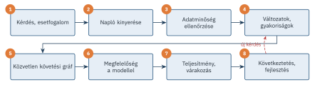
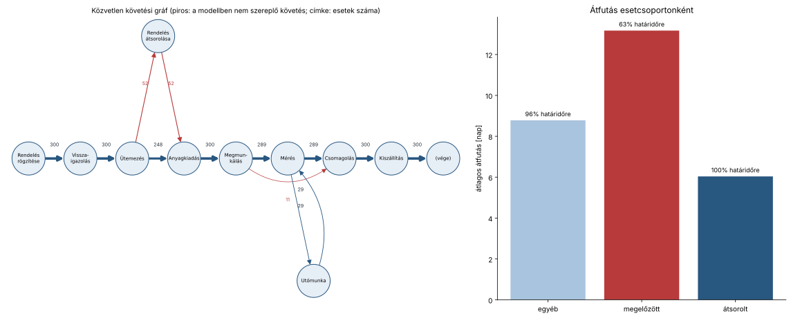

# Folyamatbányászat alapjai {#sec-folyamatbanyaszat}

::: {.cel title="Eszközkártya"}
- **Mire való?** Az informatikai rendszerek (ERP, MES, ügyviteli rendszerek) eseménynaplóiból a valóságban futó folyamat feltárása: változatok, közvetlen követések, eltérések a folyamatmodelltől, várakozások és átfutási idők.
- **Tanulási eredmény:** az eszközlap feldolgozása után képes leszel eseménynaplóból folyamatmodellt feltárni, és összevetni a tényleges folyamatot az előírt modellel.
- **V-lépés:** 9. Üzemeltetés és folyamatos fejlesztés; az üzem közbeni validáció és a folyamat újratervezésének bemenete.
- **Bemenet:** eseménynapló esetazonosítóval, tevékenységgel és időbélyeggel (lehetőleg erőforrással), a folyamatmodell (például BPMN), az esetek jellemzői (határidő, típus).
- **Kimenet:** adatminőségi jelentés, változatok, közvetlen követési gráf, a modelltől eltérő esetek, teljesítménymutatók esetcsoportonként, fejlesztési javaslatok.
- **Időigény:** a napló kinyerése és tisztítása gyakran napokig tart; az elemzés kész napló esetén néhány óra.
- **Kézikönyv:** [20. fejezet](../../kezikonyv/fejezetek/20-bpmn.html), 20.6. szakasz; [25. fejezet](../../kezikonyv/fejezetek/25-uzemeltetes.html), 25.6. szakasz.
:::

## Mikor használd?

- **Ha egy folyamatot informatikai rendszer támogat**, és a lépések naplózódnak: a napló objektív képet ad arról, hogyan működik valójában a folyamat [@vanderaalst2016].
- **Bevezetés után**, a tervezett (BPMN-) modell és a valóság összevetésére ([-@sec-bpmn]. eszközlap).
- **Ha a teljesítmény nem éri el a célt**, és meg kell találni, mely változatok, lépések vagy erőforrások okozzák a késést.
- **Az üzem közbeni validációban**: a ki nem mondott elvárások és a megkerülő megoldások a naplóban látszanak (kézikönyv [24. fejezet](../../kezikonyv/fejezetek/24-validacio.html)).
- **Kevésbé alkalmas**, ha a folyamat lépései nem naplózódnak, vagy ha az esetfogalom nem határozható meg egyértelműen; ilyenkor a megfigyelés és az interjú a jobb eszköz ([-@sec-folyamatabra-vsm]. eszközlap).

## Lépések

{#fig-lepesek-folyamatbanyaszat width=100%}

1. **Fogalmazd meg a kérdést, és határozd meg az esetet.** Mi egy eset (rendelés, ügyfél, termék)? Mire keresünk választ (késés, eltérés, szűk keresztmetszet)?
2. **Nyerd ki a naplót**: esetazonosító, tevékenység, időbélyeg, erőforrás; ha több rendszerből jön, kapcsold össze az esetazonosítóval.
3. **Ellenőrizd az adatminőséget**: hiányzó és rossz sorrendű időbélyegek, eltérő tevékenységnevek, hiányos esetek [@vanderaalst2016].
4. **Tárd fel a változatokat és a gyakoriságokat**: hány különböző útvonal van, és melyek a leggyakoribbak.
5. **Rajzold meg a közvetlen követési gráfot** gyakoriságokkal és várakozási időkkel (feltárás).
6. **Vesd össze a modellel** (megfelelőség-ellenőrzés): mely esetek térnek el, és hol.
7. **Elemezd a teljesítményt**: átfutás, várakozás, határidő-tartás esetcsoportonként és erőforrásonként (bővítés).
8. **Vonj le következtetést**: a modellt, a szabályokat vagy a folyamatot kell-e módosítani, és mit kell mérni a változás után.

## Kidolgozott példa: a ForgácsTech MES-naplója

A MES első három hónapjának naplója 300 rendelést és 2499 eseményt tartalmaz (a példában szimulált adatok; kézikönyv [20. fejezet](../../kezikonyv/fejezetek/20-bpmn.html)). Az adatminőség rendben van: nincs hiányzó vagy rossz sorrendű időbélyeg, minden tevékenységnév egységes. A rendelések 89,3%-a teljesült határidőre.

**Feltárás és megfelelőség.** A közvetlen követési gráfban két, a jövőbeli modellben nem szereplő útvonal jelenik meg ([-@fig-folyamatbanyaszat]. ábra): a rendelések 17,3%-ánál (52 eset) az ütemezés után „rendelés átsorolása” következik, 11 esetnél pedig a megmunkálás után a mérés kimarad, és a rendelés közvetlenül a csomagolásra kerül. A modelltől eltérő esetek aránya 20,3%.

**Teljesítmény és erőforrás-nézőpont.** Az erőforrás-nézőpontból a csapat megvizsgálta, mely rendeléseket előzték meg ugyanazon a gépen az átsorolt rendelések ([-@tbl-folyamatbanyaszat]. táblázat).

| Esetcsoport | Esetek | Átlagos átfutás [nap] | Határidőre |
|:--|--:|--:|--:|
| átsorolt | 52 | 6,0 | 100% |
| megelőzött (egy átsorolt rendelés ugyanazon a gépen előbb került sorra) | 65 | 13,2 | 63% |
| egyéb | 183 | 8,8 | 96% |
| összesen | 300 | 9,3 | 89% |

: A ForgácsTech rendeléseinek átfutása és határidő-tartása esetcsoportonként. {#tbl-folyamatbanyaszat tbl-colwidths="[52,12,20,16]"}

{#fig-folyamatbanyaszat width=100%}

**Tanulságok:**

- **A napló a valós folyamatot mutatja.** Az átsorolás a jövőbeli modellben nem szerepelt, a gyakorlatban azonban minden hatodik rendelésnél megtörtént.
- **Az átsorolás nem szünteti meg a késést, csak áthelyezi.** Az átsorolt rendelések mind határidőre teljesültek, a megelőzött rendelések átfutása viszont több mint négy nappal hosszabb, és több mint harmaduk késett; egy megelőzött rendelést átlagosan csaknem két munkanapnyi átsorolt megmunkálás előzött meg.
- **A kimaradt mérés minőségi kockázat.** Ez nem hatékonysági, hanem megfelelőségi kérdés: a 11 esetet egyenként ki kell vizsgálni.
- **A következtetés a modellre is vonatkozik.** A csapat az átsorolást beépítette a modellbe, és szabályhoz kötötte; a mérés kihagyását a MES-ben megakadályozta.

## Sablon és notebook

- [folyamatbanyaszat_sablon.xlsx](../sablonok/folyamatbanyaszat_sablon.xlsx): „Napló” (eseménynapló a kötelező oszlopokkal és adatminőségi jelzőkkel: ismeretlen tevékenységnév, időrend hiba, a következő tevékenység és annak megfelelősége a modellel), „Esetek” (határidő, átfutás, késés, átsorolás, eltérés esetenként), „Tevékenységek” (gyakoriság, átlagos időtartam, az esetek aránya), „Modell” (a megengedett közvetlen követések), „Követések” (közvetlen követési mátrix, pirossal a modellben nem szereplő követések) és „Összesítés” lap. A ForgácsTech szimulált naplójával kitöltve.
- [folyamatbanyaszat.ipynb](../notebookok/folyamatbanyaszat.ipynb) · [Megnyitás Google Colabban](folyamatbanyaszat.ipynb): adatminőség, változatok, közvetlen követési gráf várakozási időkkel, megfelelőség-ellenőrzés, teljesítmény esetcsoportonként és az erőforrás-nézőpontú elemzés (a [-@fig-folyamatbanyaszat]. ábra így készült). A haladó algoritmusokhoz (folyamatmodell automatikus feltárása, tokenalapú visszajátszás, igazítás) a `pm4py` könyvtár ajánlott [@berti2019pm4py].

## Előnyök és korlátok

| Előnyök | Korlátok |
|:--|:--|
| Objektív, teljes képet ad a valós folyamatról, nem csak a mintáról vagy a megkérdezettek emlékezetéről [@vanderaalst2016] | Csak a naplózott lépéseket látja; a rendszeren kívüli munka (telefon, papír) rejtve marad |
| Megmutatja a változatokat, a megkerülő megoldásokat és a modelltől való eltéréseket | Az eredmény a napló minőségén és az esetfogalom helyességén múlik [@vanderaalst2016] |
| A teljesítményt esetcsoportonként és erőforrásonként is elemezhetővé teszi | A napló személyes adatokat tartalmazhat; a célt és az adatkezelést előre rögzíteni kell |
| A változtatás után ugyanazzal a módszerrel mérhető a hatás | Az okokat nem magyarázza meg; az eltérések értelmezéséhez a folyamat szereplőit is meg kell kérdezni |

: A folyamatbányászat előnyei és korlátai. {tbl-colwidths="[50,50]"}

::: {.hiba}
- **Rossz esetfogalom.** Ha egy rendelés több tételből áll, és a napló tételenként rögzít, a rendelés mint eset összekeverheti a párhuzamos tételeket.
- **Tisztítatlan napló.** A különböző néven rögzített azonos tevékenységek („Mérés”, „3D mérés”, „Ellenőrzés”) hamis változatokat hoznak létre.
- **Az eltérés mint hiba.** A modelltől eltérő eset nem feltétlenül hibás; lehet, hogy a modell hiányos. Mindkét irányt meg kell vizsgálni.
- **A spagettimodell.** Sok változatnál a közvetlen követési gráf áttekinthetetlen; szűrni kell gyakoriságra, időszakra vagy esetcsoportra.
- **Személyes adatok kezelése.** Az erőforrás-oszlop nevekre is utalhat; az elemzés célját és az adatkezelés módját előre rögzíteni kell (kézikönyv [20. fejezet](../../kezikonyv/fejezetek/20-bpmn.html)).
:::

## Mintapromptok

::: {.prompt title="Mintaprompt: tevékenységnevek egységesítése"}
```text
A naplóban szereplő tevékenységnevek és gyakoriságaik: [LISTA].
Feladat: javasolj egységes tevékenységneveket (legfeljebb 15), és add
meg a régi → új hozzárendelést táblázatban. Jelöld azokat a neveket,
amelyek két különböző tevékenységet is jelenthetnek, és azokat,
amelyeket nem tudsz egyértelműen besorolni. Ne vonj össze olyan
neveket, amelyek eltérő erőforráshoz tartoznak, kérdés nélkül.
```
:::

::: {.prompt title="Mintaprompt: eltérések értelmezése"}
```text
A modellben nem szereplő közvetlen követések gyakoriságokkal:
[TÁBLÁZAT]; a teljesítmény esetcsoportonként: [TÁBLÁZAT]; a folyamat
rövid leírása: [LEÍRÁS].
Feladat: minden eltérésre fogalmazz meg két-három lehetséges
magyarázatot (hiányos modell, megkerülő megoldás, adatminőségi hiba),
és mindegyikhez azt, milyen további adattal vagy kérdéssel lehet
eldönteni. Javaslatot csak a magyarázat igazolása után tegyél.
```
:::

## Feladat

::: {.projekt title="Választható feladat: folyamatbányászat"}
Ha a projektedhez tartozó folyamatot informatikai rendszer támogatja, nyerj ki vagy állíts össze egy legalább 50 esetből álló eseménynaplót (szimulált napló is elfogadható, ha leírod, hogyan készült). Ellenőrizd az adatminőséget a sablonnal, rajzold meg a közvetlen követési gráfot a notebookkal, vesd össze a BPMN-modelleddel, és fogalmazz meg legalább két következtetést a modellre vagy a folyamatra.
:::
