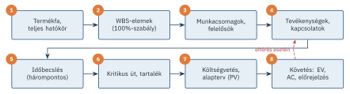
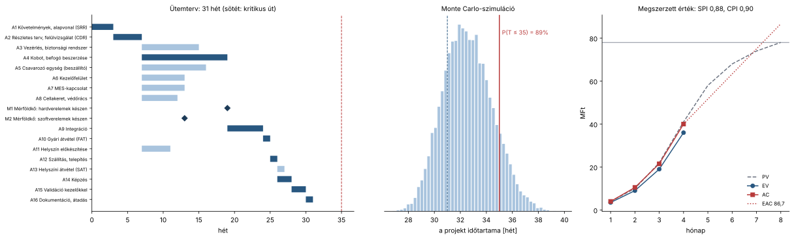

# Munkalebontási struktúra (WBS) {#sec-wbs}

::: {.cel title="Eszközkártya"}
- **Mire való?** A projekt teljes munkájának termékorientált, hierarchikus felosztása felelősökhöz és költségekhez rendelt munkacsomagokra; erre épül a hálós ütemterv a kritikus úttal, a határidő teljesülésének valószínűsége és a teljesítmény követése a megszerzett érték módszerével.
- **Tanulási eredmény:** az eszközlap feldolgozása után képes leszel termékorientált WBS-t készíteni a 100%-szabály szerint, a munkacsomagokhoz költséget és felelőst rendelni, és megszerzett érték módszerével követni az előrehaladást.
- **V-lépés:** átívelő. Az első változat a koncepciós szakaszban készül, az alapterv a követelmények és az architektúra alapvonalba helyezésekor; utána havonta frissül.
- **Bemenet:** termékfa (architektúra), a szállítandó termékek listája, a rendszermérnöki irányítási terv (SEMP), idő- és költségbecslések, a jóváhagyott határidő és keret.
- **Kimenet:** WBS kódokkal, felelősökkel és költségekkel; hálós ütemterv kritikus úttal és tartalékokkal; a határidő teljesülésének valószínűsége; költségalapterv (PV-görbe); havi megszerzettérték-jelentés.
- **Időigény:** egy 20–30 munkacsomagos projekt első WBS-e és ütemterve fél–egy nap; a havi frissítés 1–2 óra.
- **Kézikönyv:** [26. fejezet](../../kezikonyv/fejezetek/26-menedzsment.html).
- **Továbbolvasás:** [@nasa2016seh, 6.1. szakasz és B függelék].
:::

## Mikor használd?

- **A projekt indításakor**, a rendszermérnöki irányítási tervvel együtt: a WBS, az ütemterv és a költségvetés egymástól kölcsönösen függ, és együtt kell kezelni őket [@fleming2010].
- **Ha több szervezet vagy beszállító dolgozik a projekten**: a WBS a felelősség és az elszámolás közös kerete; mutatja, hogyan gyűjtik, összesítik és jelentik a költség-, ütemezési és műszaki adatokat [@pmi2019wbs].
- **Ha a határidő kockázatos**: a hárompontos becslésből és a szimulációból kiderül, mekkora eséllyel tartható a határidő, és mely tevékenységek döntik el.
- **A végrehajtás alatt havonta**: a megszerzett érték módszere az ütemezési és a költségeltérést együtt, korán jelzi [@fleming2010].
- **Kevésbé szükséges** rövid, néhány fős, egyszakaszos feladatnál. Agilis szoftverfejlesztésben a rangsorolt teendőlista és a sprintek kiválthatják a WBS alsó szintjeit [@schwaber2020], de hardvert is tartalmazó, hibrid projektekben a felső szintek és a költségkeret akkor is kellenek ([26. fejezet](../../kezikonyv/fejezetek/26-menedzsment.html)).

## Lépések

{#fig-lepesek-wbs width=100%}

1. **Indulj a termékfából, és határold le a teljes hatókört.** A WBS a végtermékek előállításához szükséges hardver, szoftver, szolgáltatások, adatok és létesítmények termékorientált, hierarchikus felosztása [@milstd881f]. A termékfa elemei mellé vedd fel a „láthatatlan” munkát is: projektirányítás, rendszermérnöki munka, integráció, verifikáció, validáció, telepítés, képzés, dokumentáció.
2. **Bontsd WBS-elemekre a 100%-szabály szerint.** Minden szint pontosan a felette álló elem teljes munkáját tartalmazza, se többet, se kevesebbet; a testvérelemek nem fedik át egymást [@pmi2019wbs]. Az elemek nevei termékek vagy eredmények (főnevek), nem tevékenységek.
3. **Jelöld ki a munkacsomagokat és a felelősöket.** A legalsó szint elemei önállóan tervezhetők, becsülhetők és követhetők, és mindegyiknek egy felelőse van. A kódolás (1, 1.1, 1.1.1) a költségek összesítésének alapja.
4. **Bontsd tevékenységekre, és add meg a kapcsolatokat.** A munkacsomagokból tevékenységek lesznek; a leggyakoribb a befejezés–kezdés kapcsolat. A felülvizsgálatok és az átvételek mérföldkövek (nulla időtartamú tevékenységek).
5. **Becsüld meg az időket három ponttal.** Optimista ($o$), legvalószínűbb ($m$) és pesszimista ($p$) idő; ebből a PERT a várható időt és a szórást közelíti ([-@eq-pert]. egyenlet) [@malcolm1959].
6. **Számold ki a kritikus utat és a tartalékokat.** Előre haladva a legkorábbi, visszafelé a legkésőbbi kezdési időket; a tartalék ezek különbsége, a kritikus út a nulla tartalékú tevékenységek sorozata [@kelley1959]. A kritikus út a projekt során változik, ezért folyamatosan figyelni kell.
7. **Készítsd el a költségvetést és az alaptervet.** A munkacsomagok költségét az ütemterv szerint időben elosztva kapod a tervezett érték (PV) görbéjét; ez a teljesítménymérés alapterve [@fleming2010].
8. **Kövesd havonta a megszerzett értéket.** Az elvégzett munka tervezett költsége (EV), a tényleges költség (AC) és a tervezett érték (PV) összevetéséből az ütemezési és a költséghatékonysági index, valamint a befejezéskori költség előrejelzése adódik [@fleming2010]. Jelentős eltérésnél újra kell tervezni.

A klasszikus PERT közelítése a $K$ kritikus út tevékenységeire:

$$
t_e = \frac{o + 4m + p}{6}, \qquad \sigma = \frac{p - o}{6}, \qquad
P(T \le T_{\text{cél}}) \approx \Phi\!\left(\frac{T_{\text{cél}} - \sum_{i \in K} t_{e,i}}{\sqrt{\sum_{i \in K} \sigma_i^2}}\right)
$$ {#eq-pert}

ahol $\Phi$ a standard normális eloszlásfüggvény [@malcolm1959]. A közelítés csak a determinisztikus kritikus úttal számol, ezért a Monte Carlo-szimuláció pontosabb: minden futásban újrasorsolja az időket, és újraszámolja a kritikus utat.

## Kidolgozott példa: a KoboCella-projekt

A KoboCella-projekt WBS-e négy felső szintű elemből és 18 munkacsomagból áll: projektirányítás és rendszermérnökség 8 MFt, a cella 52 MFt, integráció, verifikáció és validáció 10 MFt, telepítés és átadás 8 MFt, összesen 78 MFt ([26. fejezet](../../kezikonyv/fejezetek/26-menedzsment.html)). A 100%-szabályt a sablonban képlet ellenőrzi: minden szülőelem költsége a munkacsomagjainak összege.

Az ütemterv 18 tevékenységből áll. A legvalószínűbb időkkel a projekt 31 hét; a jóváhagyott időtartam 35 hét (nyolc hónap). A kritikus út: követelmények és alapvonal → részletes terv → a kobot és a befogó beszerzése (12 hét) → a hardverelemek mérföldköve → integráció → gyári átvétel → szállítás és telepítés → képzés → validáció a kezelőkkel → átadás. A csavarozó egység beszerzésének 3, a vezérlésnek 4 hét tartaléka van.

A négy hét tartalék kevésbé megnyugtató, mint amilyennek látszik. A PERT szerint a várható időtartam 32,6 hét, a szórás 1,77 hét, a határidő teljesülésének valószínűsége 91,4%. A 20 000 futásos Monte Carlo-szimuláció 89,0%-ot ad; a futások 80%-ában a projekt 34,2 héten belül elkészül ([-@fig-wbs]. ábra). A különbség oka, hogy a PERT csak egyetlen kritikus úttal számol, és figyelmen kívül hagyja, hogy a párhuzamos, közel kritikus utak is meghosszabbíthatják a projektet; ezért a klasszikus PERT-becslés optimista [@maccrimmon1964]. A legvalószínűbb időkből számolt 31 hetet a futásoknak csak 21%-a tartotta: a legvalószínűbb idők összege nem a legvalószínűbb projektidőtartam.

| Mutató | Képlet | Érték (4. hónap) | Értelmezés |
|:--|:--|--:|:--|
| ütemezési eltérés | SV = EV − PV | −5,0 MFt | a tervezettnél kevesebb munka készült el |
| költségeltérés | CV = EV − AC | −4,0 MFt | az elvégzett munka többe került a tervezettnél |
| ütemezési index | SPI = EV/PV | 0,88 | a tervezett ütem 88%-ával halad |
| költséghatékonysági index | CPI = EV/AC | 0,90 | 1 Ft-ért 0,90 Ft értékű munka készül |
| befejezéskori költség | EAC = BAC/CPI | 86,7 MFt | ha a költséghatékonyság nem javul |
| befejezéskori költség | EAC = AC + (BAC − EV) | 82,0 MFt | ha a hátralévő munka a tervezett költséggel készül |

: A KoboCella-projekt megszerzettérték-mutatói a negyedik hónap végén (PV = 41, EV = 36, AC = 40, BAC = 78 MFt) [@fleming2010]. {#tbl-wbs-evm tbl-colwidths="[22,24,16,38]"}

A negyedik hónap végén a projekt késésben van, és a vártnál drágábban halad ([-@tbl-wbs-evm]. táblázat). A két előrejelzés közötti különbség a feltevésben van: az első szerint a mostani költséghatékonyság folytatódik, a második szerint az eddigi túllépés egyszeri volt. A kézikönyv szerint a késés oka a kobot beszállítójának kéthetes csúszása, a többletköltségé a kockázatértékelés után előírt kiegészítő biztonsági berendezés volt; az előbbi közvetlenül a kritikus utat érinti.

{#fig-wbs width=100%}

**Tanulságok:**

- **A tartalék nem biztonság.** A négy hét tartalék ellenére a határidő a futások 11%-ában csúszik, mert a tevékenységidők bizonytalanok és jobbra ferdék.
- **A kritikus út a beszerzésen át vezet.** A beszállítói határidők követése itt fontosabb, mint a belső fejlesztési feladatoké; a kritikussági index ezt számszerűen is mutatja (a kobot beszerzése a futások 98%-ában kritikus).
- **A „láthatatlan” munka nagy.** Az integráció, a verifikáció és a validáció, valamint a telepítés és az átadás (benne a képzés és a dokumentáció) együtt a költségvetés 23%-a; WBS nélkül ezek könnyen kimaradnak a tervből.
- **Az elköltött pénz nem elvégzett munka.** A tényleges költség (40 MFt) közel van a tervezett értékhez (41 MFt), mégis késés és túlköltés van: ezt csak a megszerzett érték mutatja meg.

## Sablon és notebook

- [wbs_sablon.xlsx](../sablonok/wbs_sablon.xlsx): „WBS” lap legfeljebb 60 elemmel, a szint, a szülő és a munkacsomagok képlettel való felismerésével, költség- és megszerzettérték-összesítéssel és a 100%-szabály ellenőrzésével; „Ütemezés” lap legfeljebb 40 tevékenységgel és tevékenységenként legfeljebb négy előzménnyel: legkorábbi és legkésőbbi időpontok, tartalék, kritikus út, PERT-valószínűség és Gantt-rács; „Megszerzett érték” lap havi PV-, EV- és AC-értékekkel, a mutatókkal és diagrammal. A KoboCella példájával kitöltve.
- [wbs.ipynb](../notebookok/wbs.ipynb) · [Megnyitás Google Colabban](wbs.ipynb): a 100%-szabály ellenőrzése, kritikus út módszer, klasszikus PERT, Monte Carlo-szimuláció PERT-béta eloszlással, kritikussági index és megszerzettérték-elemzés két előrejelzéssel (a [-@fig-wbs]. ábra így készült).

## Előnyök és korlátok

| Előnyök | Korlátok |
|:--|:--|
| A teljes hatókört lefedi; a 100%-szabály miatt munka nem marad ki, és nem szerepel kétszer [@pmi2019wbs] | Csak olyan jó, mint a termékfa: hiányos architektúrából hiányos WBS lesz |
| Közös keretet ad a felelősségnek, a költségnek, az ütemezésnek és a jelentéseknek [@pmi2019wbs] | A túl részletes WBS adminisztrációs teher, és lassítja a változtatásokat |
| A kritikus út megmutatja, mely tevékenységek csúszása késlelteti a projektet [@kelley1959] | Determinisztikus időkkel számolva elrejti a bizonytalanságot |
| A hárompontos becslés és a szimuláció valószínűséget ad a határidőre [@malcolm1959] | A becslések szubjektívek; a klasszikus PERT egyetlen kritikus utat feltételez, ezért optimista [@maccrimmon1964]; a tevékenységek függetlensége sem mindig teljesül |
| A megszerzett érték az ütemezést és a költséget együtt méri, és korai előrejelzést ad [@fleming2010] | Az elkészültség becslése szubjektív lehet; előre rögzített mérési szabály kell (például mérföldkövek vagy 0/100) [@fleming2010] |

: A munkalebontás, a hálós ütemezés és a megszerzett érték előnyei és korlátai. {tbl-colwidths="[50,50]"}

::: {.hiba}
- **Tevékenységlista WBS helyett.** Az igékből álló lista nem garantálja a teljességet; a WBS elemei termékek és eredmények.
- **Kimaradt „láthatatlan” munka.** Az integráció, a verifikáció, a képzés, a dokumentáció és a projektirányítás gyakran hiányzik a tervből és a költségvetésből.
- **A legvalószínűbb idők összege mint határidő.** A példában ez az időtartam a szimulációs futások csak 21%-ában teljesült.
- **Tartalék minden tevékenységbe elosztva.** A rejtett tartalékok elfogynak, és nem látszik, hol van valódi kockázat; a tartalékot láthatóan, a projekt vagy a mérföldkövek szintjén érdemes kezelni.
- **Elköltött pénz mint előrehaladás.** Az AC és a PV összevetése nem mutatja a késést; az EV kell hozzá.
- **Terv a fiókban.** A frissítés nélküli ütemterv és költségvetés elavul, és a projekt észrevétlenül ellenőrizetlen állapotba csúszhat.
:::

## Mintapromptok

::: {.prompt title="Mintaprompt: WBS-tervezet a termékfából"}
```text
Termékfa: [A RENDSZER ELEMEI HIERARCHIÁBAN].
Szállítandó eredmények: [TERMÉKEK, DOKUMENTUMOK, KÉPZÉS, ÁTVÉTELEK].
Feladat: javasolj legfeljebb háromszintű, termékorientált WBS-t
kódolással (1, 1.1, 1.1.1). Vedd fel a projektirányítást, a
rendszermérnöki munkát, az integrációt, a verifikációt, a validációt,
a telepítést, a képzést és a dokumentációt is. Ellenőrizd a
100%-szabályt, és jelöld az átfedéseket. Költséget és időt ne becsülj;
ahol a termékfából nem dönthető el valami, kérdezz.
```
:::

::: {.prompt title="Mintaprompt: a megszerzett érték értelmezése"}
```text
Havi adatok: [HÓNAP, PV, EV, AC], teljes költségvetés: [BAC],
a kritikus út tevékenységei: [LISTA], az eddigi események: [LEÍRÁS].
Feladat: számítsd ki az SV, CV, SPI, CPI és EAC értékét két
feltevéssel, és értelmezd őket. Sorold fel, milyen okok magyarázhatják
az eltéréseket, és milyen adatokkal ellenőrizhetők. Ne állapíts meg
okot bizonyíték nélkül, és jelezd, ha az EV mérési módja bizonytalan.
```
:::

## Feladat

::: {.projekt title="Választható feladat: a csapatprojekt terve"}
Készítsétek el a féléves csapatprojekt WBS-ét legalább három szinttel, a projekt tíz lépéséből és a zárójelentés fejezeteiből kiindulva ([-@tbl-projekt-lepesek]. táblázat). Bontsátok tevékenységekre, adjatok hárompontos becslést munkaórában, és a notebookkal becsüljétek meg, mekkora eséllyel készültök el a zárójelentés határidejéig, és mely tevékenységek kritikussági indexe a legnagyobb. A félév közepén végezzetek megszerzettérték-elemzést munkaórában számolva, és értelmezzétek az eredményt.
:::
