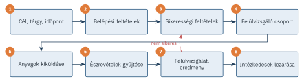

# Technikai felülvizsgálat lebonyolítása {#sec-felulvizsgalat}

::: {.cel title="Eszközkártya"}
- **Mire való?** Egy technikai felülvizsgálat (például követelmény-, előzetes vagy részletes tervfelülvizsgálat) vagy szakmai átvizsgálás előkészítése, lebonyolítása és lezárása: belépési és sikerességi feltételek, felülvizsgáló csoport, észrevételek, válaszok, intézkedések és az eredmény.
- **Tanulási eredmény:** az eszközlap feldolgozása után képes leszel egy technikai felülvizsgálatot belépési és sikerességi feltételekkel megtervezni, lebonyolítani, és az észrevételeket felelőssel és határidővel lezárni.
- **V-lépés:** átívelő; a szakaszhatárokon (alapvonalak előtt) és egy-egy munkatermék elkészültekor.
- **Bemenet:** a felülvizsgálat tárgya (dokumentumok, modellek, prototípusok), a belépési és sikerességi feltételek, a bírálók köre, az előző felülvizsgálat nyitott tételei.
- **Kimenet:** észrevételnapló súlyossággal, válasszal, felelőssel és határidővel; jegyzőkönyv az eredménnyel; a nyitott tételek követése a lezárásig.
- **Időigény:** az előkészítés 1–2 nap, a bírálóknak a dokumentumok átolvasása néhány óra, maga a felülvizsgálat fél–egy nap; az intézkedések lezárása heteket is igényelhet.
- **Kézikönyv:** [2. fejezet](../../kezikonyv/fejezetek/02-v-modell.html) (felülvizsgálatok az életciklusban) és [26. fejezet](../../kezikonyv/fejezetek/26-menedzsment.html).
- **Továbbolvasás:** [@nasa2016seh, 6.7. szakasz és N függelék].
:::

## Mikor használd?

- **A szakaszhatárokon**: a felülvizsgálatok azok a pontok, ahol a technikai mérőszámokat és trendjeiket a lehetséges problémák korai jelei után kutatva meg kell vizsgálni, és ahol eldől, hogy a projekt továbbléphet-e [@ieee15288_2_2014].
- **Egy-egy munkatermék elkészültekor**: a szakmai átvizsgálás (peer review) kisebb körben, részletesen vizsgál meg egy tervet, kódot vagy elemzést [@ieee1028_2008]. A formális átvizsgálás a hibákat a tesztelés előtt, olcsóbban tárja fel [@fagan1976].
- **Alapvonalba helyezés előtt**: a felülvizsgálat zárja le, hogy a dokumentum változtatása ettől kezdve konfigurációkezelés alá kerül ([-@sec-konfiguracio]. eszközlap).
- **Kevésbé szükséges** a napi szakmai egyeztetésekhez; ott elég egy rövid, dokumentált átnézés. A formális felülvizsgálat ott éri meg, ahol a hiba utólagos javítása drága.

A felülvizsgálatnak több fajtája van; az IEEE 1028 szabvány ötöt különböztet meg ([-@tbl-felulvizsgalat-tipusok]. táblázat) [@ieee1028_2008].

| Fajta | Fő kérdés | Jellemző résztvevők |
|:--|:--|:--|
| vezetői felülvizsgálat | Hol tart a munka a tervekhez képest, kell-e beavatkozni? | vezetők, projektvezető |
| technikai felülvizsgálat | Alkalmas-e a termék a rendeltetésére, eltér-e a specifikációtól és a szabványoktól? | szakértők, érdekelt felek képviselői |
| átvizsgálás (inspection) | Milyen hibák vannak a termékben? | képzett, független moderátor vezetésével a szerző kollégái |
| végigvezetés (walk-through) | Mit gondolnak a kollégák a megoldásról? | a szerző vezeti, a résztvevők kérdeznek és észrevételeznek |
| audit | Megfelel-e a termék vagy a folyamat a követelményeknek, szabványoknak, szerződésnek? | a projekttől független auditorok |

: A felülvizsgálatok fajtái [@ieee1028_2008 alapján]. {#tbl-felulvizsgalat-tipusok tbl-colwidths="[24,46,30]"}

## Lépések

{#fig-lepesek-felulvizsgalat width=100%}

1. **Rögzítsd a célt, a tárgyat és az időpontot.** Melyik felülvizsgálat ez, mit kell eldönteni rajta, mely dokumentumok és termékek a tárgyai [@ieee15288_2_2014].
2. **Határozd meg a belépési feltételeket.** Mi kell ahhoz, hogy a felülvizsgálat egyáltalán megtartható legyen: milyen dokumentumok, milyen érettségi szinten, mikorra kiküldve. Ha a feltételek nem teljesülnek, a felülvizsgálatot el kell halasztani.
3. **Határozd meg a sikerességi feltételeket.** Mit kell a felülvizsgálaton igazolni (például: az architektúra minden követelményt teljesíthet elfogadható kockázattal). A feltételeket előre, a dokumentumok ismerete előtt kell rögzíteni.
4. **Állítsd össze a felülvizsgáló csoportot.** A szakértők mellett az érdekelt felek képviselői és legalább egy, a projekttől független szakértő; a szerepek (vezető, jegyzőkönyvvezető, bírálók) legyenek tisztázva [@fagan1976].
5. **Küldd ki az anyagokat időben.** A bírálóknak a felülvizsgálat előtt el kell olvasniuk a dokumentumokat; a kiküldés határideje maga is belépési feltétel (a példában tíz nap).
6. **Gyűjtsd az észrevételeket.** Az észrevételek írásban, hivatkozással (dokumentum, fejezet), súlyossággal érkezzenek, lehetőleg a felülvizsgálat előtt, hogy a szerzők felkészülhessenek a válaszokra.
7. **Tartsd meg a felülvizsgálatot, és rögzítsd az eredményt.** A megbeszélés a súlyos és a vitatott észrevételekre összpontosít; a megoldás részleteit nem itt kell kidolgozni [@ieee1028_2008]. Az eredmény lehet sikeres, feltételesen sikeres vagy nem sikeres; a jegyzőkönyv rögzíti az eredményt, az ajánlásokat és az intézkedéseket [@ieee15288_2_2014].
8. **Zárd le az intézkedéseket.** Minden észrevételhez válasz, felelős és határidő tartozik; a lezárást a bíráló is elfogadja. A nyitott tételeket a következő felülvizsgálat belépési feltételei között ellenőrizni kell.

## Kidolgozott példa: a VárosiBringa előzetes tervfelülvizsgálata

A VárosiBringa előzetes tervfelülvizsgálatának nyolc belépési feltétele volt: a rendszerarchitektúra, az allokált követelmények nyomonkövetéssel, az interfészjegyzék, a dokkoló tervezési FMEA-ja, a kölcsönző alkalmazás első prototípusának használhatósági eredményei, az áthelyezési stratégia szimulációja, a dokumentumok kiküldése legalább tíz nappal előtte és a felülvizsgáló csoport kijelölése ([26. fejezet](../../kezikonyv/fejezetek/26-menedzsment.html)). Mind teljesült. Az öt sikerességi feltétel közül kettő csak részben: két állomáson nem volt igazolva, hogy a dokkoló mellett megmarad a kerekesszékhez szükséges járdaszélesség, és a téli üzemre nem készült forgatókönyv.

| Súlyosság | Nyitott | Folyamatban | Lezárt | Elutasított | Összesen |
|:--|--:|--:|--:|--:|--:|
| súlyos | 2 | 0 | 0 | 0 | 2 |
| közepes | 0 | 3 | 5 | 0 | 8 |
| kisebb | 0 | 0 | 9 | 0 | 9 |
| javaslat | 0 | 0 | 3 | 1 | 4 |
| **összesen** | **2** | **3** | **17** | **1** | **23** |

: A VárosiBringa előzetes tervfelülvizsgálatának észrevételei a május 18-i állapot szerint. {#tbl-felulvizsgalat-bringa tbl-colwidths="[24,15,15,15,16,15]"}

A felülvizsgálat feltételesen sikeres lett: a következő szakasz elkezdődhetett, de a két súlyos észrevételt felelőssel és határidővel le kellett zárni a részletes tervfelülvizsgálat előtt. A sablon a javasolt eredményt egyszerű szabállyal számolja: sikeres, ha minden sikerességi feltétel teljesül és nincs nyitott súlyos észrevétel; feltételesen sikeres, ha minden nyitott súlyos észrevételhez felelős és határidő tartozik; egyébként nem sikeres. A döntést a felülvizsgáló csoport hozza meg, a szabály csak az egységes indoklást segíti.

Egy hónappal később, a május 18-i állapot szerint 23 észrevételből 17 lezárult, egyet elutasítottak, ötöt még nem zártak le ([-@tbl-felulvizsgalat-bringa]. táblázat). Három nyitott tétel határideje lejárt, köztük az egyik súlyosé (a járdaszélesség helyszíni felmérése). Ez a projektvezetőnek szóló jelzés: vagy a felmérést kell gyorsítani, vagy a határidőt kell indoklással módosítani, de a tételt nem lehet szó nélkül továbbgörgetni. Az elutasított javaslat (szponzorációs felület a dokkolókon) indoklással került a naplóba: a városkép-védelmi szabályokkal ütközött.

**Tanulságok:**

- **A belépési feltétel védi a bírálók idejét.** Hiányos anyagokra épülő felülvizsgálat csak azt állapítja meg, hogy az anyag hiányos.
- **Az érdekelt felek képviselete számít.** A két súlyos észrevétel közül az egyiket az akadálymentességi képviselő, a másikat a független rendszermérnök tette.
- **A feltételes siker kötelezettség.** A nyitott súlyos tételeket felelőssel és határidővel kell követni; a lejárt határidő vezetői beavatkozást kíván.
- **A súlyos észrevétel mögött valós kockázat áll.** A téli forgatókönyv hiánya utólag különösen tanulságos volt: az első télen a dokkolók zárjai alacsony hőmérsékleten nem zártak, és a hibát 8D-folyamattal kellett felszámolni ([25. fejezet](../../kezikonyv/fejezetek/25-uzemeltetes.html)).

## Sablon

- [felulvizsgalat_sablon.xlsx](../sablonok/felulvizsgalat_sablon.xlsx): „Terv” lap a felülvizsgálat adataival, legfeljebb 15 belépési és 15 sikerességi feltétellel, színezett állapottal; „Észrevételek” lap legfeljebb 60 észrevétellel, legördülő súlyossággal és állapottal, a lejárt határidők automatikus jelzésével; „Összesítés” lap súlyosság és állapot szerinti összesítéssel, diagrammal, a megtarthatóság ellenőrzésével és a javasolt eredménnyel. A VárosiBringa példájával kitöltve.
- Ehhez az eszközhöz nem készült notebook: az észrevételek követése táblázatban a legegyszerűbb, és a felülvizsgálat értéke a szakmai tartalomban van, nem a számításban.

## Előnyök és korlátok

| Előnyök | Korlátok |
|:--|:--|
| Független szemmel, korán tárja fel a hibákat, amikor a javítás még olcsó [@fagan1976] | Időigényes; a jó bírálók ideje drága és szűkös |
| Az előre rögzített belépési és sikerességi feltételek tárgyilagossá teszik a döntést [@ieee15288_2_2014] | Túl általános feltételek mellett formalitássá válik |
| Az intézkedések felelőssel és határidővel dokumentáltak, a lezárás követhető | A felülvizsgálat pillanatfelvétel; a trendeket a havi technikai értékelés mutatja |
| Az érdekelt feleket strukturáltan bevonja | A bírálók csak azt látják, amit a dokumentumok tartalmaznak; ami hiányzik belőlük, könnyen rejtve marad |

: A technikai felülvizsgálat előnyei és korlátai. {tbl-colwidths="[50,50]"}

::: {.hiba}
- **Utólag megfogalmazott feltételek.** Ha a sikerességi feltételek a felülvizsgálaton születnek, a döntés nem tárgyilagos.
- **Késve kiküldött anyagok.** A bírálók felkészületlenül érkeznek, az észrevételek felületesek lesznek.
- **Megoldástervezés a felülvizsgálaton.** A megbeszélés a hibák és kockázatok feltárására való; a megoldást a felelős dolgozza ki [@ieee1028_2008].
- **Észrevétel felelős és határidő nélkül.** Az ilyen tételek nem zárulnak le, és a következő felülvizsgálaton újra előkerülnek.
- **A „feltételesen sikeres” mint „sikeres”.** A nyitott tételek követése nélkül a feltétel elveszíti az értelmét.
- **Csak belső bírálók.** Független szakértő és az érdekelt felek képviselői nélkül a csoport a saját vakfoltjait nem látja.
:::

## Mintapromptok

::: {.prompt title="Mintaprompt: belépési és sikerességi feltételek"}
```text
Felülvizsgálat: [FAJTÁJA, A PROJEKT SZAKASZA], tárgya: [DOKUMENTUMOK,
MODELLEK, PROTOTÍPUSOK], a projekt fő kockázatai: [LISTA].
Feladat: javasolj belépési feltételeket (mi kell a megtartáshoz,
milyen érettségi szinten) és sikerességi feltételeket (mit kell
igazolni). Minden feltétel legyen ellenőrizhető, és jelöld, milyen
bizonyíték igazolja. Jelezd, ha egy kockázathoz nem tartozik feltétel.
A projekt adatait ne egészítsd ki feltételezésekkel.
```
:::

::: {.prompt title="Mintaprompt: észrevételek rendezése"}
```text
Észrevételek: [AZONOSÍTÓ, DOKUMENTUM ÉS HELY, SZÖVEG, BÍRÁLÓ].
Feladat: csoportosítsd az észrevételeket témák szerint, jelöld az
ismétlődő vagy egymásnak ellentmondó tételeket, és javasolj
súlyosságot (súlyos, közepes, kisebb, javaslat) egy mondatos
indoklással. A súlyosságról és az eredményről a felülvizsgáló csoport
dönt; a javaslatod csak előkészítés. Ne fogalmazz meg megoldást.
```
:::

## Feladat

::: {.projekt title="Választható feladat: kölcsönös felülvizsgálat"}
Két csapat vizsgálja felül egymás követelményeit és működési koncepcióját (3. projektlépés). A szerző csapat előre rögzítse a belépési és a sikerességi feltételeket, és legalább egy héttel előtte küldje ki az anyagot; a bíráló csapat legalább tíz észrevételt adjon súlyossággal. Vezessétek a sablon „Észrevételek” lapját, válaszoljatok minden észrevételre, és egy héten belül zárjátok le a súlyos tételeket. A zárójelentésben röviden értékeljétek, mit tárt fel a felülvizsgálat.
:::
