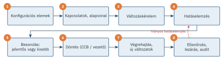
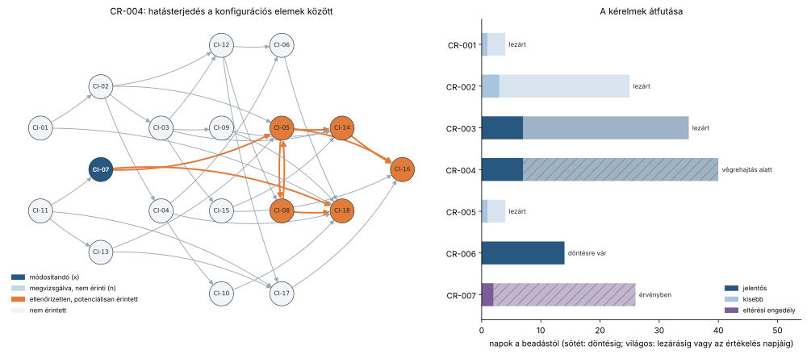

# Konfigurációkezelés és változáskérelem {#sec-konfiguracio}

::: {.cel title="Eszközkártya"}
- **Mire való?** A konfigurációs elemek (dokumentumok, szoftverek, hardverek, adatok, modellek) azonosítása és nyilvántartása, a köztük lévő hatáskapcsolatok rögzítése, a változáskérelmek besorolása, hatáselemzése, döntése és lezárása, valamint az eltérési engedélyek kezelése.
- **Tanulási eredmény:** az eszközlap feldolgozása után képes leszel konfigurációs elemeket azonosítani, egy változáskérelem hatását a kapcsolatok mentén elemezni, és a változást jelentős vagy kisebb osztályba sorolni.
- **V-lépés:** átívelő; az első alapvonaltól (a jóváhagyott követelményektől) az üzemeltetés végéig.
- **Bemenet:** a termékfa és a projekt dokumentumainak, szoftvereinek, rajzainak listája; az alapvonalak; a beérkező változtatási javaslatok.
- **Kimenet:** konfigurációs nyilvántartás változatokkal és felelősökkel; hatáskapcsolatok; változáskérelem-napló besorolással, döntéshozóval, állapottal és átfutással; a hiányos hatáselemzések listája.
- **Időigény:** az elemek és a kapcsolatok első felvétele 2–3 óra; egy kérelem hatáselemzése fél órától néhány napig tart.
- **Kézikönyv:** [26. fejezet](../../kezikonyv/fejezetek/26-menedzsment.html).
- **Továbbolvasás:** [@nasa2016seh, 6.5. szakasz].
:::

## Mikor használd?

- **Az első alapvonaltól kezdve**: a jóváhagyott követelmények, majd az architektúra, végül a termék dokumentációja csak szabályozott módon változhat. A konfigurációkezelés gondoskodik arról, hogy a termék konfigurációja ismert legyen, tükröződjön a termékinformációkban, és minden változás szabályozott legyen [@iso10007_2017].
- **Ha többen dolgoznak ugyanazokon az elemeken**: mindenkinek ugyanazt a jóváhagyott változatot kell használnia.
- **Ha egy változtatás „apróságnak” látszik**, de érintheti a biztonságot, az interfészeket vagy a képzést: a hatáselemzés derít fényt a rejtett következményekre.
- **Üzemeltetés alatt**: a karbantartáshoz, a pótalkatrészekhez és a hibaelemzéshez tudni kell, pontosan milyen konfigurációjú termék működik a helyszínen.
- **Kevésbé szükséges** rövid, egyszemélyes munkánál; ott a verziókezelés is elég. A szoftverek verziókezelése (például Git) a konfigurációkezelés eszköze, de nem helyettesíti a változások besorolását és a hatáselemzést.

A változás **jelentős** (I. osztályú) [@milhdbk61b], ha az alapvonal konfigurációs dokumentációját jelentősen érinti: utólagos átalakítást kíván a leszállított termékeken, vagy érinti a specifikációt, a költséget, a biztonságot, az interfésszel kapcsolódó termékekkel való összeférhetőséget, illetve a kezelők vagy karbantartók képzését. **Kisebb** (II. osztályú), ha a dokumentációt vagy a folyamatokat úgy javítja, hogy a cserélhetőséget nem érinti. Az **eltérési engedély** dokumentált megállapodás egy követelmény teljesítésének szándékos elengedéséről, és nem változtatja meg az alapvonalat [@milhdbk61b].

## Lépések

{#fig-lepesek-konfiguracio width=100%}

1. **Azonosítsd a konfigurációs elemeket.** Jelöld ki, mely dokumentumok, szoftverek, hardverelemek, adatok és modellek kerülnek konfigurációkezelés alá; adj nekik egyedi azonosítót, változatszámot, felelőst és tárolási helyet [@iso10007_2017].
2. **Rögzítsd a kapcsolatokat és az alapvonalakat.** Egy kapcsolat azt jelenti, hogy a forráselem módosítása után a célelemet ellenőrizni kell (például az interfészvezérlő dokumentum után a kezelőfelület-alkalmazást). Jelöld, melyik elem melyik alapvonal (funkcionális, allokált, termék) része.
3. **Fogadd a változáskérelmet.** Mit, miért és ki kér; milyen sürgős; változtatás vagy eltérési engedély.
4. **Végezd el a hatáselemzést.** Minden elemről döntsd el, hogy módosítani kell (x), vagy megvizsgáltad, és nem érinti (n). A kapcsolatok mentén ellenőrizd, hogy minden olyan elemet megvizsgáltál-e, amelyre egy módosítandó elem hat. A változások ugyanis láncszerűen terjedhetnek egyik elemről a másikra [@clarkson2004].
5. **Sorold be a változást.** Ha a hat hatásjellemző (specifikáció, költség, biztonság, interfész, képzés, leszállított termék) bármelyike érintett, a változás jelentős, egyébként kisebb [@milhdbk61b].
6. **Döntsetek.** A jelentős változásokról a konfigurációs bizottság (configuration control board, CCB) dönt, a kisebbekről a konfigurációs vezető. A döntést indoklással rögzítsd.
7. **Hajtsd végre, és helyezd alapvonalba az új változatokat.** Minden érintett elem új változata elkészül, felülvizsgálaton megy át, és bekerül a nyilvántartásba.
8. **Ellenőrizd, zárd le, auditáld.** A kérelem csak akkor zárható le, ha minden érintett elem új változata alapvonalba került, és a kapcsolódó teendők (például a képzés) megtörténtek. Az időszakos funkcionális audit azt igazolja, hogy a termék teljesíti a követelményeket, a fizikai audit azt, hogy a dokumentáció és a termék összhangban van [@milhdbk61b].

## Kidolgozott példa: a KoboCella konfigurációkezelése

A KoboCella 18 konfigurációs elemet tart nyilván: a követelményspecifikációt, az architektúrát, két interfészvezérlő dokumentumot (I-06, I-07), a kockázatértékelést és biztonsági igazolást, négy szoftvert (cellavezérlő, kobot, biztonsági vezérlő, kezelőfelület), a csavarozási paraméterkészletet, két rajzcsomagot, az FMEA-t, a kezelési útmutatót, a feladatelemzést, a képzési anyagot, a karbantartási utasítást és a verifikációs mátrixot. A köztük lévő 36 hatáskapcsolat közül a legtöbb (négy-négy) elemre az architektúra és a kezelőfelület interfészvezérlő dokumentuma hat; a verifikációs mátrixra hét elem hat, ezért szinte minden termékváltozás után ellenőrizni kell.

| Kérelem | Tárgy | Besorolás | Állapot | Nap | Nem vizsgált |
|:--|:--|:--|:--|--:|:-:|
| CR-001 | Mértékegység-elírás a követelményspecifikációban | kisebb | lezárt | 4 | 0 |
| CR-002 | Kopásálló betét a befogó ütközőjén | kisebb | lezárt | 25 | 0 |
| CR-003 | Második nyugtázó gomb a kezelői oldalon | jelentős (interfész, képzés) | lezárt | 35 | 0 |
| CR-004 | Kobotpálya módosítása a ciklusidő csökkentésére | jelentős (biztonság) | végrehajtás alatt | 40 | 2 / 5 |
| CR-005 | Elírások a kezelési útmutatóban | kisebb | lezárt | 4 | 0 |
| CR-006 | Szériaszám mező a csavarozási adatokban (I-07) | jelentős (interfész) | döntésre vár | 14 | 2 / 2 |
| CR-007 | Üzem MES-kapcsolat nélkül négy hétig | eltérési engedély | érvényben | 26 | – |

: A KoboCella változáskérelmei a május 18-i állapot szerint. A jelentős változásokról és az eltérési engedélyről a konfigurációs bizottság (CCB), a kisebbekről a konfigurációs vezető döntött. A napok lezárt kérelemnél az átfutást, nyitottnál a beadás óta eltelt időt jelentik; a nem vizsgált elemek száma: közvetlen hatás / teljes lánc. {#tbl-konfiguracio-kobo tbl-colwidths="[11,39,20,16,6,8]"}

A [-@tbl-konfiguracio-kobo]. táblázat három dolgot mutat. A második nyugtázó gomb (CR-003) a kézikönyvben leírt módon jelentős változás lett, mert a kezelők képzését és a kezelőfelület interfészvezérlő dokumentumát érintette; hét nap alatt döntöttek róla, de a lezárás 35 napig tartott, mert a nyolc érintett elem mindegyikének új változata kellett, és a kezelőket is ki kellett képezni ([26. fejezet](../../kezikonyv/fejezetek/26-menedzsment.html)). A kisebb változások átlagosan 1,7 nap alatt döntésre jutottak, a jelentősek 7 nap alatt; ez a besorolás célja: a kis ügyek ne terheljék a bizottságot.

A tanulságos eset a kobotpálya módosítása (CR-004). A technológus kérelme csak a kobotprogramot jelölte meg módosítandóként, és helyesen jelezte, hogy a változás a biztonságot érinti: kollaboratív üzemben a pálya és a sebesség megváltozása a kockázatértékelés felülvizsgálatát kívánja. A hatáselemzés mégsem vizsgálta meg a biztonsági igazolást. A sablon a kapcsolatok alapján két közvetlenül érintett, de meg nem vizsgált elemet jelez (a biztonsági igazolást és a verifikációs mátrixot); a notebook a teljes láncot is bejárja, és további hármat talál: ha a biztonsági igazolás változik, a biztonsági vezérlőt, a kezelési útmutatót és a képzési anyagot is ellenőrizni kell ([-@fig-konfiguracio]. ábra). A hatás azokon az elemeken áll meg, amelyeket valaki megvizsgált, és nem érintettnek talált; ezért kell a „nem érinti” döntéseket is rögzíteni.

{#fig-konfiguracio width=100%}

A notebook a besorolást is összeveti a hatáselemzéssel. A CR-004-nél a „biztonság: igen” jelöléshez nem tartozik megvizsgált biztonsági igazolás. A CR-001-nél fordított a helyzet: a követelményspecifikáció módosul, mégis kisebb a besorolás; ez itt helyes, mert csak egy mértékegység-elírást javítottak, de az indoklást rögzíteni kell. Az eltérési engedély (CR-007) a MES-interfész késése miatt négy hétre elengedi az adatátviteli követelményt; az alapvonal nem változik, a követelmény a határidő után ismét érvényes.

**Tanulságok:**

- **A besorolás nem a változtatás méretén múlik, hanem a hatásán.** Egy nyomógomb jelentős, egy rajzmódosítás kisebb lehet.
- **A hatáselemzés a kapcsolatok mentén halad.** A kérelmező a saját szakterületét látja; a kapcsolati táblázat a többiekét is az asztalra teszi.
- **A „nem érinti” is döntés.** Rögzítése nélkül később nem dönthető el, hogy egy elemet megvizsgáltak-e.
- **A kérelem lezárása a nyilvántartás frissítése.** A CR-003 akkor zárult le, amikor minden érintett elem új változata alapvonalba került, és a képzés megtörtént.

## Sablon és notebook

- [konfiguracio_sablon.xlsx](../sablonok/konfiguracio_sablon.xlsx): „Konfigurációs elemek” lap legfeljebb 25 elemmel, típussal, alapvonallal, változattal, állapottal, a nyitott kérelmek és a kapcsolatok számával; „Kapcsolatok” lap az elemek közötti hatáskapcsolatok mátrixával; „Változáskérelmek” lap legfeljebb 20 kérelemmel, hat hatásjellemzővel, automatikus besorolással, döntéshozóval, állapottal, átfutással és figyelmeztetéssel; „Hatásmátrix” lap a kérelmenkénti x/n jelölésekkel és a közvetlenül érintett, de meg nem vizsgált elemek automatikus jelzésével; „Összesítés” lap osztály és állapot szerinti összesítéssel, átfutási időkkel és diagrammal. A KoboCella példájával kitöltve.
- [konfiguracio.ipynb](../notebookok/konfiguracio.ipynb) · [Megnyitás Google Colabban](konfiguracio.ipynb): nyilvántartás és átfutási statisztika, a hatásterjedés kiszámítása a kapcsolatok gráfján a teljes láncra, a besorolás és a hatáselemzés összevetése két szabállyal (a [-@fig-konfiguracio]. ábra így készült).

## Előnyök és korlátok

| Előnyök | Korlátok |
|:--|:--|
| Mindenki ugyanazt a jóváhagyott változatot használja; a termék és a dokumentáció összhangban marad [@iso10007_2017] | Adminisztrációs teher; túl szigorú szabályozás lassítja a fejlesztést |
| A besorolás a bizottság figyelmét a valóban jelentős változásokra irányítja | A besorolás szakmai ítélet; a hatásjellemzők megítélése vitatható lehet |
| A hatáskapcsolatok rendszeres használata feltárja a láncszerűen terjedő hatásokat [@clarkson2004] | A kapcsolati táblázat minősége a hatáselemzés minőségének határa; hiányzó kapcsolatot az eszköz sem talál meg |
| A nyilvántartás és az átfutási adatok a folyamat fejlesztését is támogatják [@iso10007_2017] | Az egyszerű (igen/nem) kapcsolatok nem mutatják a hatás valószínűségét és nagyságát; erre a változás-előrejelzés módszerei valószínűségeket és hatásokat rendelnek a kapcsolatokhoz [@clarkson2004] |

: A konfigurációkezelés és a változáskérelem-kezelés előnyei és korlátai. {tbl-colwidths="[50,50]"}

::: {.hiba}
- **„Csak egy apró módosítás.”** A változtatás mérete nem mutatja a hatását; a besorolást a hatásjellemzők döntik el.
- **Hatáselemzés a kérelmező szakterületére szűkítve.** A kapcsolati táblázat nélkül a más szakterületet érintő következmények rejtve maradnak.
- **A „nem érinti” döntések rögzítésének hiánya.** Utólag nem dönthető el, hogy egy elemet megvizsgáltak-e.
- **Lezárás a végrehajtás után, de a nyilvántartás frissítése előtt.** A régi és az új változat egyszerre van forgalomban.
- **Eltérési engedély változtatás helyett.** Az ismétlődő eltérési engedély valójában a követelmény vagy a terv megváltoztatását jelzi, és azt a változáskezelésben kell rendezni.
- **Elavult kapcsolati táblázat.** Új elem felvételekor a kapcsolatait is rögzíteni kell.
:::

## Mintapromptok

::: {.prompt title="Mintaprompt: hatáselemzés előkészítése"}
```text
Konfigurációs elemek: [AZONOSÍTÓ, MEGNEVEZÉS, TÍPUS].
Hatáskapcsolatok: [FORRÁS -> CÉL LISTA].
Változáskérelem: [MIT, MIÉRT, MELY ELEMEKET JELÖLT MEG A KÉRELMEZŐ].
Feladat: sorold fel, mely elemekre hathat a változás közvetlenül és a
kapcsolatok láncán keresztül, és mit kell az egyes elemeknél
ellenőrizni. Jelöld, melyik hatásjellemzőt (specifikáció, költség,
biztonság, interfész, képzés, leszállított termék) érintheti. A
besorolásról a konfigurációs bizottság dönt; ne dönts helyette.
```
:::

::: {.prompt title="Mintaprompt: változáskérelem megfogalmazása"}
```text
Probléma vagy javaslat: [LEÍRÁS], érintett termék és változat:
[ELEMEK], a felismerés körülményei: [LEÍRÁS].
Feladat: fogalmazz meg változáskérelmet a következő szerkezetben:
cím, a jelenlegi állapot, a javasolt változás, az indoklás, a
várható előnyök, az ismert kockázatok, a módosítandó elemek, a
megvizsgálandó elemek, a sürgősség. Ahol adat hiányzik, jelöld
kérdésként; ne találj ki számokat.
```
:::

## Feladat

::: {.projekt title="Választható feladat: konfigurációkezelés a csapatprojektben"}
Vegyétek nyilvántartásba a csapatprojekt legalább tíz munkatermékét (például működési koncepció, követelménylista, minőségház, FMEA, folyamatmodell, verifikációs mátrix) változatszámmal és felelőssel, és rögzítsétek a köztük lévő hatáskapcsolatokat. A félév második felében fogalmazzatok meg legalább két változáskérelmet (például egy követelmény módosítását egy interjú vagy egy használhatósági próba után), végezzétek el a hatáselemzést a sablonnal, és a notebookkal ellenőrizzétek, nem maradt-e ki érintett munkatermék.
:::
