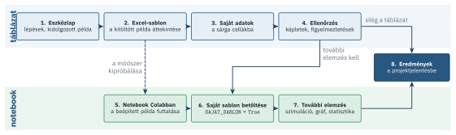

# Hogyan használd ezt az útmutatót? {.unnumbered}

::: {.callout-warning appearance="simple" icon=false}
## Fejlesztői előzetes – 2026. november

Mind az 55 eszközlap elkészült, 54 Excel-sablonnal és 46 Python-notebookkal. A szöveg, a sablonok és a notebookok kipróbálás alatt állnak; a hibákat és a javaslatokat köszönettel fogadjuk.
:::

A *Rendszermérnöki eszköztár* a [Rendszermérnökség – A rendszerfejlesztés útja a V-modell mentén](../kezikonyv/index.html) című kézikönyv párja. A kézikönyv elmagyarázza, *miért* és *mikor* van szükség egy-egy módszerre, és hogyan illeszkedik a fejlesztés folyamatába. Ez az útmutató azt mutatja meg, *hogyan* kell lépésről lépésre alkalmazni. Az eszközök a V-modell lépéseinek sorrendjében követik egymást, így egy fejlesztési projekt során elejétől a végéig használhatók. Egy-egy eszköz önállóan is elővehető.

Az útmutató ötvenöt eszköze a rendszermérnökség, a minőségügy, a döntéstámogatás, a biztonságtechnika, az emberközpontú tervezés és a folyamatmenedzsment bevált módszereit gyűjti össze, egységes leírásokkal. Minden eszközt az eredeti szakirodalma és a rá vonatkozó szabványok alapján mutatunk be, a mai gyakorlatnak megfelelően. A klasszikus eszközök egységes leírásainak jó gyűjteménye a NASA *System Engineering „Toolbox” for Design-Oriented Engineers* kiadványa [@goldberg1994toolbox] és a NASA rendszermérnöki kézikönyve [@nasa2016seh]; az eszközkártyák továbbolvasási sora megadja a kapcsolódó szakaszaikat. Az útmutató újdonságai:

- **ipari, szolgáltatási és informatikai példák:** minden eszközt a kézikönyv futó esettanulmányainak egyikén dolgozunk ki;
- **korszerű eljárások:** ahol a gyakorlat megváltozott, az újabb eljárást mutatjuk be, például a cselekvési prioritást az FMEA-ban;
- **tanulási eredmények:** minden eszközkártya rögzíti, mit kell tudnod az eszközlap feldolgozása után;
- **sablonok, notebookok, mintapromptok:** minden eszközhöz letölthető sablon, ahol érdemes, Python-notebook és a nagy nyelvi modellek felelős használatát segítő mintapromptok tartoznak.

## Az eszközlapok szerkezete

Minden eszközlap ugyanazt a szerkezetet követi, hogy könnyen eligazodj benne:

1. **Eszközkártya:**
    - mire való az eszköz;
    - mit fogsz tudni az eszközlap feldolgozása után (tanulási eredmény);
    - melyik V-lépésben használjuk;
    - mi kell hozzá, és mi lesz az eredménye;
    - mennyi időt igényel;
    - melyik kézikönyv-fejezet tárgyalja;
    - hol olvashatsz róla bővebben (továbbolvasás).
2. **Mikor használd?** Tipikus alkalmazási helyzetek és ellenjavallatok.
3. **Lépések:** folyamatábra és részletes, számozott lépésleírás.
4. **Kidolgozott példa:** az eszköz alkalmazása a kézikönyv futó esettanulmányainak egyikén.
5. **Sablon és eszközök:** letölthető Excel-sablon, szükség esetén Python-notebook.
6. **Előnyök és korlátok:** mire képes és mire nem.
7. **Gyakori hibák:** amit a tapasztalat szerint a leggyakrabban elrontunk.
8. **Mintapromptok:** hogyan segíthet egy nagy nyelvi modell, és mire kell figyelni.
9. **Feladat:** a féléves projekt soron következő lépése.

## Sablonok és notebookok

A sablonok Excelben és a vele kompatibilis táblázatkezelőkben (LibreOffice Calc, Google Táblázatok) is használhatók. A kitöltendő cellák sárga hátterűek, kék betűsek. A halványkék cellák képleteket tartalmaznak, ezeket nem kell, és nem is szabad felülírni. Minden sablon egy kitöltött példát is tartalmaz a kézikönyv futó eseteiből.

A Python-notebookok opcionálisak. Azoknak szólnak, akik a számításokat programozottan szeretnék elvégezni, nagyobb adatmennyiséggel dolgoznak, vagy olyan elemzésre van szükségük, amely táblázatban nehézkes (szimuláció, gráfbejárás, statisztikai próbák). Google Colabban telepítés nélkül futtathatók. Minden notebook a sablon kitöltött példájával indul; a saját adatokhoz a `SAJAT_SABLON` változót `True` értékre kell állítani, és fel kell tölteni a kitöltött sablont ([-@fig-sablon-munkafolyamat]. ábra).

{#fig-sablon-munkafolyamat width=100%}

A sablonok és a notebookok teljes listáját a [Sablonok és notebookok](fuggelek/a-sablonok.qmd) című függelék tartalmazza.

## Nagy nyelvi modellek használata

A mintapromptok abban segítenek, hogy egy nagy nyelvi modell (például ChatGPT, Claude vagy Gemini) **ellenőrző társként** dolgozzon veled. Ötleteket ad, hiányokat jelez, kérdéseket tesz fel. Három szabályt érdemes betartani:

- **A modell nem forrás.** Az érdekelt felek elvárásait, a műszaki adatokat és a szabványi előírásokat mindig az eredeti forrásból ellenőrizd.
- **Ne adj meg bizalmas adatot.** Személyes adatot, céges titkot vagy nem nyilvános dokumentumot ne illessz be nyilvános szolgáltatásba.
- **Jelöld a felhasználást.** A projektmunkában írd le, mire és hogyan használtál mesterséges intelligenciát.

## A féléves projekt

A következő fejezet a féléves csoportos projekt teljes útmutatója. A projekt a V-modell lépéseit járja végig egy szabadon választott fejlesztési feladaton, és az eszközlapok végén található feladatokból áll össze.
