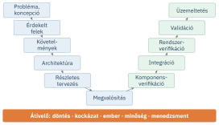
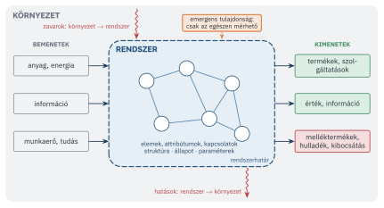
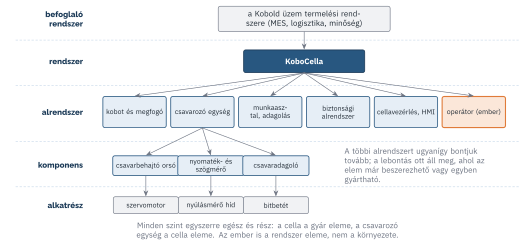
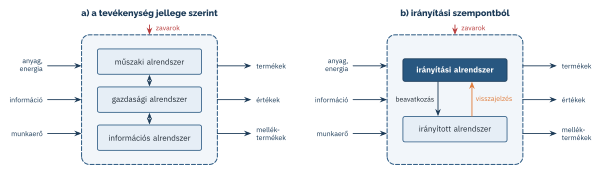
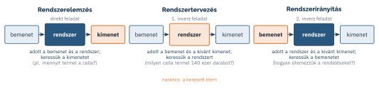
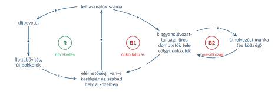

# Rendszerek és rendszerszemlélet {#sec-rendszerek}

::: {.vterkep}
{fig-alt="V-térkép: a fejezet a teljes V-modellt megalapozó fogalmakkal foglalkozik" width=62%}
:::

::: {.cel}
A fejezet feldolgozása után képes leszel:

- meghatározni, mi a rendszer, és felismerni egy rendszer elemeit, attribútumait, kapcsolatait, határát és környezetét;
- megmagyarázni, mit jelent az emergens tulajdonság, és miért nem vezethető le egy rendszer viselkedése pusztán az elemeiből;
- egy rendszert hierarchikus szintekre bontani, és elhelyezni egy befoglaló rendszerben;
- a műszaki–gazdasági rendszereket alrendszereikkel és irányítási szerkezetükkel leírni;
- megkülönböztetni az egyszerű, a bonyolult és a komplex rendszereket, valamint a rendszerelemzés, a rendszertervezés és a rendszerirányítás feladatát;
- ok-okozati hurokdiagrammal ábrázolni egy rendszer visszacsatolásait;
- elhatárolni egymástól a rendszerszemléletet, a rendszermérnökséget és a mérnöki rendszereket, és leírni a rendszermérnök szerepét és kompetenciáit.
:::

Ez a fejezet a könyv szókincsét alapozza meg. A V-modell minden lépése ([-@fig-v]. ábra) rendszerekről szól: a bal ágon egy még nem létező rendszert írunk le egyre részletesebben, a csúcson megépítjük az elemeit, a jobb ágon pedig ellenőrizzük, hogy az összerakott egész azt teszi-e, amit vártunk tőle. Ehhez közös nyelv kell. Mit nevezünk rendszernek? Hol van a határa? Miért viselkedik másként az egész, mint a részei? És mit csinál ebben a rendszermérnök?

A fejezet öt kérdésre épül:

- Mi a rendszer, és milyen általános tulajdonságai vannak?
- Hogyan épül fel egy rendszer, és hogyan illeszkedik nagyobb rendszerekbe?
- Miben különbözik egy gyártócella egy városi közlekedési szolgáltatástól, és mit jelent ez a tervezésre nézve?
- Miért kell a visszacsatolásokban gondolkodni?
- Mi a rendszermérnökség, és milyen szakember a jó rendszermérnök?

::: {.kitekintes title="Bemelegítő: a kilenc pont feladványa"}
Rajzolj fel kilenc pontot három sorban, három oszlopban. Kösd össze mind a kilencet négy egyenes vonallal úgy, hogy közben nem emeled fel a tollat. A legtöbben először sikertelenül próbálkoznak, mert hallgatólagosan feltételezik, hogy a vonalak nem léphetnek ki a pontok alkotta négyzetből. Ezt a feladat nem mondja. Amint elvetjük a képzelt határt, a megoldás kézenfekvő. Ha már ez megvan, próbáld meg három vonallal is!

A tanulság a rendszermérnökség egyik alapgondolata. A probléma határát mindig tudatosan kell kijelölni. Ha ezt nem tesszük meg, a fejünkben lévő, ki nem mondott határ korlátozza a megoldások körét. A rendszerhatár meghúzásával a [-@sec-modellek]. fejezet és a [-@sec-problema]. fejezet részletesen foglalkozik.
:::

## Mi a rendszer? {#sec-rsz-fogalom}

A „rendszer” szót mindenki használja, és mindenki mást ért rajta. A mérnöki gyakorlatban ezért pontos meghatározásokra támaszkodunk. A rendszer- és szoftvermérnöki életciklus-folyamatok nemzetközi szabványa szerint a rendszer egymással kölcsönhatásban álló elemek olyan együttese, amely egy vagy több kitűzött cél elérésére szerveződik. A szabvány azt is kiemeli, hogy az elemek sokfélék lehetnek: hardver, szoftver, adat, ember, folyamat, eljárás, létesítmény és anyag [@iso15288_2023].

A meghatározás fontos részlete, hogy az *emberek* és az *eljárások* is a rendszer elemei. Egy kollaboratív robotcella nem csak a robotból, a csavarozóból és a vezérlésből áll. Az operátor, a munkautasítás és a karbantartási eljárás ugyanúgy része, mint a szervomotor. Ha az embert a rendszer környezetének tekintjük, a tervezés éppen azt a kölcsönhatást hagyja ki, amelyen a teljesítmény sokszor múlik. Ezzel a gondolattal a könyv emberközpontú fejezetei ([-@sec-emberkozpontu]–[-@sec-emberi-hiba]. fejezet) részletesen foglalkoznak.

A Nemzetközi Rendszermérnöki Szövetség (INCOSE) 2019-ben két szinten fogalmazta meg a fogalmat [@incose2019def]. Az *általános* meghatározás szerint a rendszer részek vagy elemek olyan elrendeződése, amely együtt olyan viselkedést vagy jelentést mutat, amilyet az egyes összetevők külön nem. A *mérnöki rendszer* pedig olyan rendszer, amelyet úgy terveztek vagy alakítottak ki, hogy egy várható működési környezettel kölcsönhatásban egy vagy több kitűzött célt érjen el, miközben megfelel a rá vonatkozó korlátoknak. A mérnöki rendszer nem feltétlenül technikai: egy szolgáltatás vagy egy szervezet is lehet az, ha tudatosan, rendszermérnöki módszerekkel alakítják ki.

### Elemek, attribútumok, kapcsolatok

Blanchard és Fabrycky klasszikus tankönyve a rendszert három építőelemmel írja le [@blanchard2011]:

- **Komponensek (elemek):** a rendszer működő részei. Lehetnek fizikai tárgyak (motor, szenzor), szoftvermodulok, emberek vagy eljárások.
- **Attribútumok:** a komponensek és a rendszer jellemzői, amelyek leírják és mérhetővé teszik őket (tömeg, ciklusidő, megbízhatóság, ár, kezelhetőség).
- **Kapcsolatok:** a komponensek közötti kölcsönhatások. Ezeken keresztül áramlik az anyag, az energia és az információ.

A rendszert a **határa** választja el a **környezetétől**. A környezet az, amire a rendszer hat, és ami a rendszerre hat, de amit a fejlesztés során nem tervezünk meg. A határon lépnek be a **bemenetek** (anyag, energia, információ, munkaerő), és lépnek ki a **kimenetek** (termékek, szolgáltatások, érték, de melléktermékek és kibocsátások is). A környezet felől **zavarok** érik a rendszert, a rendszer pedig maga is hat a környezetére ([-@fig-rendszer-kornyezet]. ábra). A rendszer belső leírásához a Lakatos-jegyzet három fogalmat használ: a **struktúra** az elemek és kapcsolataik elrendeződése, az **állapot** a rendszer pillanatnyi helyzetét leíró változók összessége, a **paraméterek** pedig a működést meghatározó, (közel) állandó jellemzők [@lakatos_rendszerek].

{#fig-rendszer-kornyezet width=100%}

::: {.eset eset="C" title="ForgácsTech: mi a rendszer és mi a környezet?"}
A ForgácsTech digitális átállásánál az első vita arról szólt, mi tartozik a fejlesztendő rendszerhez. A tulajdonos szerint „a MES-szoftver”. A termelésvezető szerint „az egész műhely”. A beszélgetés végére a csapat a következő határt húzta meg:

- **A rendszer része:** a rendelés felvételétől a kész munkadarab kiszállításáig tartó információs és anyagáramlás. Ebbe beletartoznak a CNC-gépek adatkapcsolatai, a gyártáselőkészítés, a gépkezelők munkautasításai és a MES-szoftver.
- **A környezet része:** a vevők megrendelési rendszerei, a könyvelőiroda, a nyersanyag-beszállítók és a szerszámgépek gyártói. Ezekkel a rendszernek kapcsolatban kell állnia, de nem tervezzük újra őket.

A határ meghúzása döntés, nem felfedezés. Ugyanazt a műhelyt más fejlesztési célhoz másként határolnánk le. Egy energiahatékonysági projektben például a sűrítettlevegő-hálózat lenne a rendszer, a MES pedig a környezet.
:::

### Emergens tulajdonságok

A rendszerszemlélet talán legfontosabb gondolata, hogy az egész több, mint a részek összege. Maier és Rechtin rendszerarchitektúráról szóló könyvének egyik alapgondolata, hogy a rendszer hozzáadott értéke, amely túlmutat a részek önálló hozzájárulásán, elsősorban a részek közötti kapcsolatokból születik, vagyis abból, ahogyan a részeket összekapcsoljuk [@maier2009]. Az olyan tulajdonságot, amely csak az egész rendszeren jelenik meg, és egyik elemnek sincs meg külön, **emergens tulajdonságnak** nevezzük.

Néhány példa a futó esetekből:

- A KoboCella **ciklusideje** nem a robot sebességéből és nem az operátor ügyességéből adódik, hanem abból, hogyan osztják meg és hangolják össze a munkát. Egy gyorsabb robot semmit sem javít, ha az operátorra kell várnia.
- A VárosiBringa **elérhetősége** (van-e kerékpár a közelben, amikor kell) nem egy kerékpár vagy egy dokkoló tulajdonsága. A flotta, az állomáshálózat, a felhasználói viselkedés és az áthelyező szolgálat együttes eredménye.
- A **biztonság** is emergens tulajdonság. Egy alkatrész lehet megbízható, a rendszer mégis veszélyes lehet, ha az elemek kölcsönhatása váratlan állapotba viszi. Ezzel a gondolattal a [-@sec-biztonsag]. fejezet foglalkozik.

Az emergencia két irányban is figyelmeztet. A kívánt tulajdonságokat (teljesítmény, használhatóság, biztonság) nem lehet egy-egy elemre „rátervezni”: az elemek kapcsolatait kell tudatosan alakítani. A nem kívánt tulajdonságok (rezgés, holtpont, túlterhelt operátor) pedig gyakran csak az integráció során bukkannak fel. Ezért kell a V-modell jobb ágán lépésről lépésre integrálni és verifikálni ([-@sec-integracio]. fejezet).

### A rendszer általános tulajdonságai

A rendszerelméleti szakirodalom a rendszerek néhány általános tulajdonságát emeli ki [@bertalanffy1968; @lakatos_rendszerek]. Ezek egyben gondolkodási szabályok is a tervező számára.

- **A rendszer célorientált egység.** Van egy rendszeralkotó tényező, amelynek megvalósulása érdekében a rendszer működik. Mérnöki rendszernél ez a kitűzött cél. Ha a cél nem világos, a rendszer sem lesz az.
- **A rendszer egyszerre autonóm és heteronóm.** Vannak saját belső törvényszerűségei (autonóm), de működését a környezet is befolyásolja, és ő maga is hat a környezetére (heteronóm).
- **A rendszer tagolt egész.** Alrendszerekre és elemekre bontható, ezekből összeépíthető, és az elemek külön is vizsgálhatók. Az elemek tulajdonságai megjelennek a rendszerben, de az egésznek vannak olyan tulajdonságai is, amelyek csak rá jellemzők.
- **A rendszer kölcsönhatásban álló elemek összessége.** Nem bontható két részre úgy, hogy a két rész között ne maradjon legalább egy értelmezett kapcsolat. Ha egy „rendszer” két, egymással semmilyen kapcsolatban nem álló részből áll, akkor valójában két rendszerről van szó.
- **A rendszer hierarchikus jellegű.** Maga is alrendszerekből áll, és ő maga is egy nagyobb rendszer része. Ebből adódik a *hierarchiaparadoxon*: egy rendszert akkor tudunk leírni, ha egy magasabb szintű rendszer elemeként írjuk le, ehhez azonban önmagában, alacsonyabb szintű elemek egészeként is le kell tudnunk írni. A gyakorlatban a paradoxont iterációval oldjuk fel: felülről lefelé és alulról felfelé is többször végigmegyünk a hierarchián. A V-modell rekurzív alkalmazása ([-@sec-rekurzio]. szakasz) éppen ezt teszi.

A Lakatos-jegyzet a rendszereket megjelenési formájuk, keletkezésük, a környezethez való viszonyuk és további szempontok szerint is osztályozza ([-@tbl-rsz-osztalyozas]. táblázat). A táblázat jól mutatja, hogy egy rendszer leírásakor sok döntést hozunk. Egy gyártócellát a ciklusidő számításakor determinisztikusnak és statikusnak tekinthetünk, a sorbanállás és a meghibásodások elemzésekor viszont sztochasztikus, dinamikus rendszerként kell kezelnünk.

| Szempont | Egyik végpont (példa) | Másik végpont (példa) |
|:--|:--|:--|
| Megjelenési forma | konkrét (a KoboCella hardvere) | absztrakt (a cella vezérlőprogramja) |
| Keletkezés | természetes (egy folyó vízgyűjtője) | mesterséges (egy szennyvíztisztító) |
| Kapcsolat a környezettel | zárt (közelítőleg egy lezárt tartály) | nyitott (minden szolgáltatás) |
| Időbeli viselkedés | statikus (egy rácsos tartó) | dinamikus (egy szabályozott hajtás) |
| Meghatározottság | determinisztikus (egy fogaskerékhajtás) | sztochasztikus (a kölcsönzési igények) |
| Struktúra | merev (egy célgép) | rugalmas (egy átállítható robotcella) |
| Elemek és kapcsolatok száma | kevés, egyszerű (egy csavarozó egység) | nagyon sok, komplex (egy városi közlekedési hálózat) |

: A rendszerek morfológiai osztályozása a Lakatos-jegyzet nyomán, a futó esetek példáival. {#tbl-rsz-osztalyozas tbl-colwidths="[24,38,38]"}

## A rendszer felépítése: hierarchia és befoglaló rendszer {#sec-rsz-hierarchia}

Kossiakoff és szerzőtársai rámutatnak, hogy a „rendszer” fogalma az aggregáció bármely szintjén értelmezhető. Egy telefonközpont a hozzá tartozó vonalakkal rendszer, de egyben a városi telefonhálózat alrendszere is. Minden rendszer egy magasabb szintű rendszer alrendszere, és minden alrendszer maga is tekinthető rendszernek [@kossiakoff2011, 3.2. szakasz]. A komplex rendszerek ezért hierarchikus felépítésűek. Néhány fő, egymással kölcsönhatásban álló elemből, alrendszerből állnak. Ezek egyszerűbb funkcionális egységekből épülnek fel, és így tovább egészen az olyan elemi részekig, mint egy fogaskerék vagy egy izzó.

A hierarchia szintjeinek megnevezése szakterületenként eltér. A könyvben a következő szinteket használjuk ([-@fig-rendszerhierarchia]. ábra):

- **befoglaló rendszer:** az a nagyobb rendszer, amelynek a mi rendszerünk egy eleme;
- **rendszer:** a fejlesztés tárgya, amelynek a követelményeit mi határozzuk meg;
- **alrendszer:** a rendszer egy fő funkcionális egysége, gyakran külön csapat vagy beszállító felelőssége;
- **komponens:** önállóan specifikálható, beszerezhető vagy gyártható egység;
- **alkatrész:** a tovább már nem bontott elemi rész.

A gyakorlatban a hierarchiát termékszerkezetként (product breakdown structure, PBS) rögzítjük. A követelményeket a termékszerkezet szintjeihez rendeljük, és a munkalebontási struktúra (WBS) is erre épül, mert termékorientált [@pmi2019wbs; @milstd881f]. A munkalebontással a [-@sec-menedzsment]. fejezet foglalkozik.

{#fig-rendszerhierarchia width=100%}

::: {.eset eset="A" title="KoboCella: miért kell ismerni a befoglaló rendszert?"}
A KoboCella fejlesztőcsapata az első hetekben csak a cellával foglalkozott. A befoglaló rendszer, vagyis a gyár termelési rendszere csak az első tervfelülvizsgálaton került elő, amikor a logisztikai vezető megkérdezte: honnan és milyen gyakran érkeznek a motorfedelek a cellához? Kiderült, hogy a cellát ellátó anyagmozgatás jelenleg óránként egyszer, 120 darabos ládákban szállít. Ez egy 75 másodperces ciklusidejű cellánál mintegy két és fél óra anyagot jelent, amit a cella mellett tárolni kell. A tervezett, kis alapterületű elrendezés ezzel nem fért össze.

A tanulság: a rendszer bemeneteit és kimeneteit a befoglaló rendszer határozza meg. A befoglaló rendszert nem tervezzük újra, de a kapcsolódási pontjait ([-@sec-modellek]. fejezet) már az első lépésben ismerni kell.
:::

### Rendszerek rendszere

Vannak rendszerek, amelyek elemei maguk is önálló, működőképes rendszerek. Ezeket **rendszerek rendszerének** (system of systems, SoS) nevezzük. Maier klasszikus cikke szerint egy együttes akkor tekinthető rendszerek rendszerének, ha elemei működésükben és irányításukban is függetlenek: önállóan is ellátják a feladatukat, és saját tulajdonosuk, saját céljaik szerint működnek, miközben együttesen olyan képességet adnak, amelyet egyikük sem tud egyedül [@maier1998].

A VárosiBringa jó példa erre. A kerékpárrendszer önállóan is működik, de a valódi értéket akkor teremti, ha a helyi buszhálózattal, a városi kártyarendszerrel, az egyetem beléptetőrendszerével és a navigációs alkalmazásokkal együtt működik. Ezek a rendszerek más tulajdonosok kezében vannak, és nem a VárosiBringa kedvéért változnak. A tervezőnek ezért nem utasítania kell őket, hanem tárgyalnia velük, és szabványos, stabil interfészekre kell építenie. Az érdekeltfél-elemzés ([-@sec-erdekelt-felek]. fejezet) itt szó szerint rendszerszintű kérdés.

## Műszaki–gazdasági rendszerek {#sec-rsz-muszaki-gazdasagi}

A mérnöki munka tárgya legtöbbször nem pusztán műszaki rendszer. A Lakatos-jegyzet meghatározása szerint a műszaki–gazdasági rendszer bonyolult, nagyon sok elemből és kapcsolatból álló, heterogén összetételű ember–gép szervezet, amelynek célja termékek vagy szolgáltatások előállítása. Különböző természetű alrendszerekből áll, és műszaki alrendszerei dinamikus rendszerek [@lakatos_rendszerek, 1.2. szakasz].

A rendszertechnika az ilyen rendszereket kétféleképpen bontja fel ([-@fig-muszaki-gazdasagi]. ábra):

- **A tevékenység jellege szerint** műszaki, gazdasági és információs alrendszerre. A műszaki alrendszerben anyag és energia előállítása, átvitele, tárolása, átalakítása és felhasználása folyik. A gazdasági alrendszer az értéket, az árut és a szolgáltatást állítja elő. Az információs alrendszer az információt állítja elő és használja fel.
- **Irányítási szempontból** irányítási és irányított alrendszerre. Az irányítási alrendszer információt dolgoz fel, és beavatkozik az irányított alrendszer működésébe. Az irányított alrendszer visszajelzései alapján pedig korrigálja a beavatkozást.

{#fig-muszaki-gazdasagi width=100%}

::: {.eset eset="C" title="ForgácsTech: hol szakad meg az irányítási kör?"}
A ForgácsTech műszaki alrendszere (a gépek, a szerszámok, az anyagmozgatás) jól működik, a gépek korszerűek. A gazdasági alrendszer is rendben van: a cég nyereséges, a vevők elégedettek a minőséggel. A gond az információs alrendszerben van. A termelésvezető hétfő reggel papíron osztja ki a heti munkát, de csak péntek délután tudja meg, mi készült el valójában. Az irányítási kör tehát egyhetes késleltetéssel zárul, és a beavatkozások mindig egy hetet késnek.

Ebből a nézőpontból a MES-bevezetés lényege nem egy szoftver telepítése, hanem az irányítási kör lerövidítése: a visszajelzés napi, sőt valós idejű legyen. Ez pontosabb célt ad a fejlesztésnek, mint a kezdeti „kell egy MES” megfogalmazás. A visszacsatolás késleltetésének hatásaival a [-@sec-rsz-visszacsatolas]. szakasz foglalkozik.
:::

## Egyszerű, bonyolult és komplex rendszerek {#sec-rsz-komplexitas}

A KoboCella és a VárosiBringa egyaránt rendszer, de nagyon különböző tervezési helyzetet jelentenek. A cella határai jól kijelölhetők, a hasonló cellákról van tapasztalat, a lehetséges megoldások száma korlátos, és ha elkészül, kipróbálható: méréssel eldönthető, hogy teljesíti-e a 75 másodperces ciklusidőt. A városi kerékpárrendszer határa elmosódott. Sok, egymásnak ellentmondó célú érdekelt fél van, a viselkedés a felhasználók döntésein múlik, és nincs egyértelműen „jó” megoldás, csak többé-kevésbé elfogadható.

Snowden és Boone döntéshozatali keretrendszere (a Cynefin-keret) a helyzeteket aszerint sorolja kategóriákba, hogy mennyire ismerhető meg bennük az ok-okozati kapcsolat [@snowden2007]. A keret fogalmait a rendszerekre alkalmazva hasznos megkülönböztetést kapunk ([-@tbl-komplexitas]. táblázat).

- **Egyszerű** helyzetben az ok és az okozat mindenki számára nyilvánvaló, a jó gyakorlat ismert, és alkalmazni kell.
- **Bonyolult** helyzetben az ok-okozati kapcsolat megismerhető, de szakértői elemzés kell hozzá. Több jó megoldás is lehetséges, és ezek elemzéssel összevethetők.
- **Komplex** helyzetben az ok-okozati kapcsolat csak utólag ismerhető fel. A jó megoldást nem lehet előre kielemezni: biztonságosan elbukható kísérletekkel kell kitapogatni, és a felbukkanó mintázatokra kell építeni.
- **Kaotikus** helyzetben nincs felismerhető ok-okozati kapcsolat. Először cselekedni kell, hogy a helyzet stabilizálódjon. Ez a válságkezelés világa.

| Jellemző | Bonyolult műszaki rendszer (pl. KoboCella) | Komplex sociotechnikai rendszer (pl. VárosiBringa) |
|:--|:--|:--|
| Határ | jól kijelölhető, izolálható | elmosódott, vitatható |
| Tapasztalat | hasonló rendszerekről van | minden helyzet némileg egyedi |
| Megoldások köre | korlátos, elemzéssel bejárható | nagyon nagy, előre nem bejárható |
| Érdekelt felek | kevés, jól azonosítható | sok, egymásnak ellentmondó célokkal |
| Viselkedés | modellekkel jól előrejelezhető | nehezen előrejelezhető, emergens mintázatok |
| Ellenőrizhetőség | kipróbálható, mérhető | csak részben tesztelhető, a hatás késve jelentkezik |
| Jó tervezési stratégia | elemzés, optimalizálás, alapos verifikáció | kis lépések, kísérletek, gyors visszacsatolás, rugalmasság |

: A bonyolult és a komplex rendszerek tervezési helyzetének összevetése. Saját összeállítás a Cynefin-keret fogalmaira építve [@snowden2007]. {#tbl-komplexitas tbl-colwidths="[20,40,40]"}

A különbségtétel a módszerválasztást is meghatározza. Bonyolult rendszereknél a V-modell klasszikus, előre tervező szemlélete jól működik. Komplex rendszereknél is a V-modell mentén haladunk, de rövidebb ciklusokban, inkrementálisan, mérhető kísérletekkel ([-@sec-eletciklus-modellek]. szakasz). A VárosiBringa ezért nem 30 állomással indul egyszerre. Először nyolc állomással próbaüzem fut, és a kölcsönzési adatok alapján bővül a hálózat.

::: {.hiba title="Komplex probléma bonyolultként kezelve"}
Gyakori hiba, hogy egy komplex helyzetet bonyolultnak tekintünk, és azt hisszük, hogy elég alapos elemzéssel előre megtalálható a jó megoldás. Ilyenkor hónapokig készül a „tökéletes” terv, amely az első valós használat után összeomlik, mert a felhasználók másként viselkednek, mint feltételeztük. Az ellenkező hiba is előfordul: egy jól elemezhető, bonyolult műszaki feladatot „próbálgatással” oldanak meg, és drága prototípusok sorát építik meg ott, ahol egy számítás elég lett volna.
:::

### Három alapfeladat: elemzés, tervezés, irányítás

A bemenet, a rendszer és a kimenet hármasából három alapfeladat adódik, aszerint, hogy melyik ismeretlen ([-@fig-harom-feladat]. ábra) [@lakatos_rendszerek, 3.1. szakasz]:

1. **Rendszerelemzés (direkt feladat):** adott a bemenet és a rendszer, a kimenetet keressük. Mennyit termel a meglévő cella, ha ennyi rendelés érkezik?
2. **Rendszertervezés, rendszerszervezés (első inverz feladat):** adott a bemenet és a kívánt kimenet, a rendszert keressük. Milyen cella képes évi 140 ezer motort összeszerelni?
3. **Rendszerirányítás (második inverz feladat):** adott a rendszer és a kívánt kimenet, a bemenetet keressük. Hogyan ütemezzük a rendeléseket, hogy a határidők teljesüljenek?

{#fig-harom-feladat width=100%}

A rendszermérnökség középpontjában az első inverz feladat, a tervezés áll. Az inverz feladatok általában nem egyértelműek: ugyanazt a kimenetet sokféle rendszer előállíthatja. A Lakatos-jegyzet szerint a tervezés a célok és a lehetőségek közötti keresési folyamat, amely funkcionális, teljesítmény- és esztétikai követelmények teljesítésére irányul. A gondos tervező a lehetséges változatokat számba veszi, és közülük választ [@lakatos_rendszerek, 3.1. szakasz]. A változatok előállításával a [-@sec-kreativitas]. fejezet, a közöttük való választással a [-@sec-dontes]. fejezet foglalkozik. A tervezés közben azonban folyamatosan direkt feladatokat is megoldunk: minden változatot elemzünk, hogy lássuk, mit tudna.

## Gondolkodás visszacsatolásokban {#sec-rsz-visszacsatolas}

A rendszerszemlélet nem csak a részek és az egész viszonyáról szól, hanem az időbeli viselkedésről is. Bertalanffy általános rendszerelmélete óta tudjuk, hogy a nyitott rendszerek viselkedését a környezettel folytatott csere és a belső visszacsatolások alakítják [@bertalanffy1968]. Donella Meadows rendszergondolkodási bevezetője szerint a rendszer viselkedésének kulcsa a szerkezete: a készletek, az áramlások és a visszacsatolási hurkok. Ugyanaz a szerkezet hasonló viselkedést eredményez, akárkik is a szereplők [@meadows2008].

Két alapvető visszacsatolási típust különböztetünk meg:

- **Megerősítő (pozitív) visszacsatolás:** a változás önmagát erősíti. Több felhasználó több bevételt hoz, abból több kerékpár lesz, ami még több felhasználót vonz. Az ilyen hurok növekedést vagy összeomlást okoz.
- **Kiegyenlítő (negatív) visszacsatolás:** a változás önmagát korlátozza, és a rendszert egy cél vagy egyensúly felé tereli. Egy termosztát, egy szabályozott hajtás vagy egy árképzési szabály így működik.

A visszacsatolásokat **ok-okozati hurokdiagrammal** ábrázoljuk. A nyilak ok-okozati hatást jelölnek. A „+” jel azt jelenti, hogy a két változó azonos irányba mozdul, a „−” azt, hogy ellentétes irányba. A hurok megerősítő (R), ha páros számú negatív kapcsolat van benne, és kiegyenlítő (B), ha páratlan [@sterman2000].

{#fig-okhurok-bringa width=100%}

::: {.pelda title="Kidolgozott példa: a VárosiBringa visszacsatolásai"}
A [-@fig-okhurok-bringa]. ábra a VárosiBringa három hurkát mutatja.

**R – növekedés.** Ha nő a felhasználók száma, nő a díjbevétel. Ebből a konzorcium bővítheti a flottát és a dokkolóhálózatot, ami javítja az elérhetőséget, és ez újabb felhasználókat vonz. A hurok minden kapcsolata pozitív, tehát megerősítő.

**B1 – önkorlátozás.** Bakonyvár dombos város. A felhasználók szívesen gurulnak le a dombról, de kevésbé szívesen tekernek fel, még elektromos rásegítéssel sem. Ha nő a használat, a dombtetői dokkolók kiürülnek, a völgyiek megtelnek. Ez rontja az elérhetőséget: fent nincs kerékpár, lent nincs hova letenni. A rosszabb elérhetőség csökkenti a felhasználók számát. A hurokban egy negatív kapcsolat van, tehát kiegyenlítő: a rendszer maga korlátozza a növekedését.

**B2 – beavatkozás.** Minél nagyobb a kiegyensúlyozatlanság, annál több áthelyezésre van szükség, és az áthelyezés csökkenti a kiegyensúlyozatlanságot. Ez a hurok is kiegyenlítő, de pénzbe kerül.

**Mit tanul ebből a tervező?** Ha csak az R hurkot látja, arra jut, hogy minél több kerékpár, annál jobb. A B1 hurok felismerése után más kérdések kerülnek előtérbe. Hogyan lehet a kiegyensúlyozatlanságot olcsóbban kezelni, például díjkedvezménnyel azoknak, akik felfelé visznek kerékpárt? Hol legyenek az állomások, hogy a forgalom kiegyensúlyozottabb legyen? Az áthelyezési költség az üzleti modell egyik fő tétele lesz, amelyet a sorbanállási és szimulációs modellekkel ([-@sec-utemezes]. fejezet) becsülünk.
:::

A visszacsatolási hurkok három jellegzetes csapdát rejtenek, amelyekre a rendszermérnöknek figyelnie kell.

- **Késleltetés.** Ha a visszajelzés késve érkezik, a beavatkozás túllő a célon, és lengés alakul ki. A ForgácsTech egyhetes információs késleltetése miatt a termelésvezető mindig a múlt heti helyzetre reagál.
- **Nem szándékolt következmények.** Egy beavatkozás a rendszer egy másik pontján, más hurkon keresztül ellentétes hatást válthat ki. Ha a VárosiBringa díjemeléssel finanszírozná az áthelyezést, az R hurok gyengülne.
- **Tüneti kezelés.** A gyors, tüneti megoldás gyakran elnyomja a valódi okot. Ha a ForgácsTech túlórával pótolja a késéseket, a határidők rövid távon teljesülnek, de az ütemezési probléma rejtve marad. A tüneti kezelésről és a gyökérok-elemzésről a [-@sec-uzemeltetes]. fejezet szól.

## Rendszerszemlélet, rendszermérnökség, mérnöki rendszerek {#sec-rsz-harom-fogalom}

Három, hasonlóan hangzó fogalmat érdemes pontosan elhatárolni:

- **A rendszerszemlélet** (systems thinking) általános gondolkodásmód. A világot összefüggő rendszerek hálózataként látja, és az elemek helyett a kölcsönhatásokra, a visszacsatolásokra és az egész viselkedésére figyel. Bárki alkalmazhatja: a vezető, az orvos, a közgazdász és a mérnök is.
- **A rendszermérnökség** (systems engineering) a rendszerszemlélet gyakorlati, mérnöki alkalmazása konkrét rendszerek létrehozására. Módszertan és szakma, amely egy rendszert a teljes életciklusán át a megfogalmazott igénytől a kivonásig kísér.
- **A mérnöki rendszerek** (engineering systems) kifejezés azokra a nagy, technológiai, társadalmi és gazdasági szempontból egyaránt összetett rendszerekre utal, amelyek a mérnöki munka tárgyai: energiahálózatok, közlekedési infrastruktúrák, egészségügyi ellátórendszerek. De Weck, Roos és Magee könyve szerint ezek vizsgálata önálló tudományterület, amely a műszaki, a menedzsment- és a társadalomtudományi nézőpontot egyesíti [@deweck2011].

A rendszermérnökségnek több hivatalos meghatározása ismert. Az INCOSE 2019-ben megfogalmazott, az ISO/IEC/IEEE 15288 szabvány 2023-as kiadásában is szereplő meghatározása szerint a rendszermérnökség transzdiszciplináris és integratív megközelítés, amely rendszerelvek és -fogalmak, valamint tudományos, technológiai és menedzsmentmódszerek alkalmazásával teszi lehetővé mérnöki rendszerek sikeres megvalósítását, használatát és kivonását [@incose2019def; @iso15288_2023]. A *transzdiszciplináris* jelző azt jelenti, hogy a rendszermérnökség nem egyszerűen több szakterület együttműködése. Közös célt, közös fogalmakat és közös gondolkodásmódot teremt, amely túllép az egyes szakterületek határain. Blanchard és Fabrycky klasszikus tankönyve a teljes életciklust helyezi a középpontba: a rendszert a koncepciótól a kivonásig, az életciklus-költségekkel együtt kell tervezni [@blanchard2011].

### A kiegyensúlyozott nézet

Michael Griffin, a NASA egykori vezetője egy 2007-es előadásában a rendszermérnökséget olyan működőképes rendszer létrehozásának művészeteként és tudományaként írta le, amely gyakran egymásnak ellentmondó korlátok között teljesíti a követelményeket. Szerinte a rendszermérnökség egészben gondolkodó, integráló szakterület: a gépész-, villamos-, szoftver-, ergonómiai és más szakterületek hozzájárulását egymással szemben mérlegeli, hogy olyan összefüggő egész jöjjön létre, amelyet egyetlen szakterület nézőpontja sem ural [@griffin2007].

A rendszermérnök feladatát Boehm klasszikus kérdéspárja foglalja össze a legtömörebben. Nem elég, ha *jól építjük meg a terméket* (teljesíti a követelményeket); azt is el kell érni, hogy *a jó terméket építsük meg* (szolgálja a működési célokat, és megfeleljen az érdekelt felek elvárásainak) [@boehm1984]. Az első kérdésre a verifikáció, a másodikra a validáció ad választ a V-modell jobb ágán ([-@sec-verifikacio]. és [-@sec-validacio]. fejezet).

A rendszermérnökség szorosan összefonódik a projektmenedzsmenttel. A rendszermérnök a döntések műszaki tartalmáért felel, beleértve azok költség- és ütemezési következményeit is; a projektvezető a költségekért, az ütemtervért, az erőforrásokért és a szerződéses kapcsolatokért. A két szerepkör feladatai sok ponton átfedik egymást: közös terület a tervezés, az érdekelt felek kezelése, a kockázat- és a konfigurációkezelés, valamint a felülvizsgálatok [@sebok2025; @incose2023seh]. Jól működő projektben a kettő kiegészíti egymást, és egyik sem dönt a másik szempontjainak ismerete nélkül.

::: {.kitekintes title="„Elég jó” tervezés"}
Gyakran elhangzó mondás, hogy a rendszermérnökség az *éppen elég jó* tervezésének művészete. A gondolat Simon „kielégítő megoldás” (satisficing) fogalmával rokon: összetett helyzetben a döntéshozó nem a matematikai optimumot keresi, hanem olyan megoldást, amely minden lényeges szempontból elég jó [@simon1956]. A mondás nem a hanyagságot dicséri. Azt fejezi ki, hogy egy rendszer nem egyetlen mutatóra optimalizál, hanem a teljesítmény, a költség, a kockázat, az ütemterv, az emberi tényezők és a fenntarthatóság között egyensúlyoz. Egy alrendszer túltervezése, például egy feleslegesen gyors robot, pénzt és időt von el máshonnan, és a rendszer egészét nem javítja. Ezt nevezi a szakirodalom részoptimalizálásnak: az egész rendszert kell optimalizálni, nem egy-egy alrendszert a többi rovására [@blanchard2011].
:::

## A rendszermérnök {#sec-rsz-rendszermernok}

Ki a rendszermérnök, és mit csinál? Sheard a szakirodalom több mint hatvan szerepleírásából tizenkét jellegzetes rendszermérnöki szerepet gyűjtött össze [@sheard1996]. A legfontosabbak:

- **a követelmények gazdája:** az érdekelt felek igényeiből rendszer- és alrendszer-követelményeket vezet le, és karbantartja őket;
- **a rendszer tervezője:** felel a rendszer egészének architektúrájáért;
- **elemző:** modellekkel és számításokkal igazolja, hogy a terv teljesítheti a követelményeket;
- **verifikációs és validációs mérnök:** megtervezi és értékeli az ellenőrzéseket;
- **üzemeltetési és logisztikai mérnök:** a használat, a karbantartás, a képzés és a kivonás szempontjait képviseli;
- **az alrendszerek „ragasztója”:** az interfészek gazdája, aki a csapatok közötti ellentmondásokat feloldja;
- **kapcsolattartó** a megrendelővel és a felhasználókkal;
- **műszaki vezető:** tervezi és követi a műszaki munkát, kezeli a kockázatokat.

A szerepek nem munkakörök. Egy nagy projektben külön emberek látják el őket, egy kis projektben egyetlen mérnök, vagy éppen a projektvezető. A lényeg az, hogy a rendszermérnöki funkciókat valakinek el kell végeznie.

A rendszermérnök napi munkája ennek megfelelően sokszínű:

- elemzi és pontosítja a követelményeket, és tárgyal róluk az érdekelt felekkel;
- frissíti a rendszertervet, és nyomon követi a változások hatását;
- összehangolja a szakterületi csapatok (gépész, villamos, szoftveres, ergonómus) munkáját;
- interfészeket egyeztet, és feloldja a csapatok közötti ellentmondásokat;
- kockázatokat azonosít, és kompromisszumos döntéseket készít elő;
- teszteket tervez és értékel, hibákat követ nyomon;
- kommunikál a megrendelővel és a felhasználókkal.

### Milyen a jó rendszermérnök?

Williams és Derro 2008-ban a NASA-nál 37 olyan rendszermérnököt vizsgált, akiket kollégáik kiemelkedőnek tartottak. Interjúkkal, megfigyeléssel és munkaárnyékolással azt kutatták, milyen viselkedésformák különböztetik meg őket [@williams2008]. A vizsgálat öt nagy témakört azonosított: a vezetést, a hozzáállást és személyes jellemzőket, a kommunikációt, a problémamegoldást és rendszergondolkodást, valamint a műszaki jártasságot. A tanulmány a kiemelkedő rendszermérnökök jellemzői között a következőket sorolja fel [@williams2008]:

- **szellemi kíváncsiság:** az új ismeretek elsajátításának vágya és képessége;
- **az egész látása a részletek elvesztése nélkül:** képes a rendszert egészében látni, mégis elmerülni a részletekben;
- **a változások rugalmas kezelése** és a bizonytalanság elviselése;
- **kivételes kétirányú kommunikáció:** tud figyelni és érthetően magyarázni;
- **sokrétű műszaki jártasság és józan ítélőképesség;**
- **rendszerszintű kapcsolatok kiépítése:** felismeri, hogy egy döntés hol és kit érint;
- **megfelelő mértékű „paranoia”:** a legjobbat várja, de a legrosszabbra is felkészül;
- **jó csapatjátékos és vezető;**
- **magabiztos és döntésképes, de nem arrogáns.**

A cél tehát nem a mindentudó mérnök. A jó rendszermérnök rendszerszinten gondolkodik, kommunikál és dönt, és tudja, mikor kell szakértőt bevonnia.

### Kompetenciák és a T alakú szakember

Az INCOSE 2018-ban kiadott kompetenciakerete 36 rendszermérnöki kompetenciát ír le öt csoportban, mindegyiket öt jártassági szinten [@incose2018comp]:

- **alapkompetenciák** (például rendszergondolkodás, életciklusok, képességalapú tervezés, kritikai gondolkodás);
- **szakmai, viselkedési kompetenciák** (például kommunikáció, etika, vezetés, tárgyalás, csapatmunka);
- **műszaki kompetenciák**, amelyek a rendszermérnöki műszaki folyamatokhoz kapcsolódnak (követelmények, architektúra, integráció, verifikáció, validáció és a többi);
- **rendszermérnöki menedzsmentkompetenciák** (tervezés, nyomon követés, döntéskezelés, kockázatkezelés, konfigurációkezelés és a többi);
- **integráló kompetenciák**, amelyekkel mások nézőpontját egységes képbe lehet foglalni (projektmenedzsment, logisztika, minőség, pénzügy).

A rendszermérnöki pályát gyakran a **T alakú szakember** képével írják le. A T függőleges szára egy szakterület mély ismerete: a gépészeté, az irányítástechnikáé, az informatikáé vagy a logisztikáé. A vízszintes szár a széles, rendszerszintű látásmód: a többi szakterület nyelvének megértése, a kommunikáció, a menedzsment és az üzleti szemlélet. A pályakezdő mérnök jellemzően a függőleges szárral kezdi, és a tapasztalattal szélesedik a vízszintes szár. A műszaki menedzser és a mechatronikai mérnök képzés éppen ezt a kettősséget célozza.

::: {.eset eset="A" title="KoboCella: ki a rendszermérnök?"}
A Kobold Hajtástechnika nem alkalmaz „rendszermérnök” nevű munkakört. A KoboCella-projektben a rendszermérnöki feladatokat egy mechatronikai mérnök, a gyártástechnológiai osztály fiatal munkatársa kapta meg, a projektvezető pedig a gyártási igazgató. A mérnök feladata nem az volt, hogy maga tervezze meg a robotpályát vagy a biztonsági vezérlést: ezeket a robotintegrátor és a villamos tervező végezte. Az ő dolga az volt, hogy

- mindenki ugyanazokat a követelményeket ismerje és értse;
- a robotintegrátor, a munkavédelem és az operátorok szempontjai ütközzenek, és az ütközésekből döntések szülessenek;
- minden interfész (mechanikai, villamos, adat- és emberi interfész) gazdája ismert legyen;
- az átadáskor bizonyítani lehessen, hogy a cella teljesíti a vállalt célokat.

Fél év múlva így foglalta össze a tapasztalatait: „Kevesebbet számoltam, mint gondoltam, de sokkal többet beszélgettem. A legfontosabb eszközöm a követelménytáblázat és a felülvizsgálati jegyzőkönyv lett.”
:::

## Az Ipar 4.0-tól az Ipar 5.0-ig {#sec-rsz-ipar50}

A rendszermérnökség céljai a technológiai és társadalmi környezettel együtt változnak. Az Ipar 4.0 a gyártás digitalizálását, a kiberfizikai rendszereket, az összekapcsolt gépeket és az adatvezérelt döntéseket helyezte előtérbe. Az Európai Bizottság 2021-es jelentése az Ipar 5.0 fogalmával kiegészíti ezt a paradigmát. A jelentés szerint az ipar akkor lehet a jólét ellenálló forrása, ha a technológiai átalakulás három érték köré szerveződik [@breque2021]:

- **emberközpontúság:** a technológia az embert szolgálja, a munkavállaló képességeit támogatja, és biztonságosabb, kielégítőbb munkakörnyezetet teremt, nem pedig egyszerűen helyettesíti az embert;
- **fenntarthatóság:** a termelés tiszteletben tartja a bolygó határait, körforgásos és erőforrás-hatékony;
- **reziliencia (ellenállóképesség):** a rendszerek képesek ellenállni a zavaroknak, és helyreállni utánuk, legyen szó ellátási lánc megszakadásáról vagy energiaválságról.

Az Ipar 5.0 tehát nem új technológiák listája, hanem értékválasztás. A technológiák nagyrészt ugyanazok, mint az Ipar 4.0-ban, de a tervezés kiindulópontja a társadalmi és környezeti érték. Ez a rendszermérnök számára konkrét feladatokat jelent. Az érdekelt felek körébe bele kell venni a munkavállalókat és a jövő nemzedékeit ([-@sec-erdekelt-felek]. fejezet). A funkciómegosztásnál az ember képességeinek támogatására kell törekedni ([-@sec-automatizalas]. fejezet). A kockázatelemzésnek pedig a rendszer ellenállóképességére is ki kell terjednie ([-@sec-kockazat]. fejezet).

Az INCOSE a rendszermérnökség jövőképét felvázoló dokumentumában hasonló irányokat jelöl ki. A jövő rendszereinek a társadalmi igények egyre szélesebb körére kell reagálniuk, okosabbnak, fenntarthatóbbnak, robusztusabbnak és biztonságosabbnak kell lenniük, a fejlesztést pedig egyre inkább modellekre és digitális eszközökre kell építeni [@incose2022vision]. A modellalapú megközelítéssel a következő fejezet foglalkozik.

::: {.eset eset="A" title="KoboCella: Ipar 4.0 vagy Ipar 5.0?"}
A KoboCella első, belső változatú célkitűzése így szólt: „A kézi munkaállomást automatizált cellával váltjuk ki, a létszámot a felére csökkentjük.” Ez tipikus Ipar 4.0-s megfogalmazás. Az üzemi tanács és a munkavédelem bevonása után a célkitűzés megváltozott: „A cella a növekvő igényt az operátorok ergonómiai terhelésének csökkentésével és a minőség javításával szolgálja ki. Az operátor a cella irányítója és minőségellenőre lesz.” A műszaki megoldás, egy kollaboratív robot, mindkét esetben ugyanaz lehet. A követelmények, a funkciómegosztás, a kezelőfelület és a képzési terv azonban egészen másként alakul.
:::

::: {.osszefoglalo}
- A rendszer egymással kölcsönhatásban álló elemek célra szerveződött együttese. Elemei közé az emberek és az eljárások is beletartoznak. Leírásához elemeket, attribútumokat, kapcsolatokat, határt és környezetet használunk.
- A rendszer hozzáadott értéke főként az elemek kapcsolataiból születik. Az emergens tulajdonságok, mint a ciklusidő, az elérhetőség vagy a biztonság, csak az egészen jelennek meg.
- A rendszerek hierarchikusak: minden rendszer egy befoglaló rendszer része, és alrendszerekre bontható. A befoglaló rendszert ismerni kell, mert az határozza meg a bemeneteket és a kimeneteket. A rendszerek rendszere önálló tulajdonosú, önállóan működő rendszerekből áll.
- A műszaki–gazdasági rendszerek műszaki, gazdasági és információs alrendszerekből, illetve irányítási és irányított alrendszerből állnak.
- A bonyolult rendszerek elemzéssel tervezhetők. A komplex rendszereknél kis lépésekre, kísérletekre és gyors visszacsatolásra van szükség. A tervezés inverz feladat, amelynek általában sok megoldása van.
- A rendszer viselkedését a visszacsatolási hurkok alakítják. A késleltetés, a nem szándékolt következmények és a tüneti kezelés a rendszerszemlélet jellegzetes csapdái.
- A rendszerszemlélet gondolkodásmód, a rendszermérnökség ennek mérnöki alkalmazása, a mérnöki rendszerek pedig a nagy sociotechnikai rendszerek. A rendszermérnök a teljes rendszert látja, kiegyensúlyoz, kommunikál és dönt.
- Az Ipar 5.0 az emberközpontúságot, a fenntarthatóságot és az ellenállóképességet teszi a tervezés kiindulópontjává.
:::

::: {.onell}
1. Miért fontos, hogy a szabványos rendszerdefiníció az embereket és az eljárásokat is a rendszer elemei közé sorolja? Mondj egy példát a KoboCella esetéből, amikor ennek elhanyagolása hibához vezetne!
2. Mondj egy-egy emergens tulajdonságot a ForgácsTech üzeméből és a saját környezetedből!
3. Egy mobilalkalmazás fejlesztésekor mi lehet a befoglaló rendszer, a rendszer, egy alrendszer és egy komponens?
4. A következő feladatok közül melyik elemzés, melyik tervezés és melyik irányítás? (a) Milyen gyakorisággal kell az áthelyező autónak körbejárnia, hogy a dombtetői állomások ne ürüljenek ki? (b) Hány kerékpár lesz átlagosan egy állomáson reggel 8-kor, ha ismerjük az igényeket és a flottát? (c) Hány állomás és mekkora flotta kell, hogy a kölcsönzések 95%-a sikeres legyen?
5. Rajzold fel a következő hurkot, és döntsd el, megerősítő vagy kiegyenlítő! Ha nő a ForgácsTech határidő-csúszása, nő a túlóra; a túlóra növeli a fáradtságot; a fáradtság növeli a selejtet; a selejt növeli a határidő-csúszást.
6. Miben különbözik a rendszerszemlélet és a rendszermérnökség?
7. Miért nem elegendő, ha egy kollaboratív robotcella célkitűzése a létszám csökkentése? Melyik Ipar 5.0-s értékre hivatkoznál?

::: {.megoldas}
1. Mert a rendszer teljesítménye a technikai elemek és az emberek kölcsönhatásán múlik. Ha az operátort a környezet részének tekintjük, a tervezés kihagyhatja például azt, hogy az alkatrész behelyezése mennyi ideig tart, milyen testhelyzetben végzik, és mit kell az operátornak a kijelzőn látnia. Így a ciklusidő és az ergonómiai célok sem teljesülnek.
2. ForgácsTech: a rendelések átfutási ideje, amely a gépek, az ütemezés, az anyagmozgatás és az információáramlás együtteséből adódik. Saját példa lehet egy csapat hangulata vagy egy városrész forgalmi dugója.
3. Például: befoglaló rendszer a bank teljes ügyfélkiszolgálási rendszere; rendszer a mobilbanki alkalmazás a háttérszolgáltatásaival; alrendszer a bejelentkezési és azonosítási modul; komponens az ujjlenyomat-olvasást kezelő könyvtár.
4. (a) irányítás (adott a rendszer és a kívánt állapot, a beavatkozást keressük); (b) elemzés (adott a rendszer és a bemenet, a kimenetet keressük); (c) tervezés (a rendszert keressük).
5. A hurokban minden kapcsolat pozitív (csúszás → túlóra → fáradtság → selejt → csúszás), tehát megerősítő. A túlóra hosszabb távon rontja a helyzetet; ez a tüneti kezelés csapdájának tipikus esete.
6. A rendszerszemlélet általános gondolkodásmód, amely bármely területen alkalmazható. A rendszermérnökség ennek gyakorlati, mérnöki alkalmazása egy konkrét rendszer életciklusán át, saját folyamatokkal, módszerekkel és felelősségekkel.
7. Mert a cél kizárólag a költségre összpontosít, és figyelmen kívül hagyja a munkavállalókat mint érdekelt feleket. Az emberközpontúság elve szerint a technológiának az ember képességeit kell támogatnia, és biztonságosabb, kielégítőbb munkát kell teremtenie.
:::
:::

::: {.projekt title="Projektlépés: a fejlesztési feladat megfogalmazása"}
A félév során egy saját fejlesztési feladaton haladsz végig a V-modell lépésein (lásd a Gyakorlati útmutató projektfeladatát). Az első lépésben:

1. válassz egy (elképzelt) szervezetet és egy fejlesztési feladatot a „zöld és digitális átállás” témakörében;
2. írd le néhány mondatban a problémát, a fejlesztés relevanciáját és a várható hozadékot;
3. jelöld ki a fejlesztendő rendszert és a befoglaló rendszert; sorolj fel legalább öt alrendszert;
4. nevezz meg legalább két emergens tulajdonságot, amelyen a fejlesztés sikere múlik;
5. rajzold fel a rendszer legfontosabb visszacsatolási hurkát ok-okozati hurokdiagrammal.
:::

::: {.forras}
- @sebok2025: a rendszermérnökség szabadon elérhető tudásbázisa; bevezetés a rendszerfogalomba és a rendszermérnöki szerepekbe.
- @sheard1996: a tizenkét rendszermérnöki szerep.
- @incose2019def: az INCOSE rendszer- és rendszermérnökség-definíciói magyarázatokkal.
- @kossiakoff2011, 1–3. fejezet: a komplex rendszerek felépítése és a rendszermérnök feladatai.
- @meadows2008: olvasmányos bevezetés a rendszergondolkodásba és a visszacsatolási hurkokba.
- @deweck2011: a mérnöki rendszerek mint tudományterület.
- @breque2021: az Európai Bizottság Ipar 5.0-jelentése.
- @nasa2016seh, 2. fejezet: a rendszer és a rendszermérnökség meghatározása, a rendszermérnök szerepe.
:::
