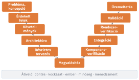
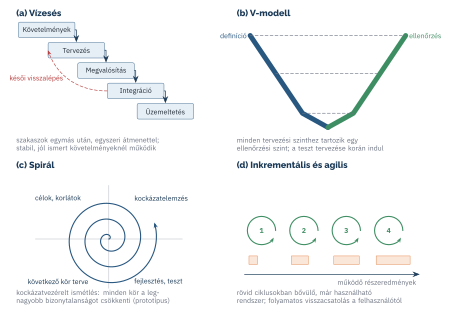
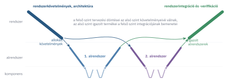

# A rendszerfejlesztés életciklusa és a V-modell {#sec-v-modell}

::: {.vterkep}
{fig-alt="V-térkép: a fejezet a teljes V-modellt áttekinti" width=62%}
:::

::: {.cel}
A fejezet feldolgozása után képes leszel:

- megnevezni egy műszaki rendszer életciklusának szakaszait, és megindokolni, miért a korai döntések határozzák meg a költségek nagy részét;
- összehasonlítani a vízesés-, a V-, a spirál- és az inkrementális/agilis életciklus-modellt, és egy adott projekthez indokoltan választani közülük;
- elmagyarázni a V-modell bal ágának, csúcsának és jobb ágának feladatait, valamint a két ág közötti vízszintes megfeleltetéseket;
- megkülönböztetni a verifikációt és a validációt, és mindkettőre saját példát adni;
- leírni, hogyan alkalmazzuk a V-modellt rekurzívan a rendszer hierarchiájának szintjein, és mi a szerepe a felülvizsgálatoknak és az alapvonalaknak;
- saját fejlesztési projektedhez elkészíteni a projekt V-tervét.
:::

Ez a fejezet a könyv gerince. Mielőtt bármelyik módszerrel (érdekeltfél-elemzéssel, QFD-vel, FMEA-val vagy folyamatmodellezéssel) foglalkoznánk, látnunk kell azt a pályát, amelyen ezek a módszerek elhelyezkednek. Először a rendszer teljes életét tekintjük át, és megnézzük, miért dől el olyan korán a projekt sorsa. Ezután összevetjük a legfontosabb életciklus-modelleket. A fejezet közepén részletesen bejárjuk a V-modellt, amely a könyv szerkezetét is adja. Végül megmutatjuk, hogyan ismétlődik a V a rendszer különböző szintjein, mit jelentenek a felülvizsgálatok és az alapvonalak, és hogyan néz ki a V a három futó esettanulmányban ([-@sec-esettanulmanyok]. függelék).

## Egy rendszer élete a koncepciótól a kivonásig {#sec-eletciklus}

Egy új rendszer nem akkor kezdődik, amikor az első alkatrészt legyártják, és nem is akkor ér véget, amikor a vevő átveszi. A rendszermérnöki szemlélet egyik alapgondolata, hogy a rendszert a teljes életciklusára tervezzük. Ebbe beletartozik, hogyan gyártják, hogyan használják, hogyan tartják karban, és hogyan vonják ki a forgalomból. Az életciklus-kezelés nemzetközi szabványa és az INCOSE rendszermérnöki kézikönyve hat általános életciklus-szakaszt különböztet meg: koncepció, fejlesztés, gyártás, használat, támogatás és kivonás ([-@fig-eletciklus]. ábra) [@iso24748_1_2024; @incose2023seh, 2.1.2. szakasz].

![A műszaki rendszerek általános életciklus-szakaszai és a szakaszok kulcskérdései. A használat és a támogatás (karbantartás, javítás, logisztika) párhuzamosan zajlik. Az INCOSE kézikönyve [@incose2023seh] alapján, saját szerkesztés.](../abrak/gen/eletciklus-szakaszok.svg){#fig-eletciklus width=100%}

A szakaszok tartalma röviden a következő.

- A **koncepciószakaszban** megértjük a problémát és az érdekelt felek igényeit. Lehetséges megoldási elképzeléseket vázolunk fel, és eldöntjük, érdemes-e egyáltalán belevágni.
- A **fejlesztési szakaszban** a kiválasztott koncepcióból követelmények, architektúra és részletes terv lesz. Ebben a szakaszban készülnek és ellenőrződnek a prototípusok is.
- A **gyártási szakasz** a rendszer előállítását, sorozatgyártásnál a gyártási folyamat felfuttatását jelenti.
- A **használat** során a rendszer azt teszi, amire szántuk. A **támogatás** gondoskodik arról, hogy ezt hosszú távon is meg tudja tenni.
- A **kivonás** a rendszer biztonságos leállítását, szétszerelését, az anyagok visszanyerését vagy ártalmatlanítását foglalja magában.

A szakaszok száma és elnevezése iparáganként és szervezetenként eltér. Az űrkutatásban és a védelmi iparban betűvel vagy számmal jelölt fázisok terjedtek el, egy gyártócég pedig gyakran a saját termékfejlesztési folyamatának lépéseit nevezi meg. A szabvány ezért csak általános keretet ad, amelyet minden szervezet a saját gyakorlatához igazít [@iso24748_1_2024]. A lényeg mindenhol ugyanaz: a döntéseket a teljes életút következményeinek ismeretében kell meghozni.

### Miért dől el korán a projekt sorsa?

A [-@fig-koltseg]. ábra a rendszermérnökség talán legtöbbet idézett összefüggését mutatja. Az amerikai Védelmi Beszerzési Egyetem (DAU) vizsgálatai szerint, amelyeket az INCOSE kézikönyve is közöl, a koncepciószakasz végére, a munka mintegy 8%-ának elvégzésekor a meghozott döntések az életciklusköltség körülbelül 70%-át már elkötelezik, a tervezés végére pedig mintegy 85%-át [@incose2015seh]. A ténylegesen elköltött összeg ekkor még csak töredéke ennek. A tervezés dönti el ugyanis, hogy a rendszert mennyibe kerül majd tesztelni, gyártani, integrálni, üzemeltetni és fenntartani.

![Az elkötelezett és a ténylegesen ráfordított életciklusköltség, valamint a tervváltoztatás relatív költsége az életciklus előrehaladtával. A számértékek szemléltetők, projektenként eltérnek, a görbék alakja azonban általános. Az INCOSE kézikönyvében közölt, a DAU-tól származó ábra [@incose2015seh] alapján, saját szerkesztés.](../abrak/gen/koltseg-elkotelezodes.svg){#fig-koltseg width=100%}

Az ábra másik üzenete a tervváltoztatás költségének meredek növekedése. Egy probléma, amelyet a tervezés során háromszor-hatszor annyiba kerül kijavítani, mint a koncepciónál, a gyártás és a tesztelés idején már nagyságrendekkel drágább. Az üzemeltetés során felfedezett hiba ára akár ezerszeres is lehet. Ennek oka egyszerű: minél később változtatunk, annál több kész munkát kell kidobni és újra ellenőrizni.

Ebből következik a rendszermérnökség egyik legfontosabb gyakorlati tanulsága. **A korai szakaszokba fektetett gondos munka – az igények feltárása, a követelmények tisztázása, a koncepciók összevetése – a teljes projekt legjobb megtérülésű befektetése.**

::: {.eset eset="A" title="KoboCella: egy korai döntés hosszú árnyéka"}
A Kobold Hajtástechnika csapata a koncepciószakaszban dönti el, hogy a kobot és az operátor ugyanazon a munkaterületen, egyidejűleg dolgozik-e, vagy időben elkülönülve, egymás után. Ezen az egyetlen döntésen múlik:

- milyen biztonsági megoldások kellenek (sebesség- és erőkorlátozás vagy elválasztó védőberendezés);
- mekkora helyet foglal a cella, és milyen lesz az operátor mozgásterülete;
- mekkora ciklusidő érhető el;
- milyen kockázatelemzést és milyen tanúsítást kell elvégezni.

Ha a csapat ezt csak az üzembe helyezéskor gondolná újra, a cella elrendezését, a vezérlést, a biztonsági rendszert és a dokumentációt is újra kellene tervezni.
:::

A költség azonban csak az egyik szempont. Ha egy megoldás már jól kiegyensúlyozott, vagyis egyik jellemzője sem javítható a többi rontása nélkül (a [-@sec-dontes]. fejezet szavával: a Pareto-fronton van), akkor a teljesítmény, a költség és a kockázat nem javítható egyszerre. Ez a rendszermérnök dilemmája:

- adott kockázat mellett a költség csökkentése csak a teljesítmény rovására lehetséges;
- adott költség mellett a kockázat csökkentése szintén teljesítményt kíván;
- adott teljesítmény mellett a költség csökkentése nagyobb kockázatvállalással jár;
- adott teljesítmény mellett a kockázat csökkentése többletköltséggel jár.

Az idő ebben az összefüggésben a költséghez hasonlóan viselkedik. A rendszermérnök feladata, hogy ezeket a kompromisszumokat tudatosan és átláthatóan kezelje. Ehhez nyújtanak segítséget a [-@sec-dontes]. fejezet döntéstámogató módszerei.

## Életciklus-modellek: hogyan haladunk végig a szakaszokon? {#sec-eletciklus-modellek}

Az életciklus-szakaszok azt írják le, *mi* történik a rendszerrel. Az **életciklus-modell** azt, hogy a fejlesztés során *milyen sorrendben, milyen visszacsatolásokkal és milyen ismétlésekkel* haladunk végig a tevékenységeken. A szakirodalom sokféle modellt ismer. Itt a négy legfontosabbat vetjük össze ([-@fig-modellek]. ábra, [-@tbl-modellek]. táblázat).

{#fig-modellek width=100%}

**A vízesésmodell** a tevékenységeket egymást követő szakaszokba rendezi. Minden szakasz egy jól meghatározott dokumentummal zárul, és a következő csak ennek elkészülte után indul. A modell eredetét többnyire Winston Royce 1970-es cikkére vezetik vissza [@royce1970]. Érdekes, hogy Royce éppen ennek a tisztán egyirányú folyamatnak a kockázataira figyelmeztetett. A szakaszok közötti visszacsatolást és egy előzetes, „kétszer építsd meg” jellegű próbaváltozat elkészítését javasolta. A vízesés előnye az átláthatóság és a jó tervezhetőség. Hátránya, hogy a hibák jellemzően csak a végén, az integráció és a tesztelés során derülnek ki, és a menet közben változó követelményeket nehezen kezeli.

**A V-modell** a vízesés lépéseit V alakba hajlítja. A bal ágon fentről lefelé haladva bontjuk le és határozzuk meg a rendszert, a jobb ágon lentről felfelé haladva építjük össze és ellenőrizzük. A modell ereje a két ág közötti vízszintes kapcsolatokban rejlik: minden meghatározási szinthez tartozik egy ellenőrzési szint, és az ellenőrzés tervét már a meghatározással egy időben elkészítjük. A V alakú ábrázolás szoftverfejlesztési változatát Paul Rook írta le 1986-ban [@rook1986]. A rendszermérnöki „Vee” modellt Kevin Forsberg és Harold Mooz 1991-ben mutatta be [@forsberg1991]. Ebben a technikai folyamat a bal felső sarokban a felhasználói igényekkel indul, és a jobb felső sarokban a felhasználó által validált rendszerrel zárul. Ettől függetlenül Németországban a szövetségi informatikai projektek kötelező eljárásrendjévé vált a V-Modell. Mai változata a 2005 óta érvényes V-Modell XT [@friedrich2009vmodellxt].

**A spirálmodellt** Barry Boehm írta le [@boehm1988]. A fejlesztés egymást követő körökben halad. Minden kör a célok és korlátok tisztázásával indul, ezt kockázatelemzés követi, majd a legnagyobb bizonytalanság csökkentésére szolgáló fejlesztési és tesztelési lépés (gyakran prototípus), végül a következő kör megtervezése. A spirálmodell lényege, hogy a kockázatok vezérlik a folyamatot. Ott és annyit kell elemezni és prototípust építeni, ahol a legnagyobb a bizonytalanság. A modell későbbi továbbfejlesztése a fokozatos elköteleződésre épülő spirálmodell (Incremental Commitment Spiral Model) [@boehm2014icsm].

**Az inkrementális és az agilis fejlesztés** rövid ciklusokban, működő részeredményeket szállítva halad. A 2001-es Agilis kiáltvány [@beck2001agile] a folyamatos együttműködést, a működő terméket és a változásokra való gyors reagálást helyezte előtérbe. A szoftverfejlesztésben ez ma elterjedt gyakorlat. A hardvert is tartalmazó, nagyobb rendszerekben viszont jellemzően hibrid megoldás működik. A rendszerszintű követelményeket, az architektúrát és a biztonsági igazolást V-modell szerint kezelik, az egyes alrendszereken, különösen a szoftveren belül pedig agilis ciklusokban dolgoznak. Az INCOSE kézikönyve az agilis rendszermérnökséget már önálló megközelítésként tárgyalja [@incose2023seh].

| Modell | Mikor jó választás? | Erősségek | Kockázatok |
|:-------|:--------------------|:----------|:-----------|
| Vízesés | Stabil, jól ismert követelmények; ismert technológia; kis bizonytalanság | Egyszerű, jól tervezhető, jól dokumentált | Késői hibafelismerés; a változás drága |
| V-modell | Biztonságkritikus vagy szabályozott termékek; sok alrendszer; szigorú igazolási igény | A verifikáció és a validáció korai tervezése; nyomonkövethetőség | Merev, ha szó szerint egyirányú folyamatnak értelmezik |
| Spirál | Új technológia, nagy műszaki vagy piaci bizonytalanság | Célzott kockázatcsökkentés, prototípusok | Nagyobb irányítási igény; nehezebb ütemezni |
| Inkrementális/agilis | Gyorsan változó igények; szoftverintenzív rendszerek; korai felhasználói visszajelzés kell | Gyors tanulás, korán használható eredmény | Az architektúra és a rendszerszintű igazolás elsikkadhat |

: Az életciklus-modellek összehasonlítása. Saját összeállítás @royce1970, @forsberg1991, @boehm1988 és @incose2023seh alapján. {#tbl-modellek tbl-colwidths="[14,30,28,28]"}

::: {.hiba title="A V-modell nem időrend"}
Gyakori félreértés, hogy a V-modell egy szigorú időbeli sorrendet ír elő: előbb minden követelményt véglegesíteni kell, aztán minden tervet, és csak a legvégén szabad tesztelni. A V-modell valójában **logikai kapcsolatokat** ábrázol: mi miből következik, és mit mivel ellenőrzünk. A gyakorlatban a V-t sokszor bejárjuk (prototípussal, szimulációval, részleges integrációval), és a jobb ág tevékenységei, például egy kritikus alkatrész korai tesztelése, a bal ági munkával párhuzamosan is indulhatnak. A V és az iteráció tehát nem zárja ki egymást (lásd [-@sec-rekurzio]. szakasz).
:::

## A V-modell bejárása {#sec-v-bejaras}

A könyv további része a [-@fig-v]. ábrán látható V-modellt követi. Az ábra a bal ágon öt meghatározási szintet, a csúcson a megvalósítást, a jobb ágon pedig öt ellenőrzési és üzembe állítási lépést mutat. A szaggatott vízszintes vonalak jelzik, melyik bal ági munkatermék szolgál melyik jobb ági ellenőrzés alapjául.

{#fig-v width=100%}

### A bal ág: a problémától a részletes tervig

A bal ágon minden lépés egy kérdésre felel, és egy munkaterméket (dokumentumot, modellt vagy döntést) állít elő, amely a következő lépés bemenete lesz.

1. **Probléma, cél és működési koncepció.** *Milyen problémát oldunk meg, és miért éri meg?* A munkatermék a szükségletek, célok és célkitűzések rendszere, valamint a működési koncepció (ConOps). A ConOps a felhasználó szemszögéből írja le, hogyan fogják használni a rendszert, beleértve a rendellenes és a leromlott üzemmódokat is ([-@sec-problema]. fejezet).
2. **Az érdekelt felek igényei és elvárásai.** *Kiket érint a rendszer, és mit várnak tőle?* Az eredmény az érdekelt felek nyilvántartása és a validált elvárások listája, a hatékonyság mérőszámaival ([-@sec-erdekelt-felek]. fejezet).
3. **Rendszerkövetelmények.** *Mit kell a rendszernek mérhetően teljesítenie?* Az elvárásokból egyértelmű, ellenőrizhető, a megoldást elő nem író követelmények lesznek, mindegyikhez hozzárendelt verifikációs móddal ([-@sec-kovetelmenyek]. és [-@sec-qfd]. fejezet).
4. **Architektúra és koncepció.** *Milyen elemekből, milyen kapcsolatokkal épül fel a rendszer?* A funkciókat formai elemekhez rendeljük, koncepcióváltozatokat generálunk és választunk közülük, a követelményeket pedig lebontjuk az alrendszerekre ([-@sec-architektura]., [-@sec-kreativitas]. és [-@sec-dontes]. fejezet).
5. **Részletes tervezés.** *Pontosan hogyan valósítjuk meg az egyes elemeket?* Ide tartoznak a gyártási rajzok, a kapcsolási rajzok, a szoftvertervek és a tűrések. Ezen a szinten kerülnek előtérbe a megbízhatósági, biztonsági és ember–gép szempontok is ([-@sec-emberkozpontu]–[-@sec-robusztus]. fejezet).

### A csúcs: megvalósítás

A V csúcsán a tervekből valóság lesz. Gyártjuk, beszerezzük vagy kódoljuk az elemeket. Mivel könyvünk műszaki menedzsereknek és mechatronikai mérnököknek is szól, ide soroljuk a gyártó- és szolgáltatófolyamatok tervezését is: a folyamatelemzést, a kapacitástervezést, a folyamatmodellezést és az ütemezést ([-@sec-folyamatelemzes]–[-@sec-utemezes]. fejezet). Ha a fejlesztés tárgya maga egy gyártócella vagy egy szolgáltatás, ezek a módszerek a megvalósítás magját alkotják.

### A jobb ág: az integrációtól az üzemeltetésig

A jobb ágon lentről felfelé haladva állítjuk össze és ellenőrizzük a rendszert.

1. **Komponens-verifikáció.** Minden elkészült elemről igazoljuk, hogy megfelel a részletes terv követelményeinek.
2. **Integráció és alrendszer-verifikáció.** Az elemeket lépésenként összeépítjük. Ez az a pont, ahol az interfészhibák jellemzően felszínre kerülnek ([-@sec-integracio]. fejezet).
3. **Rendszerverifikáció.** A teljes rendszerről igazoljuk, hogy minden rendszerkövetelményt teljesít ([-@sec-verifikacio]. fejezet).
4. **Validáció.** Valós vagy valósághű környezetben, valódi felhasználókkal igazoljuk, hogy a rendszer valóban azt nyújtja, amit az érdekelt felek vártak ([-@sec-validacio]. fejezet).
5. **Átadás, üzemeltetés és fenntartás.** A rendszert átadjuk, beüzemeljük, működtetjük, és mérjük, hogy a várt haszon valóban megvalósul-e. Az üzemeltetési tapasztalatok a folyamatos fejlesztés és a következő fejlesztési ciklus bemenetei lesznek ([-@sec-uzemeltetes]. fejezet).

### Vízszintes megfeleltetések: korai tesztterv

A V-modell legfontosabb gyakorlati üzenete a vízszintes vonalakban rejlik. **Amikor a bal ágon megfogalmazunk valamit, egyúttal azt is el kell döntenünk, hogyan fogjuk a jobb ágon igazolni.** Ha egy követelményről a megfogalmazás pillanatában nem tudjuk megmondani, milyen vizsgálattal ellenőrizzük majd, akkor az a követelmény valószínűleg nem elég pontos. Így a korai tesztterv nem bürokratikus többletmunka, hanem a bal ági munka minőségének próbája.

::: {.fogalom title="Verifikáció és validáció"}
Az ISO/IEC/IEEE 15288 szabvány a két fogalmat így választja szét [@iso15288_2023]:

- **Verifikáció:** objektív bizonyítékokkal alátámasztott megerősítése annak, hogy a termék teljesíti a rögzített követelményeket. A bizonyítékot vizsgálat, elemzés, bemutatás vagy teszt adja, vagy ezek kombinációja. Boehm rövid kérdésével: *jól építjük-e meg a terméket?* [@boehm1984]
- **Validáció:** objektív bizonyítékokkal alátámasztott megerősítése annak, hogy a termék a tervezett használatra, a tervezett környezetben alkalmas, vagyis betölti a rendeltetését, és megfelel a megrendelő és a többi érdekelt fél elvárásainak. Boehm kérdésével: *a jó terméket építjük-e?*

A verifikáció a jóváhagyott követelményekre hivatkozik, a validáció a működési koncepcióra és az érdekelt felek elvárásaira. Validálni nemcsak a végén lehet és kell: a korai szakaszokban modellekkel, makettekkel és szimulációval is feltehető a kérdés, hogy a megfelelő terméket építjük-e a felhasználóinknak [@incose2023seh].
:::

::: {.eset eset="B" title="VárosiBringa: verifikáció vagy validáció?"}
Az egyik rendszerkövetelmény így szól: *„A kerékpár kölcsönzésének elindítása az alkalmazásban a QR-kód beolvasásától a zár nyitásáig legfeljebb 5 másodpercig tarthat, a kölcsönzések legalább 95%-ában.”* Ennek ellenőrzése **verifikáció**: tesztkörnyezetben, mért időkkel igazolható.

A validáció más kérdést tesz fel: *képesek-e a 65 év feletti lakók esős időben, kesztyűben, segítség nélkül kölcsönözni?* Lehet, hogy az 5 másodperces követelmény teljesül, a felhasználók mégis elakadnak, mert a QR-kód a dokkoló alján, rossz szögben van. A rendszer ilyenkor átmegy a verifikáción, a validáción viszont elbukik. A hiba forrása a bal ág felső szintjein keresendő: valamelyik érdekelt fél elvárását nem tártuk fel, vagy nem fordítottuk le követelménnyé.
:::

### A V-modell és a szabványos folyamatok

A V-modell lépései nem egy könyv kitalációi: megfelelnek a nemzetközi szabványok folyamatainak. Az ISO/IEC/IEEE 15288:2023 szabvány harminc folyamatot határoz meg négy csoportban: megállapodási, szervezeti projekttámogató, technikai irányítási és technikai folyamatokat [@iso15288_2023]. A tizennégy technikai folyamat sorra követi a V-t az üzleti vagy küldetéselemzéstől a kivonásig, a nyolc technikai irányítási folyamat pedig a teljes V-n átível. Az INCOSE kézikönyve ugyanezt a folyamatrendszert részletezi gyakorlati tanácsokkal [@incose2023seh, 2.3. szakasz]. A [-@tbl-v-folyamatok]. táblázat megmutatja, melyik V-lépéshez melyik szabványos folyamat tartozik, és a könyv melyik fejezete foglalkozik vele.

| A V-modell lépése | ISO/IEC/IEEE 15288:2023 folyamat | Szakasz | Fejezet |
|:--|:--|:-:|:--|
| Probléma, cél, működési koncepció | Üzleti vagy küldetéselemzés | 6.4.1 | [-@sec-problema]. |
| Az érdekelt felek igényei | Az érdekelt felek igényeinek és követelményeinek meghatározása | 6.4.2 | [-@sec-erdekelt-felek]. |
| Rendszerkövetelmények | Rendszerkövetelmények meghatározása | 6.4.3 | [-@sec-kovetelmenyek]–[-@sec-qfd]. |
| Architektúra és koncepció | Rendszerarchitektúra meghatározása; rendszerelemzés | 6.4.4; 6.4.6 | [-@sec-architektura]–[-@sec-dontes]. |
| Részletes tervezés | Tervmeghatározás; rendszerelemzés | 6.4.5; 6.4.6 | [-@sec-emberkozpontu]–[-@sec-robusztus]. |
| Megvalósítás | Megvalósítás | 6.4.7 | [-@sec-folyamatelemzes]–[-@sec-utemezes]. |
| Integráció | Integráció | 6.4.8 | [-@sec-integracio]. |
| Verifikáció (komponens- és rendszerszinten) | Verifikáció | 6.4.9 | [-@sec-verifikacio]. |
| Validáció | Validáció | 6.4.11 | [-@sec-validacio]. |
| Átadás, üzemeltetés, fenntartás | Átadás; üzemeltetés; karbantartás; kivonás | 6.4.10; 6.4.12–6.4.14 | [-@sec-uzemeltetes]. |
| Átívelő tevékenységek | Technikai irányítási folyamatok (projekttervezés, döntéskezelés, kockázatkezelés, konfigurációkezelés stb.) | 6.3.1–6.3.8 | [-@sec-dontes]., [-@sec-kockazat]., [-@sec-menedzsment]. |

: A könyv V-modelljének megfeleltetése az ISO/IEC/IEEE 15288:2023 folyamatainak [@iso15288_2023]. A folyamatnevek saját fordítások; a megfeleltetés közelítő, mert a szabvány folyamatai egymással párhuzamosan és ismétlődően is futhatnak. {#tbl-v-folyamatok tbl-colwidths="[24,40,14,22]"}

## A V a V-ben: rekurzió és iteráció {#sec-rekurzio}

A V-modellt nem egyszer alkalmazzuk a teljes rendszerre. A rendszer hierarchiájának minden szintjén újra lejátszódik ([-@fig-rekurzio]. ábra). A rendszerszintű architektúra eredményeként kialakulnak az alrendszerek, és mindegyik megkapja a rá lebontott, allokált követelményeket. Az alrendszer fejlesztője számára ezek az allokált követelmények jelentik a saját V-jének bal felső sarkát. Az alrendszer saját architektúrát, komponenseket és részletes tervet dolgoz ki, a komponenseket verifikálja, integrálja, végül a kész alrendszert igazoltan visszaadja a rendszerszintű integrációnak.

{#fig-rekurzio width=100%}

Az ISO/IEC/IEEE 15288 szabvány a folyamatok alkalmazásának kétféle ismétlődését különbözteti meg [@iso15288_2023, 5.8.2. szakasz; @nasa2016seh, 2.3. szakasz]. A **rekurzió** azt jelenti, hogy ugyanazokat a folyamatokat a termékszerkezet egymás alatti szintjein újra alkalmazzuk. Az **iteráció** azt jelenti, hogy egy szinten belül többször is végigmegyünk a folyamatokon, amíg a követelmények, a koncepció és a terv összhangba nem kerülnek. A fejlesztés így egymást követő finomításokkal halad: a koncepciószakasz vázlatos körét egyre részletesebb körök követik, és minden kör érettebb, pontosabb eredményt ad.

::: {.eset eset="A" title="KoboCella: a cella termékszerkezete"}
A KoboCella rendszerszintű V-jének architektúralépése öt alrendszert jelöl ki:

1. a kobot a megfogóval;
2. a csavarozóegység a nyomatékszabályozással;
3. a biztonsági rendszer (érzékelők, biztonsági vezérlő);
4. a munkahely és az ergonómiai kialakítás;
5. a cellavezérlés a MES-kapcsolattal.

A csavarozóegységet a beszállító fejleszti. Neki a „8 csavar meghúzása 4,0 ± 0,2 Nm nyomatékkal, 2 másodperces csavaronkénti ciklusidővel, minden meghúzás nyomatékgörbéjének naplózásával” típusú allokált követelmények jelentik a kiindulópontot. A beszállító saját V-t jár be, a cella csapata pedig a kész egység verifikációs jegyzőkönyvét kapja meg, mielőtt integrálja.
:::

## Mérföldkövek, felülvizsgálatok és alapvonalak {#sec-felulvizsgalatok}

Honnan tudjuk, hogy egy szakasz eredménye elég érett ahhoz, hogy a következőre lépjünk? Erre szolgálnak a **technikai felülvizsgálatok**. Ezek előre tervezett, dokumentált bizonyítékokra épülő értékelések, amelyeken az érdekelt felek és a független szakértők közösen döntik el, hogy a munka a következő szakaszba léphet-e ([-@fig-felulvizsgalatok]. ábra) [@ieee15288_2_2014]. A felülvizsgálat nem formalitás: az a pont, ahol a projekt még olcsón korrigálhat.

![Tipikus technikai felülvizsgálatok és alapvonalak a fejlesztés során. Az IEEE 15288.2 szabvány [@ieee15288_2_2014] és a DAU [@dau2001] gyakorlata alapján, egyszerűsítve.](../abrak/gen/felulvizsgalatok.svg){#fig-felulvizsgalatok width=100%}

| Felülvizsgálat | Kulcskérdés | Tipikus bizonyítékok | Angol elnevezés |
|:--|:--|:--|:--|
| Koncepció-felülvizsgálat | Értjük-e a problémát, és van-e megvalósítható, megérő koncepció? | Szükségletek és célok, működési koncepció, koncepcióváltozatok, előzetes költség- és kockázatbecslés | Alternative Systems Review (ASR) |
| Követelmény-felülvizsgálat | Teljesek, egyértelműek és ellenőrizhetők-e a rendszerkövetelmények? | Rendszerkövetelmény-specifikáció, nyomonkövethetőség az elvárásokig, verifikációs módok | System Requirements Review (SRR) |
| Előzetes tervfelülvizsgálat | Teljesítheti-e a választott architektúra az összes követelményt elfogadható kockázattal? | Architektúra, allokált követelmények, interfészek, kompromisszumelemzések, előzetes biztonsági és megbízhatósági elemzések | Preliminary Design Review (PDR) |
| Részletes tervfelülvizsgálat | Kész-e a terv a gyártásra, kódolásra és beszerzésre? | Részletes tervek, tűrések, FMEA, tesztelési tervek | Critical Design Review (CDR) |
| Tesztkészültségi felülvizsgálat | Felkészültünk-e a formális tesztelésre? | Tesztelési eljárások, kalibrált eszközök, a tesztobjektum konfigurációja | Test Readiness Review (TRR) |
| Üzemkészségi felülvizsgálat | Átadható-e a rendszer üzemeltetésre? | Verifikációs és validációs eredmények, kezelési utasítások, képzés, karbantartási terv | System Verification Review (SVR), Operational Readiness Review (ORR) |

: A technikai felülvizsgálatok áttekintése. Az elnevezések szervezetenként eltérnek; a nagy projektek további felülvizsgálatokat is alkalmaznak, például funkcionális és fizikai konfigurációs auditot [@ieee15288_2_2014; @dau2001; @nasa2016seh, 3. fejezet]. {#tbl-felulvizsgalatok tbl-colwidths="[18,26,36,20]"}

A felülvizsgálatok egyik legfontosabb kimenete az **alapvonal**. Ez a rendszer leírásának jóváhagyott állapota, amely ettől kezdve csak szabályozott változáskezeléssel módosítható. Az amerikai védelmi gyakorlat a fejlesztési szintekhez igazodva három alapvonalat különböztet meg [@dau2001]:

- a **funkcionális alapvonal** a rendszerszintű, teljesítményben megfogalmazott leírás;
- az **allokált alapvonal** az alrendszerek és komponensek teljesítményleírása;
- a **termékalapvonal** a gyártáshoz szükséges részletes leírás.

Az alapvonal haszna egyszerű: mindenki ugyanarról a változatról beszél. Egy változtatási javaslat hatása (költség, ütemezés, más elemekre gyakorolt következmény) az alapvonalhoz képest értékelhető. A konfigurációkezelést a [-@sec-menedzsment]. fejezet tárgyalja részletesen.

::: {.hiba title="Felülvizsgálat mint előadás"}
Gyakori hiba, hogy a felülvizsgálat a csapat bemutatkozó előadásává válik, ahol mindenki azt hangsúlyozza, ami jól sikerült. A felülvizsgálat akkor éri el a célját, ha **előre rögzített belépési és kilépési feltételei vannak** (milyen dokumentumoknak, eredményeknek kell meglenniük), a bírálók a dokumentumokat előre megkapják, és a nyitott kérdéseket felelőssel és határidővel rögzítik a jegyzőkönyvben.
:::

A felülvizsgálatok száma és formalitása a projekt méretéhez igazítható. Egy féléves hallgatói projektben vagy egy kisvállalati fejlesztésben elegendő lehet három ellenőrzési pont: a koncepció és a követelmények jóváhagyása, a terv jóváhagyása, végül az átadás előtti ellenőrzés. A folyamatok projekthez igazításának (tailoring) a szabványok és a szakirodalom külön figyelmet szentel [@iso15288_2023; @incose2023seh, 4. fejezet; @nasa2016seh, 3.11. szakasz]. Az elv egyszerű: a folyamat szolgálja a projektet, és ne fordítva.

## A három futó eset a V-modellben {#sec-v-esetek}

Hogyan néz ki mindez a gyakorlatban? A [-@tbl-v-esetek]. táblázat a három futó esettanulmány néhány jellemző munkatermékét rendeli a V-modell lépéseihez. Érdemes megfigyelni, hogy a C eset, a ForgácsTech digitális átállása esetében a „rendszer” elsősorban egy szervezet és annak folyamatai. A V-modell logikája itt is ugyanúgy működik: a problémából követelmények lesznek, azokból terv, a tervből megvalósítás, a megvalósítást pedig ellenőrizni és validálni kell.

| V-lépés | A: KoboCella | B: VárosiBringa | C: ForgácsTech |
|:--|:--|:--|:--|
| Probléma, működési koncepció | Növekvő igény, ergonómiai panaszok, utómunka; a műszak működési forgatókönyvei | Rövid autós utak kiváltása dombos városban; a kölcsönzés és visszaadás forgatókönyvei | Határidő-csúszások, átláthatatlan gépállapot; egy rendelés útja az üzemen át |
| Érdekelt felek | Operátorok, munkavédelem, vevő, integrátor | Lakosok, önkormányzat, üzemeltető, közlekedési társaság | Tulajdonos, gépkezelők, vevők, MES-szállító |
| Rendszerkövetelmények | Ciklusidő, első átmenetes kihozatal, ergonómiai terhelés, nyomaték-naplózás | Elérhetőség, kölcsönzési idő, áthelyezési költség, akadálymentesség | Átfutási idő, adatgyűjtési lefedettség, OEE-mérés pontossága |
| Architektúra | Kobot, csavarozó, biztonsági rendszer, munkahely, vezérlés | Kerékpár, dokkoló, alkalmazás, háttérrendszer, szerviz | Gépcsatlakozások, MES, ütemező modul, terminálok |
| Részletes terv | Megfogó, biztonsági zónák, kezelőfelület | Dokkolózár, töltés, felhasználói felület | Adatmodell, képernyők, munkautasítások |
| Megvalósítás | Cella építése, programozás | Gyártás, telepítés, fejlesztés | Bevezetés gépcsoportonként |
| Verifikáció | Nyomaték- és ciklusidő-mérés, biztonsági funkciók tesztje | Kölcsönzési idő mérése, terheléses teszt | Adatpontosság ellenőrzése gépnaplóval |
| Validáció | Próbaüzem valódi műszakban, operátori visszajelzés | Próbaidőszak egy városrészben, felhasználói tesztek | Próbaüzem egy gépcsoporton, gépkezelői tapasztalatok |
| Üzemeltetés | OEE-követés, karbantartás | Kihasználtság, áthelyezés, javítás | Folyamatos fejlesztés, OEE- és átfutásiidő-trendek |

: Jellemző munkatermékek a V-modell lépéseiben a három futó esettanulmányban. {#tbl-v-esetek tbl-colwidths="[16,28,28,28]"}

::: {.kitekintes title="Merre tart a V-modell?"}
A V-modell logikája (meghatározni, lebontani, megvalósítani, összeépíteni, igazolni) időtálló. Megvalósítása azonban gyorsan változik. Az INCOSE 2022-ben kiadott jövőképe szerint a rendszermérnökség jövője modellalapú [@incose2022vision]. A dokumentumok helyett egy összefüggő rendszermodell hordozza a követelményeket, az architektúrát és az ellenőrzési eredményeket, így a V vízszintes kapcsolatai automatikusan nyomon követhetők. Ehhez kapcsolódik a digitális iker, amely az üzemeltetési adatokat visszavezeti a tervezésbe, és ezzel „bezárja” a V-t. Szintén ide tartozik a folyamatos integráció és telepítés, amely a jobb ág ellenőrzéseinek egy részét automatizálja és naponta futtatja. A nagy nyelvi modellek új lehetőségeket nyitnak a követelmények minőségének ellenőrzésében és a dokumentumok közötti nyomonkövethetőség feltárásában. Ezek eredményei azonban ugyanúgy verifikálandók, mint bármely más mérnöki munkatermék. A modellalapú megközelítést a [-@sec-modellek]. fejezet tárgyalja.
:::

::: {.osszefoglalo}
- A rendszert a teljes életciklusára tervezzük a koncepciótól a kivonásig. A korai döntések rögzítik az életciklusköltség nagy részét, és a változtatás költsége a projekt előrehaladtával nagyságrendekkel nő.
- Az életciklus-modell azt írja le, milyen sorrendben és visszacsatolásokkal haladunk. A vízesés egyszerű, de merev. A V-modell az ellenőrzés korai tervezésére épül. A spirálmodell a kockázatokat állítja a középpontba. Az agilis fejlesztés rövid, működő eredményt adó ciklusokkal dolgozik. A gyakorlatban gyakori a hibrid megoldás.
- A V-modell bal ága a problémától a részletes tervig halad, a csúcsa a megvalósítás, a jobb ága a komponens-verifikációtól az üzemeltetésig tart. Minden bal ági szinthez tartozik egy jobb ági ellenőrzés, amelynek tervét már a meghatározáskor elkészítjük.
- A verifikáció azt igazolja, hogy jól építettük meg a terméket, a validáció azt, hogy a jó terméket építettük meg.
- A V rekurzív: a rendszer minden szintjén újra lejátszódik. Iteratív is: egy szinten belül többször bejárjuk. A felülvizsgálatok és az alapvonalak teszik a haladást ellenőrizhetővé és a változtatásokat kezelhetővé.
:::

::: {.onell}
1. Mit jelent az, hogy a tervezés a költségek nagy részét „elkötelezi”, de csak kis részét költi el? Adj rá saját példát!
2. Milyen projektjellemzők szólnak a spirálmodell mellett a V-modellel szemben?
3. Egy okosotthon-termosztát egyik követelménye: „A beállított hőmérsékletet ±0,5 °C pontossággal kell tartania.” Írj egy verifikációs és egy validációs kérdést ehhez a termékhez!
4. Miért nevezzük a V-modell vízszintes kapcsolatait korai teszttervnek? Mi a haszna annak, ha a verifikáció módját a követelmény megfogalmazásakor rögzítjük?
5. Mi a különbség a rekurzió és az iteráció között a rendszermérnöki folyamatban?
6. Mi az alapvonal, és miért van rá szükség?

::: {.megoldas}
1. A tervezési döntések (anyagválasztás, architektúra, gyártási technológia) meghatározzák a későbbi gyártási, üzemeltetési és karbantartási költségeket, bár maguk viszonylag olcsók. Példa: ha egy kerékpárdokkoló házát öntött alumíniumból tervezzük, az öntőszerszám, a darabár és a javítás módja is eldől, mielőtt egyetlen darab elkészülne.
2. Új, kipróbálatlan technológia; nagy műszaki vagy piaci bizonytalanság; olyan kockázatok, amelyek csak prototípussal vagy kísérlettel csökkenthetők; változó vagy nehezen megfogható igények.
3. Verifikáció: klímakamrában, adott hőterhelés mellett a termosztát a beállított értéket ±0,5 °C-on belül tartja-e? Validáció: a lakók egy téli hónap alatt kényelmesnek érzik-e a lakást, és képesek-e a programozást segítség nélkül beállítani?
4. Mert a bal ági meghatározással egy időben dől el, hogyan igazoljuk majd a jobb ágon. Ha a verifikáció módja nem rögzíthető, a követelmény jellemzően nem elég pontos vagy nem mérhető. A korai rögzítés ezért a követelmények minőségét is javítja, és időben jelzi a szükséges tesztberendezéseket.
5. Rekurzió: ugyanazokat a folyamatokat a termékszerkezet egymás alatti szintjein (rendszer, alrendszer, komponens) újra alkalmazzuk. Iteráció: egy szinten belül többször végigmegyünk a folyamatokon, amíg a követelmények és a terv összhangba nem kerülnek.
6. A rendszerleírás jóváhagyott állapota, amely csak szabályozott változáskezeléssel módosítható. Ennek köszönhetően mindenki ugyanarról a változatról beszél, és a változtatások hatása az alapvonalhoz mérhető.
:::
:::

::: {.projekt title="Projektlépés: a projekt V-terve"}
Válassz egy fejlesztési feladatot a [Gyakorlati útmutató](https://complexsystemsintelligence.github.io/rendszermernokseg/gyakorlat/) projektjavaslatai közül, vagy hozd a sajátodat. Készítsd el hozzá a projekt V-tervét:

- rajzold fel a V-t a saját rendszeredre;
- minden lépéshez írd fel a várható munkaterméket;
- minden bal ági lépés mellé írd fel, hogyan fogod a jobb ágon ellenőrizni.

Jelölj ki legalább három felülvizsgálati pontot belépési feltételekkel. A részletes útmutatót és a sablont a Gyakorlati útmutató *Projekt V-terve* eszközlapja tartalmazza.
:::

::: {.forras}
- @incose2023seh, 2. fejezet: az életciklus-fogalmak és -modellek részletes, szabványokra épülő tárgyalása.
- @iso24748_1_2024: az életciklus-szakaszok és -modellek szabványos kerete.
- @sebok2025: az életciklus-modellekről és a felülvizsgálatokról szóló, szabadon elérhető fejezetek.
- @forsberg1991: a rendszermérnöki V-modell eredeti cikke.
- @boehm1988: a kockázatvezérelt spirálmodell klasszikus leírása.
- @nasa2016seh, 2. és 3. fejezet: a rendszermérnöki motor és a projektfázisok gyakorlati leírása.
:::
