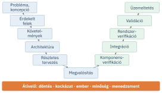
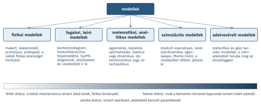
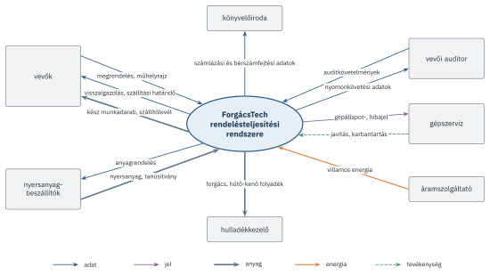
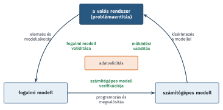
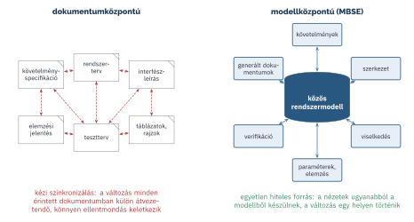
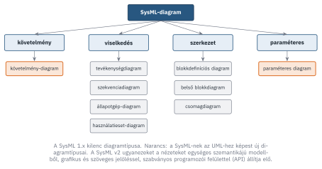
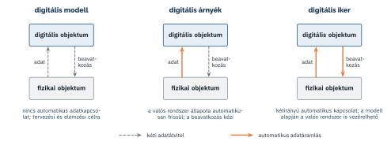

# Modellek és modellalapú rendszermérnökség {#sec-modellek}

::: {.vterkep}
{fig-alt="V-térkép: a modellek a V-modell minden lépését átszövik" width=62%}
:::

::: {.cel}
A fejezet feldolgozása után képes leszel:

- megfogalmazni, mire valók a modellek a rendszermérnökségben, és miért közelítés minden modell;
- a feladathoz illő modelltípust választani (fizikai, fogalmi, matematikai, szimulációs, adatvezérelt);
- kontextusdiagrammal kijelölni egy rendszer határát, és rendszerezni a külső interfészeit;
- megkülönböztetni a modell verifikációját és validációját;
- összevetni a dokumentumközpontú és a modellalapú rendszermérnökséget, és értelmezni a nézőpont és a nézet fogalmát;
- megnevezni a SysML diagramtípusait és azt, hogy melyik mire való, valamint értelmezni egy egyszerű SysML v2 szöveges modellt;
- megkülönböztetni a digitális modellt, a digitális árnyékot és a digitális ikret.
:::

Az előző fejezet rendszerekről szólt. Ez arról szól, hogyan gondolkodunk róluk, és hogyan beszélünk róluk egymással. A rendszermérnök nem tud egy még nem létező rendszert kipróbálni, és egy létező, nagy rendszeren sem kísérletezhet szabadon. Ezért modelleket használ: egyszerűsített leképezéseket, amelyeken kérdéseket tehet fel, és amelyek segítségével a csapat közös képet alakíthat ki a rendszerről. A V-modell bal ágán a modellek a tervezés eszközei, a jobb ágán az ellenőrzés mércéi: a mérési eredményeket a modell előrejelzéseivel vetjük össze.

A fejezet négy kérdésre keresi a választ:

- Mire jó egy modell, és hogyan válasszuk ki a feladathoz illőt?
- Hogyan jelöljük ki a rendszer határát, és hogyan írjuk le a környezetével fennálló kapcsolatait?
- Honnan tudjuk, hogy egy modellben megbízhatunk?
- Mit jelent a modellalapú rendszermérnökség, a SysML és a digitális iker?

## Miért modellezünk? {#sec-mod-miert}

A **modell** egy rendszer céltudatosan egyszerűsített leképezése, amely egy meghatározott kérdés megválaszolását szolgálja. A meghatározás két kulcsszava a *céltudatos* és az *egyszerűsített*. Nincs „a” modellje egy rendszernek, csak egy adott kérdéshez illő modellje van. A KoboCella háromdimenziós CAD-modellje alkalmas arra, hogy ellenőrizzük, elér-e a robot minden csavarhoz, de semmit sem mond arról, hány motort szerel össze a cella egy műszakban. Erre egy egyszerű folyamatmodell vagy szimuláció való.

George Box statisztikus sokat idézett megállapítása szerint minden modell hamis, de vannak hasznos modellek [@box1979]. A modell attól hasznos, hogy elhagyja a lényegtelent. Ha egy térkép ugyanolyan részletes lenne, mint a terep, nem lehetne vele tájékozódni. A modellező fő kérdése ezért nem az, hogy a modell „igaz-e”, hanem az, hogy elég jó-e a feltett kérdés megválaszolására.

Epstein sokat idézett írásában az előrejelzés mellett tizenhat további okot sorol fel arra, miért érdemes modellezni [@epstein2008]. A rendszermérnök szempontjából ezek közül négy a legfontosabb:

- **Struktúrában gondolkodunk.** A modellalkotás arra kényszerít, hogy azonosítsuk az elemeket, feltárjuk a kapcsolatokat, és kimondjuk a feltételezéseinket.
- **Megalapozottabban döntünk.** A modellel kiszámíthatjuk, mi történne különböző döntések esetén, és összevethetjük a változatokat, mielőtt bármit megépítenénk.
- **Termékenyebbek leszünk.** A modell olyan kérdéseket is felvet, amelyekre nem gondoltunk, és olyan összefüggéseket is megmutat, amelyek intuitíve nem nyilvánvalók: egyensúlyi, ciklikus, véletlenszerű vagy komplex viselkedést.
- **Óvatosságra intenek.** A modell feltárja a logikai korlátokat, és megmutatja, hol bizonytalan a tudásunk.

Ehhez jön egy ötödik, a rendszermérnökségben talán a legfontosabb szerep: a **kommunikáció**. Egy jó kontextusdiagram vagy állapotgép-diagram percek alatt közös képet teremt egy gépész, egy programozó, egy ergonómus és egy beszerző között. Szöveggel ehhez oldalakra volna szükség.

::: {.fogalom title="Modell, szimuláció, digitális iker"}
- **Modell:** egy rendszer céltudatosan egyszerűsített leképezése egy kérdés megválaszolására.
- **Szimuláció:** a modell működtetése, jellemzően időben, hogy megfigyeljük a viselkedését. A szimuláció tehát nem modelltípus, hanem a modell használatának egy módja.
- **Digitális iker:** a valós rendszerrel automatikus, kétirányú adatkapcsolatban álló digitális modell ([-@sec-mod-iker]. szakasz).
:::

## Modelltípusok {#sec-mod-tipusok}

A rendszermérnöki gyakorlatban öt modellcsaládot érdemes megkülönböztetni ([-@fig-modelltipusok]. ábra).

- **Fizikai modellek:** makettek, skálamodellek, prototípusok, próbapadok. Előnyük, hogy a valódi fizikai jelenséget hordozzák, így olyan hatásokat is megmutatnak, amelyekre nem gondoltunk. Hátrányuk, hogy drágák, és lassan módosíthatók.
- **Fogalmi, leíró modellek:** kontextusdiagramok, funkcióhierarchiák, folyamatábrák, SysML-diagramok. A rendszer szerkezetét, viselkedését és kapcsolatait írják le, és elsősorban a megértést és a kommunikációt szolgálják.
- **Matematikai, analitikus modellek:** egyenletek és képletek, amelyek a rendszer jellemzői közötti összefüggést írják le. Lehetnek statikusak vagy dinamikusak, determinisztikusak vagy sztochasztikusak, folytonosak vagy diszkrétek. Ide tartoznak a megbízhatósági blokkdiagramok és a sorbanállási képletek is.
- **Szimulációs modellek:** a rendszer viselkedését időben játsszák le. A gyártásban és a logisztikában a diszkrét eseményes szimuláció terjedt el [@law2015]. A visszacsatolásokkal teli, stratégiai szintű kérdésekhez a rendszerdinamikai modellek valók [@sterman2000]. A sok önálló döntéshozó viselkedéséből kibontakozó mintázatokhoz az ágensalapú modellek, a bizonytalanság terjedésének vizsgálatához a Monte-Carlo-szimuláció.
- **Adatvezérelt modellek:** statisztikai és gépi tanulási modellek, amelyek mért adatokból tanulják meg az összefüggéseket. Akkor hasznosak, ha a mechanizmus túl bonyolult az első elvekből történő leíráshoz, de van elég jó minőségű adat.

{#fig-modelltipusok width=100%}

A modelleket aszerint is osztályozhatjuk, hogy mennyit tudunk a modellezett rendszer belső működéséről. Karplus klasszikus elemzése szerint a modellek egy spektrumon helyezkednek el. A spektrum egyik végén a jól ismert fizikai törvényekre épülő „fehér doboz” modellek állnak (villamos és mechanikai rendszerek), a másik végén a csak megfigyelt adatokra épülő „fekete doboz” modellek (társadalmi és gazdasági rendszerek). A spektrum fekete doboz végén a modellek legfeljebb spekulációra és előrejelzésre alkalmasak, a fehér doboz felé haladva pedig elemzésre, irányításra, végül tervezésre is [@karplus1977]. A Lakatos-jegyzet ugyanezt a spektrumot használja a rendszerek modellezhetőségének jellemzésére [@lakatos_rendszerek]. A kettő között vannak a **szürke doboz** modellek: ezek szerkezete első elvekből adódik, paramétereiket viszont mért adatokból becsüljük.

A modellválasztás a kérdésből indul ki, nem az eszközből. A [-@tbl-mod-valasztas]. táblázat a futó esetek néhány tipikus kérdéséhez rendel modellt.

| Kérdés | Modelltípus | Miért ez? |
|:--|:--|:--|
| Elér-e a robot minden csavarhoz, és ütközik-e az operátorral? (A) | fizikai és geometriai (CAD, robotszimulátor) | térbeli viszonyokról szól; a kinematika ismert |
| Mekkora a cella ciklusideje az adott munkamegosztással? (A) | analitikus (idődiagram, kritikus út) | determinisztikus műveleti idők összege és átfedése |
| Mennyit termel a cella egy műszakban, ha a robot időnként leáll? (A) | diszkrét eseményes szimuláció | véletlen leállások és pufferek kölcsönhatása |
| Kik és milyen áramlásokkal kapcsolódnak a rendszerhez? (C) | fogalmi (kontextusdiagram) | a cél a határ és az interfészek tisztázása |
| Hogyan alakul a felhasználószám öt év alatt? (B) | rendszerdinamikai | visszacsatolások és késleltetések uralják |
| Hány kölcsönzés várható egy új állomáson? (B) | adatvezérelt (regresszió hasonló állomások alapján) | a mechanizmus összetett, de van adat |
| Milyen hatással jár egy MES-bevezetés a határidő-tartásra? (C) | folyamatmodell és szimuláció | sorbanállás, ütemezés, információs késleltetés |

: Kérdések és modelltípusok a futó esetekben. {#tbl-mod-valasztas tbl-colwidths="[40,26,34]"}

::: {.hiba title="Az eszköz választja a modellt"}
A kezdő modellező gyakran azzal a modellel dolgozik, amelyik eszközt ismeri. Aki szimulációs programot tanult, mindent szimulálni akar. Aki táblázatkezelőben jártas, mindent táblázatban számol. A jó kérdés mindig az, hogy mi a legegyszerűbb modell, amely a feltett kérdésre elég pontos választ ad. Egy borítékhátoldali becslés sokszor többet ér egy hetekig épített szimulációnál, ha a döntéshez elég a nagyságrend.
:::

## Rendszerhatár és kontextusdiagram {#sec-mod-kontextus}

A legelső és sokszor a legfontosabb modell a **kontextusdiagram**. Kossiakoff és szerzőtársai a rendszermérnök egyik legfontosabb kommunikációs eszközének tartják: megmutatja a rendszer környezetében lévő külső entitásokat és a rendszerrel folytatott kölcsönhatásaikat. A rendszert fekete dobozként ábrázolja, vagyis egyetlen alakzatként középen, belső felépítését elrejtve [@kossiakoff2011, 3.4. szakasz]. A diagram három összetevőből áll:

1. **Külső entitások:** minden szereplő, rendszer vagy objektum, amellyel a rendszer kapcsolatba lép. Ezek a bemenetek forrásai és a kimenetek címzettjei.
2. **Kölcsönhatások:** nyilak, amelyek iránya az áramlás irányát mutatja. Minden nyilat meg kell címkézni azzal, ami a határon átmegy. Kossiakoff szerint az egyirányú nyilak egyértelműbbek, és az olyan semmitmondó címkéket, mint az „adat” vagy a „kommunikáció”, kerülni kell.
3. **A rendszer:** egyetlen alakzat középen, csak a rendszer nevével.

A határon áthaladó kölcsönhatások öt kategóriába sorolhatók: **adat, jel, anyag, energia és tevékenység** [@kossiakoff2011, 3.4. szakasz]. Az adat feldolgozandó információ (egy megrendelés). A jel valamilyen állapotot vagy eseményt hordoz, amelyre reagálni kell (egy hibajelzés). Az anyag fizikai áramlás (nyersanyag, kész munkadarab, hulladék). Az energia lehet villamos, mechanikai vagy hő. A tevékenység egy külső szereplő munkája a rendszeren (javítás, kezelés).

{#fig-kontextus-forgacs width=100%}

::: {.pelda title="Kidolgozott példa: a ForgácsTech kontextusdiagramja"}
A [-@fig-kontextus-forgacs]. ábra a ForgácsTech rendelésteljesítési rendszerének kontextusdiagramja. Elkészítése négy lépésből állt.

**1. A rendszer megnevezése.** A csapat szándékosan nem „MES-nek” nevezte a rendszert, hanem rendelésteljesítési rendszernek. A szoftver ugyanis csak egy eleme a rendszernek, amelyhez a gépek, az emberek és az eljárások is hozzátartoznak ([-@sec-rsz-fogalom]. szakasz).

**2. A külső entitások összegyűjtése.** A csapat az érdekeltfél-listából ([-@sec-erdekelt-felek]. fejezet) és a meglévő folyamatok bejárásából indult ki. Hét külső entitás maradt: vevők, nyersanyag-beszállítók, könyvelőiroda, vevői auditor, gépszerviz, áramszolgáltató és hulladékkezelő.

**3. A kölcsönhatások felrajzolása és típusba sorolása.** Minden kapcsolatnál megkérdezték, mi megy át a határon, milyen irányba, és milyen típusú. A „kommunikáció a vevővel” címkéből így három nyíl lett: a megrendelés és a műhelyrajz befelé, a visszaigazolás a szállítási határidővel kifelé, a kész munkadarab a szállítólevéllel szintén kifelé.

**4. Ellenőrzés.** A csapat végignézte, van-e olyan entitás, amely csak ad, de nem kap semmit, vagy fordítva, és hogy van-e olyan bemenet, amelyből nem lesz kimenet. Kiderült, hogy a hulladékkezelő eredetileg kimaradt. A forgács és a hűtő-kenő folyadék elszállítása pedig jogszabályi nyilvántartási kötelezettséggel jár, így a rendszer információs feladatai közé is bekerült.

A diagram egyetlen oldalon mutatja meg, mivel kell a rendszernek kapcsolatban állnia, és mi nem a fejlesztés tárgya. A MES-szállítóval folytatott első egyeztetésen ez lett a beszélgetés kiindulópontja.
:::

### Interfészek és interfészelemek

A kontextusdiagram nyilai a **külső interfészeket** mutatják. A rendszer belsejében, az alrendszerek között ugyanígy **belső interfészek** vannak. Kossiakoff és szerzőtársai az interfészek rendszerezett azonosításához három interfészelem-típust különböztetnek meg [@kossiakoff2011, 3.5. szakasz]:

- **összekötők** (connectors), amelyek lehetővé teszik az áram, a folyadék, az erő és más hatások átvitelét a komponensek között;
- **szigetelők** (isolators), amelyek gátolják az ilyen kölcsönhatásokat;
- **átalakítók** (converters), amelyek megváltoztatják a kölcsönhatást hordozó közeg formáját.

| Közeg | Összekötő | Szigetelő | Átalakító |
|:--|:--|:--|:--|
| villamos | a cellavezérlés kábelei, csatlakozói, kapcsolói | a robot vezérlőszekrényének EMC-árnyékolása | a nyomatékérzékelő analóg–digitális átalakítója |
| mechanikai | a megfogó gyorscserélő tengelykapcsolója | a munkaasztal rezgéscsillapító lábai | a csavarorsó bolygóműves hajtása |
| pneumatikus | a megfogó sűrítettlevegő-tömlője és szelepe | a hengerek tömítései | a nyomáscsökkentő szelep |
| ember–gép | a kezelőpanel és a jelzőlámpa | az átlátszó védőburkolat | az érintőképernyő mint beviteli eszköz |

: Interfészelemek a KoboCella példáján, Kossiakoff és szerzőtársai rendszerezése nyomán. {#tbl-interfeszelemek tbl-colwidths="[16,28,28,28]"}

Az interfészelemek egyszerűsége megtévesztő. Kossiakoff és szerzőtársai hangsúlyozzák, hogy a tapasztalatok szerint a rendszerhibák jelentős része az interfészeken keletkezik, és kifejezetten a rendszermérnök felelőssége, hogy az interfészek kompatibilisek és megbízhatók legyenek [@kossiakoff2011, 3.5. szakasz]. A belső interfészek rendszerezett feltárásával, az N²-diagrammal és a tervezési struktúramátrixszal a [-@sec-architektura]. fejezet, az interfészek kezelésével a [-@sec-integracio]. fejezet foglalkozik.

::: {.eset eset="A" title="KoboCella: az elfelejtett ember–gép interfész"}
A KoboCella első interfészlistája huszonhárom tételt tartalmazott. Volt benne minden kábel, tömlő és adatkapcsolat a robot, a csavarozó, a biztonsági vezérlés és a MES között. Az operátor egyetlen sorban szerepelt: „HMI – érintőképernyő”. Az ergonómus kérdésére derült ki, hogy az operátor valójában hat különböző módon lép kapcsolatba a cellával. Behelyezi az alkatrészt (anyag), nyugtázza a ciklus indítását (jel), leolvassa a hibakódot (adat), kiveszi és szemrevételezi a kész motort (anyag és tevékenység), feltölti a csavaradagolót (anyag), és vészleállítást kezdeményezhet (jel). Mind a hatnak saját követelményei lettek: elérési távolság, kijelzési idő, kezelőszerv-elhelyezés. Ezekkel az emberközpontú tervezés fejezete ([-@sec-emberkozpontu]. fejezet) foglalkozik.
:::

## Megbízhatunk-e a modellben? {#sec-mod-vv}

Egy modell csak akkor segíti a döntést, ha megbízhatunk benne. A modellek hitelességét ugyanazzal a két kérdéssel vizsgáljuk, mint magát a rendszert ([-@sec-v-modell]. fejezet):

- **A modell verifikációja:** helyesen építettük-e meg a modellt? A számítógépes modell azt csinálja-e, amit a fogalmi modell előír, azaz nincs-e programozási, képlet- vagy beállítási hiba?
- **A modell validációja:** a megfelelő modellt építettük-e meg? A modell a felhasználási céljához elegendő pontossággal írja-e le a valós rendszert?

Sargent széles körben használt keretrendszere a modellalkotás folyamatát három elem kapcsolataként írja le: a valós rendszer (a problémaentitás), a fogalmi modell és a számítógépes modell. Ezekhez négy ellenőrzési feladat tartozik ([-@fig-modell-vv]. ábra) [@sargent2013]:

- **a fogalmi modell validitása:** a fogalmi modell feltételezései és elméletei helytállóak, és a modell szerkezete, logikája, okozati viszonyai a felhasználási célhoz megfelelőek;
- **a számítógépes modell verifikációja:** a fogalmi modell programozása és megvalósítása helyes;
- **a működési validitás:** a modell kimenete a felhasználási céljának megfelelő pontosságú a modell alkalmazási tartományában;
- **az adatvaliditás:** a modell építéséhez, értékeléséhez és a kísérletekhez használt adatok megfelelőek és helyesek.

{#fig-modell-vv width=80%}

Sargent egy fontos megszorítást is tesz: egy modell validitását mindig egy adott felhasználási célhoz és egy adott alkalmazási tartományhoz viszonyítva kell megítélni [@sargent2013]. A KoboCella szimulációs modellje lehet érvényes az évi 90–140 ezer darabos tartományban, de semmit sem mond arról, mi történne évi 300 ezer darabnál, amikor egészen más szűk keresztmetszetek lépnének fel.

::: {.eset eset="A" title="KoboCella: a szimuláció validálása"}
A KoboCella diszkrét eseményes szimulációs modelljét a robotintegrátor készítette. A rendszermérnök három lépésben ellenőrizte.

1. **Verifikáció.** Determinisztikus esetben, leállások nélkül, kézzel kiszámolta a várható ciklusidőt, és összevetette a szimuláció eredményével. Egy elírás miatt a csavarozási idő a modellben kétszer szerepelt; ezt kijavították.
2. **Adatvaliditás.** A robot leállási adatait az integrátor egy másik ügyfelénél működő, hasonló cella egyéves naplójából vette. A rendszermérnök ellenőrizte, hogy ott is ugyanaz a csavarozó típus és hasonló darabszám volt-e. A darabszám jóval kisebb volt, ezért a leállási gyakoriságot érzékenységvizsgálattal, a duplájára növelve is kipróbálták.
3. **Működési validitás.** A kézi munkaállomás jelenlegi teljesítményét a modell egyszerűsített változatával is lefuttatták, és összevetették a MES-ből kinyert valós termelési adatokkal. Az eltérés 3% alatt maradt, ami a beruházási döntéshez elegendő pontosság.
:::

::: {.hiba title="Szép eredmény, ellenőrizetlen modell"}
A modellek eredményei, különösen a színes szimulációs animációk és a sok tizedesjegyű számok, hamis biztonságérzetet keltenek. A modell nem lesz pontosabb attól, hogy szép. Minden modelleredmény mellé oda kell írni, milyen feltételezésekkel, milyen adatokkal és milyen tartományban érvényes. A modell bemeneti adatainak minőségénél soha nem lehet jobb az eredmény.
:::

## A dokumentumoktól a modellekig: MBSE {#sec-mod-mbse}

A rendszermérnökség hagyományosan dokumentumokra épült. A követelményspecifikáció, a rendszerterv, az interfészleírás, az elemzési jelentés és a tesztterv külön-külön dokumentum, amelyeket kézzel kell összhangban tartani. Ha egy követelmény megváltozik, a változást minden érintett dokumentumban át kell vezetni. Nagy rendszereknél ez szinte lehetetlen, és az ellentmondások a későbbi fázisokban drága hibákká válnak ([-@fig-dok-vs-modell]. ábra).

Az INCOSE meghatározása szerint a **modellalapú rendszermérnökség** (model-based systems engineering, MBSE) a modellezés formalizált alkalmazása a rendszerkövetelmények, a tervezés, az elemzés, a verifikáció és a validáció támogatására, a koncepciótervezési fázistól kezdve a fejlesztésen át a későbbi életciklus-szakaszokig [@incose2007vision]. A lényeg a *formalizált* szóban van. Rajzok mindig is voltak. Az MBSE-ben azonban a rendszerről szóló információ egyetlen, egységes szabályok szerint felépített, összefüggő modellben él, és a dokumentumok, diagramok, táblázatok ennek a modellnek a *nézetei*.

{#fig-dok-vs-modell width=100%}

Az MBSE várható előnyei a következők:

- **Egyetlen hiteles forrás.** A rendszer minden eleme egyszer szerepel a modellben, a nézetek ebből készülnek, így nem kerülhetnek ellentmondásba.
- **Hatáselemzés.** Mivel a követelmények, a funkciók, a szerkezeti elemek és a tesztek össze vannak kapcsolva, egy változás hatása automatikusan nyomon követhető.
- **Korai ellenőrzés.** A modell egy része végrehajtható vagy elemezhető. Az ellentmondások, a hiányzó interfészek és a teljesítményproblémák már a tervezés során kiderülhetnek.
- **Jobb kommunikáció.** Minden érdekelt fél a számára releváns nézetet látja, de mindenki ugyanarról a rendszerről.

Az MBSE nem ingyenes. Modellezési nyelvet és eszközt kell megtanulni, modellezési szabályokat kell kialakítani, és a modellt karban kell tartani. Kis projekteknél a jól szervezett táblázatok és diagramok is betölthetik ugyanezt a szerepet, ha következetesen kezelik őket. Ezt a megközelítést követi a Gyakorlati útmutató is: a sablonok összekapcsolt táblázatai egy egyszerű, de valódi rendszermodellt alkotnak.

### Nézőpontok és nézetek

Egy összetett rendszert nem lehet egyetlen ábrán teljes egészében bemutatni. Az architektúraleírás nemzetközi szabványa, az ISO/IEC/IEEE 42010:2022 ezért különbséget tesz a rendszer **architektúrája** (a rendszer alapvető fogalmai és tulajdonságai) és az **architektúraleírás** között, amely az architektúrát kifejező munkatermék [@iso42010_2022]. Az architektúraleírás **nézetekből** áll. Minden nézet egy **nézőpont** szerint készül, amely megadja, mely érdekelt felek mely kérdéseire (aggályaira) ad választ, és milyen modellezési technikákkal.

A KoboCella architektúraleírásában például a következő nézetek szerepelhetnek:

- **funkcionális nézet** a rendszermérnöknek és a robotintegrátornak: milyen funkciókat lát el a cella, és ezeket ki végzi;
- **biztonsági nézet** a munkavédelemnek: hol és hogyan érintkezhet az ember a robottal, milyen védelmi funkciók vannak;
- **kezelői nézet** az operátoroknak: mit lát, mit csinál, mire reagál az operátor egy ciklus során;
- **adatnézet** az informatikának: milyen adatokat küld a cella a MES-nek, milyen gyakran és milyen formátumban.

A nézetek nem független dokumentumok. Ugyanazon modell különböző metszetei, ezért ha a funkciómegosztás megváltozik, a biztonsági, a kezelői és az adatnézet is ennek megfelelően változik.

## A SysML nyelv {#sec-mod-sysml}

A modellalapú rendszermérnökség legelterjedtebb nyelve a **SysML** (Systems Modeling Language). Az első változatot az Object Management Group (OMG) az INCOSE-zal együttműködve, a szoftverfejlesztésben használt UML nyelvre építve dolgozta ki. A SysML 1.x kilenc diagramtípust határoz meg négy csoportban ([-@fig-sysml-diagramok]. ábra) [@friedenthal2014]:

- **követelménydiagram:** a követelmények és kapcsolataik (levezetés, teljesítés, verifikáció);
- **viselkedési diagramok:** tevékenységdiagram (folyamatok, funkciók áramlása), szekvenciadiagram (üzenetváltások időrendje), állapotgép-diagram (állapotok és átmenetek), használatieset-diagram (a felhasználók céljai);
- **szerkezeti diagramok:** blokkdefiníciós diagram (a rendszer elemei és hierarchiája), belső blokkdiagram (az elemek közötti kapcsolatok és interfészek), csomagdiagram (a modell szervezése);
- **paraméteres diagram:** a rendszer jellemzői közötti matematikai összefüggések, amelyek mérnöki elemzésekhez kapcsolhatók.

{#fig-sysml-diagramok width=100%}

### SysML v2

A SysML 1.x egyik gyengesége, hogy szemantikája nem teljesen formális, ezért a különböző eszközökben készült modellek nehezen cserélhetők és elemezhetők. Az OMG 2025 júliusában véglegesen elfogadta a nyelv új, második főváltozatát. A SysML v2 egy új, alkalmazásfüggetlen alapnyelvre, a KerML-re (Kernel Modeling Language) épül, és egy szabványos programozói felületet (Systems Modeling API and Services) is meghatároz. A formális specifikációkat 2025 szeptemberében tették közzé [@omg2025sysml]. A SysML v2 legfontosabb újdonságai:

- **formális szemantika:** a modell jelentése egyértelmű, ezért a modellek gépileg ellenőrizhetők és elemezhetők;
- **szöveges és grafikus jelölés:** ugyanaz a modell szövegként is írható és olvasható, így verziókezelő rendszerben ugyanúgy kezelhető, mint a programkód;
- **szabványos API:** a modell programokból (például Pythonból) is lekérdezhető és módosítható, így szimulációs és elemző eszközökhöz kapcsolható.

A következő szöveges SysML v2 modell a KoboCella néhány elemét és egy követelményt írja le:

```{.sysml}
package KoboCella {
    private import ScalarValues::Real;

    part def Cella {
        part kobot : Kobot;
        part csavarozo : CsavarozoEgyseg;
        part operator : Operator;
        attribute ciklusido : Real;      // másodperc
    }
    part def Kobot;
    part def Operator;
    part def CsavarozoEgyseg {
        attribute nyomatek : Real;       // newtonméter
    }

    requirement def CiklusidoKovetelmeny {
        doc /* A cella ciklusideje legfeljebb 75 s. */
        subject c : Cella;
        require constraint { c.ciklusido <= 75.0 }
    }
}
```

A modellben a `part def` egy rendszerelem típusát (definícióját) adja meg, a `part` egy ilyen típusú részt, az `attribute` egy jellemzőt, a `requirement def` pedig egy követelményt, amelynek alanya a cella, és amely a ciklusidőre korlátot ír elő. Ebből a szöveges leírásból a modellező eszköz blokkdefiníciós diagramot és követelménydiagramot is elő tud állítani.

A SysML mellett más megközelítések is elterjedtek. Az Arcadia-módszer és a hozzá tartozó nyílt forráskódú Capella eszköz például saját, a műveleti elemzéstől a fizikai architektúráig vezető nézetrendszert kínál [@voirin2017]. A módszer és a nyelv megválasztásánál a legfontosabb szempont az, hogy a csapat és a partnerek ugyanazt használják, és a modellezésnek legyen egyértelmű célja.

::: {.kitekintes title="Nagy nyelvi modellek a modellezésben"}
A nagy nyelvi modellek (LLM-ek) szöveges leírásokból kontextusdiagram-vázlatot, interfészlistát, sőt SysML v2 vagy BPMN szöveges modellt is tudnak javasolni. Ez gyorsítja az első vázlat elkészítését, különösen akkor, ha sok leírás, jegyzőkönyv vagy szabályzat áll rendelkezésre. A generált modell azonban csak *javaslat*. Ugyanúgy ellenőrizni kell, mint bármely más modellt. A külső entitásoknak a valóságban is létezniük kell, a nyilak irányának és tartalmának helytállónak kell lennie, és a modellnek a felhasználási céljához kell illeszkednie. A Gyakorlati útmutató mintapromptjai ezért mindig tartalmaznak ellenőrző lépést is. A modell gazdája az ember marad, a hiteles forrás pedig a csapat által jóváhagyott modell.
:::

## Digitális fonal és digitális iker {#sec-mod-iker}

A modellalapú megközelítés logikus folytatása, hogy a modellek ne csak a tervezés idején éljenek, hanem az egész életcikluson át kapcsolatban maradjanak a valós rendszerrel. A **digitális fonal** (digital thread) az életciklus különböző szakaszaiban keletkező adatok és modellek összekapcsolt láncolatát jelenti. A követelményektől a terveken és a gyártási adatokon át az üzemeltetési mérésekig minden visszakövethető. Az INCOSE jövőképe a modellalapú, digitális mérnöki munkát a szakma egyik fő fejlődési irányaként jelöli meg [@incose2022vision].

A **digitális iker** fogalmát Grieves és Vickers írta le részletesen: virtuális információs konstrukciók együttese, amely egy tervezett vagy már létező fizikai terméket teljes körűen leír, és az életciklus során kapcsolatban áll vele. A szerzők szerint a digitális iker abban segít, hogy a nem várt és nem kívánt emergens viselkedést még a valós rendszerben való megjelenése előtt felismerjük és megelőzzük [@grieves2017]. A kifejezést a gyakorlatban nagyon sokféle értelemben használják. Kritzinger és szerzőtársai ezért az adatkapcsolat automatizáltsága szerint három szintet különböztetnek meg ([-@fig-digitalis-iker]. ábra) [@kritzinger2018]:

- **Digitális modell:** a fizikai és a digitális objektum között nincs automatikus adatkapcsolat. Az adatcsere kézi, a modell tervezési és elemzési célra szolgál.
- **Digitális árnyék:** a fizikai objektum állapota automatikusan frissül a digitális objektumban, a visszairányú beavatkozás azonban kézi.
- **Digitális iker:** az adatáramlás mindkét irányban automatikus. A digitális objektumban bekövetkező változás a fizikai objektum állapotát is módosíthatja.

{#fig-digitalis-iker width=100%}

A gyártás területén az ISO 23247 szabványsorozat ad keretrendszert a digitális ikrekhez. Első része 2021-ben jelent meg, és a gyártási digitális ikrek áttekintését, fogalmait és általános elveit tartalmazza [@iso23247_2021].

::: {.eset eset="C" title="ForgácsTech: digitális iker vagy digitális árnyék?"}
A MES-szállító ajánlatában „a teljes üzem digitális ikre” szerepelt. A rendszermérnöki átvilágítás során kiderült, hogy a rendszer valójában a következőket tudja:

- a gépek állapotát (fut, áll, hibás) és a darabszámokat percenként automatikusan gyűjti, és ebből valós idejű OEE-kijelzőt készít;
- a gépek programjait és beállításait nem módosítja, a beavatkozás továbbra is a gépkezelő és a termelésvezető dolga.

Kritzinger és szerzőtársai osztályozása szerint ez **digitális árnyék**, és a ForgácsTech céljaihoz pontosan ez kell. A rendszer lerövidíti az irányítási kört ([-@sec-rsz-muszaki-gazdasagi]. szakasz), de az ember marad a döntéshozó. Valódi digitális iker, amely például automatikusan átütemezi a gépeket, csak akkor volna indokolt, ha a gyártás jól modellezhető, nagy sorozatú és stabil lenne. A ForgácsTech egyedi és kis sorozatú gyártására ez nem igaz. A pontos szóhasználat itt nem szőrszálhasogatás: a „digitális iker” elvárás alapján a cég jóval drágább és bonyolultabb rendszert rendelt volna meg, mint amire szüksége van.
:::

::: {.osszefoglalo}
- A modell egy rendszer céltudatosan egyszerűsített leképezése egy kérdés megválaszolására. Minden modell közelítés. A jó modell a feltett kérdéshez elég pontos és a lehető legegyszerűbb.
- Öt modellcsaládot különböztetünk meg: fizikai, fogalmi, matematikai, szimulációs és adatvezérelt modelleket. A fehér doboz modellek a mechanizmusra, a fekete doboz modellek a mért adatokra épülnek.
- A kontextusdiagram fekete dobozként ábrázolja a rendszert, és megmutatja a külső entitásokat és a velük folytatott, címkézett kölcsönhatásokat (adat, jel, anyag, energia, tevékenység). Az interfészelemek összekötők, szigetelők vagy átalakítók. A hibák jelentős része az interfészeken keletkezik.
- A modell verifikációja azt kérdezi, jól építettük-e meg a modellt, a validációja azt, hogy a megfelelő modellt építettük-e meg. A validitás mindig egy felhasználási célhoz és tartományhoz kötött.
- Az MBSE-ben a rendszerinformáció egyetlen, formalizált modellben él. A dokumentumok és diagramok ennek nézetei, amelyek az érdekelt felek kérdéseihez igazodó nézőpontok szerint készülnek.
- A SysML a legelterjedtebb rendszermodellezési nyelv. A 2025-ben elfogadott SysML v2 formális szemantikájú, szövegesen és grafikusan is írható, és szabványos API-ja van.
- A digitális modell, a digitális árnyék és a digitális iker az adatkapcsolat automatizáltságában különbözik. A pontos szóhasználat a követelmények és a költségek szempontjából is fontos.
:::

::: {.onell}
1. Miért nincs „a” modellje egy rendszernek? Mondj két különböző kérdést a VárosiBringa esetéből, amelyekhez különböző modell kell!
2. Melyik modellcsaládot választanád, és miért? (a) Hány dokkolóhely kell egy állomáson, hogy reggel 95% eséllyel le lehessen tenni a kerékpárt? (b) Milyen alakú legyen a kerékpár kormánya, hogy kényelmes legyen? (c) Hogyan hat a díjszabás változása a használatra három év alatt?
3. Mi a hiba a következő kontextusdiagram-címkében: „adatcsere a bankkal”? Javíts rajta!
4. Sorold be a következő interfészelemeket (összekötő, szigetelő, átalakító): hőszigetelő burkolat, USB-kábel, mikrofon, tengelykapcsoló, tűzgátló fal, frekvenciaváltó.
5. Egy szimulációs modell kiválóan visszaadja a ForgácsTech tavalyi átfutási idejét. Mondhatjuk-e ebből, hogy a modell érvényes a MES bevezetése utáni helyzet előrejelzésére? Miért?
6. Mi a különbség az architektúra és az architektúraleírás, illetve a nézőpont és a nézet között?
7. Egy hőerőmű folyamatirányító rendszere a mért adatokból percenként frissíti a kazán szimulációs modelljét, és a modell alapján automatikusan módosítja a tüzelőanyag-adagolás alapjelét. Digitális modell, árnyék vagy iker?

::: {.megoldas}
1. Mert a modell mindig egy kérdéshez készül, és elhagyja a kérdés szempontjából lényegtelent. Például: „hol legyenek az állomások?” (térinformatikai és adatvezérelt keresletmodell), illetve „mennyi áthelyezés kell naponta?” (szimuláció vagy sorbanállási modell).
2. (a) Sztochasztikus analitikus modell (sorbanállási vagy valószínűségi modell) vagy diszkrét eseményes szimuláció, mert véletlen érkezésekről és távozásokról van szó. (b) Fizikai modell (prototípus) felhasználói próbákkal, mert az érzékelt kényelem nehezen számítható. (c) Rendszerdinamikai modell, mert visszacsatolások és késleltetések határozzák meg a hosszú távú viselkedést.
3. Kétirányú és semmitmondó. Helyette például két nyíl: „fizetési kérelem” a rendszertől a bank felé, és „fizetési visszaigazolás” a banktól a rendszer felé.
4. Szigetelő: hőszigetelő burkolat, tűzgátló fal. Összekötő: USB-kábel, tengelykapcsoló. Átalakító: mikrofon (akusztikus jelet villamossá alakít), frekvenciaváltó (a villamos energia frekvenciáját alakítja át).
5. Nem feltétlenül. A validitás egy alkalmazási tartományra vonatkozik. A MES bevezetése megváltoztatja az információáramlást és az ütemezést, ezért a modell szerkezetét is módosítani kell, és a fogalmi modell validitását az új helyzetre újra meg kell vizsgálni.
6. Az architektúra a rendszer alapvető fogalmai és tulajdonságai, az architektúraleírás pedig az ezt kifejező munkatermék. A nézőpont egy nézet elkészítésének előírása (kinek, milyen kérdésére, milyen technikával), a nézet pedig egy adott nézőpont szerint elkészült leírás.
7. Digitális iker, mert az adatáramlás mindkét irányban automatikus.
:::
:::

::: {.projekt title="Projektlépés: kontextusdiagram"}
Saját fejlesztési feladatodhoz:

1. nevezd meg a rendszert úgy, hogy a neve a feladatát fejezze ki, ne egy megoldást;
2. gyűjtsd össze a külső entitásokat (legalább hatot), és rajzold fel a kontextusdiagramot;
3. minden kölcsönhatást címkézz meg konkrétan, és sorold típusba (adat, jel, anyag, energia, tevékenység);
4. ellenőrizd, hogy minden entitásnak van-e értelmes bemenete vagy kimenete, és hogy kimaradt-e valamilyen környezeti hatás (hulladék, kibocsátás, zaj);
5. írd le, milyen modellekkel válaszolnád meg a projekted két legfontosabb kérdését.

Az eszközt és a sablont a Gyakorlati útmutató kontextusdiagram-eszközlapja tartalmazza.
:::

::: {.forras}
- @kossiakoff2011, 3. fejezet: a rendszer környezete, a kontextusdiagram és az interfészelemek.
- @sargent2013: a szimulációs modellek verifikációjának és validációjának áttekintése.
- @friedenthal2014: a SysML 1.x nyelv részletes, gyakorlati bevezetője.
- @omg2025sysml: a SysML v2 specifikációja és nyílt referencia-implementációja.
- @kritzinger2018: a digitális iker fogalmának rendszerezése a gyártásban.
- @iso42010_2022: az architektúraleírás fogalmai.
:::
