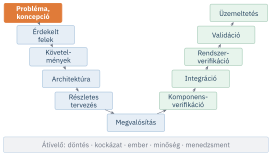
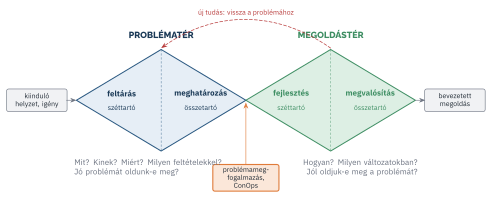
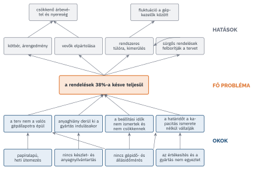
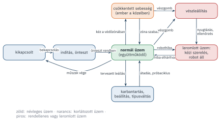
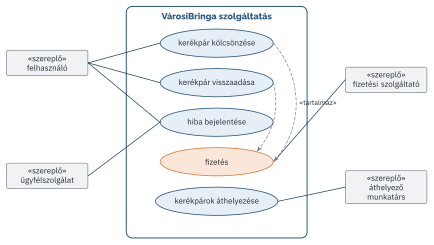

# A probléma meghatározása és a működési koncepció {#sec-problema}

::: {.vterkep}
{fig-alt="V-térkép: a fejezet a V bal ágának első lépésével, a probléma meghatározásával foglalkozik" width=62%}
:::

::: {.cel}
A fejezet feldolgozása után képes leszel:

- szétválasztani a problémateret és a megoldásteret, és felismerni, ha egy problémamegfogalmazás valójában megoldást tartalmaz;
- problémafával feltárni egy probléma okait és hatásait, és célfává alakítani;
- a „van–nincs” elemzéssel pontosan körülhatárolni egy problémát;
- tömör, mérhető problémamegfogalmazást írni, rögzítve a korlátokat, a feltételezéseket és a siker kritériumait;
- felismerni a „gonosz” (nehezen meghatározható) problémákat, és a tervezési stratégiát ehhez igazítani;
- működési koncepciót (ConOps) készíteni üzemmódokkal, normál és rendellenes forgatókönyvekkel, valamint használati esetekkel.
:::

A V-modell bal ága nem a követelményekkel kezdődik, hanem egy kérdéssel: *milyen problémát oldunk meg?* Ez a lépés gyakran rövidebb a kelleténél. A megrendelő hozza a kész megoldást („kell egy MES”, „automatizáljuk az állomást”, „csináljunk egy alkalmazást”), és a csapat azonnal nekilát. A [-@sec-v-modell]. fejezetben láttuk, hogy az életciklus-költségek nagy része már a korai döntésekkel elkötelezetté válik. A rosszul megfogalmazott probléma ezért a legdrágább hiba: a legjobb megvalósítás sem segít, ha rossz kérdésre ad választ.

A fejezet négy kérdésre épül:

- Hogyan válasszuk szét, *mit* akarunk elérni, és *hogyan* akarjuk elérni?
- Hogyan tárjuk fel egy probléma okait és hatásait, és hogyan fogalmazzuk meg pontosan?
- Mit kezdjünk azokkal a problémákkal, amelyeket nem lehet egyszer s mindenkorra meghatározni?
- Hogyan írjuk le a jövőbeli rendszer használatát úgy, hogy abból követelmények születhessenek?

## Problématér és megoldástér {#sec-pr-ter}

A tervezési munka két, egymástól elválasztandó térben zajlik. A **problématér** arról szól, *mit* kell elérni, *kinek*, *miért* és *milyen feltételekkel*. A **megoldástér** arról, *hogyan* érjük el. A két tér összemosása a rendszermérnökség egyik leggyakoribb hibája. Az INCOSE követelményírási útmutatója is erre figyelmeztet: a követelmény azt fogalmazza meg, *mire* van szükség, és ne azt, *hogyan* kell megvalósítani [@incose2023gtwr]. Ha egy követelmény mégis megoldást ír elő, érdemes megkérdezni, *miért* van rá szükség: a válasz gyakran a valódi követelményhez vezet.

A brit Design Council 2005-ben közzétett, 2019-ben továbbfejlesztett „dupla gyémánt” modellje ezt a szétválasztást teszi szemléletessé ([-@fig-dupla-gyemant]. ábra) [@designcouncil2019]. Az első gyémánt a problématér: előbb széttartó gondolkodással feltárjuk a helyzetet, aztán összetartó gondolkodással pontosan meghatározzuk a problémát. A második gyémánt a megoldástér: előbb sok lehetséges megoldást dolgozunk ki, aztán kiválasztjuk és megvalósítjuk a legjobbat. A két gyémánt határán áll a problémamegfogalmazás és a működési koncepció. A modell nem lineáris: a megoldástérben szerzett tudás gyakran visszavezet a problémához.

{#fig-dupla-gyemant width=100%}

A V-modell nyelvén: a bal ág első két lépése (a probléma és az érdekelt felek igényei) az első gyémánt, a koncepcióváltozatok kidolgozása és kiválasztása ([-@sec-kreativitas]. és [-@sec-dontes]. fejezet) a második. A követelmények ([-@sec-kovetelmenyek]. fejezet) a kettő között közvetítenek. A problématérből származnak, de már a megoldás tulajdonságait írják elő.

::: {.eset eset="C" title="ForgácsTech: „kell egy MES”"}
A ForgácsTech tulajdonos-ügyvezetője egy szakmai kiállításon látott MES-rendszerrel érkezett a projektindító megbeszélésre. A rendszermérnök felírta a táblára: „Probléma: nincs MES.” Aztán megkérdezte: „Ha holnap reggelre lenne egy MES, miben lenne más a cég helyzete egy év múlva?”

A válaszok sorra a valódi problémát rajzolták ki: „Nem csúsznának a határidők.” „Tudnánk, mennyit állnak a gépek.” „Nem kellene minden pénteken túlórázni.” „Nem vesztenénk el a legnagyobb vevőnket.” A „nincs MES” egy *hiányzó megoldás* volt. A probléma a megbízhatatlan határidő-tartás, amelynek a MES csak az egyik lehetséges orvossága. A továbbiakban kiderült, hogy legalább ugyanannyit számít az értékesítés és a gyártás egyeztetése és a beállítási idők csökkentése. Ezekhez nem kell szoftver.
:::

## A probléma feltárása {#sec-pr-feltaras}

### Problémafa és célfa

A **problémafa** a probléma okait és hatásait rendezi ok-okozati hierarchiába. Az Európai Bizottság projektciklus-menedzsment útmutatója a logikai keretmátrixos tervezés első lépéseként írja le. A középpontba a fő problémát (fókuszproblémát) helyezzük, alá az okait, fölé a hatásait, a nyilak pedig az ok-okozati kapcsolatokat mutatják [@ec2004pcm]. Az elkészítés lépései:

1. **Gyűjtsük össze a problémákat** az érdekelt felekkel közösen, kártyákon. Egy kártya egy problémát tartalmazzon, negatív állapotként megfogalmazva („a rendelések 38%-a késve teljesül”). Kerüljük a hiányzó megoldás formát („nincs MES”).
2. **Válasszuk ki a fő problémát**, amelyhez a többiek okként vagy hatásként kapcsolódnak.
3. **Rendezzük az okokat** a fő probléma alá: mi okozza ezt? És mi okozza az okot? Addig haladjunk lefelé, amíg befolyásolható okokhoz nem érünk.
4. **Rendezzük a hatásokat** a fő probléma fölé: mi következik ebből?
5. **Ellenőrizzük a logikát:** minden nyíl mentén igaz-e, hogy az alsó elem *okozza* a felsőt?

{#fig-problemafa width=100%}

A problémafából **célfa** készül: minden negatív állapotot a kívánt pozitív állapottá fogalmazunk át. A fő probléma így fő céllá válik („a rendelések legalább 95%-a határidőre teljesül”), az okokból eszközcélok lesznek („a terv a valós gépállapotra épül”), a hatásokból pedig a magasabb szintű, átfogó célok („nő az árbevétel”). Az útmutató arra is figyelmeztet, hogy nem minden eszközcél vállalható egyetlen projektben. A célfából ki kell választani azt az ágat vagy ágakat, amelyekre a projekt összpontosít [@ec2004pcm].

::: {.pelda title="Kidolgozott példa: a ForgácsTech problémafája"}
A [-@fig-problemafa]. ábra a ForgácsTech kétórás problémaelemző workshopjának eredménye. Ezen a termelésvezető, két gépkezelő, a gyártáselőkészítő, az értékesítő és a tulajdonos vett részt.

**A fő probléma.** A csapat a „határidő-csúszás” mellett döntött, és az elmúlt fél év szállítási adataiból számszerűsítette: a rendelések 38%-a teljesült késve.

**Az okok.** Négy közvetlen okot azonosítottak. A legmélyebb szinten egy ok több ágon is megjelent: a gépidő és az állásidő mérésének hiánya. Emiatt nem lehet a valós gépállapotra tervezni, a beállítási időket nem lehet csökkenteni, mert senki sem tudja, mennyik, és a határidőt is a kapacitás ismerete nélkül vállalják. Az ilyen, több ágon visszatérő ok különösen jó beavatkozási pont.

**A célfa és a projekt hatóköre.** Az átfogalmazás után a csapat két ágat választott, ezekre összpontosít a projekt: a gépállapot és az állásidő mérését (ehhez kell a MES adatgyűjtő része), valamint a kapacitásalapú határidő-vállalást (ehhez az értékesítés és a gyártás közös heti egyeztetése és egy egyszerű kapacitástábla kell). Az anyagnyilvántartás bevezetését egy későbbi szakaszra halasztották.
:::

### A probléma körülhatárolása: a „van–nincs” elemzés

Kepner és Tregoe problémaelemzési módszerének központi eszköze a probléma pontos specifikációja. Azt vizsgálja, *mi* a probléma, *hol*, *mikor* és *milyen mértékben* jelentkezik, és ugyanezekre a kérdésekre azt is, hol, mikor és mennyiben *nem* jelentkezik, holott jelentkezhetne [@kepner1965]. A „van” és a „nincs” közötti különbség gyakran közvetlenül az ok felé mutat.

| Kérdés | VAN (hol jelentkezik?) | NINCS (hol nem, bár jelentkezhetne?) | Különbség, nyom |
|:--|:--|:--|:--|
| **Mi?** | késés a kis sorozatú, egyedi rendeléseknél | a három legnagyobb vevő ismétlődő rendeléseinél ritka | az ismétlődő rendeléseknek kész programja és beállítási lapja van |
| **Hol?** | a többtengelyes megmunkáló központokon | a hagyományos esztergákon alig | a megmunkáló központok beállítása hosszabb és változékonyabb |
| **Mikor?** | főleg a hónap második felében | a hónap elején ritka | a hónap második felében gyűlnek a sürgős rendelések |
| **Mennyi?** | átlagosan 4 munkanap, a rendelések 38%-a | – | a késések fele a beállításnál és az anyagbeszerzésnél keletkezik |

: A ForgácsTech határidő-csúszásának „van–nincs” elemzése. {#tbl-van-nincs tbl-colwidths="[11,30,30,29]"}

A [-@tbl-van-nincs]. táblázat jól mutatja, mit ad az elemzés. A probléma nem általános „szervezetlenség”. Kimutathatóan a változatos, egyedi rendeléseknél és a hosszú beállítású gépeken jelentkezik. Ez a beállítási idők mérését és csökkentését (a [-@sec-folyamatelemzes]. fejezetben tárgyalt SMED-szemléletet) is a középpontba állítja.

## A probléma megfogalmazása {#sec-pr-megfogalmazas}

A feltárás eredményét tömör **problémamegfogalmazásba** foglaljuk. Ez a projekt egyik legfontosabb dokumentuma. Minden érdekelt félnek ugyanazt kell értenie belőle, és minden későbbi döntést hozzá lehet mérni. A jó problémamegfogalmazás a következő elemeket tartalmazza:

- **a jelenlegi helyzet:** mi a probléma, kit érint, hol és mikor jelentkezik, mekkora (számszerűen, ha lehet);
- **a kívánt helyzet:** mit akarunk elérni, mérhető módon, határidővel;
- **a jelentőség:** miért fontos, mi történik, ha nem oldjuk meg;
- **a hatókör:** mi tartozik a feladathoz, és mi nem;
- **a korlátok:** a megoldásnak kötelezően betartandó feltételek;
- **a feltételezések:** amit igaznak fogadunk el, de nem tudunk biztosan;
- **a siker kritériumai:** miből látjuk majd, hogy a probléma megoldódott.

A siker kritériumai azt határozzák meg, mit kell a rendszernek elérnie ahhoz, hogy sikeresnek tekintsük, és milyen jól kell ezt elérnie. Az érdekelt felek elvárásait rögzítik, ezért a korlátokkal együtt a legfelső szintű követelmények forrásai. Az érdekelt felek nézőpontjából megfogalmazott, mérhető sikerkritériumokat a szakirodalom a hatékonyság mérőszámainak (measures of effectiveness, MOE) nevezi: ezek a tervezett használati környezetben, adott feltételek mellett mutatják meg, mennyire teljesíti a rendszer a küldetését [@roedler2005; @nasa2016seh, 4.1. szakasz]. Ezekkel a [-@sec-ef-moe]. szakasz részletesen foglalkozik.

::: {.eset eset="C" title="ForgácsTech: a problémamegfogalmazás"}
**Jelenlegi helyzet.** Az elmúlt hat hónapban a ForgácsTech rendeléseinek 38%-a teljesült késve, átlagosan négy munkanappal. A késés főként a kis sorozatú, egyedi rendeléseket és a többtengelyes megmunkáló központokat érinti. A heti ütemterv papíralapú, a gépállapotról és az állásidőkről nincs adat, a határidőket a kapacitás ismerete nélkül vállalják.

**Kívánt helyzet.** Tizennyolc hónapon belül a rendelések legalább 95%-a teljesüljön határidőre, a késve teljesülő rendelések átlagos késése legfeljebb egy munkanap legyen, és a cég minden gépre ismerje a tényleges kihasználtságot és az állásidő okait.

**Jelentőség.** A két legnagyobb vevő a következő keretszerződés feltételéül szabta a 95%-os határidő-tartást és a rendelések nyomonkövethetőségét. A két vevő az árbevétel mintegy 40%-át adja.

**Hatókör.** A rendelés felvételétől a kiszállításig tartó információs és anyagáramlás. Nem része a feladatnak a könyvelési rendszer cseréje és a gépek felújítása.

**Korlátok.** A beruházás felső határa 45 millió forint. A bevezetés alatt a termelés nem állhat le egy hétnél tovább. A gépek vezérlőinek gyártói garanciáját nem szabad veszélyeztetni.

**Feltételezések.** A gépek többsége rendelkezik adatkapcsolati lehetőséggel (ellenőrizendő a régebbi esztergáknál). A gépkezelők elfogadják a digitális munkautasításokat (az üzemi megbeszélésen visszajelzés kérendő).

**A siker kritériumai.** Határidőre teljesülő rendelések aránya ≥ 95% három egymást követő hónapban; átlagos késés ≤ 1 munkanap; a gépek állásidejének legalább 90%-ához ok rendelve.
:::

### Korlátok és feltételezések

A **korlát** olyan feltétel, amelyet a megoldásnak mindenképpen teljesítenie kell, és amelyről a tervezők nem dönthetnek. Ilyen a költségkeret, a határidő, egy jogszabály, egy szabvány vagy egy meglévő rendszerhez való illeszkedés. Az ISO/IEC/IEEE 29148 szabvány szerint a korlát kívülről előírt megkötés, amely a követelményeket, a tervet, a megvalósítást vagy magát a fejlesztési folyamatot korlátozza [@iso29148_2018]. A korlát teljesüléséről költség- vagy teljesítményszempontok miatt sem lehet lemondani. A korlátok szűkítik a megoldásteret. Ezért fontos, hogy csak a valódi korlátokat rögzítsük, és ne emeljünk korláttá egy megszokott vagy kényelmes megoldást.

A **feltételezés** olyan állítás, amelyet a tervezés során igaznak fogadunk el, de nem tudjuk biztosan. Ha egy feltételezés hamisnak bizonyul, a rá épülő követelmények és tervezési döntések is megdőlhetnek. A feltételezéseket ezért érdemes nyilvántartani, és a követelmények jóváhagyása előtt megerősíteni: ki ellenőrzi őket, és mikorra. A meg nem erősített feltételezés kockázat, és a kockázatlistára kerül ([-@sec-kockazat]. fejezet).

### Gonosz problémák

Rittel és Webber 1973-as tanulmánya óta **gonosz problémáknak** (wicked problems) nevezzük azokat a társadalmi és tervezési problémákat, amelyeket nem lehet egyértelműen, végérvényesen megfogalmazni [@rittel1973]. A szerzők tíz jellemzőjük közül néhány különösen fontos a rendszermérnök számára:

- **Nincs végleges megfogalmazásuk.** A probléma megértése és a megoldás keresése ugyanaz a folyamat: minden megoldási kísérlet újabb oldalát mutatja meg a problémának.
- **Nincs leállási szabályuk.** Nem lehet megmondani, mikor oldottuk meg őket. Csak azt, mikor elég jó a helyzet.
- **A megoldásaik nem igazak vagy hamisak, hanem jobbak vagy rosszabbak**, és ezt különböző érdekelt felek eltérően ítélik meg.
- **Minden megoldás egyszeri, következményekkel járó beavatkozás.** Nincs lehetőség próbálkozásra és tévedésre következmények nélkül.
- **Minden gonosz probléma lényegében egyedi**, ezért a máshol bevált megoldás nem vihető át gondolkodás nélkül.

A VárosiBringa ilyen probléma. A „belvárosi forgalom csökkentése” mögött ellentmondó érdekek és viselkedési mintázatok állnak. A kerékpárrendszer bevezetése maga is megváltoztatja a problémát: más lesz a parkolási igény, más a buszok kihasználtsága, mások lesznek a panaszok. A gonosz problémákra nem az a válasz, hogy lemondunk a pontos megfogalmazásról. Kisebb, visszafordítható lépésekben kell haladni (próbaüzem, bővíthető hálózat), a problémamegfogalmazást rendszeresen újra kell vizsgálni, és az érdekelt feleket végig be kell vonni. Ez a [-@sec-rsz-komplexitas]. szakaszban tárgyalt komplex rendszerek tervezési stratégiája.

## A működési koncepció {#sec-pr-conops}

A problémamegfogalmazás azt mondja meg, mit kell elérni. A **működési koncepció** (concept of operations, ConOps) azt írja le, hogyan fogják a jövőbeli rendszert használni ahhoz, hogy ezt elérjék. A ConOps a koncepciószakasz elején készül. Felhasználóközpontú dokumentum: a rendszer mennyiségi és minőségi jellemzőit a felhasználók, a megrendelő, a fejlesztők és a támogató szervezetek számára egyaránt érthetően írja le, és a felhasználó szervezetét, feladatait és céljait egységes rendszerszemléletben mutatja be [@ieee1362_1998; @nasa2016seh, 4.1. szakasz]. Működési nézőpontból, jellemzően időbeli sorrendben írja le, hogyan fogják a rendszert használni, ezért a felhasználókhoz kapcsolódó követelmények és az architektúra kiindulópontja. A ConOps-dokumentum tartalmát eredetileg az IEEE 1362 útmutató rögzítette; ezt 2011-ben a követelménymérnökség szabványa, az ISO/IEC/IEEE 29148 váltotta fel. A szabvány jelenlegi változata a szervezeti szintű működési koncepciót (ConOps) és a rendszer szintű működési koncepciót (OpsCon) külön információs elemként kezeli [@iso29148_2018].

A ConOps legfontosabb tulajdonsága, hogy **a felhasználó nyelvén szól**. Nem azt írja le, milyen alkatrészekből áll a rendszer, hanem azt, hogy ki, mikor, milyen helyzetben, mit csinál vele, és mit tapasztal közben. Ezért a nem mérnök érdekelt felek is el tudják olvasni, ki tudják egészíteni, és jóvá tudják hagyni. A követelményekhez hasonlóan a ConOps is megvalósításfüggetlen: azt mondja meg, mit kell a rendszernek és elemeinek tennie, és nem azt, hogyan.

Az IEEE 1362 útmutató vázlata a mai napig a ConOps-dokumentumok legelterjedtebb szerkezete [@ieee1362_1998]. Kissé egyszerűsítve a következő fejezetekből áll:

1. **Hatókör:** a rendszer azonosítása, a dokumentum célja, a rendszer rövid áttekintése.
2. **Hivatkozott dokumentumok.**
3. **A jelenlegi rendszer vagy helyzet:** háttér és célok; működési szabályok és korlátok; a jelenlegi működés leírása; üzemmódok; felhasználói csoportok; támogató környezet.
4. **A változtatás indoka és jellege:** milyen hiányosságok miatt kell az új rendszer, és mi változik.
5. **A tervezett rendszer koncepciója:** célok; működési szabályok és korlátok; a rendszer leírása; üzemmódok; felhasználói csoportok; támogató környezet (üzemeltetés, karbantartás, javítás).
6. **Működési forgatókönyvek:** normál és rendellenes körülmények között.
7. **A hatások összefoglalása:** a várható hatás a működésre, a szervezetre és a fejlesztés ideje alatti munkára.
8. **A tervezett rendszer elemzése:** az előnyök, a hátrányok és korlátok, valamint a mérlegelt változatok.

### Üzemmódok

A ConOps-vázlat a jelenlegi és a tervezett rendszer leírásában is külön pontot szán az **üzemmódoknak** [@ieee1362_1998], vagyis azoknak a működési módoknak vagy konfigurációknak, amelyekre a rendszernek életciklusa során szüksége lehet. Ide tartoznak a fejlesztéshez és a betanításhoz szükséges teszt- és oktatási módok, a karbantartási mód, valamint a rendellenes helyzetek kezelésére szolgáló módok is. Az üzemmódokat és a köztük lévő átmeneteket állapotgép-diagrammal ábrázoljuk ([-@sec-mod-sysml]. szakasz).

{#fig-uzemmodok-kobo width=100%}

::: {.eset eset="A" title="KoboCella: miért kell leromlott üzemmód?"}
A KoboCella első koncepciója két állapotot ismert: „működik” és „áll”. A ConOps-workshopon a műszakvezető megkérdezte: „Mi történik, ha a robot hétfő reggel elromlik, és a szerviz csak szerdán jön?” A gyártási terv szerint a cella napi mintegy 610 motort szerel. Két nap kiesés több mint 1200 motor, ami a vevő felé szerződésszegés.

Így került a koncepcióba a **leromlott üzemmód** ([-@fig-uzemmodok-kobo]. ábra): a robot áll, de a cella kézi munkaállomásként tovább működik, csökkentett ütemben. Ez a döntés több követelményt is szült. A munkaasztal magasságának kézi szereléshez is megfelelőnek kell lennie. A csavarozó egységnek kézi üzemben is használhatónak kell lennie, nyomatékellenőrzéssel. Az operátoroknak évente legalább egyszer gyakorolniuk kell a kézi szerelést. Ha a leromlott üzemmód nem a ConOps-ban, hanem csak az üzembe helyezéskor merül fel, ezek a követelmények drága átalakítást jelentettek volna.
:::

### Működési forgatókönyvek

A **működési forgatókönyv** egy konkrét helyzet időbeli lefolyásának leírása: ki, mit, milyen sorrendben csinál, és hogyan reagál a rendszer. A forgatókönyveknek a normál és a rendellenes körülményeket is le kell fedniük, és együtt minden várt funkcióra és képességre ki kell terjedniük: a hiányzó forgatókönyv hiányzó követelményt jelent. Jó gyakorlat, ha minden forgatókönyv saját azonosítót kap, mert így a belőle levezetett követelmények visszakövethetők.

Három forgatókönyvtípust érdemes megkülönböztetni:

- **normál (névleges) forgatókönyv:** minden a terv szerint történik;
- **rendellenes forgatókönyv:** valami eltér a tervtől (hibás bemenet, váratlan esemény, kezelési hiba), és a rendszernek ezt kezelnie kell;
- **leromlott üzemű forgatókönyv:** a rendszer egy része nem működik, de a rendszer csökkentett képességgel tovább üzemel.

::: {.pelda title="Kidolgozott példa: a VárosiBringa egy normál és egy rendellenes forgatókönyve"}
**[FK-01] Reggeli kölcsönzés (normál).** Hétköznap reggel 7:40-kor Anna, másodéves hallgató, a lakótelepi állomáson az alkalmazással kiválaszt egy kerékpárt. A rendszer megjeleníti a kerékpár töltöttségét (82%) és a kampusz állomásán várhatóan szabad helyek számát (6). Anna jóváhagyja a kölcsönzést. A dokkoló két másodpercen belül kioldja a zárat. Anna 12 perc alatt felér a kampuszra, a kerékpárt az ottani dokkolóba tolja. A zár rögzíti a kerékpárt, és a rendszer egy percen belül lezárja a kölcsönzést. Anna értesítést kap a díjról, amelyet a közös bérlete miatt nem kell megfizetnie.

**[FK-07] Tele van a céldokkoló (rendellenes).** Egy vizsgaidőszaki reggelen a kampusz dokkolója 7:55-re megtelik. Bence a helyszínen nem tudja letenni a kerékpárt. A forgatókönyv szerint a rendszer a dokkolótól 30 méteren belül felismeri a helyzetet, felajánlja a legközelebbi szabad helyet (a könyvtárnál, 250 méterre), és tizenöt perc ingyenes többletidőt ad. Ha Bence ezt nem fogadja el, a kampuszon kijelölt túlcsorduló területen is leteheti a kerékpárt egy virtuális zárolással. Ekkor az áthelyező szolgálat riasztást kap.

A második forgatókönyv három követelményt is felszínre hozott, amelyekre a csapat korábban nem gondolt: a helymeghatározás pontossága, a túlcsorduló terület kezelése és az áthelyező szolgálat valós idejű riasztása. A rendellenes forgatókönyvek általában több új követelményt hoznak, mint a normálok.
:::

### Használati esetek

A **használati eset** (use case) egy szereplő céljának elérését írja le a rendszerrel folytatott kölcsönhatás révén. Cockburn klasszikus könyve szerint a használati eset a rendszer viselkedésére vonatkozó szerződés, amely leírja, hogyan reagál a rendszer a különböző feltételek mellett egy elsődleges szereplő kérésére. Központi eleme a **fő sikerforgatókönyv**, amely a cél elérésének leggyakoribb útja, és a **kiterjesztések**, amelyek az eltéréseket és a hibakezelést írják le [@cockburn2001].

A használati esetek áttekintésére a használatieset-diagram szolgál ([-@fig-hasznalati-eset]. ábra). A diagram megmutatja a szereplőket, a használati eseteket és a köztük lévő kapcsolatokat. A szereplő lehet ember, szervezet vagy másik rendszer. A diagram önmagában kevés információt hordoz: az értéke a hozzá tartozó szöveges leírásokban van.

{#fig-hasznalati-eset width=85%}

| Elem | Tartalom |
|:--|:--|
| Azonosító, név | HE-01 Kerékpár kölcsönzése |
| Elsődleges szereplő | felhasználó |
| Cél | egy feltöltött kerékpárral elindulni egy állomásról |
| Előfeltétel | a felhasználó regisztrált, érvényes fizetési móddal vagy bérlettel |
| Fő sikerforgatókönyv | 1. A felhasználó kiválaszt egy kerékpárt az alkalmazásban vagy a dokkolón. 2. A rendszer megjeleníti a töltöttséget és a díjat. 3. A felhasználó jóváhagyja a kölcsönzést. 4. A rendszer ellenőrzi a fizetési jogosultságot. 5. A dokkoló kioldja a zárat. 6. A felhasználó elviszi a kerékpárt; a rendszer elindítja a kölcsönzést. |
| Kiterjesztések | 4a. A fizetési jogosultság nem érvényes: a rendszer felajánlja a fizetési mód frissítését. 5a. A zár nem old ki: a rendszer másik kerékpárt ajánl, és hibajegyet nyit. 6a. A kerékpárt egy percen belül nem viszik el: a rendszer visszazárja és törli a kölcsönzést. |
| Utófeltétel | a kölcsönzés aktív, a kerékpár a felhasználóhoz van rendelve |

: A HE-01 használati eset leírása Cockburn szerkezete szerint. {#tbl-he01 tbl-colwidths="[24,76]"}

A ConOps forgatókönyvei és a használati esetek egymást erősítik. A forgatókönyv egy konkrét történet konkrét szereplőkkel. A használati eset általánosítja ezt, és rendszerezetten végiggondolja az eltéréseket. Mindkettő a követelmények egyik fő forrása. Minden lépésből és minden kiterjesztésből egy vagy több követelmény születhet, és a validáció során ugyanezek a forgatókönyvek lesznek a tesztek alapjai ([-@sec-validacio]. fejezet).

::: {.hiba title="Megoldás a forgatókönyvben"}
A forgatókönyv akkor jó, ha a felhasználó céljáról és tapasztalatáról szól. Ha már gombokat, menüpontokat és adatbázismezőket ír le, akkor a megoldásteret írja le, és szűkíti a lehetőségeket. A „Anna megnyomja a zöld »Kölcsönzés« gombot a kezdőképernyő jobb alsó sarkában” mondat felhasználói felület terv, nem működési koncepció. A ConOps-ba ennyi kell: „Anna jóváhagyja a kölcsönzést.”
:::

::: {.kitekintes title="Nagy nyelvi modellek a forgatókönyvek bővítésében"}
A rendellenes forgatókönyvek felderítése fárasztó és könnyen hiányos munka. A nagy nyelvi modellek ebben hasznos segítők lehetnek: egy normál forgatókönyvből rövid idő alatt sok lehetséges eltérést javasolnak („mi van, ha…”). A javaslatok minősége azonban változó, és a modell nem ismeri a valós üzemeltetési körülményeket. A Gyakorlati útmutató ConOps-eszközlapjának mintapromptja ezért arra kéri a modellt, hogy a javaslatait valószínűség és következmény szerint is jelölje, a csapat pedig az érdekelt felekkel együtt dönti el, melyik forgatókönyv kerül a ConOps-ba.
:::

::: {.osszefoglalo}
- A problématér azt írja le, mit, kinek, miért és milyen feltételekkel kell elérni, a megoldástér azt, hogyan. A kettő összemosása a rendszermérnökség egyik leggyakoribb hibája. A „kell egy X” típusú kérés hiányzó megoldás, nem probléma.
- A problémafa a fő probléma okait és hatásait rendezi ok-okozati hierarchiába, a célfa ennek pozitív átfogalmazása. A több ágon visszatérő okok jó beavatkozási pontok.
- A „van–nincs” elemzés a probléma pontos körülhatárolásával az okok felé terel.
- A problémamegfogalmazás tartalmazza a jelenlegi és a kívánt helyzetet, a jelentőséget, a hatókört, a korlátokat, a feltételezéseket és a siker kritériumait. A meg nem erősített feltételezések kockázatok.
- A gonosz problémák nem fogalmazhatók meg végérvényesen. Kis, visszafordítható lépésekkel, folyamatos újrafogalmazással és az érdekelt felek bevonásával kezelhetők.
- A működési koncepció a felhasználó nyelvén írja le, hogyan fogják a rendszert használni. Része az üzemmódok leírása, valamint a normál, a rendellenes és a leromlott üzemű forgatókönyvek. A használati esetek ezeket rendszerezik. Mindkettő a követelmények és a validációs tesztek forrása.
:::

::: {.onell}
1. Mi a probléma a következő megfogalmazással: „A problémánk, hogy nincs automata raktárunk.” Fogalmazd át!
2. Készíts kis problémafát a következő helyzetről: egy egyetemi menza előtt ebédidőben 25 perces sorok állnak. Legalább három okot és két hatást adj meg!
3. Mi a különbség a korlát és a feltételezés között? Mondj egy-egy példát a KoboCella esetéből!
4. Miért tekinthető a VárosiBringa gonosz problémának, a KoboCella pedig nem? Mi következik ebből a projekt ütemezésére?
5. Írj egy rendellenes forgatókönyvet a KoboCella számára arra az esetre, amikor a csavaradagoló kifogy!
6. Melyik mondat tartozik a ConOps-ba, és melyik nem? (a) „A karbantartó a heti ellenőrzést 20 perc alatt elvégzi.” (b) „A robot vezérlőszekrénye IP54 védettségű.” (c) „Ha a robot leáll, az operátor kézi üzemben folytatja a szerelést.”

::: {.megoldas}
1. A megfogalmazás egy hiányzó megoldást nevez meg. A valódi probléma például: „A komissiózás átlagosan 4 óráig tart, és a tételek 2%-a hibás; emiatt a délután beérkező rendeléseket csak másnap tudjuk kiszállítani.” Ezt automata raktár, jobb raktári elrendezés vagy vonalkódos ellenőrzés is megoldhatja.
2. Például. Okok: egyetlen pénztár; a diákok a pult előtt választanak a menüből; minden diák 12:00 és 12:30 között érkezik (az órarend miatt). Hatások: a diákok elkésnek a délutáni óráról; sokan inkább nem esznek. A fő probléma: ebédidőben 25 perces várakozás.
3. A korlát kötelező feltétel, amelyről a tervezők nem dönthetnek (például a cellának el kell férnie a jelenlegi 6 × 4 méteres helyen). A feltételezés olyan állítás, amelyet igaznak fogadunk el, de ellenőrizni kell (például hogy a gyár MES-rendszere fogadja a cella adatait a meglévő interfészen).
4. A VárosiBringa problémáját különböző érdekelt felek eltérően értik, a beavatkozás maga is megváltoztatja a problémát, és nincs egyértelmű megoldása. A KoboCella célja jól megfogalmazható és mérhető, a megoldás kipróbálható. A VárosiBringa ezért próbaüzemmel és lépcsőzetes bővítéssel, rendszeres felülvizsgálattal ütemezendő.
5. Például: [FK-12] A csavaradagoló kiürül egy ciklus közben. A cella a ciklust befejezi a meglévő csavarokkal, ha lehet; ha nem, a darabot félkész állapotban, jelölve a kiadóba teszi. A kezelőpanel és a jelzőlámpa jelzi a hiányt. Az operátor feltölti az adagolót, nyugtázza a jelzést, és a félkész darabot a következő ciklusban befejezteti. A rendszer naplózza az eseményt a MES felé.
6. (a) és (c) a ConOps-ba tartozik, mert a használatot írja le. (b) a megoldás tulajdonsága, legfeljebb egy környezeti követelményből levezetett tervezési döntés.
:::
:::

::: {.projekt title="Projektlépés: problémamegfogalmazás és működési koncepció"}
Saját fejlesztési feladatodhoz:

1. készíts problémafát (legalább egy fő probléma, négy ok, három hatás), és alakítsd át célfává; jelöld ki, mire összpontosít a projekt;
2. írd meg a problémamegfogalmazást a fejezetben bemutatott hét elemmel; a kívánt helyzet és a siker kritériumai legyenek mérhetők;
3. sorold fel a rendszer üzemmódjait, és rajzolj róluk állapotdiagramot;
4. írj legalább két normál és két rendellenes forgatókönyvet azonosítóval;
5. készíts egy használati eset leírást fő sikerforgatókönyvvel és legalább három kiterjesztéssel.

Az eszközöket és a sablonokat a Gyakorlati útmutató interjú- és ConOps-eszközlapjai tartalmazzák.
:::

::: {.forras}
- @ieee1362_1998: a ConOps-dokumentum klasszikus vázlata, részletes magyarázattal.
- @iso29148_2018: a ConOps és az OpsCon helye a követelménymérnökség folyamatában.
- @ec2004pcm: a problémafa és a célfa módszere a projektciklus-menedzsmentben.
- @kepner1965: a problémaelemzés klasszikus módszere, a „van–nincs” specifikáció.
- @rittel1973: a gonosz problémák fogalmának eredeti forrása.
- @cockburn2001: a használati esetek írásának gyakorlati kézikönyve.
- @nasa2016seh, 4.1. szakasz és S függelék: a működési koncepció szerepe és egy lehetséges vázlata.
:::
