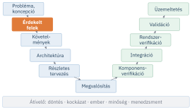
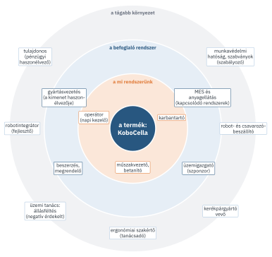
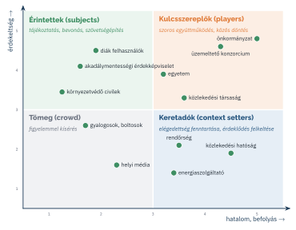
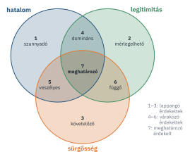
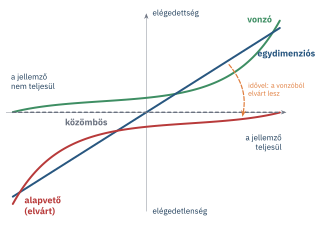

# Érdekelt felek elemzése {#sec-erdekelt-felek}

::: {.vterkep}
{fig-alt="V-térkép: a fejezet a V bal ágának második lépésével, az érdekelt felek igényeivel foglalkozik" width=62%}
:::

::: {.cel}
A fejezet feldolgozása után képes leszel:

- meghatározni, kik egy rendszer érdekelt felei, és megkülönböztetni a megrendelőt, a felhasználót és a további érdekelteket;
- rendszerezetten azonosítani egy fejlesztés érdekelt feleit az életciklus-szakaszok és a hagymamodell segítségével, a „csendes” és a negatív érdekelteket is beleértve;
- priorizálni az érdekelt feleket a hatalom–érdekeltség rács és a fontossági (szaliencia-) modell alapján, és mindegyikhez bevonási stratégiát rendelni;
- kiválasztani és alkalmazni az elvárások feltárásának megfelelő módszereit (interjú, megfigyelés, workshop, kérdőív, adatelemzés, prototípus);
- Kano-kérdőívvel osztályozni az elvárásokat, és kiszámítani az elégedettségi együtthatókat;
- az elvárásokból szükséglet–cél–célkitűzés rendszert és a hatékonyság mérőszámait (MOE) levezetni.
:::

A V-modell bal ága az érdekelt felekkel kezdődik ([-@fig-v]. ábra). Ennek egyszerű oka van: egy rendszer akkor sikeres, ha valakinek értéket teremt, és nem árt indokolatlanul másoknak. Ha nem tudjuk, kik ezek a „valakik” és „mások”, akkor a legjobb műszaki megoldás is a semmibe vezethet.

A fejezet négy kérdésre épül:

- Kik az érdekelt felek, és miért nem elég a megrendelőre figyelni?
- Hogyan azonosíthatjuk őket rendszerezetten, hogy senki fontos ne maradjon ki?
- Kire mennyi figyelmet fordítsunk?
- Hogyan tárjuk fel, osztályozzuk és fogalmazzuk meg az elvárásaikat úgy, hogy a következő lépésben ([-@sec-kovetelmenyek]. fejezet) mérhető követelmények születhessenek belőlük?

A fejezet végén az érdekelt felek elvárásait a hatékonyság mérőszámaivá alakítjuk. Ezek lesznek a validáció mércéi a V jobb ágán.

## Kik az érdekelt felek? {#sec-ef-fogalom}

Az érdekelt fél (stakeholder) fogalma a stratégiai menedzsmentből érkezett a mérnöki gyakorlatba. R. Edward Freeman klasszikus meghatározása szerint érdekelt fél minden olyan csoport vagy egyén, amely befolyásolni tudja a szervezet céljainak elérését, vagy amelyet ez befolyásol [@freeman1984]. Az ISO/IEC/IEEE 15288 szabvány a rendszerfejlesztésre szabva fogalmaz: érdekelt fél az az egyén vagy szervezet, akinek joga, részesedése, igénye vagy érdeke fűződik a rendszerhez, illetve ahhoz, hogy a rendszer az igényeinek és elvárásainak megfelelő tulajdonságokkal rendelkezzen [@iso15288_2023].

Mindkét definíció kétirányú. Érdekelt az is, aki *hat* a rendszerre (finanszírozza, engedélyezi, megépíti), és az is, *akire* a rendszer hat (használja, elszenvedi a zaját, elveszíti miatta a munkáját). A rendszermérnöki gyakorlatban három csoportot érdemes megkülönböztetni.

- **A megrendelő** az, aki a terméket kéri és jellemzően fizet érte. Az, hogy ki a megrendelő, a termékszerkezet szintjétől függ. Az ISO/IEC/IEEE 15288 megrendelő és szállító szerepekben gondolkodik, és ezek a szerepek a termékszerkezet minden szintjén, akár egy szervezeten belül is megjelennek [@iso15288_2023, 6.1. szakasz]. A rendszer legfelső szintjén a vásárló szervezet a megrendelő, egy alrendszer fejlesztője számára viszont az a csapat, amely az alrendszert a nagyobb egységbe integrálja.
- **A felhasználók és üzemeltetők** azok, akik a rendszert közvetlenül működtetik vagy használják. Ők érzékelik leginkább a rendszer erősségeit és hibáit. Gyakran mégsem ők döntenek a beszerzésről.
- **A további érdekelt felek** tágabb kereteket szabnak (hatóságok, szabványalkotók), életciklus-szolgáltatásokat nyújtanak (karbantartók, beszállítók, hulladékkezelők), vagy a rendszer hatásait viselik (szomszédok, a környezet, a jövő nemzedékei).

::: {.fogalom title="Igény, elvárás, követelmény"}
A három fogalmat a mindennapi nyelv gyakran összemossa. A rendszermérnökségben azonban mást jelentenek, és a különbség a V-modell lépéseit is tükrözi.

- **Igény (szükséglet):** az a probléma vagy hiány, amelyet az érdekelt fél megoldani szeretne. Megoldásfüggetlen: *„biztonságosan és fáradság nélkül akarok feljutni a dombon lévő egyetemre”*.
- **Elvárás:** az érdekelt fél elképzelése arról, mit és milyen feltételekkel nyújtson a rendszer. Lehet minőségi és pontatlan: *„legyen mindig kerékpár a közelben”*.
- **Követelmény:** a rendszerre vonatkozó egyértelmű, mérhető, ellenőrizhető állítás, amelyet az elvárásokból vezetünk le: *„csúcsidőben az állomások legalább 90%-án legyen legalább két kölcsönözhető kerékpár”*. A követelményekkel a [-@sec-kovetelmenyek]. fejezet foglalkozik.
:::

Miért nem elég a megrendelőre figyelni? Mert a megrendelő csak egy hang a sok közül, és sokszor nem is ismeri a többiek szempontjait. Az érdekelt felek igényeinek feltárása a V-modell első technikai lépése, és minden további munka erre épül [@iso15288_2023, 6.4.2. szakasz]. Ha a megrendelő, a többi érdekelt fél és a rendszermérnök a projekt elején közösen rögzíti, mit fog tudni a termék, azzal megelőzhető, hogy a követelmények a fejlesztés során ellenőrizetlenül bővüljenek (az angol szakirodalom ezt *requirements creep* néven ismeri). A kimaradt érdekelt fél nem tűnik el. Később jelentkezik, jellemzően a legrosszabb pillanatban: a hatósági engedélyezésnél, az üzembe helyezéskor vagy egy sajtóhírben.

::: {.eset eset="B" title="VárosiBringa: a kezdeti lista"}
Az önkormányzat projektcsapata az első megbeszélésen négy érdekelt felet sorolt fel: a város vezetését, az üzemeltetőt, a „felhasználókat” és a közlekedési társaságot. Egy órás, rendezett gondolkodás után a lista harmincnál több szereplőre bővült. Ide kerültek többek között:

- az idősebb és a mozgáskorlátozott lakók;
- a belvárosi boltosok, akik a dokkolók helyét féltik;
- a gyalogosok, akiket a járdára hagyott kerékpárok zavarnak;
- a rendőrség;
- az energiaszolgáltató;
- a kerékpárokat rongáló csoportok.

A felhasználók csoportja is szétvált diákokra, ingázókra és turistákra, mert eltérő a napszakos használatuk, a fizetési szokásuk és a technikai jártasságuk. A következő szakasz azt mutatja meg, hogyan lehet ezt a bővítést szisztematikusan, nem pedig szerencsén múlóan elvégezni.
:::

## Az érdekelt felek rendszerezett azonosítása {#sec-ef-azonositas}

Az érdekelt felek azonosítása kreatív és fegyelmezett munka egyszerre. A kreativitás ahhoz kell, hogy a nem nyilvánvaló szereplők is eszünkbe jussanak, a fegyelem ahhoz, hogy a keresés teljes legyen. Három, egymást kiegészítő nézőpont segít ebben: az életciklus, a hagymamodell és néhány célzott ellenőrző kérdés.

### Az életciklus nézőpontja

Az érdekelt felek köre a rendszer életciklusa során változik. Az ISO/IEC/IEEE 15288 szabvány ezért azt írja elő, hogy azokat az érdekelt feleket kell azonosítani, akiknek a rendszer *teljes életciklusa* során érdekük fűződik hozzá [@iso15288_2023, 6.4.2. szakasz]. A [-@tbl-ef-eletciklus]. táblázat a [-@sec-eletciklus]. szakasz életciklus-szakaszai szerint sorolja fel a jellemző érdekelteket. Ha a listánkon nincs olyan szereplő, aki a gyártással, a karbantartással vagy a kivonással foglalkozik, akkor valószínűleg kihagytunk valakit.

| Életciklus-szakasz | Jellemző érdekelt felek |
|:--|:--|
| Koncepció | Szponzor és stratégiai döntéshozók, megrendelő, potenciális felhasználók, finanszírozók, szabályozó hatóságok |
| Fejlesztés | Megrendelő, mérnöki szakterületek, biztonsági és munkavédelmi szakemberek, beszállítók, gyártás-előkészítés, tesztelők |
| Gyártás | Gyártás, minőségügy, logisztika, beszállítók, munkavállalók és érdekképviseletük |
| Használat | Felhasználók és üzemeltetők, ügyfélszolgálat, a kimenet haszonélvezői, a rendszer hatásait viselő szomszédok |
| Támogatás | Karbantartók, alkatrészellátás, betanítók, szoftverfrissítést végzők |
| Kivonás | Hulladékkezelők és újrahasznosítók, környezetvédelmi hatóságok, a közvélemény |

: Jellemző érdekelt felek az életciklus-szakaszokban. Saját összeállítás. {#tbl-ef-eletciklus tbl-colwidths="[22,78]"}

### A hagymamodell

Ian Alexander a rendszer köré rajzolt koncentrikus körökkel, „hagymával” rendszerezi az érdekelt feleket [@alexander2005]. A középpontban maga a termék áll, amely önmagában nem érdekelt fél. Körülötte három gyűrű helyezkedik el ([-@fig-hagyma]. ábra).

- **A mi rendszerünk** gyűrűjében azok vannak, akik a terméket közvetlenül működtetik: a napi kezelők, a karbantartók és az üzemeltetést segítők (betanítók, ügyfélszolgálat). A termék és ezek a szerepek együtt alkotják azt a működő rendszert, amely a szolgáltatást ténylegesen nyújtja.
- **A befoglaló rendszer** gyűrűjébe tartoznak a termék kimenetének haszonélvezői, a kapcsolódó rendszerekért felelősök, a megrendelő és a projekt szponzora, aki a fejlesztést elindítja, finanszírozza és védi.
- **A tágabb környezet** gyűrűjében találjuk a pénzügyi és a politikai haszonélvezőket, a szabályozókat, a fejlesztőket, a tanácsadókat, a beszállítókat, valamint a **negatív érdekelteket**. Ők azok, akiknek a rendszer árthat, vagy akik ártani akarnak neki.

{#fig-hagyma width=88%}

A hagymamodell legfőbb haszna, hogy **szerepekben** gondolkodtat, nem személyekben. Ugyanaz a személy több szerepben is megjelenhet: egy műszakvezető egyszerre lehet kezelő, betanító és a változtatással szembeni ellenállás hangja. Egy szerepet pedig több csoport is betölthet. Alexander megfigyelése szerint a projektek kudarca gyakran nem rossz követelményekből fakad, hanem abból, hogy egy szerep nézőpontja teljesen kimaradt. Ilyenkor a hozzá tartozó forgatókönyvek és követelmények egész csoportja hiányzik [@alexander2005].

### Ellenőrző kérdések

Az alábbi kérdések a „ki maradt ki?” vizsgálatot segítik. Érdemes mindegyiket feltenni, és minden válaszhoz konkrét csoportot vagy szervezetet rendelni.

1. Ki **fizet** a rendszerért, és ki **fizeti az üzemeltetését**?
2. Ki **használja** naponta, alkalmanként, kivételes helyzetben? Ki használja **rendellenes körülmények között** (hiba, vészhelyzet, rossz idő)?
3. Ki **építi, telepíti, karbantartja, frissíti és vonja ki**?
4. Ki **szabályozza, engedélyezi, ellenőrzi**?
5. Kinek az **érdekeit sérti**, kit **zavar**, kinek a **munkáját változtatja meg**?
6. Kinek a **rendszerével kapcsolódik**? Melyik meglévő folyamatot, adatot, infrastruktúrát érinti?
7. Kinek **nincs hangja**, mégis érinti? Ilyen a természeti környezet, a jövő nemzedékei, a fogyatékossággal élők, a digitálisan kevésbé jártasak.
8. Ki **akadályozhatja** a sikert, ha kimarad (hatóság, munkavállalói érdekképviselet, sajtó, közösségi média)?

::: {.hiba title="A „felhasználó” mint egyetlen csoport"}
Az egyik leggyakoribb hiba, hogy a felhasználókat egyetlen homogén csoportként kezeljük. A VárosiBringa diák felhasználói este és hétvégén, mobilról, bankkártyával fizetnek. Az ingázók reggel és délután, bérlettel. A turisták alkalmanként, idegen nyelvű felületet és egyszerű regisztrációt várnak. Az idősebb lakók számára a nagy betűméret, a stabil kerékpár és a személyes segítség lehetősége a döntő. Ezek a csoportok eltérő elvárásokat, eltérő forgatókönyveket és eltérő követelményeket jelentenek. A felhasználói csoportok jellemzésére a [-@sec-emberkozpontu]. fejezet perszónái adnak eszközt.
:::

## Kire mennyi figyelmet? Az érdekelt felek priorizálása {#sec-ef-priorizalas}

Harminc érdekelt fél mindegyikével nem lehet ugyanolyan intenzitással foglalkozni. A priorizálás nem azt jelenti, hogy egyes érdekelteket figyelmen kívül hagyunk. Azt jelenti, hogy tudatosan választjuk meg, kit vonunk be a döntésekbe, kit tájékoztatunk, és kinek a helyzetét figyeljük. Két egymást kiegészítő eszközt mutatunk be.

### A hatalom–érdekeltség rács

A rács az érdekelt feleket két szempont szerint helyezi el: mekkora a **hatalmuk** (befolyásuk) a rendszer sorsára, és mekkora az **érdekeltségük**, vagyis mennyire foglalkoztatja őket a rendszer. Az ötletet Mendelow vetette fel a környezetfigyelés kapcsán [@mendelow1981]. A négy negyedet és a hozzájuk tartozó stratégiákat Eden és Ackermann dolgozta ki [@eden1998; @ackermann2011].

- **Kulcsszereplők** (players, nagy hatalom és nagy érdekeltség): velük szorosan együtt kell dolgozni, és be kell vonni őket a döntésekbe.
- **Érintettek** (subjects, kis hatalom, nagy érdekeltség): tájékoztatni és bevonni kell őket. Az érdekeiket gyakran csak összefogva tudják érvényesíteni, ezért érdemes számolni a szövetségeikkel.
- **Keretadók** (context setters, nagy hatalom, kis érdekeltség): elégedettségüket fenn kell tartani, és érdemes felkelteni az érdeklődésüket. Gyakran éppen ők alakítják a projekt környezetét (szabályozás, finanszírozás).
- **Tömeg** (crowd, kis hatalom és kis érdekeltség): elég figyelemmel kísérni őket, de számolni kell azzal, hogy helyzetük megváltozhat.

Ackermann és Eden arra is felhívja a figyelmet, hogy a rács nem statikus térkép. Egy érdekelt fél helyzete változik, sőt tudatosan változtatható [@ackermann2011]. Egy támogató, de gyenge érintett csoport megerősíthető, és így kulcsszereplővé válhat. Egy közömbös keretadó érdeklődése felkelthető. Egy esetleges ellenfél pedig korai bevonással semlegesíthető.

::: {.pelda title="Kidolgozott példa: a VárosiBringa hatalom–érdekeltség rácsa"}
A projektcsapat négy tagja egymástól függetlenül pontozta a tizenkét legfontosabbnak ítélt érdekelt felet 1-től 5-ig mindkét szempont szerint. Ezután megbeszélték az eltéréseket, és az átlagot rögzítették ([-@tbl-ef-racs]. táblázat). A pontozás szempontjai a következők voltak.

- **Hatalom:** van-e döntési jogköre (engedély, finanszírozás, szerződés), rendelkezik-e nélkülözhetetlen erőforrással (terület, hálózat, ügyfélkör), és képes-e mozgósítani a közvéleményt.
- **Érdekeltség:** mennyire változtatja meg a rendszer a mindennapjait vagy az üzleti eredményét, és mennyire foglalkozik vele aktívan.

| Érdekelt fél | Hatalom | Érdekeltség | Negyed | Indoklás (röviden) |
|:--|:-:|:-:|:--|:--|
| Önkormányzat | 5,0 | 4,8 | kulcsszereplő | finanszíroz, közterületet biztosít, politikai felelősséget visel |
| Üzemeltető konzorcium | 4,3 | 4,6 | kulcsszereplő | szerződéses partner, az üzleti eredmény az övé |
| Közlekedési társaság | 3,6 | 3,3 | kulcsszereplő | bérletrendszer, átszállópontok; partner és versenytárs is |
| Egyetem | 3,2 | 3,9 | kulcsszereplő | sok potenciális felhasználó, telephelyet adhat |
| Diák felhasználók | 1,9 | 4,5 | érintett | a fő célcsoport, de szervezetlen |
| Akadálymentességi érdekképviselet | 1,6 | 4,1 | érintett | jogi és erkölcsi súly, kis közvetlen hatalom |
| Környezetvédő civilek | 1,25 | 3,45 | érintett | támogatók, a közvéleményt mozgósíthatják |
| Gyalogosok, boltosok | 1,7 | 2,6 | tömeg | a járdahasználat miatt később felerősödhet |
| Helyi média | 2,3 | 1,6 | tömeg | egy-egy rossz hír felnagyíthatja a problémákat |
| Energiaszolgáltató | 3,4 | 1,4 | keretadó | hálózati csatlakozás, töltési díjak |
| Közlekedési hatóság | 4,5 | 1,9 | keretadó | jóváhagyások, közúti szabályok |
| Rendőrség | 3,5 | 2,1 | keretadó | közterületi rend, lopások, balesetek |

: A VárosiBringa érdekelt feleinek pontozása (a csapat átlaga, szemléltető adatok). {#tbl-ef-racs tbl-colwidths="[25,9,11,14,41]"}

Az eredményt a [-@fig-racs]. ábra mutatja. Két tanulság rögtön adódik. Az akadálymentességi érdekképviselet és a környezetvédők érintettek: kis hatalmuk miatt könnyű lenne őket csak tájékoztatni. Korai bevonásukkal azonban a projekt hiteles szövetségeseket nyerhet, és elkerülheti a későbbi, költséges áttervezést, például a dokkolók akadálymentes kialakításánál. A gyalogosok és a boltosok ma a tömegbe tartoznak, de ha a kerékpárok elárasztják a járdákat, gyorsan érintettekké, a helyi média segítségével akár keretadókká válhatnak.
:::

{#fig-racs width=96%}

### A fontossági (szaliencia-) modell

A hatalom–érdekeltség rács egyszerű és szemléletes, de két fontos szempontot nem lát: azt, hogy jogos-e az érdekelt fél követelése, és azt, hogy mennyire sürgető. Mitchell, Agle és Wood ezért három tulajdonság alapján határozza meg, mennyire „fontos” (szalienciás) egy érdekelt fél a döntéshozók számára [@mitchell1997]:

- **hatalom:** képes-e elérni, hogy akaratát érvényesítse (kényszerrel, erőforrásokkal vagy szimbolikus eszközökkel);
- **legitimitás:** társadalmilag elfogadott, jogos-e a követelése (törvény, szerződés, erkölcsi jog);
- **sürgősség:** mennyire időkritikus a követelése, és mennyire fontos neki.

A három tulajdonság kombinációi hét érdekeltfél-osztályt adnak ([-@fig-venn]. ábra, [-@tbl-ef-szaliencia]. táblázat). Minél több tulajdonság jellemző valakire, annál nagyobb figyelmet kap a döntéshozóktól. A modell legfontosabb tanulsága azonban a *dinamika*. Az érdekelt fél egyik osztályból a másikba léphet, ha megszerez egy tulajdonságot, és ez a projekt szempontjából előre jelezhető kockázat.

{#fig-venn width=72%}

| Osztály (angol név) | Tulajdonságok | Példa a futó esetekből |
|:--|:--|:--|
| Szunnyadó (dormant) | hatalom | Az anyavállalat központi beszerzése, amely jelenleg nem foglalkozik a KoboCellával, de leállíthatja a beruházást |
| Mérlegelhető (discretionary) | legitimitás | A ForgácsTech egyik kisebb vevője, amely szívesen látna online rendelési nyomkövetést |
| Követelőző (demanding) | sürgősség | Egy VárosiBringa-dokkoló melletti lakó, aki minden nap panaszt tesz a zaj miatt |
| Domináns (dominant) | hatalom + legitimitás | A munkavédelmi hatóság a KoboCella esetében |
| Veszélyes (dangerous) | hatalom + sürgősség | A VárosiBringa kerékpárjait szervezetten rongáló csoport |
| Függő (dependent) | legitimitás + sürgősség | A KoboCella operátorai, akiknek egészségi panaszai jogosak és sürgetőek, de döntési hatalmuk nincs |
| Meghatározó (definitive) | mindhárom | A KoboCella üzemigazgatója (szponzor, határidővel), vagy az operátorok, ha az üzemi tanács felkarolja ügyüket |

: A fontossági modell hét osztálya példákkal. Az osztályok @mitchell1997 szerint; a magyar elnevezések saját fordítások. {#tbl-ef-szaliencia tbl-colwidths="[22,20,58]"}

::: {.eset eset="A" title="KoboCella: a függő érdekeltből meghatározó lesz"}
Az operátorok kezdetben függő érdekeltek: követelésük, a fizikai terhelés csökkentése, legitim és sürgető, de hatalmuk nincs. Ha az üzemi tanács felkarolja az ügyet, és munkavédelmi vizsgálatot kezdeményez, az operátorok hatalmat is szereznek, és meghatározó érdekeltté válnak. A projektcsapat ezt a fordulatot nem kivárja, hanem megelőzi. Két operátort a kezdetektől bevon a cella kialakításába. Ez nemcsak a konfliktust csökkenti: a tapasztalt operátorok olyan rejtett tudást hoznak (például a fedél illesztésének apró trükkjeit), amely nélkül a funkciómegosztás rossz lenne ([-@sec-automatizalas]. fejezet).
:::

A két modell eredménye végül egy **bevonási tervben** összegződik. A terv minden érdekelt félhez megadja:

- a bevonás módját (közös döntés, konzultáció, tájékoztatás, figyelés);
- a csatornát;
- a gyakoriságot;
- a felelős kapcsolattartót.

A Gyakorlati útmutató *Hatalom–érdekeltség és fontossági elemzés* eszközlapja ehhez sablont is ad.

## Az elvárások feltárása {#sec-ef-feltaras}

Ha tudjuk, kik az érdekelt felek, meg kell tudnunk, mit várnak a rendszertől. Ez nehezebb, mint amilyennek látszik. Az emberek nem mindig tudják megfogalmazni, mire van szükségük. Gyakran egy megoldást mondanak a probléma helyett. A legfontosabb elvárásaikat pedig sokszor meg sem említik, mert annyira magától értetődőnek tartják őket. A feltárásnak ezért több módszere van, és a jó gyakorlat ezeket kombinálja ([-@tbl-ef-modszerek]. táblázat).

| Módszer | Erősségek | Korlátok | Mikor különösen hasznos? |
|:--|:--|:--|:--|
| Dokumentumelemzés | Strukturált információ; nem igényli az érdekeltek idejét | Elavult lehet; nem a megfelelő részletességű | Korai tájékozódás, szabályozási háttér |
| Helyszíni megfigyelés | Gazdag, a környezetbe ágyazott kép; rejtett tudás feltárása | Időigényes; a megfigyeltek másképp viselkedhetnek; kevés eset | Munkafolyamatok, kezelési helyzetek |
| Interjú | Részletes, mély megértés | Az érdekeltek idejét igényli; több kör kell | Kulcsszereplők, szakértők, konfliktusok feltárása |
| Workshop | Az eltérő nézetek közvetlen ütköztetése és feloldása | Sok érdekelt egyidejű részvételét igényli | Ellentmondó elvárások, közös célkép |
| Kérdőív | Sok válaszadó, számszerűsíthető eredmény | Új szempontot ritkán tár fel; alacsony válaszarány | Elvárások súlyozása, Kano-elemzés |
| Adatelemzés, automatikus feltárás | Nagy esetszám, objektív adatok | Adatminőség; csak a meglévő működést mutatja | Működő rendszer vagy folyamat fejlesztése |
| Prototípus, makett | Konkrét visszajelzés; a ki nem mondott elvárások felszínre kerülnek | Korán egy megoldás felé terelhet | Kezelőfelületek, ergonómia, szolgáltatás-élmény |

: Az elvárások feltárásának módszerei. Az első öt sor @dumas2018 folyamatfeltárási módszereit követi, saját bővítéssel. {#tbl-ef-modszerek tbl-colwidths="[18,28,28,26]"}

### Igény a megoldás mögött

A feltárás egyik legfontosabb készsége, hogy a kimondott megoldás mögött meghalljuk a valódi igényt. Ha egy érdekelt fél megoldást mond, mindig érdemes megkérdezni: *mit tenne lehetővé ez a megoldás, és miért fontos ez?* Ez nem jelenti a javaslat elutasítását. Azt jelenti, hogy a megoldást az igényhez mérjük, és nyitva hagyjuk a lehetőséget más, esetleg jobb megoldások előtt.

::: {.eset eset="C" title="ForgácsTech: „kell egy tablet minden gép mellé”"}
Az egyik interjúban egy tapasztalt CNC-gépkezelő határozottan kijelentette, hogy minden gép mellé tablet kell. A beszélgetés során kiderült, mi áll e mögött:

- naponta többször is az irodába kell mennie a következő rendelés műhelyrajzáért;
- a papírrajzok között előfordul, hogy nem a legfrissebb változat van nála;
- a szerszámcseréhez szükséges adatokat egy füzetben vezeti.

A valódi igény tehát így szól: *„a következő feladat aktuális rajzához és technológiai adataihoz a gép mellől, keresgélés nélkül akarok hozzáférni”*. Erre a tablet csak az egyik lehetséges válasz. Ugyanígy szóba jöhet a gépvezérlőn megjelenő munkautasítás vagy egy közös terminál a gépcsoportnál. Az igény megfogalmazása a változatok összevetésének lehetőségét is megnyitja ([-@sec-dontes]. fejezet).
:::

### Az interjú gyakorlata

Az interjú a leggyakrabban használt feltárási módszer. Néhány bevált szabály jelentősen javítja az eredményét.

- **Készülj fel**, de ne kérdőívet olvass fel. Egy rövid témavázlat jobb, mint egy merev kérdéssor.
- **Konkrét esetekről kérdezz.** A „Hogyan szokta…?” kérdés általánosságokat hoz. A „Mesélje el, legutóbb mi történt, amikor…” kérdés valós helyzetet, valós problémákat.
- **Kerüld a sugalmazó kérdéseket.** A „Ugye fontos lenne, ha…?” kérdésre szinte mindenki igennel felel.
- **Kérdezd meg, miért** – türelmesen, akár többször is –, amíg a megoldástól el nem jutsz az igényig.
- **Kérdezz a kivételekről.** Mi történik hiba, rossz idő, csúcsidő, betegség esetén? A rendellenes helyzetek gyakran a legfontosabb követelményeket hozzák.
- **Rögzíts szó szerint**, és az interjú végén foglald össze, amit megértettél. Az összefoglalót küldd vissza jóváhagyásra. Ez az elvárás első validálása.

::: {.kitekintes title="Nagy nyelvi modellek az érdekeltfél-elemzésben"}
A nagy nyelvi modellek gyorsan készítenek hosszú listákat az érdekelt felekről és tipikus elvárásaikról, és interjúvázlatok, kérdőívek megfogalmazásában is segíthetnek. Ez hasznos ellenőrző lista lehet, különösen a „ki maradt ki?” kérdéshez. Két korlátjukat azonban látni kell. Listáik a tipikusat adják vissza, nem a konkrét helyzetet: a helyi szereplők, a nem nyilvános konfliktusok és a kimondatlan érdekek nem szerepelnek bennük. Másodszor a modell válasza nem forrás. Egy érdekelt fél elvárását csak maga az érdekelt fél erősítheti meg. A Gyakorlati útmutató mintapromptjai ezért a modell kimenetét mindig emberi ellenőrzéssel és az érdekeltekkel való egyeztetéssel kapcsolják össze.
:::

## Az elvárások osztályozása: a Kano-modell {#sec-ef-kano}

Nem minden elvárás egyforma. Vannak, amelyeknek a hiánya felháborodást kelt, a megléte viszont senkit sem lelkesít. Vannak, amelyek minél jobban teljesülnek, annál elégedettebb a felhasználó. És vannak, amelyekre senki sem számít, de ha megjelennek, meglepetésszerű örömet okoznak. Noriaki Kano és munkatársai 1984-ben megjelent modellje ezt a nem lineáris összefüggést teszi kezelhetővé [@kano1984]. A modell a termékjellemzőket aszerint osztályozza, hogyan függ az elégedettség a jellemző teljesülésétől ([-@fig-kano]. ábra).

- **Alapvető (elvárt) jellemzők** (must-be): hiányuk erős elégedetlenséget okoz, meglétük viszont csak a semleges állapotot biztosítja. Ezek a piacra lépés feltételei.
- **Egydimenziós jellemzők** (one-dimensional): az elégedettség nagyjából arányosan nő a teljesülés mértékével. Erről szólnak a versenytársakkal való összehasonlítások.
- **Vonzó jellemzők** (attractive): hiányukat senki sem kéri számon, meglétük viszont kiemelkedő elégedettséget okoz.
- **Közömbös jellemzők** (indifferent): sem meglétük, sem hiányuk nem befolyásolja érdemben az elégedettséget.
- **Fordított jellemzők** (reverse): egyesek számára éppen a hiányuk kívánatos.

{#fig-kano width=82%}

Az osztályok nem állandók. A ma vonzó jellemzőből idővel egydimenziós, majd alapvető elvárás lesz, ahogy a felhasználók hozzászoknak. A valós idejű elérhetőség jelzése a közösségi kerékpárrendszerekben néhány éve még újdonság volt, ma már inkább elvárásnak számít. Ezt az életciklus-jelenséget a szakirodalom külön is vizsgálta [@lofgren2011]. A gyakorlati következmény az, hogy a Kano-elemzést időről időre meg kell ismételni.

### A Kano-kérdőív és kiértékelése

Az osztályozáshoz jellegzetes kérdőívet használnak [@berger1993]. Minden jellemzőről két kérdést teszünk fel:

- **funkcionális kérdés:** *„Mit érezne, ha a kerékpár valós idejű elérhetősége látszana az alkalmazásban?”*
- **diszfunkcionális kérdés:** *„Mit érezne, ha a kerékpár valós idejű elérhetősége nem látszana az alkalmazásban?”*

Mindkét kérdésre öt válasz közül lehet választani: *tetszene*; *elvárom, magától értetődő*; *közömbös*; *elviselném*; *nem tetszene*. A két válasz kombinációja a [-@tbl-kano-ertekeles]. táblázat szerint adja a jellemző osztályát az adott válaszadónál.

| Funkcionális \\ diszfunkcionális | Tetszene | Elvárom | Közömbös | Elviselném | Nem tetszene |
|:--|:-:|:-:|:-:|:-:|:-:|
| **Tetszene** | K | V | V | V | E |
| **Elvárom** | F | Kö | Kö | Kö | A |
| **Közömbös** | F | Kö | Kö | Kö | A |
| **Elviselném** | F | Kö | Kö | Kö | A |
| **Nem tetszene** | F | F | F | F | K |

: A Kano-kiértékelő táblázat. Jelölések: A = alapvető, E = egydimenziós, V = vonzó, Kö = közömbös, F = fordított, K = kétséges (ellentmondó válasz). @berger1993 alapján. {#tbl-kano-ertekeles tbl-colwidths="[25,15,15,15,15,15]"}

A válaszadók osztálybesorolásait jellemzőnként összesítjük. A jellemző osztálya jellemzően a leggyakoribb kategória. Ha két kategória közel azonos gyakoriságú, az a felhasználói csoportok eltérő ízlésére utal, és érdemes a csoportokat külön elemezni. Az eredmény kifejezőbb, ha kiszámítjuk az elégedettségi együtthatókat is [@berger1993]. A képletekben $V$, $E$, $A$ és $\mathit{Kö}$ a vonzó, az egydimenziós, az alapvető és a közömbös besorolások száma (az angol szakirodalom ugyanezt $A$, $O$, $M$ és $I$ betűkkel jelöli):

$$
CS^{+}=\frac{V+E}{V+E+A+\mathit{Kö}}, \qquad CS^{-}=-\frac{E+A}{V+E+A+\mathit{Kö}}.
$$ {#eq-kano-cs}

A $CS^{+}$ (0 és 1 között) azt mutatja, mennyire növeli az elégedettséget a jellemző megléte. A $CS^{-}$ (−1 és 0 között) azt, mennyire csökkenti a hiánya. A fordított és a kétséges válaszokat a képlet nem veszi figyelembe.

::: {.pelda title="Kidolgozott példa: a VárosiBringa Kano-elemzése"}
A projektcsapat 120 lakóval töltetett ki Kano-kérdőívet öt lehetséges szolgáltatásjellemzőről. A válaszok összesítését és az együtthatókat a [-@tbl-kano-pelda]. táblázat mutatja (szemléltető adatok).

| Jellemző | V | E | A | Kö | F | K | Osztály | $CS^{+}$ | $CS^{-}$ |
|:--|:-:|:-:|:-:|:-:|:-:|:-:|:--|:-:|:-:|
| Megbízható zár és kölcsönzés | 6 | 22 | 80 | 10 | 0 | 2 | alapvető | 0,24 | −0,86 |
| Valós idejű elérhetőség az alkalmazásban | 18 | 62 | 28 | 10 | 0 | 2 | egydimenziós | 0,68 | −0,76 |
| Közös bérlet a helyi buszokkal | 58 | 24 | 8 | 26 | 2 | 2 | vonzó | 0,71 | −0,28 |
| Telefontöltő a kormányon | 30 | 10 | 4 | 70 | 4 | 2 | közömbös | 0,35 | −0,12 |
| Hangjelzés a kerékpár indulásakor | 6 | 6 | 4 | 54 | 46 | 4 | közömbös (sok fordított) | 0,17 | −0,14 |

: Kano-elemzés a VárosiBringa öt szolgáltatásjellemzőjére (120 válaszadó, szemléltető adatok). V = vonzó, E = egydimenziós, A = alapvető, Kö = közömbös, F = fordított, K = kétséges. {#tbl-kano-pelda tbl-colwidths="[31,5,5,5,5,5,5,17,11,11]"}

Nézzük például a közös bérletet. Itt $V=58$, $E=24$, $A=8$, $\mathit{Kö}=26$, így a nevező $58+24+8+26=116$. Ebből $CS^{+}=(58+24)/116\approx 0{,}71$ és $CS^{-}=-(24+8)/116\approx -0{,}28$. A jellemző tehát nagy elégedettséget okozhat, hiánya viszont alig okoz elégedetlenséget: tipikus vonzó jellemző.

A tanulságok a tervezés számára:

- A **megbízható zár és kölcsönzés** alapvető. Hiánya súlyos elégedetlenséget okoz ($CS^{-}=-0{,}86$), túlteljesítése viszont nem hoz többletelégedettséget. A cél a biztos teljesítés, nem a kiemelkedés.
- A **valós idejű elérhetőség** egydimenziós. Itt érdemes a versenyképes szintet keresni, mert minden javulás megtérül az elégedettségben.
- A **közös bérlet** vonzó. Nem kötelező, de a projekt egyik leghatásosabb megkülönböztető eleme lehet, és ráadásul a közlekedési társaság, egy kulcsszereplő együttműködését is igényli.
- A **telefontöltő** a válaszadók többségének közömbös. Erőforrást csak akkor érdemes rá fordítani, ha olcsó.
- A **hangjelzésnél** a közömbös és a fordított válaszok aránya közel azonos. Ez megosztottságra utal. Érdemes megvizsgálni, mely csoportok utasítják el (például a csendes lakóövezetek lakói), és lehet-e a jelzést helyzettől függővé tenni.
:::

A Kano-modell jól kapcsolódik a következő lépésekhez. Az osztályok segítenek a vevői elvárások súlyozásában a minőség házában ([-@sec-qfd]. fejezet). Matzler és Hinterhuber ezt az integrációt kifejezetten javasolja [@matzler1998]. A modell a koncepciók értékelésében is segít ([-@sec-dontes]. fejezet). A Gyakorlati útmutató *Kano-elemzés* eszközlapja kérdőívsablont, kiértékelő táblázatot és egy interaktív kalkulátort is tartalmaz.

## Az elvárásoktól a mérhető célokig {#sec-ef-moe}

Az érdekelt felek elvárásai még nem követelmények. Pontatlanok, gyakran ellentmondanak egymásnak, és nem mindig mérhetők. A V-modell második lépésének feladata, hogy ezekből egy egyeztetett, nyomon követhető és jóváhagyott elvárásrendszer legyen, amely a követelmények meghatározásának bemenete. Az ISO/IEC/IEEE 15288 szabvány erre önálló folyamatot határoz meg [@iso15288_2023, 6.4.2. szakasz; @nasa2016seh, 4.1. szakasz]. Tevékenységeit és feladatait nyolc lépésbe rendezve a [-@fig-elvaras-folyamat]. ábra mutatja.

![Az érdekelt felek elvárásainak meghatározási folyamata bemenetekkel és kimenetekkel. Az ISO/IEC/IEEE 15288 szabvány 6.4.2. pontja alapján, saját szerkesztés [@iso15288_2023; @nasa2016seh, 4.1-1. ábra].](../abrak/gen/elvaras-folyamat.svg){#fig-elvaras-folyamat width=100%}

### Szükséglet, cél, célkitűzés

Az elvárások rendezésének bevált kerete a szükséglet–cél–célkitűzés hierarchia. Kidolgozásához az INCOSE igény- és követelménykezelési útmutatója részletes eljárást ad: a probléma megfogalmazásából indul, és a küldetésen, a célokon és a célkitűzéseken át jut el a mérőszámokig [@incose2024nrm].

- A **szükséglet** egyetlen állítás arról, milyen problémát akarunk megoldani. Nem tartalmazza a megoldást.
- A **célok** kifejtik, mit kell elérni a szükséglet kielégítéséhez. Nem kell számszerűeknek lenniük, de lehetővé kell tenniük annak megítélését, hogy elértük-e őket.
- A **célkitűzések** konkrét, mérhető célszintek, amelyek egy-egy célhoz kapcsolódnak.

A jó célkitűzés Doran sokat idézett szempontjai szerint SMART [@doran1981]:

1. **konkrét** (specific): egy meghatározott eredményre vonatkozik, és azt mondja meg, *mit* kell elérni, nem azt, *hogyan*;
2. **mérhető** (measurable): van mérőszáma és célértéke, így a teljesülése ellenőrizhető;
3. **hozzárendelhető** (assignable): megmondható, ki felel az eléréséért;
4. **reális** (realistic): a rendelkezésre álló erőforrásokkal elérhető, de nem triviális;
5. **időhöz kötött** (time-related): kijelöli, mikorra kell teljesülnie.

A hierarchia ereje a nyomonkövethetőségben rejlik. Ha egy cél nem szolgál egyetlen szükségletet sem, vagy egy célkitűzés egyetlen célt sem, akkor nem tartozik a rendszerbe.

::: {.eset eset="B" title="VárosiBringa: szükséglet, cél, célkitűzés"}
**Szükséglet:** Bakonyvár lakói és látogatói a belvárosi, legfeljebb néhány kilométeres utakat autó nélkül, a domborzattól függetlenül, kényelmesen tehessék meg.

**Célok és célkitűzések (részlet):**

- *C1 – Elérhetőség:* a kerékpár ott legyen, ahol szükség van rá.
    - Csúcsidőben az állomások legalább 90%-án legyen legalább két kölcsönözhető kerékpár.
- *C2 – Hatás:* a rendszer valóban kiváltson autós utakat.
    - A bevezetést követő második évben a belvárosi, 3 km-nél rövidebb autós utak aránya legalább 10%-kal csökkenjen a kiinduló felméréshez képest.
- *C3 – Befogadás:* a rendszer mindenki számára használható legyen.
    - A 65 év felettiek körében a sikeres első kölcsönzések aránya segítség nélkül is érje el a 85%-ot.
:::

### A hatékonyság mérőszámai

A célkitűzések közül azokat, amelyek a rendszer egészének sikerét az érdekelt felek szemszögéből mérik, a **hatékonyság mérőszámainak** (measures of effectiveness, MOE) nevezzük. A fenti példában a C2 célkitűzés tipikus MOE. Nem azt mondja meg, milyen gyors a kerékpár vagy hány állomás van, hanem azt, hogy a rendszer eléri-e a célját. A MOE-k a validáció mércéi lesznek a V jobb ágán. A teljesítmény mérőszámaival (MOP) és a műszaki teljesítménymutatókkal (TPM), amelyek a MOE-kból vezethetők le, a [-@sec-kovetelmenyek]. fejezet foglalkozik.

### Ellentmondó elvárások

A VárosiBringa esetében az önkormányzat sűrű állomáshálózatot szeretne, az üzemeltető alacsony beruházási és üzemeltetési költséget, a gyalogosok szabad járdát, az akadálymentességi érdekképviselet pedig azt, hogy egyetlen dokkoló se szűkítse a járdát egy kerekesszék számára szükséges szélesség alá. Az ellentmondások a természetes velejárói minden többszereplős rendszernek. A rendszermérnök feladata nem az, hogy eltüntesse őket, hanem hogy **láthatóvá és kezelhetővé tegye** őket.

1. **Tedd explicitté** az ellentmondást: melyik elvárás melyikkel ütközik, és miért.
2. **Keresd a mögöttes érdeket.** Az állomássűrűség mögött az elérhetőség igénye áll, amit esetleg kevesebb, de jobb helyen lévő állomás is kielégít.
3. **Fogalmazd meg mérhetően** mindkét oldalt, hogy a változatok összevethetők legyenek.
4. **Rögzítsd, ki dönt.** A döntési jog tisztázása az érdekeltfél-elemzés része, a döntés módszertana a [-@sec-dontes]. fejezet témája.

A folyamat végén az érdekelt felek jóváhagyják a validált elvárásokat. Ezek alapvonalba kerülnek, és ettől kezdve szabályozott változáskezeléssel módosíthatók ([-@sec-felulvizsgalatok]. szakasz). Az érdekelt feleket nemcsak a kezdeti szakaszban, hanem a projekt minden szakaszában érdemes bevonni, mert rendszeres visszajelzésük önkorrekciós visszacsatolásként működik. Az ISO/IEC/IEEE 15288 is előírja, hogy az elemzett követelményeket vissza kell juttatni az érdekelt felekhez, és meg kell erősíttetni velük, hogy igényeiket helyesen rögzítettük [@iso15288_2023, 6.4.2. szakasz].

::: {.osszefoglalo}
- Érdekelt fél mindenki, aki hat a rendszerre, vagy akire a rendszer hat. A megrendelő csak egy közülük. A kimaradt érdekelt fél később, rendszerint drágán jelentkezik.
- Az azonosítást három nézőpont segíti: az életciklus-szakaszok, a hagymamodell szerepei és néhány célzott ellenőrző kérdés. A felhasználókat ne kezeljük egyetlen homogén csoportként.
- A hatalom–érdekeltség rács négy negyedet ad (kulcsszereplők, érintettek, keretadók, tömeg). A fontossági modell a hatalom, a legitimitás és a sürgősség alapján hét osztályt különböztet meg. Mindkettő dinamikus, és bevonási tervben ölt testet.
- Az elvárások feltárására többféle módszer szolgál. A kimondott megoldás mögött mindig a valódi igényt keressük.
- A Kano-modell az elvárásokat alapvető, egydimenziós, vonzó, közömbös és fordított kategóriába sorolja. Az elégedettségi együtthatók a tervezési prioritásokat segítik.
- Az elvárásokból szükséglet–cél–célkitűzés hierarchia és a hatékonyság mérőszámai (MOE) lesznek. Ezek a követelmények forrásai és a validáció mércéi.
:::

::: {.onell}
1. Miért kétirányú az érdekelt fél fogalma? Mondj egy-egy példát a KoboCella esetéből mindkét irányra!
2. A hagymamodell melyik gyűrűjébe sorolnád a ForgácsTech gépkezelőit, a MES-szállítót és a vevő minőségügyi auditorát?
3. Mi a különbség a hatalom–érdekeltség rács és a fontossági modell szemlélete között? Mit lát az egyik, amit a másik nem?
4. Fogalmazd át igénnyé a következő megoldásjavaslatot: „A dokkolókra kell egy érintőképernyő.”
5. Egy jellemzőre 100 válasz érkezett: $V=20$, $E=15$, $A=45$, $\mathit{Kö}=18$, $F=2$, $K=0$. Melyik osztályba tartozik, és mennyi a $CS^{+}$ és a $CS^{-}$?
6. Miért nem követelmény még egy jól megfogalmazott célkitűzés sem?

::: {.megoldas}
1. A rendszerre hat például az üzemigazgató (finanszíroz, határidőt szab) és a munkavédelmi hatóság (engedélyez). A rendszer hat az operátorokra (megváltozik a munkájuk és a terhelésük) és az üzemi tanácsra (a munkahelyek jövője miatt).
2. A gépkezelők a „mi rendszerünk” gyűrűjébe tartoznak (napi kezelők), a MES-szállító a tágabb környezetbe (fejlesztő vagy beszállító), a vevői auditor a befoglaló rendszerbe vagy a tágabb környezetbe, attól függően, hogy a vevő a kimenet haszonélvezőjeként vagy szabályozóként lép fel.
3. A rács két mennyiségi szempont szerint rendez, és a bevonás intenzitását adja meg. A fontossági modell a követelés jogosságát és sürgősségét is vizsgálja, és megmutatja, hogyan léphet egy érdekelt fél egyik osztályból a másikba, például hogyan válhat egy függő érdekelt meghatározóvá.
4. Például: „A dokkolónál kölcsönző felhasználó, okostelefon nélkül is, a helyszínen tudjon kerékpárt kölcsönözni és segítséget kérni.” Ezt képernyő, kártyaolvasó vagy telefonos segélyvonal is kielégítheti.
5. A leggyakoribb kategória az alapvető ($A=45$). A nevező $20+15+45+18=98$, így $CS^{+}=35/98\approx 0{,}36$ és $CS^{-}=-60/98\approx -0{,}61$.
6. Mert az érdekelt fél nézőpontjából fogalmazza meg a kívánt eredményt, és még nem a rendszerre vonatkozó, a megoldás szintjén ellenőrizhető állítás. A célkitűzésekből a követelmények meghatározása során vezetjük le a rendszer által teljesítendő, egyértelmű követelményeket.
:::
:::

::: {.projekt title="Projektlépés: érdekelt felek és elvárások"}
Saját fejlesztési feladatodhoz:

1. azonosíts legalább tíz érdekelt felet az életciklus-táblázat, a hagymamodell és az ellenőrző kérdések segítségével (legalább hármat a rendszeren kívülről);
2. készítsd el a hatalom–érdekeltség rácsot, és jelöld ki a kulcsszereplőket;
3. a két legfontosabb érdekelt féllel készíts rövid interjút, és fogalmazz meg legalább öt elvárást igényként;
4. fogalmazd meg a szükségletet, legalább három célt és célonként legalább egy mérhető célkitűzést; jelöld meg, melyik MOE.

A sablonokat a Gyakorlati útmutató érdekeltfél-eszközlapjai tartalmazzák.
:::

::: {.forras}
- @incose2024nrm: az igények feltárásának és a szükséglet–cél–célkitűzés rendszer kidolgozásának részletes útmutatója.
- @alexander2005: a hagymamodell és az érdekeltfél-szerepek részletes leírása.
- @ackermann2011: az érdekelt felek stratégiai kezelése elmélet és gyakorlat alapján.
- @mitchell1997: a fontossági modell eredeti cikke.
- @berger1993: a Kano-módszer gyakorlati útmutatója.
- @nasa2016seh, 4.1. szakasz: az érdekelt felek elvárásainak meghatározása a rendszermérnöki folyamatban.
:::
