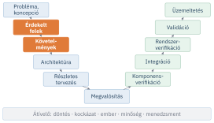
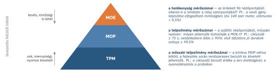
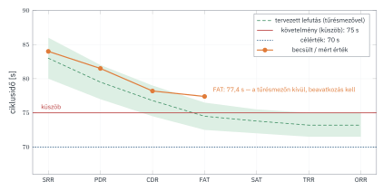
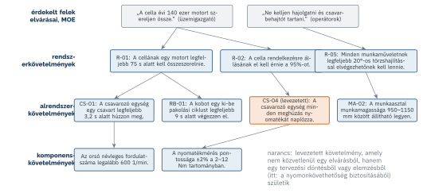
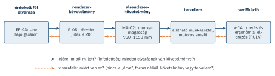

# Követelmények meghatározása {#sec-kovetelmenyek}

::: {.vterkep}
{fig-alt="V-térkép: a fejezet a V bal ágának harmadik lépésével, a rendszerkövetelményekkel foglalkozik" width=62%}
:::

::: {.cel}
A fejezet feldolgozása után képes leszel:

- megkülönböztetni az elvárást, a követelményt, a célt és a korlátot, és a követelményt mértékként és értékként megfogalmazni;
- osztályozni a követelményeket típusuk szerint (funkcionális, teljesítmény-, interfész-, környezeti, emberi tényezőkre és minőségi jellemzőkre vonatkozó);
- egyedi követelményeket és követelményhalmazokat a jó követelmény ismérvei szerint megfogalmazni és ellenőrizni;
- strukturált mondatmintákkal (EARS) egyértelmű követelményeket írni;
- a hatékonyság, a teljesítmény és a műszaki teljesítmény mérőszámait (MOE, MOP, TPM) levezetni és nyomon követni;
- a követelményeket lebontani, allokálni, kétirányúan visszakövetni, és verifikációs módot rendelni hozzájuk;
- a követelményváltozásokat szabályozottan kezelni.
:::

A probléma meghatározása ([-@sec-problema]. fejezet) és az érdekelt felek elvárásainak feltárása ([-@sec-erdekelt-felek]. fejezet) után elérkeztünk a V-modell bal ágának talán legtöbbet emlegetett lépéséhez: a követelményekhez. A követelmények közvetítenek a problématér és a megoldástér között. Az érdekelt felek nyelvéből a mérnökök nyelvére fordítják le az elvárásokat, és egyben a V jobb ágának mércéi is: a verifikáció azt vizsgálja, hogy a kész rendszer teljesíti-e őket.

A [-@sec-v-modell]. fejezet költséggörbéi szerint a követelményekben elkövetett hiba a legdrágább, mert a fejlesztés minden későbbi lépése rá épül. Ezért kell az érdekelt feleket rávenni arra, hogy elvárásaikat a tervezés megkezdése előtt alaposan végiggondolják, és ezért kell a követelményeket a fejlesztés korai szakaszában rendszeresen felülvizsgálni. Csak így szűrhetők ki időben a félreértések és az ellentmondások, és csak így becsülhető megbízhatóan a költség és az ütemterv. A fejezet ehhez ad eszközöket.

A fejezet négy kérdésre keres választ:

- Mi a követelmény, és milyen fajtái vannak?
- Mitől jó egy követelmény, és hogyan fogalmazzuk meg?
- Hogyan mérjük a rendszer sikerét és a fejlesztés előrehaladását?
- Hogyan bontjuk le, követjük vissza és kezeljük a követelményeket a fejlesztés során?

## Mi a követelmény? {#sec-kov-fogalom}

A követelménymérnökség nemzetközi szabványa szerint a követelmény olyan állítás, amely egy igényt és a hozzá tartozó korlátokat és feltételeket fogalmazza meg vagy fordítja le [@iso29148_2018]. A mennyiségi követelményeket Gilb nyomán érdemes két részre bontani: arra, *amit* mérünk, és arra a szintre, amelyet el kell érni [@gilb2005]. Ebből egyszerű, a gyakorlatban jól használható képlet adódik:

$$
\text{követelmény} = \text{mérték} + \text{érték}.
$$ {#eq-kovetelmeny}

A **mérték** az, amit mérünk (ciklusidő, rendelkezésre állás, tömeg, válaszidő). Az **érték** az, amit a mértéknek teljesítenie kell (legfeljebb 75 s, legalább 95%). Ehhez gyakran egy **célérték** is társul, amely a kívánatos, de nem kötelező szintet jelöli. A mérték lehet folytonos (idő, tömeg), diszkrét vagy logikai (van-e vészleállító), sőt minőségi is (kezelhetőség egy adott skálán), de mindig mérhetőnek, ellenőrizhetőnek kell lennie. A mérték formája lehet arányos („a selejtarány legalább 50%-kal csökkenjen”), abszolút („legfeljebb 75 s”) vagy valószínűségi („90%-os valószínűséggel legfeljebb 2 perc”).

A követelményeket a megfogalmazásuk is megkülönbözteti más állításoktól. Az ISO/IEC/IEEE 29148 szabvány az angol nyelvű dokumentumokra négy segédigét különít el [@iso29148_2018]:

- a **„shall”** (magyarul: *kell*) kötelező, verifikálandó követelményt jelöl;
- a **„should”** (magyarul: *célszerű*, *kellene*) kívánatos, de nem kötelező célt vagy preferenciát jelöl;
- a **„may”** (magyarul: *lehet*, *megengedett*) javaslatot vagy lehetőséget jelöl;
- a **„will”** (magyarul: jelen vagy jövő idejű kijelentés) tényt, jövőbeli állapotot vagy szándékot jelöl, nem követelményt.

A könyvben ennek megfelelően a követelményeket „…-nak/-nek … kell …” szerkezettel írjuk, a célokat „célérték” vagy „célszerű” kifejezéssel jelöljük, a ténymegállapításokat pedig kijelentő módban.

::: {.fogalom title="Elvárás, követelmény, cél, korlát"}
- **Elvárás:** az érdekelt fél elképzelése arról, mit nyújtson a rendszer; lehet pontatlan és minőségi („ne kelljen hajolgatni”).
- **Követelmény:** a rendszerre vonatkozó egyértelmű, ellenőrizhető állítás („a munkaasztalon végzett minden műveletnek legfeljebb 20°-os törzshajlítással elvégezhetőnek kell lennie”).
- **Cél:** kívánatos, de nem kötelező szint („célérték: 15°”).
- **Korlát:** a megoldást szűkítő, a tervezők által nem módosítható feltétel („a cellának el kell férnie a jelenlegi 6 × 4 méteres területen”).
:::

## A követelmények típusai {#sec-kov-tipusok}

A műszaki követelmények sokféle forrásból származnak. Az ISO/IEC/IEEE 29148 szabvány rendszerkövetelmény-specifikációjának vázlata külön pontot szán többek között a funkcionális, a használhatósági, a teljesítmény-, az interfész-, az üzemmódokra és állapotokra vonatkozó, a fizikai, a környezeti, a védelmi, a jogszabályi és az életciklus-támogatási követelményeknek [@iso29148_2018]. Ha valamelyik típus kimarad, a követelményhalmaz nem lesz teljes. A leggyakoribb típusok a következők:

- **Funkcionális követelmények:** mit kell a rendszernek tennie („a cellának minden csavar meghúzási nyomatékát rögzítenie kell”).
- **Teljesítménykövetelmények:** milyen jól kell a funkciót ellátnia („…±2% pontossággal”). A funkcionális követelmény önmagában ritkán elegendő, ezért a funkcionális és a teljesítménykövetelmény általában párban jár.
- **Interfészkövetelmények:** hogyan kell a rendszernek más rendszerekkel kapcsolódnia (a kontextusdiagram interfészlistájából származnak, [-@sec-mod-kontextus]. szakasz).
- **Környezeti követelmények:** milyen környezeti feltételek között kell működnie, illetve mit kell elviselnie (hőmérséklet, por, rezgés, elektromágneses zavarok), beleértve a szállítást, a tárolást és a telepítést is.
- **Emberi tényezőkre vonatkozó követelmények:** a kezelhetőség, az ergonómia, a terhelés és a hibatűrés követelményei ([-@sec-emberkozpontu]. fejezet).
- **Megbízhatósági, karbantarthatósági, biztonsági követelmények:** a rendszer működésének folytonosságára és veszélytelenségére vonatkoznak ([-@sec-megbizhatosag]. és [-@sec-biztonsag]. fejezet).
- **Korlátok:** költség, határidő, jogszabályok, szabványok, meglévő rendszerekhez való illeszkedés.

A szoftverintenzív rendszereknél jól használható keret az ISO/IEC 25010:2023 termékminőségi modellje. Kilenc minőségi jellemzőt határoz meg, ezek mindegyike egy-egy követelménycsoport forrása lehet ([-@tbl-iso25010]. táblázat) [@iso25010_2023]. A 2023-as kiadás a korábbiakhoz képest a biztonságot (safety) önálló jellemzőként vette fel, a használhatóságot interakciós képességgé, a hordozhatóságot rugalmassággá bővítette.

| Minőségi jellemző | Kérdés | Példa a VárosiBringa alkalmazására |
|:--|:--|:--|
| funkcionális megfelelőség | Megvannak-e a szükséges funkciók, és helyesen működnek-e? | a díj számítása minden díjtételre helyes |
| teljesítményhatékonyság | Elég gyors-e, elég-e a kapacitása? | a kölcsönzés jóváhagyása 2 s-on belül |
| kompatibilitás | Együttműködik-e más rendszerekkel? | a buszbérlet-adatbázissal való adatcsere |
| interakciós képesség | Képesek-e a felhasználók hatékonyan és elégedetten használni? | idősebb felhasználók is segítség nélkül kölcsönöznek |
| megbízhatóság | Működik-e, amikor kell? | havi rendelkezésre állás legalább 99,5% |
| védelem (security) | Védi-e az adatokat és a hozzáférést? | a fizetési adatokat csak a fizetési szolgáltató tárolja |
| karbantarthatóság | Könnyen módosítható, javítható-e? | új díjszabás bevezetése kódmódosítás nélkül |
| rugalmasság | Alkalmazkodik-e új környezethez, igényekhez? | újabb városba telepíthető |
| biztonság (safety) | Elkerüli-e a veszélyes helyzeteket? | menet közben nem jelenít meg figyelmet elvonó értesítést |

: Az ISO/IEC 25010:2023 kilenc termékminőségi jellemzője a VárosiBringa példáin. {#tbl-iso25010 tbl-colwidths="[24,38,38]"}

## A jó követelmény {#sec-kov-jo}

A követelmény minőségéről két szinten beszélünk: az egyes követelmények és a követelményhalmaz szintjén. Az ISO/IEC/IEEE 29148:2018 és az INCOSE követelményírási útmutatója szerint az **egyedi követelmény** akkor jól formált, ha [@iso29148_2018; @incose2023gtwr]:

- **szükséges:** kihagyása hiányt okozna, amelyet más követelmény nem pótol;
- **megfelelő szintű:** részletessége illeszkedik ahhoz a szinthez (rendszer, alrendszer, komponens), amelyre vonatkozik;
- **egyértelmű:** csak egyféleképpen értelmezhető;
- **teljes:** nem szorul kiegészítésre ahhoz, hogy érthető legyen;
- **egyedi (szinguláris):** egyetlen képességet, jellemzőt, korlátot vagy minőségi tényezőt fogalmaz meg;
- **megvalósítható:** a korlátok (költség, idő, technológia, fizika) között elérhető;
- **verifikálható:** objektív módon igazolható, hogy a rendszer teljesíti;
- **helyes:** pontosan tükrözi a forrásául szolgáló igényt vagy felsőbb szintű követelményt;
- **szabályos:** megfelel a projektben elfogadott mintának és stílusnak.

A **követelményhalmaz** egészének teljesnek, következetesnek (ellentmondásmentesnek), megvalósíthatónak, érthetőnek és validálhatónak kell lennie [@iso29148_2018]. Az INCOSE útmutatója ehhez hozzáteszi, hogy a halmaz ne legyen redundáns: minden követelmény egyszer és csak egyszer szerepeljen, és a fogalmakat, mértékegységeket egységesen használjuk [@incose2023gtwr].

### Írási szabályok a gyakorlatban

Az INCOSE követelményírási útmutatója a jó tulajdonságokat konkrét, ellenőrizhető írási szabályokra bontja [@incose2023gtwr; @nasa2016seh, C függelék]. A legfontosabbak, a magyar nyelvhez igazítva:

- **Cselekvő szerkezet:** „A [termék]nak … kell …”, és nem szenvedő szerkezet.
- **Egy követelmény, egy állítás:** egy alany és egy állítmány; egy mondatban egyetlen „kell”.
- **Tűrésekkel:** a mennyiségi értékekhez tartozzon tűrés vagy korlát (legalább, legfeljebb, ± érték).
- **Megvalósításfüggetlen:** mit kell elérni, és nem hogyan. Ha a követelmény megoldást ír elő, kérdezzük meg, miért kell.
- **Megfelelő alany:** a követelmény alanya az a rendszer vagy elem legyen, amelyre vonatkozik. Az „Az operátornak … kell” típusú mondatok szinte mindig működési állítások, amelyek a ConOps-ba tartoznak.
- **Pozitív megfogalmazás:** a „nem szabad” helyett lehetőleg azt írjuk le, aminek teljesülnie kell.
- **Indoklással:** minden követelményhez tartozzon érthető indoklás a feltételezésekkel együtt.
- **TBD helyett TBR:** a „később meghatározandó” (TBD) értékek helyett inkább egy legjobb becslést adjunk meg „pontosítandó” (TBR) jelöléssel. Rögzítsük, ki és mikorra pontosítja.
- **Kétértelmű kifejezések nélkül:** kerülendő a „szükség szerint”, a „stb.”, az „és/vagy” és a „többek között”.

A magyar nyelvű követelményekben jellemzően a következő kifejezések okoznak kétértelműséget: *megfelelő, gyors, rugalmas, felhasználóbarát, könnyen, lehetőleg, optimális, maximalizál, minimalizál, kellően, általában, szükség szerint, stb., és/vagy*. A Gyakorlati útmutató követelménysablonja ezeket automatikusan jelzi.

| Rossz megfogalmazás | Mi a gond? | Jobb megfogalmazás |
|:--|:--|:--|
| A cellának gyorsnak kell lennie. | nincs mérték és érték; nem verifikálható | A cellának egy motort legfeljebb 75 s alatt kell összeszerelnie. |
| A rendszer legyen felhasználóbarát. | kétértelmű; nem verifikálható | Az első alkalommal kölcsönzők legalább 90%-ának segítség nélkül, 3 percen belül kell tudnia kölcsönözni. |
| A cellának robottal kell felhelyeznie a fedelet és meghúznia a csavarokat. | megoldást ír elő; két követelmény egyben | A cellának a nyolc csavart 4,0 ± 0,2 Nm nyomatékkal kell meghúznia. (A fedél felhelyezése külön követelmény, a megoldás nyitva marad.) |
| Az operátornak ellenőriznie kell a kész motort. | működési leírás, nem a rendszerre vonatkozik | A cellának minden kész motor nyomatékadatait a motor azonosítójához rendelve kell rögzítenie. |
| Az alkalmazásnak stb. adatokat kell megjelenítenie. | hiányos, „stb.” | Az alkalmazásnak a kiválasztott kerékpár töltöttségét és a becsült díjat a kölcsönzés jóváhagyása előtt meg kell jelenítenie. |
| A dokkoló ne legyen hangos. | negatív, nincs mérték | A dokkoló működés közbeni hangnyomásszintje 1 m-en nem haladhatja meg a 60 dB(A)-t. |

: Rossz és jobb követelmény-megfogalmazások. {#tbl-rossz-jo tbl-colwidths="[31,26,43]"}

### Strukturált mondatminták: EARS

A természetes nyelvű követelmények egyik legnagyobb gyengesége a kétértelműség. Mavin és szerzőtársai a Rolls-Royce-nál, repülőgép-hajtómű irányítórendszerének légialkalmassági előírásait elemezve figyelték meg, hogy a jól megírt követelmények néhány visszatérő mintát követnek. Ezekből alakították ki az EARS (Easy Approach to Requirements Syntax) mondatmintákat [@mavin2009]. A minták néhány kulcsszóval kötik meg a mondat szerkezetét, de természetes nyelvűek maradnak. A [-@tbl-ears]. táblázat a minták magyar változatát mutatja.

| Minta | Szerkezet | Példa |
|:--|:--|:--|
| állandó (mindenkor érvényes) | A ‹rendszer›nek ‹válasz› kell. | A cellának minden csavar meghúzási nyomatékát rögzítenie kell. |
| eseményvezérelt | Amikor ‹kiváltó esemény›, a ‹rendszer›nek ‹válasz› kell. | Amikor a felhasználó jóváhagyja a kölcsönzést, a dokkolónak 2 s-on belül ki kell oldania a zárat. |
| állapotvezérelt | Amíg ‹állapot›, a ‹rendszer›nek ‹válasz› kell. | Amíg személy tartózkodik a védőzónában, a kobot sebességének legfeljebb 250 mm/s-nak kell lennie. |
| nem kívánt viselkedés | Ha ‹nem kívánt feltétel›, akkor a ‹rendszer›nek ‹válasz› kell. | Ha egy csavar meghúzási nyomatéka a tűrésen kívül esik, akkor a cellának a motort hibásként kell megjelölnie. |
| opcionális jellemző | Ahol ‹jellemző megléte›, a ‹rendszer›nek ‹válasz› kell. | Ahol az állomás napelemes töltéssel működik, a dokkolónak a töltöttséget a háttérrendszernek óránként jelentenie kell. |

: Az EARS-mondatminták magyar változata. A minták kombinálhatók is (például állapot és esemény együtt). {#tbl-ears tbl-colwidths="[20,30,50]"}

### Követelményattribútumok

A követelmény nem csak egy mondat. A nyilvántartásban minden követelményhez attribútumok tartoznak, amelyek kezelhetővé és visszakövethetővé teszik. Az INCOSE útmutatója az indoklást a legfontosabb attribútumnak tartja: aki később módosítani akarja a követelményt, ebből tudja meg, miért született [@incose2023gtwr]. Érdemes külön megjelölni a **meghatározó követelményeket** (key driving requirements, KDR) is. Ezek teljesítése a prioritásuktól függetlenül erősen befolyásolja a tervet, a költséget vagy az ütemtervet. Rokon fogalom a **kulcsfontosságú teljesítményparaméter** (key performance parameter, KPP): olyan jellemző, amelynek küszöbértékét ha a rendszer nem éri el, a koncepciót vagy akár a projektet is újra kell értékelni [@roedler2005]. A leggyakoribb attribútumok:

- **azonosító** (egyedi és változatlan, például R-05);
- **szöveg** és **indoklás** (miért kell, milyen feltételezésekre épül);
- **forrás** (melyik elvárásból, szabványból vagy felsőbb szintű követelményből származik);
- **típus** és **prioritás** (például kötelező, fontos, kívánatos);
- **verifikációs mód** (vizsgálat, elemzés, bemutatás, teszt) és **verifikációs szint**;
- **felelős** (aki a követelményért felel);
- **állapot** (javasolt, jóváhagyott, alapvonalban, verifikált, törölt) és **KDR-jelölés**.

::: {.eset eset="A" title="KoboCella: egy követelmény teljes leírása"}
| Attribútum | Érték |
|:--|:--|
| Azonosító | R-01 |
| Szöveg | A cellának egy motort legfeljebb 75 s alatt kell összeszerelnie. |
| Indoklás | Két műszakos munkarendben (műszakonként 7,5 óra nettó munkaidő, évi 230 munkanap) évi 3450 óra áll rendelkezésre, így az évi 140 ezer motorhoz a vevői ütemidő 3450 × 3600 / 140 000 ≈ 88,7 s. A tervezett 85%-os berendezéshatékonyság mellett a ciklusidő legfeljebb 88,7 × 0,85 ≈ 75 s lehet. |
| Forrás | EF-01 (üzemigazgató): évi 140 ezer motor; MOE-1 |
| Típus, prioritás | teljesítmény; kötelező; KDR |
| Verifikációs mód és szint | teszt (próbaüzem 3 × 8 órán át), rendszerszint; előtte elemzés (idődiagram, szimuláció) |
| Felelős | rendszermérnök; a robotintegrátor a robotalrendszerért |
| Állapot | alapvonalban (SRR után) |
:::

## A siker mérése: MOE, MOP, TPM {#sec-kov-mertekek}

A követelmények egy része a rendszer sikerét méri. Ezeket három szinten szokás megkülönböztetni ([-@fig-moe-mop-tpm]. ábra). Kossiakoff és szerzőtársai meghatározásai szerint [@kossiakoff2011, 6. fejezet]:

- **A hatékonyság mérőszáma** (measure of effectiveness, MOE) a rendszer egészének teljesítményét jellemző minőségi vagy mennyiségi mérőszáma, amely azt mutatja, milyen mértékben éri el a rendszer a céljait meghatározott feltételek mellett. A MOE mindig a rendszer egészére vonatkozik.
- **A teljesítmény mérőszáma** (measure of performance, MOP) a rendszer egy jellemzőjének vagy egy alrendszer teljesítményének mennyiségi mérőszáma. Jellemzően a rendszer egésze alatti szinten méri a fizikai teljesítményt.

Az INCOSE műszaki mérési útmutatója a két fogalmat a nézőponttal is megkülönbözteti [@roedler2005]. A MOE-k a megrendelő és a felhasználó nézőpontjából fogalmazódnak meg: azt mérik, sikeres-e a rendszer a tervezett működési környezetben. A MOP-ok a MOE-kből származnak, de műszakibb nyelven, a szállító nézőpontjából írják le a rendszer fizikai vagy funkcionális jellemzőit. Egy MOE teljesítéséhez jellemzően több, mennyiségi és mérhető MOP kell, még akkor is, ha maga a MOE minőségi.

- **A műszaki teljesítmény mérőszámai** (technical performance measures, TPM) a MOP-okhoz kapcsolódó vagy azokból levezetett fizikai vagy funkcionális jellemzők, amelyeket a siker szempontjából kritikusnak tekintünk. A megvalósítás során rendszeresen összevetjük az aktuálisan elért értéküket vagy legjobb becslésüket azzal, amit az adott időpontra terveztünk. Így igazolják az előrehaladást, és korán jelzik azokat a hiányosságokat, amelyek egy kritikus követelmény teljesülését veszélyeztetik, vagy költség- és ütemezési kockázatot jelentenek [@roedler2005; @nasa2016seh, 4.2. szakasz].

{#fig-moe-mop-tpm width=100%}

Kossiakoff és szerzőtársai szerint egy MOE vagy MOP három részből áll: a mérőszámból, a mértékegységből és a feltételekből vagy környezetből, amelyben a mérőszám érvényes [@kossiakoff2011, 6. fejezet]. A „ciklusidő” önmagában nem teljes mérőszám. Teljes alakja: „ciklusidő (másodperc), a referencia-motortípusra, betanult operátorral, folyamatos üzemben”.

### A TPM-ek nyomon követése

A TPM-eket a fejlesztés során rendszeresen, például minden felülvizsgálaton becsüljük vagy mérjük, és egy tervezett lefutással és tűrésmezővel vetjük össze ([-@fig-tpm-kovetes]. ábra). A tervezett lefutás azt mutatja, hogyan várjuk a jellemző alakulását a terv érlelődésével. A korai becslések általában kedvezőtlenebbek, és az optimalizálással javulnak. Ha a becsült érték kilép a tűrésmezőből, beavatkozásra van szükség, még akkor is, ha a végső követelmény teljesítése elvileg még lehetséges.

{#fig-tpm-kovetes width=100%}

::: {.eset eset="A" title="KoboCella: mit jelzett a TPM?"}
A gyári átvételi teszten a cella ciklusideje 77,4 s lett. Ez még csak 2,4 s-mal haladta meg a követelményt, a tervezett tűrésmezőt (legfeljebb 76,5 s) azonban már átlépte. A csapat nem várt a helyszíni telepítésig. Az idődiagram elemzése megmutatta, hogy a kobot a csavarozás után feleslegesen visszatér a nyugalmi helyzetébe, mielőtt a kész motort kivenné. A pálya átírása 2,8 s-ot hozott, a helyszíni átvételen a ciklusidő 74,1 s lett. Ha a csapat csak a végső követelményt figyeli („a 75 s majd a helyszínen is teljesül”), a hiba az üzembe helyezéskor derült volna ki, drágábban és határidő-csúszással.
:::

## Lebontás, allokáció, nyomonkövethetőség {#sec-kov-lebontas}

A rendszerszintű követelményeket le kell bontani az alrendszerek és a komponensek szintjére ([-@fig-kovetelmeny-hierarchia]. ábra). Az eredmény egy követelményhierarchia: a felső szinten azt írjuk le, *mit* akarunk elérni (a hogyant nem specifikáljuk), az alsóbb szinteken pedig a választott architektúra minden elemére, hardverre és szoftverre is lebontjuk a követelményeket.

{#fig-kovetelmeny-hierarchia width=100%}

A lebontás két fontos fogalma:

- **Allokáció:** egy rendszerszintű követelmény teljesítésének szétosztása az alrendszerek között. A teljesítményjellemzőknél ez gyakran **költségvetés** formáját ölti: a teljes ciklusidő, tömeg, energiafogyasztás vagy hibavalószínűség az alrendszerek részesedéseinek összege. A költségvetésben mindig **tartalékot** (margint) kell hagyni a bizonytalanságokra.
- **Levezetett követelmény:** olyan követelmény, amely nem közvetlenül egy érdekelt fél elvárásából, hanem egy tervezési döntésből vagy elemzésből születik. Ide tartoznak a választott architektúra és a tervezési döntések következményei, valamint a szervezetben jó gyakorlatként elfogadott belső előírások. A levezetett követelménynek is van forrása: az a döntés vagy elemzés, amelyből született, és ezt a nyilvántartásban rögzíteni kell.

| Ciklusidő-összetevő | Végrehajtó | Allokált idő [s] |
|:--|:--|--:|
| motorház és fedél behelyezése a befogóba | operátor | 18,0 |
| a fedél pozicionálása és rögzítése | kobot | 9,0 |
| 8 csavar meghúzása (8 × 3,2 s) | csavarozó egység | 25,6 |
| a kész motor kivétele a kiadóba | kobot | 6,0 |
| **soros összeg** | | **58,6** |
| **követelmény (R-01)** | | **75,0** |
| **tartalék** | | **16,4 (≈ 22%)** |

: A KoboCella ciklusidő-költségvetése a koncepció szakaszában. A szemrevételezés és a következő darab előkészítése a csavarozással párhuzamosan zajlik, ezért nem szerepel a soros összegben. {#tbl-ciklusido-kv tbl-colwidths="[50,25,25]"}

A [-@tbl-ciklusido-kv]. táblázat koncepciószintű költségvetésében 22% a tartalék. Ez a koncepció szakaszában indokolt, mert az idők még becslések. A FAT-on mért 77,4 s azt mutatta, hogy a tartalékot a valóságban a nem tervezett mozgások és várakozások felélték. Ezért kell a költségvetést a TPM-ekkel együtt követni.

### Kétirányú nyomonkövethetőség

A követelménykezelés lényege a változások kezelése és a **kétirányú nyomonkövethetőség** fenntartása az érdekelt felek igényei, a rendszer-, alrendszer- és komponenskövetelmények, a tervdokumentumok és a verifikáció között [@iso29148_2018; @iso15288_2023, 6.4.3. szakasz; @nasa2016seh, 6.2. szakasz]. A kétirányúság azt jelenti, hogy mindkét irányban követhető a lánc ([-@fig-nyomonkovetes-lanc]. ábra):

- **előre (lefelé):** minden elvárásnak és felsőbb szintű követelménynek van-e alacsonyabb szintű követelménye, tervezési eleme és verifikációja? Ez a **lefedettség** kérdése.
- **visszafelé (felfelé):** minden követelménynek és tervelemnek van-e forrása? Ha egy követelménynek nincs szülője, és nem is dokumentált levezetett követelmény, akkor vagy a visszakövetés hibás, vagy a követelmény felesleges „aranyozás” (gold plating), amelyet törölni kell.

{#fig-nyomonkovetes-lanc width=100%}

A nyomonkövethetőséget a gyakorlatban **követelmény-nyomonkövetési mátrixban** (requirements traceability matrix, RTM) vagy követelménykezelő eszközben rögzítjük. A mátrixból automatikusan kiszűrhetők az árva (forrás nélküli) követelmények, a lebontatlan felsőbb szintű követelmények és a verifikáció nélküli követelmények. A Gyakorlati útmutató nyomonkövetési sablonja és notebookja ezeket az ellenőrzéseket végzi el.

### A verifikáció módjának hozzárendelése

Már a követelmény megfogalmazásakor el kell döntenünk, hogyan fogjuk igazolni a teljesülését. Ha erre nem tudunk válaszolni, a követelmény nem verifikálható, és újra kell fogalmazni. A szabványok és a szakirodalom négy alapvető verifikációs módot különböztetnek meg [@iso29148_2018; @incose2023seh; @nasa2016seh, 5.3. szakasz]:

- **vizsgálat (inspection):** szemrevételezés vagy dokumentumellenőrzés (van-e vészleállító, megvannak-e a feliratok);
- **elemzés (analysis):** számítás, modell vagy szimuláció (megbízhatósági elemzés, ciklusidő-szimuláció);
- **bemutatás (demonstration):** a funkció működésének megfigyelése mérés nélkül vagy kevés méréssel (a kezelő végre tudja-e hajtani a típusváltást);
- **teszt (test):** ellenőrzött körülmények közötti mérés (ciklusidő-mérés próbaüzemben, nyomatékmérés).

A verifikációs módokkal és a követelmény-verifikációs mátrixszal a [-@sec-verifikacio]. fejezet foglalkozik részletesen.

## A követelmények változásának kezelése {#sec-kov-valtozas}

A követelmények változnak. Új érdekelt felek jelentkeznek, a piac megváltozik, a tervezés során kiderül, hogy egy követelmény nem teljesíthető, vagy egy másik fontosabb. A cél nem a változás megakadályozása, hanem a **szabályozott** változáskezelés. Minden változtatási kérelmet a jóváhagyás előtt értékelni kell: hogyan hat a műszaki megoldásra, a költségekre és az ütemtervre [@iso10007_2017]. A követelményeknél ez konkrétan azt jelenti, hogy meg kell vizsgálni a hatást az architektúrára, a tervre, az interfészekre, a ConOps-ra, valamint a felsőbb és alsóbb szintű követelményekre.

A rendszerkövetelmény-felülvizsgálat (SRR) után a követelmények formális konfigurációkezelés alá kerülnek. Ettől kezdve minden változtatást a konfigurációkezelési bizottság (CCB) vagy egy hasonló testület hagy jóvá. A [-@sec-eletciklus]. szakasz költséggörbéje szerint minél később változik egy követelmény, annál nagyobb költség- és ütemezési többletet okoz, ezért a késői változtatásokat különösen gondosan kell értékelni. A hatáselemzést megkönnyíti, ha naprakész a teljesítménytartalékok listája, tudjuk, mely szakértőket kell bevonni, és vezetjük a kockázatnyilvántartást. A konfigurációkezeléssel a [-@sec-menedzsment]. fejezet foglalkozik.

::: {.hiba title="A követelmények burjánzása"}
A követelmények burjánzása (requirements creep) a követelmények fokozatos, ellenőrizetlen bővülése: „ha már úgyis…, akkor legyen benne az is”. Egyenként minden bővítés kicsinek tűnik, együtt azonban felborítják a költségvetést és az ütemtervet. Ellenszere a jóváhagyott alapvonal, a változtatási kérelmek hatáselemzése és az, hogy minden új követelményhez forrást és indoklást kérünk. Ami nem vezethető vissza egy érdekelt fél elvárására, az aranyozás.
:::

::: {.kitekintes title="Automatizált követelményellenőrzés"}
A követelményírási szabályok jelentős része formalizálható: a kétértelmű kifejezések, a több „kell” egy mondatban, a szenvedő szerkezet, a hiányzó mértékegység vagy tűrés, a TBD jelölés szabályokkal felismerhető. Az INCOSE útmutatójának szabályait több kutatás és eszköz is automatizált ellenőrzéssé alakította, és a nagy nyelvi modellek újabb lehetőséget adnak a megfogalmazási hibák felismerésére és javítási javaslatok megfogalmazására. Az automatikus ellenőrzés azonban csak a *megfogalmazás* minőségét vizsgálja. Azt, hogy egy követelmény *helyes*-e, vagyis a valódi igényt fejezi-e ki, csak az érdekelt felekkel közösen lehet eldönteni. A Gyakorlati útmutató követelményellenőrző notebookja szabályalapú ellenőrzést mutat be.
:::

::: {.osszefoglalo}
- A követelmény egy igényt és a hozzá tartozó feltételeket megfogalmazó, ellenőrizhető állítás: mérték és érték, gyakran célértékkel. A követelményt („kell”) meg kell különböztetni a céltól („célszerű”), a ténymegállapítástól és a korláttól.
- A követelmények típusai: funkcionális, teljesítmény-, interfész-, környezeti, emberi tényezőkre vonatkozó, megbízhatósági, biztonsági követelmények és korlátok. A szoftverintenzív rendszereknél az ISO/IEC 25010 kilenc minőségi jellemzője jó ellenőrzőlista.
- Az egyedi követelmény legyen szükséges, megfelelő szintű, egyértelmű, teljes, egyedi, megvalósítható, verifikálható, helyes és szabályos. A halmaz legyen teljes, következetes, megvalósítható, érthető és validálható.
- Az EARS-minták (állandó, eseményvezérelt, állapotvezérelt, nem kívánt viselkedés, opcionális jellemző) egyértelműbbé teszik a természetes nyelvű követelményeket. Minden követelményhez attribútumok tartoznak: azonosító, indoklás, forrás, prioritás, verifikációs mód, felelős, állapot.
- A MOE az érdekelt fél nézőpontjából méri a sikert, a MOP a szállító nézőpontjából a teljesítményt, a TPM a kritikus jellemzőket követi a fejlesztés során. A TPM tűrésmezőből való kilépése korai figyelmeztetés.
- A követelményeket lebontjuk, allokáljuk (tartalékkal), kétirányúan visszakövetjük, és verifikációs módot rendelünk hozzájuk. A forrás nélküli követelmény aranyozás.
- Az SRR után a követelmények változását konfigurációkezelés szabályozza. A késői változások különösen drágák.
:::

::: {.onell}
1. Bontsd mértékre és értékre: „A VárosiBringa alkalmazásának a kölcsönzést 2 másodpercen belül jóvá kell hagynia az esetek 99%-ában.” Milyen formájú a mérték?
2. Javítsd ki a következő követelményeket: (a) „A dokkolónak megfelelő méretűnek kell lennie.” (b) „Az alkalmazás jelenítse meg a térképet és a díjakat, és tegye lehetővé a fizetést.” (c) „A karbantartónak hetente ellenőriznie kell a kerékpárok fékjeit.”
3. Fogalmazd meg EARS-mintával: a kobotnak meg kell állnia, ha az operátor kezét érzékeli a csavarozási zónában.
4. Mi a különbség a MOE és a MOP között? Adj egy-egy példát a ForgácsTech esetéből!
5. Egy cella tervezett ciklusidő-költségvetése 61 s, a követelmény 70 s. Mekkora a tartalék másodpercben és százalékban? Mit tennél, ha a CDR-en a becslés 68 s lenne?
6. Mit tesz a rendszermérnök egy olyan követelménnyel, amelynek nincs szülője a nyomonkövetési mátrixban?
7. Miért drágább egy követelményváltozás a részletes terv után, mint a koncepció szakaszában?

::: {.megoldas}
1. Mérték: a kölcsönzés jóváhagyásának ideje; érték: legfeljebb 2 s az esetek legalább 99%-ában. A mérték valószínűségi formájú.
2. (a) Például: „A dokkoló járdára merőleges kiterjedése legfeljebb 0,8 m lehet.” (b) Három külön követelmény: a térkép megjelenítése, a díjak megjelenítése, a fizetés lehetősége, mindegyik saját teljesítményjellemzővel. (c) Ez működési leírás. A rendszerre vonatkozó változat például: „A kerékpár fékrendszerének heti ellenőrzése legfeljebb 5 percet igényelhet egy kerékpárnál, szerszám nélkül.” A karbantartási rend a ConOps vagy a karbantartási terv része.
3. „Ha a csavarozási zónában emberi kéz jelenlétét érzékeli, akkor a kobotnak legfeljebb 100 ms-on belül meg kell állnia.” (nem kívánt viselkedés minta; a reakcióidő értékét a kockázatértékelés határozza meg)
4. A MOE az érdekelt fél szempontjából méri a sikert, a rendszer egészére vonatkozik (például: „a rendelések legalább 95%-a határidőre teljesül”). A MOP műszaki jellemző, amely a MOE eléréséhez járul hozzá (például: „a gépállapot-adatok legfeljebb 1 perc késéssel jelennek meg”, „a beállítási idő átlaga legfeljebb 35 perc”).
5. 9 s, ami a követelmény ≈ 12,9%-a. Ha a CDR-en a becslés 68 s, a tartalék 2 s-ra (≈ 3%) csökkent. Ez korai figyelmeztetés: meg kell vizsgálni, mely összetevők nőttek, és optimalizálni kell, illetve a TPM-et sűrűbben kell követni.
6. Megvizsgálja, hogy elfogadható saját levezetésű követelmény-e (egy tervezési döntés vagy jó gyakorlat következménye). Ha igen, ezt dokumentálja és jóváhagyatja. Ha nem, vagy a visszakövetés hibás és pótolni kell, vagy a követelmény aranyozás, és törölni kell.
7. Mert a részletes terv után egy követelményváltozás már elkészült terveket, beszerzett alkatrészeket, megírt szoftvert és interfészeket érint, és ezeket újra kell tervezni, verifikálni és dokumentálni. Az életciklus-költségek elkötelezettsége ([-@sec-v-modell]. fejezet) ekkor már magas.
:::
:::

::: {.projekt title="Projektlépés: követelményspecifikáció"}
Saját fejlesztési feladatodhoz:

1. vezess le az érdekelt felek elvárásaiból és a ConOps forgatókönyveiből legalább 15 rendszerkövetelményt, köztük legalább hármat a funkcionális és a teljesítménykövetelményeken kívüli típusokból;
2. minden követelményhez add meg az attribútumokat (azonosító, indoklás, forrás, prioritás, verifikációs mód);
3. legalább öt követelményt fogalmazz meg EARS-mintával;
4. határozz meg két MOE-t, mindegyikhez legalább két MOP-ot, és válassz ki egy TPM-et, amelyet a projekt során követnél;
5. bonts le egy rendszerkövetelményt alrendszer-szintre, és készíts hozzá költségvetést tartalékkal;
6. futtasd le a követelményellenőrzést a sablonnal vagy a notebookkal, és javítsd a jelzett hibákat.
:::

::: {.forras}
- @roedler2005: a MOE, a MOP, a TPM és a KPP fogalma és használata.
- @iso29148_2018: a követelménymérnökség szabványa, a jó követelmény ismérvei.
- @incose2023gtwr: az INCOSE követelményírási útmutatója szabályokkal és példákkal.
- @mavin2009: az EARS-mondatminták eredeti cikke.
- @kossiakoff2011, 6. fejezet: a MOE és a MOP fogalma és szerkezete.
- @nasa2016seh, 4.2. és 6.2. szakasz, C függelék: a műszaki követelmények meghatározása, a követelménykezelés és a követelményírás ellenőrzőlistája.
:::
