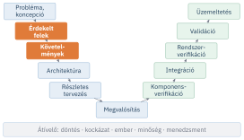
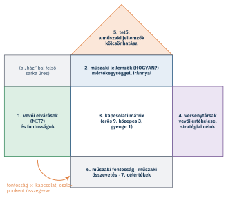
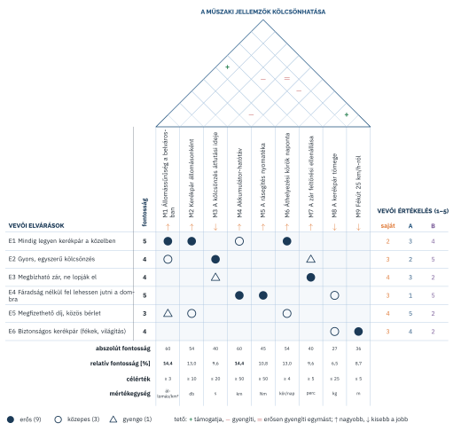
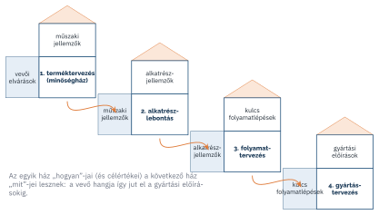

# A vevő hangja a tervezésben: QFD és a minőségház {#sec-qfd}

::: {.vterkep}
{fig-alt="V-térkép: a QFD az érdekelt felek elvárásait köti össze a rendszerkövetelményekkel" width=62%}
:::

::: {.cel}
A fejezet feldolgozása után képes leszel:

- elmagyarázni, mire való a minőségfunkció-telepítés (QFD), és hol a helye a V-modellben;
- felépíteni a minőségházat: vevői elvárások és fontosságuk, műszaki jellemzők, kapcsolati mátrix, tető, versenytárs-értékelés, műszaki fontosság és célértékek;
- kiszámítani a műszaki jellemzők abszolút és relatív fontosságát, és értelmezni az eredményt;
- a tetőmátrix alapján felismerni a műszaki jellemzők közötti ellentmondásokat, és kompromisszumot vagy innovatív megoldást keresni;
- a Kano-modell eredményeit beépíteni a minőségházba;
- leírni a négyfázisú QFD-t, és megnevezni a módszer korlátait és újabb, hálózatalapú kiterjesztéseit.
:::

Az érdekelt felek elvárásai ([-@sec-erdekelt-felek]. fejezet) a vevő nyelvén szólnak: „mindig legyen kerékpár a közelben”, „ne kelljen hajolgatni”. A követelmények ([-@sec-kovetelmenyek]. fejezet) a mérnök nyelvén: állomássűrűség, ciklusidő, munkamagasság. A kettő közötti fordítás nem magától értetődő. Melyik műszaki jellemző hat leginkább a vevői elégedettségre? Melyikre érdemes a legtöbb fejlesztési erőforrást fordítani? Mekkora legyen a célérték, hogy versenyképesek legyünk? Hol ütköznek egymással a műszaki jellemzők?

A minőségfunkció-telepítés (quality function deployment, QFD) erre a fordításra ad rendszerezett eljárást. Egyetlen táblázatban kapcsolja össze a piac elvárásait, a kielégítésüket befolyásoló műszaki jellemzőket és a versenytársak termékeinek színvonalát. Segít az új termék műszaki paramétereinek meghatározásában, és dokumentációs eszköz is: utólag is áttekinthető marad belőle, hogyan és miért születtek a tervezési döntések.

A fejezet három kérdésre épül:

- Hogyan épül fel és hogyan készül a minőségház?
- Hogyan értelmezzük az eredményét, és hogyan jutunk el belőle a célértékekig?
- Mik a módszer korlátai, és hogyan bővíthető?

## A QFD eredete és célja {#sec-qfd-eredet}

Akao Jodzsi, a módszer egyik megalkotója szerint a QFD olyan módszer, amely a vevő elégedettségét célzó tervezési minőséget fejleszti ki, és a vevő igényeit tervezési célokká és a gyártás során alkalmazandó fő minőségbiztosítási pontokká fordítja le [@akao1990]. A módszer az 1970-es évek elején Japánban született. Hauser és Clausing nagy hatású cikke szerint a minőségház első alkalmazása 1972-re, a Mitsubishi kobei hajógyárára tehető, a Toyota és beszállítói pedig sokféle irányban továbbfejlesztették [@hauser1988]. A cikk egy szemléletes adatot is közöl: a Toyota karosszériagyártó vállalatánál az új modellek gyártásindítási és előgyártási költségei 1977 januárja és 1984 áprilisa között, a QFD bevezetésével párhuzamosan, a korábbi szint 39%-ára csökkentek [@hauser1988].

A QFD középpontjában a **minőségház** (house of quality) áll. Hauser és Clausing szerint a minőségház a marketing és a mérnöki tervezés közötti kommunikáció eszköze: olyan közös térkép, amelyen a különböző felelősségű szakemberek a bizonyítékok mintázatára hivatkozva vitathatják meg a tervezési prioritásokat [@hauser1988].

Chan és Wu irodalmi áttekintése szerint a módszer előnyei és hátrányai a következőkben foglalhatók össze [@chan2002qfd]:

- **Előnyök:** rendszerezett felépítés, amelyet a minőségtervezésben érdekelt minden vállalati terület használhat; a termék tulajdonságai jól lefedik a vevő követelményeit; a fejlesztési erőforrások a vevő számára fontos jellemzőkre összpontosulnak; a területek közötti kommunikáció javul.
- **Hátrányok:** a szakértői csapat idő- és költségigényes egyeztetést igényel; a minőségház már viszonylag egyszerű terméknél is bonyolulttá válhat; a súlyok és a kapcsolati erősségek szubjektív becslések.

## A minőségház felépítése {#sec-qfd-haz}

A minőségház hét „helyiségből” áll ([-@fig-minoseg-haza]. ábra). A számozás egyben a kitöltés sorrendje is.

{#fig-minoseg-haza width=80%}

1. **Vevői elvárások (MIT?) és fontosságuk.** A ház bal oldala. Az elvárásokat a vevő nyelvén, de már rendezetten soroljuk fel, jellemzően 5–15 tételt. Mindegyikhez fontossági súly tartozik, amelyet felmérésből, interjúkból vagy a Kano-elemzésből ([-@sec-ef-kano]. szakasz) határozunk meg.
2. **Műszaki jellemzők (HOGYAN?).** A ház „mennyezete”. Mérhető, a megoldástól lehetőleg független jellemzők mértékegységgel és a javulás irányával (nagyobb vagy kisebb a jobb). Ezek a leendő MOP-ok ([-@sec-kov-mertekek]. szakasz).
3. **Kapcsolati mátrix.** A ház közepe. Minden elvárás–jellemző párra megállapítjuk, mennyire hat a műszaki jellemző az elvárás teljesülésére. A szokásos skála: erős (9), közepes (3), gyenge (1) vagy nincs kapcsolat (üres).
4. **Versenytársak vevői értékelése.** A ház jobb oldala. A vevők hogyan értékelik a saját (vagy tervezett) termékünket és a versenytársakét az egyes elvárások szerint, 1–5 skálán. Ebből látszik, hol vagyunk lemaradásban, és hol tudunk kitűnni.
5. **Tető: a műszaki jellemzők kölcsönhatása.** A tetőmátrix azt mutatja, hogy egy műszaki jellemző javítása segíti (+) vagy rontja (−) egy másik jellemző teljesítését.
6. **Műszaki fontosság és műszaki összevetés.** A ház alja. A műszaki jellemzők fontossága a kapcsolati mátrixból számítható. Ide kerülhet a saját és a versenytárs termékek mért műszaki értékeinek összevetése is.
7. **Célértékek.** Az elemzés eredménye: minden műszaki jellemzőhöz egy célérték, amely a fejlesztés követelménye lesz.

### A műszaki fontosság kiszámítása

A $j$-edik műszaki jellemző **abszolút fontossága** az elvárások fontosságával súlyozott kapcsolati erősségek összege:

$$
F_j = \sum_{i=1}^{n} w_i \, r_{ij},
$$ {#eq-qfd-fontossag}

ahol $w_i$ az $i$-edik vevői elvárás fontossága, $r_{ij} \in \{0, 1, 3, 9\}$ pedig a kapcsolat erőssége. A **relatív fontosság** az abszolút fontosság aránya az összeghez:

$$
F_j^{\mathrm{rel}} = \frac{F_j}{\sum_{k=1}^{m} F_k} \cdot 100\%.
$$ {#eq-qfd-relativ}

A 9–3–1 skála szándékosan aszimmetrikus: az erős kapcsolatokat jobban kiemeli, mint egy 3–2–1 skála, és így élesebben elkülönülnek a valóban fontos műszaki jellemzők.

## Kidolgozott példa: a VárosiBringa minőségháza {#sec-qfd-pelda}

A VárosiBringa csapata a Kano-felmérés és a fókuszcsoportok alapján hat vevői elvárást választott ki, és kilenc műszaki jellemzőt rendelt hozzájuk. A kész minőségházat a [-@fig-qfd-bringa]. ábra mutatja.

{#fig-qfd-bringa width=100%}

::: {.pelda title="A számítás lépésről lépésre"}
**Az elvárások fontossága.** A csapat a 120 fős felmérés 1–5 skálájú fontossági értékeléseit kerekítette. A legfontosabb az elérhetőség (E1) és a dombos terep leküzdése (E4), mindkettő 5. A Kano-elemzés megerősítette ezt: az elérhetőség egydimenziós, a zár alapvető jellemző.

**A kapcsolati mátrix.** A csapat soronként haladt, és minden cellánál megkérdezte: ha ezt a műszaki jellemzőt jelentősen javítjuk, mennyivel javul az elvárás teljesülése? Az elérhetőségre (E1) az állomássűrűség (M1), az állomásonkénti kerékpárszám (M2) és az áthelyezési körök száma (M6) hat erősen (9). Az akkumulátor-hatótáv (M4) közepesen (3) hat, mert a lemerült kerékpár nem kölcsönözhető.

**A műszaki fontosság.** Az állomássűrűség (M1) abszolút fontossága az [-@eq-qfd-fontossag]. egyenlet szerint:

$$
F_{M1} = 5 \cdot 9 + 4 \cdot 3 + 3 \cdot 1 = 45 + 12 + 3 = 60.
$$

Ugyanígy $F_{M4} = 5 \cdot 3 + 5 \cdot 9 = 60$, $F_{M2} = F_{M6} = 54$, $F_{M5} = 45$, $F_{M3} = F_{M7} = 40$, $F_{M9} = 36$ és $F_{M8} = 27$. Az összeg 416, így a relatív fontosság például $F_{M1}^{\mathrm{rel}} = 60/416 \approx 14{,}4\%$.

**Értelmezés.** A két legfontosabb műszaki jellemző az állomássűrűség és az akkumulátor-hatótáv (14,4–14,4%), őket az állomásonkénti kerékpárszám és az áthelyezés követi (13,0–13,0%). A rendszer sikerét tehát elsősorban a hálózat és a kerékpárok energiaellátása határozza meg, nem a kerékpár tömege vagy a zár feltörési ellenállása. Ez nem jelenti, hogy a zár nem fontos. Alapvető jellemzőként teljesítenie kell egy elfogadható szintet, de azon túl a fejlesztése nem növeli számottevően az elégedettséget.

**A versenytársak értékelése.** A vevők a tervezett rendszert az elérhetőségben (2) mindkét versenytársnál gyengébbnek látják, a díj és a zár szempontjából viszont jobbnak. A domb leküzdésében az elektromos roller (B) a mérce (5). A stratégiai következtetés: a nyitó hálózatnak elég sűrűnek kell lennie, a rásegítés teljesítményének pedig el kell érnie a roller szintjét.

**A tető.** A tetőmátrix két jelentős ellentmondást mutat. A hatótáv növelése nagyobb akkumulátort, így nagyobb tömeget jelent (M4–M8, erősen gyengíti). Az erősebb rásegítés növeli a fogyasztást, így csökkenti a hatótávot (M5–M4), és a motor tömege is nő (M5–M8). Ezek a [-@sec-qfd-teto]. szakaszban tárgyalt kompromisszumok.

**A célértékek.** Az elemzés alapján a csapat kilenc célértéket rögzített (a ház alsó sora), amelyek a rendszerkövetelmények közé kerültek. Például: belvárosi állomássűrűség legalább 3 állomás/km², akkumulátor-hatótáv legalább 50 km, rásegítési nyomaték legalább 50 Nm, tömeg legfeljebb 25 kg.
:::

## A tető: ellentmondások és kompromisszumok {#sec-qfd-teto}

A tetőmátrix a minőségház talán legértékesebb, mégis gyakran elhanyagolt része. Megmutatja, hogy a műszaki jellemzők nem függetlenek egymástól: mely paraméterek gyengítik, és melyek erősítik egymást.

A negatív kapcsolatokkal háromféleképpen bánhatunk:

1. **Kompromisszum.** A két jellemző közül a fontosabbnak adunk elsőbbséget, és a másikra elfogadható célértéket szabunk. A VárosiBringánál a hatótáv relatív fontossága (14,4%) jóval nagyobb a tömegénél (6,5%), ezért a csapat inkább a nagyobb akkumulátort választotta, és a tömegre 25 kg-os felső határt szabott.
2. **Rendszerszintű megoldás.** A konfliktust a rendszer egy másik szintjén oldjuk fel. A hatótáv–tömeg ellentmondás enyhíthető úgy is, hogy az akkumulátort nem kell nagyra méretezni, mert a dokkolók töltenek. A követelmény így „napi 50 km” helyett „két dokkolás között 50 km” lehet.
3. **Innovatív megoldás.** Az ellentmondás egy új műszaki elvvel megszüntethető. A TRIZ-módszertan ([-@sec-kreativitas]. fejezet) éppen az ilyen műszaki ellentmondások rendszerezett feloldására való. A tetőmátrix negatív kapcsolatai ezért közvetlen bemenetei a koncepcióalkotásnak.

A pozitív kapcsolatok is fontosak, mert egymást erősítő hatást jeleznek. A VárosiBringánál a sűrűbb állomáshálózat (M1) rövidebb áthelyezési utakat jelent, így ugyanakkora áthelyezési kapacitással több kör tehető meg (M6).

## A Kano-modell és a QFD {#sec-qfd-kano}

A minőségház bal oldalán a vevői elvárások fontossága áll. Egyszerűbb esetben ezt közvetlenül egy felmérés fontossági értékeléseiből vesszük. A Kano-modell ([-@sec-ef-kano]. szakasz) azonban rámutat, hogy a fontosság és az elégedettségre gyakorolt hatás nem ugyanaz. Az alapvető jellemzők hiánya erős elégedetlenséget okoz, de a teljesítésükön túli javítás alig növeli az elégedettséget. A vonzó jellemzők viszont a vevő által kimondottan nem kért, mégis nagy elégedettséget okozó lehetőségek.

Matzler és Hinterhuber javasolta, hogy a Kano-modell eredményeit építsük be a QFD-be [@matzler1998]. A gyakorlatban ez három dolgot jelent:

- **Az alapvető jellemzőkre** elég a versenyképes, elfogadható szintet célozni. Ezeket nem érdemes a fontossági súlyok alapján túlfejleszteni.
- **Az egydimenziós jellemzőkben** érdemes a versenytársak fölé célozni, mert itt a teljesítmény arányosan növeli az elégedettséget.
- **A vonzó jellemzők** a megkülönböztetés lehetőségei. A minőségházban akkor is érdemes szerepeltetni őket, ha a felmérésben kimondott fontosságuk alacsony.

A VárosiBringánál ezért került be a vevői elvárások közé a közös bérlet (E5). A felmérésben mért fontossága közepes (3) volt, de a Kano-elemzés vonzó jellemzőként azonosította, és a helyi közlekedési társasággal kötött megállapodás olcsón megvalósíthatóvá tette.

## A négyfázisú QFD {#sec-qfd-fazisok}

A minőségház csak az első lépés. Hauser és Clausing leírása szerint a házak egymáshoz kapcsolhatók: az egyik ház „hogyan”-jai a következő ház „mit”-jeivé válnak. Így a vevő hangja egészen a gyártásig eljut ([-@fig-qfd-negy-fazis]. ábra) [@hauser1988]:

1. **terméktervezés:** vevői elvárások → műszaki jellemzők (a minőségház);
2. **alkatrész-lebontás:** műszaki jellemzők → az alkatrészek jellemzői;
3. **folyamattervezés:** alkatrész-jellemzők → kritikus folyamatlépések és paramétereik;
4. **gyártástervezés:** folyamatlépések → gyártási előírások, ellenőrzési tervek.

{#fig-qfd-negy-fazis width=100%}

A négy fázis jól illeszkedik a V-modell bal ágához. Az első ház a rendszerkövetelmények szintje, a második az alrendszerek és komponensek allokációja ([-@sec-kov-lebontas]. szakasz), a harmadik és a negyedik pedig a V csúcsa, a megvalósítás és a gyártás. A gyakorlatban ritkán készül mind a négy ház teljes részletességgel. Gyakoribb, hogy a minőségház mellett csak a kritikus műszaki jellemzőkre készül alkatrész- vagy folyamatszintű lebontás.

::: {.eset eset="A" title="KoboCella: a második ház"}
A KoboCella minőségházában a csavarkötés minősége (a nyomaték pontossága) lett a legfontosabb műszaki jellemző, mert erősen hat a vevő minőségi elvárására és a selejtcsökkentésre is. A csapat erre az egy jellemzőre elkészítette a második házat. Ebben a nyomatékpontosság a „mit”, a csavarozó egység alkatrészjellemzői (az orsó fordulatszám-szabályozása, a nyomatékérzékelő pontossága, a bitbetét kopásállósága, a csavaradagolás megbízhatósága) pedig a „hogyan”. Kiderült, hogy a nyomatékérzékelő pontossága és a bitbetét kopása együtt határozza meg a nyomatékszórást. Ezért a bitbetét cseréjének gyakorisága a karbantartási terv kritikus eleme lett. Ilyen összefüggés a rendszerszintű minőségházból nem látszott volna.
:::

## Korlátok és újabb kiterjesztések {#sec-qfd-korlatok}

A QFD széles körben elterjedt, de a gyakorlatban több korlátja is ismert:

- **Szubjektivitás.** A kapcsolati erősségek és a fontossági súlyok csapatbecslések. Kis eltérések megváltoztathatják a rangsort, ezért érdemes érzékenységvizsgálatot végezni. Az egyenlő fontosságú jellemzők között a rangsort csak óvatosan szabad értelmezni.
- **Méret.** Sok elvárásnál és jellemzőnél a mátrix gyorsan átláthatatlanná válik, akár egy viszonylag egyszerű terméknél is. Ilyenkor az elvárásokat hierarchiába kell rendezni, és csak a legfontosabbakkal kell dolgozni.
- **A tető kihasználatlansága.** Az egyszerű összegzés ([-@eq-qfd-fontossag]. egyenlet) nem veszi figyelembe a műszaki jellemzők közötti kölcsönhatásokat, így a közvetett hatások rejtve maradnak.
- **Költségvakság.** A műszaki fontosság nem mond semmit arról, mennyibe kerül egy jellemző javítása. Egy kevésbé fontos jellemző olcsó javítása több elégedettséget hozhat egységnyi ráfordításra, mint egy fontos jellemző drága javítása.

::: {.kitekintes title="Hálózatalapú QFD"}
Az utóbbi két korlátra a hálózattudomány és az optimalizálás eszközei adnak választ. Abonyi és Czvetkó tanulmánya a QFD két új megfogalmazását javasolta [@abonyi2022qfd]. Az első a QFD-t hálózati folyamproblémaként írja fel, két céllal: lineáris optimalizálással a vevői igények kielégítéséből származó hasznot maximalizálja, illetve minimális költségű folyamként a vevői követelmények teljesítéséhez szükséges intézkedések összköltségét minimalizálja. A második a QFD-t hipergráfként ábrázolja, amely egyszerre képes leírni a kapcsolati és a korrelációs (tető-) mátrix kölcsönhatásait, és a legnagyobb hatású tényezőket centralitási mérőszámokkal azonosítja. A szerzők eredményei szerint a hipergráf-alapú ábrázolás feltárta a fejlesztési paraméterek és a vevői követelmények közötti közvetett kölcsönhatásokat is.

A szervezeti fenntarthatóság és az Ipar 5.0-megoldások összekapcsolására ugyanez a kutatócsoport hálózat- és QFD-alapú keretrendszert dolgozott ki. Ez azt segíti eldönteni, mely Ipar 5.0-megoldások járulnak hozzá leginkább a fenntarthatósági teljesítmény javításához [@czvetko2025]. A Gyakorlati útmutató QFD-notebookja a tetőmátrixot is figyelembe vevő, közvetett hatásokat számító egyszerű kiterjesztést mutat be.
:::

::: {.hiba title="A minőségház mint űrlap"}
A minőségház értéke nem a kitöltött táblázat, hanem az a vita, amely a kitöltése közben zajlik. Ha egy ember egyedül, egy délután alatt kitölti, a ház a saját előfeltevéseit rögzíti, és hamis tudományosságot kölcsönöz nekik. A kapcsolati mátrixot és a tetőt mindig vegyes csapat (marketing, tervezés, gyártás, szerviz) töltse ki, és minden vitás cellánál rögzítsék az indoklást.
:::

::: {.osszefoglalo}
- A QFD a vevő hangját fordítja le műszaki jellemzőkre és célértékekre. Központi eszköze a minőségház, amely a marketing és a mérnöki tervezés közös térképe.
- A minőségház hét része: vevői elvárások és fontosságuk, műszaki jellemzők, kapcsolati mátrix (9–3–1), versenytárs-értékelés, tető, műszaki fontosság és célértékek.
- A műszaki jellemzők abszolút fontossága a fontossággal súlyozott kapcsolati erősségek összege, a relatív fontosság ennek százalékos aránya. Az eredmény megmutatja, hova érdemes a fejlesztési erőforrásokat összpontosítani.
- A tető negatív kapcsolatai ellentmondásokat jeleznek. Ezek kompromisszummal, rendszerszintű megoldással vagy innovációval (TRIZ) oldhatók fel.
- A Kano-modell segít a célértékek megválasztásában: az alapvető jellemzőknél elég az elfogadható szint, az egydimenziósaknál a versenytársak fölé kell célozni, a vonzók a megkülönböztetés lehetőségei.
- A négyfázisú QFD a vevő hangját a gyártási előírásokig vezeti. A módszer korlátai a szubjektivitás, a méret, a közvetett hatások figyelmen kívül hagyása és a költségvakság. A hálózatalapú kiterjesztések ezek egy részére adnak választ.
:::

::: {.onell}
1. Mi a különbség a vevői elvárás és a műszaki jellemző között? Melyik kerül a minőségház bal oldalára, és melyik a mennyezetére?
2. Számítsd ki az M5 (rásegítés nyomatéka) és az M8 (tömeg) abszolút fontosságát a VárosiBringa minőségházából!
3. Ha az E3 (megbízható zár) fontosságát 4-ről 5-re emelnénk, hogyan változna az M7 abszolút és relatív fontossága?
4. A tetőmátrixban az M3 (kölcsönzési idő) és az M7 (zár feltörési ellenállása) között negatív kapcsolat van. Mi lehet ennek a műszaki oka, és hogyan oldanád fel?
5. Miért nem érdemes egy alapvető jellemzőt a minőségház fontossági súlya alapján túlfejleszteni?
6. Mi a szerepe a második, alkatrész-szintű háznak? Adj példát a ForgácsTech esetéből!

::: {.megoldas}
1. A vevői elvárás a vevő nyelvén fogalmazott kívánság (például „gyors kölcsönzés”), a bal oldalra kerül. A műszaki jellemző mérhető, mértékegységgel és iránnyal rendelkező mennyiség (például „a kölcsönzés átfutási ideje, s, kisebb a jobb”), a mennyezetre kerül.
2. $F_{M5} = 5 \cdot 9 = 45$ (csak az E4-gyel van erős kapcsolata). $F_{M8} = 5 \cdot 3 + 4 \cdot 3 = 27$ (E4 és E6 közepes kapcsolattal).
3. $F_{M7} = 4 \cdot 1 + 5 \cdot 9 = 49$ lenne (a korábbi 40 helyett). Az összeg 416-ról 426-ra nő (az M7-é 9-cel, az M3-é 1-gyel, 41-re nő), így az M7 relatív fontossága $49/426 \approx 11{,}5\%$ lenne a korábbi 9,6% helyett.
4. Egy erősebb, összetettebb zár (például több reteszelési pont, mechanikus kulcs mellett elektronikus azonosítás) lassabb nyitást és több hibalehetőséget jelenthet. Feloldás lehet a gyorsan nyitó elektromechanikus zár és a fizikai feltöréssel szembeni ellenállás szétválasztása: a zárszerkezet edzett, a kioldás elektronikus és gyors. A rendszerszintű megoldás a lopás utólagos felderítése (helymeghatározás), így a zárra kisebb terhelés jut.
5. Mert az alapvető jellemzők elégedettségre gyakorolt hatása telítődik: a hiányuk nagy elégedetlenséget okoz, de az elfogadható szinten túli javításuk alig növeli az elégedettséget. A ráfordítás jobb helyen van az egydimenziós vagy a vonzó jellemzőknél.
6. A második ház a rendszerszintű műszaki jellemzőket az alkatrészek vagy alrendszerek jellemzőire bontja le, és megmutatja, melyik alkatrészjellemző a kritikus. A ForgácsTech-nél például a „gépállapot-adatok késleltetése” műszaki jellemzőt a gépvezérlő adatkapcsolata, a hálózati infrastruktúra és a MES adatgyűjtő moduljának jellemzőire lehetne lebontani.
:::
:::

::: {.projekt title="Projektlépés: a minőségház"}
Saját fejlesztési feladatodhoz készíts minőségházat:

1. válassz ki 5–8 vevői elvárást, és rendelj hozzájuk fontossági súlyt (lehetőleg felmérés vagy Kano-elemzés alapján);
2. határozz meg 5–8 mérhető műszaki jellemzőt mértékegységgel és iránnyal;
3. töltsd ki a kapcsolati mátrixot és a tetőt, és rögzítsd a vitás cellák indoklását;
4. értékeld a saját koncepciódat és legalább egy versenytárs megoldását a vevő szemével;
5. számítsd ki a műszaki fontosságot, és határozz meg célértékeket;
6. írd le a két legfontosabb tanulságot és a tető egy ellentmondásának feloldási javaslatát.

A sablon és a notebook a Gyakorlati útmutató QFD-eszközlapján található.
:::

::: {.forras}
- @hauser1988: a minőségház klasszikus, ma is olvasmányos bemutatása.
- @akao1990: a QFD módszertanának alapműve a módszer egyik megalkotójától.
- @matzler1998: a Kano-modell beépítése a QFD-be.
- @abonyi2022qfd: a QFD hálózati folyam- és hipergráf-alapú megfogalmazása.
- @czvetko2025: hálózat- és QFD-alapú keretrendszer az Ipar 5.0 és a szervezeti fenntarthatóság kapcsolatára.
:::
