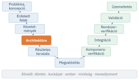
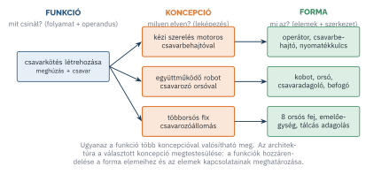
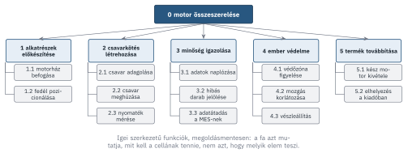
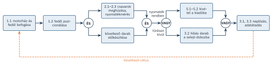
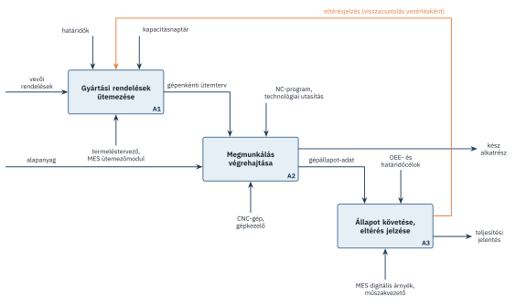
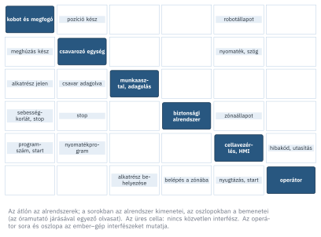
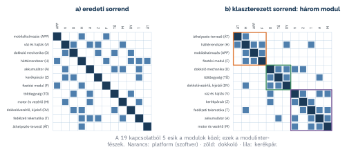

# Funkció, forma, koncepció: a rendszer architektúrája {#sec-architektura}

::: {.vterkep}
{fig-alt="V-térkép: a fejezet helye a rendszerfejlesztés folyamatában" width=62%}
:::

::: {.cel}
A fejezet feldolgozása után képes leszel:

- megkülönböztetni a rendszer funkcióját, formáját és koncepcióját, és megoldássemlegesen megfogalmazni egy funkciót;
- elhelyezni az architektúra kialakítását (a logikai dekompozíciót) a V-modellben, és felsorolni a lépéseit;
- funkcionális elemzést végezni: funkciófát, funkcionális folyamatábrát (FFBD) és IDEF0-ábrát készíteni;
- a funkciókat a forma elemeihez allokálni, és felismerni az allokációból születő levezetett követelményeket;
- N²-diagrammal azonosítani az alrendszerek közötti interfészeket, és ismertetni az interfészkezelés feladatait;
- tervezési struktúramátrixot (DSM) készíteni, klaszterezéssel modulokat kialakítani, és értékelni egy architektúra modularitását.
:::

Az előző fejezetek a probléma térben mozogtak: megértettük, mit várnak az érdekelt felek ([-@sec-erdekelt-felek]. fejezet), és ezt mérhető követelményekké fordítottuk ([-@sec-kovetelmenyek]. és [-@sec-qfd]. fejezet). A követelmények azt mondják meg, *mit* kell tudnia a rendszernek. Arról, hogy *milyen részekből áll*, és ezek *hogyan dolgoznak együtt*, még semmit nem mondanak. Ezt a lépést nevezzük architektúra-tervezésnek; az ISO/IEC/IEEE 15288 szabvány az architektúra-meghatározás folyamatának hívja [@iso15288_2023, 6.4.4. szakasz].

Az architektúra a rendszer legnehezebben megváltoztatható döntéseinek összessége. Ha egy alkatrészt rosszul méreteztünk, kicseréljük. Ha viszont a funkciókat rosszul osztottuk szét az alrendszerek között, vagy túl sok és túl bonyolult interfészt hoztunk létre, a hiba a rendszer egész életén végigkíséri: nehéz lesz integrálni, tesztelni, karbantartani és továbbfejleszteni. Blanchard és Fabrycky ezt a fejlesztés alapvető ellentmondásaként írja le: a fejlesztés elején a legkönnyebb változtatni, de ekkor a legkevesebb a rendszerre vonatkozó tudásunk [@blanchard2011]. Az architektúrát tehát akkor kell kialakítanunk, amikor a legkevesebbet tudunk, ezért rendszerezett módszerekre van szükség.

A fejezet négy kérdésre épül:

- Mit jelent a funkció, a forma és a koncepció, és hogyan kapcsolódnak egymáshoz?
- Hogyan bontjuk le a rendszer funkcióit, és hogyan ábrázoljuk a lefutásukat?
- Hogyan rendeljük a funkciókat a forma elemeihez, és hogyan azonosítjuk az interfészeket?
- Mitől jó egy architektúra, és hogyan alakíthatunk ki modulokat?

## Funkció, forma és koncepció {#sec-arch-alapfogalmak}

A fejezet Crawley és szerzőtársai rendszerarchitektúra-felfogására épül [@crawley2016]. Ebben a felfogásban minden rendszer három nézőpontból írható le.

::: {.fogalom title="Funkció, forma, koncepció"}
- **Funkció:** az, amit a rendszer *csinál*. Tevékenység, folyamat, amely létrehoz vagy átalakít valamit. Crawley és szerzőtársai szerint a funkció két részből áll: a **folyamatból** (process, ige) és az **operandusból** (operand, főnév), amelyen a folyamat végbemegy [@crawley2016]. A „csavarkötés létrehozása” funkcióban a létrehozás a folyamat, a csavarkötés az operandus.
- **Forma:** az, ami a rendszer *van*. Az elemek összessége és a fizikai vagy logikai valóság tagoltsága: alak, konfiguráció, struktúra. A forma az, ami megvalósul (gyártják, megírják, összeszerelik), és gyakran, de nem mindig látható.
- **Koncepció:** a rendszer elképzelése, amely a funkciót a formára képezi le. Crawley és szerzőtársai szerint a koncepció a működési elveket hordozza, és egyben a forma absztrakciója [@crawley2016]. A koncepció nem maga a termék, hanem az a gondolati leképezés, amely megmutatja, miként valósul meg a funkció egy adott formában.
:::

Crawley és szerzőtársai erre a három fogalomra építik az architektúra definícióját is: az architektúra a koncepció megtestesülése, vagyis a fizikai és információs funkciók hozzárendelése a forma elemeihez, valamint az elemek egymás közötti és a környezettel való kapcsolatainak meghatározása [@crawley2016]. A koncepcionális tervezés feladata tehát hármas: megalkotni a koncepciót, hozzárendelni a funkciókat a megfelelő formai elemekhez, és meghatározni az elemek közötti kapcsolatokat.

[-@fig-funkcio-forma]. ábra a KoboCella egyik funkcióján mutatja be a három fogalom kapcsolatát. A „csavarkötés létrehozása” funkció legalább három koncepcióval valósítható meg: kézi szereléssel, együttműködő robottal vagy többorsós fix csavarozóállomással. Mindegyik koncepció más formát eredményez, más elemekkel és más kapcsolatokkal. A koncepció megválasztása határozza meg a rendszer teljesítményének, költségének és kockázatainak nagyobbik részét. Ezért kell a koncepciók között tudatosan választani ([-@sec-dontes]. fejezet), és nem az első ötletnél megállni ([-@sec-kreativitas]. fejezet).

{#fig-funkcio-forma width=100%}

### A megoldássemleges funkciómegfogalmazás

A funkció megfogalmazásában rejlik az architektúra-tervezés egyik leggyakoribb csapdája. Ha a funkciót a megoldás nevével írjuk le („robotos csavarozás”), a koncepciót már előre eldöntöttük, és a többi lehetőség fel sem merül. Crawley és szerzőtársai ezért **megoldássemleges** (solution-neutral) funkciómegfogalmazást javasolnak: a funkciót úgy kell leírni, hogy az operandus és a kívánt állapotváltozás szerepeljen benne, a megvalósítás módja viszont ne [@crawley2016]. A „robotos csavarozás” helyett tehát „csavarkötés létrehozása előírt nyomatékkal”. Ebből a megfogalmazásból kiindulva a kézi szerelés, a kobot, a fix állomás, de akár a csavarkötés elhagyása (például pattintott vagy ragasztott kötés) is versenybe szállhat.

Az amerikai védelmi beszerzési egyetem rendszermérnöki alapjegyzete egyszerű ellenőrzési szabályt ad: a funkciók legyenek igék. Ha egy funkció főnévként jelenik meg, akkor valami baj van a funkciók megértésével [@dau2001, 5. fejezet]. Magyarul ez a gyakorlatban igei szerkezetet jelent („csavar adagolása”, „védőzóna figyelése”), amelyből egyértelműen kiolvasható a folyamat és az operandus.

::: {.pelda title="Tépőzár és szögesdrót: a természet mint koncepcióforrás"}
Két klasszikus példa mutatja, hogyan születik új koncepció egy funkció megoldássemleges megfogalmazásából [@vogel1998]. A tépőzárat George de Mestral svájci mérnök találta fel, miután egy vadászat után mikroszkóp alatt megvizsgálta a kutyája bundájába akadt bogáncsok horgas végződéseit. A szögesdrót a 19. századi Amerikában a legelők elkerítésére született. A telepesek addig tüskés sövényekkel próbálkoztak, de ezek lassan nőttek; az első szögesdrót-szabadalom 1868-ban kifejezetten azt a célt fogalmazta meg, hogy a drótkerítés a tüskés sövényhez hasonló legyen. Mindkét esetben a funkció („két felület oldható összekapcsolása”, „állatok távol tartása”) vezetett el egy addig szokatlan formához. A természet ihlette tervezés módszereivel a [-@sec-kreativitas]. fejezet foglalkozik.
:::

## Az architektúra helye a V-modellben {#sec-arch-v}

Az ISO/IEC/IEEE 15288 szabvány két folyamatot szentel ennek a lépésnek. Az **architektúra-meghatározás** (architecture definition) célja, hogy architektúraváltozatokat hozzon létre, kiválassza közülük azt, amely a legjobban kezeli az érdekelt felek szempontjait és teljesíti a rendszerkövetelményeket, és ezt egymással összhangban lévő nézetekben és modellekben rögzítse. A **tervmeghatározás** (design definition) pedig annyi részletet ad meg a rendszerről és elemeiről, amennyi a megvalósításukhoz szükséges [@iso15288_2023, 6.4.4. és 6.4.5. szakasz]. A V-modellben ez a bal ág második harmada: a rendszerkövetelmények és az alrendszerek, komponensek tervezése között helyezkedik el ([-@sec-v-modell]. fejezet).

Az architektúra-meghatározás a szabvány szerint hat tevékenységből áll [@iso15288_2023, 6.4.4. szakasz]:

1. az architektúra-meghatározás előkészítése (az érdekelt felek szempontjainak és a legfontosabb követelményeknek az összegyűjtése);
2. az architektúra nézőpontjainak kidolgozása;
3. a jelölt architektúrák modelljeinek és nézeteinek elkészítése, a funkciók és jellemzők hozzárendelése az architektúra elemeihez;
4. az architektúra és a részletes tervezés összekapcsolása;
5. a jelölt architektúrák értékelése és a választás;
6. a kiválasztott architektúra kezelése: jóváhagyás, alapvonal, nyomonkövethetőség.

Három gondolat érdemel külön figyelmet. Az első, hogy az architektúra arról szól, hogyan illeszkednek az elemek egymáshoz és az egészhez, és nem az egyes elemek belső működéséről. Ha az elemek közötti kapcsolatok jól meghatározottak, az elemek egymástól függetlenül fejleszthetők, mégis együtt fognak működni [@baldwin2000]. A második, hogy nem egy, hanem *több* architektúraváltozatot kell kidolgozni, mert csak így van miből választani; a szabvány is változatokban gondolkodik [@iso15288_2023, 6.4.4. szakasz]. A harmadik, hogy az architektúra kialakítása kreatív, rekurzív és iteratív munka. A funkciók szinte mindig többféleképpen bonthatók le, ezért az eredmény nagymértékben függ a csapat kreativitásától, tudásától és tapasztalatától. Maier és Rechtin ezért nevezi az architektúra-tervezést egyszerre tudománynak és művészetnek [@maier2009].

A rekurzió azt jelenti, hogy ugyanazt az eljárást minden szinten megismételjük: a rendszer architektúrájából alrendszer-követelmények születnek, az alrendszerek architektúrájából komponenskövetelmények, és így tovább ([-@sec-rekurzio]. szakasz). Az iteráció azt jelenti, hogy egy alsóbb szinten felismert nehézség visszahathat a felsőbb szintű döntésekre. A rendszermérnöknek ezért nyitottnak kell maradnia a korábban rögzített architektúra és követelmények megváltoztatására. Véglegesíteni akkor érdemes őket, amikor a rendszer minden szinten definiált, és minden követelményről kiderült, hogy megvalósítható, verifikálható és ellentmondásmentes.

::: {.kitekintes title="Architektúra és architektúraleírás"}
Az ISO/IEC/IEEE 42010:2022 szabvány megkülönbözteti egy entitás *architektúráját* és az azt kifejező *architektúraleírást* (architecture description) [@iso42010_2022]. Az architektúra a rendszer alapvető tulajdonsága, akkor is létezik, ha senki nem írta le. Az architektúraleírás az a munkatermék, amely nézőpontok és nézetek segítségével rögzíti. A fejezet eszközei (funkciófa, FFBD, IDEF0, N²-diagram, DSM) egy-egy nézetet adnak; egyik sem írja le egyedül a teljes architektúrát. A nézőpontok és a modellalapú leírás kapcsolatát a [-@sec-mod-mbse]. szakasz tárgyalja.
:::

## Funkcionális elemzés és funkciófa {#sec-arch-funkcioelemzes}

A funkcionális elemzés az architektúra kialakításának és a funkcionális követelmények lebontásának elsődleges módszere. Felülről lefelé haladó, rendszerezett eljárás, amely azonosítja, leírja és egymáshoz kapcsolja azokat a funkciókat, amelyeket a rendszernek a céljai eléréséhez el kell végeznie [@dau2001, 5. fejezet; @nasa2016seh, 4.3. szakasz]. Kiindulópontja a működési koncepció (ConOps, [-@sec-pr-conops]. szakasz). Három fő lépésből áll:

1. a legfelső szintű követelmények funkciókká fordítása, vagyis annak meghatározása, milyen funkciókat kell elvégezni a követelmények teljesítéséhez;
2. a funkciók lebontása és allokálása a termékszerkezet alacsonyabb szintjeire;
3. a funkcionális és az alrendszerek közötti interfészek azonosítása és leírása.

Érdemes minden azonosított funkciót a bemeneteivel, kimeneteivel, lehetséges hibamódjaival, a hiba következményeivel és az interfészkövetelményekkel együtt leírni, a funkciókat pedig logikai sorrendbe rendezni, hogy a rendszer bármely előírt használata végigkövethető legyen a kezdettől a végéig. Ez a leírás egyúttal a későbbi hibamód-elemzés ([-@sec-fmea]. fejezet) kiindulópontja is.

### A funkciófa

A funkcionális lebontás legegyszerűbb ábrázolása a **funkciófa** (functional hierarchy). A fa gyökere a rendszer fő funkciója, ennek gyermekei a részfunkciók, és így tovább, amíg el nem érjük azt a szintet, ahol egy funkció már egyértelműen egy formai elemhez rendelhető. A funkciókat számozással azonosítjuk (1, 1.1, 1.1.1), mert a számozás a teljes elemzésen végigvihető, és lehetővé teszi a lefelé és felfelé irányuló nyomonkövetést [@dau2001, 5. fejezet].

{#fig-funkciofa-kobo width=100%}

::: {.eset eset="A" title="KoboCella: a funkciófa"}
A KoboCella csapata a működési koncepció forgatókönyveiből indult ki ([-@sec-pr-conops]. szakasz), és öt főfunkciót azonosított ([-@fig-funkciofa-kobo]. ábra): az alkatrészek előkészítését, a csavarkötés létrehozását, a minőség igazolását, az ember védelmét és a termék továbbítását. Az első változatban a második főfunkció „kobotos csavarozás” volt. A felülvizsgálaton a minőségügyi vezető megkérdezte, miért nem szerepel a fában a „kézi csavarozás” mint lehetőség. Ebből derült ki, hogy a csapat a fa felírásakor már eldöntötte a koncepciót. A megoldássemleges átfogalmazás után a csavarkötés létrehozása három részfunkcióra bomlott: csavar adagolása, csavar meghúzása, nyomaték mérése. Ezek közül csak a második kötődik közvetlenül a kobothoz.

A negyedik főfunkció („ember védelme”) külön ágat kapott, mert a biztonsági funkciók allokációja és verifikációja szigorúbb szabályokat követ ([-@sec-biztonsag]. fejezet). Az első két szint 5 főfunkciót és 13 részfunkciót tartalmaz. Ez kezelhető méret: a csapat egyetlen falitáblán át tudta tekinteni.
:::

### Szintenként hány elem?

Gyakran idézett hüvelykujjszabály, hogy egy jól áttekinthető rendszer egy szintjén 5–9 rész szerepeljen. A szabály Miller klasszikus tanulmányára vezethető vissza, amely szerint az emberi abszolút ítélőképesség és az azonnali emlékezet terjedelme hét plusz-mínusz kettő elem körül van [@miller1956]. A későbbi kutatások ezt finomították. Cowan áttekintése szerint a rövid távú emlékezet valódi kapacitása, ha a csoportosítás és az ismétlés lehetőségét kizárjuk, inkább három-öt egység [@cowan2001]. A rendszermérnöki gyakorlat számára a tanulság nem egy pontos szám, hanem az, hogy ha egy szinten tizenöt-húsz elem szerepel, akkor a lebontás valószínűleg kihagyott egy közbülső szintet, és a csapat nem fogja tudni átlátni a kapcsolatokat.

### Teljesítményallokáció a funkciókra

A funkcionális architektúra nemcsak azt mutatja meg, milyen funkciókat kell elvégezni, hanem azt is, milyen teljesítménykövetelmények tartoznak hozzájuk. A DAU-jegyzet szerint a funkcionális architektúra a rendszer funkcionális és teljesítménykövetelményeinek felülről lefelé haladó lebontása, amely a funkciók logikai sorrendjét és a hozzájuk rendelt teljesítménykövetelményeket is tartalmazza [@dau2001, 5. fejezet]. A KoboCella esetében ez a ciklusidő-költségvetés ([-@tbl-ciklusido-kv]. táblázat): a 75 másodperces rendszerszintű követelményt a funkciókhoz és végrehajtóikhoz rendelt időkre bontottuk. A teljesítményallokáció tehát a funkciófa és a követelménylebontás ([-@sec-kov-lebontas]. szakasz) közös terméke.

## A funkciók lefutása: FFBD és IDEF0 {#sec-arch-ffbd}

A funkciófa a funkciók hierarchiáját mutatja meg, a sorrendjüket viszont nem. A rendszer viselkedésének megértéséhez azt is tudnunk kell, melyik funkció melyik után következik, mi fut párhuzamosan, és hol ágazik el a folyamat. Erre két hagyományos ábrázolás terjedt el.

### Funkcionális folyamatábra (FFBD)

A **funkcionális folyamatábra** (functional flow block diagram, FFBD) célja a DAU-jegyzet szerint az, hogy a rendszerkövetelményeket funkcionális fogalmakkal írja le. Az ábra funkcióorientált, nem megoldásorientált, és segítségével ellenőrizhető, hogy az életciklus valamennyi funkciója le van-e fedve, a tevékenységek sorrendje és a kritikus tervezési interfészek pedig meg legyenek határozva [@dau2001, 5-A. kiegészítés]. Az FFBD fő szabályai:

- minden funkciót egyetlen, folytonos vonalú doboz jelöl, amely meghatározott, véges, elkülönülő tevékenységet ír le;
- a funkciók számozása szintenként következetes, és a funkciófa számozását követi;
- a folyamat általában balról jobbra halad, a nyilak a funkcionális sorrendet jelölik (nem időbeli szünetet vagy közbülső tevékenységet);
- a kör alakú összegzőpontok ÉS, illetve VAGY kapcsolatot jelölnek. Az ÉS párhuzamos funkciókat jelent, amelyeknek mind teljesülniük kell a továbblépéshez; a VAGY alternatív utakat, amelyek közül egy is elegendő;
- az elágazásoknál a továbbhaladási feltételt (például „megfelelt” vagy „nem felelt meg”) a kimenő vonal mellé írjuk.

{#fig-ffbd-kobo width=100%}

A [-@fig-ffbd-kobo]. ábra jól mutatja, mire jó az FFBD a ciklusidő-költségvetés mellett. A ciklusidőt a *soros* útvonal határozza meg. A párhuzamos ágon futó funkciók (itt a következő darab előkészítése) nem növelik, amíg rövidebbek a velük párhuzamos ágnál. Ugyanez az ábra mutatja meg azt is, hogy a hibás darab kiválogatása külön útvonal. Ha ez gyakran előfordul, a ciklusidő eloszlása kétpúpú lesz, amit a TPM-követésnél ([-@sec-kov-mertekek]. szakasz) figyelembe kell venni.

### IDEF0

Az FFBD a funkciók sorrendjét mutatja, de nem mutatja meg, milyen információ vagy anyag áramlik közöttük, mi szabályozza őket, és mi hajtja végre őket. Erre szolgál az **IDEF0** (integration definition for function modeling) módszer, amelyet az amerikai szabványügyi intézet FIPS 183 szabványa rögzít [@fips183]. Az IDEF0-ban minden funkció egy doboz, és a dobozhoz csatlakozó nyíl helye jelöli a nyíl szerepét [@dau2001, 5-B. kiegészítés]:

- **bemenet** (input, balról): az az anyag vagy adat, amelyet a funkció átalakít;
- **vezérlés** (control, felülről): az a szabály, előírás vagy információ, amely a funkció végrehajtását szabályozza;
- **kimenet** (output, jobbra): a funkció eredménye;
- **mechanizmus** (mechanism, alulról): az az erőforrás (ember, gép, szoftver), amely a funkciót végrehajtja.

A négy szerep angol kezdőbetűiből született az ICOM rövidítés. Az IDEF0-modell hierarchikus: a legfelső szintű, egyetlen dobozból álló kontextusábrát (A-0) gyermekábrák bontják ki, amelyeken a dobozok jellemzően lépcsőzetesen, balról fentről jobbra lefelé helyezkednek el. Az IDEF0 különösen alkalmas információs és üzleti folyamatok, valamint gyártási folyamatok elemzésére, ahol a vezérlés és a mechanizmus megkülönböztetése lényeges.

::: {.eset eset="C" title="ForgácsTech: az ütemezés IDEF0-ábrája"}
A ForgácsTech csapata a késések okainak elemzéséhez IDEF0-ábrát készített a rendelésteljesítés magjáról ([-@fig-idef0-forgacs]. ábra). Az ábra három funkciót tartalmaz: a gyártási rendelések ütemezését, a megmunkálás végrehajtását és az állapot követését. A legfontosabb felismerés a visszacsatoló nyílhoz kötődött. A jelenlegi működésben az eltérésjelzés (például egy gép váratlan leállása) a műszakvezető fejében és szóbeli közlésekben létezett, és csak a következő heti ütemezésnél jutott vissza az A1 funkcióhoz. Az ábrán ez a vezérlőnyíl hiányzott. A MES digitális árnyéka (mechanizmus az A3 funkcióban) azt teszi lehetővé, hogy az eltérésjelzés vezérlésként, órákon belül visszajusson az ütemezéshez. Ez a felismerés lett a ForgácsTech-koncepció egyik központi eleme.
:::

{#fig-idef0-forgacs width=100%}

## Allokáció: a funkciótól a formáig {#sec-arch-allokacio}

A funkcionális elemzés eredménye a funkcionális architektúra. A fizikai architektúrához az **allokáció** vezet el: annak eldöntése, hogy melyik funkciót melyik formai elem (alrendszer, komponens, ember vagy szoftver) végzi el. Kossiakoff és szerzőtársai szerint a rendszer építőelemekre bontását funkcionális allokációnak nevezik, és ez a rendszermérnökség egyik alapvető eszköze [@kossiakoff2011, 1.2. szakasz].

Az allokáció eredménye legegyszerűbben egy **allokációs táblázatban** rögzíthető, amelynek soraiban a funkciók, oszlopaiban a formai elemek állnak ([-@tbl-allokacio-kobo]. táblázat). A táblázat két dolgot azonnal megmutat. Ha egy funkciónak nincs gazdája, a funkció elveszett. Ha egy funkciónak több gazdája van, azok között interfész keletkezik, amelyet meg kell tervezni.

| Funkció | Kobot, megfogó | Csavarozó egység | Asztal, adagolás | Biztonsági alrendszer | Cellavezérlés, HMI | Operátor |
|:--|:-:|:-:|:-:|:-:|:-:|:-:|
| 1.1 motorház befogása | | | × | | | × |
| 1.2 fedél pozicionálása | × | | | | | |
| 2.1 csavar adagolása | | | × | | | |
| 2.2 csavar meghúzása | × | × | | | | |
| 2.3 nyomaték mérése | | × | | | | |
| 3.1 adatok naplózása | | | | | × | |
| 3.2 hibás darab jelölése | | | | | × | × |
| 3.3 adatátadás a MES-nek | | | | | × | |
| 4.1 védőzóna figyelése | | | | × | | |
| 4.2 mozgás korlátozása | × | | | × | | |
| 4.3 vészleállítás | | | | × | | × |
| 5.1–5.2 kivétel a kiadóba | × | | | | | |

: A KoboCella funkcióinak allokációja a forma elemeihez. A több elemhez rendelt funkciók interfészeket hoznak létre. {#tbl-allokacio-kobo tbl-colwidths="[28,12,12,12,12,12,12]"}

### Moduláris és integrált architektúra

Ulrich klasszikus tanulmánya szerint a termékarchitektúra az a séma, amely szerint a termék funkciója a fizikai komponensekhez rendelődik. Pontosabban három dolgot foglal magában: a funkcionális elemek elrendezését, a funkcionális elemek fizikai komponensekre való leképezését és a kölcsönhatásban álló komponensek közötti interfészek specifikációját [@ulrich1995]. Ulrich két alaptípust különböztet meg:

- **Moduláris architektúra:** a funkcionális elemek és a fizikai komponensek között egy-egy megfeleltetés van, és a komponensek közötti interfészek lazán csatoltak. Egy komponens megváltoztatása nem igényli a többi megváltoztatását.
- **Integrált architektúra:** a leképezés összetett (egy komponens több funkciót lát el, vagy egy funkció több komponensen oszlik meg), és/vagy az interfészek szorosan csatoltak [@ulrich1995].

Egyik típus sem eleve jobb a másiknál. A moduláris architektúra a változatosságot, a cserélhetőséget, a párhuzamos fejlesztést és a karbantarthatóságot támogatja. Az integrált architektúra egy-egy teljesítményjellemzőt (tömeg, méret, költség nagy darabszámnál) jobban optimalizálhat, mert nem kell a szabványos interfészek „árát” megfizetni. A tervezőnek azt kell eldöntenie, hogy a rendszer életciklusában melyik tulajdonság a fontosabb.

A [-@tbl-allokacio-kobo]. táblázatban a KoboCella vegyes képet mutat. A csavarozó egység és a biztonsági alrendszer jó modulok: néhány, jól körülhatárolt funkciót látnak el. A kobot viszont négy főfunkcióban is részt vesz (pozicionálás, meghúzás, mozgáskorlátozás, kivétel). Ez a kobotos koncepció lényegéből fakad, de azt is jelenti, hogy a kobot programjának bármely változtatása több funkciót érinthet, és ezért a regressziós tesztelés ([-@sec-verifikacio]. fejezet) itt különösen fontos.

### Levezetett követelmények

Az allokáció új követelményeket szül. Ezek a levezetett követelmények a kiválasztott architektúrából fakadnak, ezért nem szerepelhettek a folyamat bemenetét adó követelmények között ([-@sec-kov-lebontas]. szakasz). Az eredeti és a levezetett követelményeket egyaránt allokálni kell az architektúra elemeihez és a funkciókhoz.

::: {.eset eset="A" title="KoboCella: követelmények az allokációból"}
A „mozgás korlátozása” funkció a kobothoz és a biztonsági alrendszerhez is hozzá van rendelve. A rendszerszintű R-11-es követelmény szerint a kobot sebessége az együttműködési zónában legfeljebb 250 mm/s lehet ([-@sec-kovetelmenyek]. fejezet). Az allokációból két levezetett követelmény született. A biztonsági alrendszernek a zónába lépést meghatározott reakcióidőn belül jeleznie kell a kobot vezérlőjének, a kobot vezérlőjének pedig a jelzés vételét követően meghatározott időn belül a csökkentett sebességre kell váltania. A két idő összegének a kockázatértékelésben meghatározott határ alatt kell maradnia. Egyik követelmény sem szerepelt az érdekelt felek elvárásai között: mindkettő az architektúra következménye. Ugyanez a felosztás egy interfészt is létrehozott a biztonsági alrendszer és a kobot vezérlője között, amelyet a következő szakasz N²-diagramja is mutat.
:::

## Interfészek: N²-diagram és interfészkezelés {#sec-arch-n2}

Kossiakoff és szerzőtársai szerint a rendszertervezés egyik legfontosabb lépése az építőelemek funkcionális és fizikai összekapcsolásának meghatározása. Ehhez korán azonosítani kell az összes jelentős funkcionális kölcsönhatást, és azt, hogyan lehet a funkcionális elemeket úgy csoportosítani, hogy az erősen kölcsönható elemek egy csoportba kerüljenek, a csoportok közötti kölcsönhatások pedig a lehető legegyszerűbbek legyenek [@kossiakoff2011, 4.4. szakasz]. A külső interfészek azonosításának eszköze a kontextusdiagram ([-@sec-mod-kontextus]. szakasz). A belső interfészeké az N²-diagram.

### Az N²-diagram

Az **N²-diagramot** (N-négyzet diagram) Lano dolgozta ki az 1970-es években a TRW vállalatnál, eredetileg szoftverrendszerek interfészeinek elemzésére [@lano1977]. Nevét onnan kapta, hogy N elem esetén N × N cellából áll. Felépítése:

- az **átlóban** az alrendszerek (vagy funkciók) állnak;
- az átlón kívüli cellák az interfészeket jelölik. A szokásos olvasat szerint az *i*-edik sorban álló cella az *i*-edik elem *kimenetét* tartalmazza, amely a cella oszlopában álló elem *bemenete* lesz. A kimenetek tehát vízszintesen, a bemenetek függőlegesen haladnak, az óramutató járásával egyező irányban;
- az üres cella azt jelenti, hogy a két elem között nincs közvetlen interfész.

{#fig-n2-kobo width=100%}

Az N²-diagram ([-@fig-n2-kobo]. ábra) gyorsan megmutatja az interfészek számát és eloszlását. A sűrű sorok és oszlopok azokat az elemeket jelölik, amelyek sok más elemmel kommunikálnak: ezek az integráció kritikus pontjai. A KoboCella diagramján a cellavezérlés sora és oszlopa a legsűrűbb, ami egy központi vezérlésű architektúránál várható. Az operátor sora és oszlopa az ember–gép interfészeket mutatja. Ezeket ugyanolyan gondossággal kell megtervezni, mint a műszaki interfészeket ([-@sec-emberkozpontu]. fejezet).

Az N²-diagram a funkciók szintjén is alkalmazható. Ilyenkor az átlóban a funkciók állnak, a cellákban az egymásnak átadott anyag, energia vagy információ. Pahl és szerzőtársai funkcióstruktúrája ugyanezt a gondolatot fejezi ki: a részfunkciókat az anyag-, energia- és jeláramok kapcsolják össze [@pahl2007]. A cellák tartalmának típusba sorolásához a kontextusdiagramnál megismert öt kategória (adat, jel, anyag, energia, tevékenység) itt is használható ([-@sec-mod-kontextus]. szakasz).

### Interfészkezelés

Az interfészek azonosítása csak az első lépés. Az interfészkezelés különösen akkor fontos, ha a munka több csapat vagy beszállító között oszlik meg: ilyenkor az interfész az a pont, ahol a felelősségek találkoznak, és ahol a legtöbb félreértés születik [@kossiakoff2011, 3.5. szakasz]. A külső és a belső interfészeket már a fejlesztés korai szakaszában, a működési koncepció alapján érdemes azonosítani, és meghatározni a forrásukat, a céljukat és az átadott anyag, energia vagy információ jellemzőit. Ahogy az architektúra kirajzolódik, új interfészek jelennek meg, a meglévők pedig változnak.

Az interfészeket dokumentálni kell. A nagy projektekben ennek bevett formája az interfészkövetelmény-dokumentum (IRD), amely azt rögzíti, mit kell az interfésznek tudnia, és az interfészszabályozó dokumentum vagy rajz (ICD), amely a megállapodott műszaki megoldást írja le. Ezek a konfigurációkezelés hatálya alá tartoznak, vagyis csak szabályozott változáskezeléssel módosíthatók. Az interfészek összehangolásáért jellemzően egy **interfész-munkacsoport** felel, amelyben az érintett felek műszaki képviselői ülnek [@dau2001; @nasa2016seh, 6.3. szakasz]. Az interfészek integráció közbeni verifikációjával a [-@sec-integracio]. fejezet foglalkozik.

::: {.hiba title="A „majd megbeszélik” interfész"}
Gyakori hiba, hogy az interfész két oldalát két különböző csapat vagy beszállító fejleszti, és mindkettő azt feltételezi, hogy a részleteket „majd megbeszélik”. Az interfész így senkié, és az eltérések csak az integrációnál derülnek ki, amikor a javításuk már drága. Minden interfésznek legyen gazdája, legyen dokumentálva legalább az átadott jel vagy anyag, annak formátuma, tartománya és időzítése, és minden változtatását mindkét fél hagyja jóvá.
:::

## Tervezési struktúramátrix és modularitás {#sec-arch-dsm}

Az N²-diagram rokona a **tervezési struktúramátrix** (design structure matrix, DSM). A DSM-et Steward vezette be 1981-ben, eredetileg a tervezési folyamat lépéseinek sorba rendezésére [@steward1981]. A DSM négyzetes mátrix, amelynek sorai és oszlopai ugyanazokat az elemeket tartalmazzák, egy cella pedig azt jelzi, hogy a sor eleme függ-e az oszlop elemétől (vagy fordítva, a használt konvenciótól függően). Az N²-diagrammal szemben a DSM cellái általában nem szöveges leírást, hanem jelölést vagy számot (a kapcsolat erősségét) tartalmaznak, ezért a DSM algoritmikusan elemezhető.

Eppinger és Browning összefoglaló könyve szerint a DSM négy fő alkalmazási területe a termékarchitektúra (komponensek és interfészeik), a szervezeti architektúra (csapatok és kommunikációjuk), a folyamatarchitektúra (tevékenységek és információáramlásuk), valamint ezek összekapcsolása többtartományos mátrixokban [@eppinger2012]. Browning korábbi áttekintése a statikus (komponens- és csapatalapú) és az időalapú (tevékenység- és paraméteralapú) DSM-eket különböztette meg: az előbbieket jellemzően **klaszterezéssel**, az utóbbiakat **sorba rendezéssel** elemzik [@browning2001]. [-@tbl-dsm-tipusok]. táblázat összefoglalja a típusokat.

| DSM-típus | Elemek | Kapcsolat | Fő elemzési művelet | Felhasználás |
|:--|:--|:--|:--|:--|
| termékarchitektúra (komponensalapú) | alrendszerek, komponensek | fizikai, energia-, anyag- vagy információs interfész | klaszterezés | modulok kialakítása, interfészkezelés |
| szervezeti (csapatalapú) | csapatok, szakterületek | kommunikációs igény | klaszterezés | csapatszerkezet, koordináció |
| folyamat (tevékenységalapú) | tervezési tevékenységek | információátadás | sorba rendezés, a visszacsatolások csökkentése | tervezési folyamat ütemezése |
| paraméteralapú | tervezési paraméterek | paraméterek közötti függés | sorba rendezés | részletes tervezés sorrendje |

: A DSM típusai Browning és Eppinger–Browning alapján. {#tbl-dsm-tipusok tbl-colwidths="[20,18,22,18,22]"}

### Modularitás és klaszterezés

A modularitás gondolata a rendszerelmélet egyik legrégebbi eredményére vezethető vissza. Simon nagy hatású tanulmánya szerint a komplex rendszerek jellemzően hierarchikusak és **majdnem felbonthatók** (nearly decomposable): az alrendszereken belüli kölcsönhatások általában erősebbek, mint az alrendszerek közöttiek [@simon1962]. Kossiakoff és szerzőtársai a modularitást a rendszerkomponensek kölcsönös függetlenségének mértékeként határozzák meg. A rendszermérnökség egyik alapvető célja a nagyfokú modularitás elérése, hogy az interfészek és a kölcsönhatások a lehető legegyszerűbbek legyenek, ami a gyártást, az integrációt, a tesztelést, a karbantartást, a megbízhatóságot és a későbbi továbbfejlesztést is segíti [@kossiakoff2011, 1.2. szakasz]. A modulok tervezésének két mércéje az **összetartás** (cohesion), amely a modulon belüli elemek összetartozását méri, és a **csatolás** (coupling), amely a modulok közötti kölcsönhatásokat méri. A kívánatos a szoros összetartás és a laza csatolás [@kossiakoff2011, 11. fejezet].

A komponensalapú DSM-ben a modulok kialakítása **klaszterezési** feladat: a sorokat és oszlopokat úgy kell átrendezni, hogy a kapcsolatok az átló körüli blokkokba tömörüljenek, a blokkokon kívül pedig minél kevesebb kapcsolat maradjon. A blokkok a modulok, a blokkokon kívüli kapcsolatok a modulinterfészek. Erre számos algoritmus létezik, a kézi átrendezéstől a hierarchikus klaszterezésen át a hálózattudományi közösségkeresésig. Ez utóbbiak közül Newman modularitási mértéke a legismertebb, amely azt méri, mennyivel több kapcsolat esik a csoportokon belülre, mint amennyi véletlenszerű kapcsolódás esetén várható lenne [@newman2006].

::: {.eset eset="B" title="VárosiBringa: modulok a DSM-ből"}
A VárosiBringa csapata 12 rendszerelemet és közöttük 19 kölcsönös kapcsolatot azonosított: a kerékpár elemeit (váz és hajtás, akkumulátor, motor és vezérlő, kerékpárzár, fedélzeti telematika), a dokkolóállomás elemeit (dokkoló mechanika, töltőegység, dokkolóvezérlő és kijelző) és a szoftverplatform elemeit (mobilalkalmazás, háttérrendszer, fizetési modul, áthelyezés-tervező). Az eredeti, felsorolási sorrendben ([-@fig-dsm-bringa]a. ábra) a kapcsolatok szétszórtan helyezkednek el, és nehéz megmondani, mely elemek tartoznak össze.

A csapat a szomszédsági mintázatok hasonlósága alapján hierarchikus klaszterezést végzett (a módszert a Gyakorlati útmutató DSM-eszközlapja és notebookja részletezi). Az átrendezett mátrixban ([-@fig-dsm-bringa]b. ábra) három modul rajzolódott ki: a platform (áthelyezés-tervező, háttérrendszer, mobilalkalmazás, fizetési modul), a dokkoló (mechanika, töltőegység, vezérlő) és a kerékpár (váz és hajtás, kerékpárzár, telematika, akkumulátor, motor). A 19 kapcsolatból 14 a modulokon belülre esik, és csak 5 a modulok közé: a zár és a dokkoló mechanika, a váz és a dokkoló mechanika, az akkumulátor és a töltőegység, a telematika és a háttérrendszer, valamint a dokkolóvezérlő és a háttérrendszer között. Ez az öt kapcsolat lett a három beszállítói csomag közötti interfészszerződések tárgya.
:::

{#fig-dsm-bringa width=100%}

### Tervezési szabályok és a szervezet tükre

Baldwin és Clark a modularitás gazdasági és szervezeti következményeit vizsgálták. Szerintük a moduláris tervezés kulcsa, hogy a tervezési paramétereket két csoportra osztjuk. A **látható tervezési szabályok** (az architektúra, az interfészek és a megfelelőségi tesztek) mindenkire kötelezőek, és korán rögzíteni kell őket. A **rejtett paramétereket** a modulok fejlesztői a szabályok keretein belül szabadon alakíthatják. Ez teszi lehetővé a modulok párhuzamos és egymástól független fejlesztését, és azt, hogy egy modul jobb változata a rendszer többi részének módosítása nélkül beépíthető legyen [@baldwin2000].

Az architektúra és a szervezet összefügg. Conway már 1968-ban megfogalmazta azt a megfigyelést, amelyet ma Conway-törvényként ismerünk: a rendszereket tervező szervezetek olyan terveket hoznak létre, amelyek a saját kommunikációs szerkezetüket másolják [@conway1968]. Sosa, Eppinger és Rowles egy nagy repülőgép-hajtómű fejlesztésében vetették össze a tervezési interfészeket a csapatok közötti kommunikációval. Két esetet vizsgáltak: amikor egy ismert tervezési interfészhez nem tartozik csapatkommunikáció, és amikor egy megfigyelt kommunikáció nem magyarázható tervezési interfésszel. Eredményeik szerint a kettő illeszkedését a szervezeti és rendszerhatárok, az interfészek erőssége, a közvetett kapcsolatok és a rendszer modularitása befolyásolja [@sosa2004]. A gyakorlati tanulság az, hogy a termék-DSM és a szervezeti DSM összevetése megmutatja azokat az interfészeket, amelyekért senki nem felel. Ezekhez kell interfészgazdát rendelni.

::: {.eset eset="C" title="ForgácsTech: architektúra és szervezet"}
A ForgácsTech MES-bevezetésénél a csapat a koncepció szakaszában két architektúrát vetett össze. Az elsőben egyetlen beszállító szállítja a MES-t a gépi adatgyűjtéssel és az ütemezőmodullal együtt. A másodikban a gépi adatgyűjtést a gépgyártók saját megoldásai végzik, a MES pedig csak fogadja az adatokat. A második változat olcsóbbnak tűnt, de az N²-diagram megmutatta, hogy a gépi adatgyűjtés és a MES között hat különböző interfész jönne létre (gépenként eltérő protokollal), és ezek gazdája egyik szerződésben sem lett volna egyértelmű. A csapat ezért az első változat felé hajlott, a végső döntést azonban az [-@sec-dontes]. fejezetben bemutatott értékeléssel hozta meg.
:::

## Mitől jó egy architektúra? {#sec-arch-ertekeles}

Az architektúra minőségét végső soron az dönti el, mennyire teljesíti a követelményeket és az érdekelt felek elvárásait a teljes életciklus során. A koncepció szakaszában azonban, amikor még nincs mit mérni, a fejezetben tárgyalt eszközökből több jellemző is kiolvasható:

- **Teljesség:** minden funkciónak van gazdája az allokációs táblázatban, és minden követelmény legalább egy funkcióhoz kötődik.
- **Áttekinthetőség:** szintenként kezelhető számú elem, egyértelmű funkciónevek, következetes számozás.
- **Modularitás:** szoros összetartás a modulokon belül és laza csatolás a modulok között. A DSM-ben a kapcsolatok nagy része a blokkokon belülre esik.
- **Egyszerű interfészek:** kevés, jól definiált, lehetőleg egyirányú interfész. Kossiakoff és szerzőtársai szerint a moduláris architektúrák a karbantartható és továbbfejleszthető rendszerek kulcsai [@kossiakoff2011, 4.4. szakasz].
- **Tesztelhetőség:** a modulok külön is verifikálhatók, és az integráció lépésenként, modulonként végezhető.
- **Illeszkedés a szervezethez:** minden modulinterfésznek van felelőse, és a szervezeti felosztás nem vág ketté erősen csatolt elemeket.
- **Tartalék és bővíthetőség:** a kritikus erőforrásokon (ciklusidő, számítási kapacitás, energia, hely) van tartalék, és a várható bővítések nem igényelik az architektúra átalakítását.

Ezek a jellemzők gyakran ellentmondanak egymásnak és a teljesítménykövetelményeknek. A modulárisabb megoldás általában drágább vagy nehezebb, a legkisebb költségű megoldás pedig gyakran integrált. Ezért az architektúra-tervezés nem egyetlen helyes válasz megkeresése, hanem alternatívák létrehozása ([-@sec-kreativitas]. fejezet) és tudatos kiválasztása ([-@sec-dontes]. fejezet).

::: {.kitekintes title="Modellalapú és adatvezérelt architektúra-tervezés"}
A modellalapú rendszermérnökségben ([-@sec-mod-mbse]. szakasz) az allokáció nem külön táblázatban, hanem a rendszermodellben él: a SysML nyelvben a funkciókat leíró viselkedési elemek és a formát leíró szerkezeti elemek közötti allokációs kapcsolatok formájában. Ennek előnye, hogy a funkciófa, az allokációs táblázat, az N²-diagram és a DSM ugyanabból a modellből generálható, így nem kerülhetnek ellentmondásba egymással. A DSM-ek elemzésében a hálózattudomány eszközei (közösségkeresés, centralitás, a változások terjedésének modellezése) egyre nagyobb szerepet kapnak. Segítségükkel nagy, több száz elemű rendszereknél is azonosíthatók a modulok és azok az elemek, amelyeken keresztül egy változás a legtöbb más elemre átterjedhet.
:::

::: {.osszefoglalo}
- A rendszer három nézőpontból írható le: a funkció az, amit csinál (folyamat és operandus), a forma az, ami van (elemek és szerkezet), a koncepció pedig a kettő közötti leképezés. Az architektúra a koncepció megtestesülése: a funkciók hozzárendelése a forma elemeihez és az elemek kapcsolatainak meghatározása.
- A funkciókat megoldássemlegesen, igei szerkezettel kell megfogalmazni, különben a koncepciót a funkció felírásakor már eldöntöttük.
- Az architektúra-meghatározás a követelményekből funkcionális elemzéssel hozza létre az architektúrát és a levezetett követelményeket. A munka kreatív, rekurzív és iteratív, és mindig több architektúraváltozatot kell kidolgozni.
- A funkciófa a funkciók hierarchiáját, az FFBD a sorrendjüket és párhuzamosságukat, az IDEF0 a bemeneteiket, vezérléseiket, kimeneteiket és mechanizmusaikat mutatja.
- Az allokáció a funkciókat a forma elemeihez rendeli. Ulrich szerint moduláris az architektúra, ha a leképezés egy-egy megfeleltetés és az interfészek lazán csatoltak; integrált, ha a leképezés összetett vagy az interfészek szorosan csatoltak. Az allokációból levezetett követelmények születnek.
- Az N²-diagram a belső interfészeket azonosítja (kimenetek a sorokban, bemenetek az oszlopokban). Az interfészeket dokumentálni és konfigurációkezelés alatt tartani kell, és mindegyiknek gazdája kell legyen.
- A DSM algoritmikusan elemezhető. A komponensalapú DSM klaszterezése modulokat ad. A jó architektúra szoros összetartású és lazán csatolt, és a szerkezete illeszkedik a fejlesztő szervezethez.
:::

::: {.onell}
1. Fogalmazd meg megoldássemlegesen a következő funkciókat: (a) „kerékpárzár bezárása mobilalkalmazással”, (b) „OEE-kijelzés a műhelyben”, (c) „robotos alkatrész-kivétel”!
2. Mi a különbség a funkciófa és az FFBD között? Melyik kérdésre válaszol az egyik, és melyikre a másik?
3. Az FFBD-n egy ÉS-pont után két párhuzamos ág fut: az egyik 25 s, a másik 12 s. Mennyivel járul hozzá a két ág a ciklusidőhöz? Mi változik, ha a második ág 30 s-ra nő?
4. Egy IDEF0-dobozba a „karbantartási utasítás” nyíl felülről, a „karbantartó” nyíl alulról érkezik. Mi a szerepük? Mi lenne a hiba, ha a karbantartási utasítást bemenetként rajzolnánk?
5. A [-@tbl-allokacio-kobo]. táblázat alapján melyik alrendszer a legkevésbé moduláris, és miért? Milyen következménye van ennek a tesztelésre?
6. Egy N²-diagramon a 3. sor 5. oszlopában az „üzemállapot” felirat áll. Mit jelent ez?
7. Egy 10 elemű termék-DSM-ben 24 kapcsolat van. A klaszterezés után 18 esik a modulokon belülre. Hány modulinterfész maradt? Mit tennél, ha két modul között 4 kapcsolat is van?

::: {.megoldas}
1. (a) „Kerékpár rögzítése jogosulatlan elvitel ellen” (az azonosítás módja nyitott marad). (b) „Gépek teljesítményének láthatóvá tétele a döntéshozók számára”. (c) „Kész alkatrész továbbítása a kiadóba”.
2. A funkciófa azt mutatja meg, milyen részfunkciókból áll egy funkció (hierarchia, „miből áll?”). Az FFBD azt, milyen sorrendben, milyen párhuzamosságokkal és elágazásokkal hajtódnak végre a funkciók („mi után mi következik?”).
3. A párhuzamos ágak közül a hosszabb határozza meg a ciklusidőt, ezért a két ág együtt 25 s-mal járul hozzá. Ha a második ág 30 s-ra nő, ez lesz a kritikus ág, és a hozzájárulás 30 s-ra nő, vagyis a ciklusidő 5 s-mal hosszabb lesz.
4. A karbantartási utasítás vezérlés: szabályozza, hogyan kell a funkciót végrehajtani. A karbantartó mechanizmus: ő hajtja végre. Bemenet az, amit a funkció átalakít (például a karbantartandó gép). Ha az utasítást bemenetként rajzolnánk, az ábra azt állítaná, hogy a funkció az utasítást alakítja át, ami félrevezető.
5. A kobot: négy főfunkcióban is szerepel (pozicionálás, meghúzás, mozgáskorlátozás, kivétel), így a leképezés nem egy-egy megfeleltetés. A kobot programjának bármely módosítása után több funkció regressziós tesztelésére van szükség.
6. A 3. sorban álló elem kimenete az „üzemállapot”, amely az 5. oszlopban álló elem bemenete. Vagyis a 3. elem üzemállapot-információt küld az 5. elemnek.
7. 24 − 18 = 6 modulinterfész maradt. Ha két modul között 4 kapcsolat van, érdemes megvizsgálni, hogy nem egyetlen modulról van-e szó, vagy hogy egy elem nem rossz modulba került-e. Ha az összevonás nem lehetséges, ezt a modulpárt közös interfészgazdához kell rendelni, és az interfészeket kiemelten kell kezelni.
:::
:::

::: {.projekt title="Projektlépés: az architektúra első változata"}
Saját fejlesztési feladatodhoz:

1. fogalmazd meg a rendszer fő funkcióját megoldássemlegesen, és készíts legalább kétszintű funkciófát, szintenként legfeljebb 7–9 elemmel;
2. rajzold fel a fő működési forgatókönyv FFBD-jét ÉS- és VAGY-pontokkal;
3. írj le legalább két koncepciót, és az egyikhez készíts allokációs táblázatot;
4. készíts N²-diagramot az alrendszerekről, és jelöld meg a három legkritikusabb interfészt;
5. ha legalább 8 elemed van, készíts DSM-et, és klaszterezéssel javasolj modulokat;
6. írd le, milyen levezetett követelmények születtek az allokációból.

A funkciófa és a DSM sablonja, valamint a notebookok a Gyakorlati útmutató funkciófa- és N²/DSM-eszközlapján találhatók.
:::

::: {.forras}
- @crawley2016: a funkció–forma–koncepció felfogás és a rendszerarchitektúra alapvető tankönyve.
- @maier2009: a rendszerarchitektúra-tervezés heurisztikái és gyakorlata.
- @ulrich1995: a termékarchitektúra és a moduláris–integrált megkülönböztetés klasszikus tanulmánya.
- @eppinger2012: a DSM-módszerek kézikönyve sok ipari példával.
- @simon1962: a hierarchikus, majdnem felbontható rendszerek elmélete.
- @baldwin2000: a modularitás gazdasági és szervezeti következményei.
- @nasa2016seh, 4.3–4.4. és 6.3. szakasz: a logikai dekompozíció, a tervezési megoldás meghatározása és az interfészkezelés folyamata.
:::
