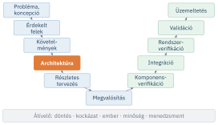
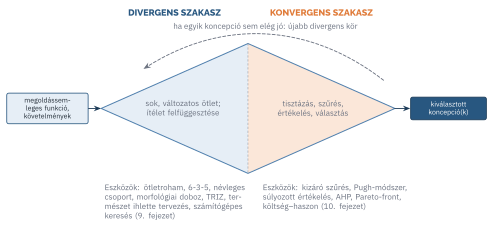
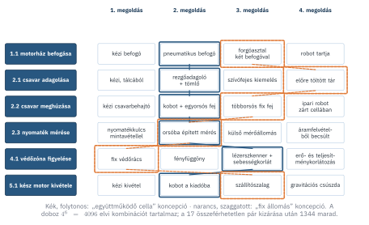
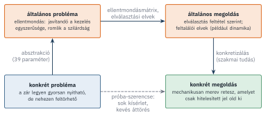

# Koncepciógenerálás és kreatív problémamegoldás {#sec-kreativitas}

::: {.vterkep}
{fig-alt="V-térkép: a fejezet helye a rendszerfejlesztés folyamatában" width=62%}
:::

::: {.cel}
A fejezet feldolgozása után képes leszel:

- megkülönböztetni a divergens és a konvergens gondolkodást, és megmagyarázni, miért kell őket időben szétválasztani;
- felismerni a kreativitás tipikus gátjait, köztük a tervezési fixációt, és tudatosan ellenük dolgozni;
- megtervezni és levezetni egy ötletrohamot, egy 6-3-5 ötletírást, egy névleges csoportos ülést és egy Delphi-felmérést, és indokolni, mikor melyiket érdemes választani;
- morfológiai dobozzal rendszerezetten koncepciókat előállítani, és kezelni a kombinatorikus robbanást;
- a TRIZ segítségével megfogalmazni egy műszaki vagy fizikai ellentmondást, és feltalálói elvekkel megoldási irányokat keresni;
- alkalmazni a hat gondolkodó kalap módszerét, a természet ihlette tervezést és a számítógépes koncepciókeresést, és értékelni egy ötletgeneráló folyamat eredményességét.
:::

Az előző fejezet azzal zárult, hogy az architektúra-tervezés nem egyetlen helyes válasz megkeresése, hanem alternatívák létrehozása és tudatos kiválasztása. Mindig több architektúraváltozatot kell kidolgozni, hogy legyen miből választani ([-@sec-arch-v]. szakasz). Honnan jönnek ezek a koncepciók?

Erre senki nem tud pontos választ adni, és a kreativitás nem is gépiesíthető teljesen. Pasteur sokat idézett mondása szerint azonban a megfigyelésben a véletlen csak a felkészült elmének kedvez, vagyis a kreativitás feltételei megteremthetők: vannak módszerek, amelyek segítenek több, változatosabb és jobb ötletet előállítani, és vannak jól ismert csapdák, amelyek elkerülhetők. Ez a fejezet ezekkel a módszerekkel és csapdákkal foglalkozik.

A koncepcióalkotás két lépésből áll:

- **koncepciógenerálás:** olyan megoldásváltozatok előállítása, amelyek képesek teljesíteni a funkciót és a követelményeket;
- **koncepció-kiválasztás:** a változatok közül annak kiválasztása, amely a követelmények teljesítése mellett a legnagyobb értéket adja, és összhangban van a jelenlegi és a várható szabályozással és szabványokkal.

Ez a fejezet az elsővel, a következő ([-@sec-dontes]. fejezet) a másodikkal foglalkozik. A fejezet négy kérdésre épül:

- Hogyan működik a kreatív folyamat, és mi akadályozza?
- Hogyan lehet egy csoport ötleteit a lehető legjobban kiaknázni?
- Hogyan állíthatók elő rendszerezetten koncepciók?
- Milyen segítséget adnak a természet, az algoritmusok és a nyelvi modellek?

## A kreatív folyamat {#sec-kre-folyamat}

### Divergens és konvergens gondolkodás

A kreativitás rendszeres pszichológiai kutatását Guilford 1950-es elnöki beszéde indította el az Amerikai Pszichológiai Társaságban [@guilford1950]. Guilford intellektusmodelljéből ered a ma is használt megkülönböztetés: a **divergens gondolkodás** egy kiindulópontból sokféle lehetséges választ állít elő, a **konvergens gondolkodás** pedig a lehetőségek közül a legjobbat választja ki. A tervezésben mindkettőre szükség van, de nem egyszerre. Ha egy ötletet azonnal értékelünk, a kritika elfojtja a további ötleteket, és a csoport a legelső elfogadható megoldásnál megáll.

A koncepcióalkotás ezért két jól elkülönülő szakaszból áll ([-@fig-divergens-konvergens]. ábra). A divergens szakaszban az ítéletet felfüggesztjük, és a mennyiségre, a változatosságra törekszünk. A konvergens szakaszban tisztázzuk, szűrjük és értékeljük az ötleteket, majd kiválasztunk egyet vagy néhányat. Ez a szerkezet a problématér feltárásánál már megismert dupla gyémánt második felének felel meg ([-@sec-pr-ter]. szakasz).

{#fig-divergens-konvergens width=100%}

### A kreatív folyamat szakaszai

Wallas klasszikus modellje szerint a kreatív gondolkodás négy szakaszon megy át: az előkészítésen (a probléma alapos megismerése), a lappangáson (a tudatos foglalkozás szüneteltetése), a megvilágosodáson (az ötlet megjelenése) és az igazoláson (az ötlet tudatos kidolgozása és ellenőrzése) [@wallas1926]. A modell két gyakorlati tanulsággal jár. Az első, hogy az előkészítés nem spórolható meg: a jó ötlet a probléma mély megértéséből születik, ezért kell a koncepcióalkotást az érdekelt felek elemzésére és a követelményekre építeni. A második, hogy a lappangásnak idő kell. Egy kétórás ötletgyűjtő ülés helyett gyakran eredményesebb két rövidebb ülés, köztük néhány nappal.

## A kreativitás gátjai {#sec-kre-gatak}

Egy ismert fejtörő jól szemlélteti a gondolkodási gátakat: kössünk össze kilenc, három sorban elhelyezett pontot négy egyenes vonallal, a ceruza felemelése nélkül. A feladat azért nehéz, mert hallgatólagosan feltételezzük, hogy a vonalak nem léphetnek ki a pontok alkotta négyzetből, pedig ezt senki nem kérte. A tervezésben ugyanilyen ki nem mondott feltevések korlátozzák a megoldásteret.

A legjobban dokumentált gát a **tervezési fixáció** (design fixation). Jansson és Smith kísérleteiben a tervezőknek egy feladat mellé egy példamegoldást is mutattak. A példát látó tervezők megoldásai a példa jellemzőit szignifikánsan gyakrabban tartalmazták, mint a kontrollcsoporté, és ez akkor is így volt, amikor a példa jellemzői kifejezetten hibásak voltak, sőt a feladatleírás figyelmeztetett is a hibákra [@jansson1991]. A fixáció a tapasztalt mérnököket is érinti, sőt a szakmai tapasztalat a meglévő megoldások erős mintáit is magával hozza.

A tervezési fixáció és a többi gát ellen a következő gyakorlatok segítenek:

- **Megoldássemleges funkció.** A funkciót a megvalósítás említése nélkül fogalmazzuk meg ([-@sec-arch-alapfogalmak]. szakasz). Amíg a funkció „robotos csavarozás”, nem merül fel más megoldás.
- **Előbb ötletek, aztán példák.** A meglévő megoldásokat (versenytársak, korábbi projektek) csak az első önálló ötletgyűjtés *után* mutassuk meg a csapatnak.
- **A feltevések kimondása.** Írjuk le, mit tételezünk fel hallgatólagosan („a csavarkötés kötelező”, „az operátor áll”), és vizsgáljuk meg, mi történne, ha a feltevés nem igaz.
- **Távoli analógiák.** Keressünk megoldást más szakterületeken és a természetben ([-@sec-kre-bio]. szakasz).
- **Rendszerezett módszerek.** A morfológiai doboz és a TRIZ éppen azért értékes, mert olyan kombinációkat és elveket is elénk tesz, amelyek maguktól nem jutnának eszünkbe.

::: {.hiba title="Az első jó ötlet"}
A leggyakoribb hiba a koncepcióalkotásban az, hogy a csapat az első elfogadhatónak tűnő ötletnél megáll, és a fennmaradó időt annak kidolgozására fordítja. Az így született koncepció lehet jó, de soha nem derül ki, volt-e jobb. Ezért kell mindig több architektúraváltozatot kidolgozni ([-@sec-arch-v]. szakasz). Egy egyszerű szabály: a konvergens szakasz csak akkor kezdődhet, ha legalább három, egymástól lényegesen különböző koncepció van az asztalon.
:::

## Csoportos ötletgenerálás {#sec-kre-csoport}

### Ötletroham

Az **ötletroham** (brainstorming) Osborn reklámszakember nevéhez fűződik, aki az 1950-es években négy alapszabályt fogalmazott meg: az ítélet felfüggesztése (az ötleteket az ülés alatt nem kritizáljuk), a mennyiségre törekvés, a szokatlan ötletek bátorítása és az ötletek kombinálása, továbbfejlesztése [@osborn1953]. Az ülésen a résztvevők kritikától mentesen, gyorsan állítanak elő ötleteket egy adott problémára. A hangsúly az ötletek mennyiségén van, nem a minőségén, és a csoport minden tagja egyenrangú. A gyakorlatban az ülés három szakaszra tagolódik [@goldberg1994toolbox, 7.7. szakasz]:

1. **generálás:** a csoport tagjai ötletlistát állítanak elő;
2. **tisztázás:** a csoport átnézi a listát, hogy mindenki értse az egyes ötleteket;
3. **értékelés:** a csoport kiszűri az ismétlődéseket, a nem odaillő és a kizárt ötleteket.

Fontos ülésekhez érdemes olyan moderátort felkérni, aki ismeri a módszert, segíti az ötletek előállítását, de az eredményben nem érdekelt. Az ötletroham csak javasol megoldást, de nem dönt; a döntéshez a [-@sec-dontes]. fejezet módszerei kellenek.

Az ötletroham a legismertebb, de nem a leghatékonyabb ötletgeneráló módszer. Diehl és Stroebe kísérletei szerint a szóban, együtt ötletelő csoportok kevesebb ötletet állítanak elő, mint ugyanannyi, egymástól elkülönülten dolgozó ember (úgynevezett névleges csoport). A termelékenységi veszteség fő oka a **produkciós blokkolás**: egyszerre csak egy ember beszélhet, a többiek eközben elfelejtik vagy visszatartják az ötletüket [@diehl1987]. Mullen és szerzőtársai metaanalízise megerősítette, hogy az együtt ötletelő csoportok termelékenységi vesztesége jelentős, és nagyobb csoportokban nagyobb [@mullen1991]. Ezért alakultak ki az írásos és a csendes változatok.

### Ötletírás: a 6-3-5 módszer

A **6-3-5 módszert** Rohrbach írta le [@rohrbach1969]. Hat résztvevő mindegyike egy lapra három ötletet ír öt perc alatt, majd a lapot továbbadja a szomszédjának. A következő körben mindenki a kapott lapon szereplő ötletekre építve ír újabb hármat. Hat kör után, harminc perc alatt legfeljebb 6 × 3 × 6 = 108 ötlet születik. A módszer kiküszöböli a produkciós blokkolást (mindenki egyszerre ír), és a domináns személyiségek hatását is csökkenti, miközben megtartja az egymás ötleteire építés előnyét.

### Névleges csoporttechnika

A **névleges csoporttechnikát** (nominal group technique, NGT) Delbecq és Van de Ven dolgozta ki a problémák azonosítására és a programtervezésre [@delbecq1971]. Az NGT a csendes, egyéni ötletgyűjtést szavazással és rangsorolással ötvöző, strukturált csoportos módszer, ezért akkor hasznos, ha az ötletek mellett prioritást vagy rangsort is fel kell állítani. Kis csoportban működik jól, és minden tagnak részt kell vennie. Az eljárás lépései [@delbecq1971; @goldberg1994toolbox, 7.10. szakasz]:

1. a moderátor ismerteti a problémát és a szabályokat;
2. a résztvevők 5–15 percig csendben, egyénileg írják le ötleteiket;
3. a moderátor körbejárva, egyesével összegyűjti és felírja az ötleteket;
4. a csoport megbeszéli az ötleteket, de csak tisztázó kérdésekkel, vita nélkül; az ismétlődéseket összevonják;
5. mindenki csendben rangsorolja vagy pontozza az ötleteket;
6. a moderátor összesíti az egyéni rangsorokat.

### Delphi-módszer

A **Delphi-módszert** a RAND Corporation kutatói, Dalkey és Helmer dolgozták ki szakértői becslések rendszerezett összegyűjtésére [@dalkey1963]. Rowe és Wright áttekintése szerint a módszert négy jellemző határozza meg: a résztvevők névtelensége, a több körös iteráció, a szabályozott visszacsatolás és a csoportvélemény statisztikai összesítése [@rowe1999; @goldberg1994toolbox, 7.9. szakasz]. A szakértők egymással nem tanácskoznak, hanem véleményüket egy moderátornak küldik, aki összesíti és névtelenül visszaküldi azokat további véleményezésre. A körök addig ismétlődnek, amíg a vélemények nem stabilizálódnak. A névtelenség kiküszöböli a személyes ellentéteket és a domináns személyiségek hatását, és bevonhatók olyan szakértők is, akik egy közös ülésre nem érnének rá. A módszer hátránya, hogy a több kör és a résztvevők összegyűjtése időigényes. A Delphi kevésbé ötletgeneráló, inkább becslő és értékelő módszer: jól használható például egy új technológia érettségének vagy egy koncepció kockázatainak felmérésére.

| Módszer | Fő erőssége | Fő gyengesége | Mikor válaszd? |
|:--|:--|:--|:--|
| ötletroham | gyors, egymás ötleteire épít, csapatot épít | produkciós blokkolás, domináns hangok | kis, összeszokott csapat, laza téma |
| 6-3-5 ötletírás | sok ötlet rövid idő alatt, mindenki egyszerre dolgozik | kötött forma, írásban nehezebb a bonyolult ötlet | 6 fős csoport, sok ötlet kell gyorsan |
| névleges csoport | kiegyensúlyozott részvétel, rangsort is ad | erős moderálást igényel | vegyes státuszú csoport, döntés-előkészítés |
| Delphi | névtelen, a földrajzilag szétszórt szakértőket is bevonja | lassú, több körös | becslés, előrejelzés, szakértői értékelés |

: A csoportos ötletgeneráló és értékelő módszerek összevetése. {#tbl-csoportos-modszerek tbl-colwidths="[18,28,27,27]"}

::: {.eset eset="C" title="ForgácsTech: névleges csoport a késések okairól"}
A ForgácsTech csapata a késések lehetséges okainak összegyűjtésére először hagyományos ötletrohamot tartott. Az ülésen a termelési vezető és a két legtapasztaltabb műszakvezető beszélt a legtöbbet, a gépkezelők és a beszerző szinte meg sem szólalt. Az ülés tizennégy okot gyűjtött, többségük a gépek állapotához kötődött. A második alkalommal a csapat névleges csoporttechnikát alkalmazott ugyanazzal a tizenegy résztvevővel. Tíz perc csendes írás után 41 ötlet gyűlt össze, az összevonás után 27 különböző ok maradt. A csendes rangsorolás első öt helyére két olyan ok is került (a sürgős rendelések szóbeli „előresorolása” és az alapanyag-beérkezés bizonytalansága), amely az első ülésen fel sem merült. Ez a tapasztalat közvetlenül befolyásolta a MES-koncepciót: az ütemezőmodulnak a sürgősségi átsorolást is naplóznia kell.
:::

## Rendszerezett koncepcióalkotás: a morfológiai doboz {#sec-kre-morfologia}

A csoportos módszerek az emberek ötleteit gyűjtik össze. A **morfológiai doboz** (morphological box, morfológiai mátrix) ezzel szemben rendszerezetten állítja elő a lehetséges megoldásokat. A módszert Zwicky svájci asztrofizikus dolgozta ki általános feltaláló és problémamegoldó módszerként [@zwicky1969]. Lényege, hogy a problémát egymástól független részfunkciókra vagy paraméterekre bontjuk, mindegyikhez összegyűjtjük a lehetséges megoldásokat, majd a részmegoldások kombinálásával teljes koncepciókat állítunk elő. Pahl és szerzőtársai rendszeres géptervezési módszertanában a morfológiai doboz a funkcióstruktúrából kiinduló koncepcióalkotás egyik alapeszköze [@pahl2007].

A morfológiai doboz lépései:

1. a fő funkció lebontása részfunkciókra (a funkciófa második szintje jó kiindulópont, [-@sec-arch-funkcioelemzes]. szakasz);
2. minden részfunkcióhoz megoldási lehetőségek gyűjtése (ehhez bármelyik csoportos módszer használható);
3. az összeférhetetlen részmegoldás-párok megjelölése;
4. ígéretes kombinációk (koncepciók) összeállítása, mindegyik egy-egy útvonal a dobozon át;
5. a koncepciók rövid leírása és továbbadása a kiválasztáshoz.

A morfológiai doboz legnagyobb erénye és legnagyobb nehézsége ugyanaz: a kombinációk száma. Ha $n$ részfunkció mindegyikéhez $m_i$ megoldás tartozik, az elvi kombinációk száma

$$
N = \prod_{i=1}^{n} m_i .
$$ {#eq-morf-kombinacio}

Hat részfunkció és részfunkciónként négy megoldás esetén ez már $4^6 = 4096$ kombináció. Ennyit kézzel nem lehet értékelni. A kombinatorikus robbanást három lépésben kezeljük: kizárjuk az összeférhetetlen párokat, kizárjuk azokat a részmegoldásokat, amelyek egy kötelező követelményt nem teljesítenek, és a maradékból néhány jellegzetes, egymástól jól különböző koncepciót választunk ki. A kiválasztásnál hasznos, ha a koncepciók egy-egy „vezérelv” köré szerveződnek (például „minden automatikus”, „minimális beruházás”, „maximális rugalmasság”).

::: {.eset eset="A" title="KoboCella: a morfológiai doboz"}
A KoboCella csapata a funkciófa hat legfontosabb részfunkciójához részfunkciónként négy megoldást gyűjtött ([-@fig-morfologiai-kobo]. ábra). A $4^6 = 4096$ elvi kombinációból a 17 összeférhetetlen pár (például a kézi csavarbehajtó és a fix védőrács, vagy az ipari robot zárt cellában és a kézi kivétel) kizárása után 1344 maradt. A kötelező követelmények szűrője tovább szűkítette a kört: az R-09 szerint minden csavarkötés nyomatékadatát át kell adni a MES-nek, ezért a mintavételes nyomatékkulcsos ellenőrzés kiesett, és 1008 kombináció maradt.

A csapat ezekből négy vezérelv köré szervezett koncepciót állított össze: „együttműködő cella” (kobot, lézerszkenner, sebességkorlátozás), „fix állomás” (többorsós fej, forgóasztal, védőrács), „kézi plusz” (fejlesztett kézi munkahely automatikus csavaradagolással és mérő csavarbehajtóval) és „zárt robotcella”. Az ábrán az első kettő útvonala látható. A négy koncepció a [-@sec-dontes]. fejezetben kerül értékelésre. A morfológiai doboz legfontosabb hozadéka a csapat szerint az volt, hogy a „kézi plusz” koncepció egyáltalán felmerült: a kobotos megoldás iránti lelkesedésben senki nem gondolt rá, holott a beruházási költsége a legkisebb.
:::

{#fig-morfologiai-kobo width=100%}

## TRIZ: az ellentmondások feloldása {#sec-kre-triz}

A **TRIZ** (orosz rövidítés, magyarul a feltalálói problémamegoldás elmélete) Altsuller szovjet mérnök és feltaláló nevéhez fűződik, aki az 1940-es évektől kollégáival szabadalmak tömegét elemezte azzal a céllal, hogy feltárja a sikeres találmányok mögötti ismétlődő mintázatokat [@altshuller1984]. Altsuller következtetése az volt, hogy a találmányok jelentős része néhány tucat általános elv alkalmazásával jön létre, és hogy az igazán innovatív megoldások egy **ellentmondást** oldanak fel, ahelyett hogy kompromisszumot kötnének [@altshuller1984].

### Az ellentmondás két fajtája

- **Műszaki ellentmondás:** ha a rendszer egyik jellemzőjét javítjuk, egy másik romlik. Például ha erősebbre tervezzük a kerékpárzárat, nehezebb és lassabban nyitható lesz. A hagyományos mérnöki válasz a kompromisszum: valahol középen megállunk. A QFD tetőmátrixának negatív kapcsolatai éppen ilyen ellentmondásokat jeleznek ([-@sec-qfd-teto]. szakasz).
- **Fizikai ellentmondás:** ugyanannak a jellemzőnek egyszerre két ellentétes értéket kellene felvennie. Például a zárnak *merevnek* kell lennie (hogy ne lehessen feltörni) és *könnyen mozdulónak* (hogy gyorsan nyíljon).

A fizikai ellentmondásokat a TRIZ **elválasztási elvekkel** oldja fel: az ellentétes követelményeket időben (az egyik értékre az egyik pillanatban, a másikra máskor van szükség), térben (a rendszer egyik részén az egyik, a másikon a másik), feltétel szerint (az egyik helyzetben az egyik, a másikban a másik) vagy a rendszerszintek között (az egész rendelkezik az egyik, a részek a másik tulajdonsággal) választjuk szét.

### A 39 paraméter, a 40 elv és az ellentmondásmátrix

A műszaki ellentmondásokhoz Altsuller két listát állított össze [@altshuller1984]. Az egyik **39 általános műszaki paraméter** (például a mozgó tárgy tömege, a sebesség, az erő, a szilárdság, a megbízhatóság, a kezelés egyszerűsége, az automatizáltság foka, a termelékenység), amelyekkel egy konkrét ellentmondás általános alakra hozható. A másik a **40 feltalálói elv** (például a felosztás, az eltávolítás, a helyi minőség, az aszimmetria, az összevonás, a beágyazás, az előzetes cselekvés, a „fordítva”, a dinamika, a visszacsatolás, a közvetítő, az önkiszolgálás, a másolás, a kompozit anyagok). A kettőt az **ellentmondásmátrix** kapcsolja össze: a 39 × 39-es mátrix sorai a javítandó, oszlopai a romló paramétereket tartalmazzák, a cellák pedig azokat az elveket, amelyek a szabadalmak tanúsága szerint az adott ellentmondást leggyakrabban oldották fel.

A TRIZ alapsémája ([-@fig-triz-sema]. ábra) a próba-szerencse módszer helyett egy kerülőutat javasol. A konkrét problémát általános problémává alakítjuk (absztrakció), az általános problémához megkeressük az általános megoldást (ellentmondásmátrix, elválasztási elvek), majd az általános megoldást szakmai tudásunk segítségével konkrét megoldássá alakítjuk.

{#fig-triz-sema width=100%}

A TRIZ egy további fontos fogalma az **ideális végeredmény**: az a képzeletbeli rendszer, amely a funkciót ellátja, de nincs költsége, nincs káros hatása, és nem foglal helyet. Az ideális végeredmény megfogalmazása (például „a kerékpár magától marad a helyén, amíg a jogosult felhasználó el nem viszi”) segít elszakadni a meglévő megoldásoktól.

::: {.eset eset="B" title="VárosiBringa: a zár ellentmondása"}
A VárosiBringa minőségházának tetőmátrixában negatív kapcsolat volt a kölcsönzés gyorsasága és a zár feltörési ellenállása között ([-@sec-qfd-teto]. szakasz). A csapat először műszaki ellentmondásként fogalmazta meg: javítandó a kezelés egyszerűsége és a gyorsaság, romlik a szilárdság. Ezután rájött, hogy valójában fizikai ellentmondásról van szó: a retesznek egyszerre kell merevnek és könnyen mozdulónak lennie.

Az elválasztás *feltétel szerint* adta a megoldási irányt: a retesz jogosulatlan erőhatással szemben legyen merev, jogosult kérésre pedig könnyen mozduljon. A „dinamika” elv (a rendszer jellemzői változzanak a működési körülményekhez igazodva) és az „előzetes cselekvés” elv (a szükséges műveletet előre végezzük el) két konkrét ötlethez vezetett. Az egyik egy mechanikusan önzáró retesz, amelyet csak a hitelesített jelre működő kis teljesítményű aktuátor old ki. A másik az, hogy a kioldást már a kölcsönzés jóváhagyásakor, a felhasználó odaérése előtt előkészítik, így a nyitás érzékelt ideje csökken. Az ideális végeredmény megfogalmazása egy harmadik irányt is megnyitott: ha a lopott kerékpár helyzete mindig ismert, a zár szilárdságára kisebb terhelés jut.
:::

### A TRIZ korlátai

Ilevbare, Probert és Phaal a TRIZ gyakorlati alkalmazásának előnyeit és nehézségeit felmérő tanulmányukban arra jutottak, hogy a módszer népszerűsége nő, de az elsajátítása és alkalmazása komoly kihívás. A nehézségek a módszertan összetettségétől a szervezeti és kulturális akadályokig terjednek [@ilevbare2013]. A tanulmány a kezdők számára is ad útmutatást: a felmérésben részt vevők által leggyakrabban használt eszközök (köztük a 40 feltalálói elv és az ellentmondások megfogalmazása) a legjobb kiindulópontok. Fontos tudni azt is, hogy a TRIZ eszköztára ennél jóval bővebb (szabványmegoldások, fejlődési trendek, problémamegoldó algoritmus), és az ellentmondásmátrix csak egy a sok eszköz közül.

## Hat gondolkodó kalap {#sec-kre-kalap}

De Bono **hat gondolkodó kalap** módszere abból indul ki, hogy egy megbeszélésen a résztvevők egyszerre többféle gondolkodásmódot kevernek: tényeket közölnek, érzelmeiket fejezik ki, kockázatokat sorolnak és ötleteket vetnek fel [@debono1985]. Ez zavart és vitát okoz, mert az egyik ember egy ötlet előnyeiről, a másik a hátrányairól beszél, és egyikük sem hallja a másikat. A módszer szerint a csoport egyszerre csak egyféle módon gondolkodik, és ezt egy-egy képzeletbeli, színes kalap jelöli ([-@tbl-hat-kalap]. táblázat).

| Kalap | Gondolkodásmód | Jellemző kérdés |
|:--|:--|:--|
| fehér | tények, adatok, információ | Mit tudunk biztosan? Milyen adat hiányzik? |
| piros | érzelmek, megérzések | Mi a zsigeri reakciónk? |
| fekete | óvatosság, kockázatok, kritika | Milyen kockázatokra kell figyelnünk? Mi mehet félre? |
| sárga | előnyök, optimizmus | Miért lehetünk bizakodók? Mi az értéke? |
| zöld | kreativitás, új lehetőségek | Hogyan teremthetünk új lehetőségeket? |
| kék | a gondolkodási folyamat irányítása | Hol tartunk? Milyen rendszerek és folyamatok kellenek? Mi a következő lépés? |

: A hat gondolkodó kalap és a hozzájuk tartozó kérdések de Bono alapján [@debono1985]. {#tbl-hat-kalap tbl-colwidths="[12,30,58]"}

A kék kalapot általában a moderátor viseli: ő nyitja és zárja az ülést, és ő dönti el, mikor melyik kalapot veszi fel a csoport. Egy tipikus sorrend koncepcióértékeléshez: kék (cél), fehér (tények), zöld (ötletek), sárga (előnyök), fekete (kockázatok), piros (megérzések), kék (összegzés, következő lépések). Gyakorlásként érdemes egy egyszerű eseten kipróbálni a módszert, például egy kávéházon, amely egyre több panaszt kap a hosszú várakozás miatt: a csoport a tulajdonos, a vezetés és a fejlesztőcsapat szerepébe képzelve magát, kalapról kalapra haladva vizsgálja a problémát.

A módszer erőssége, hogy a kritikát nem tiltja (mint az ötletroham), hanem kijelöli a helyét. A fekete kalap ideje alatt kifejezetten elvárt a kockázatok felsorolása, a zöld kalap ideje alatt viszont nem. Így a kritikus alkatú résztvevők sem érzik, hogy el kell hallgatniuk, a kreatívabbak pedig nem érzik, hogy minden ötletüket azonnal lelövik.

## Természet ihlette tervezés {#sec-kre-bio}

A természet ihlette tervezés (biomimetika, biomimikri) az élővilág megoldásait használja fel műszaki problémák megoldására. A tépőzár és a szögesdrót példáját a [-@sec-arch-alapfogalmak]. szakasz már bemutatta. Jó kiindulópont az **AskNature** adatbázis, amely az élővilág stratégiáit funkciók szerint rendszerezi: a tervező egy funkcióra (például „rögzítés”, „hűtés”, „energiaelnyelés”) keresve talál biológiai példákat [@asknature].

Vincent és szerzőtársai a biológiai és a műszaki problémamegoldás összehasonlítására a TRIZ fogalomrendszerét használták, és egy biológiai változatot (BioTRIZ) dolgoztak ki. Elemzésük szerint a biológia és a technika által alkalmazott megoldási elvek között meglepően kicsi az átfedés. A technika jellemzően az energiafelhasználás módosításával old meg problémákat, a biológia inkább az információ és a szerkezet alakításával [@vincent2006]. Ez a különbség a mérnök számára éppen a lehetőséget jelenti: a természet olyan megoldási irányokat mutathat, amelyek a műszaki gyakorlatban ritkák.

A természet ihlette tervezésnek két iránya van. A **problémavezérelt** megközelítés egy műszaki problémából indul ki, és a megoldáshoz biológiai analógiát keres. A **megoldásvezérelt** megközelítés egy érdekes biológiai jelenségből indul ki (mint a bogáncs horgai), és alkalmazást keres hozzá. A rendszermérnöki munkában az első a gyakoribb, mert a funkció már adott. A legnagyobb kockázat a felszínes analógia: a biológiai megoldás csak akkor használható, ha a működési elvét (és nem csupán a formáját) értjük, és ha a méretarányok és az anyagok közötti különbségek nem teszik érvénytelenné.

## Számítógépes koncepciókeresés {#sec-kre-szamitogepes}

Ha a tervezési tér paraméterekkel leírható, és egy-egy változat teljesítménye számítással vagy szimulációval értékelhető, a koncepciókeresés egy része algoritmusokra bízható. Két, a természetből ihletett keresőmódszer különösen elterjedt.

A **genetikus algoritmus** a darwini evolúció elvét követi [@holland1975]. A lehetséges megoldásokat (fenotípusokat) kódolt formában (genotípusként) ábrázoljuk, és egy populációt hozunk létre belőlük. A populáció egyedeit értékeljük, a jobbakat nagyobb valószínűséggel kiválasztjuk, majd keresztezéssel és mutációval új egyedeket hozunk létre, amelyek a rosszabbak helyére lépnek. A folyamat ismétlődik, amíg a populáció jó megoldásokhoz nem konvergál. A módszer általában gyorsan talál az optimálishoz közeli megoldást, de nem garantálja a globális optimumot.

A **részecskeraj-optimalizálás** (particle swarm optimization, PSO) a madárrajok és halrajok viselkedését utánozza [@kennedy1995]. A lehetséges megoldások részecskékként „repülnek” a problématérben, és információt osztanak meg egymással. Minden részecske emlékszik a saját eddigi legjobb pozíciójára, és ismeri a raj legjobbját is. Mozgási sebességét és irányát e kettő felé módosítja, így a raj fokozatosan a jó megoldások környékére gyűlik.

Mindkét módszer alkalmazásának kulcsa a **kódolás** és az **értékelés**. Egy hőkezelési program optimalizálásánál például a hőmérséklet- és időparamétereket egyetlen számsorba kódolják, és minden jelölt programot dinamikus szimulációval értékelnek. A KoboCellánál ugyanígy kódolható lenne a kobot pályájának néhány köztes pontja, és a ciklusidő a robotszimulációból számítható. Ha több, egymással ütköző célt (például ciklusidő és energiafelhasználás) egyszerre kell figyelembe venni, a többcélú evolúciós algoritmusok, például Deb és szerzőtársai NSGA-II algoritmusa, nem egyetlen megoldást, hanem a Pareto-optimális megoldások halmazát közelítik [@deb2002]. A Pareto-front fogalmával a [-@sec-dontes]. fejezet foglalkozik.

Fontos látni a számítógépes keresés határait. Az algoritmus csak a megadott kódolás által kifeszített térben keres: ha a kódolás csak a kobotos koncepció paramétereit tartalmazza, a fix állomást soha nem fogja megtalálni. A számítógépes keresés tehát a koncepción *belüli* optimalizálásra való, a koncepciók *közötti* választás továbbra is a csapat feladata.

::: {.kitekintes title="Nagy nyelvi modellek az ötletgenerálásban"}
A nagy nyelvi modellek (LLM) gyorsan és nagy mennyiségben képesek ötleteket előállítani, és jól használhatók a csoportos módszerek kiegészítésére: további megoldásokkal tölthetik fel a morfológiai doboz sorait, TRIZ-elvekhez konkrét alkalmazási javaslatokat adhatnak, vagy egy-egy gondolkodó kalap szerepében érvelhetnek. Doshi és Hauser online kísérlete azonban egy fontos kockázatra figyelmeztet. A kísérletben a nyelvi modelltől ötleteket kapó írók történeteit kreatívabbnak és jobban megírtnak értékelték, különösen a kevésbé kreatív írók esetében. A modell segítségével írt történetek viszont jobban hasonlítottak egymásra, mint a csak emberek által írtak [@doshi2024]. A szerzők ezt társadalmi dilemmaként írják le: az egyén jobban jár, de együttesen szűkebb lesz az új tartalmak köre. A koncepcióalkotás szempontjából ez azt jelenti, hogy a nyelvi modell ötleteit a csapat saját, önálló ötletgyűjtése *után* érdemes bevonni, különben a modell a tervezési fixáció új forrásává válhat.
:::

## Az ötletgenerálás eredményességének értékelése {#sec-kre-ertekeles}

Honnan tudjuk, hogy egy ötletgeneráló ülés vagy módszer eredményes volt? Shah, Smith és Vargas-Hernandez négy mérőszámot javasoltak az ötletgenerálás eredményességének mérésére [@shah2003]:

- **mennyiség:** az előállított ötletek száma;
- **változatosság:** mennyire fedik le az ötletek a megoldástér különböző részeit (például hány különböző működési elvre épülnek);
- **újdonság:** mennyire szokatlanok az ötletek a szokásos megoldásokhoz képest;
- **minőség:** mennyire megvalósíthatók, és mennyire teljesítik a követelményeket.

A négy mérőszám egymást kiegészíti. Egy ülés, amely száz ötletet hoz, de mindegyik ugyanarra a működési elvre épül, mennyiségben kiváló, változatosságban gyenge. A gyakorlatban a változatosság a legfontosabb a koncepcióalkotás korai szakaszában, mert a konvergens szakasz csak abból választhat, amit a divergens szakasz előállított.

A konvergens szakasz első lépése a **kizáró szűrés**: azokat az ötleteket, amelyek egy kötelező követelményt vagy korlátot biztosan nem teljesítenek, indoklással kizárjuk. A KoboCella esetében ilyen volt a mintavételes nyomatékellenőrzés kizárása az R-09 alapján. A szűrésen átjutott koncepciókat ezután összehasonlító értékeléssel rangsoroljuk, amelyről a következő fejezet szól.

::: {.osszefoglalo}
- A koncepcióalkotás két szakasza a divergens (sok, változatos ötlet, felfüggesztett ítélettel) és a konvergens (tisztázás, szűrés, értékelés, választás). A kettőt időben szét kell választani.
- A legjobban dokumentált gát a tervezési fixáció: a látott példák jellemzői akkor is visszaköszönnek az új tervekben, ha hibásak. Ellene a megoldássemleges funkció, a feltevések kimondása, a távoli analógiák és a rendszerezett módszerek segítenek.
- Az ötletroham négy szabálya: az ítélet felfüggesztése, a mennyiség, a szokatlan ötletek bátorítása, a kombinálás. A szóbeli csoportok termelékenysége a produkciós blokkolás miatt elmarad az egyénileg dolgozókétól; az ötletírás (6-3-5) és a névleges csoporttechnika ezt kiküszöböli. A Delphi névtelen, többkörös szakértői becslő módszer.
- A morfológiai doboz részfunkciónként gyűjtött megoldások kombinálásával állít elő koncepciókat. A kombinációk száma a megoldásszámok szorzata, ezért összeférhetetlenségi és követelményszűrésre, majd vezérelvek szerinti válogatásra van szükség.
- A TRIZ az ellentmondások feloldására épül. A műszaki ellentmondásokhoz a 39 paraméter, a 40 feltalálói elv és az ellentmondásmátrix, a fizikai ellentmondásokhoz az elválasztási elvek (idő, tér, feltétel, rendszerszint) adnak megoldási irányt.
- A hat gondolkodó kalap a gondolkodásmódokat időben választja szét, és a kritikának is kijelöli a helyét. A természet ihlette tervezés a technikában ritka megoldási elvekhez vezethet. A genetikus algoritmus és a részecskeraj-optimalizálás a koncepción belüli paraméterkeresésre való.
- Az ötletgenerálás eredményessége a mennyiséggel, a változatossággal, az újdonsággal és a minőséggel mérhető. A korai szakaszban a változatosság a legfontosabb.
:::

::: {.onell}
1. Miért kell a divergens és a konvergens szakaszt időben szétválasztani? Mi történik, ha egy ötletet azonnal értékelünk?
2. Mi a tervezési fixáció? Milyen sorrendben mutatnád meg a csapatnak a versenytársak megoldásait egy koncepcióalkotó műhelyben?
3. Hány ötlet születhet legfeljebb egy 6-3-5 ülésen, ha öt résztvevő van, és mindenki minden lapra ír egyszer?
4. Egy morfológiai dobozban öt részfunkció van, a megoldások száma rendre 3, 4, 2, 5, 3. Hány elvi kombináció van? Mennyi marad, ha a második részfunkció egyik megoldását egy kötelező követelmény miatt kizárjuk?
5. Fogalmazd meg fizikai ellentmondásként: „a dokkoló legyen könnyen telepíthető, de ne lehessen elmozdítani”. Melyik elválasztási elv segíthet?
6. Mire használnád a fekete és mire a zöld kalapot egy koncepcióértékelő megbeszélésen? Miért jó, hogy a módszer nem tiltja a kritikát?
7. Miért nem találhatja meg egy genetikus algoritmus a fix állomás koncepciót, ha a kódolás a kobot pályapontjait tartalmazza?

::: {.megoldas}
1. Mert a korai kritika elfojtja a további ötleteket, és a csoport az első elfogadható megoldásnál megáll. Ha egy ötletet azonnal értékelünk, a résztvevők óvatosabbak lesznek, és a szokatlan, de továbbfejleszthető ötletek ki sem mondódnak.
2. A tervezési fixáció az a jelenség, hogy a látott példamegoldások jellemzői akkor is megjelennek az új tervekben, ha hibásak. A versenytársak megoldásait csak az első önálló ötletgyűjtés után érdemes megmutatni.
3. Öt résztvevő, mindenki három ötletet ír minden körben, és öt kör van (minden lap mindenkihez eljut egyszer): $5 \cdot 3 \cdot 5 = 75$ ötlet.
4. $N = 3 \cdot 4 \cdot 2 \cdot 5 \cdot 3 = 360$. Ha a második részfunkcióból egy megoldást kizárunk, $3 \cdot 3 \cdot 2 \cdot 5 \cdot 3 = 270$ marad.
5. A dokkoló talapzatának egyszerre kell könnyen mozdíthatónak (telepítéskor) és mozdíthatatlannak (üzem közben) lennie. Az elválasztás időben segít: telepítéskor könnyű, moduláris elemek, üzemben például ballaszttal vagy talajhoz rögzítő elemmel rögzített szerkezet. Az elválasztás feltétel szerint is működhet: csak célszerszámmal oldható rögzítés.
6. A fekete kalappal a kockázatokat, gyenge pontokat és lehetséges hibákat gyűjtjük, a zöld kalappal új ötleteket és a gyenge pontok javítási lehetőségeit. A kritika kijelölt helyet kap, így a kritikus résztvevők sem hallgatnak el, a kreatív szakasz alatt viszont nem lövik le az ötleteket.
7. Mert az algoritmus csak a kódolás által kifeszített térben keres. A kobot pályapontjai a kobotos koncepció paraméterei; a fix állomás ebben a térben nem ábrázolható, tehát nem is található meg.
:::
:::

::: {.projekt title="Projektlépés: koncepciók előállítása"}
Saját fejlesztési feladatodhoz:

1. írd le a csapat hallgatólagos feltevéseit a megoldásról, és jelöld meg, melyik kérdőjelezhető meg;
2. tarts egy 6-3-5 vagy névleges csoportos ülést a fő funkció megoldási lehetőségeiről, és rögzítsd az ötletek számát és a különböző működési elvek számát;
3. készíts morfológiai dobozt legalább öt részfunkcióval, jelöld az összeférhetetlen párokat, és számítsd ki az elvi és a megmaradó kombinációk számát;
4. keress legalább egy ellentmondást (például a minőségház tetőmátrixából), és fogalmazd meg TRIZ-szel;
5. állíts össze legalább három, egymástól lényegesen különböző koncepciót vezérelvvel és egybekezdéses leírással.

A morfológiai doboz, a TRIZ-elvek, a hat kalap és az ötletroham sablonja és notebookja a Gyakorlati útmutatóban található.
:::

::: {.forras}
- @osborn1953 és @diehl1987: az ötletroham eredeti leírása és a csoportos termelékenységi veszteség klasszikus vizsgálata.
- @delbecq1971 és @rowe1999: a névleges csoporttechnika eredeti leírása és a Delphi-módszer kritikai áttekintése.
- @zwicky1969: a morfológiai módszer eredeti leírása.
- @altshuller1984 és @ilevbare2013: a TRIZ alapműve és gyakorlati alkalmazásának kritikai áttekintése.
- @jansson1991: a tervezési fixáció klasszikus kísérlete.
- @shah2003: az ötletgenerálás eredményességének mérőszámai.
- @goldberg1994toolbox, 7.7., 7.9. és 7.10. szakasz: az ötletroham, a Delphi-módszer és a névleges csoporttechnika eljárásai.
:::
