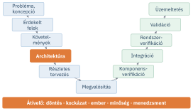
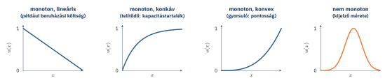
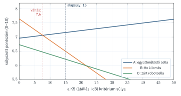
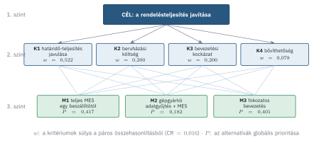
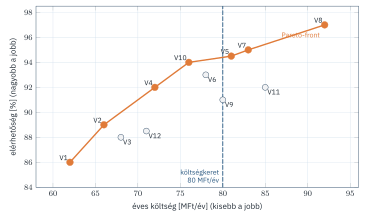

# Koncepció-kiválasztás és döntéstámogatás {#sec-dontes}

::: {.vterkep}
{fig-alt="V-térkép: a fejezet helye a rendszerfejlesztés folyamatában" width=62%}
:::

::: {.cel}
A fejezet feldolgozása után képes leszel:

- leírni egy választási döntés elemeit és a döntéskezelési folyamat lépéseit, és felismerni, mikor indokolt formális döntéselemzés;
- megfogalmazni jó értékelési kritériumokat, és kizáró szűréssel elkülöníteni a kötelező követelményeket nem teljesítő alternatívákat;
- elvégezni egy Pugh-féle összehasonlítást, és megindokolni, mire alkalmas és mire nem;
- súlyozott értékelést (trade study) készíteni hasznossági függvényekkel, és érzékenységvizsgálattal ellenőrizni a rangsor robusztusságát;
- páros összehasonlítással (AHP) súlyokat és prioritásokat számítani, és ellenőrizni a következetességet;
- dominanciavizsgálattal meghatározni a Pareto-frontot, és költség–haszon elemzést végezni növekményes elemzéssel;
- felismerni a csoportos döntések és az emberi ítéletalkotás csapdáit, és dokumentálni egy döntést.
:::

Az előző fejezet végére a csapatok asztalán több, egymástól lényegesen különböző koncepció van. A KoboCellánál négy, a ForgácsTech-nél három, a VárosiBringánál tucatnyi tervváltozat. Most választani kell. A választás a V-modell bal ágának egyik legkövetkezményesebb lépése: a kiválasztott koncepció határozza meg a további tervezés kereteit, és a rendszerkövetelmény- és rendszertervezési felülvizsgálatokon ([-@sec-felulvizsgalatok]. szakasz) ennek a döntésnek az indoklását is be kell mutatni.

A döntés alternatívák közötti tudatos választás: csak ott van mit eldönteni, ahol legalább két valódi lehetőség közül választhatunk. A rendszermérnöki döntések ritkán egyszerűek. Több, egymással ütköző kritérium szerint kell választani, a kritériumok egy része nehezen mérhető, az alternatívák jellemzői bizonytalanok, és a döntésben több érdekelt fél vesz részt, eltérő értékrenddel. Ez a fejezet olyan módszereket mutat be, amelyek ezt a bonyolultságot átláthatóvá teszik. Egyik módszer sem dönt helyettünk, de mindegyik segít abban, hogy a döntés indokolható, megismételhető és utólag is érthető legyen.

A fejezet négy kérdésre épül:

- Milyen elemekből áll egy döntés, és mikor van szükség formális döntéselemzésre?
- Hogyan hasonlíthatók össze a koncepciók minőségi és mennyiségi kritériumok szerint?
- Hogyan ellenőrizhető, hogy az eredmény nem a bizonytalan becsléseken vagy a súlyokon múlik?
- Milyen csapdák fenyegetik az egyéni és a csoportos döntéseket?

## A döntés elemei és folyamata {#sec-dont-elemek}

Ben-Akiva és Lerman a választási folyamatot négy elemmel írja le: a döntéshozóval, az alternatívákkal, az alternatívák jellemzőivel (attribútumaival) és a döntési szabállyal, amely alapján a döntéshozó a jellemzők ismeretében választ [@benakiva1985]. A gyakorlatban ugyanez négy kérdésként jelenik meg: mik az alternatívák, mik a kritériumok, mi az értékítélet, és ki a döntéshozó (egyén vagy csoport). A négy elem közül a leginkább elhanyagolt az értékítélet: az, hogy a kritériumok közül melyik mennyire fontos, nem műszaki, hanem értékválasztási kérdés, amelyet a döntésre jogosultaknak kell meghozniuk.

Az ISO/IEC/IEEE 15288 szabvány döntéskezelési folyamatának célja, hogy rendezett, elemző keretet adjon a döntési alternatívák objektív azonosításához, jellemzéséhez és értékeléséhez, és a legelőnyösebb cselekvési irány kiválasztásához az életciklus bármely pontján [@iso15288_2023, 6.3.3. szakasz]. A döntési modellek a szakértői ítéleteket és a döntéshozói preferenciákat is számszerűsítik, így segítenek abban a nehéz feladatban, hogy hiányos tudás birtokában kell versengő alternatívák közül választani. Ezért kell minden módszer feltevéseit és korlátait megérteni és dokumentálni.

A döntéselemzési folyamat lépéseit a [-@fig-dontes-folyamat]. ábra mutatja. Nem minden döntés igényel formális elemzést: sok döntés egyszerűen meghozható a felelős szakterületek világos tájékoztatása alapján. Parnell és szerzőtársai szerint a formális döntéselemzés azokban a nehéz döntésekben hoz értéket, amelyekre az alábbi jellemzők közül több is igaz [@parnell2013; @nasa2016seh, 6.8. szakasz]:

- **összetett alternatívák:** a változatok következményei részletes elemzés nélkül nehezen érthetők;
- **jelentős bizonytalanság:** a legfontosabb bemenetek bizonytalansága az alternatívák rangsorát is bizonytalanná teszi;
- **több, egymással ütköző cél:** minél több a figyelembe veendő szempont, annál nagyobb a formális elemzés haszna;
- **több érdekelt fél:** ha az érdekelt felek értékei, preferenciái és nézőpontjai eltérnek, a célokat külön tisztázni kell;
- **súlyos következmények:** a döntés nagy tétű, és nehezen vagy egyáltalán nem fordítható vissza.

![A döntéselemzés folyamata az ISO/IEC/IEEE 15288 döntéskezelési folyamata [@iso15288_2023, 6.3.3. szakasz] és Parnell és szerzőtársai [@parnell2013] nyomán, saját szerkesztés. A bizonytalanság csak akkor számít, ha csökkentése megváltoztathatja a rangsort.](../abrak/gen/dontes-folyamat.svg){#fig-dontes-folyamat width=72%}

### Az emberi ítéletalkotás korlátai

Az Ebbinghaus-féle optikai csalódásban két egyforma kör közül azt látjuk nagyobbnak, amelyiket kisebb körök vesznek körül. Az ítéletalkotásunk ugyanígy rendszeresen és előre jelezhetően torzul. Tversky és Kahneman klasszikus tanulmánya három heurisztikát írt le, amelyekre bizonytalanság esetén támaszkodunk, és amelyek rendszeres hibákhoz vezetnek: a **reprezentativitást** (annak megítélése, mennyire hasonlít valami egy jellegzetes mintára), a **hozzáférhetőséget** (azt tartjuk valószínűbbnek, ami könnyebben eszünkbe jut) és a **lehorgonyzást** (a becslés a kiinduló értéktől csak kevéssé tér el) [@tversky1974]. Egy koncepcióértékelésnél a lehorgonyzás például úgy jelenik meg, hogy az első elhangzó költségbecslés minden későbbi becslést maga felé húz.

A döntési helyzet kialakítása maga is befolyásolja az eredményt. Johnson és Goldstein európai országok szervadományozási adatait vetették össze. Azokban az országokban, ahol a szervadományozáshoz kifejezett hozzájárulás kell, a hozzájárulók aránya jellemzően harminc százalék alatt maradt. Ahol viszont a hozzájárulás az alapértelmezés, és külön nyilatkozni kell az elutasításról, az arány 85% fölött volt, Magyarországon és Ausztriában gyakorlatilag száz százalék [@johnson2003]. A rendszermérnök számára ebből két tanulság következik. Az egyik, hogy a döntési folyamat tervezése (milyen sorrendben, milyen alapértelmezéssel, milyen keretezéssel kerülnek elő az alternatívák) nem semleges. A másik, hogy az általunk tervezett rendszerek alapértelmezései a felhasználók döntéseit is erősen befolyásolják ([-@sec-emberkozpontu]. fejezet).

## Kritériumok és kizáró szűrés {#sec-dont-kriteriumok}

A döntési kritériumok azok a szempontok, amelyek szerint az alternatívákat egyenként értékeljük. Jellemző kritériumok a költség, az ütemterv, a kockázat, a biztonság, a teljesítmény és a támogathatóság, de a döntéshez kapcsolódó műszaki kritériumokat is figyelembe kell venni. Kepner és Tregoe klasszikus módszere két kritériumfajtát különít el: a **kötelező** („kell”) és a **javító** („kívánatos”) kritériumokat [@kepner1965]. Azt az alternatívát, amely egy kötelező kritériumot nem teljesít, el kell vetni; a javító kritériumok pedig a megmaradt alternatívák rangsorolására szolgálnak.

Keeney és Gregory szerint egy jó mérőszám (attribútum) öt tulajdonsággal rendelkezik [@keeney2005attr]:

- **egyértelmű:** minden értékelő ugyanazt érti rajta, és a következmény alapján egyértelműen megadható az értéke;
- **teljes körű:** a cél teljesülésének minden lehetséges fokát lefedi;
- **közvetlen:** közvetlenül azt méri, amiről a döntéshozónak tudnia kell;
- **működtethető:** elfogadható költséggel és bizonytalansággal mérhető vagy becsülhető;
- **érthető:** a következmények és az átváltások könnyen kommunikálhatók vele.

Ehhez jön egy, a súlyozott összegzésnél különösen fontos követelmény: a kritériumok legyenek egymástól függetlenek, vagyis ne mérjék ugyanazt a tulajdonságot többször [@keeney1976].

Ez a követelmény gyakran sérül. Ha a „beruházási költség” és a „teljes életciklus-költség” egyaránt szerepel a kritériumok között, a beruházást kétszer számoljuk. Ha a „ciklusidő” és a „termelékenység” is szerepel, ugyanazt a tulajdonságot kétszer jutalmazzuk.

A koncepcióválasztás tölcsérként képzelhető el: a kezdeti ötletekből a szűrés a lehetséges, a megvalósítható, végül az ígéretes koncepciókhoz vezet. Az első szűrő a **kizáró szűrés**: minden alternatívát összevetünk a kötelező követelményekkel és korlátokkal (fizikai törvények, erőforrások, szabványok, hatósági előírások, biztonság), és a nem megfelelőket indoklással kizárjuk. A kizárt alternatívákat is dokumentálni kell. Egy fontos döntés értékelő táblázatát akkor is érdemes elkészíteni, ha csak egyetlen alternatíva bizonyult életképesnek, mert az indoklás így is dokumentálva marad. Azt se felejtsük el, hogy a semmittevés vagy a döntés elhalasztása is lehet alternatíva.

Ha az alternatívák száma nagy, érdemes őket **döntési fába** (trade tree) rendezni. A fa megmutatja, hogyan bomlanak a magas szintű alternatívák egyre alacsonyabb szintű alternatívákra, és segít a változatok számát a részletes elemzés előtt csökkenteni, valamint a szűkítés indoklását az érdekelt felekkel megosztani [@parnell2017; @goldberg1994toolbox, 2.1.3. szakasz]. Egy nagy értékelés így több kisebbre bontható.

## A Pugh-módszer {#sec-dont-pugh}

A koncepció szakaszának legegyszerűbb összehasonlító módszere Pugh skót mérnök nevéhez fűződik [@pugh1991]. A módszer minden alternatívát egy kiválasztott **vonatkoztatási alaphoz** (datum) hasonlít, kritériumonként három fokozattal: jobb (+), azonos (S vagy 0), rosszabb (−). A módszer lépései [@pugh1991]:

1. a kritériumok kiválasztása az alapkövetelmények és a kívánt cél figyelembevételével;
2. az összehasonlítandó alternatívák kiválasztása, amelyeket a lehető legtöbb szempontból azonos részletességgel kell leírni;
3. a pontozás: kiválasztunk egy vonatkoztatási alapot (például a jelenlegi megoldást vagy a legígéretesebbnek vélt koncepciót), és minden alternatívát minden kritérium szerint ehhez hasonlítunk;
4. az összesítés: alternatívánként megszámoljuk a pluszokat és a mínuszokat, és előjelesen összeadjuk. Ez az érték csak tájékoztató jellegű;
5. szükség esetén szélesebb skála (például −3-tól +3-ig) vagy súlyozás is alkalmazható.

A Pugh-módszer ereje, hogy rendezi az eljárást, valódi csapatmunkára ösztönöz, kiszűri a gyengébb ötleteket és továbbviszi az erősebbeket, és segít felismerni a jó kombinációkat. Pugh ezt a fokozatos szűkítést és bővítést irányított konvergenciának nevezte [@pugh1991]. Arra viszont nem alkalmas, hogy automatikusan döntsön: a számok csak tájékoztató jellegűek, nem szabad őket algebrailag összeadva végeredménynek tekinteni.

A módszer legfontosabb tulajdonsága az iteráció. Pugh azt javasolta, hogy az első kör után a csapat vizsgálja meg, hogyan lehetne a legjobb koncepciók gyenge pontjait más koncepciók erősségeivel javítani, majd egy új vonatkoztatási alappal (általában az első kör nyertesével) ismételje meg az összehasonlítást. Így a módszer nemcsak szűr, hanem új, hibrid koncepciókat is létrehoz.

| Kritérium | A: együttműködő cella | B: fix állomás | C: kézi plusz | D: zárt robotcella |
|:--|:-:|:-:|:-:|:-:|
| ciklusidő-képesség | + | + | + | + |
| kötésminőség, utómunka | + | + | + | + |
| ergonómia | + | + | S | + |
| beruházási költség | − | − | S | − |
| átállási rugalmasság | S | − | S | − |
| helyigény | S | − | S | − |
| technikai kockázat | − | S | S | − |
| bővíthetőség 140 ezer db/évig | + | + | S | + |
| **pluszok / mínuszok** | **4 / 2** | **4 / 3** | **2 / 0** | **4 / 4** |
| **előjeles összeg (tájékoztató)** | **+2** | **+1** | **+2** | **0** |

: A KoboCella koncepcióinak Pugh-féle összehasonlítása. Vonatkoztatási alap: a jelenlegi kézi szerelés. {#tbl-pugh-kobo tbl-colwidths="[32,17,17,17,17]"}

::: {.eset eset="A" title="KoboCella: a Pugh-összehasonlítás tanulságai"}
A KoboCella csapata a négy koncepciót a jelenlegi kézi szereléshez hasonlította ([-@tbl-pugh-kobo]. táblázat). Az eredmény meglepő volt: a „kézi plusz” koncepció ugyanannyi előjeles pontot kapott, mint az együttműködő cella, és egyetlen mínusza sem volt. A csapat ezért a kizáró szűrés előtt részletesebben megvizsgálta. A munkahely-ergonómiai elemzés szerint a „kézi plusz” koncepcióban a csavarozás alsó pozícióinál a legnagyobb törzshajlítás becsült értéke 25°, miközben az R-05 követelmény legfeljebb 20°-ot enged meg ([-@sec-kovetelmenyek]. fejezet). A „kézi plusz” így kötelező követelményt sértett, és kiesett. A csapat egy tanulságot mégis megtartott belőle: az automatikus csavaradagolást és a mérő csavarbehajtót a kobotos koncepció tartalék üzemmódjába is beépítette, hogy a kobot meghibásodása esetén a cella csökkentett ütemben kézzel is működtethető legyen (UM-7, leromlott üzem).

A második körben a csapat az együttműködő cellát választotta vonatkoztatási alapnak. A fix állomás és a zárt robotcella rugalmasságban és helyigényben rosszabb, ciklusidőben jobb volt. A Pugh-módszer tehát nem adott egyértelmű nyertest, de világossá tette, hogy a döntés a ciklusidő és a rugalmasság közötti átváltáson múlik. Ennek számszerűsítésére a csapat súlyozott értékelést végzett.
:::

## Súlyozott értékelés és hasznossági függvények {#sec-dont-sulyozott}

### A súlyozott értékelés lépései

A **súlyozott értékelés** akkor használható jól, ha az alternatívák és a követelmények is jól definiáltak. Minden fontos kritériumhoz súlyt rendelünk, az alternatívákat kritériumonként értékeljük, és a döntés a súlyozott értékelés számszerű eredményén alapul. Elméleti alapja a többszempontú hasznosságelmélet [@keeney1976], egyszerűsített, a gyakorlatban jól bevált változatát Edwards és Barron írta le [@edwards1994]. Az eljárás jellemző lépései [@parnell2013; @goldberg1994toolbox, 2.1.3. szakasz]:

1. a célok és követelmények meghatározása és lehetőség szerinti rangsorolása;
2. a hiteles alternatívák azonosítása, a követelményeket biztosan nem teljesítők kizárása;
3. döntési fa készítése (nagy értékeléseknél);
4. a kiválasztási kritériumok meghatározása;
5. a kritériumok súlyainak meghatározása, összesen 100 ponttal;
6. szükség esetén a súlyok meghatározása páros összehasonlítással (AHP, [-@sec-dont-ahp]. szakasz);
7. hasznossági függvények felállítása a különböző mértékegységű kritériumok közös skálára hozásához;
8. az alternatívák értékelése kritériumonként, a hasznossági pontszámok és a súlyozott pontszámok kiszámítása;
9. az eredmények táblázatba foglalása;
10. érzékenységvizsgálat;
11. a legmagasabb súlyozott összpontszámú alternatíva kiválasztása.

Fontos szervezési szabály, hogy a súlyokat a végső döntési jogkörrel rendelkező személy vagy csoport határozza meg, mégpedig előre, mielőtt az alternatívák pontszámai ismertté válnak. Az elemzők így elfogulatlanul értékelhetik az alternatívákat a kritériumok szerint. Ezzel elválik egymástól az *értékítélet* (mennyire fontos egy kritérium) és a *ténybeli ítélet* (mennyire jó egy alternatíva az adott kritérium szerint).

### Hasznossági függvények és normalizálás

A kritériumok különböző mértékegységűek: másodperc, százalék, fok, millió forint, perc, szóbeli kockázati besorolás. Összeadni csak közös skálán lehet őket. A hasznosság (utilitás) a relatív megfelelőség mértéke: a döntéshozó preferenciáit kifejező szubjektív érték, amely a mindenkori döntési céllal változik, ezért nincs általános hasznossági függvény. A hasznosság fogalmának döntéselméleti megalapozása Neumann János és Oskar Morgenstern nevéhez fűződik [@vonneumann1944]. A gyakorlatban minden kritériumhoz egy **hasznossági függvényt** rendelünk, amely a természetes mértékegységben kifejezett értéket 0 és 1 (vagy 0 és 10) közötti pontszámra képezi le.

A hasznossági függvény alakja nem mindig lineáris ([-@fig-hasznossagi-fuggvenyek]. ábra). Egy mobiltelefon kijelzőjénél például a nagyobb méret egy határig jobb, azon túl rosszabb: a függvény nem monoton. A kapacitástartaléknál az első néhány százalék nagyon értékes, a további egyre kevésbé: a függvény konkáv, telítődő. A normalizálás módjától függetlenül a legfontosabb a skála **működtethető definíciója**: minden fokozatnak megismételhető, mérhető tartalma legyen [@keeney2005attr]. A „magas” például jelentheti azt, hogy „legalább 67% valószínűség”, az „alacsony” pedig azt, hogy „legfeljebb 33% valószínűség”. A transzformációt minden esetben dokumentálni kell.

{#fig-hasznossagi-fuggvenyek width=100%}

Lineáris hasznossági függvénynél, ha az $x$ érték a „rossz” $x^{-}$ és a „jó” $x^{+}$ szint között van, a pontszám

$$
u(x) = 10 \cdot \frac{x - x^{-}}{x^{+} - x^{-}} ,
$$ {#eq-linearis-hasznossag}

amely kisebb-a-jobb kritériumnál (költség, idő) is működik, ha $x^{+} < x^{-}$. Az alternatívák összpontszáma a **súlyozott összeg**:

$$
U_j = \sum_{i=1}^{m} w_i \, u_i(x_{ij}), \qquad \sum_{i=1}^{m} w_i = 1 ,
$$ {#eq-sulyozott-osszeg}

ahol $w_i$ az $i$-edik kritérium súlya, $u_i(x_{ij})$ pedig a $j$-edik alternatíva hasznossági pontszáma az $i$-edik kritérium szerint.

::: {.kitekintes title="Mikor szabad összeadni? A függetlenségi feltételek"}
A súlyozott összeg a többszempontú hasznosságelemzés (multi-attribute utility analysis) legegyszerűbb modellje. Keeney és Raiffa elmélete szerint az additív modell csak akkor érvényes, ha a kritériumok között bizonyos függetlenségi feltételek teljesülnek [@keeney1976]. Keeney és Raiffa három szintet különböztet meg: az additív függetlenség magában foglalja a hasznossági függetlenséget, az pedig a preferenciafüggetlenséget. A legenyhébb, a preferenciafüggetlenség azt jelenti, hogy két kritérium közötti átváltási hajlandóságunk nem függ a többi kritérium szintjétől. Egy szemléletes példa: egy házibuli sikere a sör és a pizza mennyiségétől függ, de a kettő nem cserélhető fel tetszőlegesen: sok sör pizza nélkül nem ugyanannyit ér, mint a kettő kiegyensúlyozott aránya. Ilyenkor az additív modell félrevezet, és összetettebb (például multiplikatív) aggregálásra van szükség. A mérnöki gyakorlatban az additív modell jó közelítés, ha a kritériumok valóban különböző tulajdonságokat mérnek, és egyik sem szükséges feltétele a másik értékének. Ez utóbbiról a kizáró szűrés gondoskodik.
:::

### A súlyok meghatározása

A súlyok meghatározásának legegyszerűbb módja a közvetlen pontosztás: a döntéshozók 100 pontot osztanak szét a kritériumok között. Ha a döntéshozók a kritériumok sorrendjében könnyebben egyeznek meg, mint a pontos számokban, Edwards és Barron rangsoralapú súlyozást javasol [@edwards1994]. A **rangsor-súlypont** (rank order centroid, ROC) módszerben $n$ kritérium esetén az $i$-edik helyen álló kritérium súlya

$$
w_i = \frac{1}{n} \sum_{k=i}^{n} \frac{1}{k} .
$$ {#eq-roc}

Hat kritérium esetén a ROC-súlyok: 0,408; 0,242; 0,158; 0,103; 0,061; 0,028. A módszer előnye, hogy csak sorrendet kér, hátránya, hogy a sorrend elején álló kritériumokat erősen felülsúlyozza. Ha a döntéshozók szerint két kritérium között nincs nagy különbség, a ROC-súlyokat érdemes közvetlen egyeztetéssel finomítani.

::: {.eset eset="A" title="KoboCella: a súlyozott értékelés"}
A KoboCella csapata a kizáró szűrés után megmaradt három koncepciót hat kritérium szerint értékelte ([-@tbl-sulyozott-kobo]. táblázat). A súlyokat a gyártásvezető, a minőségügyi vezető és a munkavédelmi felelős közösen, a csapattól függetlenül határozta meg. A ciklusidő és az utómunka-arány 20–20 pontot kapott, a többi kritérium 15–15-öt. A hasznossági függvények lineárisak voltak. A ciklusidőnél például a 90 s jelentette a 0, a 45 s a 10 pontot. A technikai kockázathoz szóbeli skála tartozott operatív definíciókkal (alacsony: 9, közepes: 6, magas: 2 pont).

| Kritérium (súly) | Mérték | A: értéke | A: pont | B: értéke | B: pont | D: értéke | D: pont |
|:--|:--|--:|--:|--:|--:|--:|--:|
| K1 ciklusidő (20) | s | 58,6 | 7,0 | 52 | 8,4 | 48 | 9,3 |
| K2 utómunka-arány (20) | % | 0,8 | 9,0 | 0,7 | 9,3 | 0,6 | 9,7 |
| K3 törzshajlítás (15) | ° | 15 | 8,6 | 15 | 8,6 | 10 | 10,0 |
| K4 beruházás (15) | MFt | 78 | 3,5 | 95 | 2,1 | 110 | 0,8 |
| K5 átállási idő (15) | perc | 5 | 8,3 | 30 | 0,0 | 20 | 3,3 |
| K6 technikai kockázat (15) | szóbeli | közepes | 6,0 | alacsony | 9,0 | magas | 2,0 |
| **súlyozott összpontszám** | | | **7,16** | | **6,50** | | **6,22** |

: A KoboCella súlyozott értékelése. A pontszámok 0–10 skálán, a súlyozott összpontszám a súlyokkal képzett átlag. {#tbl-sulyozott-kobo tbl-colwidths="[24,10,11,10,11,10,12,12]"}

Az együttműködő cella (A) 7,16 ponttal az első, a fix állomás (B) 6,50 ponttal a második. A különbség 0,66 pont. Mivel a pontszámok minőségi ítéletekből származnak, egy skálalépésnél kisebb különbséget óvatosan kell értelmezni. Itt egy lépés 1 pont, a különbség tehát kisebb egy lépésnél. A csapat ezért érzékenységvizsgálatot végzett.
:::

### Érzékenységvizsgálat és a rangsor robusztussága

A döntéshozónak a javaslattal együtt azt is be kell mutatni, mennyire robusztus a rangsor, vagyis megváltoztathatná-e az alternatívák sorrendjét a bizonytalanságok csökkentése [@parnell2013]. Általában egyetlen alternatívát kell javasolni. Ha azonban az alternatívák nem különböznek számottevően, vagy a bizonytalanság csökkentése megváltoztathatná a rangsort, a javaslatnak minden szorosan rangsorolt alternatívát tartalmaznia kell. Ilyenkor érdemes megvizsgálni, megéri-e több adatot gyűjteni; ha ez sem segít, a kritériumokat és a súlyokat kell újragondolni.

Az érzékenységvizsgálat két leggyakoribb formája:

- **Egytényezős vizsgálat:** egy kritérium súlyát nulla és egy felső határ között változtatjuk, a többi súlyt arányosan módosítjuk, hogy az összeg 100 maradjon, és megkeressük azt a súlyt, amelynél a rangsor megfordul.
- **Monte Carlo-szimuláció:** a súlyokat (és ha szükséges, a pontszámokat is) a bizonytalanságuknak megfelelő valószínűségi eloszlásból sokszor újramintavételezzük, és megszámoljuk, hányszor nyer az egyes alternatíva. Butler, Jia és Dyer módszertani tanulmánya a többszempontú döntési modellek ilyen szimulációs érzékenységvizsgálatának több változatát dolgozta ki [@butler1997].

::: {.eset eset="A" title="KoboCella: mennyire biztos az első hely?"}
Az egytényezős vizsgálat ([-@fig-erzekenyseg-kobo]. ábra) megmutatta, hogy az együttműködő cella (A) első helye leginkább az átállási idő (K5) súlyán múlik. Ha ez a súly 15-ről 7,6 alá csökkenne, a fix állomás (B) kerülne az élre. A technikai kockázat (K6) súlyának 30,5 fölé, illetve a ciklusidő (K1) súlyának 43,3 fölé kellene emelkednie ahhoz, hogy a rangsor megforduljon. A csapat ezután Monte Carlo-szimulációt is végzett: 5000 alkalommal mintavételezte a súlyokat egy, az alapsúlyok körül szóródó eloszlásból. Az A koncepció az esetek 92%-ában lett első, a B 7%-ában.

A K5 súlya tehát a döntés kulcsa. A csapat ezért visszament a gyártásvezetőhöz azzal a kérdéssel, mennyire biztos a változatváltások várható gyakorisága. A válasz az volt, hogy a Kobold két új motorváltozat bevezetését tervezi a következő két évben, így a gyakori átállás valószínű. A csapat az együttműködő cellát javasolta, és a javaslatban rögzítette, hogy a döntés érzékeny az átállási igényre: ha a termékpaletta mégsem bővül, a fix állomás versenyképes alternatíva lett volna.
:::

{#fig-erzekenyseg-kobo width=88%}

## Páros összehasonlítás: az AHP {#sec-dont-ahp}

Az **analitikus hierarchia eljárás** (analytic hierarchy process, AHP) a súlyozott értékelés egy változata, amelyet Saaty dolgozott ki [@saaty1980; @saaty1990; @goldberg1994toolbox, 2.1. szakasz]. Páros összehasonlításokra épül, ezért akkor hasznos, ha szóbeli kifejezésekkel (egyforma, kissé fontosabb, sokkal fontosabb) könnyebb ítéletet mondani, mint számokkal.

Az AHP a döntési problémát hierarchiába rendezi: a csúcson a cél, alatta a kritériumok (szükség esetén alkritériumok), legalul az alternatívák ([-@fig-ahp-hierarchia]. ábra). Minden szinten páronként hasonlítjuk össze az elemeket a felettük álló elem szempontjából. Saaty skáláján az 1 az egyforma fontosságot, a 3 a mérsékelt, az 5 az erős, a 7 a nagyon erős, a 9 a rendkívüli fontosságot jelenti, a páros számok a köztes értékek [@saaty1990]. Ha az $i$-edik elem $a_{ij}$-szer fontosabb a $j$-ediknél, akkor a $j$-edik $1/a_{ij}$-szer fontosabb az $i$-ediknél, így a páros összehasonlítási mátrix reciprok, és az átlójában egyesek állnak.

A súlyokat Saaty szerint a mátrix legnagyobb sajátértékéhez tartozó sajátvektor adja, amelyet úgy normálunk, hogy elemeinek összege 1 legyen [@saaty1990]. Gyakorlati közelítésként a sorok mértani közepeinek normált értéke is használható; jól következetes mátrixnál a két eredmény alig tér el. Az AHP nagy előnye, hogy ellenőrizni tudja az ítéletek **következetességét**. Ha az A kétszer fontosabb B-nél, B pedig kétszer fontosabb C-nél, akkor következetes ítéletnél A négyszer fontosabb C-nél. A következetlenség mértéke a következetességi index és a következetességi arány:

$$
\mathrm{CI} = \frac{\lambda_{\max} - n}{n - 1}, \qquad \mathrm{CR} = \frac{\mathrm{CI}}{\mathrm{RI}_n} ,
$$ {#eq-ahp-cr}

ahol $\lambda_{\max}$ a mátrix legnagyobb sajátértéke, $n$ a mátrix mérete, $\mathrm{RI}_n$ pedig a véletlen mátrixok átlagos következetességi indexe. Saaty értékei: $n = 3$ esetén 0,58, $n = 4$ esetén 0,90, $n = 5$ esetén 1,12, $n = 6$ esetén 1,24, $n = 7$ esetén 1,32 [@saaty1980]. Saaty szerint a 0,10 alatti következetességi arány elfogadható; e fölött az ítéleteket felül kell vizsgálni [@saaty1990].

::: {.eset eset="C" title="ForgácsTech: a MES-koncepció AHP-val"}
A ForgácsTech csapata három MES-koncepciót hasonlított össze: M1 a teljes MES egy beszállítótól, M2 a gépgyártói adatgyűjtés és egy erre épülő MES, M3 a fokozatos bevezetés (első ütemben gépi adatgyűjtés, OEE-monitoring és ütemezőmodul, később bővítés). A négy kritériumot a vezetőség páronként hasonlította össze. A határidő-teljesítés javulását (K1) a beruházási költséghez (K2) és a bevezetési kockázathoz (K3) képest mérsékelten fontosabbnak (3), a bővíthetőséghez (K4) képest erősen fontosabbnak (5) ítélte. A költséget és a kockázatot egyformán fontosnak (1), mindkettőt a bővíthetőségnél mérsékelten fontosabbnak (3) tartotta.

A sajátvektor-módszer szerint a súlyok: K1 0,522, K2 0,200, K3 0,200, K4 0,078. A legnagyobb sajátérték 4,043, így $\mathrm{CI} = 0{,}014$ és $\mathrm{CR} = 0{,}016$, ami jóval a 0,10-es határ alatt van. Az alternatívák kritériumonkénti páros összehasonlítása után a globális prioritások: M1 0,417, M2 0,182, M3 0,401 ([-@fig-ahp-hierarchia]. ábra). Az M1 és az M3 közötti különbség alig 4%, ami az ítéletek bizonytalanságához képest nem tekinthető érdemi különbségnek. Az AHP tehát az M2-t egyértelműen kiszűrte, az M1 és az M3 között azonban nem döntött. A csapat ezért költség–haszon elemzést is végzett ([-@sec-dont-koltseg-haszon]. szakasz).
:::

{#fig-ahp-hierarchia width=100%}

Az AHP-t széles körben használják, de kritikusai is vannak. Belton és Gear mutatott rá elsőként, hogy egy új, az eddigiek egyikével azonos alternatíva hozzáadása megfordíthatja a korábbi alternatívák rangsorát (rangsorfordulás) [@belton1983]. A jelenség oka a prioritások normálása. A gyakorlatban ezért érdemes az alternatívák listáját az AHP előtt véglegesíteni, és az eredményt más módszerrel is ellenőrizni.

## Dominancia és Pareto-front {#sec-dont-pareto}

A súlyozott értékelés és az AHP egyetlen számmá aggregálja a kritériumokat. Ehhez súlyokat kell meghatározni, ami értékítélet. A **dominanciavizsgálat** súlyok nélkül is szűkíti az alternatívák körét. Maximalizálandó kritériumok esetén egy alternatíva akkor dominál egy másikat, ha minden jellemzőben legalább olyan jó, és legalább egyben jobb. A dominált alternatívát nyugodtan elvethetjük, mert van nála minden szempontból legalább olyan jó lehetőség.

A dominancia páros összehasonlítással vizsgálható. Az eredmény a **dominanciamátrix**: a sorok és oszlopok az alternatívák, a $j$-edik sor $k$-adik eleme 1, ha a $j$-edik alternatíva dominálja a $k$-adikat. A $j$-edik sor összege azt mutatja meg, hány másik alternatívát dominál a $j$-edik, a $k$-adik oszlop összege pedig azt, hány másik alternatíva dominálja a $k$-adikat. Azok az alternatívák, amelyek oszlopösszege nulla, a **nem dominált** megoldások.

A nem dominált megoldások halmaza a **Pareto-front**. Egy fontos finomság: minden Pareto-optimális pont nem dominált, de nem minden nem dominált pont Pareto-optimális. Ha csak néhány tervváltozatot vizsgálunk, a közöttük nem dominált változatok csak *közelítik* a valódi Pareto-frontot, amely a teljes tervezési tér nem dominált pontjaiból áll. A teljes front közelítésére a többcélú evolúciós algoritmusok alkalmasak ([-@sec-kre-szamitogepes]. szakasz).

A Pareto-front a kompromisszumokat teszi láthatóvá. Egy bank telefonos ügyfélszolgálata például a gyors kiszolgálás és a munkatermelékenység között választ: nagyon rövid várakozási időt csak gyakori üresjárattal lehet elérni, magas kihasználtságot csak hosszabb várakozással. Az iparági front megmutatja, mely szolgáltatók működnek hatékonyan, és melyek vannak a front mögött, vagyis melyek javíthatnának mindkét szempontból egyszerre. A rendszermérnök feladata kettős: a front mögötti hatékonytalanságok megszüntetése, és új koncepciókkal magának a frontnak az eltolása.

::: {.eset eset="B" title="VárosiBringa: kerékpárok, dokkolók, furgonok"}
A VárosiBringa csapata tizenkét tervváltozatot vizsgált, amelyek a kerékpárok számában (250, 300, 350), a dokkolóállomások számában (25, 30, 35) és az áthelyezést végző furgonok számában (1 vagy 2) különböztek. Minden változatra szimulációval becsülte az éves teljes költséget és az elérhetőséget, vagyis azt, hogy a kölcsönzési kérések hány százalékában van kerékpár 300 méteren belül ([-@fig-pareto-bringa]. ábra).

A dominanciavizsgálat öt változatot kiszűrt. A legtanulságosabb a V6 (350 kerékpár, 30 dokkoló, 1 furgon) esete volt: ezt a V10 (300 kerékpár, 35 dokkoló, 1 furgon) dominálta, amely olcsóbb (76 MFt/év a 78 helyett) és jobb elérhetőségű (94% a 93 helyett). Vagyis a kerékpárok számának növelése helyett az állomássűrűség növelése a hatékonyabb út, ami egybevág a minőségház eredményével, ahol az állomássűrűség holtversenyben az első helyen végzett, és a Gyakorlati útmutató QFD-notebookjának érzékenységvizsgálata szerint ez a jellemző tartotta meg legstabilabban az élmezőnyben elfoglalt helyét ([-@sec-qfd-pelda]. szakasz). A Pareto-frontra hét változat került. A 80 MFt/éves költségkeret alatt a V10 kínálta a legjobb elérhetőséget. Az eredeti terv (V4) a fronton van, de a V10 évi 4 MFt többletköltségért 2 százalékpontnyi elérhetőség-javulást ad. A választás a két változat között már értékítélet, amelyet a város döntéshozóinak kell meghozniuk.
:::

{#fig-pareto-bringa width=92%}

## Költség–haszon elemzés {#sec-dont-koltseg-haszon}

A **költség–haszon elemzés** (benefit–cost analysis) az alternatívákat a várható jövőbeli hasznok és költségek arányával hasonlítja össze. A hasznokat és a költségeket is jelenértéken kell kifejezni, hogy a különböző időpontokban esedékes összegek összevethetők legyenek. Boardman és szerzőtársai tankönyve az elemzést a következő lépésekre bontja [@boardman2018; vö. @goldberg1994toolbox, 2.2. szakasz]:

1. az egymást kizáró alternatívák meghatározása;
2. annak eldöntése, kinek a hasznai és költségei számítanak (például csak a vállalaté, vagy a társadalomé is);
3. a hatások azonosítása és mérőszámaik kiválasztása (beruházás, üzemeltetés, karbantartás, maradványérték, hasznok és hátrányok);
4. a hatások mennyiségi előrejelzése a rendszer teljes élettartamára;
5. a hatások pénzben kifejezése;
6. a jövőbeli összegek diszkontálása jelenértékre;
7. a nettó jelenérték (és szükség esetén a haszon–költség arány) kiszámítása;
8. érzékenységvizsgálat;
9. javaslat.

Egy $t$-edik évben esedékes $X_t$ összeg jelenértéke $r$ kamatláb mellett $X_t/(1+r)^t$. Ha egy összeg $T$ éven át minden évben esedékes, jelenértéke

$$
\mathrm{PV} = X \sum_{t=1}^{T} \frac{1}{(1+r)^t} .
$$ {#eq-jelenertek}

A bevezetés kockázata és a műszaki érettség egy $f$ kockázati szorzóval vehető figyelembe a hasznok oldalán. Mivel a szorzó szubjektív becslés, érdemes kevés, durva fokozatot használni (például 0,5; 0,75; 1), mert a finomabb megkülönböztetés csak látszólagos pontosságot adna.

### A növekményes elemzés

Ha sem a költségkeret, sem a kívánt haszon nincs rögzítve, a legnagyobb B/C arányú alternatíva nem feltétlenül a legjobb választás. Ilyenkor **növekményes elemzést** kell végezni [@sullivan2019]: először kizárjuk az 1-nél kisebb B/C arányú alternatívákat, a maradékot növekvő költség szerint sorba rendezzük, majd minden szomszédos párra kiszámítjuk a többlethaszon és a többletköltség arányát ($\Delta B / \Delta C$). Egy költségnövekmény akkor éri meg, ha $\Delta B / \Delta C > 1$. A preferált alternatíva a sorrendben az utolsó olyan, amelynek növekménye még megéri. A logika egyszerű: a drágább alternatíva csak akkor jobb, ha a ráfordított *többlet* pénz is legalább annyi többlethasznot hoz.

::: {.eset eset="C" title="ForgácsTech: költség–haszon elemzés"}
A ForgácsTech csapata az AHP után költség–haszon elemzést végzett a három MES-koncepcióra, ötéves időtávra és 8%-os kamatlábbal. A hasznokat a késedelmi kötbérek, a sürgős átállások és a két legnagyobb vevő elvesztésének kockázatából becsülte, a bevezetési kockázatot kockázati szorzóval vette figyelembe. Az ötéves annuitástényező 3,993.

| | M1: teljes MES | M2: gépgyártói + MES | M3: fokozatos |
|:--|--:|--:|--:|
| beruházás [MFt] | 42 | 30 | 14 |
| éves működtetés [MFt/év] | 4 | 6 | 3 |
| éves haszon [MFt/év] | 28 | 22 | 15 |
| kockázati szorzó ($f$) | 0,75 | 0,5 | 1,0 |
| költségek jelenértéke, C [MFt] | 58,0 | 54,0 | 26,0 |
| hasznok jelenértéke, B [MFt] | 83,8 | 43,9 | 59,9 |
| B/C | 1,45 | 0,81 | 2,31 |
| nettó jelenérték, B − C [MFt] | 25,9 | −10,0 | 33,9 |

: A ForgácsTech MES-koncepcióinak költség–haszon elemzése (5 év, 8%). {#tbl-kh-forgacs tbl-colwidths="[40,20,20,20]"}

Az M2 B/C aránya 1 alatt van, ezért kiesett ([-@tbl-kh-forgacs]. táblázat). Az M3-ról az M1-re való átlépés növekménye $\Delta B = 24{,}0$ MFt, $\Delta C = 32{,}0$ MFt, így $\Delta B / \Delta C = 0{,}75 < 1$: a többletberuházás nem éri meg. A költség–haszon elemzés tehát az M3-at, a fokozatos bevezetést preferálta, amelynek a nettó jelenértéke is a legnagyobb.

A két módszer eredményét összevetve a csapat arra jutott, hogy az M3 gyengesége a bővíthetőség (az AHP-ban ebben volt a leggyengébb), erőssége pedig a kis kockázat és a gyors megtérülés. A végső javaslat ezért az M3 volt, egy kiegészítő feltétellel: az első ütem eszközeit olyan beszállítótól kell beszerezni, amelynek rendszere a teljes MES-funkcionalitásig bővíthető. Ezzel a csapat megőrizte az egyetlen interfészgazda előnyét, amelyet az architektúra-elemzés feltárt ([-@sec-arch-dsm]. szakasz), és a beruházás első üteme jóval a 45 millió forintos keret alatt maradt.
:::

A költség–haszon elemzés legnagyobb előnye, hogy a teljes életciklust figyelembe veszi, és dokumentált. Korlátai a „forintosíthatóság” problémájában foglalhatók össze: az elemzés félrevezető, ha az alternatívák listája nem teljes, ha a költségbecslések pontatlanok, és ha a gyakran nehezen megfogható hasznokat nem lehet hitelesen pénzben kifejezni [@boardman2018]. A biztonság, az ergonómia vagy a környezeti hatás pénzbeli értékelése különösen vitatott. Ezeket gyakran célszerűbb kötelező követelményként vagy külön kritériumként kezelni.

## Csoportos döntés {#sec-dont-csoport}

A rendszermérnöki döntéseket ritkán hozza egyetlen ember. A csoportos döntésnek azonban van egy meglepő buktatója: a csoport tagjai egyenként következetesek és racionálisak lehetnek, a csoport összesített preferenciája mégsem az.

Tegyük fel, hogy a KoboCella három csapattagja a három megmaradt koncepciót így rangsorolja:

- első tag: A > B > D;
- második tag: B > D > A;
- harmadik tag: D > A > B.

Többségi szavazással az A-t a B-vel szemben ketten preferálják (az első és a harmadik), a B-t a D-vel szemben szintén ketten (az első és a második), a D-t az A-val szemben szintén ketten (a második és a harmadik). A csoport preferenciája tehát körbeér: A > B > D > A. Ezt a jelenséget Condorcet márki írta le a 18. században. Arrow később általánosan bizonyította, hogy nincs olyan, az egyéni rangsorokat csoportrangsorrá összesítő szabály, amely egyszerre teljesítene néhány, ésszerűnek tűnő követelményt (többek között a Pareto-elvet, a független alternatívák függetlenségét és a diktátor hiányát) [@arrow1951].

A rendszermérnöki gyakorlat számára ebből nem az következik, hogy a csoportos döntés reménytelen, hanem az, hogy a rangsorok egyszerű összeszavazása helyett rendszerezett eljárás kell. A bemutatott módszerek éppen ezt teszik: szétválasztják a ténybeli ítéleteket (az alternatívák pontszámait, amelyeket a szakértők adnak) és az értékítéleteket (a kritériumok súlyait, amelyeket a döntéshozók adnak), és mindkettőt átláthatóvá teszik. Ha a vita a súlyokról szól, az érzékenységvizsgálat megmutatja, hogy a vitának van-e egyáltalán jelentősége a döntés szempontjából. A döntéshozó ugyanakkor mindig szabadon választhat bármelyik alternatívát, vagy kérheti további alternatívák értékelését: az elemzés a döntést támogatja, nem helyettesíti.

## A módszerek összevetése és a döntés dokumentálása {#sec-dont-dokumentalas}

A módszerek a fejlesztés menetében egymásra épülnek: a koncepcionális tervezés közben a Pugh-módszer és, ha elérhetők, egyszerű matematikai modellek; az előzetes tervezés során a hasznossági vizsgálat és a dominanciavizsgálat, minden koncepcióhoz több tervváltozattal. [-@tbl-modszerek-dontes]. táblázat a fejezetben tárgyalt módszereket veti össze.

| Módszer | Bemenet | Kimenet | Mikor használd? | Fő korlát |
|:--|:--|:--|:--|:--|
| kizáró szűrés | kötelező követelmények | megfelelő/nem megfelelő | mindig, elsőként | csak kizár, nem rangsorol |
| Pugh-módszer | minőségi összehasonlítás egy alaphoz | +/S/− mintázat, hibrid ötletek | korai koncepció szakasz, sok koncepció | a számok csak tájékoztatók |
| súlyozott értékelés | súlyok, hasznossági függvények, becslések | összpontszám, rangsor | jól definiált alternatívák, mérhető kritériumok | a súlyok és a függvények szubjektívek |
| AHP | páros szóbeli ítéletek | súlyok, prioritások, CR | szubjektív kritériumok, kevés elem | sok összehasonlítás, rangsorfordulás |
| Pareto-front | két-három mennyiségi cél | nem dominált változatok | sok tervváltozat, nincs megállapodás a súlyokról | nem választ a fronton belül |
| költség–haszon | pénzben kifejezett költségek, hasznok | B/C, nettó jelenérték, növekmény | beruházási döntések, életciklus-szemlélet | a hasznok forintosítása |

: A koncepció-kiválasztás módszereinek összevetése. {#tbl-modszerek-dontes tbl-colwidths="[15,20,18,25,22]"}

A döntést dokumentálni kell; az ISO/IEC/IEEE 15288 is előírja, hogy a döntést, annak indoklását és feltevéseit rögzíteni kell [@iso15288_2023, 6.3.3. szakasz; @nasa2016seh, 6.8. szakasz]. Egy jó döntési jelentés tartalmazza a döntés rendszerszintű összefüggéseit, a szükséges döntést és a kívánt eredményt, a döntési kritériumokat, az azonosított alternatívákat, az alkalmazott értékelési módszereket és eszközöket, a feltevéseket, bizonytalanságokat és érzékenységeket, az összes alternatíva értékelésének eredményét, a javaslatokat, a meghozott végső döntést az indoklással együtt, valamint a tanulságokat. A dokumentált döntés évekkel később is érthetővé teszi, miért alakult így a rendszer, és lehetővé teszi, hogy ha a feltevések megváltoznak, a döntést tudatosan felül lehessen vizsgálni.

::: {.hiba title="A súlyok utólagos hangolása"}
Gyakori, de súlyos hiba, hogy a csapat már a kiértékelés előtt tudja, melyik koncepciót szeretné, és addig hangolja a súlyokat vagy a pontszámokat, amíg a kívánt eredmény ki nem jön. Az így készült értékelés hamis tudományosságot kölcsönöz egy előre meghozott döntésnek. Ha nem a legmagasabb pontszámú alternatívát javasoljuk, meg kell indokolni, miért. Ha a kisebb pontszámú alternatíva előnyei mégis meghaladják a nagyobbét, akkor az értékelés valamit nem ragadott meg: ilyenkor nem a súlyokat kell csendben módosítani, hanem a kritériumokat és azok definícióit kell a döntéshozó egyetértésével újragondolni. A súlyokat ezért a pontozás előtt kell rögzíteni, lehetőleg a csapattól függetlenül.
:::

::: {.osszefoglalo}
- A döntés elemei az alternatívák, a kritériumok, az értékítélet és a döntéshozók. Formális döntéselemzés akkor indokolt, ha a döntés összetett, bizonytalan, sok szempontú, és sokféle érdekelt felet érint.
- Az emberi ítéletalkotás rendszeresen torzul (reprezentativitás, hozzáférhetőség, lehorgonyzás), és a döntési helyzet kialakítása, például az alapértelmezés, maga is befolyásolja az eredményt.
- A kritériumok legyenek mérhetők, megkülönböztetők, függetlenek és a követelményekhez kötöttek. A kötelező kritériumot nem teljesítő alternatívát kizáró szűréssel el kell vetni.
- A Pugh-módszer egy vonatkoztatási alaphoz hasonlít (+/S/−), szűr és hibrid koncepciókat hoz létre, de nem dönt helyettünk.
- A súlyozott értékelés hasznossági függvényekkel közös skálára hozza a kritériumokat, és súlyozott összeget képez. Az additív modell függetlenségi feltételeket feltételez. A súlyokat a döntésre jogosultak rögzítik, a pontozás előtt.
- Az érzékenységvizsgálat (egytényezős vagy Monte Carlo) megmutatja, mennyire robusztus a rangsor. Szoros eredménynél minden közeli alternatívát be kell mutatni a döntéshozónak.
- Az AHP páros szóbeli ítéletekből számít súlyokat és prioritásokat, és ellenőrzi a következetességet ($\mathrm{CR} < 0{,}10$). A dominanciavizsgálat súlyok nélkül szűkít; a nem dominált változatok a Pareto-frontot közelítik. A költség–haszon elemzés jelenértéken veti össze a hasznokat és a költségeket; ha a keret nem rögzített, növekményes elemzés kell.
- A csoport preferenciája akkor is lehet következetlen, ha a tagoké nem az (Condorcet-paradoxon, Arrow-tétel). Ezért kell a ténybeli ítéleteket és az értékítéleteket szétválasztani, és a döntést dokumentálni.
:::

::: {.onell}
1. Mi a különbség a kötelező és a javító kritérium között? Mi a teendő azzal az alternatívával, amely egy kötelező kritériumot nem teljesít?
2. Miért nem szabad a Pugh-összehasonlítás előjeles összegét végeredménynek tekinteni? Mire használnád inkább?
3. Egy kritérium „rossz” szintje 120 MFt, „jó” szintje 0 MFt. Mekkora a 78 MFt-os alternatíva lineáris hasznossági pontszáma 0–10 skálán?
4. Számítsd ki a ROC-súlyokat négy kritérium esetén!
5. Egy 3 × 3-as páros összehasonlítási mátrix legnagyobb sajátértéke 3,08. Elfogadható-e a következetesség?
6. Négy változat (költség, teljesítmény) értékei: P (10, 70), Q (12, 80), R (14, 75), S (15, 90). A költség minimalizálandó, a teljesítmény maximalizálandó. Melyik változat dominált, és melyik melyiket dominálja?
7. Két alternatíva: X költsége 40, haszna 60; Y költsége 70, haszna 85 (jelenértéken). Melyiket választanád növekményes elemzéssel, ha a keret nincs rögzítve?
8. Mutasd meg egy példán, hogy három, egyenként következetes rangsor többségi összesítése körbeérő csoportpreferenciát adhat!

::: {.megoldas}
1. A kötelező kritérium („kell”) nem teljesítése kizáró ok, a javító kritérium az alternatívák rangsorolását szolgálja. A kötelező kritériumot nem teljesítő alternatívát indoklással el kell vetni, de a kizárást dokumentálni kell.
2. Mert a pluszok és mínuszok nem azonos súlyúak és nem azonos nagyságú különbségeket jeleznek, így összegük nem mérhető mennyiség. A Pugh-összehasonlítás a gyenge koncepciók kiszűrésére, az erősségek és gyengeségek mintázatának feltárására és hibrid koncepciók ötletének előállítására való.
3. $u = 10 \cdot (78 - 120) / (0 - 120) = 10 \cdot 0{,}35 = 3{,}5$.
4. $w_1 = (1 + 1/2 + 1/3 + 1/4)/4 = 0{,}521$; $w_2 = (1/2 + 1/3 + 1/4)/4 = 0{,}271$; $w_3 = (1/3 + 1/4)/4 = 0{,}146$; $w_4 = (1/4)/4 = 0{,}063$.
5. $\mathrm{CI} = (3{,}08 - 3)/2 = 0{,}04$; $\mathrm{CR} = 0{,}04 / 0{,}58 \approx 0{,}069 < 0{,}10$, tehát elfogadható.
6. Az R dominált: a Q olcsóbb (12 < 14) és jobb teljesítményű (80 > 75). A P, a Q és az S nem dominált: a P a legolcsóbb, az S a legjobb teljesítményű, a Q-nál pedig nincs olyan változat, amely olcsóbb és jobb is lenne.
7. Mindkettő B/C aránya 1 fölött van (1,5 és 1,21). A növekmény: $\Delta B / \Delta C = (85 - 60)/(70 - 40) = 0{,}83 < 1$, tehát a többletköltség nem éri meg: az X a preferált.
8. Például: első tag A > B > C, második B > C > A, harmadik C > A > B. Az A-t a B-vel szemben az első és a harmadik, a B-t a C-vel szemben az első és a második, a C-t az A-val szemben a második és a harmadik preferálja. A többségi preferencia: A > B > C > A.
:::
:::

::: {.projekt title="Projektlépés: a koncepció kiválasztása"}
Saját fejlesztési feladatodhoz:

1. sorold fel a kötelező kritériumokat, és végezz kizáró szűrést a koncepcióidon, a kizárások indoklásával;
2. készíts Pugh-összehasonlítást legalább három koncepcióval, majd egy második kört új vonatkoztatási alappal;
3. készíts súlyozott értékelést legalább öt kritériummal; a súlyokat egy csapattársad vagy a megrendelő határozza meg a pontozás előtt;
4. végezz egytényezős érzékenységvizsgálatot a két legfontosabb kritérium súlyára, és határozd meg a rangsorfordulás küszöbét;
5. ha van legalább két mennyiségi célod és legalább hat tervváltozatod, határozd meg a nem dominált változatokat;
6. írj egyoldalas döntési jelentést a [-@sec-dont-dokumentalas]. szakaszban leírt szerkezetben.

A Pugh-módszer, a súlyozott értékelés, a MAUT, az AHP, a Pareto-front és a költség–haszon elemzés sablonja és notebookja a Gyakorlati útmutatóban található.
:::

::: {.forras}
- @parnell2013: a döntéselemzés gyakorlati kézikönyve a célok, a kritériumok és a bizonytalanság kezeléséről.
- @boardman2018: a költség–haszon elemzés részletes, alkalmazott tankönyve.
- @keeney1976: a többszempontú hasznosságelmélet alapműve.
- @saaty1990: az AHP rövid, olvasmányos bemutatása a szerzőtől.
- @pugh1991: a Pugh-módszer eredeti leírása a teljes terméktervezési folyamat részeként.
- @tversky1974: az ítéletalkotási heurisztikák és torzítások klasszikus tanulmánya.
- @nasa2016seh, 6.8. szakasz: a döntéselemzési folyamat, a kritériumok, a robusztusság és a dokumentálás.
- @goldberg1994toolbox, 2.1–2.2. szakasz: a súlyozott értékelés, az AHP és a költség–haszon elemzés részletes eljárása kidolgozott példákkal.
:::
