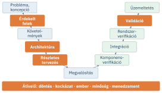
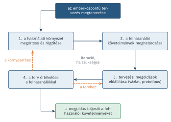
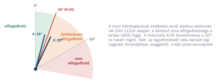
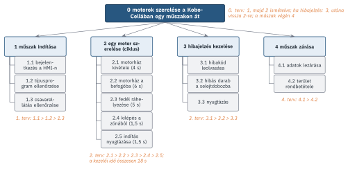

# Emberközpontú tervezés és emberi rendszerintegráció (HSI) {#sec-emberkozpontu}

::: {.vterkep}
{fig-alt="V-térkép: a fejezet helye a rendszerfejlesztés folyamatában" width=62%}
:::

::: {.cel}
A fejezet feldolgozása után képes leszel:

- megindokolni, miért az ember a rendszer egyik eleme, és mit jelent az emberi rendszerintegráció (HSI);
- leírni a HSI-terv tartalmát és a HSI-tevékenységek helyét a V-modellben;
- alkalmazni az ISO 9241-210 emberközpontú tervezési ciklusát, és meghatározni a használhatóságot az ISO 9241-11 szerint;
- figyelembe venni az ember képességeit és korlátait: az észlelést, a figyelmet, a helyzettudatosságot, a testméreteket és a testtartást;
- hierarchikus feladatelemzést (HTA) készíteni;
- megtervezni a használhatóság és a terhelés mérését (SUS, NASA-TLX).
:::

Kezdjük egy kellemetlen tapasztalattal. A hagyományos rendszermérnöki folyamatban a működési követelményeket műszaki teljesítménymértékekben rögzítjük, és bár ezek közül sok az emberre is vonatkozik, az emberi szempontok gyakran alacsony prioritást kapnak. A következmény ismerős. A gép jól működik, de a kezelője nem tudja jól működtetni; a szoftver minden funkciót tud, de a felhasználó nem találja; a cella teljesíti a ciklusidőt, de a kezelő a műszak végére elfárad, és hibázik.

Ez a fejezet arról szól, hogyan kerül az ember a rendszertervezés középpontjába. A következő két fejezet erre épül: a [-@sec-automatizalas]. fejezet azt tárgyalja, mit végezzen az ember és mit a gép, a [-@sec-emberi-hiba]. fejezet pedig azt, hogyan tervezzünk az emberi hibák ellen.

A fejezet négy kérdésre épül:

- Miért része az ember a rendszernek, és mit jelent ez a rendszermérnöki munkában?
- Milyen folyamattal érhető el, hogy a rendszer a felhasználói számára is jól használható legyen?
- Milyen emberi képességekkel és korlátokkal kell tervezni?
- Hogyan elemezzük a feladatokat, és hogyan mérjük a használhatóságot és a terhelést?

## Az ember mint rendszerelem {#sec-ek-ember}

A rendszerszemléletet a rendszer minden elemére alkalmazni kell, az emberre is. Az ISO/IEC/IEEE 15288 szabvány rendszerdefiníciója ezt egyértelművé teszi: a rendszer elemei között a hardver, a szoftver, az adatok, a folyamatok, az eljárások és a létesítmények mellett az **ember** is szerepel [@iso15288_2023]. A rendszermérnöki megközelítésnek ezért a hardvert, a szoftvert és az embert egyenrangúan kell kezelnie és integrálnia: a rendszer a szükséges képességet a három elem együttműködésével hozza létre.

Az emberre fordított figyelem gazdasági kérdés is. A [-@sec-eletciklus]. szakaszban láttuk, hogy a koncepció és a tervezés döntései az életciklusköltség nagy részét már elkötelezik [@incose2015seh]. Az üzemeltetés költségeinek jelentős része pedig emberi [@booher2003]: a kezelők, karbantartók, oktatók munkája, a betanítás, a hibák következményei. Ha a tervezés nem számol az emberrel, ezek a költségek az életciklus későbbi szakaszában, a legdrágább helyen jelentkeznek.

Az Európai Bizottság Ipar 5.0-koncepciója az emberközpontúságot az ipari átalakulás egyik alappillérévé tette: a technológia az embert szolgálja, és nem fordítva [@breque2021]. A rendszermérnök számára ez nem csak érték, hanem tervezési feladat. Az ember képességeit, korlátait és igényeit ugyanolyan gondossággal kell modellezni, követelményekké fordítani és verifikálni, mint a gép jellemzőit.

## Emberi rendszerintegráció (HSI) {#sec-ek-hsi}

Az INCOSE meghatározása szerint az **emberi rendszerintegráció** (human systems integration, HSI) interdiszciplináris műszaki és vezetési folyamat, amely az emberi szempontokat a rendszer minden elemével és minden elemén át integrálja, és a rendszermérnöki gyakorlat nélkülözhetetlen része [@incose2023seh; @nasa2015hsi]. Booher összefoglalása szerint a HSI célja hármas [@booher2003]:

- a rendszer emberi elemei jól illeszkedjenek a hardver- és szoftverelemekhez, és a rendszer egésze a lehető legjobb teljesítményt nyújtsa;
- a fejlesztéshez és az üzemeltetéshez szükséges emberi erőforrás megjelenjen az életciklusköltség tervezésében, és a költség a lehető legkisebb legyen;
- a rendszer illeszkedjen azoknak a felhasználóknak a jellemzőihez, akik üzemeltetik, karbantartják és támogatják.

A HSI-t az emberrel kapcsolatos szakterületek (tartományok) összehangolásaként szokás leírni. A HSI kézikönyvei a tartományokat eltérő bontásban sorolják fel, de jellemzően ide tartozik a létszám, a szükséges szakképzettség, a képzés, az emberi tényezők mérnöki tervezése (ergonómia, kezelőfelületek), a munkabiztonság és egészségvédelem, valamint a munkakörnyezet [@booher2003]. Jó kiindulópont a korábbi, hasonló rendszerek tapasztalatainak összegyűjtése: azoknak az eseteknek a feltárása, amikor a létszám, a szakképzettség, a képzés, a kezelői idő, a karbantartás vagy a biztonsági kockázatok meghaladták a várakozásokat.

### A HSI-terv

Nagyobb projektekben az emberi rendszerintegráció stratégiáját és tervezett megvalósítását külön HSI-tervben érdemes rögzíteni. A terv tartalmazza a HSI-tartományok közötti integráció szerepeit és felelősségeit, a HSI céljait és munkatermékeit életciklus-szakaszonként, a felülvizsgálatok belépési és kilépési feltételeit mérőszámokkal, a tervezett módszereket és eszközöket, a HSI-kockázatok azonosításának és kezelésének módját, valamint az összhangot a rendszermérnöki tervvel. A HSI nagyrészt a rendszermérnökség meglévő eszközeire épül: a működési koncepcióra, a funkciók egyértelmű elosztására a hardver, a szoftver és az ember között, és az életciklus során követett teljesítménymérőszámokra. A terv célja tehát nem a többi terv megismétlése, hanem az, hogy az emberi elem ugyanakkora figyelmet kapjon, mint a hardver és a szoftver.

### A HSI a V-modellben

Az emberi tényezők mérnöki tervezésének klasszikus folyamata, amelyet az amerikai védelmi szabványosítás is rögzített, hat lépésben foglalható össze ([-@fig-hse-folyamat]. ábra) [@milstd46855a]: küldetés- és forgatókönyv-elemzés, funkcióelemzés, funkciómegosztás, feladatelemzés, rendszertervezés, valamint teszt és értékelés. A lépések nem új, különálló folyamatot alkotnak, hanem a V-modell már ismert lépéseinek emberi nézőpontját adják. A forgatókönyvek a működési koncepcióból jönnek ([-@sec-pr-conops]. szakasz), a funkcióelemzés az architektúra része ([-@sec-arch-funkcioelemzes]. szakasz), a funkciómegosztás a [-@sec-automatizalas]. fejezet tárgya, a teszt és az értékelés pedig a verifikáció és a validáció része.

![Az emberi tényezők mérnöki tervezésének egyszerűsített folyamata a MIL-STD-46855A [@milstd46855a] nyomán, a könyv fejezeteihez rendelve.](../abrak/gen/hse-folyamat.svg){#fig-hse-folyamat width=100%}

Részletesebben is érdemes végiggondolni, milyen emberközpontú tevékenységek kísérik a fejlesztés egyes szakaszait. Az előzetes tervezésben a szükséglet- és feladatelemzés, a forgatókönyvek és a látványtervek (storyboard), a teljesítmény- és használhatósági követelmények, valamint a létszám- és költségtervezés. A részletes tervezésben a felhasználói felület tervei és prototípusai, a munkamenet-elemzés, a súgó és a dokumentáció. A megvalósítás és az integráció során a prototípusok használhatósági értékelése és a heurisztikus felülvizsgálat. Az átadáskor a képzés, a felhasználói támogatás és a helyszíni értékelés, amelynek tapasztalatai a következő változat koncepciójába táplálódnak vissza.

## Az emberközpontú tervezés folyamata {#sec-ek-hcd}

Az interaktív rendszerek emberközpontú tervezésének nemzetközi szabványa az ISO 9241-210 [@iso9241_210_2019]. A szabvány hat alapelvet fogalmaz meg:

1. a tervezés a felhasználók, a feladatok és a környezet kifejezett megértésén alapul;
2. a felhasználók a tervezés és a fejlesztés során végig részt vesznek;
3. a tervezést felhasználóközpontú értékelés vezérli és finomítja;
4. a folyamat iteratív;
5. a tervezés a teljes felhasználói élményt figyelembe veszi;
6. a tervezőcsapat multidiszciplináris készségeket és nézőpontokat egyesít.

A szabvány négy, egymásra épülő tevékenységet ír elő ([-@fig-hcd-ciklus]. ábra): a használati környezet megértését és rögzítését, a felhasználói követelmények meghatározását, a tervezési megoldások előállítását és a terv értékelését. Ha az értékelés szerint a megoldás nem teljesíti a követelményeket, a ciklus megismétlődik: vissza kell lépni a környezet megértéséhez, a követelményekhez vagy a tervhez.

{#fig-hcd-ciklus width=84%}

A ciklus kulcsfogalma a **használati környezet** (context of use): kik a felhasználók, milyen céljaik és feladataik vannak, milyen erőforrásokkal, milyen fizikai, társadalmi és szervezeti környezetben dolgoznak. Ugyanaz a termék más környezetben másképp használható: egy kerékpárkölcsönző alkalmazás a lakásban, nyugodt körülmények között könnyen kezelhető, esőben, kesztyűben, egy forgalmas buszmegállóban viszont már egészen más feltételek között kell működnie.

Az ISO 9241-11 szerint a **használhatóság** az a mérték, amennyire egy rendszert, terméket vagy szolgáltatást meghatározott felhasználók meghatározott céljaik elérésére eredményesen, hatékonyan és megelégedéssel használhatnak egy meghatározott használati környezetben [@iso9241_11_2018]. A definíció három mérhető összetevője:

- **eredményesség:** a felhasználók elérik-e a céljukat, és milyen pontossággal, teljességgel (például a feladatok hány százalékát fejezik be hibátlanul);
- **hatékonyság:** milyen ráfordítással (idő, lépésszám, erőfeszítés) érik el;
- **megelégedettség:** hogyan élik meg a használatot (például kérdőívvel mérve).

A definíció legfontosabb üzenete a „meghatározott” szó háromszori ismétlése. A használhatóság nem a termék önálló tulajdonsága, hanem a termék, a felhasználó, a cél és a környezet viszonya. Ezért egy használhatósági követelmény csak akkor verifikálható, ha mind a négyet rögzíti.

::: {.eset eset="B" title="VárosiBringa: a használati környezet"}
A VárosiBringa csapata a kölcsönzés használati esetét ([-@sec-pr-conops]. szakasz) eredetileg egyetlen felhasználói csoportra írta meg: okostelefont rutinosan használó egyetemistákra. A használatikörnyezet-elemzés négy további csoportot azonosított: az idősebb, ritkán kölcsönző lakókat, a városba látogató turistákat (más nyelv, nincs regisztráció), a gyengénlátó felhasználókat és a kesztyűt viselő téli használókat. A követelmények ennek megfelelően bővültek. Például: „a kölcsönzésnek egy korábban nem regisztrált felhasználó számára is legfeljebb 3 percen belül befejezhetőnek kell lennie, a felhasználók legalább 90%-ánál, segítség nélkül”. Ez a követelmény meghatározza a felhasználót (nem regisztrált), a célt (kölcsönzés), az eredményességet (90%), a hatékonyságot (3 perc) és a környezetet (segítség nélkül).
:::

## Emberi képességek és korlátok {#sec-ek-kepessegek}

### Észlelés, figyelem, emlékezet

Az ember információfeldolgozó képessége korlátos. A rövid távú emlékezet kapacitásáról a [-@sec-arch-funkcioelemzes]. szakaszban már volt szó: a klasszikus „hét plusz-mínusz kettő” [@miller1956] helyett a mai kutatások inkább három-öt egységgel számolnak [@cowan2001]. Egy kezelőfelület tervezésénél ez azt jelenti, hogy a kezelőnek ne kelljen egyszerre sok információt fejben tartania: amit egy lépés elvégzéséhez tudnia kell, az legyen a képernyőn, és ne az emlékezetére hagyatkozzon.

A figyelem szintén szűk erőforrás. Fitts klasszikus összevetése szerint [@fitts1951] az ember elsősorban egycsatornás információfeldolgozó, és teljesítményét a tanulás és a kifáradás is befolyásolja ([-@sec-automatizalas]. fejezet). Egy kezelő, akinek egyszerre kell figyelnie a gépre, a képernyőre és a kollégájára, könnyen elmulaszt egy jelzést.

### Helyzettudatosság

Összetett, dinamikus rendszereknél (műhelyirányítás, forgalomirányítás, folyamatirányítás) a kezelő teljesítményének kulcsa a **helyzettudatosság** (situation awareness). Endsley meghatározása szerint ez a környezet elemeinek észlelése egy adott idő- és térbeli tartományban, jelentésük megértése és közeli jövőbeli állapotuk előrevetítése [@endsley1995]. A három szint egymásra épül:

1. **észlelés:** a kezelő látja-e a releváns adatokat (például hogy egy gép leállt);
2. **megértés:** érti-e, mit jelentenek (például hogy a leállás egy sürgős rendelést érint);
3. **előrevetítés:** meg tudja-e becsülni, mi fog történni (például hogy a rendelés két nap késést szenved, ha nem sorolják át).

A helyzettudatosság a kezelőfelületek tervezésének egyik legfontosabb mércéje. Egy jó műhelyirányítási felület nem csak adatokat mutat (első szint), hanem azok jelentését (második szint) és várható következményeit (harmadik szint) is.

::: {.eset eset="C" title="ForgácsTech: a műszakvezető helyzettudatossága"}
A ForgácsTech műszakvezetője a jelenlegi működésben a gépállapotot a műhelyben körbejárva, a rendelések állapotát egy táblázatból, a sürgős kéréseket telefonon kapta. Az információ három helyen volt, és mindhárom csak részben naprakész. A MES-koncepció felülettervét a csapat Endsley három szintje szerint értékelte. Az első változat a gépek állapotát mutatta (első szint). A második változat színnel jelölte azokat a gépeket, amelyek leállása határidős rendelést érint (második szint). A harmadik változat azt is kiírta, hány óra késést okoz a leállás a következő rendelésekben, ha nincs átsorolás (harmadik szint). A műszakvezetők a harmadik változatot választották, mert az „nem csak azt mondja, mi történt, hanem azt is, mit kell tennem”.
:::

### Testméretek és testtartás

A fizikai munkakörnyezet tervezésének alapja az **antropometria**: a felhasználói népesség testméreteinek ismerete. A szokásos tervezési gyakorlat szerint a munkahelyet úgy kell kialakítani, hogy a felhasználók nagy többségének (jellemzően az 5. és a 95. percentilis közé eső testméretűeknek) megfeleljen. Ahol ez egyetlen méretezéssel nem érhető el, ott állíthatóság kell: állítható magasságú munkaasztal, ülés, kijelző.

A testtartás értékelésére szabványos módszerek állnak rendelkezésre. Az ISO 11226 a statikus munkatesttartások elfogadhatóságát a testszögek és a tartási idő alapján értékeli [@iso11226_2000]. A törzs előrehajlásánál a 0–20° tartomány elfogadható, a 20–60° tartomány elfogadhatósága a tartási időtől és a megtámasztástól függ, a 60° fölötti előrehajlás nem elfogadható ([-@fig-testtartas]. ábra). Gyors, megfigyelésen alapuló értékelésre a RULA (a felső végtag terhelésére) és a REBA (a teljes testre) módszer terjedt el [@mcatamney1993; @hignett2000].

{#fig-testtartas width=92%}

::: {.eset eset="A" title="KoboCella: honnan jön a 20°?"}
A KoboCella R-05 követelménye szerint a munkaasztalon végzett minden műveletnek legfeljebb 20°-os törzshajlítással elvégezhetőnek kell lennie ([-@sec-kovetelmenyek]. fejezet). A 20° nem önkényes szám: az ISO 11226 elfogadható zónájának felső határa. A követelmény így ellenőrizhető és szakmailag megalapozott. A csapat a koncepciók értékelésénél ([-@sec-dont-pugh]. szakasz) videós mozgáselemzéssel becsülte meg a legnagyobb törzshajlítást: az együttműködő cellában 15°, a kézi plusz koncepcióban a csavarozás alsó pozícióinál 25° adódott. Ez utóbbi a feltételesen elfogadható zónába esik, de sérti a követelményt, ezért a koncepció kiesett. A verifikáció tervében ([-@sec-verifikacio]. fejezet) a csapat rögzítette, hogy az R-05-öt az 5. és a 95. percentilis testmagasságú operátorokkal kell ellenőrizni, mert az állítható asztal ellenére a legmagasabb és a legalacsonyabb kezelők testtartása eltérhet.
:::

## Feladatelemzés {#sec-ek-feladatelemzes}

A funkcióelemzés azt írja le, mit kell a rendszernek tennie ([-@sec-arch-funkcioelemzes]. szakasz). A **feladatelemzés** azt, hogy az embernek mit kell tennie ahhoz, hogy a rá bízott funkciókat ellássa. A leggyakrabban használt módszer a **hierarchikus feladatelemzés** (hierarchical task analysis, HTA), amelyet Annett és Duncan dolgozott ki az 1960-as években, eredetileg a képzés tervezésére [@annett1967]. Stanton áttekintése szerint a HTA azóta az ergonómia egyik legszélesebb körben alkalmazott módszerévé vált, a képzéstől a kezelőfelület-tervezésen és a létszámtervezésen át az emberi hibák elemzéséig [@stanton2006].

A HTA a feladatot célok és részcélok hierarchiájaként írja le. Minden szinthez tartozik egy **terv** (plan), amely megmondja, milyen sorrendben és milyen feltételek mellett kell a részcélokat végrehajtani: egymás után, választás szerint, ismételve, vagy egy feltétel teljesüléséig [@stanton2006]. A lebontás ott áll meg, ahol a további bontás már nem ad hasznos információt az elemzés céljához. Képzési célú elemzésnél például ott, ahol a művelet már biztosan nem okoz nehézséget a kezelőnek.

{#fig-hta-kobo width=100%}

::: {.eset eset="A" title="KoboCella: a kezelő feladatai"}
A KoboCella csapata a kezelő munkáját egy műszakra elemezte ([-@fig-hta-kobo]. ábra). A legfontosabb részcél a 2-es, egy motor szerelése, amely ciklusonként ismétlődik. Az öt művelet becsült ideje összesen 18 s, ami megegyezik a ciklusidő-költségvetés kezelői részével ([-@tbl-ciklusido-kv]. táblázat). Az elemzés három tervezési következtetéshez vezetett. Először: a 2.4-es lépés (kilépés a zónából) nélkül a kobot nem indulhat, ezért a biztonsági alrendszernek a zóna elhagyását kell érzékelnie, nem csak a nyugtázást. Másodszor: a 2.2-es és a 2.3-as lépés a hibás behelyezés legvalószínűbb helye, ezért ezekre hibabiztos kialakítás kell ([-@sec-emberi-hiba]. fejezet). Harmadszor: a 3-as részcél (hibakezelés) ritka, ezért a kezelő nem gyakorolja rendszeresen; a HMI-nek lépésről lépésre végig kell vezetnie rajta.
:::

## A használhatóság és a terhelés mérése {#sec-ek-meres}

A használhatóság három összetevője közül az eredményességet és a hatékonyságot megfigyeléssel mérjük (befejezett feladatok aránya, hibák száma, feladatidő), a megelégedettséget kérdőívvel. A két legelterjedtebb szabványosított kérdőív a rendszer használhatósági skálája (SUS) és a NASA terhelési indexe (NASA-TLX).

A **SUS** (System Usability Scale) Brooke tíz kérdésből álló, „gyors és egyszerű” használhatósági skálája. A páratlan kérdések pozitív, a párosak negatív állítások, mindegyik ötfokú skálán értékelve. Az eredmény egy 0 és 100 közötti pontszám [@brooke1996]. A pontszám nem százalék, ezért értelmezéséhez viszonyítási alap kell. Bangor, Kortum és Miller több mint kétezer kérdőív elemzése alapján a 70 fölötti pontszámot elfogadhatónak, az 50 alattit elfogadhatatlannak találták [@bangor2008]. Egy későbbi vizsgálatukban a SUS-pontszámokat melléknévi minősítésekhez kötötték: az „OK” minősítés átlagos pontszáma 50,9, a „jó” minősítésé 71,4, a „kiváló” minősítésé 85,5 volt [@bangor2009]. Sauro és Lewis nagy adatbázisa szerint az átlagos SUS-pontszám 68 [@sauro2016].

A **NASA-TLX** (Task Load Index) Hart és Staveland módszere a szubjektív munkaterhelés mérésére [@hart1988]. Hat alskálán (szellemi igénybevétel, fizikai igénybevétel, időbeli nyomás, teljesítmény, erőfeszítés, frusztráció) a résztvevő 0 és 100 közötti értéket ad. Az eredeti eljárásban az alskálák súlyát 15 páros összehasonlítás adja; Hart húszéves áttekintése szerint a gyakorlatban széles körben elterjedt a súlyozás nélküli, egyszerű átlagolás is (nyers TLX) [@hart2006].

Mindkét kérdőív egyszerű, gyors és jól összehasonlítható eredményt ad, de egyik sem helyettesíti a megfigyelést. A SUS azt méri, hogyan *élik meg* a felhasználók a használatot, nem azt, hogy *mennyire jól* használják. Előfordul, hogy egy felhasználó elégedett, közben hibázik, vagy fordítva. Ezért a használhatósági tesztben mindig mérni kell a feladatok eredményességét és hatékonyságát is ([-@sec-validacio]. fejezet).

::: {.eset eset="B" title="VárosiBringa: két prototípus, két SUS-pontszám"}
A VárosiBringa csapata a kölcsönző alkalmazás két prototípusát tesztelte tizenkét résztvevővel, akik között mind a négy felhasználói csoport képviselve volt. Az első prototípus átlagos SUS-pontszáma 64 lett, ami az átlag (68) alatt van. A megfigyelés szerint a nem regisztrált felhasználók fele elakadt a fizetési lépésnél, és a gyengénlátó résztvevők nem találták a térképen a dokkolók szabad helyeinek jelzését. A javított prototípusban a csapat egyszerűsítette a vendégfizetést, és a szabad helyek számát a térkép mellett szövegesen is megjelenítette. A második teszt átlagos SUS-pontszáma 79 lett, és a feladatok befejezési aránya 75%-ról 96%-ra nőtt. A részletes számítást a Gyakorlati útmutató NASA-TLX és SUS eszközlapja mutatja be.
:::

::: {.kitekintes title="Akadálymentesség"}
Az emberközpontú tervezés a fogyatékossággal élő felhasználókat is magában foglalja. A digitális szolgáltatásoknál ezt az akadálymentességi irányelvek és jogszabályok követelményként is előírják. A rendszermérnöki gyakorlatban az akadálymentesség akkor valósul meg a legolcsóbban, ha már a használati környezet elemzésekor megjelenik, és nem a kész termék utólagos átalakításaként. Ugyanaz a megoldás gyakran mindenkinek segít: a szöveges kiírás a gyengénlátó felhasználón kívül annak is, aki tűző napon nézi a telefonját.
:::

::: {.hiba title="A felhasználó mint átlagember"}
Gyakori hiba, hogy a csapat egyetlen „átlagos felhasználóra” tervez, aki legtöbbször maguk a tervezők. Átlagos felhasználó azonban nem létezik: egy munkaasztal, amely az átlagos testmagasságú kezelőnek kényelmes, a legmagasabbaknak és a legalacsonyabbaknak rossz lehet. A használati környezet elemzésében a felhasználói csoportokat és a szélső eseteket (méret, tapasztalat, nyelv, képességek) kifejezetten fel kell sorolni, és mindegyikre ellenőrizni kell a követelményeket.
:::

::: {.osszefoglalo}
- A rendszer a hardver, a szoftver és az ember együttese; a rendszermérnöki megközelítésnek a hármat egyenrangúan kell kezelnie. A tervezés rögzíti az életciklus-költségek nagy részét, amelynek jelentős része emberi.
- Az emberi rendszerintegráció (HSI) az emberi szempontokat a fejlesztés egészébe építi be. A HSI-terv rögzíti a felelősségeket, a célokat, a módszereket, a mérőszámokat és a kockázatkezelést.
- Az ISO 9241-210 emberközpontú tervezési ciklusa négy tevékenységből áll: a használati környezet megértése, a felhasználói követelmények meghatározása, a tervezési megoldások előállítása és az értékelés, iteratívan.
- Az ISO 9241-11 szerint a használhatóság eredményesség, hatékonyság és megelégedettség meghatározott felhasználók, célok és használati környezet mellett.
- Az ember információfeldolgozó képessége korlátos. Dinamikus rendszereknél a helyzettudatosság (észlelés, megértés, előrevetítés) a kezelőfelületek kulcsmércéje. A fizikai munkahelyet antropometriai adatokra és szabványos testtartás-értékelésre (ISO 11226, RULA, REBA) kell tervezni.
- A hierarchikus feladatelemzés célok, részcélok és tervek hierarchiájaként írja le, mit kell az embernek tennie. A használhatóság megelégedettségi összetevőjét a SUS, a szubjektív terhelést a NASA-TLX méri; a megfigyelést egyik sem helyettesíti.
:::

::: {.onell}
1. Miért kell a rendszermérnökségnek a hardvert, a szoftvert és az embert egyenrangúan kezelnie? Mi a gazdasági érv mellette?
2. Sorold fel a HSI-terv legalább öt tartalmi elemét!
3. Fogalmazz meg egy verifikálható használhatósági követelményt a ForgácsTech műszakvezetői felületére az ISO 9241-11 definíciójának minden elemével!
4. Mi a különbség a helyzettudatosság második és harmadik szintje között? Adj példát a KoboCella kezelőfelületéről!
5. Egy munkafolyamatban a törzs előrehajlása rövid ideig 35°. Hogyan értékelnéd az ISO 11226 zónái szerint, és mit tennél?
6. Mi a HTA-ban a terv szerepe? Írd fel a „kávé főzése kávéfőzővel” feladat kétszintű HTA-ját tervekkel!
7. Egy alkalmazás SUS-pontszáma 72. Mit mondhatunk róla, és mit nem?

::: {.megoldas}
1. Mert a rendszer a szükséges képességet a három elem együttműködésével hozza létre; ha az ember kimarad, a rendszer nem fogja a kívánt képességet nyújtani. A gazdasági érv: a tervezés rögzíti az életciklus-költségek nagy részét (a [-@sec-eletciklus]. szakasz szerint a tervezés végére mintegy 85%-át), és az üzemeltetési költségek jelentős része emberi (létszám, képzés, hibák).
2. Szerepek és felelősségek a HSI-tartományok integrálására; HSI-célok és munkatermékek életciklus-szakaszonként; felülvizsgálati belépési és kilépési feltételek mérőszámokkal; tervezett módszerek, eszközök, szabványok; a HSI-kockázatok azonosítása és kezelése; összhang a rendszermérnöki tervvel.
3. Például: „A műszakvezetőknek (felhasználó) a felület bevezetése után egy hét gyakorlattal (környezet) egy gépleállás által érintett rendelések azonosítását (cél) a próbák legalább 95%-ában hibátlanul (eredményesség), legfeljebb 30 s alatt (hatékonyság) kell elvégezniük, és a felület SUS-pontszáma legalább 70 legyen (megelégedettség).”
4. A második szint a helyzet megértése: például a felület jelzi, hogy a nyomatékhiba a 3. csavarnál ismétlődik. A harmadik szint az előrevetítés: például jelzi, hogy ha a hiba így folytatódik, a bitbetét 40 ciklus múlva cserére szorul, vagy a műszak végéig 12 selejt várható.
5. A 35° a feltételesen elfogadható zónába esik; az elfogadhatóság a tartási időtől és a megtámasztástól függ. Rövid ideig, megtámasztással elfogadható lehet, de érdemes a munkahelyet úgy átalakítani (magasság, alkatrész-elhelyezés), hogy a hajlítás 20° alá kerüljön.
6. A terv a részcélok végrehajtásának sorrendjét és feltételeit adja meg. Példa: 0 kávé főzése; 0. terv: 1 > 2 > 3 > 4. 1 víz betöltése; 2 kávé adagolása (2.1 szűrő behelyezése, 2.2 őrölt kávé a szűrőbe; 2. terv: 2.1 > 2.2); 3 bekapcsolás; 4 kiszolgálás, ha lefőtt (4. terv: vár, amíg a jelzőfény kialszik, majd tölt).
7. A 72 az átlag (68) fölött van, és Bangor és szerzőtársai melléknévi skáláján a „jó” minősítés környékére esik. Azt nem mondja meg, hogy a felhasználók eredményesen és hatékonyan használják-e az alkalmazást, sem azt, hogy melyik funkcióval van gond: ehhez megfigyelés és feladatmérés kell.
:::
:::

::: {.projekt title="Projektlépés: az ember a rendszerben"}
Saját fejlesztési feladatodhoz:

1. sorold fel a felhasználói csoportokat (kezelők, karbantartók, végfelhasználók, szélső esetek), és írd le a használati környezetüket;
2. fogalmazz meg legalább két verifikálható használhatósági vagy ergonómiai követelményt az ISO 9241-11 elemeivel;
3. készíts HTA-t a legfontosabb kezelői vagy felhasználói feladatra tervekkel és időbecsléssel;
4. tervezd meg, hogyan méred a használhatóságot (SUS, feladatmérés) és a terhelést (NASA-TLX) a validáció során.

A HTA és a NASA-TLX/SUS sablonja és notebookja a Gyakorlati útmutatóban található.
:::

::: {.forras}
- @milstd46855a: az emberi tényezők mérnöki tervezésének folyamata és eljárásai.
- @iso9241_210_2019 és @iso9241_11_2018: az emberközpontú tervezés és a használhatóság nemzetközi szabványai.
- @booher2003: az emberi rendszerintegráció kézikönyve.
- @endsley1995: a helyzettudatosság elméletének alapműve.
- @stanton2006: a hierarchikus feladatelemzés fejlődésének és alkalmazásainak áttekintése.
- @hart2006 és @bangor2009: a NASA-TLX és a SUS használata és értelmezése.
- @nasa2016seh, 2.6. szakasz és R függelék: az emberi rendszerintegráció helye a rendszermérnökségben és a HSI-terv tartalma.
- @nasa2015hsi: az emberi rendszerintegráció gyakorlati útmutatója.
:::
