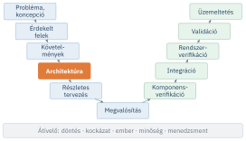
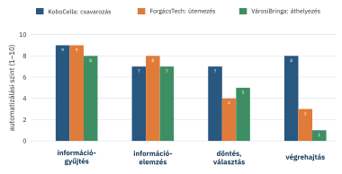

# Funkciómegosztás és automatizálás {#sec-automatizalas}

::: {.vterkep}
{fig-alt="V-térkép: a fejezet helye a rendszerfejlesztés folyamatában" width=62%}
:::

::: {.cel}
A fejezet feldolgozása után képes leszel:

- leírni a funkciómegosztás lépéseit, és megindokolni, miért „inkább művészet, mint tudomány”;
- alkalmazni a Fitts-listát és a megosztási kritériumokat, és megnevezni a módszer korlátait;
- az automatizálás szintjét Sheridan és Verplank tízfokú skáláján, az automatizálás típusát Parasuraman, Sheridan és Wickens négy szakasza szerint meghatározni;
- felismerni az automatizálás iróniáit és buktatóit (a helyzettudatosság elvesztése, a túlzott és a hiányos bizalom);
- ismertetni az ember–robot együttműködés módjait és biztonsági alapelveit;
- statikus és dinamikus (adaptív) funkciómegosztást tervezni, a leromlott üzemmódokat is beleértve.
:::

Az architektúra kialakításakor a funkciókat a forma elemeihez rendeltük ([-@sec-arch-allokacio]. szakasz). Ezek között az elemek között ott van az ember is: a kezelő, a karbantartó, a felhasználó. Az emberi rendszerintegráció egyik alapeszköze éppen a funkciók egyértelmű elosztása a rendszer elemei, vagyis a hardver, a szoftver és az ember között ([-@sec-ek-hsi]. szakasz). Melyik funkciót végezze az ember, melyiket a gép, és melyiket együtt? Ez a kérdés minden automatizálási projekt középpontjában áll, a KoboCella kobotjától a ForgácsTech ütemezőjéig.

A kérdésre csábító egyszerű választ adni: „amit lehet, automatizáljunk”. A tapasztalat azonban azt mutatja, hogy az automatizálás nem egyszerűen átveszi az ember feladatait, hanem meg is változtatja azokat. Új feladatokat (felügyelet, beavatkozás, hibaelhárítás) hoz létre, és ezek gyakran nehezebbek, mint a régiek voltak. Ez a fejezet a funkciómegosztás módszereit és az automatizálás emberi következményeit tárgyalja.

A fejezet négy kérdésre épül:

- Milyen elvek alapján osszuk meg a funkciókat ember és gép között?
- Hogyan írható le az automatizálás szintje és típusa?
- Milyen buktatói vannak az automatizálásnak?
- Hogyan működhet együtt biztonságosan az ember és a robot?

## A funkciómegosztás feladata {#sec-auto-feladat}

A funkciómegosztásra nincs mechanikus eljárás, a tervezői ítéletnek itt különösen nagy a szerepe. A munka lépései:

1. a funkciók azonosítása (a funkcióelemzésből, a használati esetekből, interjúkból és a vevői elvárásokból);
2. annak azonosítása, ki a legmegfelelőbb az adott funkcióra: ember, automatika vagy a kettő együtt;
3. annak eldöntése, hogy a megosztás statikus (a tervezéskor rögzített) vagy dinamikus, adaptív (a terheléstől és a helyzettől függően változó) legyen.

A funkciómegosztás a funkciófára épül ([-@sec-arch-funkcioelemzes]. szakasz), és eredménye az allokációs táblázatban jelenik meg ([-@sec-arch-allokacio]. szakasz). A különbség az, hogy itt kifejezetten azt vizsgáljuk, mit jelent egy-egy döntés az emberre nézve: milyen feladatai maradnak, mennyire terhelt, érti-e, mit csinál a gép, és be tud-e avatkozni, ha kell.

### A Fitts-lista

A funkciómegosztás klasszikus eszköze a **Fitts-lista**, amely Fitts 1951-es, a légiforgalmi irányítás emberi tényezőiről szóló jelentéséből származik [@fitts1951]. A lista összeveti, miben jobb az ember és miben a gép. A [-@tbl-fitts]. táblázat a lista szellemében, mai példákkal kiegészítve foglalja össze az összevetést.

| Tulajdonság | Gép | Ember |
|:--|:--|:--|
| sebesség | kiváló | viszonylag lassú |
| kimenő teljesítmény | kiváló, állandó | viszonylag gyenge |
| következetesség | ideális, ismétlődő eseményeknél | megbízhatatlan; a tanulás és a kifáradás befolyásolja |
| információs kapacitás | többcsatornás | elsősorban egycsatornás |
| emlékezet | pontos, szó szerinti felidézés, korlátozott hozzáférés | elvek és stratégiák jobb felidézése, sokoldalú hozzáférés, innováció |
| logikai számítás | deduktív, bonyolult program, gyors és alapos, gyenge hibajavítás | induktív, egyszerűbb program, lassú, pontos, jó hibajavítás |
| érzékelés | jó mennyiségi értékelés, gyenge mintafelismerés | széles hatókör, sokoldalúság, ítélőképesség |
| észlelés | a változatossággal nehezen birkózik, zajérzékeny | a változásokkal jobban megbirkózik, zajérzékeny |

: Az ember és a gép erősségei a Fitts-lista [@fitts1951] szellemében, saját összeállítás. {#tbl-fitts tbl-colwidths="[20,38,42]"}

A Fitts-listát sokan kritizálták. A leggyakoribb ellenvetés, hogy a lista az embert és a gépet egymás helyettesítőiként kezeli, holott a jó rendszerekben kiegészítik egymást, és hogy a gépek képességei azóta jelentősen változtak. De Winter és Dodou mégis amellett érvelnek, hogy a lista azért maradt fenn hét évtizeden át, mert lényegi megállapításai, például hogy a gép a gyorsaságban, a pontosságban és az ismétlődő feladatokban, az ember az ítéletalkotásban, az alkalmazkodásban és a váratlan helyzetek kezelésében erősebb, ma is többnyire érvényesek, és a lista jó kiindulópontot ad a tervezői gondolkodáshoz [@dewinter2014].

### Megosztási kritériumok

Price az ember és a gép relatív képességei alapján hat esetet különít el [@price1985]:

1. nincs különbség az emberi és a gépi képességek között;
2. az ember teljesítménye jobb;
3. a gép teljesítménye jobb;
4. a gép teljesítménye olyan gyenge, hogy a funkciót az embernek kell kiosztani;
5. az ember teljesítménye olyan gyenge, hogy a funkciót a gépnek kell kiosztani;
6. sem az ember, sem a gép teljesítménye nem elfogadható.

A 4. és az 5. eset egyértelmű. A 6. esetben a funkciót vagy a rendszert újra kell gondolni (a funkció megoldássemleges megfogalmazásától kezdve, [-@sec-arch-alapfogalmak]. szakasz). Az 1–3. esetben a döntés nem csak a képességeken múlik. Price ezért további megosztási szempontokat is megnevez [@price1985]: az **érték-egyensúlyt** (mi a jó az emberi munka minősége szempontjából), a **haszonelvű és költségalapú** megosztást (mi a gazdaságos), és az érzelmi vagy kognitív támogatást szolgáló megosztást (mit fogadnak el és mit értenek az érintettek). A gyakorlatban mindhárom számít: egy technikailag és gazdaságilag indokolt automatizálás is megbukhat, ha az érintettek nem fogadják el, vagy ha az ember számára értelmetlen, monoton maradékfeladatot hagy.

::: {.eset eset="A" title="KoboCella: ki mit csinál?"}
A KoboCella csapata a funkciófa tizenhárom részfunkcióján végigment a Fitts-lista és a megosztási kritériumok szerint. A csavar meghúzása és a nyomaték mérése egyértelműen gépi funkció lett (3. és 5. eset: következetesség, pontosság, naplózhatóság). A motorház befogása az emberé maradt: a különböző változatok kezelése, a sérült alkatrész felismerése ítélőképességet igényel, és a gépi megoldás aránytalanul drága lett volna (2. eset, költségalapú szempont). A hibás darab jelölése megosztott funkció lett: a gép jelzi a tűrésen kívüli nyomatékot, az ember dönt a további teendőről (javítás vagy selejt). A csapat külön megvizsgálta az érzelmi szempontot is: az operátorokkal folytatott interjúk szerint a kezelők attól tartottak, hogy „a robot mellett csak adogatók lesznek”. Ezért a cella kezelőjének feladatai közé bekerült a minőségi ellenőrzés és a változatváltás is, a HMI pedig minden ciklusban visszajelzést ad a kezelőnek a kötés minőségéről.
:::

## Az automatizálás szintjei és típusai {#sec-auto-szintek}

Az automatizálás nem kétállású kapcsoló (ember vagy gép), hanem fokozatos. Sheridan és Verplank tízfokú skálája a döntés és a cselekvés kiválasztásának automatizálását írja le ([-@tbl-loa]. táblázat) [@sheridan1978].

| Szint | Az automatika szerepe |
|:-:|:--|
| 1 | a számítógép nem ad segítséget: mindenről az ember dönt, és ő cselekszik |
| 2 | a számítógép a döntési vagy cselekvési alternatívák teljes körét felkínálja, vagy |
| 3 | leszűkíti a választékot néhány lehetőségre, vagy |
| 4 | egy alternatívát javasol, és |
| 5 | végrehajtja a javaslatot, ha az ember jóváhagyja, vagy |
| 6 | korlátozott ideig lehetőséget ad az embernek a vétóra, mielőtt automatikusan végrehajtja, vagy |
| 7 | automatikusan végrehajtja, majd szükségszerűen tájékoztatja az embert, és |
| 8 | csak akkor tájékoztatja az embert, ha az kérdezi, vagy |
| 9 | csak akkor tájékoztatja az embert, ha az automatika úgy dönt, |
| 10 | a számítógép mindenről dönt, önállóan cselekszik, és figyelmen kívül hagyja az embert |

: Az automatizálás tíz szintje Sheridan és Verplank alapján [@sheridan1978], saját fordítás. {#tbl-loa tbl-colwidths="[10,90]"}

Parasuraman, Sheridan és Wickens ezt a gondolatot továbbfejlesztették. Szerintük az automatizálás nem egyetlen szinttel, hanem négy információfeldolgozási szakasz mentén írható le: az **információgyűjtés** (érzékelés, adatgyűjtés), az **információelemzés** (feldolgozás, következtetés, előrejelzés), a **döntés és választás**, valamint a **végrehajtás**. A négy szakaszban az automatizálás szintje egymástól függetlenül változhat [@parasuraman2000]. Egy rendszer így jellemezhető egy négyelemű **automatizálási profillal**. A szerzők azt is javasolják, hogy a megfelelő szintet szakaszonként az emberi teljesítményre gyakorolt hatás (terhelés, helyzettudatosság, beidegződés, készségek leépülése) és a megbízhatóság, valamint a döntési hibák költsége alapján válasszuk meg [@parasuraman2000].

{#fig-loa-profil width=90%}

A [-@fig-loa-profil]. ábra a három eset egy-egy funkciójának profilját mutatja. A KoboCella csavarozása mind a négy szakaszban magas szintű: a gép gyűjti az adatokat, értékeli a nyomatékot, dönt a megfelelőségről és végre is hajtja a műveletet (a kezelőt tájékoztatja). A ForgácsTech ütemezése az információgyűjtésben és -elemzésben magas, a döntésben viszont szándékosan alacsonyabb szintű (4: egy javaslatot ad), a végrehajtásban pedig a műszakvezetőé a szó. A VárosiBringa áthelyezése hasonló: az áthelyezés-tervező javaslatot tesz a következő útvonalra, de a fizikai végrehajtás teljes egészében emberi.

::: {.eset eset="C" title="ForgácsTech: miért nem dönt az ütemező?"}
A ForgácsTech MES-ütemezőmodulja technikailag képes lenne önállóan átsorolni a rendeléseket egy gépleállás után (7-es szint). A csapat mégis a 4-es szint mellett döntött: az ütemező egy átsorolási javaslatot ad a várható késésekkel, és a műszakvezető hagyja jóvá vagy módosítja. Az indoklás három pontból állt. Először: a műszakvezető olyan információkat is ismer, amelyek a rendszerben nincsenek meg (például hogy egy vevő elfogad-e részszállítást). Másodszor: a döntési hibák költsége magas, egy rossz átsorolás a két legnagyobb vevő egyikét is érintheti. Harmadszor: a névleges csoportos elemzés ([-@sec-kre-csoport]. szakasz) szerint a késések első számú oka a szóbeli előresorolás volt; ha az ütemező teljesen automatikusan dönt, a műszakvezetők a rendszert megkerülve folytatnák a régi gyakorlatot. A jóváhagyási lépés az átsorolást láthatóvá és naplózottá teszi. A csapat rögzítette, hogy egy év üzemi tapasztalat után a szint emelését újra megvizsgálja.
:::

## Az automatizálás iróniái és buktatói {#sec-auto-buktatok}

Bainbridge nagy hatású tanulmánya az automatizálás **iróniáit** írta le [@bainbridge1983]. Az első irónia, hogy a tervezők, akik az embert megbízhatatlannak tartják, és ezért automatizálnak, maguk is emberek, és a tervezési hibáik az automatikában jelennek meg. A második, hogy az automatizálás után az embernek azok a feladatok maradnak, amelyeket a tervezők nem tudtak automatizálni: a ritka, váratlan, nehéz helyzetek kezelése. Ehhez azonban gyakorlat és naprakész helyzetismeret kellene, amelyet az ember éppen az automatizálás miatt veszít el. Aki csak felügyeli a gépet, annak kézi készségei leépülnek, és a beavatkozás pillanatában nem érti pontosan, mi történik.

Parasuraman és Riley az automatizálás négy problémás használati módját különítették el [@parasuraman1997]:

- **helyes használat** (use): az ember akkor támaszkodik az automatikára, amikor kell;
- **túlzott támaszkodás** (misuse): az ember akkor is az automatikára hagyatkozik, amikor nem kellene, például nem veszi észre a hibáit (automatizálási torzítás, elkényelmesedés);
- **mellőzés** (disuse): az ember nem használja az automatikát, például a túl gyakori téves riasztások miatt figyelmen kívül hagyja a jelzéseit;
- **visszaélés** (abuse): a tervezők vagy a vezetők anélkül automatizálnak, hogy figyelembe vennék a következményeket az ember teljesítményére.

A középpontban a **bizalom** áll. Lee és See áttekintése szerint a cél nem a bizalom maximalizálása, hanem a **kalibrált bizalom**: az ember bizalma igazodjon az automatika tényleges képességeihez. A túlzott bizalom túlzott támaszkodáshoz, a hiányos bizalom mellőzéshez vezet. A kalibrált bizalmat az segíti, ha az automatika átlátható: a kezelő látja, mit csinál, miért, és mennyire biztos benne [@lee2004].

A buktatók elleni tervezési elvek:

- **tartsd a hurokban az embert:** a felügyeleti feladat mellett maradjanak aktív feladatai, és a kijelzők a helyzettudatosság mindhárom szintjét támogassák ([-@sec-ek-kepessegek]. szakasz);
- **tedd átláthatóvá az automatikát:** a kezelő lássa az automatika állapotát, szándékát és bizonytalanságát;
- **kezeld a téves riasztásokat:** a túl sok téves riasztás mellőzéshez vezet; a riasztási küszöböket a téves és az elmulasztott riasztások költségének egyensúlya alapján kell beállítani;
- **gyakoroltasd a kézi üzemet:** ha az automatika kieshet, az embernek gyakorlatban kell maradnia a kézi működtetésben.

::: {.eset eset="A" title="KoboCella: a nyugtázás csapdája"}
A KoboCella első HMI-tervében a kezelőnek minden tűrésen kívüli nyomaték után egy gombnyomással kellett nyugtáznia a hibajelzést. A próbaüzemben kiderült, hogy a kezelők a második-harmadik nap után rutinszerűen, a jelzés elolvasása nélkül nyomták meg a gombot: a nyugtázás a mozdulatsor része lett (túlzott támaszkodás, Parasuraman és Riley kategóriájában). A csapat két változtatást vezetett be. A hibás darab nem kerülhet a kiadóba, amíg a kezelő nem helyezte át a selejtdobozba, amit érzékelő ellenőriz (a nyugtázás helyett fizikai cselekvés). A HMI pedig a hiba helyét is megmutatja (melyik csavar), így a kezelő ténylegesen ellenőrizni tudja a darabot. A leromlott üzemmódra (UM-7) a csapat negyedéves kézi gyakorlást írt elő, hogy a kézi szerelési készség ne vesszen el.
:::

## Ember–robot együttműködés {#sec-auto-kobot}

Az együttműködő robotok (kobotok) a funkciómegosztás egy különleges formáját teszik lehetővé: az ember és a robot közös munkaterületen, védőkerítés nélkül dolgozik. Az ipari robotok biztonsági követelményeit az ISO 10218 szabványsorozat rögzíti: az 1. rész a robotokra, a 2. rész a robotalkalmazásokra és robotcellákra vonatkozik [@iso10218_1_2025; @iso10218_2_2025]. A 2025-ös kiadás beépítette az együttműködő alkalmazások korábban külön műszaki specifikációban (ISO/TS 15066) rögzített biztonsági követelményeit is.

Az együttműködő működésnek négy alapvető módja van:

- **biztonsági felügyelt megállás:** a robot megáll, amikor az ember belép a közös munkaterületre, és csak akkor folytatja, amikor kilépett;
- **kézi vezetés:** az ember közvetlenül, kézzel vezeti a robotot (például betanításkor);
- **sebesség- és távolságfelügyelet:** a robot sebességét az ember távolságától függően csökkentik, és a robot megáll, mielőtt a távolság egy kritikus érték alá csökkenne;
- **teljesítmény- és erőkorlátozás:** a robot tervezése és vezérlése korlátozza az érintkezéskor fellépő erőket és nyomásokat, így az érintkezés nem okoz sérülést.

A módok kiválasztása a kockázatértékelés eredménye ([-@sec-biztonsag]. fejezet), és egy cellán belül többféle mód is alkalmazható.

::: {.eset eset="A" title="KoboCella: a választott együttműködési mód"}
A KoboCella koncepciójában a védőzónát lézerszkenner figyeli, sebességkorlátozással ([-@sec-kre-morfologia]. szakasz). Ez a sebesség- és távolságfelügyelet módja: amikor a kezelő belép a közös zónába, a kobot csökkentett sebességre vált (R-11: legfeljebb 250 mm/s), és ha a kezelő a kritikus távolságon belülre kerül, megáll. A csapat azért nem a teljesítmény- és erőkorlátozást választotta egyedüli védelemként, mert a csavarozó fej éles bitbetétje a kezelő keze közelében mozog, és ennél a szerszámnál az érintkezés még korlátozott erő mellett is sérülést okozhatna. A választást a kockázatértékelés indokolja, amelyet a [-@sec-biztonsag]. fejezet mutat be.
:::

## Statikus és dinamikus megosztás {#sec-auto-dinamikus}

A **statikus megosztás** a tervezéskor rögzíti, ki mit csinál. Egyszerű, kiszámítható és könnyen betanítható, de nem alkalmazkodik a változó helyzetekhez. A **dinamikus** vagy **adaptív megosztás** a helyzettől függően változtatja a feladatok elosztását: nagy terhelésnél több feladatot vesz át az automatika, kis terhelésnél vagy az automatika meghibásodásakor több marad az emberé.

A dinamikus megosztás legfontosabb gyakorlati formája a **leromlott üzemmód**: ha egy automatikus funkció kiesik, a rendszer csökkentett képességgel, nagyobb emberi részvétellel tovább működik. Ezt a működési koncepcióban kell megtervezni ([-@sec-pr-conops]. szakasz), mert minden leromlott üzemmód új követelményeket szül: az embernek képesnek kell lennie átvenni a funkciót, a kezelőfelületnek támogatnia kell az átvételt, és az átvételt gyakorolni kell.

A dinamikus megosztás kockázata a **módzavar**: a kezelő nem tudja pontosan, melyik üzemmódban van a rendszer, és ennek megfelelően rosszul cselekszik. Ezért minden üzemmódváltásnak egyértelműen jelzettnek kell lennie, és az átmeneteket a forgatókönyvekben végig kell gondolni.

::: {.eset eset="B" title="VárosiBringa: amikor az áthelyezés-tervező téved"}
A VárosiBringa áthelyezés-tervezője a kölcsönzési adatokból előrejelzi, melyik állomás fog kiürülni vagy megtelni, és javaslatot tesz a furgonos áthelyezés útvonalára. A csapat a forgatókönyvek elemzésekor felismerte, hogy rendezvények, útlezárások vagy hirtelen időjárás-változás esetén az előrejelzés megbízhatatlan. Ezért két üzemmódot terveztek: normál üzemben a sofőr a javasolt útvonalat követi (5-ös szint: a rendszer javasol, az ember jóváhagyja), rendkívüli helyzetben pedig a diszpécser kézi üzemmódra válthat, amelyben a rendszer csak az állomások aktuális állapotát mutatja, és az útvonalat a diszpécser állítja össze (2–3-as szint). Az üzemmód a sofőr kijelzőjén mindig látható, és minden váltást naplóznak, hogy utólag elemezni lehessen, mikor és miért tért el az ember a javaslattól.
:::

::: {.kitekintes title="Mesterséges intelligencia a döntési szakaszban"}
A gépi tanulási és nyelvi modelleken alapuló döntéstámogató rendszerek egyre gyakrabban az információelemzés és a döntés szakaszában jelennek meg: hibát diagnosztizálnak, ütemezést javasolnak, karbantartást ütemeznek. A Parasuraman–Sheridan–Wickens-modell erre is jól alkalmazható. Különösen fontos a kalibrált bizalom: a modellek hibái gyakran nem szembetűnők, és a felhasználó a meggyőzően megfogalmazott javaslatot hajlamos ellenőrzés nélkül elfogadni. A tervezési elvek ugyanazok: átláthatóság (miért ezt javasolja, mennyire biztos benne), a döntési jogkör egyértelmű kijelölése, és annak megtervezése, mi történik, ha a javaslat téves.
:::

::: {.hiba title="Automatizáljunk mindent, amit lehet"}
A „technológiai imperatívusz” az a hozzáállás, hogy mindent automatizálni kell, ami technikailag automatizálható, és az embernek a maradék jut. Ez Bainbridge iróniájához vezet: az ember feladatai töredezettek, monotonok és ritkán gyakorolt vészhelyzeti beavatkozásokból állnak. A funkciómegosztást az ember szempontjából is meg kell tervezni: a megmaradó feladatoknak együtt értelmes, kezelhető és gyakorolható munkát kell alkotniuk.
:::

::: {.osszefoglalo}
- A funkciómegosztás eldönti, mit végezzen az ember, mit a gép és mit együtt. Lépései a funkciók azonosítása, a legalkalmasabb végrehajtó kiválasztása és a statikus vagy dinamikus megosztás eldöntése.
- A Fitts-lista az ember és a gép relatív erősségeit veti össze. Kritikusai szerint a kettőt helyettesítőként kezeli, mégis máig hasznos kiindulópont. A képességek mellett az érték-egyensúly, a költség és az elfogadottság is megosztási szempont.
- Sheridan és Verplank tíz szintje a döntés és a cselekvés automatizálásának fokát írja le. Parasuraman, Sheridan és Wickens szerint az automatizálás négy szakaszban (információgyűjtés, -elemzés, döntés, végrehajtás) eltérő szintű lehet.
- Az automatizálás iróniája, hogy az embernek a legnehezebb, legritkább feladatok maradnak, miközben készségei és helyzettudatossága leépül. A túlzott támaszkodás, a mellőzés és a visszaélés elkerülésének kulcsa a kalibrált bizalom és az átlátható automatika.
- Az együttműködő robotok biztonságát az ISO 10218 szabványsorozat szabályozza; a négy együttműködési mód a felügyelt megállás, a kézi vezetés, a sebesség- és távolságfelügyelet, valamint a teljesítmény- és erőkorlátozás.
- A dinamikus megosztás legfontosabb formája a leromlott üzemmód, amelyet a működési koncepcióban kell megtervezni. Az üzemmódokat egyértelműen jelezni kell a módzavar elkerülésére.
:::

::: {.onell}
1. Miért mondják a funkciómegosztásra, hogy „inkább művészet, mint tudomány”?
2. Hogyan osztanád meg a Fitts-lista alapján egy raktári komissiózás két funkcióját: (a) a megfelelő tétel kiválasztása egy polcról, (b) a kiszedett mennyiség ellenőrzése?
3. Melyik Sheridan–Verplank-szinten működik egy navigációs alkalmazás, amely útvonalat javasol, és csak akkor indul, ha a felhasználó jóváhagyja? És egy autó vészfékasszisztense?
4. Írd fel egy laboratóriumi mintaelemző automata automatizálási profilját a négy szakaszban!
5. Mi Bainbridge második iróniája? Mivel csökkenthető a hatása?
6. Mi a különbség a túlzott támaszkodás és a mellőzés között? Mi okozhatja az utóbbit egy riasztórendszernél?
7. Miért nem elég a KoboCellánál a teljesítmény- és erőkorlátozás?

::: {.megoldas}
1. Mert a döntés sok, egymással nehezen összemérhető szemponton múlik: a képességeken, a költségen, az érintettek elfogadásán, a munka minőségén és a ritka helyzetek kezelésén, és ezekre nincs egyetlen, mechanikusan alkalmazható szabály.
2. (a) A változatos tételek felismerése és megfogása mintafelismerést és ügyességet igényel; ez hagyományosan az ember erőssége (bár a gépi látás fejlődik). (b) A mennyiség ellenőrzése pontosságot és következetességet igényel; ez a gépé (mérleg vagy vonalkód-olvasás).
3. A navigációs alkalmazás az 5-ös szinten működik (végrehajtja, ha az ember jóváhagyja). A vészfékasszisztens a 7-es szint körül (automatikusan végrehajtja, majd tájékoztat), mert a reakcióidő nem teszi lehetővé az emberi jóváhagyást.
4. Például: információgyűjtés 9 (a minták automatikus azonosítása és mérése), elemzés 8 (az eredmények automatikus értékelése a referenciatartományokhoz), döntés 4 (a kóros eredményt a rendszer jelzi, a szakember dönt), végrehajtás 7 (a jóváhagyott eredmény automatikusan továbbítódik, a rendszer tájékoztat).
5. Az automatizálás után az embernek a ritka, váratlan, nehéz helyzetek kezelése marad, miközben az ehhez szükséges gyakorlata és helyzetismerete éppen az automatizálás miatt leépül. Csökkenthető rendszeres gyakorlással (szimuláció, kézi üzem), aktív feladatokkal a felügyelet mellett és átlátható kijelzőkkel.
6. Túlzott támaszkodásnál az ember akkor is az automatikára hagyatkozik, amikor nem kellene (nem veszi észre a hibáit); mellőzésnél nem használja, amikor kellene. Riasztórendszernél a mellőzés gyakori oka a sok téves riasztás: a kezelő megtanulja figyelmen kívül hagyni a jelzéseket.
7. Mert a csavarozó fej éles bitbetétje a kezelő keze közelében mozog, és ennél a szerszámnál az érintkezés korlátozott erő mellett is sérülést okozhat. Ezért sebesség- és távolságfelügyelet kell, amely megakadályozza az érintkezést.
:::
:::

::: {.projekt title="Projektlépés: funkciómegosztás"}
Saját fejlesztési feladatodhoz:

1. válaszd ki a funkciófa legalább hat funkcióját, és osszd meg őket ember, gép vagy együttes végrehajtás között a Fitts-lista és a megosztási kritériumok alapján, indoklással;
2. a két legfontosabb automatizált funkcióhoz határozd meg az automatizálási profilt a négy szakaszban;
3. írd le, milyen feladatai maradnak az embernek, és értelmes, gyakorolható munkát alkotnak-e;
4. tervezz legalább egy leromlott üzemmódot, és írd le, milyen követelményeket szül.

A funkciómegosztás sablonja és notebookja a Gyakorlati útmutatóban található.
:::

::: {.forras}
- @parasuraman2000: az automatizálás típusainak és szintjeinek modellje; a funkciómegosztás egyik legtöbbet hivatkozott tanulmánya.
- @bainbridge1983: az automatizálás iróniái; rövid, ma is aktuális klasszikus.
- @parasuraman1997 és @lee2004: az automatizálás használata, a visszaélések és a kalibrált bizalom.
- @dewinter2014: a Fitts-lista kritikája és tartós érvényességének magyarázata.
- @iso10218_2_2025: az együttműködő robotalkalmazások biztonsági követelményei.
- @nasa2015hsi: az emberi rendszerintegráció gyakorlati útmutatója, a funkciómegosztás és a feladatelemzés helyével a fejlesztésben.
:::
