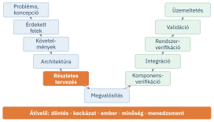
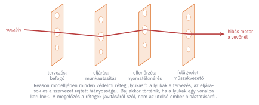
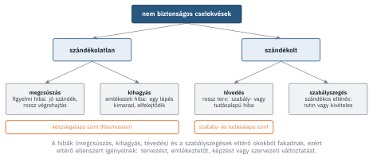

# Emberi teljesítmény és emberi hiba {#sec-emberi-hiba}

::: {.vterkep}
{fig-alt="V-térkép: a fejezet helye a rendszerfejlesztés folyamatában" width=62%}
:::

::: {.cel}
A fejezet feldolgozása után képes leszel:

- megkülönböztetni az emberi hibát mint okot és mint tünetet, valamint a személyközpontú és a rendszerszemléletű megközelítést;
- besorolni az emberi hibákat (megcsúszás, kihagyás, tévedés, szabályszegés) és összekapcsolni őket Rasmussen viselkedési szintjeivel;
- felsorolni a teljesítményt befolyásoló tényezőket, és ismertetni az emberi megbízhatóság-elemzés (HRA) célját és korlátait;
- egy egyszerű HEART-számítással összehasonlítani tervezési változatokat;
- hibabiztos (poka-yoke) megoldásokat és kényszerítő funkciókat tervezni;
- az emberi hibák elemzését beépíteni a kockázatelemzésbe és a szervezeti tanulásba.
:::

Az emberközpontú tervezés ([-@sec-emberkozpontu]. fejezet) és a funkciómegosztás ([-@sec-automatizalas]. fejezet) után is marad egy kérdés: mi történik, ha az ember hibázik? Az ember hibázni fog: ez nem jellemhiba, hanem az emberi működés természetes velejárója. A rendszermérnök feladata nem a hibátlan ember feltételezése, hanem olyan rendszer tervezése, amelyben a hibák ritkák, időben észrevehetők, és nem vezetnek súlyos következményhez.

A fejezet négy kérdésre épül:

- Hogyan gondolkodjunk az emberi hibáról: ok vagy tünet?
- Milyen típusú hibákat követünk el, és miért?
- Hogyan becsülhető az emberi hiba valószínűsége, és mire jó ez a becslés?
- Hogyan tervezhetünk a hibák ellen?

## Az emberi hiba két szemlélete {#sec-hiba-szemlelet}

Reason két megközelítést különít el az emberi hiba kezelésében [@reason2000]. A **személyközpontú megközelítés** a hibát az egyén figyelmetlenségével, hanyagságával, motiválatlanságával magyarázza, és a válasza a figyelmeztetés, a fegyelmezés, az újabb utasítás. A **rendszerszemléletű megközelítés** abból indul ki, hogy az ember esendő, és a hibák a legjobb szervezetekben is előfordulnak. A hibák ezért inkább következmények, mint okok: a munkahely és a szervezet rejtett hiányosságaiból fakadnak. A válasz itt nem az ember megváltoztatása, hanem azoké a feltételeké, amelyek között dolgozik.

Reason híres **svájcisajt-modellje** szerint a rendszer veszélyekkel szembeni védelme több rétegből áll (műszaki megoldások, eljárások, képzés, felügyelet), és minden rétegnek vannak „lyukai” ([-@fig-svajci-sajt]. ábra). A lyukak egy része **aktív hiba**: az első vonalban dolgozó ember tévedése, kihagyása. Más része **lappangó feltétel**: a tervezés, az eljárások, a szervezet hiányossága, amely hosszú ideig rejtve maradhat. Baj akkor lesz, ha a lyukak pillanatnyilag egy vonalba kerülnek [@reason2000].

{#fig-svajci-sajt width=92%}

Dekker gyakorlati útmutatója ugyanezt a szemléletet képviseli: az „emberi hiba” nem magyarázat, hanem kiindulópont a vizsgálathoz. Azt kell megérteni, miért tűnt ésszerűnek az adott embernek abban a helyzetben azt tenni, amit tett [@dekker2014]. A rendszermérnök számára ez döntő különbség. Ha egy balesetvizsgálat „emberi hiba” megállapításánál megáll, a rendszer nem változik, és a következő ember ugyanabban a helyzetben ugyanazt a hibát fogja elkövetni.

## A hibák típusai {#sec-hiba-tipusok}

Reason osztályozása a nem biztonságos cselekvéseket aszerint csoportosítja, hogy szándékosak voltak-e, és hol csúszott el a folyamat [@reason1990] ([-@fig-hibatipusok]. ábra):

- **megcsúszás** (slip): a szándék jó, de a végrehajtás téves, jellemzően figyelmi hiba miatt (például rossz gombot nyom meg, mert ugyanott van, mint a megszokott);
- **kihagyás** (lapse): egy lépés kimarad vagy elfelejtődik, emlékezeti hiba miatt (például félbeszakítás után nem folytatja ott, ahol abbahagyta);
- **tévedés** (mistake): maga a terv hibás. Szabályalapú tévedésnél egy jó szabályt rossz helyzetben, vagy egy rossz szabályt alkalmaz; tudásalapú tévedésnél új helyzetben hiányos tudás vagy rossz helyzetértékelés alapján dönt;
- **szabályszegés** (violation): szándékos eltérés az előírt eljárástól, jellemzően nem ártó szándékkal, hanem mert az előírás betartása nehézkes, időigényes vagy a helyzethez nem illő. Lehet rutinszerű (mindenki így csinálja) vagy kivételes (egy rendkívüli helyzetben).

{#fig-hibatipusok width=100%}

Rasmussen modellje az emberi viselkedés három szintjét különíti el [@rasmussen1983]. A **készségalapú** viselkedés begyakorolt, tudatos figyelem nélkül zajló mozdulatsor (például egy alkatrész behelyezése). A **szabályalapú** viselkedés ismert helyzetben tárolt szabályokat alkalmaz („ha a jelzőfény piros, akkor…”). A **tudásalapú** viselkedés új, ismeretlen helyzetben tudatos elemzést és problémamegoldást igényel. A megcsúszások és a kihagyások a készségalapú szinten, a tévedések a szabály- és tudásalapú szinten jellemzők.

A besorolásnak gyakorlati jelentősége van, mert a különböző típusú hibák ellen különböző eszközök hatásosak. A megcsúszások ellen a tervezés (egyértelmű elrendezés, egymástól megkülönböztethető kezelőszervek, hibabiztos kialakítás), a kihagyások ellen az emlékeztetők és az ellenőrzőlisták, a tévedések ellen a képzés, a jobb információ és a döntéstámogatás, a szabályszegések ellen az eljárások észszerűsítése és a szervezeti kultúra.

## A teljesítményt befolyásoló tényezők {#sec-hiba-tenyezok}

Az emberi teljesítményt a helyzet számos jellemzője befolyásolja: az időnyomás, a fáradtság, a zaj, a megvilágítás, a visszajelzés minősége, a feladat ismerőssége, a képzettség, az eljárások minősége, a munkahelyi légkör. Az emberi megbízhatóság-elemzés módszerei ezeket teljesítményt befolyásoló tényezőként vagy hibát előidéző feltételként veszik figyelembe.

Ezek közül a tervező közvetlenül befolyásolja a legfontosabbakat. Norman a tervezés néhány alapelvével írja le, hogyan segíthet a környezet a helyes cselekvésben [@norman2013]:

- **jelzések** (signifiers): a tárgy vagy felület mutassa meg, mit lehet vele tenni és hogyan;
- **leképezés** (mapping): a kezelőszervek elrendezése feleljen meg a vezérelt dolgok elrendezésének;
- **visszajelzés** (feedback): a cselekvés eredménye azonnal és érthetően látsszon;
- **korlátok** (constraints): a fizikai, logikai vagy kulturális korlátok szűkítsék a lehetséges (és ezzel a hibás) cselekvéseket;
- **kényszerítő funkciók** (forcing functions): a helytelen cselekvés fizikailag ne legyen végrehajtható.

## Emberi megbízhatóság-elemzés {#sec-hiba-hra}

Az **emberi megbízhatóság-elemzés** (human reliability analysis, HRA) célja az emberi hibák azonosítása, valószínűségük becslése és csökkentésük módjainak megtalálása. Kirwan gyakorlati kézikönyve szerint a HRA három fő lépésből áll: a lehetséges emberi hibák azonosításából, mennyiségi becsléséből és a csökkentésükre irányuló javaslatokból [@kirwan1994]. A mennyiségi eredmény bekerülhet a megbízhatósági és kockázatelemzésbe, például egy hibafa eseményeként ([-@sec-megbizhatosag]. fejezet).

A legismertebb módszerek közül a THERP Swain és Guttmann nukleáris erőművi alkalmazásokra kidolgozott, részletes feladatlebontáson alapuló eljárása [@swain1983]. A **HEART** Williams egyszerűbb, gyorsan alkalmazható módszere [@williams1988]. A HEART három lépésben becsül:

1. a feladatot besoroljuk egy **általános feladattípusba**, amelyhez névleges hibavalószínűség tartozik. Például egy teljesen ismerős, jól megtervezett, gyakorlott, óránként többször ismétlődő rutinfeladaté 0,0004; egy rendszer előírt eljárással, némi ellenőrzéssel végzett visszaállításáé 0,003;
2. azonosítjuk a **hibát előidéző feltételeket**, mindegyikhez egy legnagyobb hatást jelentő szorzóval. Például az időhiány legfeljebb 11-szeresére, a gyenge, félreérthető vagy rosszul illeszkedő visszajelzés legfeljebb négyszeresére növelheti a hibavalószínűséget;
3. minden feltételhez megbecsüljük, mekkora hányadában érvényesül a helyzetben (0–1), és a hibavalószínűséget így számoljuk:

$$
\mathrm{HEP} = \mathrm{GTT} \cdot \prod_{i} \left[ (\mathrm{EPC}_i - 1) \cdot \mathrm{APOA}_i + 1 \right] ,
$$ {#eq-heart}

ahol GTT a feladattípus névleges valószínűsége, $\mathrm{EPC}_i$ az $i$-edik feltétel szorzója, $\mathrm{APOA}_i$ pedig a becsült érvényesülési hányada.

A HRA mennyiségi eredményeit óvatosan kell kezelni. A becslések nagymértékben az elemző ítéletén múlnak, és az abszolút értékek bizonytalansága egy nagyságrend is lehet. A módszer erőssége inkább az **összehasonlítás**: megmutatja, melyik tervezési változat vagy beavatkozás csökkenti leginkább a hibavalószínűséget, és melyik feltétel járul hozzá a legjobban [@kirwan1994].

::: {.eset eset="A" title="KoboCella: a fordítva behelyezett fedél"}
A KoboCella HTA-ja ([-@sec-ek-feladatelemzes]. szakasz) szerint a fedél ráhelyezése (2.3) a hibás behelyezés egyik legvalószínűbb helye. A fedél két irányban is ráhelyezhető, és fordított helyzetben a csavarok egy része meghúzható, de a tömítés nem zár. A csapat HEART-tal hasonlított össze három változatot.

**Alapváltozat.** A feladat gyakorlott, óránként sokszor ismétlődő rutinfeladat (GTT = 0,0004). Két hibát előidéző feltétel érvényesül: az időnyomás (szorzó 11, a csapat becslése szerint 10%-ban érvényesül: $10 \cdot 0{,}1 + 1 = 2{,}0$) és a gyenge visszajelzés, mert a fordított fedél ránézésre alig különbözik a helyestől (szorzó 4, 50%-ban: $3 \cdot 0{,}5 + 1 = 2{,}5$). A becsült hibavalószínűség $0{,}0004 \cdot 2{,}0 \cdot 2{,}5 = 0{,}002$. Napi mintegy 610 motorral ez átlagosan 1,2 fordított fedelet jelent naponta.

**Visszajelzéssel.** Egy optikai érzékelő ellenőrzi a fedél helyzetét, és a HMI azonnal jelez. A gyenge visszajelzés feltétele megszűnik: $0{,}0004 \cdot 2{,}0 = 0{,}0008$, napi 0,5 eset, de ezeket a kezelő még a csavarozás előtt kijavítja.

**Hibabiztos kialakítás.** A befogóba aszimmetrikus illesztőcsapok kerülnek, így a fedél fordítva fizikailag nem helyezhető be. Ez a hibamód megszűnik.

A csapat a hibabiztos kialakítás mellett döntött, mert ez a hibát nem csak észleli, hanem lehetetlenné teszi, és kevesebbe került, mint az érzékelő. A számítás abszolút értékei bizonytalanok, de a sorrend egyértelmű volt, és a döntéshez ennyi elég.
:::

## Tervezés a hibák ellen {#sec-hiba-megelozes}

A hibák elleni védekezésnek több szintje van, és a hatékonyságuk eltérő:

1. **a hiba lehetetlenné tétele:** kényszerítő funkciók és hibabiztos kialakítás. A helytelen cselekvés fizikailag nem hajtható végre;
2. **a hiba azonnali észlelése:** visszajelzés, érzékelők, automatikus ellenőrzés, mielőtt a hiba következménye kialakulna;
3. **a következmény korlátozása:** a hiba visszafordíthatósága (visszavonás, megerősítés), tűrőképes kialakítás;
4. **az ember felkészítése:** képzés, eljárások, ellenőrzőlisták.

A sorrend fontos: a lista elején álló megoldások a rendszerbe épülnek, és nem függenek attól, hogy az ember éppen figyel-e. A lista végén álló megoldások szükségesek, de egyedül nem elegendők.

### Hibabiztos kialakítás

A **poka-yoke** (japánul nagyjából „a figyelmetlenségi hiba elkerülése”) Shingo nevéhez fűződik, aki a nulla hibás gyártás egyik alapeszközévé tette [@shingo1986]. A poka-yoke megoldások vagy megakadályozzák a hibát (például csak egy irányban illeszthető alkatrész), vagy azonnal jelzik (például ha a szerelés után egy alkatrész a tálcán marad, a művelet nem fejeződhet be). Shingo az ellenőrzés helyét is hangsúlyozta: a hibát a forrásánál, a keletkezése pillanatában kell észlelni, nem a végellenőrzésen [@shingo1986].

Norman a **kényszerítő funkciók** három típusát írja le [@norman2013]:

- **reteszelés** (interlock): a műveletek csak a helyes sorrendben hajthatók végre (például a mikrohullámú sütő nem indul nyitott ajtóval);
- **benntartás** (lock-in): a rendszer nem engedi idő előtt befejezni a műveletet (például a szoftver mentés nélküli kilépéskor megerősítést kér);
- **kizárás** (lockout): a rendszer megakadályozza a veszélyes helyre vagy állapotba jutást (például a karbantartás idejére lelakatolt energiaforrás).

::: {.eset eset="C" title="ForgácsTech: kihagyások a műszakátadásban"}
A ForgácsTech késési okainak elemzésében ([-@sec-kre-csoport]. szakasz) az ötödik helyre a hiányos műszakátadás került. A szóbeli átadásnál a sürgős tudnivalók egy része rendszeresen elveszett: tipikus kihagyási hiba, amelyet a műszakvégi fáradtság és a félbeszakítások erősítenek. A csapat nem újabb utasítást adott ki („figyelmesebben kell átadni”), hanem a MES-be beépített egy rövid, strukturált átadólapot. A lapon az ütemező automatikusan megjeleníti a nyitott eltéréseket és a következő műszak határidős rendeléseit, a leköszönő műszakvezetőnek pedig csak a megjegyzéseit kell hozzáírnia. A műszak lezárása az átadólap kitöltése nélkül nem lehetséges (benntartás), a következő műszakvezető pedig a lap elolvasását nyugtázza.
:::

::: {.eset eset="B" title="VárosiBringa: amikor a zár nem zárt"}
A VárosiBringa első próbaüzemében a felhasználók egy része úgy hagyta ott a kerékpárt, hogy az nem rögzült a dokkolóban: a kerékpárt nem tolták be ütközésig. A kölcsönzés nyitva maradt, a felhasználó díjat fizetett, a kerékpár pedig őrizetlenül állt. Ez megcsúszás: a felhasználó szándéka helyes volt, a végrehajtás pontatlan, és a hiba oka a gyenge visszajelzés volt. A javítás a visszajelzés erősítése lett: a dokkoló a sikeres rögzítéskor zöld fénnyel és hangjelzéssel, a sikertelennél villogó sárga fénnyel jelez, az alkalmazás pedig értesítést küld, ha a kerékpár öt másodpercen belül nem rögzült. A probléma a következő hónapban a töredékére csökkent.
:::

## Az emberi hiba a kockázatelemzésben és a szervezetben {#sec-hiba-szervezet}

Az emberi hibákat ugyanúgy be kell építeni a kockázatelemzésbe, mint a műszaki meghibásodásokat. Az FMEA-ban ([-@sec-fmea]. fejezet) a HTA műveletei a folyamatlépések, a hibamódok pedig a lehetséges emberi hibák (kihagyás, rossz sorrend, rossz végrehajtás, késés). A hibafákban ([-@sec-megbizhatosag]. fejezet) az emberi hibák alapeseményként szerepelhetnek. A rendszerelméleti biztonsági elemzés ([-@sec-biztonsag]. fejezet) pedig kifejezetten azt vizsgálja, milyen irányítási döntések vezethetnek veszélyes állapothoz, akár emberi, akár gépi az irányító.

A szervezet tanulni tud a hibákból, ha a hibákról és a „majdnem bekövetkezett” eseményekről (near miss) értesül. Ehhez az kell, hogy a jelentés ne vonjon maga után automatikus büntetést. Reason szerint a rendszerszemléletű szervezetek egyik jellemzője az, hogy a jelentési kultúrát tudatosan építik, és megkülönböztetik a büntetendő, szándékos szabályszegést a büntetést nem érdemlő emberi hibától [@reason2000]. Ezt a megkülönböztetést szokás méltányos kultúrának (just culture) nevezni.

::: {.kitekintes title="Az emberi teljesítmény mint erőforrás"}
A biztonságtudomány újabb irányzatai arra is felhívják a figyelmet, hogy az ember nem csak hibaforrás, hanem a rendszer rugalmasságának forrása is. A legtöbb nap azért telik el baj nélkül, mert az emberek folyamatosan észlelik és korrigálják a rendszer apró hiányosságait, alkalmazkodnak a váratlan helyzetekhez. Ha egy fejlesztés csak az emberi hibák kiküszöbölésére törekszik, és közben elveszi az emberi beavatkozás lehetőségét, ezt a rugalmasságot is elveszítheti. A tervezési cél tehát kettős: a hibák elleni védelem, és annak megőrzése, ami az emberben a rendszer javára működik.
:::

::: {.hiba title="„Az operátor hibázott”"}
A balesetvizsgálati jelentések egyik leggyakoribb, és legkevésbé hasznos megállapítása. Ha a vizsgálat itt megáll, és a válasz az operátor figyelmeztetése vagy egy újabb utasítás, a rendszer nem változik. A helyes kérdés: miért tűnt észszerűnek a cselekvés abban a helyzetben, és milyen lappangó feltételek (tervezés, eljárás, időnyomás, képzés) tették lehetővé, hogy a hiba következménnyel járjon?
:::

::: {.osszefoglalo}
- A rendszerszemléletű megközelítés szerint az emberi hiba inkább következmény, mint ok: a munkahely és a szervezet rejtett hiányosságaiból fakad. A svájcisajt-modellben a baj akkor következik be, ha a védelmi rétegek lyukai egy vonalba kerülnek.
- Reason osztályozása szerint a nem biztonságos cselekvés lehet megcsúszás, kihagyás, tévedés vagy szabályszegés. Rasmussen szerint a viselkedés készség-, szabály- vagy tudásalapú. Az eltérő típusok ellen eltérő eszközök hatásosak.
- A teljesítményt az időnyomás, a visszajelzés, a fáradtság, a feladat ismerőssége és sok más tényező befolyásolja. Norman tervezési elvei (jelzések, leképezés, visszajelzés, korlátok, kényszerítő funkciók) a helyes cselekvést segítik.
- Az emberi megbízhatóság-elemzés azonosítja, számszerűsíti és csökkenti az emberi hibákat. A HEART a feladattípus névleges valószínűségét a hibát előidéző feltételekkel módosítja. Az abszolút értékek bizonytalanok; a módszer a változatok összehasonlítására való.
- A hibák elleni védekezés hatékonysági sorrendje: lehetetlenné tétel (poka-yoke, kényszerítő funkciók), azonnali észlelés, a következmény korlátozása, felkészítés. Az emberi hibák az FMEA, a hibafa és a biztonsági elemzés részei; a szervezeti tanuláshoz méltányos jelentési kultúra kell.
:::

::: {.onell}
1. Mi a különbség a személyközpontú és a rendszerszemléletű megközelítés között? Melyik vezet tartós javuláshoz, és miért?
2. Sorold be a következő eseteket Reason kategóriái szerint: (a) a kezelő a szokott helyen nyomja meg a gombot, de az új felületen ott a „törlés” van; (b) egy telefonhívás után a karbantartó elfelejti visszaszerelni a védőburkolatot; (c) a műszakvezető egy szokatlan hibánál a megszokott újraindítást alkalmazza, de az itt nem segít; (d) a dolgozók rendszeresen kikerülik a lassú biztonsági ellenőrzést.
3. Egy feladat névleges hibavalószínűsége 0,003. Két hibát előidéző feltétel érvényesül: 11-es szorzó 20%-ban és 3-as szorzó 50%-ban. Mennyi a becsült hibavalószínűség?
4. Miért értékes a HEART akkor is, ha az abszolút értékei bizonytalanok?
5. Adj példát a reteszelésre, a benntartásra és a kizárásra egy ipari környezetből!
6. Miért jobb egy hibabiztos kialakítás, mint egy figyelmeztető felirat?
7. Hogyan építenéd be a KoboCella HTA-jának lépéseit egy folyamat-FMEA-ba?

::: {.megoldas}
1. A személyközpontú megközelítés az egyént hibáztatja, és az egyént próbálja megváltoztatni (figyelmeztetés, fegyelmezés); a rendszerszemléletű a hibát a feltételek következményének tekinti, és a feltételeket változtatja meg. Az utóbbi vezet tartós javuláshoz, mert a következő ember ugyanabban a helyzetben már nem kerül ugyanabba a csapdába.
2. (a) megcsúszás (figyelmi, a megszokott mozdulat rossz helyen); (b) kihagyás (emlékezeti, félbeszakítás után); (c) szabályalapú tévedés (jó szabály rossz helyzetben); (d) rutinszerű szabályszegés.
3. $(11 - 1) \cdot 0{,}2 + 1 = 3{,}0$; $(3 - 1) \cdot 0{,}5 + 1 = 2{,}0$; $\mathrm{HEP} = 0{,}003 \cdot 3{,}0 \cdot 2{,}0 = 0{,}018$.
4. Mert a változatok összehasonlításához a relatív különbségek elegendők, és ezek kevésbé érzékenyek a becslési bizonytalanságra. A módszer azt is megmutatja, melyik feltétel járul hozzá leginkább a hibához, vagyis hol érdemes beavatkozni.
5. Reteszelés: a présgép csak akkor indul, ha a védőajtó zárva van. Benntartás: a gépvezérlő nem engedi leállítani a szerszámcserét, amíg minden rögzítőcsavar nincs meghúzva. Kizárás: a karbantartás idejére lelakatolt villamos főkapcsoló.
6. Mert a felirat az ember figyelmén múlik, amely fáradtság, időnyomás és rutin mellett kihagy; a hibabiztos kialakítás a helytelen cselekvést fizikailag lehetetlenné teszi, függetlenül attól, hogy az ember figyel-e.
7. A HTA minden művelete (például 2.2, 2.3) egy folyamatlépés lesz. Minden lépéshez felsoroljuk a lehetséges emberi hibamódokat (kihagyás, rossz sorrend, rossz végrehajtás, például fordított fedél), azok hatását (tömítetlenség), okát (gyenge visszajelzés, időnyomás) és a meglévő ellenőrzést, majd értékeljük a súlyosságot, a gyakoriságot és az észlelhetőséget.
:::
:::

::: {.projekt title="Projektlépés: emberi hibák"}
Saját fejlesztési feladatodhoz:

1. a HTA legalább öt műveletéhez sorold fel a lehetséges emberi hibákat Reason kategóriái szerint;
2. a két legsúlyosabb következményűhöz azonosítsd a hibát előidéző feltételeket, és becsüld meg HEART-tal a hibavalószínűséget legalább két tervezési változatban;
3. javasolj legalább egy hibabiztos (poka-yoke) megoldást vagy kényszerítő funkciót;
4. vidd át az emberi hibamódokat a projekt FMEA-jába ([-@sec-fmea]. fejezet).
:::

::: {.forras}
- @reason2000: rövid, olvasmányos összefoglaló a személyközpontú és a rendszerszemléletű megközelítésről és a svájcisajt-modellről.
- @reason1990: az emberi hiba osztályozásának és elméletének alapműve.
- @norman2013: a tervezés hatása az emberi cselekvésre és hibákra; mérnököknek is kötelező olvasmány.
- @kirwan1994: az emberi megbízhatóság-elemzés gyakorlati kézikönyve.
- @shingo1986: a poka-yoke és a forrásnál végzett ellenőrzés eredeti leírása.
- @dekker2014: gyakorlati útmutató az emberi hiba rendszerszemléletű vizsgálatához.
:::
