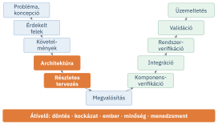
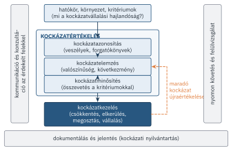
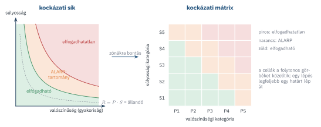
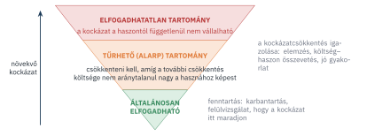
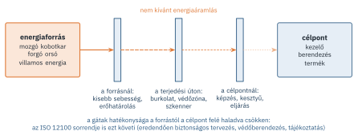

# Kockázatkezelés {#sec-kockazat}

::: {.vterkep}
{fig-alt="V-térkép: a fejezet helye a rendszerfejlesztés folyamatában" width=62%}
:::

::: {.cel}
A fejezet feldolgozása után képes leszel:

- megkülönböztetni a veszélyt, a veszélyes eseményt, a kockázatot, a maradó kockázatot és a biztonságot;
- leírni a kockázatkezelés folyamatát az ISO 31000 és az ISO/IEC/IEEE 15288 alapján;
- kockázati mátrixot szerkeszteni és kalibrálni, és alkalmazni az ALARP-elvet;
- előzetes veszélyelemzést (PHA) és energia–gát elemzést végezni;
- a kockázatcsökkentő intézkedéseket hatékonyságuk szerint rangsorolni;
- kockázati nyilvántartást vezetni, és a kockázatokat a fejlesztés során folyamatosan követni.
:::

Minden fejlesztés bizonytalanságban zajlik. Nem tudjuk biztosan, hogy a kiválasztott koncepció teljesíti-e a követelményeket, hogy a beszállító időben szállít-e, hogy a felhasználók elfogadják-e az új rendszert, és azt sem, hogy a rendszer üzem közben okozhat-e sérülést vagy kárt. A kockázatkezelés nem a bizonytalanság megszüntetése, hanem annak rendszeres feltárása, értékelése és tudatos kezelése. Az ISO/IEC/IEEE 15288 a technikai irányítás átívelő folyamatai között tárgyalja: a kockázatkezelés a fejlesztés teljes életciklusán végigkíséri a döntéseket [@iso15288_2023, 6.3.4. szakasz; @nasa2016seh, 6.4. szakasz].

A fejezet négy kérdésre épül:

- Mit nevezünk kockázatnak, és mikor biztonságos egy rendszer?
- Hogyan épül fel a kockázatkezelés folyamata?
- Hogyan értékeljük és rangsoroljuk a kockázatokat?
- Hogyan azonosítjuk a veszélyeket, és mivel csökkentjük a kockázatot?

## Veszély, kockázat, biztonság {#sec-kock-fogalmak}

A biztonsági szabványok közös fogalomtára szerint a **kár** (harm) a személyek sérülése, egészségkárosodása, illetve a vagyon vagy a környezet károsodása; a **veszély** (hazard) a kár lehetséges forrása; a **veszélyes esemény** az az esemény, amely kárt okozhat; a **kockázat** (risk) pedig a kár bekövetkezési valószínűségének és súlyosságának kombinációja [@isoguide51_2014]. A műszaki rendszerek tipikus veszélyhelyzete az, hogy egy eszköz, anyag vagy berendezés a környezeténél magasabb energiaszinten van, és a tervezett üzemállapottól eltérés lép fel ([-@sec-kock-pha]. szakasz).

A kockázatot gyakran egyetlen szorzattal fejezik ki:

$$
R = P \cdot S,
$$ {#eq-kockazat}

ahol $P$ a veszélyes esemény valószínűsége vagy gyakorisága egy adott expozíciós időre, $S$ a következmény súlyossága. A valószínűség mindig egy expozíciós időintervallumhoz tartozik: egy „évi 0,01” és egy „élettartam alatt 0,01” valószínűség teljesen más kockázatot jelent [@ericson2015].

A projektmenedzsment tágabb kockázatfogalmat használ: a kockázat annak lehetősége, hogy a projekt nem teljesíti kitűzött céljait a biztonság, a műszaki teljesítmény, a költség vagy az ütemterv terén. Kaplan és Garrick klasszikus meghatározása szerint a kockázatot hármasok halmaza írja le: a nem kívánt állapothoz vezető **forgatókönyv**, ennek **valószínűsége** és a **következmény** súlyossága [@kaplan1981]. A meghatározás azért hasznos, mert arra kényszerít, hogy minden kockázatnál megkérdezzük: mi történhet, mennyire valószínű, és mi lenne a következménye? Az ISO 31000 még általánosabb: számára a kockázat a bizonytalanság hatása a célokra, amely lehet kedvező is [@iso31000_2018]. A fejezetben elsősorban a kedvezőtlen kimenetekkel foglalkozunk, két területen: a rendszer üzemeltetésének **biztonsági kockázataival** és a fejlesztési projekt **technikai, költség- és ütemezési kockázataival**.

A kockázatok kezelésük szempontjából is csoportosíthatók. Az **azonosított kockázatot** valamilyen elemzéssel feltártuk; a **nem azonosított** kockázatról nem tudunk. Az azonosított kockázat lehet **elfogadható**, amely további csökkentés nélkül is vállalható, vagy **elfogadhatatlan**, amelyet csökkenteni kell. A **maradó kockázat** a kockázatcsökkentés után megmaradó kockázat. A szabványok szerint a **biztonság** az elfogadhatatlan kockázattól való mentesség [@isoguide51_2014]. Ez fontos különbség: a biztonság nem a kockázat teljes hiánya, hanem az, hogy a megmaradt kockázat a társadalom, a jogszabályok és az érintettek által elfogadott határon belül van.

## A kockázatkezelés folyamata {#sec-kock-folyamat}

Az ISO 31000 szerint a kockázatkezelés folyamata a hatókör, a környezet és a kockázati kritériumok meghatározásával kezdődik. Ezt követi a **kockázatértékelés** három lépése (azonosítás, elemzés, minősítés), majd a **kockázatkezelés**, vagyis az intézkedések kiválasztása és végrehajtása. A folyamatot végigkíséri a kommunikáció és konzultáció az érdekelt felekkel, a nyomon követés és felülvizsgálat, valamint a dokumentálás [@iso31000_2018] ([-@fig-kockazat-folyamat]. ábra).

{#fig-kockazat-folyamat width=80%}

Az ISO/IEC/IEEE 15288 kockázatkezelési folyamata öt tevékenységből áll: a kockázatkezelés megtervezése, a kockázati profil kezelése, a kockázatok elemzése, a kockázatok kezelése és a kockázatok figyelése [@iso15288_2023, 6.3.4. szakasz]. A gyakorlatban két, egymást kiegészítő szemlélet fonódik össze. A **kockázatinformált döntéshozatal** (risk-informed decision making, RIDM) a nagy, irányt szabó tervezési döntéseket támogatja: az alternatívák kiválasztását a kockázati és bizonytalansági információk alapján ([-@sec-kock-ridm]. szakasz). A **folyamatos kockázatkezelés** (continuous risk management, CRM) ezután a fejlesztés és a megvalósítás során kezeli az egyes kockázatokat. A Carnegie Mellon Egyetem szoftvermérnöki intézetének (SEI) útmutatója szerint a CRM ciklusa az azonosítás, az elemzés, a tervezés, a nyomon követés és a beavatkozás, és mindegyiket a kommunikáció kíséri [@dorofee1996].

A kockázatokat a projektben **kockázati nyilvántartás** (kockázati regiszter) rögzíti. Egy jó bejegyzés a kockázatot feltétel–következmény formában fogalmazza meg [@dorofee1996]: „mivel [feltétel, amely ma igaz], fennáll a lehetősége, hogy [esemény], ami [következmény a célokra]”. Ez a megfogalmazás elválasztja a tényt (a feltételt) a bizonytalan eseménytől, és megmutatja, hol lehet beavatkozni. A bejegyzéshez tartozik a valószínűség és a következmény becslése, a felelős, a kezelési mód, a beavatkozást kiváltó küszöb és az állapot. A kockázatok állapotáról rendszeresen, a küszöbhöz közeledő kockázatokról sűrűbben kell jelenteni, és a kockázatok állapotát minden életciklus-felülvizsgálaton ([-@sec-felulvizsgalatok]. szakasz) érdemes áttekinteni.

## A kockázat minősítése: kockázati mátrix és ALARP {#sec-kock-matrix}

A [-@eq-kockazat]. egyenlet szerint az azonos kockázatú pontok a valószínűség–súlyosság síkon hiperbolákon, úgynevezett **izokockázati görbéken** helyezkednek el. A görbék a síkot tartományokra osztják: elfogadható, feltételesen elfogadható és elfogadhatatlan kockázatra ([-@fig-kockazati-sik]. ábra). Mivel a valószínűség és a súlyosság ritkán ismert pontosan, a gyakorlatban a síkot kategóriákra bontjuk. Így jön létre a **kockázati mátrix**, amelynek cellái a folytonos görbéket közelítik [@cox2008].

{#fig-kockazati-sik width=100%}

Cox elemzése szerint a kockázati mátrixok könnyen félrevezetnek: kis felbontásuk miatt a valóban eltérő kockázatokat azonos cellába sorolhatják, vagy a sorrendjüket meg is fordíthatják [@cox2008]. Cox elemzése és a rendszerbiztonsági gyakorlat [@milstd882e; @goldberg1994toolbox, 3.1. szakasz] alapján a mátrix szerkesztésének gyakorlati szabályai:

- a szomszédos valószínűségi kategóriák nagyságrendben (tízszeres szorzóval) különbözzenek;
- ne legyen túl sok cella, mert a szubjektív értékelés finomabb felbontása csak zavart okoz;
- a zónák legyenek folytonosak: egy lépés a mátrixban legfeljebb egy zónahatárt lépjen át;
- csak annyi zóna legyen, ahány különböző kezelési mód létezik (például elfogadhatatlan, felmentéssel elfogadható, rutinszerűen elfogadható);
- a mátrixot egy ismert, mindenki által értett forgatókönyvvel kell **kalibrálni**;
- a zónahatárokat nem az elemző, hanem a vezetés állapítja meg és hagyja jóvá.

A kockázatot a **legrosszabb hihető** (worst credible), nem a legrosszabb elképzelhető következményre kell értékelni [@ericson2015]. A mátrixok kategóriái gyakran az amerikai védelmi szabvány rendszerbiztonsági gyakorlatából származnak, amely négy súlyossági kategóriát (katasztrofális, kritikus, mérsékelt, elhanyagolható) és hat valószínűségi szintet (gyakori, valószínű, alkalmi, ritka, valószínűtlen, kizárt) használ [@milstd882e]. A könyv eseteiben egy 5 × 5-ös változatot használunk ([-@tbl-kockazati-skalak]. táblázat).

| Szint | Súlyosság (személy) | Valószínűség (egy cellára) |
|:-:|:--|:--|
| 5 | halál vagy maradandó egészségkárosodás | gyakori: legalább havonta (> 10/év) |
| 4 | súlyos sérülés, kórházi ellátás, tartós munkaképtelenség | valószínű: évente néhányszor (1–10/év) |
| 3 | orvosi ellátást igénylő sérülés | alkalmi: néhány évente (0,1–1/év) |
| 2 | elsősegéllyel ellátható sérülés | ritka: az élettartam alatt előfordulhat (0,01–0,1/év) |
| 1 | sérülés nélküli esemény | valószínűtlen: nem várható (< 0,01/év) |

: A könyv eseteiben használt súlyossági és valószínűségi skála. A zónák: $S + P \geq 8$ elfogadhatatlan, $6 \leq S + P \leq 7$ ALARP, $S + P \leq 5$ elfogadható. {#tbl-kockazati-skalak tbl-colwidths="[8,46,46]"}

A feltételesen elfogadható tartomány értelmezésére a brit munkavédelmi hatóság **ALARP-elve** (as low as reasonably practicable, olyan alacsony, amennyire észszerűen megvalósítható) terjedt el ([-@fig-alarp]. ábra). A felső, elfogadhatatlan tartományban a kockázat a haszontól függetlenül nem vállalható. A középső, tűrhető tartományban a kockázatot csökkenteni kell mindaddig, amíg a további csökkentés költsége nem válik aránytalanul nagyra a hasznához képest. Az alsó tartományban a kockázat általánosan elfogadható, de fenn kell tartani ezt a szintet [@hse2001]. Az ALARP tehát nem azt jelenti, hogy „elég jó”, hanem fordított bizonyítási terhet: a tervezőnek kell igazolnia, hogy a további csökkentés már nem észszerű.

{#fig-alarp width=80%}

A kockázati mátrix egyszerű és szemléletes, de korlátai is vannak. Cox matematikai elemzése szerint a mátrixok felbontása gyenge: a véletlenszerűen választott kockázatpároknak csak kis hányadát tudják egyértelműen sorba rendezni, mennyiségileg nagyon különböző kockázatokat ugyanabba a cellába sorolhatnak, és előfordulhat, hogy a kisebb kockázat kap magasabb minősítést [@cox2008]. A mátrix ezért a kockázatok **előszűrésére** és a kommunikációra jó eszköz. Ha két intézkedés vagy két tervváltozat között kell dönteni, és vannak adatok, a mennyiségi elemzés (megbízhatósági modell, hibafa, eseményfa, [-@sec-megbizhatosag]. fejezet) megbízhatóbb.

## Veszélyazonosítás: PHA és energia–gát elemzés {#sec-kock-pha}

A kockázat csak akkor értékelhető, ha a veszélyt azonosítottuk. Az **előzetes veszélyelemzés** (preliminary hazard analysis, PHA) a fejlesztés korai szakaszában, a koncepció ismeretében készül. Célja a veszélyek leltárba vétele, a célpontok (személy, berendezés, termék, környezet) meghatározása, a kockázat első értékelése és az ellenintézkedések kijelölése. A PHA erőssége, hogy már a koncepció szakaszában leltárt ad a veszélyekről és az ellenintézkedésekről; korlátja, hogy nem foglalkozik az egyidejűleg fennálló hibák kombinációival, ezért a részletesebb elemzések (FMEA, hibafa) nem maradhatnak el [@ericson2015; @goldberg1994toolbox, 3.2. szakasz].

A veszélyek azonosításának hatékony vezérfonala az **energia**. Haddon klasszikus megfigyelése szerint a sérülések nagy része energiaátadásból ered: a mozgási, helyzeti, hő-, villamos, kémiai és sugárzási energia olyan mértékben vagy ütemben jut el a célpontig, amelyet az nem tud elviselni. Haddon tíz stratégiát írt le a kár csökkentésére, a veszély létrehozásának elkerülésétől és mennyiségének csökkentésétől a forrás és a célpont térbeli vagy időbeli elválasztásán és a gátakon át a célpont ellenállóbbá tételéig és a kár enyhítéséig [@haddon1973]. Az **energia–gát elemzés** ezt a gondolatot követi: számba veszi a rendszer energiaforrásait, a célpontokat és a közöttük lévő gátakat, és megvizsgálja, hogy a gátak elegendőek-e [@ericson2015; @goldberg1994toolbox, 3.3. szakasz] ([-@fig-energia-gat]. ábra). A módszer korlátja, hogy azokat a veszélyeket, amelyeknél nem energiaáramlás okozza a kárt (például az oxigénhiányos zárt térben bekövetkező fulladást), nem azonosítja.

{#fig-energia-gat width=100%}

::: {.eset eset="A" title="KoboCella: előzetes veszélyelemzés"}
A KoboCella csapata a koncepció kiválasztása után PHA-t készített. Az energiaforrások listája (a kobot mozgó karja, a csavarozó orsó, a befogó szorítóereje, a villamos energia, a motorház helyzeti energiája, a vezérlőszoftver) és a kezelő HTA-ja ([-@sec-emberkozpontu]. fejezet) adta a kiindulópontot. A [-@tbl-pha-kobo]. táblázat a PHA egy részletét mutatja.

| Veszély | Kiinduló $S$/$P$ | Ellenintézkedés | Maradó $S$/$P$ |
|:--|:-:|:--|:-:|
| a kobotkar ütközése a kezelővel | 3/4 (ALARP) | erő- és teljesítményhatárolás, sebesség- és távolságfelügyelet lézerszkennerrel, legfeljebb 250 mm/s a közös térben (R-11) | 2/3 (elfogadható) |
| kéz becsípődése a befogó és a fedél között | 4/3 (ALARP) | a befogó csak zónaelhagyás után zár; korlátozott szorítóerő | 3/2 (elfogadható) |
| forgó orsó, ruha vagy kesztyű behúzása | 3/3 (ALARP) | burkolat; az orsó csak zónaelhagyás után indul | 3/1 (elfogadható) |
| áramütés a vezérlőszekrényben karbantartáskor | 5/2 (ALARP) | érintésvédelem, kizárási eljárás, csak képzett villamos szakember | 5/1 (ALARP, indokolva) |
| ismétlődő törzshajlítás (ergonómia) | 3/5 (elfogadhatatlan) | munkamagasság a kezelőhöz állítható, legfeljebb 20° törzshajlítás (R-05) | 2/3 (elfogadható) |
| váratlan indulás szoftverhiba miatt | 4/2 (ALARP) | a zónafelügyelet független biztonsági vezérlésen fut | 4/1 (elfogadható) |

: A KoboCella előzetes veszélyelemzésének részlete. $S$: súlyosság, $P$: valószínűség a [-@tbl-kockazati-skalak]. táblázat skáláin. {#tbl-pha-kobo tbl-colwidths="[24,14,46,16]"}

Az elemzés két fontos tanulsággal járt. Először: a legnagyobb kiinduló kockázat nem a robottól, hanem a jelenlegi kézi szerelés ergonómiai terheléséből származott; a cella ezt csökkenti. Másodszor: az áramütés kockázata a csökkentés után is az ALARP-tartományban maradt, mert a súlyosság nem csökkenthető. A csapat ezért írásban indokolta, miért nem észszerű a további csökkentés (a karbantartási munkák ritkák, a villamos szakemberek képzettek, a kizárási eljárás bevett), és a vezetés ezzel a maradó kockázatot elfogadta.
:::

## Kockázatcsökkentés {#sec-kock-csokkentes}

A gépek biztonságának alapszabványa háromlépéses kockázatcsökkentést ír elő, rögzített sorrendben. Az első lépés az **eredendően biztonságos tervezés**: a veszély megszüntetése vagy csökkentése magával a kialakítással (kisebb energia, kisebb erő, a veszélyes zóna elkerülése). A második a **műszaki védőintézkedések**: védőburkolatok és védőberendezések (reteszelés, fényfüggöny, lézerszkenner). A harmadik a **használati információ**: figyelmeztetések, jelzések, utasítások, képzés [@iso12100_2010]. A sorrend nem véletlen: az eredendően biztonságos megoldás az ember figyelmétől és a védőberendezés működőképességétől függetlenül hat, a tájékoztatás viszont csak akkor, ha az ember tudja, emlékszik rá és be is tartja. Ugyanezt a logikát követi az energia–gát szemlélet: a forrásnál alkalmazott gát hatékonyabb, mint a célpontnál alkalmazott ([-@fig-energia-gat]. ábra), és az emberi hibák elleni védekezés hatékonysági sorrendje is ([-@sec-emberi-hiba]. fejezet).

Az ISO 31000 általánosabban írja le a kockázatkezelési lehetőségeket: a kockázat elkerülése (a tevékenység elhagyásával), a kockázati forrás megszüntetése, a valószínűség vagy a következmény megváltoztatása, a kockázat megosztása (például szerződéssel vagy biztosítással), valamint a kockázat tudatos vállalása; kedvező kimenetnél akár a kockázat növelése is, egy lehetőség kihasználására [@iso31000_2018]. A projektkockázatoknál mindegyik lehetőség szóba jöhet, a biztonsági kockázatoknál a megosztás nem csökkenti a személyeket érintő kárt, ezért ott a háromlépéses sorrend az irányadó.

Minden kockázatcsökkentő intézkedés után újra kell értékelni a kockázatot ([-@fig-kockazat-folyamat]. ábra), mert az intézkedés új veszélyt is behozhat. A KoboCellában például a lézerszkenner miatt a kezelő a zóna elhagyása nélkül nem indíthatja a ciklust; ha ez lassítja a munkát, a kezelők megkerülhetik a védelmet. Ezt a lehetőséget a csapat a HTA-ban szabályszegésként azonosította, és a megoldást is a tervezésben kereste: a teljes sebesség csak zónaelhagyás után engedélyezett, így a megkerülés nem gyorsítja a munkát.

::: {.eset eset="B" title="VárosiBringa: az akkumulátor mint energiaforrás"}
A VárosiBringa dokkolóállomásain az elektromos kerékpárok akkumulátorai töltődnek, köztéren, felügyelet nélkül. Az energia–gát elemzés legfontosabb energiaforrása a lítiumion-akkumulátor kémiai és villamos energiája lett, célpontként a járókelők, a dokkoló és a szomszédos kerékpárok. A csapat a gátakat Haddon stratégiái szerint rendezte: a töltés áramának korlátozása (a forrásnál), az akkumulátorkezelő rendszer hőmérséklet-figyelése és a töltés leállítása rendellenesség esetén (a felszabadulás megakadályozása), fémházas akkumulátortartó és távolság a dokkolóhelyek között (elválasztás), valamint automatikus riasztás az üzemeltetőnek (a kár enyhítése). A súlyosság itt nem csökkenthető a tájékoztatással, ezért a csapat a gátakat a forrás közelében sűrítette.
:::

## Kockázatinformált döntés és folyamatos kockázatkezelés {#sec-kock-ridm}

A kockázat nemcsak a kész rendszer biztonsági tulajdonsága, hanem a fejlesztési döntések egyik szempontja is. A kockázatinformált döntéshozatalban a tervváltozatokat nemcsak a várható teljesítményük, hanem a teljesítmény bizonytalansága és a kudarc valószínűsége szerint is összevetjük [@parnell2013]. A [-@sec-dontes]. fejezet Monte Carlo-elemzései (a súlyozott értékelés és a költség–haszon elemzés bizonytalansága) éppen ezt teszik: egy változat, amely átlagosan jobb, de jelentős valószínűséggel kudarcot vall, kevésbé vonzó lehet, mint egy kissé gyengébb, de biztosabb változat.

A kiválasztás után a folyamatos kockázatkezelés veszi át a szerepet. A kockázati nyilvántartás élő dokumentum: új kockázatok kerülnek bele, a régiek pontszáma az intézkedések hatására csökken, a bekövetkezett kockázatokból problémák lesznek, a megszűntek lezárulnak. A kockázatok alakulását sok projekt idősoros ábrán követi: a tervezett csökkentési lépések és a tényleges állapot összevetése megmutatja, ha egy kockázat nem a tervek szerint csökken.

::: {.eset eset="C" title="ForgácsTech: a MES-bevezetés kockázatai"}
A ForgácsTech csapata a fokozatos MES-bevezetés (M3, [-@sec-dontes]. fejezet) első ütemének indításakor kockázati nyilvántartást nyitott. Három bejegyzés:

- „Mivel a régi gépek egy részének nincs digitális interfésze, fennáll a lehetősége, hogy a gépi adatgyűjtés csak kiegészítő hardverrel oldható meg, ami az első ütemet 2–3 hónappal késlelteti.” Valószínűség 4, következmény 3; kezelés: a gépek felmérése a szerződéskötés előtt, és a kiegészítő hardver beárazása tartalékként.
- „Mivel a sürgős rendelések előresorolása eddig szóban történt, fennáll a lehetősége, hogy a műszakvezetők megkerülik az ütemezőt, így a határidő-teljesítés nem javul.” Valószínűség 3, következmény 4; kezelés: a műszakvezetők bevonása az ütemező szabályainak kialakításába, és az átsorolás naplózása ([-@sec-automatizalas]. fejezet).
- „Mivel a platformot egyetlen beszállító fejleszti, fennáll a lehetősége, hogy a későbbi ütemek ára vagy ütemezése a beszállító helyzetétől függ.” Valószínűség 2, következmény 4; kezelés: nyílt adatexport és a második ütem árának rögzítése a keretszerződésben (kockázatmegosztás).

A nyilvántartást a csapat havonta frissítette. A második kockázat a próbaüzem első hónapjában a vártnál lassabban csökkent: a naplók szerint az átsorolások harmada a rendszeren kívül történt. A csapat ezért a beavatkozási küszöb elérésekor a tervezett tartalékintézkedést indította el: a napi műszakindító megbeszélés napirendjére került az előző nap átsorolásainak áttekintése.
:::

::: {.kitekintes title="Kockázat és ellenálló képesség"}
A klasszikus kockázatkezelés előre azonosított veszélyekből és forgatókönyvekből indul. Az összetett, sok szereplős rendszerekben azonban mindig lesznek előre nem látott helyzetek. Ezért a kockázatkezelést egyre gyakrabban egészíti ki az **ellenálló képesség** (reziliencia) szemlélete: a rendszer képessége, hogy a váratlan zavarokat észlelje, elviselje, alkalmazkodjon hozzájuk és helyreálljon. A rendszermérnök számára ez olyan tervezési jellemzőket jelent, mint a tartalékok, a leromlott üzemmódok (a KoboCella UM-7 üzemmódja), a moduláris felépítés és a gyors helyreállítást támogató megfigyelhetőség. A rendszerelméleti biztonságelemzés ([-@sec-biztonsag]. fejezet) ezt a gondolatot viszi tovább.
:::

::: {.hiba title="A kockázati mátrix mint döntési automata"}
Gyakori hiba, hogy a mátrix színe „dönt”: ami zöld, azzal nem foglalkozunk, ami piros, azt bármi áron csökkentjük. A mátrix kategóriái durvák, a besorolás szubjektív, és a cellahatárok közelében kis becslési eltérés is más színt ad [@cox2008]. A mátrix arra való, hogy a figyelmet a fontos kockázatokra irányítsa és a kommunikációt egységessé tegye. A döntéshez az ALARP-elv szerinti indoklás, és ahol lehet, mennyiségi elemzés kell.
:::

::: {.osszefoglalo}
- A veszély a kár lehetséges forrása, a kockázat a kár valószínűségének és súlyosságának kombinációja. A biztonság nem a kockázat hiánya, hanem az elfogadhatatlan kockázattól való mentesség; a maradó kockázatot tudatosan kell elfogadni.
- A kockázatkezelés folyamata: hatókör és kritériumok, azonosítás, elemzés, minősítés, kezelés, a kommunikáció és a felülvizsgálat folyamatos kíséretében. A kockázatinformált döntéshozatal (RIDM) a nagy tervezési döntéseket, a folyamatos kockázatkezelés (CRM) az egyes kockázatok követését szolgálja.
- A kockázati mátrix a kockázati sík izokockázati görbéit közelíti. Szerkesztésének szabályai: nagyságrendi valószínűségi lépések, kevés cella és zóna, folytonos zónahatárok, kalibrálás; a határokat a vezetés hagyja jóvá. Az ALARP-elv szerint a tűrhető tartományban a kockázatot addig kell csökkenteni, amíg a csökkentés költsége nem aránytalan.
- A PHA a veszélyek korai leltára ellenintézkedésekkel; az energia–gát elemzés az energiaforrások, a célpontok és a gátak vizsgálatával azonosítja a veszélyeket.
- A kockázatcsökkentés sorrendje: eredendően biztonságos tervezés, műszaki védőintézkedések, használati információ. Minden intézkedés után újra kell értékelni a kockázatot.
:::

::: {.onell}
1. Mi a különbség a veszély és a kockázat között? Adj példát mindkettőre a saját környezetedből!
2. Miért kell a valószínűséghez expozíciós időt rendelni?
3. Egy kockázati mátrixban a valószínűségi kategóriák „ritka: évente egyszer” és „alkalmi: évente kétszer”. Mi a probléma ezzel a skálával?
4. Mit jelent az ALARP-elv, és kit terhel a bizonyítás?
5. Miért korlátozott egy kockázati mátrix felbontása? Mikor van szükség mennyiségi elemzésre?
6. Végezz rövid energia–gát elemzést egy háztartási kenyérpirítóra!
7. Miért a használati információ az utolsó a kockázatcsökkentés sorrendjében?
8. Fogalmazz meg feltétel–következmény formájú kockázati állítást egy félévi projektfeladat egyik kockázatára!

::: {.megoldas}
1. A veszély a kár lehetséges forrása (például a forgó köszörűkorong), a kockázat a kár valószínűségének és súlyosságának kombinációja (például annak esélye, hogy egy évben a korong szilánkja szemsérülést okoz, és ennek súlyossága).
2. Mert ugyanaz az esemény egy óra alatt, egy év alatt vagy a teljes élettartam alatt nagyon különböző valószínűséggel következik be; expozíciós idő nélkül a valószínűségek nem vethetők össze, és a kockázat nem értelmezhető.
3. A két kategória között csak kétszeres különbség van, így a besorolás a becslési bizonytalanságon belül esik; a szomszédos kategóriák nagyságrendben különbözzenek.
4. A tűrhető tartományban a kockázatot addig kell csökkenteni, amíg a további csökkentés költsége (pénz, idő, erőfeszítés) nem válik aránytalanul nagyra a kockázatcsökkentés hasznához képest. A bizonyítás a rendszer tervezőjét és üzemeltetőjét terheli: neki kell igazolnia, hogy a további csökkentés nem észszerű.
5. Mert kevés kategóriája van, a besorolás szubjektív, ezért mennyiségileg nagyon különböző kockázatok kerülhetnek egy cellába, és a sorrend is hibás lehet. Mennyiségi elemzés kell, ha változatok között kell dönteni, ha a kockázat a zónahatár közelében van, vagy ha a súlyosság katasztrofális.
6. Energiaforrások: villamos (hálózati feszültség), hő (izzó fűtőszálak). Célpontok: a felhasználó (áramütés, égés), a konyha (tűz). Gátak: kettős szigetelés és földelés (villamos), hőszigetelt ház, automatikus kikapcsolás időzítővel és hőbiztosítékkal, morzsatálca (tűz), használati utasítás (fém eszközt ne dugjunk bele).
7. Mert hatása az ember tudásán, emlékezetén és szabálykövetésén múlik, amely fáradtság, időnyomás és rutin mellett megbízhatatlan; a tervezési és a műszaki intézkedés ettől függetlenül hat.
8. Például: „Mivel a csapat két tagja a vizsgaidőszakban gyakornokoskodik, fennáll a lehetősége, hogy a validációs próba elmarad, ami miatt a zárójelentés a felhasználói visszajelzések nélkül készül el.”
:::
:::

::: {.projekt title="Projektlépés: kockázatok"}
Saját fejlesztési feladatodhoz:

1. készíts kockázati mátrixot a projekt jellegéhez igazított súlyossági és valószínűségi skálával, és kalibráld egy ismert forgatókönyvvel;
2. végezz előzetes veszélyelemzést az energiaforrások és a felhasználói feladatok alapján, legalább hat veszéllyel, ellenintézkedésekkel és maradó kockázattal;
3. nyiss kockázati nyilvántartást legalább öt projektkockázattal, feltétel–következmény formában, felelőssel és beavatkozási küszöbbel;
4. a módszerekhez használd a Gyakorlati útmutató kockázati mátrix és PHA eszközlapját, sablonját és notebookját.
:::

::: {.forras}
- @dorofee1996: a folyamatos kockázatkezelés eredeti, gyakorlati útmutatója.
- @ericson2015: a veszélyelemzési módszerek (PHA, gátelemzés és mások) részletes kézikönyve.
- @cox2008: a kockázati mátrixok korlátainak kritikai elemzése.
- @iso31000_2018 és @iso12100_2010: a kockázatkezelés általános keretrendszere és a gépek kockázatcsökkentésének háromlépéses módszere.
- @hse2001: az ALARP-elv és a tűrhető kockázat eredeti, közérthető leírása.
- @cox2008: a kockázati mátrixok matematikai korlátainak elemzése.
- @haddon1973: az energiaátadás és a tíz ellenstratégia klasszikus cikke.
- @nasa2016seh, 6.4. szakasz: a technikai kockázatkezelés folyamata, a RIDM és a CRM viszonya.
- @goldberg1994toolbox, 3.1–3.3. szakasz: a kockázati mátrix szerkesztése, a PHA és az energia–gát elemzés.
:::
