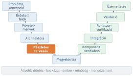
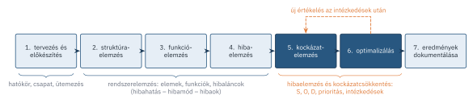
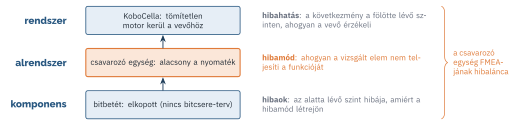

# Hibamód- és hatáselemzés (FMEA) {#sec-fmea}

::: {.vterkep}
{fig-alt="V-térkép: a fejezet helye a rendszerfejlesztés folyamatában" width=62%}
:::

::: {.cel}
A fejezet feldolgozása után képes leszel:

- elmagyarázni az FMEA célját, típusait és helyét a fejlesztésben;
- végigvezetni egy FMEA-t az AIAG–VDA kézikönyv hét lépésén;
- felírni a hibaláncot (hibahatás, hibamód, hibaok) a rendszer szintjein;
- a súlyosságot, az előfordulást és az észlelhetőséget következetesen értékelni;
- ismertetni a kockázati prioritásszám (RPN) korlátait és a cselekvési prioritás elvét;
- kritikusságot számítani az FMECA módszerével, és az FMEA-t élő dokumentumként kezelni.
:::

A kockázatkezelés ([-@sec-kockazat]. fejezet) a veszélyekből és a projekt bizonytalanságaiból indul ki, felülről lefelé. A hibamód- és hatáselemzés (failure mode and effects analysis, FMEA) ezt alulról felfelé egészíti ki: a rendszer elemeit egyenként veszi sorra, és mindegyiknél megkérdezi, hogyan hibásodhat meg, mi lesz ennek a következménye, és mi okozhatja. Az FMEA a megelőző minőségügy módszere: a meglévő hibák elhárítása helyett a lehetséges hibák elkerülésére törekszik, ezért a vizsgálat szempontjából mindegy, hogy a hiba előfordult-e már, vagy csak lehetőség [@iec60812_2018].

A fejezet négy kérdésre épül:

- Mire való az FMEA, és milyen fajtái vannak?
- Milyen lépésekből áll, és hogyan írjuk fel a hibaláncokat?
- Hogyan értékeljük és rangsoroljuk a hibamódokat?
- Hogyan lesz az FMEA-ból intézkedés és élő dokumentum?

## Az FMEA célja és típusai {#sec-fmea-cel}

Az FMEA szabványos leírását a nemzetközi szabvány [@iec60812_2018], a kritikusságelemzéssel kiegészített változatot (FMECA) az amerikai védelmi szabvány [@milstd1629a], az autóipari gyakorlatot az AIAG és a VDA közös kézikönyve [@aiagvda2019] adja meg. Az FMEA alapos módszer az egypontos hibák és következményeik azonosítására, a kritikusságelemzés pedig ezek kockázatát is értékeli. Korlátja, hogy munkaigényes, és egyszerre csak egy hibamódot vizsgál, a hibák kombinációit nem; erre a hibafa-elemzés való ([-@sec-megbizhatosag]. fejezet) [@iec60812_2018; @goldberg1994toolbox, 3.4. szakasz].

A gyakorlatban két fő típust különítenek el [@aiagvda2019]:

- A **tervezési (termék-) FMEA** a termék konstrukciós hibáit, gyenge pontjait tárja fel. A tervezéssel párhuzamosan fut, a tervdokumentáció jóváhagyásáig befejeződik, és a konstrukciós szervezet felelőssége. Szintje szerint lehet rendszer-, alrendszer- és alkatrész-FMEA.
- A **folyamat-FMEA** a gyártási, szerelési, ellenőrzési és logisztikai folyamat hibáit elemzi. A tervezési FMEA-ra épül, a sorozatgyártás engedélyezéséig befejeződik, és a gyártás-előkészítés felelőssége.

Az autóipari kézikönyv szerint az FMEA három helyzetben szükséges: új termék, technológia vagy folyamat esetén (teljes körűen); meglévő termék vagy folyamat módosításakor (a módosításra és hatásaira összpontosítva); és ha egy meglévő termék vagy folyamat új környezetbe, helyszínre vagy alkalmazásba kerül [@aiagvda2019]. A módszer legeredményesebben csoportmunkában végezhető: egy felelős vezeti, de a tervezés, a gyártás, a minőségügy, a karbantartás és lehetőség szerint a vevő és a beszállító is részt vesz.

A rendszermérnöki fejlesztésben az FMEA helye a V bal ágán van: a koncepció és az architektúra kialakítása után a rendszer- és alrendszerszintű FMEA a tervezési döntéseket, a részletes tervezésben az alkatrész- és folyamat-FMEA a konstrukciót és a gyártást támogatja. A funkcióelemzésben a funkciókat érdemes a hibamódjaikkal és a hibák következményeivel együtt leírni ([-@sec-arch-funkcioelemzes]. szakasz), így a funkcióelemzés közvetlenül táplálja az FMEA-t.

## Az FMEA lépései {#sec-fmea-lepesek}

Az AIAG–VDA kézikönyv az FMEA-t hét lépésre bontja ([-@fig-fmea-het-lepes]. ábra) [@aiagvda2019]:

{#fig-fmea-het-lepes width=100%}

1. **Tervezés és előkészítés:** a hatókör, a csapat, az ütemezés és az alkalmazott eszközök rögzítése; mit elemzünk, és mit nem.
2. **Struktúraelemzés:** a vizsgált rendszer felbontása elemekre (rendszer, alrendszer, komponens; vagy folyamatnál folyamatlépés, munkaelem). Itt használható a fizikai architektúra és a HTA ([-@sec-emberkozpontu]. fejezet).
3. **Funkcióelemzés:** az elemek funkcióinak és követelményeinek hozzárendelése a struktúrához, mérhető formában, a funkciófa ([-@sec-architektura]. fejezet) alapján.
4. **Hibaelemzés:** minden funkcióhoz a hibamódok, ezek hatásai és okai, vagyis a **hibaláncok** felírása.
5. **Kockázatelemzés:** a meglévő megelőző és észlelő intézkedések rögzítése, és a súlyosság, az előfordulás és az észlelhetőség értékelése.
6. **Optimalizálás:** intézkedések a kockázat csökkentésére, felelőssel és határidővel, majd az új értékelés.
7. **Az eredmények dokumentálása** és közlése.

A hibaelemzés kulcsfogalmai a **hibamód**, a **hibahatás** és a **hibaok**. A hibamód az, ahogyan a vizsgált elem nem teljesíti a funkcióját (például „a nyomaték alacsony”). A hibahatás az, ahogyan a következmény a fölötte lévő szinten, végső soron a vevőnél megjelenik (a vevő lehet belső vevő is). A hibaok az, amiért a hibamód létrejön. A hibamódot fizikai, műszaki fogalmakkal kell leírni (repedés, meglazulás, szivárgás, nincs nyomatékátvitel, időszakos jelzés), nem pedig a vevő által tapasztalt tünettel. A hibaláncok a rendszer szintjei között összekapcsolódnak: egy szint hibamódja a fölötte lévő szint hibaoka és az alatta lévő szint hibahatása ([-@fig-hibalanc]. ábra).

{#fig-hibalanc width=100%}

## Súlyosság, előfordulás, észlelhetőség {#sec-fmea-sod}

A kockázatelemzés három tényezőt értékel, mindegyiket 1-től 10-ig terjedő skálán:

- **Súlyosság** ($S$): a hibahatás jelentősége a vevő számára. A 10 a biztonságot vagy az egészséget, a 9 a jogszabályi megfelelést érintő hatásoké [@aiagvda2019], a 7–8 a funkció elvesztéséé vagy jelentős romlásáé, a 4–6 a kényelmi funkciók zavaráé, a 2–3 az alig észrevehető hibáké, az 1 a hatás nélküli hibáé. A súlyosság csak a konstrukció megváltoztatásával csökkenthető.
- **Előfordulás** ($O$): annak valószínűsége, hogy a hibaok a termék élete során (vagy a folyamatban) bekövetkezik, a meglévő megelőző intézkedések mellett. A skála gyakorisági adatokhoz is kalibrálható, például az ezer egységre jutó hibák számához: a 10 pont a nagyon gyakori hibaokot (ezer egységből legalább száz hibás), az 1 pont a megelőző intézkedéssel gyakorlatilag kizárt hibaokot jelenti. Az AIAG–VDA kézikönyv az előfordulást már elsősorban a megelőző intézkedések hatékonysága alapján pontoztatja [@aiagvda2019]. Az előfordulás megelőző intézkedéssel (konstrukciós vagy folyamatbeli változtatással) csökkenthető.
- **Észlelhetőség** ($D$): annak esélye, hogy a meglévő észlelő intézkedések felfedezik a hibát (vagy okát), mielőtt a vevőhöz ér. Itt a nagy szám a rossz: 1 pont, ha a hiba nyilvánvaló vagy a 100%-os automatikus ellenőrzés biztosan kiszűri; 9–10 pont, ha a hiba rejtett, vagy nincs ellenőrzés.

Két gyakorlati szabályt érdemes betartani. Először: a skálák relatívak, egy FMEA-n belül érvényesek, ezért a csapatnak előre meg kell egyeznie a kiértékelési szempontokban, és azokat következetesen kell alkalmaznia. Másodszor: a 9-es és 10-es súlyossági fokozat a biztonsághoz és a jogszabályokhoz kötődik, ezért ezek kritériumait a csapat nem lazíthatja fel.

::: {.eset eset="A" title="KoboCella: folyamat-FMEA a kezelői feladatokból"}
A KoboCella csapata a folyamat-FMEA struktúráját a kezelő HTA-jából ([-@sec-emberkozpontu]. fejezet) és a cella gépi lépéseiből építette fel. A [-@tbl-fmea-kobo]. táblázat hat hibamódot mutat a kezdeti értékeléssel és a tervezett intézkedésekkel.

| Folyamatlépés | Hibamód | Hibahatás | $S$ | $O$ | $D$ | RPN | Intézkedés | $O'$ | $D'$ | RPN' |
|:--|:--|:--|:-:|:-:|:-:|:-:|:--|:-:|:-:|:-:|
| 2.3 fedél ráhelyezése | fordított fedél | tömítetlen motor | 8 | 5 | 7 | 280 | aszimmetrikus illesztőcsapok | 1 | 1 | 8 |
| 3.2 hibás darab kiválogatása | a darab a kiadóba kerül | hibás motor a vevőnél | 8 | 3 | 8 | 192 | a kiadó reteszelése a selejtdoboz jelzéséig | 3 | 2 | 48 |
| 1.2 típusprogram | rossz program marad | rossz nyomaték egy sorozaton | 7 | 3 | 5 | 105 | a HMI a rendelés alapján tölti be a programot | 1 | 5 | 35 |
| csavaradagolás | hiányzó csavar | laza fedél, tömítetlenség | 8 | 5 | 2 | 80 | töltöttségérzékelő az adagolóban | 3 | 2 | 48 |
| csavarmeghúzás | alacsony nyomaték | laza kötés a vevőnél | 8 | 4 | 2 | 64 | bitcsere a ciklusszám alapján | 2 | 2 | 32 |
| 2.2 motorház behelyezése | nem ül fel teljesen | a cella nem indul, időveszteség | 4 | 6 | 2 | 48 | – | – | – | 48 |

: A KoboCella folyamat-FMEA-jának részlete. $O'$, $D'$, RPN': a tervezett intézkedés utáni értékelés; a súlyosság egyik esetben sem változik. {#tbl-fmea-kobo tbl-colwidths="[15,12,14,4,4,4,6,21,5,5,6]"}

Az elemzés legfontosabb tanulsága a fordított fedél: a nagy előfordulás és a gyenge észlelhetőség együtt adta a legmagasabb RPN-t. A csapat itt nem az észlelést javította (érzékelő), hanem az előfordulást szüntette meg hibabiztos kialakítással, összhangban a HEART-összehasonlítással ([-@sec-emberi-hiba]. fejezet). Mivel a fordított fedél fizikailag nem helyezhető be, az észlelhetőség is a legjobb értéket kapta: a hiba nem jöhet létre. A táblázat utolsó két sora a következő szakasz problémáját is mutatja: a hiányzó csavar intézkedés utáni RPN-je (48) azonos a motorház behelyezéséével (48), holott az előbbi a vevőnél tömítetlen motort, az utóbbi csak időveszteséget okoz.
:::

## A kockázati prioritásszám és korlátai {#sec-fmea-rpn}

A hagyományos FMEA a három tényező szorzatával, a **kockázati prioritásszámmal** rangsorol:

$$
\text{RPN} = S \cdot O \cdot D, \qquad 1 \leq \text{RPN} \leq 1000.
$$ {#eq-rpn}

Sok szervezet tájékoztató RPN-határokat is használ (például 100 fölött intézkedés szükséges), az autóipari kézikönyvek azonban kifejezetten nem javasolják, hogy az intézkedés szükségességét egyetlen RPN-küszöb döntse el [@aiagvda2019]. Az RPN egyszerű és elterjedt, de módszertani hibái jól dokumentáltak. Bowles elemzése szerint [@bowles2003]:

- az RPN **sorrendi skálákat** kezel arányskálaként: a 8-as súlyosság nem „kétszer olyan súlyos”, mint a 4-es, így a szorzatnak nincs mennyiségi értelme;
- a skála **lyukas**: az 1 és 1000 közötti egész számok közül csak 120 állhat elő három 1 és 10 közötti szám szorzataként, és a lehetséges értékek többsége a skála alsó részén sűrűsödik;
- **azonos RPN mögött nagyon különböző kockázat** állhat: $10 \cdot 2 \cdot 4 = 80$ (biztonságkritikus, ritka, jól észlelhető) és $4 \cdot 5 \cdot 4 = 80$ (kényelmi, gyakoribb) ugyanazt a számot adja;
- az RPN **érzékenysége egyenetlen**: egy pont változás az egyik tényezőben a többi tényező értékétől függően kicsi vagy nagy változást okoz.

Liu és munkatársai 75 tanulmányt tekintettek át, amelyek az RPN hiányosságait különféle módszerekkel (fuzzy logika, többszempontú döntési módszerek, súlyozás) próbálják kiküszöbölni [@liu2013fmea]. Az AIAG–VDA kézikönyv a gyakorlat számára egyszerűbb utat választott: az RPN helyett **cselekvési prioritást** (action priority, AP) vezetett be, amely a három tényező minden kombinációjához magas, közepes vagy alacsony prioritást rendel egy táblázat alapján, és elsősorban a súlyosságra, azután az előfordulásra, végül az észlelhetőségre helyezi a hangsúlyt [@aiagvda2019]. Az elv a lényeg: a súlyos hatású hibamódok akkor is figyelmet kapnak, ha az előfordulásuk vagy az észlelhetőségük kedvező. A könyv sablonjai ezért az RPN mellett egy egyszerűsített szabályt is alkalmaznak: a 9 és 10 súlyosságú hibamódoknál minden esetben intézkedést kell mérlegelni, az RPN-től függetlenül.

## FMECA és kritikusságelemzés {#sec-fmea-fmeca}

Az FMECA (failure modes, effects and criticality analysis) az FMEA-t mennyiségi kritikusságelemzéssel egészíti ki. Az amerikai védelmi szabvány szerint egy hibamód kritikussági száma [@milstd1629a]:

$$
C_m = \beta \cdot \alpha \cdot \lambda_p \cdot t,
$$ {#eq-fmeca}

ahol $\lambda_p$ az alkatrész meghibásodási rátája, $\alpha$ a hibamód aránya (az alkatrész hibáinak hányad része ilyen módú), $\beta$ annak feltételes valószínűsége, hogy a hibamód a vizsgált súlyosságú hatást okozza, és $t$ az üzemidő. Az alkatrész kritikussági száma a hibamódjaié összegezve. A hibamódokat súlyossági kategória és kritikusság szerint **kritikussági mátrixba** rendezik, amely a kockázati mátrix ([-@sec-kockazat]. fejezet) mennyiségi változata.

Tegyük fel például, hogy a KoboCella csavarozó egységének meghibásodási rátája $\lambda_p = 20$ hiba millió üzemóránként, a hibák 30%-a az alacsony nyomaték módja ($\alpha = 0{,}3$), és ennek a fele vezet tömítetlen motorhoz a vevőnél ($\beta = 0{,}5$). Évi 3450 üzemórával $C_m = 0{,}5 \cdot 0{,}3 \cdot 20 \cdot 10^{-6} \cdot 3450 \approx 0{,}01$, vagyis évente átlagosan 0,01 ilyen esemény várható. Az FMECA tehát nem pontszámot, hanem a megbízhatósági adatokból levezetett gyakoriságot ad; ehhez meghibásodási ráták kellenek ([-@sec-megbizhatosag]. fejezet).

## Az FMEA a gyakorlatban {#sec-fmea-gyakorlat}

A tervezési FMEA **élő dokumentum** [@aiagvda2019]: elkészítését a tervezési koncepció idején kell elkezdeni, folyamatosan naprakészen kell tartani minden változáskor és minden új információ birtokában, és teljesen készen kell lennie, mielőtt a gyártási dokumentációt kiadják a szerszámok elkészítéséhez. Az FMEA értéke nem a kitöltött táblázat, hanem a végrehajtott intézkedések: minden magas prioritású hibamódhoz felelős, határidő és az intézkedés utáni új értékelés tartozik.

Néhány bevált gyakorlat:

- **A funkcióból induljunk, ne az alkatrészből.** A „hogyan nem teljesíti a funkcióját?” kérdés teljesebb hibamódlistát ad, mint az „mi romolhat el rajta?”.
- **Használjuk a korábbi tapasztalatokat.** A garanciális adatok, a reklamációk, a hasonló termékek FMEA-i és a karbantartási naplók a hibamódok legjobb forrásai; ezeket ötletroham egészíti ki.
- **Az emberi hibamódok is hibamódok.** A folyamat-FMEA-ban a HTA minden lépéséhez meg kell vizsgálni a kihagyást, a rossz sorrendet, a rossz végrehajtást ([-@sec-emberi-hiba]. fejezet).
- **A súlyosságot csak a konstrukció csökkenti.** Ha egy biztonságkritikus hibamódnál a csapat csak az észlelést javítja, a súlyosság változatlan marad, és a hibamód a következő változásnál ismét előkerül.
- **Az FMEA nem helyettesíti a kombinációk elemzését.** Az egyidejű hibákat és a közös okú meghibásodásokat a hibafa ([-@sec-megbizhatosag]. fejezet), a vezérlési kölcsönhatásokat a rendszerelméleti elemzés ([-@sec-biztonsag]. fejezet) vizsgálja.

::: {.eset eset="B" title="VárosiBringa: a dokkoló zárjának tervezési FMEA-ja"}
A VárosiBringa csapata a dokkoló tervezési FMEA-jában a „kerékpár rögzítése” funkcióból indult. A „nem reteszel” hibamódhoz három okot talált: a kerékpár nincs ütközésig betolva (felhasználói megcsúszás, [-@sec-emberi-hiba]. fejezet), a reteszcsap kopása és a zárvezérlő szoftverhibája. A hibahatás mindhárom esetben ugyanaz: a kerékpár őrizetlenül áll, a kölcsönzés nem zárul le. Az első ok előfordulása messze a legnagyobb volt, ezért a csapat két irányban lépett. Az előfordulást a dokkoló bevezető formájának módosításával csökkentette (a kerékpár „beugrik” a végállásba), az észlelést a rögzítésérzékelővel, a fény- és hangjelzéssel és az alkalmazás értesítésével javította. A reteszcsap kopására a karbantartási terv kapott ellenőrzési pontot, a szoftverhibára pedig a verifikációs terv egy tesztesetet.
:::

::: {.kitekintes title="FMEA és digitális modellek"}
A modellalapú rendszermérnökségben ([-@sec-modellek]. fejezet) a hibamódok a rendszermodell elemeihez köthetők, így az FMEA struktúrája és funkcióelemzése a modellből automatikusan előállítható, és a modell változásakor jelezhető, mely sorokat kell felülvizsgálni. Az üzemi adatok (gépi naplók, karbantartási rendszerek) pedig az előfordulás becslését teszik tényszerűbbé. Az elemzés lényegi része, a hibaláncok végiggondolása és az intézkedések kiválasztása azonban továbbra is szakértői csapatmunka.
:::

::: {.hiba title="Az FMEA mint papírmunka"}
Gyakori, hogy az FMEA-t az auditra készítik el, a tervezés után, egy ember a meglévő dokumentációból. Az ilyen FMEA a már meghozott döntéseket igazolja, nem alakítja. Jelei: a hibamódok az alkatrészlistát követik, nincsenek hibaláncok a szintek között, minden RPN 100 alatt van, és az intézkedések oszlopa üres vagy „oktatás”. Az FMEA akkor hasznos, ha a tervezéssel párhuzamosan, csapatban készül, és a magas prioritású sorok konstrukciós változáshoz vezetnek.
:::

::: {.osszefoglalo}
- Az FMEA alulról felfelé, elemenként vizsgálja a lehetséges hibamódokat, hatásaikat és okaikat. Fő típusai a tervezési (termék-) és a folyamat-FMEA; a kritikusságelemzéssel kiegészített változat az FMECA.
- Az AIAG–VDA kézikönyv hét lépése: tervezés, struktúraelemzés, funkcióelemzés, hibaelemzés, kockázatelemzés, optimalizálás, dokumentálás. A hibaláncok a szintek között összekapcsolódnak: egy szint hibamódja a fölötte lévő szint hibaoka.
- A kockázatot a súlyosság, az előfordulás és az észlelhetőség 1–10-es skáláján értékeljük. A súlyosság csak konstrukciós változtatással, az előfordulás megelőző, az észlelhetőség észlelő intézkedéssel javítható.
- Az RPN sorrendi skálákat szoroz, csak 120 különböző értéket vehet fel, és azonos érték mögött nagyon különböző kockázat állhat. Az AIAG–VDA cselekvési prioritása a súlyosságot helyezi előtérbe.
- Az FMECA a hibamódok kritikusságát meghibásodási rátákból számítja. Az FMEA élő dokumentum: értéke a végrehajtott intézkedésekben van.
:::

::: {.onell}
1. Mi a különbség a tervezési és a folyamat-FMEA között? Ki a felelőse az egyiknek és a másiknak?
2. Írd fel egy kerékpárfék hibaláncát a rendszer (kerékpár), az alrendszer (fék) és a komponens (fékbetét) szintjén!
3. Miért kell a hibamódot fizikai fogalmakkal, és nem a vevő által tapasztalt tünettel leírni?
4. Melyik tényező csökkenthető megelőző és melyik észlelő intézkedéssel? Melyik csak konstrukciós változtatással?
5. Két hibamód: $S = 9$, $O = 2$, $D = 3$ és $S = 3$, $O = 6$, $D = 3$. Számítsd ki az RPN-t! Mit mutat az eredmény?
6. Hány különböző RPN-érték létezik? Miért probléma ez?
7. Egy alkatrész meghibásodási rátája 50 hiba millió óránként, egy hibamód aránya 0,2, a súlyos hatás feltételes valószínűsége 0,4. Mennyi a hibamód kritikussági száma 2000 üzemórára?
8. Miért nevezzük az FMEA-t élő dokumentumnak?

::: {.megoldas}
1. A tervezési FMEA a termék konstrukciós hibáit vizsgálja, a tervezéssel párhuzamosan fut, és a konstrukciós szervezet felelőssége; a folyamat-FMEA a gyártási, szerelési és ellenőrzési folyamat hibáit vizsgálja, a tervezési FMEA-ra épül, és a gyártás-előkészítés felelőssége.
2. Komponens: a fékbetét elkopott (hibamód), oka a karbantartás elmaradása. Alrendszer: a fékerő elégtelen (hibamód), oka a kopott betét. Rendszer: a kerékpár nem áll meg időben (hatás), a felhasználó balesetet szenvedhet.
3. Mert a tünet több hibamód következménye is lehet, ezért nem vezet el az okhoz és az intézkedéshez; a fizikai hibamód (például „a csavar meglazul”) egyértelműen azonosítja, mit kell megelőzni vagy észlelni.
4. Az előfordulás megelőző intézkedéssel (például konstrukciós vagy folyamatbeli változtatással), az észlelhetőség észlelő intézkedéssel (ellenőrzés, teszt, érzékelő) javítható; a súlyosság csak a konstrukció megváltoztatásával.
5. $9 \cdot 2 \cdot 3 = 54$ és $3 \cdot 6 \cdot 3 = 54$. Az RPN azonos, holott az első egy biztonsági hatású, ritka hibamód, a második egy enyhe, gyakoribb; az RPN nem különbözteti meg őket, ezért a súlyosságot külön is figyelni kell.
6. 120. Probléma, mert a skála lyukas és egyenetlen: a számok közötti különbségek nem arányosak a kockázatok közötti különbségekkel, és a küszöbértékek (például 100) körül kis változás nagy ugrást okozhat.
7. $C_m = 0{,}4 \cdot 0{,}2 \cdot 50 \cdot 10^{-6} \cdot 2000 = 0{,}008$.
8. Mert a tervezés korai szakaszában kezdődik, minden változáskor és új információ (próba, reklamáció, üzemi adat) birtokában frissíteni kell, és értéke a végrehajtott intézkedésekben és az utána következő újraértékelésben van, nem az egyszeri kitöltésben.
:::
:::

::: {.projekt title="Projektlépés: FMEA"}
Saját fejlesztési feladatodhoz:

1. válaszd ki a legkockázatosabb alrendszert vagy folyamatot (a PHA és a kockázati nyilvántartás alapján);
2. készíts FMEA-t legalább nyolc hibamóddal, mindegyikhez hibahatással, hibaokkal, meglévő megelőző és észlelő intézkedéssel;
3. értékeld a súlyosságot, az előfordulást és az észlelhetőséget, számíts RPN-t, és jelöld külön a 9–10 súlyosságú sorokat;
4. a legmagasabb prioritású sorokhoz javasolj intézkedést, és add meg a várható új értékelést;
5. használd a Gyakorlati útmutató FMEA eszközlapját, sablonját és notebookját.
:::

::: {.forras}
- @aiagvda2019: az autóipari FMEA-gyakorlat hét lépése és a cselekvési prioritás.
- @iec60812_2018: az FMEA és az FMECA nemzetközi szabványa.
- @milstd1629a: a kritikusságelemzés klasszikus leírása.
- @bowles2003 és @liu2013fmea: az RPN korlátai és a javasolt alternatívák áttekintése.
- @goldberg1994toolbox, 3.4. szakasz: az FMEA és az FMECA eljárásának gyakorlati leírása.
:::
