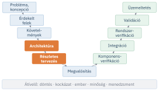
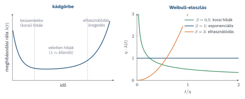
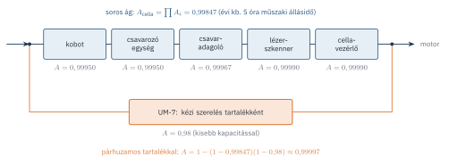
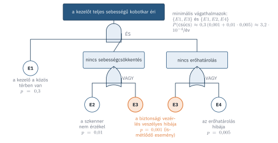
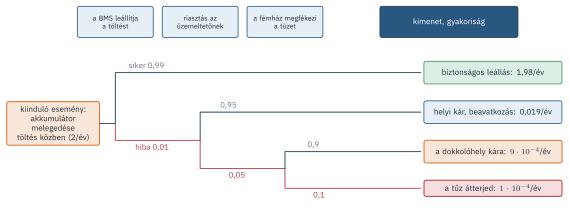
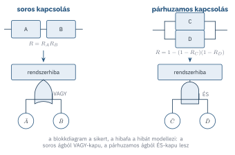

# Megbízhatóság és rendelkezésre állás {#sec-megbizhatosag}

::: {.vterkep}
{fig-alt="V-térkép: a fejezet helye a rendszerfejlesztés folyamatában" width=62%}
:::

::: {.cel}
A fejezet feldolgozása után képes leszel:

- definiálni a megbízhatósági függvényt, a meghibásodási rátát és a kádgörbe szakaszait;
- számolni az exponenciális eloszlással, és értelmezni a Weibull-eloszlás alakparaméterét;
- megkülönböztetni az MTTF, MTBF és MTTR mutatókat, és rendelkezésre állást számolni;
- soros, párhuzamos és $k$-ból-$n$ rendszerek megbízhatóságát meghatározni blokkdiagrammal;
- hibafát és eseményfát szerkeszteni, minimális vágathalmazokat keresni, és valószínűséget számolni;
- a modelleket egymásba alakítani, és felismerni a függetlenségi feltevés csapdáit.
:::

A kockázatelemzés ([-@sec-kockazat]. fejezet) és az FMEA ([-@sec-fmea]. fejezet) azonosítja, mi romolhat el. A megbízhatósági elemzés azt kérdezi, *milyen valószínűséggel* és *milyen gyakran*. Erre a követelményeknek is szükségük van: egy „a cella rendelkezésre állása legalább 98%” vagy „a biztonsági funkció veszélyes hibájának valószínűsége évente legfeljebb $10^{-4}$” követelmény csak akkor tervezhető és verifikálható, ha a rendszert az elemei megbízhatóságából modellezni tudjuk.

A fejezet négy kérdésre épül:

- Hogyan írjuk le egy elem megbízhatóságát az időben?
- Mit jelent a rendelkezésre állás, és hogyan számoljuk?
- Hogyan következik a rendszer megbízhatósága az elemekéből?
- Hogyan modellezzük a hibák kombinációit és a következmények láncolatát?

## A megbízhatóság alapfüggvényei {#sec-megb-alap}

A **megbízhatóság** annak valószínűsége, hogy egy rendszer adott időtartamon át, adott feltételek mellett a követelményeknek megfelelően működik. Ha $T$ a meghibásodásig eltelő (véletlen) idő, akkor a megbízhatósági függvény és a hibavalószínűség:

$$
R(t) = P(T > t), \qquad F(t) = P(T \leq t) = 1 - R(t).
$$ {#eq-megbizhatosag}

A **meghibásodási ráta** $\lambda(t)$ annak a valószínűségnek az időegységre eső értéke, hogy a $t$ időpontig hibátlanul működő rendszer a következő pillanatban meghibásodik. A feltételes valószínűség definíciójából vezethető le [@oconnor2012]:

$$
\lambda(t) = \frac{f(t)}{R(t)}, \qquad R(t) = \exp\!\left(-\int_0^t \lambda(u)\,\mathrm{d}u\right),
$$ {#eq-hibarata}

ahol $f(t) = \mathrm{d}F/\mathrm{d}t$ a meghibásodási idő sűrűségfüggvénye [@oconnor2012].

Sok műszaki rendszer meghibásodási rátája a **kádgörbét** követi ([-@fig-kadgorbe]. ábra): a beüzemelési szakaszban a rejtett gyártási hibák miatt a ráta magas és csökkenő, az üzemszerű szakaszban közel állandó (véletlen hibák), az öregedési szakaszban pedig a visszafordíthatatlan fizikai-kémiai folyamatok (kopás, kifáradás, korrózió) miatt növekvő.

{#fig-kadgorbe width=100%}

Állandó meghibásodási ráta esetén a meghibásodásig eltelő idő **exponenciális eloszlású**. Ez az elektronikus rendszerekre a hasznos élettartam alatt jellemzően jó közelítés [@oconnor2012]:

$$
R(t) = e^{-\lambda t}, \qquad \text{MTTF} = \frac{1}{\lambda}, \qquad t_{50\%} = \frac{\ln 2}{\lambda}.
$$ {#eq-exponencialis}

Ha például egy gép átlagos működési ideje a meghibásodásig $\text{MTTF} = 1000$ óra, akkor annak valószínűsége, hogy 500 óránál tovább üzemel, $R(500) = e^{-0{,}5} = 0{,}607$; annak, hogy addig meghibásodik, $F(500) = 0{,}393$. Az exponenciális eloszlás „emlékezet nélküli”: egy már 400 órája működő gép a következő 500 órát ugyanakkora valószínűséggel éli túl, mint egy új. Ez az öregedő alkatrészekre nyilvánvalóan nem igaz.

A **Weibull-eloszlás** mindhárom szakaszt leírja [@weibull1951]:

$$
R(t) = \exp\!\left[-\left(\frac{t}{\eta}\right)^{\beta}\right], \qquad \lambda(t) = \frac{\beta}{\eta}\left(\frac{t}{\eta}\right)^{\beta - 1},
$$ {#eq-weibull}

ahol $\eta$ a skálaparaméter (karakterisztikus élettartam), $\beta$ az alakparaméter. Ha $\beta < 1$, a ráta csökkenő (korai hibák), ha $\beta = 1$, állandó (exponenciális eset), ha $\beta > 1$, növekvő (elhasználódás). A gyakorlatban a Weibull-eloszlást meghibásodási adatokra illesztik, és $\beta$ értéke maga is diagnosztikai információ: megmutatja, hogy a hibákat gyártási, véletlen vagy kopási folyamatok okozzák-e, és így azt is, hogy a megelőző csere segít-e [@oconnor2012].

## Javítható rendszerek: MTTF, MTBF, MTTR, rendelkezésre állás {#sec-megb-rendelkezes}

A legtöbb ipari rendszert meghibásodás után megjavítják. A javítható rendszerekre a következő átlagos időket szokás megkülönböztetni [@oconnor2012]:

- **MTTFF** (mean time to first failure): az első üzembe helyezéstől az első meghibásodásig eltelő átlagos idő;
- **MTTF** (mean time to failure): egy javítás végétől a következő meghibásodásig eltelő átlagos idő;
- **MTTR** (mean time to repair): a meghibásodástól a javítás végéig, az újbóli üzembe állásig eltelő átlagos idő;
- **MTBF** (mean time between failures): két meghibásodás között eltelő átlagos idő, $\text{MTBF} = \text{MTTF} + \text{MTTR}$.

A szakirodalom és a gyártói adatlapok a betűszavakat nem egységesen használják: sok helyen az MTBF a két hiba közötti átlagos *működési* időt jelenti. Egy adatlap értékét ezért mindig a definíciójával együtt kell átvenni.

Ha a meghibásodás és a javítás is exponenciális eloszlású (állandó $\lambda$ meghibásodási és $\mu$ javítási rátával), a rendszer hosszú távon a ki nem esett idő meghatározott hányadában üzemképes. Ez a **belső (inherens) rendelkezésre állás**:

$$
A = \frac{\mu}{\lambda + \mu} = \frac{\text{MTTF}}{\text{MTTF} + \text{MTTR}}.
$$ {#eq-rendelkezesre-allas}

Ha egy gép átlagosan 100 óránként hibásodik meg, és a javítási ráta $\mu = 0{,}05$ 1/óra ($\text{MTTR} = 20$ óra), akkor $A = 100/120 = 0{,}833$. A belső rendelkezésre állás csak a javítás tényleges idejét veszi figyelembe; a gyakorlati (operatív) rendelkezésre állás a logisztikai és adminisztratív várakozást (alkatrészre, szerelőre várás) is tartalmazza, és ezért kisebb. A gyártásban a rendelkezésre állás az OEE egyik tényezője is ([-@sec-folyamatelemzes]. fejezet).

## Soros, párhuzamos és vegyes rendszerek {#sec-megb-rbd}

A **megbízhatósági blokkdiagram** (reliability block diagram, RBD) a rendszer sikeres működésének logikai modellje: a rendszer akkor működik, ha a bemenettől a kimenetig vezet működő elemeken át út [@iec61078_2016]. Független elemek esetén:

$$
R_{\text{soros}} = \prod_{i=1}^{n} R_i, \qquad R_{\text{párhuzamos}} = 1 - \prod_{i=1}^{n} (1 - R_i).
$$ {#eq-soros-parhuzamos}

A soros rendszer csak akkor működik, ha minden eleme működik, ezért megbízhatósága kisebb a leggyengébb eleménél; a párhuzamos (redundáns) rendszer akkor működik, ha legalább egy eleme működik. Egy egyszerű számpélda ezt látványosan mutatja: ugyanabból az eszközből egyre többet sorba kötve a megbízhatósági függvény egyre gyorsabban csökken, párhuzamosan kötve egyre lassabban. A **$k$-ból-$n$ rendszer** akkor működik, ha $n$ eleméből legalább $k$ működik; azonos, független elemekre a binomiális eloszlással számolható:

$$
R_{k/n} = \sum_{j=k}^{n} \binom{n}{j} R^{j} (1 - R)^{n - j}.
$$ {#eq-k-n}

A rendelkezésre állásra ugyanezek a képletek érvényesek, ha az elemek egymástól függetlenül hibásodnak meg és javíthatók. Az összetett szerkezeteket alapkapcsolású részrendszerekre bontjuk, és ezek eredő értékeiből számolunk tovább.

::: {.eset eset="A" title="KoboCella: a cella rendelkezésre állása"}
A KoboCella termelési funkciójához öt elem soros működése kell. A beszállítói adatlapok és a csapat becslése szerint az MTBF és az MTTR: kobot 8000 és 4 óra, csavarozó egység 2000 és 1 óra, csavaradagoló 1500 és 0,5 óra, lézerszkenner 20 000 és 2 óra, cellavezérlő 30 000 és 3 óra. A soros ág rendelkezésre állása 0,99847, ami évi 3450 üzemórával mintegy 5 óra műszaki állásidőt jelent ([-@fig-rbd-kobo]. ábra). A cella eredő meghibásodási rátája az elemek rátáinak összege, $\lambda = 1{,}375 \cdot 10^{-3}$ 1/óra, vagyis a cella átlagosan 727 óránként, évente mintegy 4,7-szer áll meg műszaki hiba miatt; egy 7,5 órás műszakot 0,99 valószínűséggel hiba nélkül teljesít.

{#fig-rbd-kobo width=100%}

A leromlott üzemmód (UM-7) párhuzamos ágként működik: ha a cella áll, a kézi szerelés folytatható. Ezzel a termelési funkció rendelkezésre állása 0,99997-re nő, de a kézi tartalék kisebb kapacitással dolgozik, ezért a ciklusidő-követelményt (R-01) leromlott üzemben nem teljesíti. A blokkdiagram tehát a funkció elérhetőségét mutatja, a teljesítményét nem. A legnagyobb hozzájárulás az állásidőhöz a kobottól és a csavarozó egységtől jön; a csapat a csavarozó egységhez tartalék orsót rendelt, amellyel az MTTR rövidebb lesz.
:::

A párhuzamos redundancia számított előnye a valóságban gyakran kisebb. A blokkdiagrammal számított rendszer-megbízhatóság ezért irreálisan magas lehet [@oconnor2012; @goldberg1994toolbox, 3.5. szakasz]. Ennek leggyakoribb oka a **közös okú meghibásodás**: ha a két redundáns elemet ugyanaz a tápellátás, ugyanaz a szoftver vagy ugyanaz a karbantartási hiba érinti, nem függetlenek, és a $1 - (1 - R)^2$ képlet túlbecsül. A redundáns ágakat ezért eltérő elvű, fizikailag elkülönített megoldásokkal érdemes kialakítani (diverzitás), ami a biztonsági rendszerek tervezésének egyik alapelve ([-@sec-biztonsag]. fejezet).

::: {.eset eset="B" title="VárosiBringa: hány dokkoló kell egy állomáson?"}
Egy VárosiBringa-állomás tíz dokkolóhelyből áll, és a csapat úgy ítélte, hogy az állomás akkor teljesíti a funkcióját, ha legalább nyolc dokkoló működik. Egy dokkoló rendelkezésre állása 0,98. A [-@eq-k-n]. egyenlet szerint az állomás 0,999 valószínűséggel működik; ha mind a tíz dokkolóra szükség lenne, csak 0,82 valószínűséggel. A $k$-ból-$n$ szemlélet így a követelmény megfogalmazására is hat: a „minden dokkoló működik” követelmény a gyakorlatban teljesíthetetlen, a „legalább nyolc dokkoló működik” viszont jól mérhető, és illeszkedik a felhasználók igényéhez.
:::

## Hibafa-elemzés {#sec-megb-hibafa}

A **hibafa-elemzés** (fault tree analysis, FTA) egy kiválasztott nem kívánt eseményből, a **csúcseseményből** indul, és felülről lefelé, logikai kapukkal bontja le azokra az eseménykombinációkra, amelyek előidézhetik [@vesely1981; @iec61025_2006]. Az ÉS-kapu kimenete akkor következik be, ha minden bemenete bekövetkezik, a VAGY-kapué akkor, ha legalább egy. A legalsó szint **alapeseményei** az alkatrészhibák, emberi hibák és külső események, amelyekhez valószínűséget rendelünk. A hibafa legfőbb erőssége, hogy az egyidejűleg fennálló hibák valószínűségét is értékelni tudja; korlátja, hogy egyetlen, az elemző által előre megnevezett csúcseseményt vizsgál, és a teljes fák nagyon nagyok lehetnek [@vesely1981; @ericson2015; @goldberg1994toolbox, 3.6. szakasz].

A hibafa minőségi eredménye a **minimális vágathalmazok** listája. Egy vágathalmaz olyan alapesemény-kombináció, amely együtt előidézi a csúcseseményt; minimális, ha egyetlen eleme sem hagyható el. Az egyelemű minimális vágathalmazok az **egypontos hibák**, amelyekre a tervezésnek különös figyelmet kell fordítania. Független alapesemények esetén a mennyiségi kiértékelés: az ÉS-kapu valószínűsége a bemenetek szorzata, a VAGY-kapué $1 - \prod (1 - p_i)$, kis valószínűségeknél jó közelítéssel az összeg (ritka esemény közelítés).

::: {.eset eset="A" title="KoboCella: hibafa egy biztonsági csúcseseményre"}
A PHA ([-@sec-kockazat]. fejezet) szerint a KoboCella legfontosabb biztonsági veszélye a kobotkar ütközése a kezelővel. A csapat hibafát szerkesztett arra a csúcseseményre, hogy a kezelőt teljes sebességű kobotkar éri ([-@fig-hibafa-kobo]. ábra). Ehhez három feltételnek kell együtt teljesülnie: a kezelő a közös térben van (E1), elmarad a sebességcsökkentés (a szkenner nem érzékel, E2, vagy a biztonsági vezérlés hibás, E3), és nem működik az erőhatárolás (E4 vagy ugyanaz az E3).

{#fig-hibafa-kobo width=100%}

A minimális vágathalmazok: $\{E1, E3\}$ és $\{E1, E2, E4\}$. Az évi valószínűség (a szkenner és az erőhatárolás veszélyes, fel nem fedezett hibáira vonatkozó becslésekkel) $P \approx 0{,}3 \cdot (0{,}001 + 0{,}01 \cdot 0{,}005) \approx 3{,}2 \cdot 10^{-4}$, és ennek 95%-a az első vágathalmazból jön. Ha valaki a fát a kapuk szintjén, a független események képleteivel számolná, $2{,}0 \cdot 10^{-5}$ adódna, tizenhatszor kevesebb: az E3 ismétlődő esemény, ezért a két VAGY-kapu kimenete nem független. A tanulság a tervezésnek is szól: a biztonsági vezérlés közös pont a két védelmi rétegben, ezért a csapat a sebességfelügyeletet és az erőhatárolást független csatornára tervezte ([-@sec-biztonsag]. fejezet).
:::

## Eseményfa-elemzés {#sec-megb-esemenyfa}

Az **eseményfa-elemzés** (event tree analysis, ETA) a hibafával ellentétes irányban halad: egy **kiinduló eseményből** indul, és előre követi, hogyan alakul a folyamat attól függően, hogy az egymás után következő védelmi rétegek (gátak, biztonsági funkciók, emberi beavatkozások) működnek-e [@iec62502_2010]. Minden réteg egy elágazás siker és hiba ágra, a végpontok a lehetséges kimenetek, gyakoriságuk a kiinduló esemény gyakoriságának és az ágak valószínűségének szorzata. Az eseményfa egyszerre dolgozik a siker és a hiba tartományában, és a végkimeneteket nem kell előre ismerni; korlátja, hogy egyetlen kiinduló eseményt vizsgál, és a részleges sikert nehezen tudja megkülönböztetni [@ericson2015].

::: {.eset eset="B" title="VárosiBringa: az akkumulátor túlmelegedésének eseményfája"}
A kockázatelemzésben ([-@sec-kockazat]. fejezet) azonosított akkumulátorveszélyre a VárosiBringa csapata eseményfát készített ([-@fig-esemenyfa-bringa]. ábra). A kiinduló esemény egy akkumulátor rendellenes melegedése töltés közben; a teljes flottára évi két ilyen eseménnyel számoltak. Három védelmi réteg követi egymást: az akkumulátorkezelő rendszer (BMS) leállítja a töltést, a hőmérséklet-riasztás az üzemeltetőhöz fut be, és a fémház megfékezi a tüzet.

{#fig-esemenyfa-bringa width=100%}

A legsúlyosabb kimenet, a tűz átterjedése a szomszédos kerékpárokra, évente $2 \cdot 0{,}01 \cdot 0{,}05 \cdot 0{,}1 = 10^{-4}$ gyakoriságú. Az eseményfa azt is megmutatta, hol a leghatékonyabb a beavatkozás: a BMS 0,99-es sikere a legerősebb réteg, de a riasztás és a fémház együtt további kétszázszoros csökkentést ad. Az egyes rétegek sikertelenségének valószínűségét a csapat külön hibafákkal becsülte meg, így a két módszer egymást egészítette ki.
:::

## A modellek kapcsolata {#sec-megb-atalakitas}

A blokkdiagram, a hibafa és az eseményfa ugyanannak a rendszernek különböző nézetei, és egymásba alakíthatók [@vesely1981; @iec61078_2016; @goldberg1994toolbox, 3.9. szakasz]. A blokkdiagram a sikert, a hibafa a hibát modellezi: a soros blokkokból VAGY-kapu, a párhuzamos blokkokból ÉS-kapu lesz a hibák között ([-@fig-rbd-hibafa]. ábra). Az eseményfa egyes ágainak hibavalószínűsége hibafával számolható, a hibafa egy-egy alapeseménye pedig blokkdiagramból. Az átalakítás új információt nem ad, de segít abban, hogy az egyik módszer gyengeségét a másik erősségével ellensúlyozzuk.

{#fig-rbd-hibafa width=80%}

A módszerek kiválasztásában a kérdés a döntő ([-@tbl-megb-modszerek]. táblázat).

| Kérdés | Módszer | Irány |
|:--|:--|:--|
| Mekkora a rendszer megbízhatósága, rendelkezésre állása? | blokkdiagram | a sikerből, alulról felfelé |
| Milyen kombinációk vezetnek egy nem kívánt eseményhez, és mekkora valószínűséggel? | hibafa | a csúcseseményből, felülről lefelé |
| Mi következhet egy kiinduló eseményből a védelmi rétegektől függően? | eseményfa | a kiinduló eseményből, előre |
| Milyen hibamódok vannak, és mi a hatásuk egyenként? | FMEA ([-@sec-fmea]. fejezet) | az elemekből, alulról felfelé |

: A megbízhatósági és biztonsági modellek alkalmazási területe. {#tbl-megb-modszerek tbl-colwidths="[50,22,28]"}

::: {.kitekintes title="Adatok és állapotfüggő megbízhatóság"}
A klasszikus megbízhatósági számítás alkatrész-adatbázisok és gyártói adatlapok rátáiból dolgozik (például a katonai elektronikai alkatrészekre kidolgozott meghibásodásiráta-modellekből). Az üzemelő rendszerekben ma egyre több a tényleges üzemi adat: a gépi naplók, a karbantartási rendszerek és az érzékelők alapján a Weibull-paraméterek folyamatosan frissíthetők, és a megbízhatóság az alkatrész tényleges állapotához köthető. Ez vezet az állapotalapú és előrejelző karbantartáshoz ([-@sec-uzemeltetes]. fejezet), amelyben a cserét nem a naptár, hanem a romlás mértéke vezérli.
:::

::: {.hiba title="Függetlenség ott, ahol nincs"}
A soros és párhuzamos képletek, a hibafa kapuképletei és az eseményfa szorzatai mind függetlenséget feltételeznek. Ha egy esemény több ágban is szerepel (ismétlődő esemény), vagy a redundáns elemeknek közös okuk van (tápellátás, szoftver, karbantartó), a kapuszintű számítás nagyságrendekkel is tévedhet, és mindig a túl optimista irányba. A minimális vágathalmazokon alapuló számítás és a közös okú hibák külön vizsgálata a megoldás.
:::

::: {.osszefoglalo}
- A megbízhatóság annak valószínűsége, hogy a rendszer adott ideig megfelelően működik. A meghibásodási ráta időbeli alakja a kádgörbe: korai hibák, véletlen hibák, elhasználódás.
- Állandó rátánál az élettartam exponenciális eloszlású ($R = e^{-\lambda t}$, $\text{MTTF} = 1/\lambda$). A Weibull-eloszlás alakparamétere megmutatja, melyik szakaszban vagyunk.
- Javítható rendszereknél az MTTF, az MTTR és az MTBF jellemzi a működést; a belső rendelkezésre állás $A = \text{MTTF}/(\text{MTTF} + \text{MTTR})$.
- A blokkdiagramon a soros elemek megbízhatósága szorzódik, a párhuzamos elemek hibavalószínűsége szorzódik; a $k$-ból-$n$ rendszer binomiálisan számolható. A redundancia hasznát a közös okú hibák csökkentik.
- A hibafa a csúcseseményből lefelé keresi a hibakombinációkat; eredménye a minimális vágathalmazok listája és a csúcsesemény valószínűsége. Az eseményfa a kiinduló eseményből előre követi a védelmi rétegek sikerét és kudarcát. A modellek egymásba alakíthatók.
:::

::: {.onell}
1. Egy alkatrész meghibásodási rátája állandó, $\lambda = 2 \cdot 10^{-4}$ 1/óra. Mennyi az MTTF, és mennyi a valószínűsége, hogy 1000 órát hiba nélkül működik?
2. Három gép meghibásodásainak időpontja (óra): 1. gép 500, 1300, 2600, 4300, 6000; 2. gép 800, 1500, 3300, 5000, 7100; 3. gép 400, 1200, 2500, 4000, 5500. A javítási időt elhanyagolva mennyi az egyes gépek MTBF-je?
3. Egy gép meghibásodásai között átlagosan 100 óra telik el, a javítási ráta 0,05 1/óra. Mennyi a rendelkezésre állása?
4. Két 0,9 megbízhatóságú elem: mennyi a rendszer megbízhatósága sorosan és párhuzamosan?
5. Mit jelent a Weibull-eloszlás $\beta = 3$ alakparamétere, és milyen karbantartási következménye van?
6. Miért adhat túl optimista eredményt a párhuzamos redundancia képlete?
7. Mi a minimális vágathalmaz? Mit jelent, ha egy minimális vágathalmaz egyelemű?
8. Miért nem szabad egy ismétlődő eseményt tartalmazó hibafát a kapuk szintjén, a független események képleteivel kiértékelni?

::: {.megoldas}
1. $\text{MTTF} = 1/\lambda = 5000$ óra; $R(1000) = e^{-0{,}2} = 0{,}819$.
2. Az utolsó meghibásodás időpontja osztva a hibák számával: 1. gép $6000/5 = 1200$ óra, 2. gép $7100/5 = 1420$ óra, 3. gép $5500/5 = 1100$ óra.
3. $\text{MTTR} = 1/0{,}05 = 20$ óra, $A = 100/(100 + 20) = 0{,}833$.
4. Sorosan $0{,}9 \cdot 0{,}9 = 0{,}81$, párhuzamosan $1 - 0{,}1 \cdot 0{,}1 = 0{,}99$.
5. A meghibásodási ráta az idővel növekszik (elhasználódás, kopás, kifáradás). Ilyenkor a megelőző csere egy alkalmas üzemidő után csökkenti a hibák számát; állandó rátánál ($\beta = 1$) a megelőző csere nem segítene.
6. Mert a képlet a redundáns elemek független meghibásodását feltételezi, a valóságban viszont közös okok (közös táp, szoftver, környezet, karbantartási hiba) egyszerre több ágat is kiejthetnek.
7. Olyan alapesemény-kombináció, amely együtt előidézi a csúcseseményt, és egyik eleme sem hagyható el. Az egyelemű minimális vágathalmaz egypontos hiba: egyetlen esemény önmagában előidézi a csúcseseményt.
8. Mert az ismétlődő eseményt tartalmazó ágak nem függetlenek; a kapuszintű képletek a közös eseményt többször, egymástól függetlenként veszik figyelembe, és ezért (ÉS-kapuknál) nagyságrendekkel alábecsülhetik a valószínűséget. A helyes számítás a minimális vágathalmazokból indul.
:::
:::

::: {.projekt title="Projektlépés: megbízhatóság"}
Saját fejlesztési feladatodhoz:

1. készíts megbízhatósági blokkdiagramot a fő funkcióhoz, és becsüld meg a rendelkezésre állást adatlapok vagy becslések alapján (jelöld az adatok forrását);
2. azonosítsd az egypontos hibákat, és vizsgáld meg, hol érdemes redundanciát vagy leromlott üzemmódot tervezni;
3. a PHA legsúlyosabb veszélyére készíts hibafát, határozd meg a minimális vágathalmazokat, és értékeld a csúcsesemény valószínűségét;
4. egy kiinduló eseményre készíts eseményfát a védelmi rétegekkel;
5. használd a Gyakorlati útmutató blokkdiagram-, hibafa- és eseményfa-eszközlapját.
:::

::: {.forras}
- @oconnor2012: a megbízhatósági mérnökség gyakorlatias tankönyve.
- @vesely1981: a hibafa-elemzés klasszikus kézikönyve, szabadon elérhető.
- @iec61078_2016, @iec61025_2006 és @iec62502_2010: a blokkdiagram, a hibafa és az eseményfa nemzetközi szabványai.
- @weibull1951: a Weibull-eloszlás eredeti cikke.
- @goldberg1994toolbox, 3.5–3.9. szakasz: a blokkdiagram, a hibafa, az eseményfa és átalakításaik gyakorlati leírása.
:::
