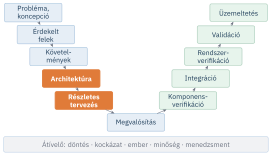
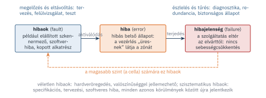
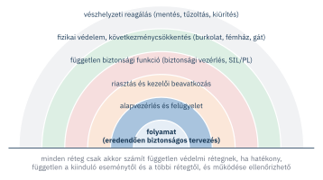
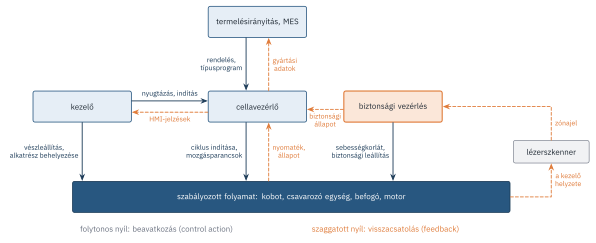

# Biztonságkritikus rendszerek {#sec-biztonsag}

::: {.vterkep}
{fig-alt="V-térkép: a fejezet helye a rendszerfejlesztés folyamatában" width=62%}
:::

::: {.cel}
A fejezet feldolgozása után képes leszel:

- elmagyarázni a funkcionális biztonság fogalmát és a hibaok, a hiba és a hibajelenség láncát;
- megkülönböztetni a véletlen és a szisztematikus hibaokokat, és a megfelelő védekezési módot hozzájuk rendelni;
- értelmezni a biztonsági integritási szinteket (SIL, PL, ASIL), és kapcsolatukat a kockázatcsökkentéssel;
- független védelmi rétegeket tervezni és értékelni;
- rendszerelméleti biztonságelemzést (STPA) végezni egy egyszerű irányítási struktúrán;
- az ember–robot együttműködés biztonsági szempontjait a kockázatértékelésbe illeszteni.
:::

A megbízhatósági elemzés ([-@sec-megbizhatosag]. fejezet) azt kérdezi, működik-e a rendszer. A biztonsági elemzés azt, hogy ha nem működik, vagy éppen ha működik, de rossz helyzetben, okoz-e kárt. A két kérdés nem azonos. Egy megbízható rendszer lehet veszélyes, ha jól teljesíti a rossz parancsot; és egy kevésbé megbízható rendszer is lehet biztonságos, ha minden hiba után biztonságos állapotba kerül. A biztonság emergens tulajdonság ([-@sec-rendszerek]. fejezet): az elemek kölcsönhatásából születik, ezért nem elég az elemeket egyenként vizsgálni.

Knight meghatározása szerint biztonságkritikus az a rendszer, amelynek hibája emberi életet vagy egészséget veszélyeztethet, illetve jelentős anyagi vagy környezeti kárt okozhat [@knight2002]. Az ilyen rendszer bizonyos jellemzőire ezért szigorú követelményeket rögzítünk, mert ezek nem teljesülése veszélyhelyzethez vezet.

A fejezet négy kérdésre épül:

- Hogyan vezet egy hibaok veszélyes hibajelenséghez, és hogyan védekezünk ellene?
- Mennyire kell megbízhatónak lennie egy biztonsági funkciónak?
- Hogyan épül fel a rétegezett védelem, és mikor független egy réteg?
- Hogyan elemezzük a biztonságot, ha a baj nem alkatrészhibából, hanem az irányítás hiányosságaiból fakad?

## Funkcionális biztonság és a hibamodell {#sec-bizt-funkcionalis}

Az elektromos, elektronikus és programozható elektronikus rendszerek biztonságának alapszabványa, az IEC 61508 szerint a **funkcionális biztonság** a teljes biztonságnak az a része, amely a biztonsággal kapcsolatos rendszerek helyes működésén múlik [@iec61508_2010]. A **biztonsági funkció** egy meghatározott veszélyes eseménnyel szemben biztonságos állapotot ér el vagy tart fenn: például a robot lelassítása, amikor ember lép a közös térbe. A szabvány szemléletét három gondolat foglalja össze: kockázatmentes állapot soha nem érhető el; a biztonságra a tervezés kezdetétől törekedni kell; és a nem tűrhető kockázatot csökkenteni kell [@iec61508_2010]. A szabvány szerint az irányított berendezés (equipment under control, EUC) alapvezérlésének el kell különülnie a biztonsági (védelmi) rendszertől; ma az adatátvitel közös hálózaton is történhet, de a két rendszer érzékelőinek és irányítóinak elkülönítése továbbra is követelmény.

A hibák terjedését háromszintű modell írja le ([-@fig-hibaok-lanc]. ábra). A **hibaok** (fault) a hiba feltételezett oka: elállított érzékelő, tervezési hiba, kopott alkatrész. Ha aktiválódik, **hibát** (error), hibás belső állapotot okoz. Ha a hiba a rendszer szolgáltatásáig terjed, **hibajelenség** (failure) lép fel: a szolgáltatás eltér az elvárttól. Egy alrendszer hibajelensége a befoglaló rendszer számára hibaok, így a lánc szintről szintre folytatódik [@avizienis2004]. Ez ugyanaz a szerkezet, mint az FMEA hibalánca ([-@sec-fmea]. fejezet).

{#fig-hibaok-lanc width=100%}

A hibaokok két nagy csoportja eltérő védekezést kíván. A **véletlen hibaok** (a hardver öregedése, alkatrészhiba) valószínűséggel jellemezhető, és megbízhatósági modellel kezelhető ([-@sec-megbizhatosag]. fejezet): redundanciával, diagnosztikával, rendszeres próbával. A **szisztematikus hibaok** (specifikációs, tervezési vagy szoftverhiba) azonos körülmények között mindig újra jelentkezik, ezért nem valószínűséggel, hanem a fejlesztési folyamat minőségével kezeljük: felülvizsgálattal, verifikációval, szigorú konfigurációkezeléssel. Avižienis és munkatársai rendszerezése szerint a megbízható rendszer négy eszközcsoportja a hibaokok megelőzése, tűrése, eltávolítása és előrejelzése [@avizienis2004]. Ugyanez a fejlesztés és az üzem szerint is felbontható: a hibaok elkerülése (a fejlesztés során), eltávolítása (tesztelés az üzembe helyezés előtt), a hiba észlelése (üzem közben) és elhárítása (beavatkozás, hogy hatása mielőbb mérséklődjön).

## Biztonsági integritási szintek {#sec-bizt-sil}

Teljes funkcionális biztonság nem létezik: egyetlen biztonsági rendszer sem zárja ki teljesen sem a véletlen, sem a szisztematikus hibát. A **biztonsági integritás** annak valószínűsége, hogy egy biztonsági rendszer az előírt biztonsági funkciókat adott időszakban, meghatározott körülmények között megfelelően végrehajtja. Az IEC 61508 ezt négy **biztonsági integritási szintbe** (safety integrity level, SIL) sorolja; a szint határozza meg a megengedett hibavalószínűséget és az alkalmazandó tervezési, fejlesztési és üzemeltetési módszerek szigorúságát [@iec61508_2010] ([-@tbl-sil]. táblázat). A folyamatiparban az IEC 61511 alkalmazza ugyanezt a rendszert [@iec61511_2016].

| SIL | Alacsony igényű üzem: átlagos hibavalószínűség igénykor (PFD) | Magas igényű vagy folyamatos üzem: veszélyes hiba óránkénti valószínűsége (PFH) | Kockázatcsökkentés (alacsony igény) |
|:-:|:-:|:-:|:-:|
| 4 | $10^{-5}$–$10^{-4}$ | $10^{-9}$–$10^{-8}$ | $10\,000$–$100\,000$ |
| 3 | $10^{-4}$–$10^{-3}$ | $10^{-8}$–$10^{-7}$ | $1000$–$10\,000$ |
| 2 | $10^{-3}$–$10^{-2}$ | $10^{-7}$–$10^{-6}$ | $100$–$1000$ |
| 1 | $10^{-2}$–$10^{-1}$ | $10^{-6}$–$10^{-5}$ | $10$–$100$ |

: A biztonsági integritási szintek az IEC 61508 szerint. {#tbl-sil tbl-colwidths="[8,32,34,26]"}

Az **alacsony igényű üzemmódban** a biztonsági funkciót ritkán kell működtetni: a szabvány jelenlegi kiadása szerint az igény legfeljebb évente egyszer jelentkezik (a szabvány első, 1998-as kiadása ezen felül azt is kikötötte, hogy az igény ne legyen gyakoribb a bizonyító próbák gyakoriságának kétszeresénél). Itt az a kérdés, hogy a funkció működik-e, amikor szükség van rá; erről a rejtett hibák felderítésére végzett **bizonyító próbák** (proof test) gondoskodnak, amelyek a rendszert az újszerű vagy a gyakorlatilag elérhető legbiztonságosabb állapotba hozzák vissza. A **magas igényű vagy folyamatos üzemmódban** a funkció gyakran vagy állandóan működik, ezért a veszélyes hibák óránkénti gyakorisága a mérték.

Más ágazatok ugyanezt a gondolatot saját skálával fejezik ki. A gépek biztonsággal kapcsolatos vezérlésrészeire az ISO 13849-1 öt **teljesítményszintet** (performance level, PL a–e) határoz meg; a szükséges szintet kockázati gráf adja a sérülés súlyossága, a veszélynek való kitettség gyakorisága és a veszély elkerülésének lehetősége alapján [@iso13849_2023]. A közúti járművekre az ISO 26262 négy **autóipari biztonsági integritási szintet** (ASIL A–D) használ; a szintet a súlyosság (S), a kitettség (E) és az irányíthatóság (C) kombinációja adja, a D a legszigorúbb, a legalacsonyabb kockázatú esetek pedig a szokásos minőségirányítás (QM) körébe tartoznak [@iso26262_2018]. A három rendszer rendezési elve azonos: a magasabb szint ritkább veszélyes hibát és szigorúbb fejlesztési folyamatot jelent.

## Védelmi rétegek {#sec-bizt-retegek}

A biztonságot ritkán egyetlen intézkedés adja. A rétegezett védelem gondolata a folyamatipari kockázatelemzésből ismert ([-@fig-vedelmi-retegek]. ábra): a folyamat eredendően biztonságos tervezését az alapvezérlés, a riasztások és a kezelői beavatkozás, a független biztonsági funkció, a fizikai védelem és végül a vészhelyzeti reagálás veszi körül. A **védelmi rétegek elemzése** (layer of protection analysis, LOPA) egy kiinduló esemény gyakoriságát a független védelmi rétegek hibavalószínűségével szorozza, és az eredményt a tűrhető gyakorisággal veti össze [@ccps2001]. Ez az eseményfa ([-@sec-megbizhatosag]. fejezet) egyszerűsített, szabványosított változata.

{#fig-vedelmi-retegek width=80%}

Egy réteg csak akkor számít **független védelmi rétegnek**, ha hatékony (önmagában képes megakadályozni a következményt), független a kiinduló eseménytől és a többi rétegtől, és működése ellenőrizhető [@ccps2001]. A függetlenség a leggyakoribb gyenge pont. Reason sajtmodellje szerint a rétegek lyukai „vándorolnak” [@reason2000]: a tervezésből kimaradt kölcsönhatás, a riasztást figyelmen kívül hagyó kezelő, a karbantartás alatt álló védelmi elem egy időben is előfordulhat ([-@sec-emberi-hiba]. fejezet). A KoboCella hibafája ([-@sec-megbizhatosag]. fejezet) ugyanezt mutatta mennyiségileg: amíg a sebességfelügyelet és az erőhatárolás ugyanazon a biztonsági vezérlésen futott, a két réteg nem volt független, és a kockázat 95%-a ebből a közös pontból eredt.

## Rendszerelméleti biztonságelemzés (STPA) {#sec-bizt-stpa}

Az eddigi módszerek (FMEA, hibafa, eseményfa) a baleseteket hibaláncként értelmezik: egy elem meghibásodik, és a hiba végigterjed. Leveson szerint a mai, szoftverrel irányított, sok szereplős rendszerekben a balesetek jelentős része nem alkatrészhibából fakad, hanem abból, hogy az irányítás nem tartja be a biztonsági korlátokat: minden elem a specifikációja szerint működik, de kölcsönhatásuk veszélyes állapotot hoz létre [@leveson2011]. A biztonság ebben a szemléletben irányítási probléma. Erre épül a **rendszerelméleti folyamatelemzés** (system-theoretic process analysis, STPA), amelynek négy lépése [@leveson2018]:

1. **A cél meghatározása:** a veszteségek (mit nem engedhetünk meg), a rendszerszintű veszélyek (a rendszer olyan állapotai, amelyek bizonyos körülmények között veszteséghez vezetnek) és a rendszerszintű biztonsági korlátok.
2. **Az irányítási struktúra modellezése:** az irányítók (ember, szoftver, szervezet), a beavatkozások (control actions) és a visszacsatolások.
3. **A nem biztonságos beavatkozások azonosítása:** minden beavatkozásra négy kérdés: veszélyes-e, ha *nem adják ki*; ha *kiadják*; ha *túl korán, túl későn vagy rossz sorrendben* adják ki; ha *túl sokáig tart vagy túl korán áll le*?
4. **A veszteséghez vezető forgatókönyvek azonosítása:** miért adhatja ki az irányító a nem biztonságos beavatkozást (hibás folyamatmodell, hiányzó visszacsatolás, rossz algoritmus), és miért nem hajtódhat végre helyesen egy helyes beavatkozás?

Az STPA ereje, hogy a szoftver, az ember és a szervezet hibáit ugyanabban a keretben vizsgálja, mint a hardverét. Az irányító **folyamatmodellje** (amit a szabályozott folyamatról „hisz”) központi fogalom: a nem biztonságos beavatkozások nagy része abból fakad, hogy az irányító modellje eltér a valóságtól. Ez az emberre is igaz; a helyzettudatosság ([-@sec-emberkozpontu]. fejezet) ennek az emberi oldala.

::: {.eset eset="A" title="KoboCella: STPA a cella irányítására"}
A KoboCella csapata a PHA két, vezérlésen múló veszélyére (ütközés, váratlan indulás) STPA-t végzett. A veszteségek: L1 a kezelő megsérül; L2 hibás motor jut a vevőhöz; L3 a termelés kiesik. A rendszerszintű veszélyek: H1 a kobot a kezelő közelében a biztonságos határt meghaladó sebességgel vagy erővel mozog (L1); H2 hibás kötésű motor hagyja el a cellát (L2); H3 a cella ok nélkül áll, vagy indokolatlanul leromlott üzemben marad (L3). Az irányítási struktúrát a [-@fig-stpa-kobo]. ábra mutatja.

{#fig-stpa-kobo width=100%}

A „teljes sebesség engedélyezése” beavatkozásra (biztonsági vezérlés → kobot) a négy kérdés:

| Típus | Nem biztonságos beavatkozás | Veszély |
|:--|:--|:-:|
| nem adja ki | – (a cella lassan dolgozik, ez nem veszélyes) | H3 |
| kiadja | a teljes sebességet engedélyezi, miközben a kezelő a közös térben van | H1 |
| túl korán | a teljes sebességet azelőtt engedélyezi, hogy a kezelő teljesen elhagyta a zónát | H1 |
| túl sokáig | a kezelő belépése után is fenntartja a teljes sebességet | H1 |

: Nem biztonságos beavatkozások a „teljes sebesség engedélyezése” beavatkozásra. {#tbl-uca-kobo tbl-colwidths="[16,70,14]"}

A forgatókönyvek közül három vezetett tervezési változáshoz. Először: a szkenner védőmezejét karbantartás után rosszul állítják vissza, így a biztonsági vezérlés folyamatmodellje szerint a zóna üres, holott nem az; erre a mezőkonfiguráció ellenőrzése és a napi indítási próba lett a válasz (az FMEA F7 sora, [-@sec-fmea]. fejezet). Másodszor: a kezelő egy olyan irányból is beléphet, amelyet a tálcaállvány takar a szkenner elől; az elrendezést módosították. Harmadszor: a kezelő „nyugtázás” beavatkozása veszélyes, ha a hibás darab még nincs a selejtdobozban (H2). Ezt a forgatókönyvet a csapat a próbaüzemben meg is figyelte ([-@sec-automatizalas]. fejezet), és fizikai cselekvéshez kötötte. Az STPA tehát olyan okokat is feltárt, amelyek egyetlen alkatrész meghibásodásával sem írhatók le.
:::

## Ember–robot együttműködés biztonsága {#sec-bizt-kobot}

Az ipari robotok biztonsági követelményeit az ISO 10218 szabvány két része rögzíti: az 1. rész a robotot, a 2. rész a robotalkalmazást és a robotcellát. A 2025-ös kiadás az együttműködő alkalmazásokra vonatkozó, korábban az ISO/TS 15066 műszaki specifikációban szereplő követelményeket is beépítette, és a „kobot” helyett az **együttműködő alkalmazás** fogalmát használja [@iso10218_1_2025; @iso10218_2_2025]. A szóváltás lényeges: nem a robot együttműködő, hanem az alkalmazás, és a biztonságot az adott alkalmazás kockázatértékelése alapozza meg. A szerszám, a munkadarab, az elrendezés és a kezelő feladatai legalább annyit számítanak, mint maga a robot.

Az együttműködés négy alapvető módja (biztonsági felügyelt megállás, kézi vezetés, sebesség- és távolságfelügyelet, teljesítmény- és erőkorlátozás) a [-@sec-automatizalas]. fejezetben szerepelt. A biztonsági elemzés szempontjából két mód kíván különös figyelmet:

- **Sebesség- és távolságfelügyeletnél** a robotnak meg kell állnia, mielőtt az ember elérné. A szükséges védőtávolság az ember közeledési sebességétől, a biztonsági vezérlés reakcióidejétől, a robot fékútjától és a mérési bizonytalanságoktól függ; ezért a szkenner, a vezérlés és a robot fékezése együtt alkotja a biztonsági funkciót, és együtt kell verifikálni.
- **Teljesítmény- és erőkorlátozásnál** az érintkezés megengedett, de az erő és a nyomás nem haladhatja meg a testtájanként eltérő biomechanikai határértékeket, amelyeket az ISO/TS 15066 közölt először [@isots15066_2016]. Az éles, hegyes szerszámok és a becsípődési helyek ezt a módot kizárhatják, mert ott kis erő is sérülést okoz.

A biztonsági funkciókhoz szükséges teljesítményszintet (PL) a kockázatértékelés alapján kell meghatározni és a megvalósítást verifikálni ([-@sec-verifikacio]. fejezet).

::: {.eset eset="A" title="KoboCella: miért nem elég az erőkorlátozás?"}
A [-@sec-automatizalas]. fejezet szerint a KoboCella csapata a sebesség- és távolságfelügyeletet választotta elsődleges védelemnek. A kockázatértékelés ezt három érvvel támasztotta alá. A csavarozó fej bitbetétje éles és hegyes, ezért a kéz és a fej érintkezésénél a biomechanikai határérték már kis erőnél is túlléphető. A befogó és a fedél között becsípődési hely van, ahol az erő a kezet csapdába ejtheti. A műszakmegfigyelés szerint a kezelő a ciklusidő mintegy 30%-ában a közös térben van (a HTA szerint 18 s a 58,6 s-ból), ezért az érintkezés nem kivételes, hanem rendszeres esemény lenne. Az erő- és teljesítménykorlátozás ezért második rétegként maradt meg, és a hibafa tanulsága nyomán ([-@sec-megbizhatosag]. fejezet) a csapat a két funkciót független csatornán valósította meg. A biztonsági funkciók szükséges teljesítményszintjét a csapat az ISO 13849-1 kockázati gráfjával határozta meg (súlyos sérülés lehetősége, gyakori kitettség, a csökkentett sebesség miatt korlátozottan elkerülhető veszély), és a verifikációs tervbe az ütközési erő mérését és a reakcióidő-mérést is felvette.
:::

::: {.kitekintes title="Biztonság és kiberbiztonság"}
A hálózatra kötött gépekben a biztonsági funkciókat szándékos támadás is veszélyeztetheti: egy manipulált konfiguráció vagy szoftverfrissítés ugyanúgy hamis folyamatmodellt adhat a biztonsági vezérlésnek, mint egy véletlen hiba. A 2025-ös robotbiztonsági szabványok ezért már kiberbiztonsági szempontokat is tartalmaznak, és a rendszerelméleti szemlélet a szándékos fenyegetéseket is az irányítási struktúra keretében, hamis visszacsatolásként vagy jogosulatlan beavatkozásként vizsgálhatja. A ForgácsTech kockázati nyilvántartásának kibertámadási kockázata ([-@sec-kockazat]. fejezet) ugyanennek a kérdésnek a projektszintű megjelenése.
:::

::: {.hiba title="A biztonság mint utólagos ráépítés"}
Gyakori, hogy a rendszert először a termelési funkciókra tervezik meg, és a biztonsági funkciókat a végén, a meglévő vezérlésre „ráépítve” egészítik ki. Ilyenkor a biztonsági funkció közös pontokat örököl az alapvezérléssel (közös érzékelő, közös szoftver), a függetlenség nem teljesül, és a verifikáció nehézkes. Az IEC 61508 alapelve szerint a biztonságra a tervezés kezdetétől törekedni kell: a veszélyelemzés a koncepcióval együtt indul, és a biztonsági követelmények a rendszerkövetelmények részei.
:::

::: {.osszefoglalo}
- A funkcionális biztonság a biztonságnak az a része, amely a biztonsági rendszerek helyes működésén múlik. A hibaok aktiválódva hibát, a hiba terjedve hibajelenséget okoz; egy alrendszer hibajelensége a befoglaló rendszer hibaoka.
- A véletlen hibaokok valószínűséggel kezelhetők (redundancia, diagnosztika, próba), a szisztematikusak a fejlesztési folyamat minőségével (felülvizsgálat, verifikáció, konfigurációkezelés).
- A SIL (IEC 61508), a PL (ISO 13849-1) és az ASIL (ISO 26262) a biztonsági funkciók megengedett hibavalószínűségét és a fejlesztés szigorúságát rögzíti; a magasabb szint ritkább veszélyes hibát jelent.
- A védelmi rétegek akkor csökkentik a kockázatot, ha hatékonyak, függetlenek és ellenőrizhetők; a LOPA ezt egyszerűsített eseményfaként számszerűsíti.
- Az STPA a biztonságot irányítási problémaként kezeli: veszteségek, veszélyek, irányítási struktúra, nem biztonságos beavatkozások négy típusa, veszteséghez vezető forgatókönyvek. Feltárja a hibátlan elemek veszélyes kölcsönhatásait is.
- Az együttműködő robotalkalmazás biztonságát az alkalmazás egészének kockázatértékelése alapozza meg; a szerszám, a becsípődési helyek és a kezelő feladatai döntik el, mely együttműködési mód elfogadható.
:::

::: {.onell}
1. Mi a különbség a megbízhatóság és a biztonság között? Adj példát megbízható, de veszélyes rendszerre!
2. Írd fel a hibaok–hiba–hibajelenség láncot egy lift ajtóérzékelőjére!
3. Miért nem kezelhető a szoftverhiba redundanciával ugyanúgy, mint a hardverhiba?
4. Egy biztonsági funkció átlagos hibavalószínűsége igénykor 0,004. Melyik SIL-szintet teljesíti alacsony igényű üzemben, és mekkora kockázatcsökkentést ad?
5. Mitől lesz egy védelmi réteg független? Miért nem független két réteg, amely ugyanazt az érzékelőt használja?
6. Sorold fel a nem biztonságos beavatkozások négy típusát, és adj mindegyikre példát egy közlekedési lámpa vezérlőjéből!
7. Miért mondja a 2025-ös robotbiztonsági szabvány, hogy nem a robot, hanem az alkalmazás együttműködő?
8. Miért nem elegendő a teljesítmény- és erőkorlátozás a KoboCella csavarozó fejénél?

::: {.megoldas}
1. A megbízhatóság a követelményeknek megfelelő működés valószínűsége, a biztonság az elfogadhatatlan kockázattól való mentesség. Megbízható, de veszélyes: egy pontosan és hibátlanul működő szállítószalag, amely védőburkolat nélkül behúzhatja a kezelő ruháját.
2. Hibaok: az ajtó fényérzékelőjének lencséje szennyezett. Hiba: a vezérlés úgy „látja”, hogy az ajtónyílás szabad. Hibajelenség: az ajtó záródik, miközben valaki a nyílásban áll.
3. Mert a szoftverhiba szisztematikus: két azonos szoftverpéldány azonos bemenetre ugyanúgy hibázik, ezért a redundáns példányok egyszerre esnek ki. Ellene a fejlesztési folyamat minősége (felülvizsgálat, teszt) vagy eltérő elvű (diverz) megoldás véd.
4. A 0,004 a $10^{-3}$–$10^{-2}$ tartományba esik: SIL 2; a kockázatcsökkentés $1/0{,}004 = 250$-szeres.
5. Ha a kiinduló eseménytől és a többi rétegtől független (nincs közös érzékelő, táp, szoftver, kezelő), önmagában hatékony, és működése ellenőrizhető. Közös érzékelőnél az érzékelő egyetlen hibája mindkét réteget kiejti, tehát valójában egy rétegről van szó.
6. Nem adja ki: nem vált pirosra, amikor a gyalogos átkelést kér, és jön egy autó. Kiadja: zöldet ad mindkét keresztező iránynak. Túl korán vagy későn: a pirosra váltás előtt nem ad sárgát, vagy túl későn vált. Túl sokáig tart vagy túl korán áll le: a gyalogos zöld túl rövid az átkeléshez.
7. Mert a biztonság nem csak a robottól függ: ugyanaz a robot egy puha munkadarabbal és tompa szerszámmal biztonságosan együttműködhet, éles szerszámmal vagy becsípődési helyekkel viszont nem. A kockázatot az alkalmazás egészére kell értékelni.
8. Mert a hegyes, éles bitbetét és a befogó becsípődési helyei miatt a biomechanikai határértékek már kis erőnél is túlléphetők, és a kezelő keze a ciklus jelentős részében a közös térben van, így az érintkezés rendszeres esemény lenne.
:::
:::

::: {.projekt title="Projektlépés: biztonság"}
Saját fejlesztési feladatodhoz:

1. azonosítsd a rendszer biztonsági funkcióit (ha vannak), és határozd meg, milyen veszélyes esemény ellen védenek;
2. sorold fel a védelmi rétegeket egy kiinduló eseményre, és ellenőrizd a függetlenségüket;
3. végezz STPA-t a rendszer egy irányítási hurkára: veszteségek, veszélyek, irányítási struktúra, legalább két beavatkozás nem biztonságos változatai a négy típus szerint, és legalább három forgatókönyv;
4. használd a Gyakorlati útmutató STPA-eszközlapját, sablonját és notebookját.
:::

::: {.forras}
- @leveson2011: a rendszerelméleti biztonságszemlélet alapműve, szabadon elérhető.
- @leveson2018: az STPA gyakorlati kézikönyve példákkal.
- @iec61508_2010: a funkcionális biztonság alapszabványa; @iso13849_2023 és @iso26262_2018 az ágazati megfelelők.
- @avizienis2004: a megbízhatóság és a hibák fogalomrendszerének klasszikus összefoglalása.
- @ccps2001: a védelmi rétegek elemzésének (LOPA) módszertana.
- @iso10218_2_2025: az ipari robotalkalmazások és az együttműködő alkalmazások biztonsági követelményei.
:::
