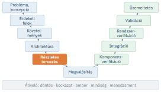
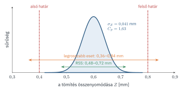
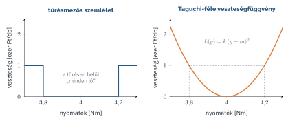
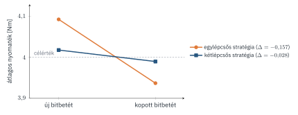
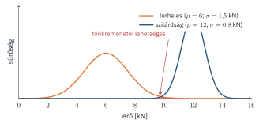

# Robusztus tervezés és tűrések {#sec-robusztus}

::: {.vterkep}
{fig-alt="V-térkép: a fejezet helye a rendszerfejlesztés folyamatában" width=62%}
:::

::: {.cel}
A fejezet feldolgozása után képes leszel:

- érzékenységvizsgálattal azonosítani a rendszer teljesítményét leginkább befolyásoló paramétereket;
- tűrésláncot számítani legrosszabb eset, négyzetes összegzés (RSS) és Monte Carlo-szimuláció alapján, és megítélni a módszerek feltevéseit;
- elmagyarázni a Taguchi-féle minőségi veszteségfüggvényt, és kiszámítani a várható veszteséget;
- teljes faktoros kísérletet tervezni és kiértékelni, főhatásokat és kölcsönhatásokat értelmezni;
- megkülönböztetni a tervezési és a zajtényezőket, és kölcsönhatásuk kihasználásával robusztus beállítást választani;
- terhelés–szilárdság interferenciával megbízhatóságot becsülni, és összevetni a biztonsági tényező szemléletével.
:::

A korábbi fejezetek a meghibásodással foglalkoztak: mi romolhat el, milyen valószínűséggel, és mi a következménye. A minőségi problémák nagy része azonban nem meghibásodásból, hanem **szórásból** fakad: az alkatrészek méretei, az anyagjellemzők, a környezeti feltételek és a használat módja ingadozik, és a rendszer teljesítménye ezzel együtt ingadozik. A **robusztus tervezés** célja olyan rendszer, amelynek teljesítménye a lehető legkevésbé érzékeny ezekre az ingadozásokra. A fejezet a robusztus tervezés legfontosabb eszközeit mutatja be: az érzékenységvizsgálatot, a méretezést és a tűrésláncot, a minőségi veszteségfüggvényt, a kísérlettervezést és a valószínűségi tervezést [@phadke1989; @taguchi2005; @goldberg1994toolbox, 4. fejezet].

A fejezet négy kérdésre épül:

- Melyik paraméter számít igazán?
- Hogyan halmozódnak az alkatrészek tűrései az összeállításban?
- Mennyibe kerül az eltérés a célértéktől, és hogyan csökkenthető a szórás érzékenysége?
- Hogyan becsülhető a tönkremenetel valószínűsége a biztonsági tényező helyett?

## Érzékenységvizsgálat {#sec-rob-erzekenyseg}

Az **érzékenységvizsgálat** (paraméteres elemzés) azt vizsgálja, hogyan változik a rendszer egy jellemzője, ha egy tervezési paraméter megváltozik [@saltelli2008]. Legegyszerűbb formája az egyparaméteres változtatás: a többi paramétert névleges értékén tartva egyet változtatunk, és figyeljük a kimenetet. A paraméterek összevetéséhez a **relatív érzékenység** (rugalmasság) a hasznos:

$$
E_x = \frac{\partial y}{\partial x} \cdot \frac{x}{y},
$$ {#eq-rugalmassag}

amely megmutatja, hogy a paraméter 1%-os változása hány százalékkal változtatja a kimenetet. A KoboCella soros ciklusideje ($T = 58{,}6$ s, [-@sec-kovetelmenyek]. fejezet) például a nyolc csavar meghúzási idejétől $25{,}6/58{,}6 = 0{,}44$, a kezelő idejétől $18/58{,}6 = 0{,}31$ rugalmassággal függ: a csavarozás 10%-os gyorsítása 4,4%-kal rövidíti a ciklust, a kezelő 10%-kal gyorsabb munkája csak 3,1%-kal. Az érzékenységvizsgálat ezzel megmutatja, hova érdemes a fejlesztési erőforrást összpontosítani; a döntéselemzésben a súlyok érzékenységét ugyanígy vizsgáltuk ([-@sec-dontes]. fejezet).

Az egyparaméteres vizsgálat nem mutatja meg a paraméterek kölcsönhatását: két paraméter együttes változásának hatása eltérhet az egyenkénti hatások összegétől. Ezt a kísérlettervezés és a Monte Carlo-szimuláció tárja fel (lásd alább).

## Méretezés és tűréslánc {#sec-rob-turesek}

Minden gyártott méret ingadozik, ezért a rajzon a névleges érték mellett a megengedett eltérést, a **tűrést** is meg kell adni. A méretezés és a tűrésmegadás szabályait (beleértve a geometriai tűréseket: alak, helyzet, irány) szabvány rögzíti [@asmey145_2018]. Összeállításban az alkatrészek tűrései **tűrésláncot** alkotnak: egy funkcionálisan fontos méret (rés, átfedés, összenyomódás) több alkatrész méretének összegeként vagy különbségeként adódik. A tűrésláncot két klasszikus módon számolják [@chase1991]:

- **Legrosszabb eset:** az eredő tűrés a tagok tűréseinek összege, $T_Z = \sum |a_i| T_i$, ahol $a_i$ a tag érzékenysége (lineáris láncnál $\pm 1$). Garantálja, hogy minden összeállítás a határon belül marad, de sok tagnál nagyon szoros, drága alkatrésztűréseket követel.
- **Statisztikus (négyzetes) összegzés (RSS):** $T_Z = \sqrt{\sum a_i^2 T_i^2}$. Feltételezi, hogy a tagok egymástól függetlenek, normális eloszlásúak, a tűrésmező közepére szórnak, és a tűrés például $\pm 3\sigma$-nak felel meg. Ekkor a szélső értékek együttes előfordulása nagyon valószínűtlen, és lazább alkatrésztűrések is elegendők.

Ha a feltevések nem teljesülnek (eltolt középérték, nem normális eloszlás, összefüggő tagok, nemlineáris lánc), a **Monte Carlo-szimuláció** ad megbízható eredményt: a tagokat a tényleges eloszlásukból mintázzuk, és az eredő méret eloszlását közvetlenül számoljuk [@chase1991].

::: {.eset eset="A" title="KoboCella: a fedéltömítés összenyomódása"}
A fordított fedél hibamódja után ([-@sec-fmea]. fejezet) a csapat a helyesen felhelyezett fedél tömítését is megvizsgálta. A tömítés akkor zár megbízhatóan, ha összenyomódása 0,40 és 0,80 mm között van. Az összenyomódás négy méretből adódik: a tömítés vastagsága ($2{,}50 \pm 0{,}08$ mm, +), a fedél horonymélysége ($2{,}20 \pm 0{,}05$ mm, −), a motorház tömítőperemének magassága ($0{,}30 \pm 0{,}06$ mm, +) és a fedél síklapúsági eltérése ($0 \pm 0{,}05$ mm, −). A névleges összenyomódás 0,60 mm.

A legrosszabb eset szerint az eredő tűrés $\pm 0{,}24$ mm, így az összenyomódás 0,36 és 0,84 mm között lehet: a követelmény nem teljesül. Az RSS szerint az eredő tűrés $\pm 0{,}12$ mm (0,48–0,72 mm), és ha a tűrések $\pm 3\sigma$-nak felelnek meg, az összenyomódás szórása 0,041 mm, a folyamatképesség $C_p = 1{,}63$ ([-@fig-tureslanc]. ábra). A csapat a statisztikus méretezést fogadta el, mert napi mintegy 610 motornál a nagy darabszám indokolja, és a beszállítók folyamatképessége mérésekkel igazolható. Kikötötte viszont, hogy a tömítés vastagságát és a horonymélységet a beszállítók statisztikai folyamatszabályozással felügyeljék, mert a középérték eltolódása a statisztikus számítás legfontosabb feltevését rontaná. A Gyakorlati útmutató notebookja Monte Carlo-szimulációval azt is megmutatja, mekkora eltolódás fér bele a követelménybe.

{#fig-tureslanc width=85%}
:::

## A minőségi veszteségfüggvény {#sec-rob-taguchi}

A hagyományos minőségszemlélet szerint a tűrésmezőn belüli termék jó, a kívüli rossz („kapufa-szemlélet”). Taguchi szerint azonban a célértéktől való minden eltérés veszteséget okoz a társadalomnak: a vevőnek, a gyártónak és a környezetnek, és ez a veszteség a célértéktől távolodva négyzetesen nő [@taguchi2005] ([-@fig-taguchi-veszteseg]. ábra):

$$
L(y) = k\,(y - m)^2, \qquad k = \frac{A_0}{\Delta_0^2},
$$ {#eq-veszteseg}

ahol $m$ a célérték, $\Delta_0$ az a funkcionális eltérés, amelynél a termék már nem teljesíti a funkcióját, $A_0$ pedig az ekkor fellépő veszteség (javítás, csere, reklamáció). Egy $\mu$ középértékű, $\sigma$ szórású folyamat darabonkénti várható vesztesége:

$$
\mathrm{E}[L] = k\left[\sigma^2 + (\mu - m)^2\right].
$$ {#eq-varhato-veszteseg}

A képlet a robusztus tervezés két irányát mutatja: a középértéket a célértékre kell állítani, és a szórást kell csökkenteni. Mindkettő pénzben kifejezhető, így az intézkedések költsége összevethető a veszteségcsökkentéssel.

{#fig-taguchi-veszteseg width=100%}

Ha például a KoboCella csavarkötésének nyomatéka $4{,}0 \pm 0{,}2$ Nm, és a tűréshatáron egy motor javítása 1000 Ft-ba kerül, akkor $k = 1000/0{,}2^2 = 25\,000$ Ft/Nm². A $\mu = 4{,}02$ Nm középértékű, $\sigma = 0{,}05$ Nm szórású folyamat várható vesztesége $25\,000 \cdot (0{,}0025 + 0{,}0004) = 72{,}5$ Ft darabonként, évi 140 000 motornál mintegy 10 MFt. Ha a szórás 0,03 Nm-re csökken, és a középérték a célértékre kerül, a veszteség 22,5 Ft-ra, évente 3,2 MFt-ra csökken, pedig a tűrésmezős szemlélet szerint mindkét folyamat „hibátlan” termékeket gyárt.

## Kísérlettervezés {#sec-rob-doe}

A kísérlettervezés (design of experiments, DoE) arra szolgál, hogy a lehető legkevesebb kísérlettel megtudjuk, mely tényezők és milyen kölcsönhatásaik befolyásolják a vizsgált jellemzőt [@montgomery2017]. A „egyszerre egy tényező” módszerrel szemben a faktoros kísérlet minden tényezőt egyszerre változtat, így kevesebb kísérletből több információt ad, és a kölcsönhatásokat is feltárja.

A **$2^k$ teljes faktoros kísérletben** $k$ tényező mindegyikét két szinten (kódolva $-1$ és $+1$) vizsgáljuk, minden kombinációban. Egy tényező **főhatása** a válasz átlaga a felső szinten mínusz az átlag az alsó szinten; két tényező **kölcsönhatása** azt mutatja, mennyiben függ az egyik hatása a másik szintjétől. Montgomery a kísérletezés három alapelvét emeli ki: a **véletlen sorrendet** (hogy az időben változó zavaró hatások ne torzítsák az eredményt), az **ismétlést** (a kísérleti hiba becslésére) és a **blokkosítást** (az ismert zavaró tényezők kiszűrésére) [@montgomery2017]. Sok tényezőnél a **részfaktoros** tervek a kombinációk egy jól választott részhalmazával dolgoznak, a magasabb rendű kölcsönhatások összemosása árán.

Taguchi **paramétertervezése** a kísérletezést a robusztusság szolgálatába állítja. Megkülönbözteti a **tervezési tényezőket**, amelyeket a tervező szabadon beállíthat, és a **zajtényezőket**, amelyek a gyártásban vagy a használatban ingadoznak, és nem, vagy csak drágán szabályozhatók (környezeti hőmérséklet, anyagingadozás, kopás). A cél olyan tervezési beállítás, amelynél a zajtényezők hatása a legkisebb, és ehhez éppen a tervezési és a zajtényezők közötti kölcsönhatást használja ki [@phadke1989; @taguchi2005]. Taguchi a robusztusságot jel–zaj viszonnyal méri; Montgomery szerint ugyanez a cél általában hatékonyabban elérhető, ha a választ a tervezési és a zajtényezők függvényeként modellezzük, és a modellből választjuk ki a robusztus beállítást [@montgomery2017].

::: {.eset eset="A" title="KoboCella: robusztus csavarozási stratégia"}
A QFD-ből tudjuk ([-@sec-qfd]. fejezet), hogy a nyomaték pontosságát a bitbetét kopása erősen befolyásolja. A csapat $2^3$ teljes faktoros kísérletet végzett két ismétléssel (16 csavarozás véletlen sorrendben). Tényezők: A a végső fordulatszám (alacsony, magas), B a csavarozási stratégia (egylépcsős, kétlépcsős: gyors előhúzás, majd lassú meghúzás), C a bitbetét állapota (új, kopott). Az A és a B tervezési tényező, a C zajtényező: a kopás a gyártásban elkerülhetetlen.

A főhatások: A $+0{,}086$ Nm, C $-0{,}092$ Nm, B elhanyagolható; a legnagyobb kölcsönhatás a B×C ($+0{,}065$ Nm). A kölcsönhatás a robusztusság kulcsa ([-@fig-doe-kolcsonhatas]. ábra): egylépcsős stratégiánál a kopott bitbetét $0{,}157$ Nm-rel csökkenti a nyomatékot, kétlépcsősnél csak $0{,}028$ Nm-rel. A kétlépcsős stratégia tehát a zajtényezőre majdnem érzéketlen. A csapat ezt választotta, a fordulatszámmal pedig a középértéket állította a célértékre. A bitcsere-tervet ([-@sec-fmea]. fejezet) megtartotta, de a cseréket ritkíthatta.

{#fig-doe-kolcsonhatas width=80%}
:::

## Valószínűségi tervezés {#sec-rob-valoszinusegi}

A hagyományos méretezés **biztonsági tényezővel** dolgozik: az alkatrész szilárdsága legyen a várható terhelés valahányszorosa. A biztonsági tényező azonban nem mondja meg, mekkora a tönkremenetel valószínűsége, mert sem a terhelés, sem a szilárdság szórását nem veszi figyelembe. A **valószínűségi tervezés** mindkettőt valószínűségi változóként kezeli, és a tönkremenetel valószínűségét az eloszlásaik átfedéséből (**terhelés–szilárdság interferencia**) számítja [@oconnor2012; @goldberg1994toolbox, 3.14. szakasz]. Normális eloszlású, független terhelés ($L$) és szilárdság ($S$) esetén:

$$
R = P(S > L) = \Phi\!\left(\frac{\mu_S - \mu_L}{\sqrt{\sigma_S^2 + \sigma_L^2}}\right),
$$ {#eq-interferencia}

ahol $\Phi$ a standard normális eloszlásfüggvény. A módszer a biztonsági tényezők gyakorlati alternatívája, de jelentős statisztikai tapasztalatot kíván. Eredménye erősen függ az eloszlások szélétől, ezért csak akkor megbízható, ha a felhasznált adatok a tervezett populációra érvényesek [@oconnor2012].

::: {.eset eset="B" title="VárosiBringa: elég erős-e a reteszcsap?"}
A VárosiBringa dokkolójának reteszcsapja nyírószilárdságának várható értéke 12 kN, szórása 0,8 kN. A csapat a próbaüzem rángatási és vandalizmusadataiból a nagy terheléses események erejét 6 kN várható értékűnek és 1,5 kN szórásúnak becsülte. A biztonsági tényező 2, ami első ránézésre bőségesnek tűnik. Az interferenciaszámítás szerint ([-@fig-terheles-szilardsag]. ábra) egy ilyen esemény $3{,}53$ szórásnyi távolságra van, a tönkremenetel valószínűsége eseményenként $2{,}1 \cdot 10^{-4}$. Ha a 300 dokkolóhely mindegyikét évente 20 ilyen esemény éri, az évente átlagosan 1,25 tönkrement reteszcsapot jelent. A csapat a csap anyagának erősítése helyett a terhelés szórását csökkentette: a dokkoló bevezető íve a kerékpárt rángatáskor megtámasztja, így a csapra jutó erő csúcsai kisebbek lettek.

{#fig-terheles-szilardsag width=85%}
:::

::: {.kitekintes title="Bizonytalanság a teljes rendszerben"}
A tűrés, a veszteségfüggvény, a kísérlettervezés és az interferencia ugyanannak a gondolatnak a változatai: a tervezési döntéseket a bizonytalanság ismeretében kell meghozni, nem a névleges értékek alapján. Ugyanez a gondolat jelent meg a döntéselemzés Monte Carlo-vizsgálataiban ([-@sec-dontes]. fejezet) és a megbízhatósági szimulációban ([-@sec-megbizhatosag]. fejezet). A modellalapú fejlesztésben ([-@sec-modellek]. fejezet) a rendszermodell paramétereihez eloszlás rendelhető, és a bizonytalanság a teljes modellen végigterjeszthető; a szimulációval kapott eloszlás mutatja meg, mekkora tartalékkal teljesülnek a követelmények.
:::

::: {.hiba title="Névleges értékre tervezni"}
Gyakori hiba, hogy a tervezés a névleges méretekkel és anyagjellemzőkkel számol, és a tűréseket a végén, a rajzkészítéskor, szokásértékekkel adja meg. Ilyenkor az összeállítás egy része nem működik, vagy a tűrések feleslegesen szigorúak és drágák. A funkcionálisan fontos méretláncokat már a részletes tervezés elején azonosítani kell, és a tűréseket a lánc elemzése alapján kell elosztani.
:::

::: {.osszefoglalo}
- Az érzékenységvizsgálat megmutatja, mely paraméterek befolyásolják leginkább a teljesítményt; a relatív érzékenység (rugalmasság) a paraméterek összevetésére alkalmas.
- A tűréslánc legrosszabb esetre számolva mindig biztonságos, de drága; az RSS-számítás függetlenséget, normális eloszlást és központosított folyamatot feltételez. A feltevések sérülésekor Monte Carlo-szimuláció kell.
- Taguchi veszteségfüggvénye szerint a célértéktől való minden eltérés veszteség; a várható veszteség a szórás és a középérték-eltérés négyzetével arányos.
- A faktoros kísérlet egyszerre változtatja a tényezőket, így a főhatások mellett a kölcsönhatásokat is feltárja; alapelvei a véletlen sorrend, az ismétlés és a blokkosítás.
- A robusztus tervezés a tervezési és a zajtényezők kölcsönhatását használja ki: olyan beállítást keres, amelynél a zaj hatása a legkisebb.
- A valószínűségi tervezés a terhelés és a szilárdság szórásából számítja a tönkremenetel valószínűségét; azonos biztonsági tényező mellett is nagyon különböző lehet a kockázat.
:::

::: {.onell}
1. Egy rendszer kimenete $y = x_1 x_2^2$. Mekkora a relatív érzékenység $x_1$ és $x_2$ szerint?
2. Egy háromtagú lineáris lánc tűrései $\pm 0{,}1$, $\pm 0{,}2$ és $\pm 0{,}2$ mm. Mennyi az eredő tűrés legrosszabb esetre és RSS szerint?
3. Milyen feltevésekre épül az RSS-számítás? Mi történik, ha egy tag középértéke a tűrésmező szélére tolódik?
4. Egy jellemző célértéke 10, a funkcionális határ $\pm 1$, a határon a veszteség 500 Ft. Mennyi a darabonkénti várható veszteség, ha $\mu = 10{,}2$ és $\sigma = 0{,}3$?
5. Mi a különbség a főhatás és a kölcsönhatás között? Miért nem tárja fel a kölcsönhatást az egyszerre egy tényezőt változtató kísérlet?
6. Mi a tervezési és a zajtényező? Adj példát mindkettőre egy háztartási gépnél!
7. Egy alkatrész szilárdsága $\mu_S = 100$, $\sigma_S = 5$, a terhelés $\mu_L = 70$, $\sigma_L = 10$ (azonos egységben). Mennyi a biztonsági tényező, és mennyi a tönkremenetel valószínűsége?
8. Miért mondhatjuk, hogy a biztonsági tényező önmagában nem jellemzi a kockázatot?

::: {.megoldas}
1. $E_{x_1} = 1$, $E_{x_2} = 2$: $x_2$ 1%-os változása kétszer akkora relatív változást okoz.
2. Legrosszabb eset: $0{,}1 + 0{,}2 + 0{,}2 = \pm 0{,}5$ mm; RSS: $\sqrt{0{,}01 + 0{,}04 + 0{,}04} = \pm 0{,}3$ mm.
3. A tagok függetlenek, normális eloszlásúak, a tűrésmező közepére szórnak, és a tűrés ismert szórásnak (például $3\sigma$) felel meg. Ha egy tag középértéke eltolódik, az eredő méret középértéke is eltolódik, és a határon kívül eső összeállítások aránya jelentősen nőhet; ilyenkor Monte Carlo-szimuláció vagy az eltolódást figyelembe vevő számítás kell.
4. $k = 500/1^2 = 500$; $\mathrm{E}[L] = 500 \cdot (0{,}09 + 0{,}04) = 65$ Ft/db.
5. A főhatás egy tényező átlagos hatása; a kölcsönhatás azt mutatja, hogy egy tényező hatása függ egy másik tényező szintjétől. Az egyszerre egy tényezőt változtató kísérlet a többi tényezőt egy rögzített szinten tartja, így nem látja, hogyan változna a hatás más szinteken.
6. A tervezési tényezőt a tervező beállítja (például egy mosógép dobfordulatszáma vagy a programidő), a zajtényező ingadozik, és nem szabályozható (például a víz keménysége, a ruha mennyisége és anyaga, a hálózati feszültség).
7. A biztonsági tényező $100/70 = 1{,}43$; $z = 30/\sqrt{25 + 100} = 2{,}68$; a tönkremenetel valószínűsége $\Phi(-2{,}68) \approx 0{,}0037$.
8. Mert ugyanaz a biztonsági tényező kis szórásnál elhanyagolható, nagy szórásnál jelentős tönkremeneteli valószínűséget jelenthet; a kockázatot a középértékek különbsége és a szórások együtt határozzák meg.
:::
:::

::: {.projekt title="Projektlépés: robusztusság"}
Saját fejlesztési feladatodhoz:

1. végezz érzékenységvizsgálatot a legfontosabb teljesítményjellemzőre (MOP vagy TPM), és rangsorold a paramétereket relatív érzékenységük szerint;
2. ha a rendszerben van funkcionálisan fontos méretlánc (rés, illesztés, összenyomódás), számítsd ki legrosszabb esetre, RSS szerint és Monte Carlo-szimulációval;
3. tervezz egy legalább három tényezős faktoros kísérletet (tényezők, szintek, válasz, ismétlések, sorrend), és jelöld a tervezési és a zajtényezőket;
4. használd a Gyakorlati útmutató tűréslánc- és kísérlettervezési eszközlapját.
:::

::: {.forras}
- @montgomery2017: a kísérlettervezés alapvető tankönyve, a robusztus tervezés válaszfelület-alapú megközelítésével.
- @taguchi2005 és @phadke1989: a Taguchi-módszer, a veszteségfüggvény és a paramétertervezés.
- @chase1991: a tűrésanalízis módszereinek áttekintése.
- @saltelli2008: az érzékenységvizsgálat módszereinek bevezető kézikönyve.
- @goldberg1994toolbox, 3.14., 4.1–4.3., 7.5. és 7.13. szakasz: a valószínűségi tervezés, az érzékenységvizsgálat, a tűrések, a kísérlettervezés és a veszteségfüggvény gyakorlati leírása.
:::
