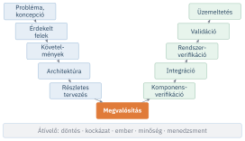
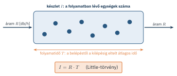
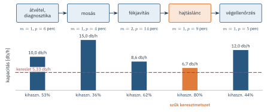
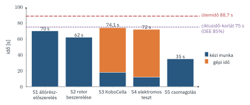
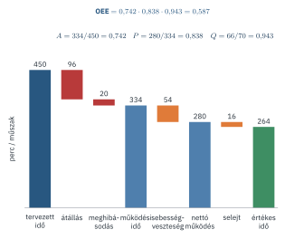
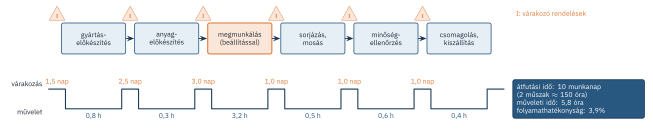
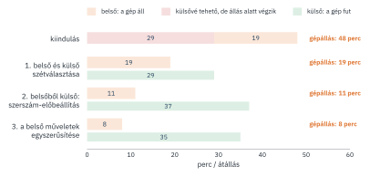

# Folyamatelemzés és hatékonyság {#sec-folyamatelemzes}

::: {.vterkep}
{fig-alt="V-térkép: a fejezet helye a rendszerfejlesztés folyamatában" width=62%}
:::

::: {.cel}
A fejezet feldolgozása után képes leszel:

- leírni egy folyamatot az áram, a folyamatidő és a készlet jellemzőivel, és alkalmazni a Little-törvényt;
- meghatározni az erőforrások kapacitását, a szűk keresztmetszetet, a folyamat áramát és az erőforrások kihasználtságát;
- kiszámítani a munkatartalmat, a ciklusidőt és az átlagos munkaerő-kihasználtságot;
- kiszámítani az ütemidőt, Yamazumi-diagrammal értékelni egy szerelősor kiegyenlítettségét, és javaslatot tenni az átrendezésre;
- kiszámítani és értelmezni az OEE-t és az OLE-t, felismerni a hat nagy veszteséget és a mutatók korlátait;
- értékáram-térképpel feltárni a veszteségeket, és a SMED módszerével csökkenteni a beállítási időt.
:::

A V-modell csúcsán a tervekből valóság lesz. Ha a fejlesztés tárgya maga egy gyártó- vagy szolgáltatófolyamat (egy szerelősor, egy javítóműhely, egy rendelésteljesítési lánc), a megvalósítás magja a folyamat megtervezése és méretezése. Az ISO/IEC/IEEE 15288 megvalósítási folyamata a rendszerelemek legyártását, beszerzését vagy újrafelhasználását és a gyártás előkészítését foglalja magában [@iso15288_2023, 6.4.7. szakasz; @nasa2016seh, 5.1. szakasz]. A folyamat megtervezésének és javításának alapeszköze a folyamatábra: láthatóvá teszi a folyamat lépéseit és azok kapcsolatát, és segít kiszűrni a nem értékteremtő lépéseket [@rother1999; @goldberg1994toolbox, 7.15–7.16. szakasz].

A fejezet a műveletmenedzsment alapfogalmaira épül [@cachon2013; @hopp2008; @lakatos_termelesi], és öt kérdésre keres választ:

- Mennyi egység halad át a folyamaton, mennyi ideig tart, és mennyi van belőle egyszerre a rendszerben?
- Melyik erőforrás korlátozza a teljesítményt, és mennyire használjuk ki a többit?
- Elég gyors-e a folyamat a vevői igényhez, és egyenletesen oszlik-e meg a munka?
- Mennyi veszteség keletkezik a berendezéseken és a munkában?
- Hol várakozik a termék, és hogyan rövidíthető az átfutás?

## A folyamat alapjellemzői és a Little-törvény {#sec-fa-little}

Egy folyamatot három alapjellemzővel írunk le [@cachon2013, 2. fejezet]:

- **áram** (átbocsátás, $R$): az egységnyi idő alatt a folyamaton áthaladó egységek száma;
- **folyamatidő** (átfutási idő, $T$): az az átlagos idő, amelyet egy egység a belépéstől a kilépésig a folyamatban tölt;
- **készlet** ($I$): az adott időpontban a folyamatban lévő egységek száma.

Az áramló egység a vizsgálat céljától függ: lehet munkadarab, rendelés, kerékpár, vevő vagy egy ügyirat. A három jellemzőt a **Little-törvény** kapcsolja össze ([-@fig-folyamat-little]. ábra):

$$
I = R \cdot T.
$$ {#eq-little}

{#fig-folyamat-little width=72%}

Little 1961-ben bizonyította, hogy az összefüggés stabil rendszerben a hosszú távú átlagokra érvényes, és nem függ az érkezések és a kiszolgálások eloszlásától, sem a kiszolgálás sorrendjétől [@little1961]. Ötven évvel később összegezte a törvény gyakorlati alkalmazásait: a műveletmenedzsmentben azért használják ilyen széles körben, mert a három mennyiség közül kettő mérésével a harmadik számítható [@little2011]. A törvény a rendszer határától függ: ugyanaz az összefüggés érvényes egy gépre, egy műhelyre vagy a teljes rendelésteljesítési láncra, ha a három mennyiséget ugyanarra a határra mérjük. Az egységeknek is egyezniük kell: ha az áram rendelés/nap, a folyamatidő napban adódik.

::: {.eset eset="C" title="ForgácsTech: miért tart tíz napig egy rendelés?"}
A ForgácsTech üzemében egy átlagos hétköznapon 60 rendelés van folyamatban (a gyártáselőkészítéstől a kiszállításig), és naponta átlagosan 6 rendelés készül el. A Little-törvény szerint egy rendelés átlagosan $60/6 = 10$ munkanapot tölt az üzemben. A vevő által elfogadható átfutás 5 munkanap. Ha az áram nem változik, ehhez a folyamatban lévő rendelések számát 30-ra kell csökkenteni. Ez nem gyorsabb gépeket igényel, hanem azt, hogy kevesebb rendelés várakozzon egyszerre: a rendelések kiadását a kapacitáshoz kell igazítani ([-@sec-utemezes]. fejezet). A számítás azt is megmutatja, miért keletkezik a késések fele a beállításnál és az anyagbeszerzésnél ([-@sec-problema]. fejezet): a rendelések az idejük nagy részét nem megmunkálással, hanem várakozással töltik ([-@sec-fa-ertekaram]. szakasz).
:::

## Kapacitás, szűk keresztmetszet, kihasználtság {#sec-fa-kapacitas}

Egy erőforrás **kapacitása** az az áram, amelyet akkor teljesítene, ha folyamatosan dolgozna. Ha az erőforráson $m_i$ párhuzamos egység (dolgozó vagy gép) dolgozik, és egy egység feldolgozása $p_i$ ideig tart, a kapacitás $K_i = m_i / p_i$. A folyamat kapacitását a legkisebb kapacitású erőforrás, a **szűk keresztmetszet** határozza meg. A folyamat tényleges árama a kereslet és a folyamatkapacitás közül a kisebb, egy erőforrás **kihasználtsága** pedig a tényleges áram és a kapacitás hányadosa [@cachon2013, 3. fejezet]:

$$
K_i = \frac{m_i}{p_i}, \qquad R = \min\left\{D,\ \min_i K_i\right\}, \qquad u_i = \frac{R}{K_i}.
$$ {#eq-kapacitas}

Ha a kereslet meghaladja a folyamatkapacitást, a folyamat **kapacitáskorlátos**, és a szűk keresztmetszet kihasználtsága 100%. Ha a kereslet kisebb, a folyamat **keresletkorlátos**, és minden erőforrásnak van szabad kapacitása. A szűk keresztmetszet szemléletét Goldratt tette ismertté: a rendszer teljesítményét a korlátozó erőforrás szabja meg, ezért a szűk keresztmetszeten elvesztett idő az egész rendszer számára elveszett, a többi erőforráson megtakarított idő viszont nem növeli a kibocsátást [@goldratt1984]. A fejlesztést tehát a szűk keresztmetszeten kell kezdeni, és minden javítás után újra meg kell vizsgálni, hol van a korlát.

Összetett folyamatokban, ahol több terméktípus különböző útvonalon halad, az elemzés lépései a következők [@cachon2013, 3. fejezet]:

1. a folyamatábra elkészítése: hogyan áramlik az egység az erőforrásokon át;
2. minden erőforrás kapacitásának meghatározása;
3. az egységek munkaigényének táblázatos összesítése erőforrásonként és terméktípusonként;
4. az igények összesítése erőforrásonként;
5. a származtatott kihasználtság számítása: az összesített igény és a kapacitás hányadosa; a legnagyobb értékű erőforrás a szűk keresztmetszet.

::: {.eset eset="B" title="VárosiBringa: a javítóműhely kapacitása"}
A VárosiBringa javítóműhelyébe naponta átlagosan 40 kerékpár érkezik egy 7,5 órás műszakban, azaz a kereslet $D = 5{,}33$ db/h. Minden kerékpár öt lépésen halad át ([-@fig-kapacitas-szerviz]. ábra). A fékjavításon két szerelő dolgozik párhuzamosan, a többi lépésen egy-egy. A kapacitások: átvétel és diagnosztika $60/6 = 10$ db/h, mosás $60/4 = 15$ db/h, fékjavítás $2 \cdot 60/14 = 8{,}6$ db/h, hajtáslánc $60/9 = 6{,}7$ db/h, végellenőrzés $60/5 = 12$ db/h. A szűk keresztmetszet a hajtáslánc-javítás, a folyamatkapacitás 6,7 db/h, azaz műszakonként 50 kerékpár. A folyamat keresletkorlátos: az áram 5,33 db/h, a hajtásláncon dolgozó szerelő kihasználtsága 80%, a mosóé csak 36%.

A műhelyvezető úgy tervezte, hogy a nyári csúcsban, napi 55 kerékpárnál ($7{,}33$ db/h) egy második mosóberendezést állít be. A számítás szerint ez semmit nem javítana: a csúcsban a hajtáslánc-javítás kapacitása (6,7 db/h) lesz kevés. A második mosó helyett a hajtáslánc-javítás egy részét (a lánc tisztítását és kenését, 3 perc) a mosóhoz csoportosították át. Ekkor a hajtáslánc ideje 6 percre, kapacitása 10 db/h-ra nő, a mosásé 7 percre nő, kapacitása 8,6 db/h-ra csökken, és az új szűk keresztmetszet a fékjavítás és a mosás 8,6 db/h-val: ez a csúcsigényt is fedezi.

{#fig-kapacitas-szerviz width=96%}
:::

A kihasználtság nem lehet tartósan 100%. Ha az érkezések és a feldolgozási idők ingadoznak, a várakozási idő a kihasználtság növekedésével egyre gyorsabban nő, és a teljes kihasználtság közelében korlátlanul megnő [@hopp2008, 8. fejezet]. Ezt a sorbanállási modellek segítségével a [-@sec-utemezes]. fejezet vizsgálja.

## Munkaerő-termelékenység {#sec-fa-munkaero}

A gépek mellett a munka hatékonyságát is mérni kell. A **munkatartalom** egy egység elkészítéséhez szükséges összes kézi munka ideje, a **ciklusidő** két egymást követő egység elkészülése között eltelt idő, azaz az áram reciproka ($CT = 1/R$). Ha egy erőforráson $m_i$ dolgozó dolgozik, és az erőforrás munkaigénye egységenként $p_i$, egy ciklus alatt a dolgozóknak $m_i \cdot CT - p_i$ kihasználatlan ideje marad. Az **átlagos munkaerő-kihasználtság** a munkatartalom és a ciklusonként fizetett teljes munkaidő hányadosa [@cachon2013, 4. fejezet]:

$$
\bar{u} = \frac{\sum_i p_i}{\sum_i p_i + \sum_i \left( m_i \cdot CT - p_i \right)} = \frac{\sum_i p_i}{CT \cdot \sum_i m_i}.
$$ {#eq-munkaero}

A VárosiBringa műhelyében a munkatartalom $6 + 4 + 14 + 9 + 5 = 38$ perc, a ciklusidő $1/5{,}33 = 11{,}25$ perc, a dolgozók száma 6. Az átlagos munkaerő-kihasználtság $38 / (11{,}25 \cdot 6) = 56{,}3\%$, azaz a fizetett munkaidő 44%-a kihasználatlan. A közvetlen munkaerőköltség egy kerékpárra a ciklusidő, a létszám és az órabér szorzata, és nem a munkatartalomé: a kihasználatlan időt is ki kell fizetni. A munkaerőköltség egy termék teljes költségében első ránézésre kicsi, de a beszállítói láncon végigösszegezve meghatározó lehet, ezért a munkaerő-termelékenység javítása a beszállítói lánc minden szintjén fontos.

## Ütemidő és sorkiegyenlítés {#sec-fa-utemido}

Ha a folyamatnak a vevői igényt kell követnie, a tervezés kiindulópontja az **ütemidő** (takt time): a rendelkezésre álló termelési idő és a kereslet hányadosa, vagyis az az idő, amely egy termék előállítására a vevői igény szerint jut [@rother1999]:

$$
TT = \frac{\text{rendelkezésre álló termelési idő}}{\text{kereslet}}.
$$ {#eq-utemido}

Az ütemidőt a **ciklusidővel** vetjük össze, amely egy művelet vagy egy állomás tényleges időigénye. Ha egy állomás ciklusideje nagyobb az ütemidőnél, a sor nem tudja kiszolgálni az igényt; ha jóval kisebb, az állomáson várakozás és kihasználatlan munkaidő keletkezik. A **sorkiegyenlítés** (line balancing) célja, hogy a műveleteket úgy osszuk el az állomások között, hogy egyik állomás ideje se haladja meg az ütemidőt, és a munka a lehető legegyenletesebben oszoljon meg. Az elméletileg szükséges legkisebb állomásszám és a kiegyenlítés hatásfoka:

$$
N_{\min} = \left\lceil \frac{\sum_j t_j}{TT} \right\rceil, \qquad \eta = \frac{\sum_j t_j}{N \cdot c},
$$ {#eq-kiegyenlites}

ahol $t_j$ a műveletek ideje, $N$ az állomások száma és $c$ a legnagyobb állomásidő. A műveletek sorrendi kötöttségei (előbb kell a rotort beszerelni, mint tesztelni) miatt az elméleti minimum nem mindig érhető el. A feladat két alapváltozata a legkevesebb állomás keresése adott ütemidőre és a legkisebb ciklusidő keresése adott állomásszámra. Mindkettő kombinatorikus optimalizálási feladat, amelyre pontos és heurisztikus eljárások egyaránt léteznek [@scholl2006].

A **Yamazumi-diagram** (japánul: halmozott) a sorkiegyenlítés szemléletes eszköze: állomásonként egy halmozott oszlopot rajzol, amelyben az egyes műveletek vagy időfajták (kézi munka, gépi idő, gyaloglás, várakozás) egymásra rakódnak, és vízszintes vonal jelöli az ütemidőt. Egy pillantással látszik, melyik állomás lépi túl az ütemidőt, és hol van tartalék.

::: {.eset eset="A" title="KoboCella: a szerelősor kiegyenlítése"}
A KoboCella egy ötállomásos motorszerelő sor harmadik állomása. A sor két műszakban, évi 3450 órában dolgozik, és évi 140 ezer motort kell gyártania, így az ütemidő 88,7 s. A tervezett 85%-os berendezéshatékonyság miatt egyik állomás ciklusideje sem lehet nagyobb 75 s-nál ([-@sec-kovetelmenyek]. fejezet). A [-@fig-yamazumi-kobo]. ábra az állomások idejét mutatja; a KoboCella oszlopa a helyszíni átvételen mért 74,1 s, amelyből 18 s a kezelő kézi munkája.

{#fig-yamazumi-kobo width=92%}

A munkatartalom $70 + 62 + 74{,}1 + 72 + 35 = 313{,}1$ s, az elméleti minimum $\lceil 313{,}1 / 88{,}7 \rceil = 4$ állomás. A szűk keresztmetszet a KoboCella 74,1 s-mal, a sor kapacitása $3600/74{,}1 = 48{,}6$ motor/óra, az igény $3600/88{,}7 = 40{,}6$ motor/óra. Minden állomás a 75 s-os korlát alatt marad, de a KoboCella tartaléka mindössze 0,9 s: a cella ciklusidejének bármilyen romlása az egész sor kibocsátását veszélyezteti, ezért a cella ciklusidejét a gyártás során is folyamatosan követni kell. A kiegyenlítés hatásfoka $313{,}1 / (5 \cdot 74{,}1) = 84{,}5\%$.

A diagram a kézi munka és a gépi idő szétválasztásával többet mutat a puszta állomásidőknél. A harmadik, negyedik és ötödik állomás kezelőjének kézi munkája együtt $18 + 12 + 35 = 65$ s, ami az ütemidőn belül marad, mert a kobot és a tesztberendezés a kezelő nélkül is dolgozik. A csapat ezért azt vizsgálta, átveheti-e a KoboCella kezelője a csomagolást is: ekkor kézi terhelése $18 + 35 = 53$ s lenne ütemenként, azaz az ütemidő 60%-a, a sor létszáma pedig ötről négyre csökkenne. A változtatást a csapat csak az elrendezés módosítása (a csomagolóasztal a cella kiadóoldalára kerül) és a terhelés ismételt mérése után vezette be ([-@sec-ek-meres]. szakasz). A kezelő kis lekötöttsége ugyanis nem csak tartalék: a felügyeleti feladat és a zavarelhárítás figyelmet igényel, és a leromlott üzemben a kezelőnek kell átvennie a cella egyes feladatait ([-@sec-automatizalas]. fejezet).
:::

## OEE és OLE: a berendezések és a munka hatékonysága {#sec-fa-oee}

A **teljes eszközhatékonyság** (Overall Equipment Effectiveness, OEE) Nakajima teljes körű hatékony karbantartási (TPM) koncepciójának mérőszáma. Azt méri, hogy a tervezett üzemidőből mennyi fordítódik ténylegesen jó termék előállítására a gép elméleti sebességével. A veszteségeket hat csoportba sorolja, ezek a **hat nagy veszteség** [@nakajima1988]:

- **állásidő-veszteségek:** (1) meghibásodások és (2) beállítás, átállás;
- **sebességveszteségek:** (3) üresjárat és kisebb leállások, (4) csökkentett sebesség;
- **minőségi veszteségek:** (5) selejt és utómunka, (6) indítási (felfutási) veszteségek.

A három veszteségcsoportnak egy-egy tényező felel meg, és az OEE ezek szorzata:

$$
\text{OEE} = A \cdot P \cdot Q, \qquad A = \frac{T_\mathrm{m}}{T_\mathrm{t}}, \qquad P = \frac{t_\mathrm{i} \cdot n}{T_\mathrm{m}}, \qquad Q = \frac{n_\mathrm{j}}{n},
$$ {#eq-oee}

ahol $T_\mathrm{t}$ a tervezett üzemidő, $T_\mathrm{m}$ a tényleges működési idő, $t_\mathrm{i}$ az ideális ciklusidő, $n$ a legyártott és $n_\mathrm{j}$ a jó darabok száma. A szorzat egyszerűsítve a jó darabok ideális gyártási idejének és a tervezett üzemidőnek a hányadosa: $\text{OEE} = t_\mathrm{i} \cdot n_\mathrm{j} / T_\mathrm{t}$. A szakirodalom Nakajimára hivatkozva adja meg azokat az ideális értékeket, amelyek mellett a gép kiemelkedően hatékonynak tekinthető: rendelkezésre állás 90% felett, teljesítmény 95% felett, minőség 99% felett, ami mintegy 85%-os OEE-t ad [@nakajima1988]. A KoboCella követelményeiben rögzített 85%-os berendezéshatékonyság ([-@sec-kovetelmenyek]. fejezet) ezt a szintet célozza.

::: {.eset eset="C" title="ForgácsTech: az OEE-vízesés"}
A ForgácsTech az M3 koncepció első ütemében gépi adatgyűjtést és OEE-monitorozást vezetett be ([-@sec-dontes]. fejezet). Az egyik többtengelyes megmunkáló központ első négy hetének műszakonkénti átlagát a [-@fig-oee-vizeses]. ábra mutatja. A 450 perces tervezett üzemidőből 96 percet vitt el két átállás és 20 percet a meghibásodások, így a rendelkezésre állás $334/450 = 0{,}742$. A gép műszakonként 70 darabot gyártott; ideális ciklusideje 4 perc, így a teljesítménytényező $70 \cdot 4 / 334 = 0{,}838$. A 70 darabból 66 volt jó, a minőségi tényező $0{,}943$. Az OEE $0{,}742 \cdot 0{,}838 \cdot 0{,}943 = 0{,}587$: a tervezett üzemidőnek csak 59%-a jelent jó terméket. A legnagyobb veszteség az átállás; ezt a [-@sec-fa-smed]. szakasz vizsgálja.

{#fig-oee-vizeses width=80%}
:::

Az OEE népszerűségét egyszerűsége adja, korlátait azonban ismerni kell. Muchiri és Pintelon irodalmi áttekintése szerint a mutató egyetlen gépre vonatkozik, és nem mutatja meg a gépek egymásra hatását; a három tényezőt egyenlő súllyal kezeli; értéke erősen függ az adatgyűjtés pontosságát (a kézzel rögzített kisebb leállások például gyakran kimaradnak); és mivel az üzemek céljai különböznek, nincs mindenhol érvényes viszonyítási érték. Kis sorozatú egyedi gyártásban a mutató kevésbé hasznos, pufferekkel tagolt folyamatokban pedig át kell értelmezni [@muchiri2008]. A ForgácsTech esetében ezért az OEE-t a gépek saját korábbi értékeihez hasonlítják, és nem iparági átlagokhoz; a szűk keresztmetszetként működő gépek OEE-je fontosabb, mint a többié. Ha a tervezett üzemidőt a naptári időhöz viszonyítjuk, a teljes effektív eszközteljesítmény (TEEP) azt is megmutatja, mennyi kapacitást hagyunk kihasználatlanul a műszakrend miatt [@muchiri2008].

Az OEE gondolata a munkára is kiterjeszthető. A **teljes munkaerő-hatékonyság** (Overall Labour Effectiveness, OLE) a munkaerő rendelkezésre állásának, teljesítményének és minőségének szorzata: a rendelkezésre állást a távollétek, a várakozás és a szervezési veszteségek, a teljesítményt a normaidőhöz viszonyított lassúság, a minőséget az utómunka csökkenti. Braglia és szerzőtársai bírálták a mutató hagyományos formáját, mert a veszteségek egy része nehezen mérhető, és olyan veszteségstruktúrát javasoltak, amely közvetlenül mérhető mennyiségekre épül, és a szakaszos gyártásban is alkalmazható [@braglia2021ole]. A VárosiBringa műhelyének egyik szerelője egy 450 perces műszakban 405 percig dolgozhatott (a többi idő megbeszélésre és alkatrészre várásra ment el), a 405 perc alatt elvégzett munkák normaideje 340 perc volt, és a javítások 95%-a elsőre sikerült. Ekkor $\text{OLE} = 0{,}90 \cdot 0{,}84 \cdot 0{,}95 \approx 0{,}72$. A mutató értelme nem a dolgozók rangsorolása, hanem a munkaszervezési veszteségek feltárása: a 45 perces várakozás oka az alkatrész-ellátásban van, nem a szerelőben.

## Értékáram és veszteségek {#sec-fa-ertekaram}

A Toyota termelési rendszerének egyik alapgondolata, hogy a termelésben minden tevékenység vagy értéket teremt a vevő számára, vagy veszteség. Ohno hét veszteségfajtát különböztetett meg: a túltermelést, a várakozást, a szállítást, a felesleges feldolgozást, a készletet, a felesleges mozgást és a hibás termék előállítását [@ohno1988]. Közülük a túltermelést tartotta a legsúlyosabbnak, mert a többi veszteséget eltakarja.

Az **értékáram-térkép** (value stream mapping, VSM) a termék útját ábrázolja a nyersanyagtól a vevőig: a folyamatlépéseket, az anyag- és információáramlást, a lépések közötti készleteket, és alul egy lépcsős idővonalon a várakozási és a műveleti időket [@rother1999]. Az idővonalból számítható a **folyamathatékonyság**, a műveleti idő és az átfutási idő hányadosa:

$$
\text{PCE} = \frac{\sum T_\mathrm{művelet}}{T_\mathrm{átfutás}}.
$$ {#eq-pce}

Rother és Shook módszerében a térképezés két lépésből áll: először a jelenlegi állapotot rajzoljuk fel a gyártótérben mért adatokkal, majd a jövőbeli állapotot tervezzük meg, amelyben a termék a lehető legkevesebb várakozással, a vevői ütemhez igazodva áramlik [@rother1999]. A térkép elkészítésének lépéseit a Gyakorlati útmutató folyamatábra- és értékáramtérkép-eszközlapja mutatja be.

::: {.eset eset="C" title="ForgácsTech: a rendelés értékárama"}
A ForgácsTech csapata egy jellemző rendelés útját térképezte fel ([-@fig-ertekaram-forgacs]. ábra). A hat lépés műveleti ideje együtt 5,8 óra, a lépések előtti várakozás együtt 10 munkanap, ami két műszakkal 150 óra. A folyamathatékonyság $5{,}8/150 = 3{,}9\%$: a rendelés az idejének több mint 96%-át várakozással tölti. A leghosszabb várakozás (3 nap) a megmunkáló központ előtt, a második leghosszabb (2,5 nap) az anyag-előkészítés előtt keletkezik; ez egyezik a problémaelemzés megállapításával, hogy a késések fele a beállításnál és az anyagbeszerzésnél keletkezik ([-@sec-problema]. fejezet). A 10 napos átfutás a Little-törvénnyel számított értékkel is egyezik ([-@sec-fa-little]. szakasz). A jövőbeli állapotban a csapat a rendeléskiadást a megmunkáló központ kapacitásához köti, az anyagot a rendelés kiadásakor foglalja le, és a beállítási időt csökkenti.

{#fig-ertekaram-forgacs width=100%}
:::

## A beállítási idő csökkentése: SMED {#sec-fa-smed}

A beállítási (átállási) idő az az idő, amely az egyik termék utolsó jó darabja és a következő termék első jó darabja között telik el. Ha hosszú, a gyártó nagy sorozatokat gyárt, hogy ritkán kelljen átállni, a nagy sorozatok pedig nagy készletet és hosszú átfutást okoznak. Shingo **SMED** (single-minute exchange of die, percre kész szerszámcsere) módszere a beállítási időt tíz perc alá kívánja csökkenteni. Kiindulópontja a beállítási műveletek két csoportja [@shingo1985]:

- **belső** műveletek: csak álló gépen végezhetők (például a szerszám behelyezése, a munkadarab befogása);
- **külső** műveletek: a gép futása közben is elvégezhetők (például a következő szerszám és készülék előkészítése, a program betöltése, a mérőeszközök odakészítése).

A módszer három szakaszból áll [@shingo1985]:

1. **a belső és a külső műveletek szétválasztása:** a külső műveleteket a gép futása alatt végezzük el, ami önmagában nagy megtakarítást ad, mert a gyakorlatban sok külső műveletet álló gépen végeznek;
2. **belső műveletek átalakítása külsővé:** például a szerszámok gépen kívüli előbeállításával vagy szabványos befogófelületekkel;
3. **minden művelet egyszerűsítése:** gyorsrögzítők, a csavarozás és az utánállítás kiküszöbölése, párhuzamos munkavégzés.

::: {.eset eset="C" title="ForgácsTech: a megmunkáló központ átállása"}
A csapat videóra vette a megmunkáló központ átállásait, és minden lépést belsőnek vagy külsőnek minősített. A 48 perces átállásból 29 perc olyan tevékenység volt, amely a gép futása alatt is elvégezhető: a szerszámok és készülékek kikeresése, a program betöltése és ellenőrzése, a mérőeszközök odakészítése ([-@fig-smed]. ábra). Az első szakaszban ezeket a gép futása alatt végezték el, így a gépállás 19 percre csökkent. A második szakaszban a szerszámokat egy gépen kívüli előbeállító készüléken állították be, ami további 8 percet tett külsővé. A harmadik szakaszban nullponti gyorsbefogó rendszert vezettek be a készülékekhez, és a gépállás 8 percre csökkent.

{#fig-smed width=92%}

A megtakarítás kétféleképpen használható fel. Ha az átállások száma marad (műszakonként kettő), a rendelkezésre állás $(450 - 16 - 20)/450 = 0{,}92$-re, az OEE változatlan teljesítmény- és minőségi tényező mellett $0{,}92 \cdot 0{,}838 \cdot 0{,}943 = 0{,}727$-re nő. Ha a csapat a sorozatokat felezi, és műszakonként négyszer áll át, a rendelkezésre állás $0{,}884$, az OEE $0{,}699$, ami még mindig jóval meghaladja a kiindulási 0,587-et, a gép előtt várakozó munka viszont a felére csökken, és a Little-törvény szerint vele együtt a gép előtti várakozási idő is. A ForgácsTech a második utat választotta, mert céljai között a határidő-tartás és az átfutás csökkentése szerepel, és nem a gépkihasználás maximalizálása.
:::

::: {.kitekintes title="Folyamatelemzés szolgáltatásokban"}
A fejezet fogalmai nem csak a gyártásban érvényesek. A Little-törvény egy kórházi osztály betegforgalmára, egy ügyfélszolgálat nyitott ügyeire vagy egy szoftverfejlesztő csapat folyamatban lévő feladataira ugyanúgy alkalmazható [@little2011]. Az OEE mintájára szolgáltatásokban is felbontható az idő: egy orvos fizetett munkaidejéből levonható a szabadság, a le nem foglalt idő, a lemondott vizsgálatok és az orvosi képesítést nem igénylő tevékenységek ideje, és a maradék mutatja a valóban értékteremtő időt. A szolgáltatási folyamatok sajátossága, hogy a vevő maga is a folyamat része, és a várakozást ő érzékeli. Ezért ott az átfutási idő és a várakozás gyakran fontosabb a kihasználtságnál.
:::

::: {.hiba title="A gépkihasználtság hajszolása"}
Gyakori hiba, hogy a vezetés minden gép kihasználtságát külön-külön maximalizálni akarja. Ha egy nem szűk keresztmetszet gép a szükségesnél többet gyárt, az nem növeli a kibocsátást, csak a készletet és az átfutási időt. Hasonló hiba az OEE-t gépek, műszakok vagy üzemek rangsorolására használni: a mutató értelme a saját veszteségek feltárása és a javulás követése. A kihasználtság és az átfutás közötti átváltást (a teljes kihasználtság közelében a várakozás gyorsan nő) tudatosan kell kezelni.
:::

::: {.osszefoglalo}
- A folyamatot az áram, a folyamatidő és a készlet írja le; a Little-törvény ($I = R \cdot T$) stabil rendszerben a hosszú távú átlagokra eloszlástól függetlenül érvényes.
- Az erőforrás kapacitása $m/p$; a folyamat kapacitását a szűk keresztmetszet határozza meg, az áram a kereslet és a kapacitás közül a kisebb, a kihasználtság az áram és a kapacitás hányadosa.
- Az átlagos munkaerő-kihasználtság a munkatartalom és a ciklusonként fizetett munkaidő hányadosa; a kihasználatlan időt is ki kell fizetni.
- Az ütemidő a rendelkezésre álló idő és a kereslet hányadosa; a sorkiegyenlítés az állomásidőket az ütemidő alá és egymáshoz közel hozza. A Yamazumi-diagram a kézi és a gépi időt is megmutatja.
- Az OEE a rendelkezésre állás, a teljesítmény és a minőség szorzata, a hat nagy veszteségre épül; egy gépre vonatkozik, és értéke az adatgyűjtés minőségétől függ. Az OLE ugyanezt a munkára alkalmazza.
- Az értékáram-térkép a várakozásokat teszi láthatóvá; a folyamathatékonyság gyakran néhány százalék.
- A SMED a belső és a külső műveletek szétválasztásával, a belsők külsővé alakításával és egyszerűsítésével csökkenti a beállítási időt; a megtakarítás kapacitásra vagy kisebb sorozatokra és rövidebb átfutásra fordítható.
:::

::: {.onell}
1. Egy ügyfélszolgálaton átlagosan 45 nyitott ügy van, és naponta 15 ügyet zárnak le. Mennyi egy ügy átlagos átfutási ideje? Milyen feltételek mellett érvényes a számítás?
2. Egy háromlépéses folyamat lépésein 1, 2, illetve 1 dolgozó dolgozik, a munkaigények 4, 10, illetve 3 perc/egység. Melyik lépés a szűk keresztmetszet, és mennyi a folyamatkapacitás egységenként óránként?
3. Az előző folyamatban a kereslet 10 egység/óra. Mennyi az egyes lépések kihasználtsága és az átlagos munkaerő-kihasználtság?
4. Egy szerelősor két műszakban, műszakonként 7 óra nettó idővel dolgozik, a napi igény 420 termék. Mennyi az ütemidő? A munkatartalom 230 s; legalább hány állomás kell?
5. Mit mutat a Yamazumi-diagram, amit az állomásidők táblázata nem?
6. Egy gép tervezett üzemideje 480 perc, ebből 60 perc állás. Az ideális ciklusidő 1 perc, a gép 380 darabot gyártott, ebből 361 jó. Számítsd ki az A, P, Q tényezőt és az OEE-t!
7. Miért nem célszerű két különböző üzem OEE-értékeit közvetlenül összehasonlítani?
8. Sorold fel Ohno hét veszteségét, és adj mindegyikre példát egy javítóműhelyből!
9. Mi a különbség a belső és a külső beállítási művelet között? Miért ad már az első SMED-szakasz is nagy megtakarítást?

::: {.megoldas}
1. $T = I/R = 45/15 = 3$ nap. A rendszernek stabilnak kell lennie (hosszú távon annyi ügy zárul le, amennyi beérkezik), és a három mennyiséget ugyanarra a rendszerhatárra és időszakra kell mérni.
2. Kapacitások: $60/4 = 15$, $2 \cdot 60/10 = 12$, $60/3 = 20$ egység/óra. A szűk keresztmetszet a második lépés, a folyamatkapacitás 12 egység/óra.
3. Az áram 10 egység/óra (keresletkorlátos). Kihasználtságok: $10/15 = 67\%$, $10/12 = 83\%$, $10/20 = 50\%$. A ciklusidő 6 perc, a munkatartalom 17 perc, a létszám 4, így az átlagos munkaerő-kihasználtság $17/(6 \cdot 4) = 70{,}8\%$.
4. $TT = 2 \cdot 7 \cdot 3600 / 420 = 120$ s; $N_{\min} = \lceil 230/120 \rceil = 2$ állomás.
5. Az állomásidők összetételét: a kézi munka, a gépi idő, a gyaloglás és a várakozás arányát, valamint az ütemidőhöz viszonyított tartalékot. Ebből látszik, hol lehet a kézi munkát átcsoportosítani úgy, hogy a gépi idő változatlan maradjon.
6. $A = 420/480 = 0{,}875$; $P = 380 \cdot 1 / 420 = 0{,}905$; $Q = 361/380 = 0{,}95$; $\text{OEE} = 0{,}875 \cdot 0{,}905 \cdot 0{,}95 = 0{,}752$ (ellenőrzés: $361/480 = 0{,}752$).
7. Mert eltérhet a veszteségek osztályozása és az adatgyűjtés pontossága (például a kisebb leállások rögzítése), az ideális ciklusidő meghatározása, a termékszerkezet és a sorozatnagyság. Az üzemek céljai is különböznek; a mutató a saját fejlődés követésére alkalmas.
8. Túltermelés: előre felújított, de hetekig álló kerékpárok; várakozás: alkatrészre váró szerelő; szállítás: a kerékpár többszöri mozgatása a műhelyrészek között; felesleges feldolgozás: a teljes átvizsgálás olyan hibánál is, amelyet a diagnosztika már lokalizált; készlet: nagy alkatrészkészlet; felesleges mozgás: szerszám keresése; hibás termék: ismételt javítás, mert a fék elsőre nem lett jó.
9. A belső művelet csak álló gépen, a külső a gép futása közben is elvégezhető. A gyakorlatban sok külső műveletet (keresés, előkészítés, szállítás) álló gépen végeznek, ezért már a szétválasztás és a gép futása alatti elvégzés is jelentősen csökkenti a gépállást, beruházás nélkül.
:::
:::

::: {.projekt title="Projektlépés: folyamatelemzés"}
Ha saját fejlesztési feladatod egy gyártó- vagy szolgáltatófolyamatot is érint (vagy a rendszer gyártását, szerelését, javítását kell megtervezni):

1. rajzold fel a folyamatábrát, és jelöld az áramló egységet, a rendszerhatárt és az erőforrásokat;
2. becsüld vagy mérd az áramot, a készletet és a folyamatidőt, és ellenőrizd őket a Little-törvénnyel;
3. számítsd ki az erőforrások kapacitását és kihasználtságát, és azonosítsd a szűk keresztmetszetet;
4. ha a folyamat ütemezett, számítsd ki az ütemidőt, és készíts Yamazumi-diagramot;
5. számítsd ki egy kritikus berendezés OEE-jét, vagy készíts értékáram-térképet a teljes folyamatról;
6. használd a Gyakorlati útmutató folyamatábra-, kapacitás-, sorkiegyenlítési és OEE-eszközlapját.
:::

::: {.forras}
- @cachon2013, 2–4. fejezet: a folyamatelemzés alapjai, a kapacitás, a kihasználtság és a munkaerő-termelékenység; a fejezet számpéldái is erre a könyvre épülnek.
- @hopp2008: a gyártórendszerek „fizikája”: a Little-törvény, a változékonyság és a kihasználtság hatása az átfutásra.
- @little2011: a Little-törvény elmélete és gyakorlata ötven év távlatából.
- @nakajima1988 és @muchiri2008: az OEE eredete, a hat nagy veszteség, valamint a mutató változatainak és korlátainak áttekintése.
- @rother1999: az értékáram-térképezés gyakorlati kézikönyve.
- @shingo1985: a SMED-módszer eredeti leírása.
- @scholl2006: a szerelősor-kiegyenlítés pontos és heurisztikus megoldási módszereinek áttekintése.
- @lakatos_termelesi: a termelési rendszerek magyar nyelvű egyetemi jegyzete.
- @goldberg1994toolbox, 7.15–7.16. szakasz: a folyamatábra és a munkafolyamat-elemzés gyakorlati leírása.
:::
