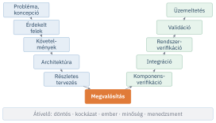
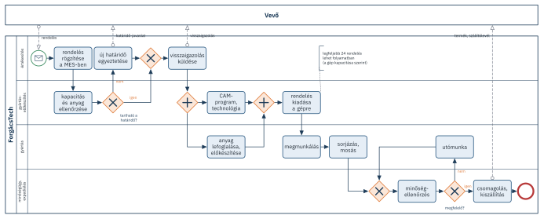

# Folyamatmodellezés BPMN-nel {#sec-bpmn}

::: {.vterkep}
{fig-alt="V-térkép: a fejezet helye a rendszerfejlesztés folyamatában" width=62%}
:::

::: {.cel}
A fejezet feldolgozása után képes leszel:

- elhelyezni a folyamatmodellezést a folyamatmenedzsment életciklusában;
- kiválasztani a folyamatfeltárás megfelelő módszereit, és összevetni erősségeiket és gyengeségeiket;
- BPMN 2.0 jelöléssel modellezni egy több résztvevős folyamatot eseményekkel, tevékenységekkel, átjárókkal, sávokkal és üzenetfolyamokkal;
- alkalmazni a modellezési irányelveket, hogy a modell érthető és hibamentes legyen;
- a modellből a folyamat átfutási idejét kiszámítani, és eldönteni, mikor van szükség szimulációra;
- megkülönböztetni a folyamatbányászat három feladatát, és a modellt eseménynaplóval összevetni;
- nagy nyelvi modellt felelősen használni a modell előállításában és ellenőrzésében.
:::

Az előző fejezet a folyamatot számokkal írta le: árammal, kapacitással, hatékonysággal. Ehhez azonban tudni kell, milyen lépésekből áll a folyamat, ki végzi őket, hol ágazik el, és milyen információ áramlik a résztvevők között. Ezt a **folyamatmodell** rögzíti. A rendszermérnökségben a folyamatmodellnek kettős szerepe van: a fejlesztés tárgyát (egy gyártó- vagy szolgáltatófolyamatot) írja le, és egyben a fejlesztendő informatikai rendszer követelményeinek forrása, mert megmutatja, mely lépéseket kell a rendszernek támogatnia vagy automatizálnia. A fejezet a folyamatmenedzsment tankönyvi összefoglalására [@dumas2018], a BPMN 2.0 szabványra [@omg2011bpmn] és a folyamatbányászat alapművére [@vanderaalst2016] épül.

## A folyamatmenedzsment életciklusa {#sec-bpmn-eletciklus}

Dumas és szerzőtársai a folyamatmenedzsmentet hat szakaszból álló, ismétlődő ciklusként írják le ([-@fig-bpm-eletciklus]. ábra) [@dumas2018, 1. fejezet]. A **folyamatazonosítás** a szervezet folyamatait és kapcsolataikat (a folyamatarchitektúrát) tárja fel, és kiválasztja a fejlesztendő folyamatot. A **folyamatfeltárás** a jelenlegi (as-is) modellt készíti el. A **folyamatelemzés** a gyengeségeket és azok hatását tárja fel, minőségi és mennyiségi módszerekkel. Az **újratervezés** a jövőbeli (to-be) modellt állítja elő. A **bevezetés** a szervezeti változtatásokat és a folyamat informatikai támogatását valósítja meg. A **monitorozás és irányítás** a végrehajtás adataiból méri a folyamatot, és visszacsatol a következő ciklusba.

![A folyamatmenedzsment életciklusa és a szakaszok kimenetei [@dumas2018, 1. fejezet nyomán].](../abrak/gen/bpm-eletciklus.svg){#fig-bpm-eletciklus width=72%}

A ciklus a V-modellel jól összeilleszthető: a feltárás és az elemzés a probléma meghatározásához és a működési koncepcióhoz ([-@sec-problema]. fejezet), az újratervezés az architektúrához és a koncepcióválasztáshoz, a bevezetés a megvalósításhoz és az integrációhoz, a monitorozás az üzemeltetéshez tartozik. A ForgácsTech MES-projektje ([-@sec-dontes]. fejezet) például a rendelésteljesítési folyamat feltárásával kezdődött, és a bevezetett rendszer adataiból a folyamat újabb ciklusban fejleszthető tovább.

A folyamatok három csoportját érdemes megkülönböztetni: az **üzleti** (alap)folyamatok értéket teremtenek a vevő számára (például a rendelésteljesítés), a **fejlesztési** folyamatok új termékeket és képességeket hoznak létre, az **üzemeltetési** (támogató) folyamatok a működés feltételeit biztosítják (karbantartás, beszerzés, informatika).

## Folyamatfeltárás {#sec-bpmn-feltaras}

A folyamatfeltárás nehézsége, hogy a folyamatot ismerő szakemberek általában nem modelleznek, a modellező pedig nem ismeri a folyamatot. A tudás szétszórt: mindenki a saját lépéseit ismeri, és ritkán látja a teljes folyamatot [@dumas2018, 5. fejezet]. A feltárás módszereit a [-@tbl-feltaras]. táblázat foglalja össze.

| Módszer | Erősség | Gyengeség |
|:--|:--|:--|
| dokumentumelemzés | strukturált információ, nem igényli az érintettek idejét | elavult anyag, nem megfelelő részletezettség |
| megfigyelés | gazdag, a valóságot mutató kép a folyamatról | zavaró lehet, a megfigyeltek másképp viselkedhetnek, kevés esetet lát |
| automatikus feltárás (folyamatbányászat) | sok eset, objektív adat | az adatok minősége gyenge lehet |
| interjú | részletes, mélyre hatoló kérdezés | sok időt kér az érintettektől, több körös egyeztetés kell |
| workshop | az eltérő nézetek közvetlenül tisztázhatók | egyszerre több érintett jelenlétét igényli |

: A folyamatfeltárás módszerei [@dumas2018, 5. fejezet nyomán]. {#tbl-feltaras tbl-colwidths="[24,38,38]"}

A módszereket a gyakorlatban kombináljuk: a dokumentumokból és az informatikai rendszerek naplóiból vázlatot készítünk, interjúkkal és megfigyeléssel pontosítjuk, és workshopon hagyjuk jóvá. Az interjúk technikáját a [-@sec-erdekelt-felek]. fejezet, a megfigyelés és a feladatelemzés módszereit a [-@sec-emberkozpontu]. fejezet tárgyalja.

## A BPMN 2.0 jelölés {#sec-bpmn-jeloles}

A **BPMN** (Business Process Model and Notation) az Object Management Group (OMG) szabványa, amelynek 2.0 változata 2011-ben jelent meg [@omg2011bpmn], és ISO/IEC szabványként is elfogadták [@iso19510_2013]. Célja, hogy az üzleti és a műszaki szakemberek egyaránt megértsék, és hogy a modell végrehajtható folyamatleírássá is alakítható legyen. A szabvány az elemeket öt alapcsoportba sorolja: folyamatobjektumok (események, tevékenységek, átjárók), adatok, összekötők, résztvevők (medencék és sávok) és kiegészítők [@omg2011bpmn, 7.2. szakasz]. A leggyakrabban használt elemeket a [-@fig-bpmn-elemek]. ábra mutatja.

![A BPMN 2.0 leggyakrabban használt elemei [@omg2011bpmn nyomán].](../abrak/gen/bpmn-elemek.svg){#fig-bpmn-elemek width=100%}

- **Események:** valami, ami megtörténik. Az indító esemény elindítja, a záró esemény befejezi a folyamatot, a köztes esemény a folyamat közben következik be (például egy üzenet megérkezése vagy egy határidő lejárta). Az esemény típusát belső jel mutatja: üzenet, időzítő, hiba, jelzés.
- **Tevékenységek:** a munka egységei. A feladat tovább nem bontott tevékenység; az alfolyamat önálló modellben részletezett tevékenységcsoport. A jelölők ismétlődést, többszörös végrehajtást vagy kompenzációt jeleznek; a feladat típusa is jelölhető (felhasználói, automatikus, kézi, üzenetküldő).
- **Átjárók:** a folyamat elágazása és összefutása. A **kizáró** (XOR) átjáró a feltételek alapján pontosan egy ágat választ; a **párhuzamos** (ÉS) átjáró minden ágat elindít, illetve mindegyik befejeződését megvárja; a **befogadó** (VAGY) átjáró egy vagy több ágat indít; az **eseményalapú** átjáró annak alapján választ, melyik esemény következik be előbb.
- **Összekötők:** a **szekvenciafolyam** a végrehajtás sorrendjét mutatja egy résztvevőn belül, az **üzenetfolyam** két résztvevő közötti üzenetváltást, az **asszociáció** a kiegészítőket köti az elemekhez.
- **Résztvevők:** a **medence** egy önálló résztvevőt (szervezetet, vevőt, informatikai rendszert) jelöl, a **sáv** a medencén belüli szerepet vagy szervezeti egységet. Két medence között csak üzenetfolyam lehet.
- **Kiegészítők:** az adatobjektum a folyamatban keletkező vagy felhasznált dokumentumot, adatot jelöl; a csoport és a szöveges megjegyzés a modell olvasását segíti.

::: {.eset eset="C" title="ForgácsTech: a rendelésteljesítés jövőbeli folyamata"}
A ForgácsTech csapata a MES első ütemének bevezetésekor a rendelésteljesítés jövőbeli folyamatát BPMN-nel modellezte ([-@fig-bpmn-forgacs]. ábra). A vevő külön medence: belső működése nem érdekes, csak az üzenetváltás vele. A ForgácsTech medencéje négy sávra oszlik. A rendelés beérkezésekor az értékesítés rögzíti a rendelést a MES-ben, a gyártáselőkészítés a MES ütemezőjével ellenőrzi a kapacitást és az anyagot. Ha a kért határidő nem tartható, az értékesítés új határidőt egyeztet a vevővel; ezután küldi el a visszaigazolást. A CAM-program elkészítése és az anyag lefoglalása párhuzamosan fut. A rendelést csak akkor adják ki a gépre, ha a folyamatban lévő rendelések száma a korlát alatt van ([-@sec-folyamatelemzes]. fejezet). A minőségellenőrzés után a nem megfelelő darab utómunkára kerül, majd újra ellenőrzik.

{#fig-bpmn-forgacs width=100%}

A jelenlegi folyamat modellje két fontos különbséget mutatott. A kapacitást a termelésvezető becsülte heti egyszer, papíron, ezért a visszaigazolás átlagosan több mint egy napig tartott. A sürgős rendeléseket pedig szóban sorolták előre, ami a modellben sehol sem jelent meg, a valóságban viszont gyakori volt ([-@sec-bpmn-banyaszat]. szakasz).
:::

## Modellezési irányelvek {#sec-bpmn-iranyelvek}

Ugyanaz a folyamat sokféleképpen modellezhető, és a modellek érthetősége, hibákra való hajlama nagyon különböző. Mendling, Reijers és van der Aalst empirikus vizsgálatok alapján hét irányelvet fogalmazott meg (7PMG) [@mendling2010]:

1. a modell a lehető legkevesebb elemből álljon;
2. egy elembe a lehető legkevesebb ág fusson be és fusson ki;
3. egy indító és egy záró esemény legyen;
4. a modell a lehető legstrukturáltabb legyen: minden elágazó átjárónak legyen azonos típusú összefutó párja;
5. kerülni kell a befogadó (VAGY) átjárókat;
6. a tevékenységek neve „ige + tárgy” szerkezetű legyen (például „rendelés rögzítése”);
7. az 50 elemnél nagyobb modellt alfolyamatokra kell bontani.

Ezekhez a gyakorlatban néhány további szabály társul. A modellnek egyértelmű célja és nézőpontja legyen (kinek készül, mit kell megmutatnia). A részletezettség legyen egyenletes: egy modellben ne keveredjenek a stratégiai lépések a billentyűleütésekkel. A medencék közötti kapcsolat mindig üzenetfolyam, a sávok közötti átadás szekvenciafolyam. A ForgácsTech modellje ([-@fig-bpmn-forgacs]. ábra) egy indító és egy záró eseményt használ, a kizáró átjárók összefutását is kirajzolja, és a párhuzamos ágakat azonos típusú átjáró zárja, így strukturált; 12 tevékenységével jóval az 50 elemes határ alatt marad.

## Mértékek és szimuláció {#sec-bpmn-szimulacio}

A folyamat teljesítményét négy szempontból mérjük: idő, költség, minőség és rugalmasság [@dumas2018, 2. fejezet]. A négy szempont gyakran ütközik: a gyorsabb folyamat drágább lehet, a rugalmasabb lassabb. A mérőszámokat két szinten érdemes megkülönböztetni. A **kulcsmutatók** (KPI) a szervezet egészének céljaihoz kapcsolódnak, és hosszabb távon állandóak (például a határidőre teljesített rendelések aránya). Az **akciócentrikus mutatók** egy-egy folyamatlépést vagy részfolyamatot követnek, és közvetlen beavatkozásra alkalmasak (például a visszaigazolás átfutási ideje).

A modell elemeihez paraméterek rendelhetők: a tevékenységekhez ciklusidő, erőforrás, költség és rendelkezésre állás, az átjárók ágaihoz valószínűség. Ezekből a **folyamatáram-elemzés** kiszámítja a folyamat átlagos ciklusidejét: soros lépéseknél az idők összeadódnak, a kizáró átjáró ágainál az ágak idejének valószínűséggel súlyozott átlagát, a párhuzamos ágaknál a leghosszabb ág idejét vesszük; egy $r$ valószínűséggel ismétlődő $T$ idejű blokk várható ideje $T/(1-r)$ [@dumas2018, 7. fejezet]:

$$
CT_\text{soros} = \sum_i T_i, \qquad CT_\text{XOR} = \sum_i p_i T_i, \qquad CT_\text{ÉS} = \max_i T_i, \qquad CT_\text{ismétlés} = \frac{T}{1-r}.
$$ {#eq-folyamataram}

::: {.eset eset="C" title="ForgácsTech: mennyi ideig tart a visszaigazolás?"}
A jelenlegi folyamatban a rögzítés fél óra, a kapacitás becslése (a termelésvezetőre várással együtt) átlagosan 16 óra, a rendelések 40%-ánál új határidőt kell egyeztetni, ami a vevő válaszával együtt 24 óra, a visszaigazolás elküldése fél óra. A visszaigazolás átlagos ideje $0{,}5 + 16 + 0{,}4 \cdot 24 + 0{,}5 = 26{,}6$ óra. A MES ütemezőjével a kapacitás-ellenőrzés 2 óra, és mivel a vállalt határidők a kapacitáson alapulnak, csak a rendelések 20%-ánál kell egyeztetni: $0{,}5 + 2 + 0{,}2 \cdot 24 + 0{,}5 = 7{,}8$ óra. A párhuzamos ágon a CAM-program 6, az anyag előkészítése 4 óra, a blokk ideje a hosszabb ág, 6 óra; ha sorban végeznék, 10 óra lenne. A minőségellenőrzés 0,6 óra, a darabok 5%-a 1 órás utómunkára és újraellenőrzésre szorul, így a blokk várható ideje $(0{,}6 + 0{,}05 \cdot 1)/(1 - 0{,}05) = 0{,}68$ óra.
:::

A folyamatáram-elemzés átlagokkal számol, és nem veszi figyelembe, hogy a tevékenységek erőforrásokon osztoznak, és az ingadozó érkezések sorokat okoznak. Ezekre a kérdésekre a sorbanállási modellek ([-@sec-utemezes]. fejezet) és a **folyamatszimuláció** ad választ. A szimuláció a modellt eseményenként végrehajtja, véletlen érkezési és feldolgozási időkkel, és a „mi lenne, ha” kérdésekre ad választ: mi történik, ha nő a rendelések száma, ha egy erőforrás kiesik, vagy ha egy lépést automatizálunk [@dumas2018, 7. fejezet]. A szimuláció eredménye annyira megbízható, amennyire a bemenő adatok és a modell validálása ([-@sec-modellek]. fejezet). A folyamatosan frissített adatokkal futó szimulációs modell a digitális iker egyik formája.

## Folyamatbányászat {#sec-bpmn-banyaszat}

Az informatikai rendszerek (ERP, MES, ügyviteli rendszerek) minden lépést naplóznak. Az **eseménynapló** minden sora egy esemény: melyik esethez tartozik (esetazonosító), melyik tevékenység történt, mikor (időbélyeg), és gyakran az is, ki végezte. A **folyamatbányászat** ezekből a naplókból nyer ismeretet a valóságban futó folyamatról. Van der Aalst három feladattípust különböztet meg [@vanderaalst2016]:

- **feltárás:** a naplóból modell készül, előzetes modell nélkül;
- **megfelelőség-ellenőrzés:** a meglévő modellt vetjük össze a naplóval, és feltárjuk, hol tér el a valóság a modelltől;
- **bővítés:** a meglévő modellt a napló adataival gazdagítjuk, például a várakozási időkkel vagy a szűk keresztmetszetekkel.

::: {.eset eset="C" title="ForgácsTech: a napló, amely felfedte a rejtett lépést"}
A MES első három hónapjának naplójában a rendelések 17%-ánál szerepelt egy „rendelés átsorolása” esemény, amely a jövőbeli modellben nem szerepelt: a sürgős rendeléseket a termelésvezető továbbra is előre sorolta, csak most a rendszerben. Az átsorolt rendelések határidőre teljesültek, az általuk megelőzött rendelések viszont átlagosan csaknem két munkanappal később kerültek gépre, és több mint harmaduk késve teljesült. A csapat a lépést beépítette a modellbe, és szabályhoz kötötte: átsorolni csak akkor lehet, ha az ütemező szerint a megelőzött rendelések határideje így is tartható. A folyamatbányászat eszközeit és lépéseit a Gyakorlati útmutató folyamatbányászati eszközlapja mutatja be.
:::

A folyamatbányászat eredménye a napló minőségén múlik: hiányzó vagy pontatlan időbélyegek, eltérő tevékenységnevek és rosszul meghatározott esetfogalom torz modellt adnak [@vanderaalst2016]. Az eseménynapló a folyamat minden szereplőjéről személyes adatot is tartalmazhat, ezért az elemzés célját és az adatkezelés módját előre rögzíteni kell.

## Nagy nyelvi modellek a folyamatmodellezésben {#sec-bpmn-llm}

A nagy nyelvi modellek (LLM) szöveges folyamatleírásból folyamatmodellt tudnak előállítani. Grohs és szerzőtársai három feladaton vizsgálták a GPT-4-et: imperatív folyamatmodell kinyerését szövegből, deklaratív modell kinyerését szövegből és annak megítélését, mely feladatok alkalmasak robotizált folyamatautomatizálásra. Mindhárom feladatban a célra fejlesztett megoldásokhoz hasonló vagy jobb eredményt kaptak, különösebb előkészítés nélkül [@grohs2024]. Kourani és szerzőtársai olyan keretrendszert javasoltak, amelyben a nyelvi modell nem közvetlenül rajzol, hanem egy köztes, ellenőrizhető folyamatleíró kódot állít elő; a hibákat a rendszer automatikusan visszajelzi, és a kész modell BPMN-be vagy Petri-hálóba exportálható [@kourani2024]. A szöveges modellleírás és a modellek iteratív, párbeszédes finomítása így a modellezés gyakorlati eszközévé vált.

A nyelvi modell azonban a valóságot nem ismeri: csak a kapott leírást és az általános tudását. Ebből három szabály következik:

1. **Kétlépcsős munkamenet.** A modell először csak értelmezze a leírást: sorolja fel a résztvevőket, az eseményeket, a tevékenységeket és a döntési pontokat, és tegyen fel tisztázó kérdéseket. A modellt csak a jóváhagyott értelmezés alapján generálja.
2. **Jelenlegi állapot a leírás szerint.** A feltárás során kifejezetten kérni kell, hogy a modell ne optimalizáljon és ne egészítsen ki: a „szokásos” lépések hozzáadása éppen a valóságos eltéréseket fedi el.
3. **Ellenőrzés.** A generált modellt modellezőeszközben meg kell nyitni (érvényes-e, olvasható-e), és a folyamat résztvevőivel jóvá kell hagyatni. A megfelelőség-ellenőrzést is támogathatja a nyelvi modell (az eseménynaplót és a modellt együtt megadva), de a következtetést a naplóból számított gyakoriságokkal kell igazolni.

A kidolgozott mintapromptokat a Gyakorlati útmutató BPMN-eszközlapja tartalmazza.

::: {.kitekintes title="Végrehajtható modellek és munkafolyamat-motorok"}
A BPMN 2.0 nemcsak jelölés, hanem végrehajtási szemantikát is meghatároz: a modell munkafolyamat-motorban futtatható, amely a felhasználói feladatokat kiosztja, a szolgáltatásfeladatokat meghívja, és minden lépést naplóz [@omg2011bpmn]. Ilyenkor a modell a működő rendszer része, és a naplózott adatok közvetlenül a folyamatbányászat bemenetei. A ForgácsTech MES-e a rendelésteljesítés lépéseit így követi. A végrehajtható modellhez azonban jóval részletesebb leírás kell (adatok, feltételek, kivételek kezelése), mint a megértést szolgáló modellhez; a kettőt nem érdemes összekeverni.
:::

::: {.hiba title="A modell, amely a szabályzatot rajzolja le"}
Gyakori hiba, hogy a jelenlegi folyamat modellje a szabályzatból vagy a vezető elmondásából készül, és azt mutatja, hogyan kellene a folyamatnak működnie. Az ilyen modellből levont következtetések tévesek, mert a kerülőutak, a kivételek és a rejtett lépések hiányoznak belőle. A jelenlegi állapotot a folyamatot végzőkkel, megfigyeléssel és lehetőség szerint eseménynaplóval kell feltárni.
:::

::: {.osszefoglalo}
- A folyamatmenedzsment életciklusa: azonosítás, feltárás, elemzés, újratervezés, bevezetés, monitorozás; a ciklus a V-modell lépéseivel összeilleszthető.
- A feltárás módszerei (dokumentumelemzés, megfigyelés, automatikus feltárás, interjú, workshop) egymást kiegészítik.
- A BPMN 2.0 elemei: események, tevékenységek, átjárók, összekötők, résztvevők (medence, sáv) és kiegészítők; medencék között csak üzenetfolyam lehet.
- A 7PMG irányelvei (kevés elem, egy indító és egy záró esemény, strukturált modell, „ige + tárgy” nevek, alfolyamatok) a modell érthetőségét és helyességét javítják.
- A folyamatáram-elemzés a modellből átlagos ciklusidőt számít; az erőforrás-versengéshez és az ingadozáshoz szimuláció kell.
- A folyamatbányászat feladatai: feltárás, megfelelőség-ellenőrzés, bővítés; az eredmény a napló minőségén múlik.
- A nagy nyelvi modell gyorsítja a modellezést, de a kimenetet kétlépcsős munkamenettel, modellezőeszközben és a résztvevőkkel ellenőrizni kell.
:::

::: {.onell}
1. Sorold fel a folyamatmenedzsment életciklusának szakaszait és kimeneteit!
2. Miért kevés egyetlen feltárási módszer? Melyik módszert választanád egy háromműszakos gyártóüzem anyagellátási folyamatának feltárására, és miért?
3. Mi a különbség a szekvenciafolyam és az üzenetfolyam között? Miért nem köthet össze két medencét szekvenciafolyam?
4. Mi a különbség a kizáró, a párhuzamos és a befogadó átjáró között? Adj példát mindháromra!
5. Egy folyamat három soros lépésből áll (1, 2 és 1 óra). A második és a harmadik lépés közé 30% valószínűséggel egy 4 órás ellenőrző lépés ékelődik. Mennyi az átlagos ciklusidő?
6. Egy 2 órás lépést 20% valószínűséggel meg kell ismételni. Mennyi a várható ideje?
7. Mi a folyamatbányászat három feladata? Melyikkel derítenéd ki, hogy a dolgozók megkerülik-e a jóváhagyási lépést?
8. Miért kell egy nyelvi modellel készített folyamatmodellt a folyamat résztvevőivel is jóváhagyatni?

::: {.megoldas}
1. Azonosítás (folyamatarchitektúra), feltárás (jelenlegi modell), elemzés (gyengeségek és hatásuk), újratervezés (jövőbeli modell), bevezetés (végrehajtható folyamat), monitorozás és irányítás (megfelelőségi és teljesítményadatok).
2. Mert mindegyiknek más a gyengesége: a dokumentum elavult lehet, a megfigyelés kevés esetet lát, az interjú egy ember nézőpontját adja. Háromműszakos üzemben a megfigyelés több műszakban, a dolgozókkal készült interjúk és a raktári rendszer naplója együtt adja a teljes képet; a vázlatot workshopon érdemes jóváhagyatni.
3. A szekvenciafolyam a végrehajtás sorrendjét mutatja egy résztvevőn belül, az üzenetfolyam két önálló résztvevő közötti kommunikációt. Két medence egymástól függetlenül működik, a sorrendjüket nem egymás vezérlése, hanem üzenetek váltása kapcsolja össze.
4. Kizáró: pontosan egy ág (jóváhagyják vagy elutasítják a rendelést). Párhuzamos: minden ág (a CAM-program és az anyag előkészítése egyszerre). Befogadó: egy vagy több ág (a rendeléshez szükség lehet hőkezelésre, felületkezelésre vagy mindkettőre).
5. $1 + 2 + 0{,}3 \cdot 4 + 1 = 5{,}2$ óra: a kizáró ág idejét a valószínűségével súlyozzuk.
6. $2/(1 - 0{,}2) = 2{,}5$ óra.
7. Feltárás, megfelelőség-ellenőrzés, bővítés. A megkerülést a megfelelőség-ellenőrzés mutatja ki: azokat az eseteket keresi, amelyekben a jóváhagyás eseménye hiányzik, vagy a sorrend eltér a modelltől.
8. Mert a nyelvi modell csak a kapott leírásból és általános tudásából dolgozik: kitölthet hiányokat „szokásos” lépésekkel, és nem tudhatja, mi történik valójában. A résztvevők jóváhagyása az érvényesítés része.
:::
:::

::: {.projekt title="Projektlépés: folyamatmodell"}
Saját fejlesztési feladatodhoz:

1. válaszd ki a megvalósítás szempontjából legfontosabb folyamatot, és határozd meg a modell célját és nézőpontját;
2. tárd fel a jelenlegi folyamatot legalább két módszerrel (például interjú és megfigyelés vagy dokumentum);
3. készíts BPMN 2.0 modellt legalább három résztvevővel (medencével vagy sávval) és legalább tíz tevékenységgel, és ellenőrizd a 7PMG irányelvei szerint;
4. rendelj a tevékenységekhez időt és az átjárókhoz valószínűséget, és számítsd ki az átlagos ciklusidőt;
5. használd a Gyakorlati útmutató BPMN-eszközlapját, a modellt pedig egy BPMN-szerkesztőben (például a bpmn.io webes szerkesztőjében) készítsd el.
:::

::: {.forras}
- @dumas2018: a folyamatmenedzsment alapvető tankönyve az életciklustól a feltáráson, a modellezésen és az elemzésen át a folyamatbányászatig.
- @omg2011bpmn: a BPMN 2.0 szabvány; @iso19510_2013: ugyanez nemzetközi szabványként.
- @mendling2010: a hét modellezési irányelv és empirikus háttere.
- @vanderaalst2016: a folyamatbányászat alapműve.
- @grohs2024 és @kourani2024: nagy nyelvi modellek a folyamatmodellezésben.
:::
