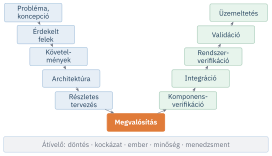
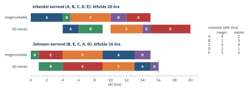
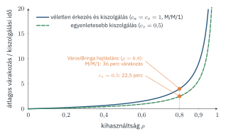

# Ütemezés, készlet és sorbanállás {#sec-utemezes}

::: {.vterkep}
{fig-alt="V-térkép: a fejezet helye a rendszerfejlesztés folyamatában" width=62%}
:::

::: {.cel}
A fejezet feldolgozása után képes leszel:

- elhelyezni a gyártásirányítás feladatait a vállalat–irányítás integráció (ISA-95) szintjein;
- megfogalmazni egy ütemezési feladatot (feladatok, műveletek, erőforrások, korlátozások, célfüggvény), és Gantt-diagrammal ábrázolni;
- alkalmazni az SPT, az EDD és a Johnson-sorolást, és értelmezni, melyik célfüggvényre optimális;
- leírni egy diszkrét eseményű rendszert, és eldönteni, mikor kell szimulációval vizsgálni;
- a Kendall-jelöléssel osztályozni egy sorbanállási rendszert, kiszámítani az M/M/1 rendszer jellemzőit, és becsülni a változékonyság hatását;
- kiszámítani a készletforgást és a készlethatékonyságot, és ABC-elemzéssel differenciált készletgazdálkodást tervezni.
:::

A [-@sec-folyamatelemzes]. fejezet a folyamatot átlagokkal írta le: áram, kapacitás, kihasználtság. A [-@sec-bpmn]. fejezet a lépések logikáját modellezte. Ez a fejezet három további kérdést vizsgál, amely a megvalósító folyamat tervezésében mindig felmerül:

- **Ki, mikor, min dolgozzon?** Ez az ütemezés kérdése.
- **Mennyit kell várni?** Ezt a sorbanállási modellek és a szimuláció válaszolják meg.
- **Mennyi anyagot és félkész terméket tartsunk?** Ez a készletgazdálkodás kérdése.

A három kérdést a Little-törvény köti össze ([-@sec-folyamatelemzes]. fejezet): a várakozó munka készlet, és a készlet átfutási idő. A fejezet Lakatos Béla egyetemi jegyzeteire [@lakatos_termelesi; @lakatos_rendszerek] és a nemzetközi tankönyvekre épül [@pinedo2022; @hopp2008; @silver2016].

## A gyártásirányítás szintjei {#sec-utem-szintek}

Egy gyártó vállalat döntései különböző időtávokon születnek. Az IEC 62264 szabvány (az amerikai ISA-95 nemzetközi változata) a vállalatirányítási és a gyártásirányítási rendszerek integrációjához funkcionális hierarchiát határoz meg ([-@fig-isa95-szintek]. ábra) [@iec62264_2013]. A 4. szint az üzleti tervezés és a logisztika (jellemzően az ERP-rendszer), a 3. szint a gyártásirányítás (MOM, a gyakorlatban a MES): a részletes ütemezés, a gyártási rendelések kiadása, a teljesítmény követése. A 2. szint a felügyelet és a folyamatirányítás, az 1. szint az érzékelés és a beavatkozás, a 0. szint maga a fizikai folyamat. Az alsóbb szintek rövidebb időtávon döntenek: a 4. szint hónapokban és hetekben, a 3. szint napokban, műszakokban és órákban, az alsó szintek percekben és másodpercekben gondolkodnak.

![A vállalat–irányítás integráció szintjei [@iec62264_2013 nyomán], a ForgácsTech példájával.](../abrak/gen/isa95-szintek.svg){#fig-isa95-szintek width=92%}

Lakatos ugyanezt a hierarchiát a tervezés felől írja le: hosszabb időhorizonton a koordinációs szint aggregált tervet készít, rövid időhorizonton a lokális szint műveletterveket; a kettő együtt már a rendszertervezés és a rendszerirányítás kombinációja [@lakatos_rendszerek, 8.1. szakasz]. A ForgácsTech problémája ([-@sec-problema]. fejezet) éppen a 3. szinten volt: az ERP ismerte a rendeléseket, a gépvezérlők a műveleteket, de a kettő között a heti papíralapú ütemterv egyhetes késleltetéssel zárta az irányítási kört. A MES ezt a rést tölti ki.

## Ütemezés {#sec-utem-utemezes}

Az ütemezési feladat elemei: a **munkafeladatok** (mit kell gyártani), a **műveletek** (milyen lépésekből áll), a **műveleti egységek** (milyen erőforrásokon) és a **korlátozások**. A műveletek és a műveleti egységek összerendelése az allokáció. A korlátozások lehetnek időbeliek (kezdési és befejezési idő, megszakíthatóság), kizárásiak (a feladatok osztoznak egy erőforráson) és sorrendiek (egy feladat olyan anyagot vagy információt igényel, amelyet egy másik állít elő) [@lakatos_termelesi, 6.1. szakasz]. Két feladatosztály különböztethető meg: az **ütemezés** az összerendelést és a sorrendet úgy határozza meg, hogy a korlátozások teljesüljenek, és a célfüggvény optimális legyen; a **megvalósíthatósági vizsgálat** adott összerendelésről azt dönti el, teljesíthetők-e a korlátozások [@lakatos_termelesi, 6.1. szakasz].

Az ütemezési feladatokat a gépkörnyezet szerint osztályozzuk: egy gép, párhuzamos gépek, **folyamatsor** (flow shop: minden feladat ugyanabban a sorrendben halad át a gépeken) és **műhelyrendszer** (job shop: minden feladatnak saját útvonala van) [@pinedo2022, 2. fejezet]. A ForgácsTech egyedi rendelései műhelyrendszert alkotnak, a KoboCella-sor folyamatsor.

A munkafeladatok időjellemzői: a $t_{p,i}$ műveleti idő, a $d_i$ esedékesség (határidő), a $t_{f,i}$ átfutási idő (a feladat befejezéséig eltelt idő), az $L_i = t_{f,i} - d_i$ pontatlanság (lehet negatív), a $T_i = \max\{L_i, 0\}$ késedelem [@lakatos_termelesi, 6.3. szakasz]. A leggyakoribb célfüggvények az átlagos átfutási idő, a legnagyobb késedelem, a késő feladatok száma, a teljes átfutás (az utolsó feladat befejezése) és az átállási veszteség. Az ütemtervet a **Gantt-diagram** ábrázolja: minden sor egy erőforrás, minden téglalap egy művelet, amelynek hossza a műveleti idő. A diagram több mint száz éve a termelésirányítás alapeszköze [@wilson2003].

Egy gépen a legegyszerűbb ütemezési szabályok a **sorolási elvek** [@lakatos_termelesi, 6.3. szakasz]:

- **FCFS** (first come, first served): érkezési sorrend;
- **SPT** (shortest processing time): a legrövidebb műveleti idő először; egy gépen ez minimalizálja az átlagos átfutási időt, az átlagos várakozási időt és az átlagos pontatlanságot;
- **EDD** (earliest due date): a legkorábbi határidő először; egy gépen ez minimalizálja a legnagyobb késedelmet;
- **CR** (critical ratio): a határidőig hátralévő idő és a műveleti idő hányadosa szerint, dinamikus helyzetekre.

::: {.eset eset="C" title="ForgácsTech: hat rendelés egy gépen"}
A megmunkáló központra reggel hat rendelés vár ([-@tbl-sorolas-forgacs]. táblázat). Érkezési sorrendben négy rendelés késik, a legnagyobb késedelem 12 óra. SPT-sorolással az átlagos átfutási idő 16,8 óráról 13,0 órára csökken, és csak egy rendelés késik 2 órát. EDD-sorolással egyetlen rendelés sem késik, az átlagos átfutás 13,5 óra. A MES ütemezője ezért a határidő-tartást elsődleges célnak tekintve EDD-vel indul, és az egyforma határidejű rendeléseket SPT szerint rendezi.

| Rendelés | R1 | R2 | R3 | R4 | R5 | R6 |
|:--|--:|--:|--:|--:|--:|--:|
| műveleti idő [óra] | 6 | 2 | 8 | 3 | 5 | 4 |
| határidő [óra múlva] | 20 | 6 | 30 | 10 | 12 | 24 |

: A megmunkáló központra váró rendelések. {#tbl-sorolas-forgacs tbl-colwidths="[28,12,12,12,12,12,12]"}

| Sorolás | Sorrend | Átlagos átfutás [óra] | Késő rendelések | Legnagyobb késedelem [óra] |
|:--|:--|--:|--:|--:|
| FCFS | R1, R2, R3, R4, R5, R6 | 16,8 | 4 | 12 |
| SPT | R2, R4, R6, R5, R1, R3 | 13,0 | 1 | 2 |
| EDD | R2, R4, R5, R1, R6, R3 | 13,5 | 0 | 0 |

: A sorolási elvek összevetése. {#tbl-sorolas-eredmeny tbl-colwidths="[12,34,18,16,20]"}
:::

Két gépből álló folyamatsorban, ahol minden feladat előbb az első, majd a második gépen halad át, a teljes átfutást **Johnson eljárása** minimalizálja [@johnson1954]: keresd meg a legkisebb műveleti időt a még nem sorolt feladatok között; ha ez az első gépen van, a feladat a sorrend elejére kerül, ha a másodikon, a végére; ismételd a maradék feladatokra [@lakatos_termelesi, 6.3. szakasz]. Három vagy több gépre és műhelyrendszerre a feladat általában NP-nehéz, ezért heurisztikákat, egészértékű programozást vagy kényszerprogramozást használnak [@pinedo2022].

::: {.eset eset="C" title="ForgácsTech: megmunkálás és 3D mérés"}
Öt rendelés előbb a megmunkáló központon, majd a 3D mérőgépen halad át ([-@fig-gantt-johnson]. ábra). Érkezési sorrendben a teljes átfutás 20 óra, mert a mérőgép az elején és a C rendelés előtt is áll. A Johnson-sorrend (B, E, C, A, D) a legrövidebb első gépi idejű B rendeléssel indít, hogy a mérőgép hamar munkát kapjon, és a legrövidebb második gépi idejű D rendeléssel zár. A teljes átfutás 16 óra; ez egyben az alsó korlát is (az első gép 15 órája plusz a legrövidebb mérés), tehát az ütemezés optimális.

{#fig-gantt-johnson width=96%}
:::

## Diszkrét eseményű rendszerek és szimuláció {#sec-utem-des}

A szakaszos gyártórendszerek, a műhelyek és a szolgáltatások **diszkrét eseményű rendszerek**: véges idő alatt véges számú esemény történik, és a rendszer állapota csak ezekben az időpontokban változik [@lakatos_rendszerek, 8.1. szakasz]. Az esemény lehet egy munkafeladat beérkezése, egy művelet kezdete vagy vége, egy gép meghibásodása. Az állapot lehet diszkrét (hány feladat vár a gép előtt) vagy folytonos (folyadékszint egy tartályban). A rendszer leírásának elemei az állapot, a rendszeridő és az eseménylista [@lakatos_termelesi, 8.1. szakasz].

A **diszkrét eseményű szimuláció** ezt a leírást hajtja végre: a szimulációs óra mindig a következő esemény időpontjára ugrik, végrehajtja az esemény hatását az állapotra, és az újonnan keletkező eseményeket felveszi az eseménylistára [@law2015]. A véletlen érkezési és műveleti időket valószínűségi eloszlásokból sorsolja, ezért egy futás egyetlen lehetséges lefolyás: a következtetéshez több független futás és konfidenciaintervallum kell [@law2015]. A szimuláció akkor szükséges, ha a rendszer túl összetett az analitikus modellekhez: több erőforráson osztozó termékek, meghibásodások, átállások, prioritások, munkaidő-beosztás. A szimulációs modell érvényességét a valós rendszerrel kell igazolni ([-@sec-modellek]. fejezet).

## Sorbanállás {#sec-utem-sorbanallas}

Ha a munkafeladatok véletlenszerűen érkeznek, és a kiszolgálásuk ideje is ingadozik, akkor átlagosan elegendő kapacitás mellett is sorok alakulnak ki. A sorbanállási rendszer elemei az ügyfélpopuláció, az érkezési folyamat, a kiszolgáló egységek száma és kiszolgálási ideje, a rendszer kapacitása és a sor viselkedése [@lakatos_termelesi, 8.3. szakasz]. Kendall jelölése a rendszert az *érkezési folyamat / kiszolgálási idő eloszlása / kiszolgálók száma* hármassal írja le [@kendall1953]: M a Markov-tulajdonságú (Poisson-érkezés, exponenciális kiszolgálási idő), D a determinisztikus, G az általános eloszlás. Az M/M/1 rendszerben egy kiszolgáló dolgozik, az érkezési intenzitás $\lambda$, a kiszolgálási intenzitás $\mu$, a kihasználtság $\rho = \lambda/\mu < 1$. A stacionárius állapot jellemzői:

$$
L = \frac{\rho}{1-\rho}, \qquad W = \frac{1}{\mu - \lambda}, \qquad W_q = \frac{\rho}{\mu-\lambda}, \qquad L_q = \frac{\rho^2}{1-\rho},
$$ {#eq-mm1}

ahol $L$ a rendszerben, $L_q$ a sorban lévő feladatok várható száma, $W$ a rendszerben, $W_q$ a sorban töltött idő várható értéke. A jellemzőket a Little-törvény köti össze: $L = \lambda W$, $L_q = \lambda W_q$ [@lakatos_termelesi, 8.3. szakasz; @little1961].

Az M/M/1 modell a véletlen érkezést és a nagyon ingadozó kiszolgálást feltételezi. Általános eloszlásokra Kingman közelítése ad becslést a sorban töltött időre egy kiszolgáló esetén, nagy kihasználtságnál [@kingman1961]. Hopp és Spearman ezt a változékonyság (V), a kihasználtság (U) és az idő (T) szorzataként fogalmazza meg [@hopp2008, 8. fejezet]:

$$
W_q \approx \underbrace{\frac{c_a^2 + c_s^2}{2}}_{V} \cdot \underbrace{\frac{\rho}{1-\rho}}_{U} \cdot \underbrace{t_s}_{T},
$$ {#eq-kingman}

ahol $c_a$ és $c_s$ az érkezések közötti idő és a kiszolgálási idő relatív szórása, $t_s$ az átlagos kiszolgálási idő. Exponenciális eloszlásoknál ($c_a = c_s = 1$) a közelítés az M/M/1 pontos képletét adja vissza. A képlet két tanulsága a rendszertervezés alapszabálya: a várakozás a kihasználtság közelében korlátlanul nő, és a változékonyság csökkentése ugyanúgy rövidíti a várakozást, mint a kapacitás bővítése ([-@fig-sorbanallas-gorbe]. ábra).

::: {.eset eset="B" title="VárosiBringa: mennyit vár egy kerékpár a hajtásláncra?"}
A javítóműhely szűk keresztmetszete a hajtáslánc-javítás ([-@sec-folyamatelemzes]. fejezet): óránként átlagosan $\lambda = 5{,}33$ kerékpár érkezik, a szerelő óránként $\mu = 6{,}67$ kerékpárt javít, a kihasználtság $\rho = 0{,}8$. Ha az érkezések véletlenszerűek és a javítási idők exponenciálisak, egy kerékpár átlagosan $W_q = 0{,}8 / (6{,}67 - 5{,}33) = 0{,}6$ órát, azaz 36 percet vár, a rendszerben átlagosan $L = 4$ kerékpár van. A javítási időket méréssel ellenőrizve kiderült, hogy relatív szórásuk csak 0,5, mert a szerelő szabványos munkautasítás szerint dolgozik. Kingman közelítésével a várakozás $\frac{1 + 0{,}25}{2} \cdot 4 \cdot 9 = 22{,}5$ perc. A nyári csúcsban, a feladatok átcsoportosítása után a mosás kihasználtsága 0,86 lesz; itt a várakozás már a kiszolgálási idő hatszorosa is lehet, ezért a csapat a csúcsidőszakra időpontfoglalást vezetett be, amely az érkezések változékonyságát is csökkenti.

{#fig-sorbanallas-gorbe width=78%}
:::

Több párhuzamos kiszolgálóra (M/M/c) az Erlang-féle képletek adnak pontos eredményt; ezeket és az időbeli változásokat a Gyakorlati útmutató sorbanállási eszközlapja és notebookja számítja ki.

## Készlet és készlethatékonyság {#sec-utem-keszlet}

A készlet a termelési rendszer puffere: alapanyag, alkatrész, műveletközi félkész termék és végtermék formájában. Lakatos a készletezés motivációi között a gazdaságosságot, a bizonytalanságok csökkentését, a szállítási és logisztikai okokat, a termelés simítását és az irányítási költségek csökkentését sorolja fel; a készletezési rendszert az igény jellege, a szállítási idő, a készletellenőrzés periódusa és a készlet értékének változása jellemzi [@lakatos_termelesi, 10.1. szakasz]. A készlet azonban pénzt köt le, helyet foglal, avul, és a Little-törvény szerint meghosszabbítja az átfutást.

A készlet nagyságát a forgalomhoz viszonyítjuk:

$$
\text{fordulatszám} = \frac{\text{forgalom (éves felhasználás)}}{\text{átlagos készlet}}, \qquad \text{készlet napokban} = \frac{\text{napok száma}}{\text{fordulatszám}},
$$ {#eq-keszletforgas}

ahol a forgalmat és a készletet azonos értékalapon (például bekerülési áron) kell mérni [@silver2016]. A **készlethatékonyság** az átlagos készlet és a forgalom hányadosa: azt mutatja, mekkora készlet kell ezer forint forgalomhoz. A készlet napokban kifejezve a Little-törvény alkalmazása: az átlagos idő, amelyet egy anyagegység a raktárban tölt.

A készletgazdálkodás erőforrásait a tételek fontossága szerint érdemes elosztani. Az **ABC-elemzés** a tételeket éves felhasználási értékük szerint csökkenő sorrendbe rendezi, és három csoportra osztja: a kevés, de nagy értékű A tételekre, a közepes B és a sok, kis értékű C tételekre [@silver2016]. A csoporthatárok vállalatonként változnak; a könyv példái a tételek 20–40–40%-os megosztásával dolgoznak. A csoportokhoz eltérő szabályozás tartozik: az A tételeknél pontos nyilvántartás, gyakori felülvizsgálat és előrejelzés, a C tételeknél egyszerű nyilvántartás, nagyobb rendelési tételek és biztonsági készlet.

::: {.eset eset="C" title="ForgácsTech: az anyagkészlet ABC-elemzése"}
A ForgácsTech éves anyag- és szerszámfelhasználása 185 millió forint, az átlagos készlet értéke 31 millió forint. A fordulatszám 6, a készlet 230 munkanappal számolva 38 munkanapnyi felhasználásnak felel meg. A 20 leggyakrabban használt tétel ABC-elemzése szerint a tételek 20%-a (három rúdanyag és a keményfém marószár) adja a felhasználási érték 70%-át, a következő 40% 27%-át, az utolsó 40% csupán 3%-át. A csapat az A tételeknél heti készletfelülvizsgálatot és a rendelésekhez kötött anyaglefoglalást vezetett be a MES-ben; ez szüntette meg az anyagra várást a jövőbeli értékáramban ([-@sec-folyamatelemzes]. fejezet). A C tételeknél negyedéves keretrendelésre tértek át, ami csökkentette a beszerzés adminisztrációját.
:::

A rendelési tételnagyság klasszikus modellje, a gazdaságos rendelési tételnagyság (EOQ), a rendelési (átállási) költség és a készlettartási költség egyensúlyát keresi: $Q^* = \sqrt{2DS/H}$, ahol $D$ az éves igény, $S$ a rendelésenkénti fix költség, $H$ az egységnyi éves készlettartási költség [@silver2016]. A képlet szerint a fix költség csökkentése kisebb optimális tételnagyságot ad: ugyanez a gondolat áll a SMED mögött ([-@sec-folyamatelemzes]. fejezet). A rövidebb átállás kisebb sorozatot, kisebb készletet és rövidebb átfutást tesz lehetővé.

::: {.kitekintes title="Ütemezés és nagy nyelvi modellek"}
Az ütemezési feladatok nagy része kombinatorikus optimalizálási feladat, amelyet célalgoritmusok (heurisztikák, egészértékű és kényszerprogramozás) oldanak meg [@pinedo2022]. A nagy nyelvi modellek itt elsősorban a feladat megfogalmazásában segíthetnek: a szöveges igényekből (határidők, prioritások, kizárások) korlátozásokat és célfüggvényt írnak, vagy elmagyarázzák egy ütemterv döntéseit. Az ütemtervet azonban ellenőrizhető algoritmusnak kell előállítania, és a korlátozások teljesülését automatikusan ellenőrizni kell.
:::

::: {.hiba title="Átlaggal méretezett rendszer"}
Gyakori hiba, hogy a kapacitást az átlagos igényre méretezik, és 95–100%-os kihasználtsággal terveznek. A sorbanállási modellek szerint ilyenkor a várakozás a kiszolgálási idő sokszorosa, és a legkisebb zavar is hosszú sorokat okoz. A szűk keresztmetszeteken tartalékkapacitást kell tervezni, vagy csökkenteni kell az érkezések és a kiszolgálás változékonyságát (időpontfoglalás, szabványos munka, kisebb sorozatok).
:::

::: {.osszefoglalo}
- Az IEC 62264 (ISA-95) a vállalati (4.) és a gyártásirányítási (3.) szint integrációját írja le; a MES a 3. szinten végzi a részletes ütemezést és a teljesítménykövetést.
- Az ütemezési feladat elemei a munkafeladatok, a műveletek, az erőforrások, a korlátozások és a célfüggvény; az ütemtervet Gantt-diagram ábrázolja.
- Egy gépen az SPT az átlagos átfutást, az EDD a legnagyobb késedelmet minimalizálja; két gépes folyamatsorban a Johnson-eljárás a teljes átfutást.
- A diszkrét eseményű rendszer állapota csak eseményekkor változik; a szimuláció a következő esemény időpontjára léptet, és több futásból von le következtetést.
- Az M/M/1 rendszer várakozása $\rho/(\mu - \lambda)$; Kingman közelítése szerint a várakozás a változékonyság, a kihasználtság és a kiszolgálási idő szorzata.
- A készletforgás és a készletnapok a Little-törvény alkalmazásai; az ABC-elemzés a készletgazdálkodás figyelmét a nagy értékű tételekre irányítja.
:::

::: {.onell}
1. Melyik ISA-95 szinthez tartozik a heti termelési terv, a műszakon belüli rendeléssorrend és egy hajtás fordulatszám-szabályozása?
2. Négy feladat műveleti ideje 5, 2, 7 és 3 óra, határidejük 9, 4, 20 és 6 óra. Sorold SPT és EDD szerint, és számítsd ki az átlagos átfutást és a legnagyobb késedelmet!
3. Négy feladat ideje az első és a második gépen: A (3, 6), B (5, 2), C (1, 2), D (6, 6). Add meg a Johnson-sorrendet és a teljes átfutást!
4. Miért kell több független szimulációs futás egy sztochasztikus rendszer vizsgálatához?
5. Egy kiszolgálóhoz óránként 8 ügyfél érkezik, a kiszolgálás átlagosan 6 perc. Mennyi a kihasználtság, és M/M/1 feltevéssel mennyi a sorban töltött idő és a rendszerben lévő ügyfelek száma?
6. Az előző rendszerben a kiszolgálás relatív szórása 0,3-ra csökken. Mennyi a sorban töltött idő Kingman közelítésével?
7. Egy cég éves anyagfelhasználása 120 millió forint, átlagos készlete 20 millió forint. Mennyi a fordulatszám és a készlet napokban (365 nappal)?
8. Miért nem elég az ABC-elemzés önmagában a készletszabályozás megtervezéséhez?

::: {.megoldas}
1. A heti terv a 4. szint (üzleti tervezés), a műszakon belüli sorrend a 3. szint (gyártásirányítás), a fordulatszám-szabályozás a 2. és az 1. szint.
2. SPT: 2, 3, 5, 7 (a második, a negyedik, az első, a harmadik feladat); befejezések 2, 5, 10, 17, átlagos átfutás 8,5 óra; késedelmek: 0, 0, 1 (az első feladat 10 > 9), 0, legnagyobb 1 óra. EDD: határidő szerint 4, 6, 9, 20 (második, negyedik, első, harmadik): ugyanez a sorrend, átlagos átfutás 8,5 óra, legnagyobb késedelem 1 óra.
3. A legkisebb idő C első gépen (1) → elejére; aztán B második gépen (2) → végére; aztán A első gépen (3) → C után; végül D. Sorrend: C, A, D, B. Első gép: C 0–1, A 1–4, D 4–10, B 10–15; második gép: C 1–3, A 4–10, D 10–16, B 16–18. Teljes átfutás 18 óra.
4. Mert egy futás a véletlen sorsolások egyetlen lehetséges kimenete; a teljesítményjellemzők becsléséhez és a bizonytalanság számszerűsítéséhez (konfidenciaintervallum) több független futás eredményének eloszlása kell.
5. $\mu = 10$/óra, $\rho = 0{,}8$; $W_q = 0{,}8/(10 - 8) = 0{,}4$ óra = 24 perc; $L = 0{,}8/0{,}2 = 4$ ügyfél.
6. $W_q \approx \frac{1 + 0{,}09}{2} \cdot 4 \cdot 6 = 13{,}1$ perc.
7. Fordulatszám $120/20 = 6$, készlet napokban $365/6 \approx 61$ nap.
8. Mert csak a felhasználási értéket nézi; az igény változékonyságát, a beszerzési időt, a tétel kritikusságát (például egy olcsó, de pótolhatatlan alkatrész) és az avulást nem. Ezért gyakran kiegészítik az igény változékonysága szerinti (XYZ) vagy kritikussági besorolással.
:::
:::

::: {.projekt title="Projektlépés: ütemezés, sorbanállás, készlet"}
Saját fejlesztési feladatodhoz, ha a megvalósító folyamatban releváns:

1. helyezd el a rendszer irányítási funkcióit az ISA-95 szintjein, és jelöld, melyik szinten milyen időtávú döntés születik;
2. készíts Gantt-diagramot egy jellemző napra vagy műszakra, és vesd össze legalább két sorolási elvet;
3. a szűk keresztmetszetnél becsüld meg a várakozást sorbanállási modellel, és vizsgáld meg a kihasználtság és a változékonyság hatását;
4. ha a folyamatban készlet van, számítsd ki a fordulatszámot, és készíts ABC-elemzést;
5. használd a Gyakorlati útmutató Gantt-, ABC- és sorbanállási eszközlapját.
:::

::: {.forras}
- @lakatos_termelesi, 6., 8. és 10. fejezet, valamint @lakatos_rendszerek, 8. fejezet: a gyártásütemezés, a diszkrét eseményű rendszerek, a sorbanállás és a készletezés magyar nyelvű alapjai.
- @pinedo2022: az ütemezéselmélet és -algoritmusok alapvető tankönyve.
- @hopp2008: a változékonyság, a kihasználtság és a várakozás kapcsolata a gyártórendszerekben.
- @law2015: a diszkrét eseményű szimuláció módszertana.
- @silver2016: a készletgazdálkodás és a termeléstervezés tankönyve.
- @iec62264_2013: a vállalat–irányítás integráció szabványa.
:::
