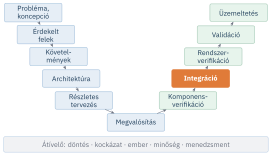
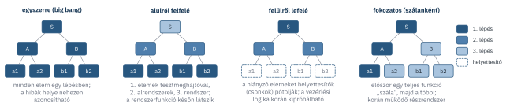
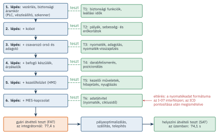

# Integráció és interfészmenedzsment {#sec-integracio}

::: {.vterkep}
{fig-alt="V-térkép: a fejezet helye a rendszerfejlesztés folyamatában" width=62%}
:::

::: {.cel}
A fejezet feldolgozása után képes leszel:

- elmagyarázni az integráció célját és helyét a V-modell jobb ágán;
- összevetni az integrációs stratégiákat, és indokoltan választani közülük;
- azonosítani és dokumentálni a rendszer interfészeit, és megkülönböztetni az interfészkövetelmény-dokumentumot (IRD) és az interfészvezérlő dokumentumot (ICD);
- integrációs tervet készíteni, amely lépésenként megadja az integrálandó elemeket, a segédeszközöket, a felelősöket és a lépést lezáró ellenőrzést;
- felismerni a jellegzetes integrációs kockázatokat, és tervezni a kezelésüket.
:::

A V-modell bal ága a rendszert lebontja, a jobb ága összerakja. Az összerakás nem egyszerű szerelés: a külön-külön jól működő elemek együtt gyakran nem működnek, mert az interfészeken, a köztük lévő kölcsönhatásokban rejlő hibák csak ekkor jelennek meg. Az ISO/IEC/IEEE 15288 az integrációt önálló műszaki folyamatként írja le: célja, hogy a rendszerelemekből olyan megvalósult rendszert állítson össze, amely teljesíti a rendszerkövetelményeket, és előkészítse a verifikációt és az átadást [@iso15288_2023, 6.4.8. szakasz; @nasa2016seh, 5.2. szakasz]. Az integrációra a rendszerhierarchia minden szintjén szükség van: az alkatrészekből alrendszer, az alrendszerekből rendszer lesz.

Két dolgot érdemes már az elején rögzíteni. Az integráció nem egyszeri esemény a gyártás végén: elemzéssel és szimulációval kezdődik, és egyre valószerűbb, egyre több funkciót tartalmazó összeállításokon át jut el a végtermékig. Az integráció tervezését pedig már a koncepció kialakításakor el kell kezdeni, mert az architektúra döntései (például a modulhatárok) meghatározzák, milyen sorrendben lehet majd összeépíteni a rendszert ([-@sec-architektura]. fejezet).

## Integrációs stratégiák {#sec-integ-strategiak}

Az **integrációs stratégia** megadja, milyen sorrendben, milyen csoportokban kerülnek össze az elemek, és mi ellenőrzi az egyes lépéseket. A szabvány szerint a stratégia célja, hogy az integráció idejét, költségét és kockázatát a lehető legkisebbre csökkentse [@iso15288_2023, 6.4.8. szakasz]. Minél nagyobb, összetettebb vagy érzékenyebb a rendszer, annál fontosabb a helyes sorrend. A sorrendet rendszeresen felül kell vizsgálni, mert a gyártási és szállítási ütemezés változásai érvényteleníthetik a korábbi döntések alapjait. A leggyakoribb stratégiákat a [-@fig-integracios-strategiak]. ábra mutatja [@incose2023seh].

{#fig-integracios-strategiak width=100%}

- **Egyszerre (big bang):** minden elemet egy lépésben kapcsolunk össze. Kis, jól ismert rendszernél gyors, de ha valami nem működik, nehéz kideríteni, melyik elem vagy interfész a hibás.
- **Alulról felfelé:** előbb az elemeket, majd az alrendszereket, végül a rendszert integráljuk. Minden szinten csak ellenőrzött építőelemek kerülnek össze, de a rendszer egészének viselkedése csak a végén látszik; a hiányzó felsőbb szintet tesztmeghajtók pótolják.
- **Felülről lefelé:** a rendszer vezérlő logikája készül el először, a hiányzó elemeket egyszerű helyettesítők (csonkok, szimulátorok) pótolják. A rendszerszintű működés korán kipróbálható, a helyettesítők azonban munkát igényelnek, és pontatlanságuk elfedhet hibákat.
- **Fokozatos, szálanként:** először egy teljes funkció „szálát” integráljuk a bemenettől a kimenetig, majd a többit. Korán van működő, bemutatható részrendszer, és a legfontosabb funkciók a legtöbbet tesztelődnek.

A választást a rendszer szerkezete, az elemek elkészülésének sorrendje, a kockázatok és a rendelkezésre álló segédeszközök határozzák meg. A gyakorlatban a stratégiák keverednek: a mechanikai alrendszereket alulról felfelé, a szoftvert felülről lefelé, a kritikus funkciót szálanként integrálják.

## Interfészmenedzsment {#sec-integ-interfesz}

Az **interfész** két rendszerelem vagy a rendszer és környezete közötti kapcsolat, amelyen anyag, energia, információ vagy erőhatás halad át. Az interfészek típusai: mechanikai (illesztés, rögzítés, tömeg), energetikai (villamos, pneumatikus), adat- és jelinterfész, ember–gép interfész és környezeti interfész (hő, rezgés, elektromágneses hatások). Az interfészeket a funkcióelemzés és az N²-diagram segítségével azonosítjuk ([-@sec-architektura]. fejezet).

A nagy projektek gyakorlatában az interfészek dokumentálására három dokumentumtípus terjedt el [@dau2001; @nasa2016seh, 5.2. szakasz és L függelék]:

- az **interfészkövetelmény-dokumentum** (IRD) az interfész követelményeit rögzíti, és lehetőleg nem írja elő a megoldást;
- az **interfészvezérlő dokumentum** (ICD) végső formájában az IRD követelményeinek részletes megvalósítását írja le (méretek, csatlakozók, jelek, adatformátumok, időzítés);
- az **interfészvezérlési terv** az IRD-k és ICD-k kezelésének folyamatát határozza meg: hogyan tárják fel és oldják fel az összeférhetetlenségeket, és hogyan értékelik az interfészt érintő tervezési változtatások hatását.

Az interfészkezelés az életcikluson átívelő tevékenység: az interfészeket azonosítani, dokumentálni és a változásaikat szabályozottan kezelni kell a teljes életciklus alatt [@incose2023seh]. A kompatibilitási elemzés igazolja, hogy az interfész-meghatározás teljes, és a változások nyomon követhetők; enélkül előfordulhat, hogy egy elem a rendszerbe illesztve nem a szándék szerint működik.

::: {.eset eset="A" title="KoboCella: az interfészjegyzék"}
A csapat az N²-diagram ([-@sec-architektura]. fejezet) alapján nyolc interfészt azonosított, és mindegyikhez felelőst és ICD-t rendelt ([-@tbl-interfesz-kobo]. táblázat). A két legkockázatosabb interfész a kezelő és a kezelőfelület közötti (I-06), mert itt a tervezett működés az emberen múlik ([-@sec-emberkozpontu]. fejezet), és a csavarozó vezérlője és a MES közötti (I-07), mert a két oldalt két különböző beszállító fejleszti.

| Azonosító | Interfész | Típus | Mi halad át? | Felelős |
|:--|:--|:--|:--|:--|
| I-01 | kobot – csavarozó orsó | mechanikai, energetikai, jel | rögzítés, tömeg, 24 V, indítás/kész | robotintegrátor |
| I-02 | csavarozó orsó – csavaradagoló | mechanikai, pneumatikus | csavar, sűrített levegő | robotintegrátor |
| I-03 | kobot – cellavezérlés (PLC) | jel, adat | indítás, kész, hibakód | robotintegrátor |
| I-04 | lézerszkenner – biztonsági vezérlés | biztonsági jel | védőmező megsértése, leállítás | biztonsági mérnök |
| I-05 | befogó készülék – motorház | mechanikai | pozicionálás, rögzítés | gyártástechnológus |
| I-06 | kezelő – kezelőfelület | ember–gép | utasítás, hibajelzés, nyugtázás | ergonómus, rendszermérnök |
| I-07 | csavarozó vezérlő – MES | adat | nyomaték, szög, megfelelő/nem megfelelő, ciklusidő | informatika, beszállító |
| I-08 | cella – üzem | energetikai, környezeti | 400 V, sűrített levegő, padló, hőmérséklet | karbantartás |

: A KoboCella interfészjegyzéke. {#tbl-interfesz-kobo tbl-colwidths="[10,26,18,30,16]"}
:::

## Az integrációs terv {#sec-integ-terv}

Az integrációs terv a stratégiát lépésekre bontja. Indokolja a választott stratégiát (ha szükséges, az alternatívák elemzésével), és lépésenként megadja a tevékenységek helyét, az integrálandó elemeket, a szükséges segédeszközöket (különleges szoftver, teszteszközök, csonkok és meghajtók a még hiányzó elemek szimulálására), a telepítés utáni integrációs tevékenységeket, a lépést követő verifikációt, a felelősöket és az ütemezést. A stratégia egyben az építési, a verifikációs és a telepítési terv alapja is.

Minden integrációs lépést ellenőrzés zár: csak akkor lépünk tovább, ha az eddig összerakott rész működik. Így a hiba mindig a legutóbb hozzáadott elemben vagy interfészében keresendő. Az integráció két jellegzetes mérföldköve a **gyári átvételi teszt** (factory acceptance test, FAT) a beszállítónál vagy az integrátornál, és a **helyszíni átvételi teszt** (site acceptance test, SAT) a felhasználás helyén. A kettő között a rendszer környezete megváltozik: más az energiaellátás, a padló, a hálózat, és mások a kezelők.

::: {.eset eset="A" title="KoboCella: integráció lépésenként"}
A csapat alulról felfelé és szálanként vegyes stratégiát választott ([-@fig-integracio-kobo]. ábra). Elsőként a vezérlés és a biztonsági áramkör került össze, mert minden további lépés csak működő biztonsági funkciók mellett végezhető biztonságosan. Ezután a kobot, a csavarozó orsó és az adagoló, a befogó készülék, a kezelőfelület és végül a MES-kapcsolat következett; minden lépést teszt zárt. A hatodik lépésben derült ki, hogy a csavarozó vezérlője a nyomatékot más mértékegységben és tizedesjegy-pontossággal küldi, mint amit a MES vár (I-07). A hibát az ICD pontosítása és a fogadó oldal átalakítása oldotta meg, a T6 tesztet megismételték. A gyári átvételi teszten a ciklusidő 77,4 s volt; a kobot pályájának optimalizálása után a helyszíni átvételen 74,1 s ([-@sec-kovetelmenyek]. fejezet).

{#fig-integracio-kobo width=92%}
:::

## Integrációs kockázatok és tanulságok {#sec-integ-kockazatok}

Az integráció a projekt egyik legkockázatosabb szakasza, mert itt derül ki minden, amit a tervezés során nem gondoltak végig. A leggyakoribb kockázatok:

- **későn rögzített vagy kétértelmű interfészek:** ha az ICD csak a gyártás után készül el, a két oldal eltérően értelmezi;
- **beszállítói elemek ismeretlen viselkedése:** a kereskedelmi termékek dokumentációja ritkán írja le a határhelyzeteket;
- **a teszt- és az üzemi környezet eltérése:** ami az integrátor csarnokában működik, az üzemben másként viselkedhet;
- **szoftver- és firmware-változatok:** az integráció közben frissített szoftver más viselkedést mutat;
- **a segédeszközök hiánya:** ha nincs szimulátor vagy csonk, a lépés csak akkor végezhető el, amikor minden elem megérkezett, és a stratégia észrevétlenül „big bang”-gé válik.

Gyakran idézett mérnöki szabály, hogy úgy kell tesztelni, ahogyan a rendszert használni fogják, és úgy kell használni, ahogyan tesztelték. Ez az integrációra is igaz: a lépéseket záró teszteknek a valós működési feltételeket kell közelíteniük.

::: {.eset eset="C" title="ForgácsTech: integráció a gépvezérlők garanciájának megőrzésével"}
A ForgácsTech problémamegfogalmazása korlátként rögzítette, hogy a gépek vezérlőinek gyártói garanciáját nem szabad veszélyeztetni ([-@sec-problema]. fejezet). Ezért a MES és a gépek közötti interfészt csak olvasó adatkapcsolatként határozták meg: a MES a vezérlők szabványos adatfelületéről olvassa a gépállapotot és a darabszámot, de nem ír a vezérlőbe. A régebbi esztergáknál, ahol ilyen felület nincs, külső érzékelők (áramfelvétel, ajtókapcsoló) adják a jelet. Az integrációt szálanként végezték: elsőként egyetlen megmunkáló központ teljes adatútját kötötték be a gépállapottól az OEE-kijelzőig, és csak a működő szál után következett a többi gép.
:::

::: {.kitekintes title="Folyamatos integráció"}
A szoftverfejlesztésben a folyamatos integráció azt jelenti, hogy a fejlesztők változtatásait naponta többször egy közös változatba olvasztják, és minden összeolvasztás után automatikus tesztek futnak. A gondolat a mechatronikai rendszerekre is átvihető: a digitális iker és a hardver a hurokban (hardware-in-the-loop) tesztelés lehetővé teszi, hogy a vezérlőszoftvert a valós hardver elkészülte előtt szimulált környezetben integrálják és teszteljék ([-@sec-modellek]. fejezet). A virtuális üzembe helyezés így a FAT előtt feltárhatja az interfész- és logikai hibák nagy részét.
:::

::: {.hiba title="Integráció interfészjegyzék nélkül"}
Gyakori hiba, hogy az interfészeket nem azonosítják és nem dokumentálják külön, mert „a rajzokon úgyis rajta van”. A rajz azonban csak az egyik oldalt mutatja; a két oldal közötti megállapodást, a mértékegységeket, a tűréseket, az időzítést és a hibahelyzetek kezelését senki nem rögzíti. Az integráció során ezek a hiányok egyszerre jelentkeznek, amikor a legdrágább kijavítani őket.
:::

::: {.osszefoglalo}
- Az integráció az elemekből a magasabb szintű terméket állítja össze, és igazolja, hogy együtt működnek; a rendszerhierarchia minden szintjén szükséges, és tervezését a koncepciónál kell kezdeni.
- A stratégiák: egyszerre, alulról felfelé, felülről lefelé, szálanként; a gyakorlatban vegyesen alkalmazzák őket, a sorrendet műszaki és üzleti szempontok együtt határozzák meg.
- Az interfészeket azonosítani, dokumentálni és szabályozottan változtatni kell; az IRD a követelményeket, az ICD a megvalósítást, az interfészvezérlési terv a kezelés folyamatát rögzíti.
- Az integrációs terv lépésenként megadja az elemeket, a segédeszközöket, a felelősöket, az ütemet és a lépést lezáró ellenőrzést.
- A legnagyobb kockázatot a későn rögzített interfészek, az ismeretlen beszállítói elemek és a teszt- és az üzemi környezet eltérése jelenti.
:::

::: {.onell}
1. Miért nem egyszeri esemény az integráció?
2. Hasonlítsd össze az alulról felfelé és a felülről lefelé integrációt! Mikor melyiket választanád?
3. Mi a különbség az IRD és az ICD között? Miért nem szabad az IRD-ben megoldást előírni?
4. Sorolj fel öt interfésztípust, és adj mindegyikre példát egy háztartási robotporszívóból!
5. Mit tartalmaz az integrációs terv egy lépésének leírása?
6. Miért hasznos, ha minden integrációs lépést ellenőrzés zár?
7. Mi a FAT és a SAT, és miért nem helyettesíti az egyik a másikat?

::: {.megoldas}
1. Mert elemzéssel és szimulációval kezdődik, és egyre valószerűbb, egyre több funkciót tartalmazó összeállításokon át jut el a végtermékig; ráadásul a rendszerhierarchia minden szintjén ismétlődik, és a tervezése már a koncepciónál elkezdődik.
2. Alulról felfelé: minden szinten ellenőrzött elemek kerülnek össze, de a rendszerszintű működés későn látszik; akkor jó, ha az elemek korán elkészülnek, és a fizikai illesztés a kritikus. Felülről lefelé: a vezérlési logika és a rendszerszintű működés korán kipróbálható, de helyettesítők kellenek; akkor jó, ha a vezérlés a legkockázatosabb, és a helyettesítők olcsón elkészíthetők.
3. Az IRD az interfész követelményeit rögzíti (mit kell teljesítenie), az ICD a részletes megvalósítást (hogyan). Ha az IRD megoldást ír elő, szükségtelenül szűkíti a tervezési teret, és a később jobb megoldás csak követelményváltozással vezethető be.
4. Mechanikai: a kefe rögzítése; energetikai: a töltőállomás érintkezői; adat és jel: a mobilalkalmazás és a robot közötti kapcsolat; ember–gép: a gombok és a hangjelzések; környezeti: a padló, a küszöbök, a por és a hő.
5. A tevékenységek helyét, az integrálandó elemeket, a segédeszközöket (szoftver, teszteszköz, csonk, meghajtó), a telepítés utáni integrációs tevékenységeket, a lépést követő verifikációt, a felelősöket és az ütemezést.
6. Mert így a hiba a legutóbb hozzáadott elemben vagy annak interfészében keresendő, és a hibakeresés gyors; enélkül a hibák összeadódnak, és a lokalizálásuk nehéz.
7. A FAT a gyártónál vagy az integrátornál, a SAT a felhasználás helyén zajló átvételi teszt. Nem helyettesítik egymást, mert a környezet (energiaellátás, padló, hálózat, kezelők, anyagok) eltér, és a helyszínen olyan hibák jelentkezhetnek, amelyek a gyárban nem.
:::
:::

::: {.projekt title="Projektlépés: integrációs terv"}
Saját fejlesztési feladatodhoz:

1. készíts interfészjegyzéket az N²-diagram alapján (azonosító, interfész, típus, mi halad át, felelős);
2. válassz integrációs stratégiát, és indokold a rendszer szerkezete és a kockázatok alapján;
3. bontsd a stratégiát legalább öt integrációs lépésre: mi kerül össze, milyen segédeszköz kell, mi zárja a lépést, ki a felelős;
4. azonosítsd a három legnagyobb integrációs kockázatot, és tervezd meg a kezelésüket;
5. használd a Gyakorlati útmutató integrációs terv eszközlapját.
:::

::: {.forras}
- @iso15288_2023, 6.4.8. szakasz: az integrációs folyamat a szabványban.
- @incose2023seh: az integrációs stratégiák és az interfészmenedzsment gyakorlata.
- @nasa2016seh, 5.2. és 6.3. szakasz, H és L függelék: a termékintegráció folyamata, az interfészmenedzsment, az integrációs terv és az interfészkövetelmény-dokumentum vázlata.
:::
