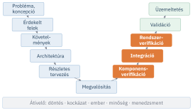
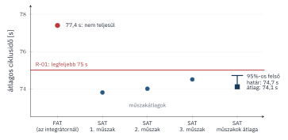

# Verifikáció {#sec-verifikacio}

::: {.vterkep}
{fig-alt="V-térkép: a fejezet helye a rendszerfejlesztés folyamatában" width=62%}
:::

::: {.cel}
A fejezet feldolgozása után képes leszel:

- megkülönböztetni a verifikációt, a validációt, a minősítést, az átvételt és a tanúsítást;
- minden követelményhez megfelelő verifikációs módot rendelni (vizsgálat, elemzés, bemutatás, teszt);
- követelmény-verifikációs mátrixot készíteni sikerkritériumokkal;
- megtervezni egy verifikációs eljárást, és helyesen kezelni az eltéréseket;
- a mintavételből származó bizonytalanságot konfidenciahatárral és sikeres futás próbával figyelembe venni.
:::

Az integráció végén a rendszer összeáll és működik. A verifikáció azt kérdezi: azt építettük-e meg, amit a követelmények előírnak? Az ISO/IEC/IEEE 15288 szerint a verifikáció célja objektív bizonyítékot szolgáltatni arról, hogy a rendszer vagy a rendszerelem teljesíti a rá megadott követelményeket és jellemzőket [@iso15288_2023, 6.4.9. szakasz; @nasa2016seh, 5.3. szakasz]. A V-modellben a verifikáció a bal ág követelményeit zárja le, szintről szintre: a komponenst a komponenskövetelményekkel, az alrendszert az alrendszer-követelményekkel, a rendszert a rendszerkövetelményekkel vetjük össze ([-@sec-v-modell]. fejezet). A rendszerek, szoftverek és hardverek verifikációs és validációs tevékenységeit az IEEE 1012 szabvány részletezi [@ieee1012_2024].

## Verifikáció, validáció és rokon fogalmak {#sec-ver-fogalom}

A **verifikáció** a megadott követelményekhez, a **validáció** az érdekelt felek elvárásaihoz és a működési koncepcióhoz méri a terméket. A különbség a tesztek jellegén is látszik. A verifikációs teszt a jóváhagyott követelményekre vezethető vissza: hivatalos, jegyzőkönyvezett teszt, amely mérőeszközökkel, ellenőrzött környezetben igazolja, hogy a rendszer teljesíti a rá allokált követelményeket, beleértve a fizikai és funkcionális interfészeket. A validációs teszt ezzel szemben a működési koncepcióra vezethető vissza: valószerű vagy szimulált körülmények között, jellemző felhasználókkal vizsgálja, hogy a termék alkalmas-e a rendeltetésére [@ieee1012_2024; @engel2010]. A verifikáció tehát azt kérdezi, *jól építettük-e meg* a terméket; a validáció azt, hogy *a jó terméket építettük-e meg* ([-@sec-validacio]. fejezet).

A verifikációhoz három rokon fogalom kapcsolódik ([-@tbl-ver-fogalmak]. táblázat). A különbség abban áll, mit igazolnak, és hányszor kell elvégezni őket.

| Fogalom | Mit igazol? | Hányszor? |
|:--|:--|:--|
| verifikáció | a rendszer és elemei teljesítik a megadott követelményeket (teszttel, elemzéssel, vizsgálattal vagy bemutatással) | egyszer, amíg a terv nem változik |
| minősítés | a terv a várható környezeti szélsőértékek mellett is teljesíti a funkcionális és teljesítménykövetelményeket, a tervezett tartalékokkal | egyszer, amíg a terv nem változik |
| átvétel | az adott példány gyártása megfelel a már verifikált és minősített tervnek | minden legyártott példányon |
| tanúsítás | a verifikáció bizonyítékait az illetékes szervezet áttekinti, és a tervet használatra alkalmasnak nyilvánítja | egyszer, amíg a terv nem változik |

: A verifikáció, a minősítés, az átvétel és a tanúsítás. Az európai űripari verifikációs szabvány [@ecss2018ver] és az INCOSE kézikönyve [@incose2023seh] alapján, saját összeállítás. {#tbl-ver-fogalmak tbl-colwidths="[16,62,22]"}

A KoboCella gyári és helyszíni átvételi tesztje (FAT és SAT, [-@sec-integracio]. fejezet) ebben az értelemben egyszerre verifikáció és átvétel: a cella egyedi példány, így a terv verifikációja és a példány átvétele egybeesik. Egy sorozatban gyártott dokkolónál (VárosiBringa) viszont a verifikációt és a minősítést egyszer, néhány mintapéldányon végzik el, az átvételi tesztet pedig minden legyártott darabon, szűkebb tartalommal.

## A verifikáció módjai {#sec-ver-modok}

A szabványok és a szakirodalom jellemzően négy verifikációs módot különböztetnek meg ([-@tbl-ver-modok]. táblázat) [@iso29148_2018; @incose2023seh]. Az európai űripari szabvány a bemutatás helyett a tervdokumentáció átvizsgálását (review of design) tekinti negyedik módnak [@ecss2018ver]. Ezek már a követelmények megfogalmazásakor szóba kerültek ([-@sec-kovetelmenyek]. fejezet): ha egy követelményhez nem rendelhető verifikációs mód, a követelményt újra kell fogalmazni.

- **Elemzés:** matematikai modellek és elemzési módszerek használata annak előrejelzésére, hogy a terv megfelel-e az elvárásoknak, számított adatok vagy az alacsonyabb szintű elemek verifikációs eredményei alapján. Akkor alkalmazzák, ha prototípus vagy kész termék még nem áll rendelkezésre; ide tartozik a modellezés és a szimuláció, valamint a hasonlóság alapján végzett verifikáció egy korábban bevált termék esetén.
- **Bemutatás:** annak megmutatása, hogy a termék használata teljesíti a követelményt. Alapvető képességigazolás, amely a teszttől abban különbözik, hogy nem gyűjt részletes adatokat. Makettel vagy szimulátorral is végezhető.
- **Vizsgálat:** a kész termék szemrevételezése. Fizikai jellemzők, feliratok, azonosítók ellenőrzésére szolgál; kiterjedhet rajzok, dokumentumok és egyéb nyilvántartások ellenőrzésére is.
- **Teszt:** a termék használata a teljesítmény igazolásához szükséges részletes adatok megszerzésére, vagy annyi információ előállítására, amennyi a teljesítmény további elemzéssel való igazolásához kell. Ellenőrzött körülmények között, minden követelményre diszkrét pontokban szolgáltat adatot, és a legtöbb erőforrást igénylő verifikációs mód.

| Mód | Mikor választjuk? | KoboCella-példa |
|:--|:--|:--|
| elemzés | nincs még kész termék, a teszt túl drága vagy nem kivitelezhető, valószínűségi követelmény | R-02: havi rendelkezésre állás megbízhatósági blokkdiagrammal ([-@sec-megbizhatosag]. fejezet) |
| bemutatás | a képesség megléte a kérdés, részletes mérés nélkül | R-09: a nyomatékadatok megjelennek a MES-ben a motor azonosítójához rendelve |
| vizsgálat | fizikai jellemző, felirat, méret, dokumentum | R-15: a cella elfér a 6 × 4 m-es területen |
| teszt | mennyiségi teljesítménykövetelmény, ellenőrzött körülmények között | R-01: ciklusidő próbaüzemben; R-03: nyomaték kalibrált mérőeszközzel |

: A verifikáció négy módja [@iso29148_2018; @incose2023seh]. {#tbl-ver-modok tbl-colwidths="[13,42,45]"}

A választás mérlegelés kérdése. A verifikáció a fejlesztés egyik legnagyobb költség- és ütemezési tényezője [@engel2010], ezért a verifikációs módokról és a létesítményekről már az életciklus elején érdemes elemzéssel dönteni, például egy modellen végzett teszt és egy olcsóbb, de kevésbé feltáró elemzés között. A kockázatelemzés, például az FMEA, gyakran új aggályokat tár fel, amelyek további verifikációt indokolnak ([-@sec-fmea]. fejezet).

## A verifikáció tervezése: a követelmény-verifikációs mátrix {#sec-ver-rvm}

A verifikációs terv minden követelményhez megadja, hogyan, hol, mikor és ki igazolja a teljesülését. Ennek központi eszköze a **követelmény-verifikációs mátrix** (requirements verification matrix, RVM). Az európai űripari szabvány ezt verifikációs ellenőrző dokumentumnak (verification control document, VCD) nevezi [@ecss2018ver; @nasa2016seh, D függelék]. A mátrixba a kötelező („kell”) követelmények kerülnek, mindegyik egyedi azonosítóval és a forrásdokumentum megjelölésével. A javasolt minimális tartalom: azonosító, forrásdokumentum és bekezdés, a követelmény szövege, a sikerkritérium, a verifikációs mód, a létesítmény vagy labor, a fázis (szint), annak jelölése, hogy a követelményt minden példány átvételekor is ellenőrizni kell-e, a végrehajtó szervezet és az eredményt tartalmazó dokumentum.

A mátrix legfontosabb oszlopa a **sikerkritérium**. Az R-01 követelmény („legfeljebb 75 s”) önmagában nem mondja meg, hány ciklust kell mérni, milyen körülmények között, és mi számít teljesülésnek, ha az egyes ciklusok szórnak. A sikerkritérium ezt rögzíti, még a teszt előtt. A kritérium utólagos megfogalmazása, amikor az eredmény már ismert, a verifikáció hitelességét rontja.

::: {.eset eset="A" title="KoboCella: a követelmény-verifikációs mátrix részlete"}
A [-@tbl-rvm-kobo]. táblázat a KoboCella követelményeinek ([-@sec-kovetelmenyek]. fejezet) verifikációs mátrixát mutatja a helyszíni átvétel után. Két követelmény a gyári átvételen még nem teljesült: az R-01 (77,4 s) és az R-09 (az I-07 interfész adatformátuma, [-@sec-integracio]. fejezet). Mindkettő javítás után, ismételt verifikációval teljesült.

| Az. | Követelmény | Sikerkritérium | Mód | Szint, helyszín | Átvétel? | Eredmény |
|:--|:--|:--|:--|:--|:--|:--|
| R-01 | ciklusidő ≤ 75 s | a háromműszakos próbaüzem műszakátlagaiból számolt átlag 95%-os egyoldali felső konfidenciahatára ≤ 75 s | teszt (előtte elemzés) | rendszer, SAT | igen | FAT: 77,4 s, nem teljesült; SAT: 74,1 s, felső határ 74,7 s, teljesült |
| R-02 | havi rendelkezésre állás ≥ 95% | a megbízhatósági blokkdiagram és a tervezett állásidők alapján ≥ 95% | elemzés | rendszer | nem | teljesült; az üzemi adatok az első három hónapban megerősítendők |
| R-03 | nyomaték 4,0 ± 0,2 Nm | a próbaüzem minden kötése a tűrésmezőn belül; legalább 2302 kötés hiba nélkül | teszt | csavarozó egység, FAT és SAT | igen | 8096 kötés hiba nélkül, teljesült |
| R-05 | törzshajlítás ≤ 20° | digitális emberi modell az 5. és a 95. percentilisre, majd próba három kezelővel | elemzés és bemutatás | munkahely, FAT | nem | teljesült |
| R-07 | tűrésen kívüli kötés jelölése | 20 szándékosan hibás kötésből (hiányzó, laza csavar) mind hibásként jelölve | teszt | rendszer, FAT | igen | teljesült |
| R-09 | nyomatékadatok a MES-ben | 10 motor adatai a MES-ben a motor azonosítójához rendelve, egyezésben a vezérlő naplójával | bemutatás | rendszer és MES, FAT | igen | FAT: nem teljesült (I-07); javítás után teljesült |
| R-11 | sebesség a védőzónában ≤ 250 mm/s | sebességmérés három pozícióban, próbatesttel a védőzónában | teszt | rendszer, FAT | igen | teljesült |
| R-15 | elfér 6 × 4 m-en | helyszíni felmérés és elrendezési rajz | vizsgálat | üzem | nem | teljesült |

: A KoboCella követelmény-verifikációs mátrixának részlete. {#tbl-rvm-kobo tbl-colwidths="[6,15,27,11,13,8,20]"}
:::

A mátrix egyben a verifikáció állapotjelentése. Ha a verifikációs módot és a sikerkritériumot már a követelmények alapvonalba helyezésekor kitöltik, kiderül, mely követelmények nem verifikálhatók, és melyekhez kell drága segédeszköz vagy létesítmény. A verifikációt akkor tekintjük lezártnak, ha minden követelményre van dokumentált objektív bizonyíték vagy jóváhagyott eltérési engedély, és minden eltérés- és nem megfelelőségi jelentés lezárult.

## A verifikáció végrehajtása {#sec-ver-vegrehajtas}

Az ISO/IEC/IEEE 15288 a verifikációt három tevékenységre bontja: az előkészítésre, a végrehajtásra és az eredmények kezelésére [@iso15288_2023, 6.4.9. szakasz]. A gyakorlatban ezt öt lépésben követjük: felkészülés, végrehajtás, az eredmények elemzése, jelentés és a munkatermékek rögzítése ([-@fig-verifikacio-folyamat]. ábra).

![A verifikáció folyamata és az eltérések kezelése. Az ISO/IEC/IEEE 15288 verifikációs folyamata [@iso15288_2023, 6.4.9. szakasz] nyomán, saját szerkesztés.](../abrak/gen/verifikacio-folyamat.svg){#fig-verifikacio-folyamat width=100%}

**Felkészülés.** Összegyűjtik és jóváhagyják a verifikációs tervet és a követelményeket, előkészítik a terméket és a segédeszközöket, véglegesítik a lépésenkénti eljárásokat, és felkészítik a környezetet (létesítmény, eszközök, mérőeszközök, klimatikus feltételek). Ha a rendszerrel ember dolgozik, a verifikációban az embert megfelelően kell képviselni: testméret, képességek, tudás, képzettség, ruházat és eszközök szempontjából; az ilyen teszteket „ember a hurokban” (human-in-the-loop) tesztnek nevezik. A felkészülést jellemzően tesztkészültségi felülvizsgálat zárja, amely ellenőrzi, hogy a létesítmény, a személyzet, a mérőeszközök és a segédeszközök készen állnak-e.

A **verifikációs eljárás** és a **verifikációs jelentés** tartalmát előre rögzíteni kell; a jelentésre az európai űripari szabvány részletes mintát is ad [@ecss2018ver]. Az eljárásban szerepel többek között a vizsgált termék azonosítása és a tesztkonfiguráció eltérése az üzemitől, a célok és a sikerkritériumok, a mérendő jellemzők tűrésekkel, a lépések sorrendje, a mérőeszközök (méréshatár, pontosság), a kalibrálás rögzítése, a veszélyes helyzetek és a biztonsági előírások, valamint az eltérések esetén követendő eljárás. A jelentés a célok teljesülését, az eltéréseket, az egyes lépések eredményeit, a nem megfelelőségek összefoglalását a javító intézkedésekkel, a következtetéseket és a ténylegesen végrehajtott eljárás (a feljegyzésekkel ellátott példány) másolatát tartalmazza.

**Végrehajtás.** A verifikáció a jóváhagyott eljárás szerint folyik; a vezető ellenőrzi, hogy az eljárást betartották, a mérőeszközöket helyesen kalibrálták, és az adatokat rögzítették. A verifikáció a termékhierarchia több szintjén zajlik; ha lehet, a végén a teljes működési láncot átfogó (end-to-end) teszt következik, amely működési forgatókönyvekkel igazolja az interfészek összeférhetőségét és a teljes funkcionalitást. A KoboCellánál ilyen teszt a motor útja a behelyezéstől a nyomatékadat MES-be kerüléséig.

**Eltérések.** Ha a teszt során eltérés jelentkezik, vagyis bármilyen különbség a megkövetelt vagy várt eredménytől, a verifikációt le kell állítani, és eltérésjelentést kell készíteni. Ezután azt kell kideríteni, hogy a termék nem felel meg, vagy az eljárás, a környezet, illetve a végrehajtás hibás. Termékhiba esetén nem megfelelőségi jelentés készül; a javítás a terv módosítását és ismételt verifikációt igényelhet, vagy, ha a követelmény enyhítése elfogadható, eltérési engedélyt (waiver) kérnek. A nem megfelelőségek a kockázatkezelés bemenetei is ([-@sec-kockazat]. fejezet).

**Elemzés, jelentés, rögzítés.** Az adatokat minőség, épség, helyesség, következetesség és érvényesség szempontjából elemzik, lehetőleg még akkor, amikor a tesztkonfiguráció érintetlen, hogy egy esetleges ismétlés gyors legyen. Az eredmények a verifikációs mátrixba kerülnek. Az eredmények és a kapcsolódó adatok (döntések és indoklásuk, feltételezések, tanulságok) rögzítése nagyon fontos, de gyakran elhanyagolt lépés.

::: {.eset eset="C" title="ForgácsTech: a MES verifikációja a teljes adatúton"}
A ForgácsTech MES-ének egyik követelménye, hogy a gépállapot (üzemel, áll, átállás, hiba) változását legfeljebb 60 s késéssel jelezze, és a MES által számolt darabszám műszakonként legfeljebb 1%-kal térjen el a kézi számlálástól. A csapat a verifikációt a teljes adatúton végezte: a gép vezérlőjétől vagy a régebbi esztergák külső érzékelőitől az OEE-kijelzőig ([-@sec-integracio]. fejezet). A késést 40 kiváltott állapotváltáson mérték, a darabszámot tíz műszakon át vetették össze a műszakvezetők számlálásával. A tesztek két régi esztergánál 2–3%-os darabszám-eltérést mutattak: az ajtókapcsoló a mérőhelyi ellenőrzéskor is jelzett, és a MES ezt új ciklusként számolta. Az eltérés oka nem a MES volt, hanem a jelfeldolgozás szabálya, amelyet a ciklusidő alsó korlátjával egészítettek ki. Az ismételt verifikáció után a követelmény teljesült.
:::

## Statisztikai alapok {#sec-ver-statisztika}

A teszt mintát vesz a termék viselkedéséből. Ha a mért jellemző szór, a minta átlaga csak becslése a valódi átlagnak, és a döntésnek ezt a bizonytalanságot is figyelembe kell vennie. Kis mintákra a Student-féle *t*-eloszlásra épülő elemzés való, amely annak eldöntésére szolgál, hogy egy mintaátlag adott hibavalószínűség mellett egyezik-e egy előírt értékkel; feltétele, hogy a mért jellemző eloszlása ne térjen el lényegesen a normálistól. Ugyanerre épül a konfidenciaintervallum, amely megadja, milyen tartományban van a valódi átlag a választott valószínűséggel [@montgomery2020sqc; @goldberg1994toolbox, 6.1. és 6.5. szakasz].

### Konfidenciahatár egy felső korlátos követelményhez

Ha a követelmény felső korlát ($\mu \le U$), az átlag egyoldali felső konfidenciahatárát vetjük össze a korláttal:

$$
\bar{x} + t_{1-\alpha,\,n-1}\,\frac{s}{\sqrt{n}} \le U ,
$$ {#eq-felso-konfidencia}

ahol $\bar{x}$ a mintaátlag, $s$ a minta szórása, $n$ a mintaelemszám, $t_{1-\alpha,\,n-1}$ a *t*-eloszlás kvantilise $n-1$ szabadsági fokkal. Ha az egyenlőtlenség teljesül, $1-\alpha$ megbízhatósággal állíthatjuk, hogy a valódi átlag a korlát alatt van. Ha csak a mintaátlag van a korlát alatt, a határ azonban nem, a teszt nem elég bizonyító erejű: vagy több mérés kell, vagy kisebb szórás.

::: {.eset eset="A" title="KoboCella: teljesül-e a 75 s?"}
A helyszíni próbaüzem három műszakjában a MES minden ciklus idejét rögzítette. Az egymást követő ciklusok azonban nem függetlenek: egy lassabb kezelő vagy egy beállítási hiba több egymást követő ciklust érint. A csapat ezért óvatos megközelítést választott: a műszakokat tekintette független megfigyelésnek ($n = 3$). A műszakátlagok 73,8, 74,0 és 74,5 s voltak ([-@fig-verifikacio-ciklusido]. ábra); az átlag $\bar{x} = 74{,}1$ s, a szórás $s = 0{,}36$ s. A $t_{0,95;\,2} = 2{,}92$ kvantilissel a [-@eq-felso-konfidencia]. egyenlet szerinti felső határ

$$
74{,}1 + 2{,}92 \cdot \frac{0{,}36}{\sqrt{3}} = 74{,}7 \text{ s} \le 75 \text{ s},
$$

így az R-01 követelmény 95%-os megbízhatósággal teljesül. A gyári átvételen mért 77,4 s ezzel szemben egyértelműen a korlát fölött volt.

{#fig-verifikacio-ciklusido width=88%}
:::

### Sikeres futás próba

Nagy megbízhatóságú követelményeknél (egy kötés legalább 0,999 valószínűséggel megfelelő) a hibák ritkák, így a mintában jellemzően nincs hibás darab. A **sikeres futás próba** (success run) azt adja meg, hány egymást követő hibátlan próba igazolja az $R$ megbízhatóságot $C$ konfidenciaszinten. Ha $n$ független próba mind sikeres, és a hibavalószínűség állandó, akkor

$$
R^{\,n} \le 1 - C \quad\Longrightarrow\quad n \ge \frac{\ln(1-C)}{\ln R}
$$ {#eq-sikeres-futas}

[@oconnor2012]. A KoboCella R-03 követelményéhez ($R = 0{,}999$, $C = 0{,}9$) $n \ge \ln 0{,}1 / \ln 0{,}999 \approx 2302$ hibátlan kötés szükséges, ami 288 motornak, körülbelül hat üzemórának felel meg. A háromműszakos próbaüzem 1012 motorján 8096 kötés készült hiba nélkül; ez 90%-os konfidenciaszinten $R \ge 0{,}1^{1/8096} \approx 0{,}9997$ megbízhatóságot igazol. Ha egyetlen hiba is előfordul, a szükséges próbaszám jelentősen nő, ezért a nagy megbízhatóságú követelményeket elemzéssel és alacsonyabb szintű tesztekkel együtt szokás verifikálni ([-@sec-megbizhatosag]. fejezet).

::: {.kitekintes title="Az első és a másodfajú hiba"}
A verifikációs döntés két hibát ejthet. Elsőfajú hiba, ha a megfelelő terméket elutasítjuk; másodfajú, ha a nem megfelelőt elfogadjuk. A konfidenciaszint az utóbbit korlátozza: a 95%-os felső határral legfeljebb 5% az esélye annak, hogy a ténylegesen 75 s feletti átlagú cellát megfelelőnek nyilvánítjuk. A szükséges mintaelemszám a két hiba megengedett valószínűségétől, a mért jellemző szórásától és attól függ, mennyire van a várt érték a korlát alatt [@montgomery2020sqc]. A mintaelemszámot ezért a teszt megtervezésekor kell meghatározni, nem a mérés után.
:::

## Verifikáció modellekkel és a hierarchia szintjein {#sec-ver-szintek}

A verifikáció nem a rendszer elkészültével kezdődik. A koncepció és a tervezés szakaszában az elemzés és a szimuláció a fő eszköz, és a modellek maguk is verifikációt és validációt igényelnek ([-@sec-mod-vv]. szakasz). A hardver a hurokban (hardware-in-the-loop) teszt a valós vezérlőt szimulált környezethez köti, így a vezérlőszoftver a mechanika elkészülte előtt verifikálható. A követelmények egy része csak alacsonyabb szinten verifikálható (a csavarozó orsó nyomatékpontossága a komponensen), más része csak a rendszer szintjén (a ciklusidő). A verifikációs terv ezért a mátrixban minden követelményhez a szintet is megadja.

::: {.eset eset="B" title="VárosiBringa: a dokkoló reteszcsapjának verifikációja"}
A dokkoló reteszcsapjára vonatkozó követelmény a nagy terheléses események elviselése. A csapat a verifikációt három szinten végezte. Elemzéssel igazolta, hogy a terhelés és a szilárdság eloszlása alapján a várható tönkremenetel elfogadható ([-@sec-robusztus]. fejezet). Teszttel, tíz próbacsap tönkremenetelig terhelésével igazolta a nyírószilárdság várható értékét és szórását. Vizsgálattal pedig minden beérkező csapszállítmánynál ellenőrzi az anyagbizonylatot. Az első kettő a terv verifikációja és minősítése, a harmadik az átvétel része.
:::

::: {.hiba title="A teszt mint formalitás"}
Gyakori hiba, hogy a verifikációt a projekt végére hagyják, és úgy tekintenek rá, mint a kész termék „lepecsételésére”. Ilyenkor a sikerkritériumokat utólag igazítják az eredményekhez, az eltéréseket „mérési hibának” minősítik, és a nem megfelelőségi jelentés helyett szóbeli megállapodás születik. A verifikáció célja a hibák megtalálása, amíg olcsón javíthatók; ezt csak előre rögzített sikerkritériumokkal, dokumentált eltéréskezeléssel és a teszt végrehajtójának függetlenségével lehet elérni.
:::

::: {.osszefoglalo}
- A verifikáció azt igazolja, hogy a termék teljesíti a megadott követelményeket; a validáció azt, hogy megfelel az érdekelt felek elvárásainak és a működési koncepciónak.
- A minősítés a környezeti szélsőértékek melletti működést, az átvétel az egyes példányok gyártását, a tanúsítás a bizonyítékok hatósági vagy megrendelői elfogadását jelenti.
- A négy verifikációs mód az elemzés, a bemutatás, a vizsgálat és a teszt; a teszt adja a legrészletesebb adatot, de a legdrágább.
- A követelmény-verifikációs mátrix minden kötelező követelményhez megadja a sikerkritériumot, a módot, a szintet, a helyszínt, a felelőst és az eredményt; a sikerkritériumot a teszt előtt kell rögzíteni.
- Az eltérésnél a verifikációt le kell állítani, és el kell dönteni, hogy a termék vagy az eljárás hibás; a verifikáció akkor zárul, ha minden követelményre van bizonyíték vagy eltérési engedély, és minden eltérésjelentés lezárult.
- A mintavétel bizonytalanságát konfidenciahatárral, a nagy megbízhatóságú követelményeket sikeres futás próbával vagy elemzéssel kell kezelni.
:::

::: {.onell}
1. Miben különbözik a verifikációs és a validációs teszt?
2. Mi a különbség a minősítés és az átvétel között? Melyiket kell minden példányon elvégezni?
3. Milyen verifikációs módot választanál a következő követelményekhez: (a) a dokkoló kijelzőjén a feliratok magyar és angol nyelvűek; (b) a kerékpár akkumulátora 50 km hatótávot biztosít; (c) a kezelő a vészleállítót a munkahelyéről eléri; (d) a rendszer éves rendelkezésre állása legalább 99%?
4. Miért kell a sikerkritériumot a teszt előtt rögzíteni?
5. Egy teszt során a mért érték kívül esik a tűrésen. Milyen lépések következnek?
6. Egy követelmény szerint a válaszidő átlaga legfeljebb 2,0 s. Öt független mérés átlaga 1,8 s, szórása 0,2 s. Teljesül-e a követelmény 95%-os megbízhatósággal? ($t_{0,95;\,4} = 2{,}13$)
7. Hány hibátlan próba kell ahhoz, hogy 95%-os konfidenciaszinten 0,99-es megbízhatóságot igazoljunk?

::: {.megoldas}
1. A verifikációs teszt a jóváhagyott követelményekre vezethető vissza, ellenőrzött környezetben, mérőeszközökkel, mérnökök és technikusok végzik. A validációs teszt a működési koncepcióra vezethető vissza, valószerű vagy szimulált körülmények között, jellemző felhasználókkal vizsgálja a termék alkalmasságát.
2. A minősítés azt igazolja, hogy a terv a környezeti szélsőértékek mellett is működik, egyszer, amíg a terv nem változik. Az átvétel azt igazolja, hogy az adott példány gyártása megfelel a tervnek; ezt minden példányon el kell végezni.
3. (a) vizsgálat; (b) teszt (vagy, a korai szakaszban, elemzés az akkumulátor és a fogyasztás adataiból); (c) bemutatás, a kezelők testméret-tartományát képviselő személyekkel; (d) elemzés, mert egy év üzem nem várható ki a verifikáció során, majd az üzemi adatokkal megerősítés.
4. Mert az eredmény ismeretében megfogalmazott kritérium az eredményhez igazodhat, és így a verifikáció nem bizonyít semmit. A kritérium határozza meg a mintaelemszámot és a körülményeket is, ezeket a teszt előtt kell megtervezni.
5. A verifikációt le kell állítani, és eltérésjelentést kell készíteni. Meg kell vizsgálni, hogy a termék hibás, vagy az eljárás, a környezet, a mérőeszköz. Termékhiba esetén nem megfelelőségi jelentés készül, javítás vagy eltérési engedély következik, majd ismételt verifikáció; nem termékhiba esetén az eljárást vagy a környezetet javítják, és megismétlik a tesztet.
6. A felső határ $1{,}8 + 2{,}13 \cdot 0{,}2/\sqrt{5} = 1{,}8 + 0{,}19 = 1{,}99$ s, ami kisebb 2,0 s-nál, így a követelmény (szűken) teljesül. A tartalék kicsi; egy újabb mérés vagy kisebb szórás erősítené a bizonyítékot.
7. $n \ge \ln 0{,}05 / \ln 0{,}99 \approx 298{,}1$, vagyis 299 hibátlan próba.
:::
:::

::: {.projekt title="Projektlépés: verifikációs terv"}
Saját fejlesztési feladatodhoz:

1. válassz ki legalább nyolc kötelező követelményt, köztük legalább egy teljesítmény-, egy interfész-, egy biztonsági és egy emberi tényezőkre vonatkozó követelményt;
2. készíts követelmény-verifikációs mátrixot: sikerkritérium, mód, szint, helyszín, átvételi követelmény-e, felelős;
3. írd meg egy teszt eljárását a [-@sec-ver-vegrehajtas]. szakaszban leírt fő tartalommal (cél, konfiguráció, mérőeszközök, lépések, biztonság, eltérések kezelése);
4. egy mennyiségi követelménynél határozd meg a döntési szabályt konfidenciahatárral, és becsüld meg a szükséges mintaelemszámot;
5. használd a Gyakorlati útmutató követelmény-verifikációs mátrix eszközlapját.
:::

::: {.forras}
- @engel2010: a verifikáció, a validáció és a tesztelés alapvető tankönyve, költség- és kockázati modellekkel.
- @ecss2018ver: az európai űripar verifikációs szabványa a minősítés, az átvétel és a verifikációs ellenőrző dokumentum leírásával.
- @iso15288_2023, 6.4.9. szakasz; @ieee1012_2024: a verifikáció folyamata a szabványokban.
- @montgomery2020sqc: a *t*-próba és a konfidenciaintervallum.
- @oconnor2012: a megbízhatóság igazolása teszttel.
- @nasa2016seh, 5.3. szakasz és D függelék: a termékverifikáció folyamata, a verifikáció módjai, az eljárás és a jelentés tartalma, a követelmény-verifikációs mátrix.
- @goldberg1994toolbox, 6.1. és 6.5. szakasz: a *t*-próba és a konfidenciaintervallum gyakorlati alkalmazása.
:::
