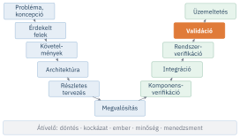
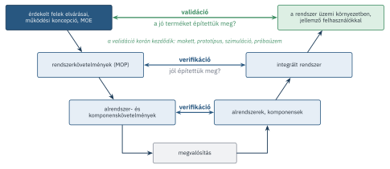

# Validáció {#sec-validacio}

::: {.vterkep}
{fig-alt="V-térkép: a fejezet helye a rendszerfejlesztés folyamatában" width=62%}
:::

::: {.cel}
A fejezet feldolgozása után képes leszel:

- elmagyarázni, miben különbözik a validáció a verifikációtól, és miért kezdődik már a tervezés korai szakaszában;
- validációs tervet és validációs mátrixot készíteni az érdekelt felek elvárásaiból és a MOE-kból;
- megtervezni egy használhatósági tesztet, és értelmezni a hatékonyság, a hatásosság és az elégedettség mérőszámait;
- megbecsülni a résztvevők szükséges számát, és a mért arányokat konfidenciaintervallummal értékelni;
- felismerni, miért bukhat meg a validáción egy verifikáción átjutott rendszer.
:::

A verifikáció azt igazolja, hogy a termék teljesíti a követelményeket. A követelmények azonban az érdekelt felek elvárásainak egy fordítását jelentik, és a fordítás lehet hiányos vagy téves. Boehm rövid kérdéseivel: a verifikáció azt bizonyítja, hogy *jól építettük-e meg* a terméket, a validáció azt, hogy *a jó terméket építettük-e meg* [@boehm1984]. A verifikáció objektív bizonyítékot ad arra, hogy a követelményekben szereplő minden „kell” teljesült. Az ISO/IEC/IEEE 15288 szerint a validáció pedig arra ad objektív bizonyítékot, hogy a rendszer használat közben teljesíti az üzleti vagy küldetési célokat és az érdekelt felek követelményeit, vagyis a tervezett környezetben betölti a rendeltetését [@iso15288_2023, 6.4.11. szakasz; @nasa2016seh, 5.4. szakasz]. A két folyamat viszonyát a [-@fig-vv-kapcsolat]. ábra mutatja.

{#fig-vv-kapcsolat width=100%}

## A validáció célja és tárgya {#sec-val-cel}

A validáció tehát azt igazolja, hogy a végtermék kielégíti az érdekelt felek elvárásait (a MOE-kat) a tervezett üzemi környezetben, és lehetőség szerint a várható kezelők és felhasználók végzik. Az emberi rendszerintegráció szemléletében ([-@sec-ek-hsi]. szakasz) ennek két oldala van [@booher2003; @iso9241_210_2019]:

- **a rendeltetésszerű használat igazolása:** a termék a tervezett környezetben üzemeltetve betölti a rendeltetését; a rendszerstruktúra minden szintjén, a legalsó végterméktől a rendszerig;
- **az ember megfelelő integrálásának igazolása:** a felhasználói felület megfelel az emberi tényezők szempontjainak, a kezelők és a karbantartók elsajátították a szükséges készségeket, az utasítások elkészültek, a képzés megszervezése megtörtént, és a munkakörnyezet támogatja az egészséget és a biztonságot ([-@sec-emberkozpontu]. fejezet).

A validáció módszerei ugyanazok, mint a verifikációé: elemzés, bemutatás, vizsgálat és teszt; a mérce azonban az érdekelt felek céljai, a működési koncepció és a MOE-k, nem a követelmények szövege [@ieee1012_2024]. A validációs teszt a várható környezetre és működésre összpontosít, a minősítő teszt viszont a legrosszabb esetet jelentő terhelésekre és környezeti feltételekre ([-@sec-verifikacio]. fejezet).

A validáció nem a fejlesztés végén kezdődik. A validációt a lehető legkorábban és iteratívan kell elvégezni, mert minél korábban derül ki az újratervezés szükségessége, annál olcsóbb ([-@sec-eletciklus]. szakasz) [@incose2023seh]. Az emberközpontú tervezés szabványa ugyanezt írja elő: a terveket a felhasználók bevonásával, a tervezés során többször kell értékelni [@iso9241_210_2019]. A koncepció szakaszában a működési forgatókönyvek közös végiggondolása, később a makettek, a prototípusok és a szimulációk, a megvalósítás után a próbaüzem és az üzemi adatok szolgálnak validációs bizonyítékul.

## A validációs terv és a validációs mátrix {#sec-val-terv}

A validációs terv forrásai a működési koncepció, az érdekelt felek szükségletei, céljai és célkitűzései, a követelmények indoklása, a korábbi projektek tanulságai, a rendszerarchitektúra modelljei, valamint a rendszermérnöki, az emberi rendszerintegrációs és a verifikációs-validációs tervek. A validáció eszközei sokfélék lehetnek: az érdekelt felek értékelése és visszajelzése, szakmai átvizsgálások, különböző hűségű fizikai modellek, szimulációk és virtuális modellek, tesztek, illesztési próbák, az eljárások próbái és a felülvizsgálatokon kapott visszajelzések [@engel2010].

A **validációs mátrix** minden validációs tevékenységhez megadja az azonosítót, a tevékenység leírását, a célt (mit kell az érdekelt félnek értékelnie), a módszert, a helyszínt, az életciklus-fázist, a felelős szervezetet és az eredményt igazoló dokumentumot. A verifikációs mátrixszal szemben itt nem a követelmények, hanem az érdekelt felek céljai és a MOE-k a sorok kiindulópontjai.

::: {.eset eset="B" title="VárosiBringa: a validációs mátrix"}
A VárosiBringa három célkitűzése ([-@sec-erdekelt-felek]. fejezet) a validáció mércéje: C1 (csúcsidőben az állomások legalább 90%-án legalább két kerékpár), C2 (a második évben a belvárosi, 3 km-nél rövidebb autós utak aránya legalább 10%-kal csökkenjen) és C3 (a 65 év felettiek körében a sikeres első kölcsönzések aránya segítség nélkül legalább 85%). A [-@tbl-validacio-bringa]. táblázat a validációs mátrix részlete. A tevékenységek a tervezés korai szakaszától az üzemeltetés második évéig tartanak.

| Az. | Tevékenység | Cél | Módszer | Fázis | Felelős | Eredmény |
|:--|:--|:--|:--|:--|:--|:--|
| V-1 | a kölcsönző alkalmazás két prototípusának próbája 12 résztvevővel | a kölcsönzés minden felhasználói csoport számára érthető (C3) | teszt (használhatósági) | részletes tervezés | UX-csapat | SUS 64 → 79; feladatsiker 75% → 96% |
| V-2 | az áthelyezési stratégia szimulációja a kölcsönzési adatokkal | a C1 elérhető a tervezett furgonszámmal | elemzés | részletes tervezés | rendszermérnök | 93% a szimulációban |
| V-3 | első kölcsönzés próbaállomáson 30, 65 év feletti résztvevővel | a C3 elérhetőségének előzetes értékelése | teszt | próbaüzem | UX-csapat, idősügyi tanács | 26/30 sikeres (87%) |
| V-4 | az állomások telítettségének mérése az első három hónapban | C1 | teszt (üzemi adatok) | üzemeltetés | üzemeltető | 86% → az áthelyezés módosítása után 92% |
| V-5 | az első kölcsönzések naplója a 65 év feletti regisztrált felhasználóknál | C3 | teszt (üzemi adatok) | üzemeltetés, első félév | üzemeltető | 571/640 sikeres (89%) |
| V-6 | forgalomszámlálás és háztartási felmérés | C2 | teszt (terepi felmérés) | üzemeltetés, második év | önkormányzat | folyamatban |

: A VárosiBringa validációs mátrixának részlete. {#tbl-validacio-bringa tbl-colwidths="[6,22,18,12,12,12,18]"}
:::

A táblázat két fontos tanulságot hordoz. A validáció egy része csak üzem közben végezhető el: a C2 hatásmutató a második év végéig nem igazolható, ezért a validációs terv az üzemeltetés első két évére is kiterjed ([-@sec-uzemeltetes]. fejezet). A korai bizonyítékok (V-1–V-3) pedig nem igazolják a MOE teljesülését, de jelzik, jó irányba halad-e a terv, és olcsón lehetővé teszik a javítást.

## Felhasználók bevonása és használhatósági teszt {#sec-val-hasznalhatosag}

A validáció leggyakoribb, a felhasználókat közvetlenül bevonó formája a **használhatósági teszt**. Az ISO 9241-11 szabvány szerint a használhatóság annak mértéke, hogy egy rendszert, terméket vagy szolgáltatást meghatározott felhasználók meghatározott célok elérésére mennyire hatásosan, hatékonyan és elégedetten használhatnak egy meghatározott használati környezetben [@iso9241_11_2018]. A három összetevőhöz jellemző mérőszámok tartoznak:

- **hatásosság:** a feladatok sikeres befejezésének aránya, a hibák száma és súlyossága;
- **hatékonyság:** a feladatra fordított idő és erőforrás;
- **elégedettség:** a felhasználók értékelése, például a System Usability Scale (SUS) kérdőívvel [@brooke1996]; a SUS-pontszámok átlaga a nagy adatbázisok alapján 68 körül van [@sauro2016].

A használhatósági tesztben a felhasználói népességet képviselő résztvevők a működési forgatókönyvekből levezetett, valószerű feladatokat hajtanak végre, miközben a moderátor megfigyeli őket, és rögzíti a sikert, az időt, a hibákat és az elakadásokat [@rubin2008]. A validáció felkészítésénél ügyelni kell arra, hogy a résztvevők megfelelően képviseljék a felhasználókat (testméret, készségek, tudás, képzettség, ruházat, eszközök), és ahol lehet, valódi végfelhasználókat kell bevonni [@iso9241_210_2019].

A tesztek két célt szolgálhatnak. A **formatív** teszt a tervezés közben a problémák feltárását célozza: mi akadályozza a felhasználót, és miért. Az **összegző** (szummatív) teszt a kész vagy közel kész termék mért teljesítményét veti össze a célértékekkel, például a C3 85%-os sikerarányával. A kettő eltérő mintaelemszámot kíván.

### Hány résztvevő kell a problémák feltárásához?

Nielsen és Landauer modellje szerint, ha egy probléma egy résztvevőnél $p$ valószínűséggel jelentkezik, akkor $n$ résztvevő a problémák

$$
1 - (1 - p)^{n}
$$ {#eq-felderites}

hányadát tárja fel [@nielsen1993]. A szerzők által elemzett projektekben a $p$ átlagosan 0,31 volt; ekkor öt résztvevő a problémák mintegy 84%-át találja meg ([-@fig-felderites-gorbe]. ábra). Ebből ered a gyakran idézett „öt résztvevő elég” szabály, amelyet Virzi korábbi vizsgálatai is alátámasztottak [@virzi1992]. A szabály azonban feltételes: ha a $p$ kicsi, például mert a felhasználói csoportok eltérően viselkednek, vagy a problémák csak ritka helyzetekben jelentkeznek, öt résztvevő a problémák kisebbik felét sem tárja fel. Sauro és Lewis ezért azt javasolja, hogy a $p$-t a saját tesztadatokból becsüljük, és vegyük figyelembe, hogy kis mintán a becslés felfelé torzít [@sauro2016]. Több felhasználói csoport esetén csoportonként kell résztvevőket bevonni.

![A feltárt problémák aránya a résztvevők számának függvényében [@nielsen1993 modellje alapján].](../abrak/gen/felderites-gorbe.svg){#fig-felderites-gorbe width=82%}

### Arányok és konfidenciaintervallum

Az összegző tesztben a sikerarány is mintából származó becslés. Kis mintán a normális közelítésen alapuló („Wald-féle”) intervallum megbízhatatlan; Agresti és Coull a módosított Wald-intervallumot javasolja, amely $x$ sikerre $n$ próbából

$$
\tilde{p} = \frac{x + z^2/2}{n + z^2}, \qquad \tilde{p} \pm z\sqrt{\frac{\tilde{p}(1-\tilde{p})}{n + z^2}},
$$ {#eq-modositott-wald}

ahol 95%-os szinten $z = 1{,}96$ [@agresti1998]. Sauro és Lewis a használhatósági tesztek sikerarányaira ezt az intervallumot ajánlja [@sauro2016].

::: {.eset eset="B" title="VárosiBringa: elég-e 26 sikeres első kölcsönzés 30-ból?"}
A próbaállomáson (V-3) a 30, 65 év feletti résztvevő közül 26 segítség nélkül kölcsönzött elsőre, ami 87%, vagyis a mintaarány meghaladja a 85%-os célt. A [-@eq-modositott-wald]. egyenlet szerinti 95%-os intervallum azonban 70–95%: a 30 fős minta nem elég annak igazolására, hogy a népességben a sikerarány legalább 85%. A csapat ezért a próbát formatív eredménynek tekintette: a négy sikertelen résztvevő közül három a dokkolón a zár kioldására szolgáló gombot kereste, ezért a kioldás menetét a dokkoló kijelzőjén nagyobb betűs, hangos útmutatóval egészítették ki. A C3 teljesülését az üzemi napló (V-5) igazolta: az első félévben a 65 év feletti regisztrált felhasználók 640 első kölcsönzéséből 571 sikerült ügyfélszolgálati segítség nélkül (89%; 95%-os intervallum 87–91%).
:::

::: {.eset eset="A" title="KoboCella: validáció a kezelőkkel"}
A KoboCella verifikációja igazolta a ciklusidőt, a nyomatékot és a biztonsági funkciókat ([-@sec-verifikacio]. fejezet). A validáció azt kérdezte, hogy a cella a valós műszakrendben, a valós kezelőkkel betölti-e a rendeltetését: tartja-e az évi 140 ezer motor ütemét, és a kezelők munkája valóban könnyebb-e. A helyszíni átvétel utáni két hétben mind a hat betanított kezelő legalább három műszakot dolgozott a cellánál. Az első héten a kezelők a hibaelhárítási forgatókönyvekben (elakadt csavar, hiányzó fedél) a nyugtázó gomb és a hibaüzenet kijelzőjének távolsága miatt gyakran a cella mögé mentek; a csapat a nyugtázást a kezelői oldalra helyezte. A második héten a kezelők átlagos SUS-pontszáma 74, a NASA-TLX fizikai terhelési összetevője a korábbi kézi szerelésénél lényegesen kisebb volt ([-@sec-emberkozpontu]. fejezet). A heti termelés a tervezett ütemet elérte.
:::

## Validáció üzem közben {#sec-val-uzem}

Sok MOE csak a rendszer üzemelése során mérhető: a VárosiBringa elérhetősége és hatása, a ForgácsTech határidő-tartása. Az ilyen MOE-k validációja az átadás után folytatódik, és a validációs tervnek meg kell határoznia, milyen adatokból, mennyi ideig és ki értékeli az eredményt ([-@sec-uzemeltetes]. fejezet). Az üzemi adatokkal végzett validáció előnye a nagy mintaelemszám és a valós környezet, hátránya, hogy a feltárt hiányosság javítása már drága. A validáció addig nem tekinthető befejezettnek, amíg minden feltárt probléma és intézkedés le nem zárult.

## Ha a verifikáció sikeres, de a validáció nem {#sec-val-kudarc}

Különösen kellemetlen az a helyzet, amikor a rendszer sikeresen átjut a verifikáción, de a validáció egy kritikus szakaszában megbukik. Ez késést, jelentős átdolgozást és az érdekelt felekkel kötött kompromisszumokat okozhat. A megelőzés kulcsa a korán kidolgozott és a követelmények és a tervezés során folyamatosan finomított működési koncepció, a felhasználók bevonásának tisztázása az emberi rendszerintegrációs tervben, valamint a gyakori, iteratív kommunikáció az érdekelt felekkel. Arra is ügyelni kell, hogy a validációs hiányosságok javítása nem ütközhet az érdekelt felek elvárásaival azok előzetes egyeztetése nélkül, és a javítás nem okozhat új hibát a korábban megfelelően működő részekben; ennek eszköze a korábbi átvételi tesztek megismétlése (regressziós teszt).

A validáció sikertelenségének nem mindig a terv az oka. Három okcsoportot érdemes megkülönböztetni: a validáció rossz végrehajtását (hiányzó vagy hibás segédeszközök, betanítatlan kezelők, be nem tartott eljárások, nem kalibrált eszközök, nem megfelelő környezet), a verifikáció hiányosságát, valamint modellek és szimulációk esetén a hibás kezdeti és peremfeltételeket, a pontatlan egyenleteket és a nem megfelelő felbontást ([-@sec-mod-vv]. szakasz). Csak ezek kizárása után állítható, hogy a terv nem felel meg az elvárásoknak.

::: {.eset eset="C" title="ForgácsTech: a verifikált MES és a 89%-os határidő-tartás"}
A ForgácsTech MES-e minden követelményt teljesített a verifikáción ([-@sec-verifikacio]. fejezet). A siker kritériuma azonban a problémamegfogalmazás szerint az volt, hogy a rendelések legalább 95%-a teljesüljön határidőre három egymást követő hónapban ([-@sec-problema]. fejezet). Az első három hónapban az arány 92, 87 és 89% lett: jelentős javulás a kiinduló 62%-hoz képest, de a cél alatt. Az elemzés kimutatta, hogy a műszakvezetők az ütemező átsorolási javaslatainak 41%-át módosították. A naplózott indoklásokból kiderült, hogy az ütemező nem tudta, melyik kezelő jogosult az öttengelyes megmunkáló központ kezelésére, ezért javaslatai egy része a gyakorlatban végrehajthatatlan volt ([-@sec-automatizalas]. fejezet). Ez az információ egyik követelményben sem szerepelt, mert a feltáró interjúkban senki nem említette: a műszakvezetők számára magától értetődő volt. A csapat a kezelők jogosultsági mátrixát az ütemező korlátai közé vette, az érintett modulokon megismételte a korábbi átvételi teszteket, és a következő három hónapban az arány 95,6, 96,1 és 95,2% lett. A MOE teljesült.
:::

::: {.kitekintes title="Validáció és tanúsítás szabályozott területeken"}
Az orvostechnikai eszközök, a járművek és a vasúti rendszerek területén a validációt jogszabályok és harmonizált szabványok írják elő. Ilyenkor a validáció bizonyítékai a megfelelőségértékelés részei, és a tervezési dokumentáció mellett a hatóság vagy a kijelölt tanúsító szervezet vizsgálja őket. Az orvostechnikai eszközöknél a használhatósági mérnöki folyamatot, benne a használhatóság összegző értékelését, külön szabvány írja elő, mert a használati hibák a betegre veszélyesek lehetnek [@iec62366_2015]. A rendszermérnöki elv ugyanaz, mint a fejezet többi részében: a validáció tervét korán kell elkészíteni, és a működési koncepcióra és a felhasználókra kell építeni.
:::

::: {.hiba title="Validáció a fejlesztőkkel"}
Gyakori hiba, hogy a „felhasználói próbát” a fejlesztőcsapat tagjai vagy a rendszert jól ismerő kollégák végzik. Ők tudják, hol kell keresni a gombot, mit jelent a hibaüzenet, és milyen sorrendben kell végrehajtani a lépéseket, ezért nem akadnak el ott, ahol a valódi felhasználó elakadna. A validáció résztvevőinek a felhasználói népességet kell képviselniük, beleértve azokat a csoportokat is (idősek, gyengénlátók, alkalmi felhasználók, új kezelők), amelyek a fejlesztők között nem fordulnak elő.
:::

::: {.osszefoglalo}
- A verifikáció azt igazolja, hogy a terméket jól készítettük el, a validáció azt, hogy a jó terméket készítettük el: a mérce az érdekelt felek céljai, a működési koncepció és a MOE-k.
- A validációt a tervezett környezetben, lehetőleg valódi felhasználókkal végzik, és az ember megfelelő integrálását is igazolja.
- A validációt korán és iteratívan kell végezni: makettel, prototípussal, szimulációval, próbaüzemmel; egyes MOE-k csak üzem közben igazolhatók.
- A validációs mátrix minden tevékenységhez megadja a célt, a módszert, a fázist, a felelőst és az eredményt.
- A használhatóság hatásosságból, hatékonyságból és elégedettségből áll; a problémák feltárásához kevés, a sikerarány igazolásához sok résztvevő kell, az arányokat módosított Wald-intervallummal értékeljük.
- A verifikáción átjutott rendszer is megbukhat a validáción, ha a követelmények hiányosan fordították le az elvárásokat; a megelőzés kulcsa a jó működési koncepció és a felhasználók folyamatos bevonása.
:::

::: {.onell}
1. Fogalmazd meg egy-egy mondatban a verifikáció és a validáció kérdését!
2. Milyen két oldala van a validációnak az emberi rendszerintegráció szemléletében?
3. Miben különbözik a validációs teszt a minősítő teszttől?
4. Miért kezdődik a validáció már a tervezés korai szakaszában? Milyen eszközei vannak ekkor?
5. Egy alkalmazás tesztjén a problémák egy résztvevőnél átlagosan 0,2 valószínűséggel jelentkeznek. Hány százalékukat tárja fel öt, illetve tíz résztvevő?
6. Egy próbán 20 résztvevőből 18 sikeres. Számítsd ki a módosított Wald-intervallumot! Igazolja-e ez, hogy a sikerarány legalább 80%?
7. Sorolj fel három okot, amelyek miatt egy validáció sikertelen lehet, pedig a terv megfelelő!
8. Mit tanít a ForgácsTech esete a követelmények feltárásáról?

::: {.megoldas}
1. Verifikáció: jól építettük-e meg a terméket, vagyis teljesíti-e a követelményeket? Validáció: a jó terméket építettük-e meg, vagyis kielégíti-e az érdekelt felek elvárásait a tervezett környezetben?
2. Annak igazolása, hogy a termék a tervezett környezetben betölti a rendeltetését, és hogy az ember megfelelően integrálódott a rendszerbe (felület, készségek, utasítások, képzés, munkakörnyezet).
3. A validációs teszt a várható környezetre és működésre összpontosít, a minősítő teszt a legrosszabb esetet jelentő terhelésekre és környezeti feltételekre.
4. Mert minél korábban derül ki, hogy a terv nem felel meg az elvárásoknak, annál olcsóbb a javítás. Eszközei: a működési forgatókönyvek közös végiggondolása az érdekelt felekkel, makettek, prototípusok, szimulációk, virtuális modellek, felülvizsgálati visszajelzések.
5. $1 - 0{,}8^{5} = 0{,}67$, vagyis 67%; $1 - 0{,}8^{10} = 0{,}89$, vagyis 89%.
6. $\tilde{p} = (18 + 1{,}92)/(20 + 3{,}84) = 0{,}836$; a félszélesség $1{,}96\sqrt{0{,}836 \cdot 0{,}164 / 23{,}84} = 0{,}149$; az intervallum 69–98%. Nem igazolja, mert az alsó határ 80% alatt van, bár a mintaarány (90%) fölötte.
7. Hiányzó vagy hibásan működő segédeszközök, betanítatlan kezelők, be nem tartott eljárás, nem kalibrált eszközök, nem megfelelő környezet; a verifikáció hiányossága; modelleknél hibás kezdeti vagy peremfeltételek.
8. Azt, hogy a magától értetődőnek tartott, ki nem mondott tudás (a kezelők jogosultsága) könnyen kimarad a követelményekből, és csak a valós használatban derül ki. A feltárásnál a munka megfigyelése és a forgatókönyvek közös végigjátszása segít, az üzem közbeni validáció pedig felszínre hozza az ilyen hiányokat.
:::
:::

::: {.projekt title="Projektlépés: validációs terv"}
Saját fejlesztési feladatodhoz:

1. gyűjtsd össze a MOE-kat és a működési forgatókönyveket, és jelöld, melyik érdekelt csoportot érintik;
2. készíts validációs mátrixot legalább négy tevékenységgel, köztük legalább egy korai (makett, prototípus, szimuláció) és egy üzem közbeni tevékenységgel;
3. tervezz egy használhatósági tesztet: résztvevők csoportonként, feladatok sikerkritériummal és célidővel, mérőszámok (siker, idő, SUS);
4. becsüld meg a résztvevők számát a problémák feltárásához és a sikerarány igazolásához, és indokold a különbséget;
5. használd a Gyakorlati útmutató használhatósági teszt eszközlapját.
:::

::: {.forras}
- @engel2010: a validáció tervezése és eszközei a verifikációval és a teszteléssel együtt.
- @iso15288_2023, 6.4.11. szakasz; @iso9241_11_2018; @iso9241_210_2019: a validáció, a használhatóság és az emberközpontú értékelés a szabványokban.
- @rubin2008; @sauro2016: a használhatósági tesztek tervezése és statisztikai értékelése.
- @nielsen1993; @virzi1992; @agresti1998: a résztvevők száma és az arányok konfidenciaintervalluma.
- @nasa2016seh, 5.4. szakasz és E függelék: a termékvalidáció folyamata, céljai, a sikertelen validáció okai és a validációs mátrix.
:::
