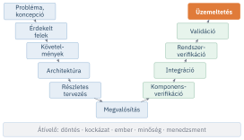
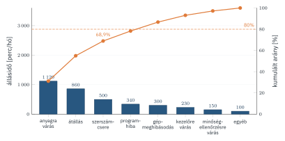
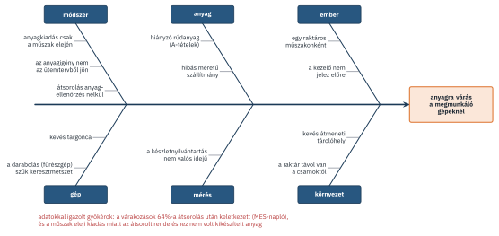
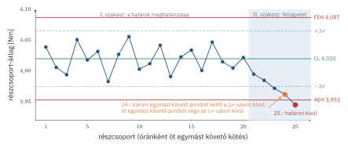
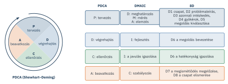

# Átadás, üzemeltetés és folyamatos fejlesztés {#sec-uzemeltetes}

::: {.vterkep}
{fig-alt="V-térkép: a fejezet helye a rendszerfejlesztés folyamatában" width=62%}
:::

::: {.cel}
A fejezet feldolgozása után képes leszel:

- megtervezni egy rendszer átadását és üzembe helyezését, és megnevezni az átadás lezárásának feltételeit;
- megkülönböztetni a karbantartás fő fajtáit, és a rendszer jellemzőihez illő karbantartási stratégiát választani;
- alkalmazni a minőségügy alapeszközeit (Pareto-diagram, ok-okozati diagram, hisztogram, kontrollkártya) üzemi problémák elemzésére;
- kontrollkártyát készíteni és értelmezni, és kiszámolni a folyamatképességi indexeket;
- PDCA-, 8D- vagy DMAIC-ciklusban vezetni egy fejlesztést, és üzemi adatokból trendeket felismerni;
- már a tervezéskor figyelembe venni a rendszer életciklusának végét.
:::

A V-modell jobb ága nem ér véget a validációval. A rendszert át kell adni, üzembe kell helyezni, üzemeltetni és karban kell tartani, a teljesítményét követni és javítani kell, végül ki kell vonni a használatból. Az üzemeltetés célja, hogy a rendszer kielégítse azt a szükségletet, amelyre létrehozták, és ezt tartósan fenntartsa. A továbbfejlesztés is ide tartozik, de csak addig, amíg nem igényli az architektúra jelentős megváltoztatását: az ilyen mértékű változás már új szükségletet jelent, és új fejlesztési ciklust indít. Az ISO/IEC/IEEE 15288 ezeket a tevékenységeket négy műszaki folyamatban írja le: átadás, üzemeltetés, karbantartás és kivonás [@iso15288_2023, 6.4.10., 6.4.12–6.4.14. szakasz].

## Átadás és üzembe helyezés {#sec-uz-atadas}

Az ISO/IEC/IEEE 15288 szerint az átadás célja, hogy a rendszer a tervezett üzemi környezetben képes legyen nyújtani az érdekelt felek követelményeiben rögzített szolgáltatásokat [@iso15288_2023, 6.4.10. szakasz; @nasa2016seh, 5.5. szakasz]. Az átadásnak két formája van: az alacsonyabb szintű termék átadása integrálásra a rendszerstruktúra következő szintjén, illetve a végtermék átadása a felhasználónak, aki a tervezett üzemi környezetben használja. A rendszermérnök felelőssége, hogy csak megfelelően tesztelt, verifikált és validált termék kerüljön át a következő szintre.

Az átadás fő tevékenységei [@iso15288_2023, 6.4.10. szakasz]:

- **felkészülés:** a termék, a személyzet és a segédeszközök készenlétének értékelése; a termékkel együtt átadandó dokumentáció (kezelési, telepítési és karbantartási utasítások, a konfigurációs alapvonal, a verifikáció és a validáció bizonyítékai); a személyzet szükséges képzése;
- **a helyszín előkészítése:** helyszíni felmérés, a létesítmények szükséges átalakítása, a logisztikai támogatás, a felhasználók, kezelők és karbantartók képzése; a helyszíni felmérést már az életciklus korai szakaszában érdemes elvégezni, mert a helyszín adottságai a tervet is befolyásolják;
- **a termék előkészítése és szállítása:** csomagolás, kezelés, tárolás, a sérülések elleni védelem;
- **az átadás és a telepítés:** jóváhagyott telepítési eljárással, majd funkcionális és átvételi teszttel, amely igazolja, hogy a szállítás nem okozott sérülést, és a termék támogatásra kész;
- **a munkatermékek rögzítése:** helyszíntervek, kezelési eljárások, képzési anyagok, tanulságok.

A felhasználónak történő átadás akkor zárul le, ha a termék a helyszínen telepítve van, az átvételi és tanúsítási tevékenységek befejeződtek, a felhasználók, kezelők és karbantartók képzése megtörtént, és az átadást átvételi dokumentum zárja.

::: {.eset eset="C" title="ForgácsTech: bevezetés a termelés leállítása nélkül"}
A ForgácsTech problémamegfogalmazása korlátként rögzítette, hogy a bevezetés alatt a termelés egy hétnél tovább nem állhat le ([-@sec-problema]. fejezet). A csapat ezért szakaszos bevezetést tervezett. Az első két hétben a MES párhuzamosan futott a papíralapú heti ütemtervvel: a műszakvezetők a megszokott módon dolgoztak, de minden átsorolást a MES-ben is rögzítettek, és naponta összevetették a két ütemtervet. A gépeket csoportonként, hétvégén kötötték be. A harmadik héten a papíralapú ütemterv megszűnt. Az átadás része volt a műszakvezetők és a kezelők képzése, a kezelési útmutató, a hibaelhárítási eljárás (mi a teendő, ha a MES nem elérhető) és a felelősök kijelölése az üzemeltetés első három hónapjára.
:::

## Üzemeltetés és karbantartás {#sec-uz-karbantartas}

Az üzemeltetés és a karbantartás jellemző tevékenységei [@iso15288_2023, 6.4.12–6.4.13. szakasz]: a pótalkatrész-terv végrehajtása, a műszaki adatok gyűjtése, a cserekezelők és -karbantartók képzése, az üzemeltetési és karbantartási naplók vezetése, a rendszer karbantartása és korszerűsítése, a kockázatok azonosítása és frissítése, a hiba- és problémajelentések kezelése, a tanulságok rögzítése, valamint a kivonás előkészítése.

A **karbantartás** az EN 13306 szabvány szerint két fő ágra bomlik ([-@fig-karbantartas-tipusok]. ábra) [@en13306_2017]. A **megelőző karbantartást** a hiba bekövetkezése előtt végzik: előre meghatározott időközönként vagy darabszám után, illetve az állapot mérése és értékelése alapján (állapotalapú karbantartás). Az állapotalapú karbantartás egyik formája az **előrejelző** (prediktív) karbantartás, amely az állapot jövőbeli alakulását is előre jelzi. A **hibát követő** (korrektív) karbantartás a hiba felismerése után állítja helyre a működőképességet, azonnal vagy halasztva.

![A karbantartás fajtái az EN 13306 szerint [@en13306_2017 alapján], KoboCella-példával.](../abrak/gen/karbantartas-tipusok.svg){#fig-karbantartas-tipusok width=92%}

A választás a meghibásodás jellegétől és következményeitől függ. Ha a meghibásodási ráta nem nő az idővel ([-@sec-megbizhatosag]. fejezet), az időalapú csere nem csökkenti a hibák számát, csak a jó alkatrészeket cseréli le. Ha a romlás mérhető (kopás, rezgés, hőmérséklet, a nyomaték szórása), az állapotalapú karbantartás a hibák előtt beavatkozik, de csak a szükséges helyen. A karbantartás a rendelkezésre állást és az OEE-t közvetlenül befolyásolja ([-@sec-folyamatelemzes]. fejezet), ezért a karbantartási stratégia a rendszer teljesítménykövetelményeinek része.

A rendszer üzemi **teljesítménykövetése** a fejlesztés során használt mérőszámok folytatása: a MOE-k és a TPM-ek ([-@sec-kovetelmenyek]. fejezet) az üzemben mutatószámokká válnak. A KoboCellánál a ciklusidő, a rendelkezésre állás és a nyomaték, a VárosiBringánál az állomások telítettsége és a kölcsönzések száma, a ForgácsTechnél a határidő-tartás és az OEE.

## A minőségügy alapeszközei {#sec-uz-eszkozok}

Az üzemi problémák többsége egyszerű eszközökkel elemezhető. Ishikawa hét alapeszközt javasolt, amelyekkel szerinte az üzemi minőségi problémák túlnyomó része megoldható [@ishikawa1982]; Montgomery a statisztikai folyamatszabályozás „nagy hetesének” nevezi őket ([-@tbl-hetek]. táblázat) [@montgomery2020sqc].

| Eszköz | Mire jó? |
|:--|:--|
| ellenőrzőlap | az adatok egyszerű, egységes gyűjtése (hol, mikor, milyen hiba) |
| hisztogram | egy jellemző eloszlásának megjelenítése; a tűrésmezőhöz viszonyítva a képesség szemléltetése |
| Pareto-diagram | a problémák vagy okok fontossági sorrendje; a „kevés lényeges” kiválasztása |
| ok-okozati (halszálka-) diagram | egy probléma lehetséges okainak rendszerezése |
| rétegzés | az adatok csoportosítása (gép, műszak, anyag) a különbségek feltárására |
| szórásdiagram | két változó kapcsolatának vizsgálata |
| kontrollkártya | a folyamat időbeli stabilitásának figyelése; a különleges okok jelzése |

: A minőségügy hét alapeszköze [@ishikawa1982; @montgomery2020sqc]. {#tbl-hetek tbl-colwidths="[30,70]"}

A **Pareto-diagram** az okokat gyakoriságuk vagy hatásuk szerint csökkenő sorrendben ábrázolja, a kumulált aránnyal együtt. A tapasztalat szerint a hatás nagy részét az okok kis része okozza; ez a „kevés lényeges és sok kevésbé lényeges” elve [@montgomery2020sqc]. A Pareto-diagram így a problémák rangsorolására és a fejlesztési erőfeszítések összpontosítására szolgál. Az **ok-okozati diagram** egy probléma lehetséges okait fő csoportok (gyakran: ember, gép, módszer, anyag, mérés, környezet) szerint rendezi; a csapatmunkát segíti, de a lehetséges okok közül a valódit adatokkal kell igazolni [@ishikawa1982].

::: {.eset eset="C" title="ForgácsTech: mi okozza az állásidőt?"}
A MES bevezetése után a gépek állásidejének túlnyomó része okhoz rendelve került rögzítésre, ami a siker egyik kritériuma volt ([-@sec-problema]. fejezet). Egy hónap adataiból a csapat Pareto-diagramot készített ([-@fig-pareto-forgacs]. ábra): a 3600 perc állásidőből 31% anyagra várás, 24% átállás, 14% szerszámcsere volt; a három ok együtt az állásidő 69%-át adta. Az átállás csökkentésén már dolgoztak ([-@sec-folyamatelemzes]. fejezet), ezért az anyagra várást vizsgálták tovább ok-okozati diagrammal ([-@fig-halszalka-forgacs]. ábra). A hat okcsoportból a csapat két lehetséges gyökérokot tartott valószínűnek, és a MES-naplóval ellenőrizte őket: a várakozások 64%-a egy rendelés átsorolása után keletkezett, mert az anyagot csak a műszak elején adták ki, az átsorolt rendeléshez tehát nem volt kikészítve anyag.

{#fig-pareto-forgacs width=88%}

{#fig-halszalka-forgacs width=100%}
:::

## Statisztikai folyamatszabályozás {#sec-uz-spc}

Minden folyamat szór. Shewhart megkülönböztette a **véletlen** (közös) okokat, amelyek a folyamat természetes ingadozását adják, és a **különleges** (azonosítható) okokat, amelyek a folyamat megváltozását jelzik [@shewhart1931]. A folyamat akkor „szabályozott”, ha csak véletlen ingadozás van jelen; a statisztikai folyamatszabályozás célja, hogy a különleges okokat még azelőtt felismerje, mielőtt hibás termék keletkezne [@montgomery2020sqc].

A **kontrollkártya** a mérési eredményeket (vagy részcsoportok átlagát) időrendben ábrázolja, a középvonallal és a ±3σ-nál húzott beavatkozási határokkal. Részcsoportok esetén a szórást az átlagos terjedelemből becsüljük:

$$
\hat{\sigma} = \frac{\bar{R}}{d_2}, \qquad \mathrm{FEH},\,\mathrm{AEH} = \bar{\bar{x}} \pm 3\,\frac{\hat{\sigma}}{\sqrt{n}} = \bar{\bar{x}} \pm A_2 \bar{R},
$$ {#eq-kontrollhatar}

ahol $\bar{R}$ a részcsoport-terjedelmek átlaga, $n$ a részcsoport mérete, $d_2$ és $A_2 = 3/(d_2\sqrt{n})$ táblázatos állandók ($n = 5$ esetén $d_2 = 2{,}326$, $A_2 = 0{,}577$) [@montgomery2020sqc]. A határokat egy stabil időszak adataiból számoljuk (I. szakasz), és ezekkel figyeljük a folyamatot (II. szakasz).

A különleges ok jelei az úgynevezett Western Electric-szabályok szerint [@montgomery2020sqc; @goldberg1994toolbox, 7.14. szakasz]: (1) egy pont a ±3σ határon kívül; (2) három egymást követő pontból kettő ugyanazon az oldalon a 2σ-n túl; (3) öt egymást követő pontból négy ugyanazon az oldalon az 1σ-n túl; (4) nyolc egymást követő pont a középvonal ugyanazon oldalán. A szabályok a határon kívüli pont előtt is jelezhetik a folyamat elmozdulását.

A kontrollkártya a folyamat stabilitásáról szól, nem arról, hogy a termék megfelel-e a tűrésnek. Ezt a **folyamatképességi indexek** mutatják:

$$
C_p = \frac{\mathrm{FTH} - \mathrm{ATH}}{6\sigma}, \qquad C_{pk} = \frac{\min(\mathrm{FTH} - \mu,\; \mu - \mathrm{ATH})}{3\sigma},
$$ {#eq-kepesseg}

ahol FTH és ATH a felső és az alsó tűréshatár. A $C_p$ a tűrésmező és a folyamat szórásának viszonya, a $C_{pk}$ a folyamat középértékének elhelyezkedését is figyelembe veszi [@montgomery2020sqc]. A képességindex csak stabil folyamatra értelmezhető.

::: {.eset eset="A" title="KoboCella: a nyomaték kontrollkártyája"}
A csavarozó egység óránként öt egymást követő kötés nyomatékát rögzíti. Az első húsz részcsoportból a középvonal 4,020 Nm, az átlagos terjedelem 0,116 Nm, így $\hat{\sigma} = 0{,}116/2{,}326 = 0{,}050$ Nm, a beavatkozási határok 3,953 és 4,087 Nm ([-@fig-kontrollkartya-kobo]. ábra). A folyamat stabil, a képességindexek a 4,0 ± 0,2 Nm tűrésre $C_p = 0{,}4/(6 \cdot 0{,}050) = 1{,}33$ és $C_{pk} = 0{,}18/(3 \cdot 0{,}050) = 1{,}20$. A $C_{pk}$ azért kisebb a $C_p$-nél, mert a középérték 0,02 Nm-rel a célérték fölött van; a középérték beállításával a $C_{pk}$ a $C_p$ értékéig növelhető ([-@sec-robusztus]. fejezet). A 21. részcsoporttól az átlag csökkenni kezdett. A 24. részcsoportnál két szabály is jelzett (három pontból kettő a 2σ-n túl, öt pontból négy az 1σ-n túl), a 25. pont már a beavatkozási határ alá esett. Az első gyanú a bitbetét kopása volt, de a kísérlettervezés szerint a választott kétlépcsős stratégiánál a kopás csak néhány század Nm-rel csökkenti a nyomatékot ([-@sec-robusztus]. fejezet), a megfigyelt elmozdulás ennél jóval nagyobb volt. A rétegzés megmutatta, hogy az elmozdulás egy új csavartétel felhasználásával kezdődött: a beszállító gyártási helyet váltott, és a csavarok felületi bevonata eltért a korábbiakétól. A csapat a tételt visszatartotta, a beszállítói specifikációt a bevonatra is kiterjesztette, és a beérkező tételekre mintavételes csavarozási próbát vezetett be; a kontrollkártya jelzése egyben a bitbetét állapotalapú cseréjének is egyik feltétele lett.

{#fig-kontrollkartya-kobo width=100%}
:::

## Fejlesztési ciklusok: PDCA, 8D, DMAIC {#sec-uz-ciklusok}

A folyamatos fejlesztés szervezett ciklusokban halad ([-@fig-fejlesztesi-ciklusok]. ábra). A **PDCA**-ciklus (tervezés, végrehajtás, ellenőrzés, beavatkozás) Shewhart munkájára épül, és Deming tette ismertté [@deming1986]: a fejlesztés tervvel és mérhető céllal indul, kis léptékben valósul meg, a hatását mérik, és a bevált változtatást szabványosítják, a be nem váltat elvetik.

{#fig-fejlesztesi-ciklusok width=100%}

A **8D** (nyolc fegyelem) a reklamációk és a súlyos hibák rendszerezett, csapatban végzett kezelésére szolgál, különösen a járműiparban [@vda2018_8d]. Lépései: D1 a csapat összeállítása, D2 a probléma leírása, D3 azonnali (elszigetelő) intézkedések, D4 a gyökérok feltárása és igazolása, D5 a javító intézkedések kiválasztása, D6 a bevezetésük és hatékonyságuk igazolása, D7 a megismétlődés megelőzése, D8 a csapat elismerése és a lezárás. A 8D sajátossága, hogy az ügyfél védelmét szolgáló azonnali intézkedést elválasztja a gyökérokot megszüntető tartós intézkedéstől.

A **DMAIC** (meghatározás, mérés, elemzés, fejlesztés, szabályozás) a hat szigma módszertan projektciklusa. Schroeder és szerzőtársai szerint a hat szigma lényege a párhuzamos szervezeti struktúra (képzett projektvezetők), a strukturált fejlesztési eljárás és a mérőszámokra épülő célok [@schroeder2008]. A DMAIC adatvezérelt: a probléma meghatározása után a jelenlegi teljesítményt mérik, a gyökérokokat statisztikai eszközökkel igazolják, a megoldást kísérletileg kipróbálják, végül a javulást szabályozással (például kontrollkártyával) tartják fenn [@montgomery2020sqc].

| | PDCA | 8D | DMAIC |
|:--|:--|:--|:--|
| tipikus kiváltó ok | bármilyen fejlesztési lehetőség | reklamáció, súlyos hiba | krónikus, adatokkal mérhető teljesítményhiány |
| léptéke | kicsi, gyorsan ismételhető | egy probléma, csapat, hetek | projekt, hónapok |
| fő eszközök | egyszerű mérés, kísérlet | ok-okozati diagram, 5 miért, azonnali intézkedés | statisztika, kísérlettervezés, kontrollkártya |
| a lezárás feltétele | a változtatás szabványosítása | a megismétlődés megelőzése igazolt | a javulás szabályozott és fenntartott |

: A három fejlesztési ciklus összevetése [@deming1986; @vda2018_8d; @schroeder2008; @montgomery2020sqc alapján]. {#tbl-ciklusok tbl-colwidths="[22,22,28,28]"}

::: {.eset eset="B" title="VárosiBringa: 8D a téli zárhibákra"}
Az első télen három hét alatt 12 bejelentés érkezett arról, hogy a dokkoló a kerékpár visszahelyezése után nem zárt; mind a négy érintett állomás árnyékos helyen volt (D2). Az azonnali intézkedés: az alkalmazás a visszaadás után a zár állapotát is ellenőrizte, és sikertelen zárás esetén a felhasználót a szomszédos dokkolóhoz irányította; a diszpécser reggelente ellenőrizte az érintett állomásokat (D3). A csapat a lehetséges okokat ok-okozati diagrammal gyűjtötte össze, és hűtőkamrás teszttel igazolta a gyökérokot: −5 °C alatt a zárnyelv kenőanyaga besűrűsödött, és a reteszcsap nem ugrott be teljesen (D4). A javító intézkedés alacsony hőmérsékleten is működő kenőanyag és a zárnyelv rugójának erősítése lett (D5), amelyet hűtőkamrában és két állomáson igazoltak (D6). A megelőzés: a dokkoló FMEA-jának frissítése ([-@sec-fmea]. fejezet), a kenőanyag-specifikáció módosítása és egy téli ellenőrzőlista (D7).
:::

::: {.eset eset="C" title="ForgácsTech: DMAIC az anyagra várásra"}
A Pareto-elemzés után a csapat DMAIC-projektet indított. *Meghatározás:* az anyagra várás havi 1120 perc, a cél legfeljebb 400 perc. *Mérés:* a MES-napló gépenként és okonként rögzíti a várakozásokat. *Elemzés:* az ok-okozati diagram és a napló szerint a várakozások 64%-a átsorolás után keletkezett. *Fejlesztés:* a MES-ütemező átsorolás előtt ellenőrzi az anyag rendelkezésre állását, és az anyagot a műszak eleje helyett kétóránként, az ütemterv alapján adják ki; két gépen egy hónapig próbálták ki. *Szabályozás:* a napi várakozási percek egyedi értékes kontrollkártyáját a műszakvezetői megbeszélésen követik. Három hónap után a havi anyagra várás 380 perc lett.
:::

## Trendelemzés és üzemi visszacsatolás {#sec-uz-trend}

A kontrollkártya a hirtelen változást jelzi, a **trendelemzés** a lassú, fokozatos romlást. A trendelemzés több területre is kiterjedhet: a teljesítmény (egy működési jellemző alakulása), a problémák (a hibajelentések gyakorisága és jellege), a programmenedzsment (költség, ütemezés, erőforrások), a támogathatóság (pótalkatrészek, karbantartás) és a megbízhatóság trendjére. A trendelemzés célja, hogy a romlást még a követelmény megsértése vagy a meghibásodás előtt felismerje, és a beavatkozásra időt adjon.

Az üzemi adatok a fejlesztés számára is értékesek. A folyamatbányászat a valós folyamatot tárja fel az eseménynaplókból ([-@sec-bpmn]. fejezet), a hibajelentések és a karbantartási naplók a megbízhatósági modellek paramétereit pontosítják ([-@sec-megbizhatosag]. fejezet), az üzem közbeni validáció ([-@sec-validacio]. fejezet) pedig a ki nem mondott elvárásokat hozza felszínre. Ezért a tanulságokat az üzemeltetés és a lezárás minden szakaszában rögzíteni kell; a következő fejlesztés ezekből indul.

## Az életciklus vége és a körforgásos szemlélet {#sec-uz-eletciklus-vege}

Minden rendszer egyszer kikerül a használatból. Az ISO/IEC/IEEE 15288 a kivonást önálló folyamatként kezeli: célja, hogy a rendszer vagy elem működését befejezze, a kivont elemeket megfelelően kezelje, és a kritikus kivonási igényeket kielégítse, például a környezetvédelmi előírásokat [@iso15288_2023, 6.4.14. szakasz]. A rendszermérnök feladata, hogy a műszaki információkat azonosítsák és archiválják. A kivonás tevékenységei hosszúak és összetettek lehetnek, és visszahatnak a tervre, ezért a lehetőségeket és költségeiket már a korábbi szakaszokban mérlegelni kell.

A **körforgásos gazdaság** ezt a szemléletet a teljes termékláncra kiterjeszti. Kirchherr és szerzőtársai 114 meghatározás elemzése alapján a körforgásos gazdaságot olyan gazdasági rendszerként írják le, amely a termékek életciklusának végét a csökkentéssel, az újrahasználattal, az újrahasznosítással és az anyagok visszanyerésével váltja fel a termelés, az elosztás és a fogyasztás folyamataiban; a gyakran használt hierarchikus keretrendszerek a lehetőségeket az elutasítástól és újragondolástól az újrahasználaton, javításon, felújításon és újragyártáson át az újrahasznosításig és az energia visszanyeréséig rangsorolják [@kirchherr2017]. A rendszermérnöki következmény: a javíthatóságot, a szétszerelhetőséget, a modularitást és az anyagok azonosíthatóságát követelményként kell kezelni, nem utólagos szempontként. Egyes termékcsoportoknál ezt jogszabály is előírja: az Európai Unió elemrendelete például a könnyű közlekedési eszközök (köztük az elektromos kerékpárok) akkumulátoraira is gyűjtési, újrafeldolgozási és tájékoztatási kötelezettségeket állapít meg [@eu2023_1542].

::: {.eset eset="B" title="VárosiBringa: az akkumulátorok életciklusa"}
A VárosiBringa csapata az akkumulátorok életciklus végét már a koncepció szakaszában a követelmények közé vette: a cserélhető, szabványos csatlakozójú akkumulátorok kapacitását a flottakezelő rendszer folyamatosan követi; ha egy akkumulátor kapacitása a névleges 80%-a alá csökken, kikerül a kerékpárból. A kivont akkumulátorokat a szerződés szerint a gyártó veszi vissza, és helyhez kötött energiatárolóként vagy újrafeldolgozásra hasznosítja. A követelmény hatással volt a tervre is: a kerékpár akkumulátortartója szerszám nélkül, de csak szervizkulccsal nyitható.
:::

::: {.kitekintes title="Prediktív karbantartás és digitális iker"}
Az érzékelők, az ipari adatgyűjtés és a gépi tanulás lehetővé teszi, hogy a karbantartás az állapot jövőbeli alakulásának előrejelzésére épüljön. A rendszer digitális ikre ([-@sec-modellek]. fejezet) az üzemi adatokkal folyamatosan frissül, és szimulációval mutatja meg, hogyan hat egy beavatkozás. A rendszermérnöki kérdések ugyanazok, mint a fejezet többi részében: mely jellemzők romlása mérhető, mekkora a téves riasztás és az elmulasztott jelzés költsége, és ki dönt a beavatkozásról ([-@sec-automatizalas]. fejezet).
:::

::: {.hiba title="Átadás után magára hagyott rendszer"}
Gyakori hiba, hogy a fejlesztőcsapat az átvétellel lezártnak tekinti a munkát, és senki nem felel a teljesítmény követéséért. A mérőszámokat nem gyűjtik, a kezelők a hibákat megkerülő megoldásokkal kezelik, a tudás a fejlesztőkkel együtt távozik. Az átadás része kell legyen az üzemeltetés felelőseinek kijelölése, a mérőszámok gyűjtésének és értékelésének rendje, és a fejlesztők elérhetősége egy meghatározott időszakra.
:::

::: {.osszefoglalo}
- Az átadás a verifikált és validált terméket a következő szintre vagy a felhasználóhoz juttatja; része a dokumentáció, a képzés, a helyszín előkészítése, a telepítés és az átvételi teszt.
- Az üzemeltetés során a rendszer továbbfejleszthető, de az architektúra jelentős változása új szükségletet és új életciklust jelent.
- A karbantartás megelőző (előre meghatározott vagy állapotalapú, ezen belül előrejelző) vagy hibát követő; a választást a meghibásodás jellege és következménye határozza meg.
- A hét alapeszköz (ellenőrzőlap, hisztogram, Pareto-diagram, ok-okozati diagram, rétegzés, szórásdiagram, kontrollkártya) az üzemi problémák többségének elemzésére elég.
- A kontrollkártya a különleges okokat jelzi; a képességindexek a tűréshez viszonyított teljesítményt mérik, és csak stabil folyamatra értelmezhetők.
- A PDCA, a 8D és a DMAIC a fejlesztés szervezett ciklusai; a trendelemzés a lassú romlást, az üzemi adatok a következő fejlesztés bemeneteit adják.
- Az életciklus végét a tervezéskor kell figyelembe venni: javíthatóság, szétszerelhetőség, újrahasználat és újrahasznosítás.
:::

::: {.onell}
1. Mikor zárul le az átadás?
2. Miért kell a helyszíni felmérést az életciklus korai szakaszában elvégezni?
3. Mi a különbség az előre meghatározott és az állapotalapú karbantartás között? Mikor nem csökkenti a hibák számát az időalapú csere?
4. Egy hónapban a reklamációk okai: csomagolási sérülés 46, hibás címke 12, méreteltérés 31, felületi hiba 8, egyéb 3. Készíts Pareto-sorrendet, és számold ki, mekkora arányt ad a két leggyakoribb ok!
5. Mi a különbség a véletlen és a különleges ok között?
6. Egy folyamat középértéke 10,02 mm, szórása 0,01 mm, a tűrés 10,00 ± 0,05 mm. Számítsd ki a $C_p$ és a $C_{pk}$ értékét!
7. Miben különbözik a 8D azonnali (D3) és tartós (D5–D6) intézkedése, és miért fontos a kettő elválasztása?
8. Milyen tervezési követelmények következnek a körforgásos szemléletből?

::: {.megoldas}
1. Ha a termék a helyszínen telepítve van, az átvételi és tanúsítási tevékenységek befejeződtek, a felhasználók, kezelők és karbantartók képzése megtörtént, és az átadást átvételi dokumentum zárja.
2. Mert a létesítmények átalakítását, a logisztikai támogatást és az esetleges engedélyeket jóval az üzembe helyezés előtt meg kell tervezni; egy későn felismert hiány (energiaellátás, alapozás, hálózat) késést és többletköltséget okoz.
3. Az előre meghatározott karbantartás rögzített időközönként vagy darabszám után végzik, az állapotalapú az állapot mérése alapján. Ha a meghibásodási ráta nem nő az idővel (véletlen hibák), az időalapú csere nem csökkenti a hibák számát.
4. Sorrend: csomagolási sérülés 46, méreteltérés 31, hibás címke 12, felületi hiba 8, egyéb 3; összesen 100. A két leggyakoribb ok 77%.
5. A véletlen ok a folyamat természetes, sok kis tényezőből adódó ingadozása; a különleges ok azonosítható, a folyamat megváltozását jelzi (kopás, új anyag, beállítási hiba), és beavatkozást kíván.
6. $C_p = 0{,}10/(6 \cdot 0{,}01) = 1{,}67$; $C_{pk} = \min(10{,}05 - 10{,}02;\ 10{,}02 - 9{,}95)/(3 \cdot 0{,}01) = 0{,}03/0{,}03 = 1{,}00$.
7. Az azonnali intézkedés az ügyfelet védi a hiba következményeitől, amíg a gyökérok nem ismert; a tartós intézkedés a gyökérokot szünteti meg. Ha nem választják el őket, az azonnali intézkedés (például szigorított ellenőrzés) tartóssá válik, és a gyökérok megmarad.
8. Javíthatóság, szétszerelhetőség, modularitás, szabványos csatlakozók és alkatrészek, az anyagok azonosíthatósága, visszavételi és újrahasznosítási lehetőség, valamint az ezekhez szükséges információk átadása.
:::
:::

::: {.projekt title="Projektlépés: üzemeltetés és fejlesztés"}
Saját fejlesztési feladatodhoz:

1. sorold fel az átadás feltételeit: dokumentáció, képzés, a helyszín előkészítése, átvételi teszt, felelősök;
2. válassz karbantartási stratégiát a rendszer két legfontosabb eleméhez, és indokold;
3. nevezz meg három üzemi mutatót (a MOE-kból és a TPM-ekből), és add meg, hogyan, milyen gyakran és ki méri őket;
4. tervezz egy kontrollkártyát egy kritikus jellemzőhöz: részcsoport, mintavételi gyakoriság, a jelzések kezelése;
5. írd le, mi történik a rendszerrel az életciklus végén, és milyen követelmény következik ebből.
:::

::: {.forras}
- @iso15288_2023, 6.4.10. és 6.4.12–6.4.14. szakasz: az átadás, az üzemeltetés, a karbantartás és a kivonás folyamata.
- @iso15288_2023, 6.4.10., 6.4.12–6.4.14. szakasz; @en13306_2017: az átadás, üzemeltetés, karbantartás és kivonás folyamatai, a karbantartás fogalmai.
- @ishikawa1982; @montgomery2020sqc: a minőségügy alapeszközei és a statisztikai folyamatszabályozás.
- @shewhart1931; @deming1986; @vda2018_8d; @schroeder2008: a folyamatszabályozás és a fejlesztési ciklusok alapjai.
- @kirchherr2017; @eu2023_1542: a körforgásos gazdaság fogalma és szabályozási példa.
- @nasa2016seh, 3.8., 3.9. és 5.5. szakasz: az üzemeltetési és a lezárási szakasz, valamint a termékátadás folyamata.
- @goldberg1994toolbox, 5., 7. és 8. fejezet: a minőségügy alapeszközei, a statisztikai folyamatszabályozás és a trendelemzés gyakorlati leírása.
:::
