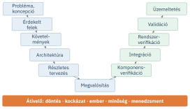
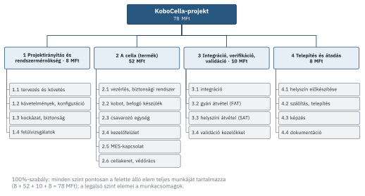
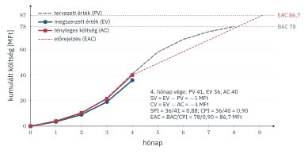

# Technikai tervezés és irányítás {#sec-menedzsment}

::: {.vterkep}
{fig-alt="V-térkép: a fejezet helye a rendszerfejlesztés folyamatában" width=62%}
:::

::: {.cel}
A fejezet feldolgozása után képes leszel:

- áttekinteni a technikai irányítás folyamatait, és elhelyezni őket a V-modell mentén;
- munkalebontási struktúrát készíteni, és arra ütemezést és költségvetést építeni;
- a projekt előrehaladását technikai mérőszámokkal és a megszerzett érték módszerével követni;
- megtervezni a konfigurációkezelést, és szabályozottan kezelni a változtatási kérelmeket;
- technikai felülvizsgálatot előkészíteni és lebonyolítani;
- mérlegelni, mikor és hogyan illeszthetők az agilis módszerek egy rendszerfejlesztésbe.
:::

A V-modell mentén haladó műszaki munkát irányítani kell: meg kell tervezni, követni kell az előrehaladását, kezelni kell a változásokat és a kockázatokat, és rendszeresen értékelni kell az eredményeket. Ezek a **technikai irányítási folyamatok** a teljes életcikluson átívelnek, és a termékszerkezet minden szintjén alkalmazandók; az ISO/IEC/IEEE 15288 nyolc ilyen folyamatot ír le [@iso15288_2023, 6.3. szakasz]. A [-@tbl-irany-folyamatok]. táblázat mutatja, hol tárgyalja a könyv az egyes folyamatokat.

| Irányítási tevékenység | ISO/IEC/IEEE 15288 folyamat (szakasz) | Ahol a könyv tárgyalja |
|:--|:--|:--|
| technikai tervezés | projekttervezés (6.3.1) | ez a fejezet |
| az előrehaladás értékelése | projektértékelés és -irányítás (6.3.2); mérés (6.3.7) | ez a fejezet; [-@sec-kovetelmenyek]. fejezet |
| döntések előkészítése | döntéskezelés (6.3.3) | [-@sec-dontes]. fejezet |
| kockázatkezelés | kockázatkezelés (6.3.4) | [-@sec-kockazat]. fejezet |
| konfigurációkezelés | konfigurációkezelés (6.3.5) | ez a fejezet |
| technikai adatkezelés | információkezelés (6.3.6) | ez a fejezet |
| minőségbiztosítás | minőségbiztosítás (6.3.8) | [-@sec-uzemeltetes]. fejezet |
| követelménykezelés | a rendszerkövetelmények meghatározásának része (6.4.3) | [-@sec-kovetelmenyek]. fejezet |
| interfészkezelés | az architektúra- és a tervmeghatározás része (6.4.4–6.4.5) | [-@sec-integracio]. fejezet |

: A technikai irányítás tevékenységei és az ISO/IEC/IEEE 15288 folyamatai [@iso15288_2023]. {#tbl-irany-folyamatok tbl-colwidths="[26,40,34]"}

## Technikai tervezés: munkalebontás, ütemezés, költségvetés {#sec-men-tervezes}

### Munkalebontási struktúra

A **munkalebontási struktúra** (work breakdown structure, WBS) a projekt végtermékeinek előállításához szükséges hardver, szoftver, szolgáltatások, adatok és létesítmények termékorientált, hierarchikus felosztása [@milstd881f; @nasa2016seh, 6.1. szakasz]. Azt is tükrözi, hogyan végzik a munkát, és hogyan gyűjtik, összesítik és jelentik a költség-, ütemezési, műszaki és kockázati adatokat [@pmi2019wbs]. A WBS tehát a termékfára (a termékstruktúrára) épül, de a terméket létrehozó munkát is tartalmazza: a projektirányítást, a rendszermérnöki munkát, az integrációt, a verifikációt, a telepítést és a képzést ([-@fig-wbs-kobo]. ábra).

A WBS legfontosabb szabálya a **100%-szabály**: minden szint pontosan a felette álló elem teljes munkáját tartalmazza, se többet, se kevesebbet [@pmi2019wbs]. A legalsó szint elemei a **munkacsomagok**: önállóan tervezhető, felelőshöz rendelhető, becsülhető és követhető munkaegységek.

{#fig-wbs-kobo width=100%}

### Ütemezés és költségvetés

A WBS munkacsomagjai időt igényelnek, és sorrendi kapcsolatban állnak egymással. A hálós ütemterv kifejezetten megadja az egyes tevékenységek függését más tevékenységektől, az erőforrások rendelkezésre állásától és a külső beszállításoktól. A **kritikus út** a függő tevékenységek leghosszabb sorozata, amely a projekt időtartamát meghatározza [@kelley1959]. A kritikus út a projekt előrehaladásával változik, ezért folyamatosan figyelni kell; a módszert a Gyakorlati útmutató integrációs terv és WBS eszközlapja mutatja be. A tapasztalat szerint a költség- és műszaki problémák gyakran először ütemezési problémaként jelentkeznek, ezért a csúszás korai jelzés.

A költségvetés a WBS-ből és az ütemtervből épül fel: a munkaerő- és egyéb erőforrásigényből, a közvetlen és közvetett költségekből, a beszállítói és anyagköltségekből és a tartalékból. A WBS, az ütemterv és a költségvetés egymástól kölcsönösen függ, és együtt kell kezelni őket [@fleming2010].

### A rendszermérnöki irányítási terv

A **rendszermérnöki irányítási terv** (systems engineering management plan, SEMP) a projekt legfelső szintű technikai irányítási dokumentuma: leírja, milyen technikai folyamatokat alkalmaz a projekt, milyen tevékenységekkel, milyen szervezetben, milyen költséggel és ütemezéssel [@incose2023seh; @sebok2025]. Már a koncepcionális szakaszban készül, és az életciklus során folyamatosan frissül; a többi technikai tervnek összhangban kell lennie vele. A SEMP fő értéke nem maga a dokumentum, hanem a tervezési munka, amely létrehozza: a terjedelme lényegtelen, az számít, hogy a projekt műszaki szükségleteit lefedje.

## A teljesítmény követése {#sec-men-kovetes}

A technikai értékelés folyamatos visszacsatolási hurok: tervezés, végrehajtás, állapotjelentés, értékelés, döntés, és ha szükséges, újratervezés [@iso15288_2023, 6.3.2. és 6.3.7. szakasz; @nasa2016seh, 6.7. szakasz]. A jó gyakorlat elvei: előre egyeztetett, jól meghatározott mérőszámok; egységes formátum minden szinten; a mérőszámok WBS szerinti összesítése; a történeti adatok megőrzése a trendek felismeréséhez; és színkódos (piros, sárga, zöld) jelzőzónák a mérőszámokra. A mérőszámokat rendszeresen, például havonta kell követni, a fontosabb felülvizsgálatokon pedig a trendjeiket is értékelni kell [@roedler2005].

A műszaki előrehaladást a technikai teljesítménymutatók (TPM) követik ([-@sec-kovetelmenyek]. fejezet), a költséget és az ütemezést együtt a **megszerzett érték módszere** (earned value management, EVM). A megszerzett érték az adott időpontig ténylegesen elvégzett munka tervezett költsége; a módszer a műszaki tartalmat, az ütemezést és a költséget együtt kezelve méri a teljesítményt. Három mennyiséggel dolgozik [@fleming2010]:

- **tervezett érték** (planned value, PV): az adott időpontig tervezett munka tervezett költsége;
- **megszerzett érték** (earned value, EV): az adott időpontig ténylegesen elvégzett munka tervezett költsége;
- **tényleges költség** (actual cost, AC): az elvégzett munka tényleges költsége.

Ezekből

$$
\mathrm{SV} = \mathrm{EV} - \mathrm{PV}, \quad \mathrm{CV} = \mathrm{EV} - \mathrm{AC}, \quad \mathrm{SPI} = \frac{\mathrm{EV}}{\mathrm{PV}}, \quad \mathrm{CPI} = \frac{\mathrm{EV}}{\mathrm{AC}}, \quad \mathrm{EAC} = \frac{\mathrm{BAC}}{\mathrm{CPI}},
$$ {#eq-evm}

ahol SV az ütemezési, CV a költségeltérés, SPI és CPI az ütemezési és a költséghatékonysági index, BAC a teljes jóváhagyott költségvetés, EAC a befejezéskori költség előrejelzése (azzal a feltevéssel, hogy a további munka is a mostani költséghatékonysággal halad) [@fleming2010].

::: {.eset eset="A" title="KoboCella: a projekt a negyedik hónap végén"}
A KoboCella-projekt költségvetése 78 MFt, időtartama nyolc hónap ([-@fig-wbs-kobo]. ábra). A negyedik hónap végén a tervezett érték 41 MFt, a megszerzett érték 36 MFt, a tényleges költség 40 MFt ([-@fig-evm-kobo]. ábra). Az ütemezési index 0,88, a költséghatékonysági index 0,90: a projekt késésben van, és a vártnál drágábban halad. A befejezéskori költség előrejelzése $78/0{,}90 = 86{,}7$ MFt. Az elemzés két okot talált: a kobot beszállítója két hetet késett, és a kockázatértékelés ([-@sec-kockazat]. fejezet) után előírt kiegészítő biztonsági mérések a tervezettnél több munkát igényeltek. A csapat a kritikus úton lévő integrációs lépésekhez tartalék segédeszközt (szimulátort) rendelt, a többletköltségre pedig a tartalékból kért jóváhagyást.

{#fig-evm-kobo width=88%}
:::

## Konfigurációkezelés és technikai adatkezelés {#sec-men-konfiguracio}

A **konfigurációkezelés** célja, hogy a termék konfigurációja mindig ismert legyen és tükröződjön a termékinformációkban, hogy minden változtatás indokolt legyen és káros következmények nélkül valósuljon meg, és hogy a változások kezelése szabályozott legyen. Csökkenti a technikai kockázatot, megkülönbözteti a termékváltozatokat, és összhangban tartja a terméket és a róla szóló információkat [@iso10007_2017; @milhdbk61b; @nasa2016seh, 6.5. szakasz]. Az ISO 10007 szabvány öt tevékenységet különít el [@iso10007_2017]:

- **tervezés és irányítás:** a konfigurációkezelés stratégiája és terve;
- **azonosítás:** a konfigurációs elemek (dokumentumok, hardver, szoftver, modellek) kijelölése, egyedi azonosítása és alapvonalba helyezése ([-@sec-felulvizsgalatok]. szakasz);
- **változáskezelés:** a változtatási javaslatok rendszeres benyújtása, indoklása, értékelése, a jóváhagyott változások végrehajtása és ellenőrzése;
- **nyilvántartás** (configuration status accounting): a jelenlegi és korábbi konfigurációk, a változtatási kérelmek, eltérések és engedélyek állapotának rögzítése és jelentése;
- **ellenőrzés és auditálás:** annak igazolása, hogy a termék teljesíti a követelményeket (funkcionális audit), és hogy a terve dokumentált és összhangban van a termékkel (fizikai audit).

A változásokat a hatásuk szerint két osztályba sorolják [@milhdbk61b]. **Jelentős** (I. osztályú) a változás, ha az alapvonal konfigurációs dokumentációját jelentősen érinti: utólagos átalakítást kíván a már leszállított termékeken, vagy érinti a specifikációt, a költséget, a biztonságot, az interfésszel kapcsolódó termékekkel való összeférhetőséget, illetve a kezelők vagy karbantartók képzését. **Kisebb** (II. osztályú) a változás, ha a dokumentációt vagy a folyamatokat úgy javítja, hogy a termékek és elemek cserélhetőségét nem érinti. Az **eltérési engedély** (waiver) dokumentált megállapodás egy követelmény teljesítésének szándékos elengedéséről; nem változtatja meg az alapvonalat [@milhdbk61b]. A változáskezelés folyamatát a [-@fig-valtozaskezeles]. ábra mutatja; a jelentős változásokról a **konfigurációs bizottság** (configuration control board, CCB) dönt.

![A változáskezelés folyamata az ISO 10007 [@iso10007_2017] és a MIL-HDBK-61B [@milhdbk61b] nyomán, egyszerűsítve.](../abrak/gen/valtozaskezeles.svg){#fig-valtozaskezeles width=78%}

::: {.eset eset="A" title="KoboCella: egy második nyugtázó gomb"}
A validáció során a csapat egy második nyugtázó gombot javasolt a kezelői oldalra ([-@sec-validacio]. fejezet). A változtatás első ránézésre apróság: egy nyomógomb és két vezeték. A hatáselemzés azonban kimutatta, hogy érinti a kezelőfelület interfészvezérlő dokumentumát (I-06), a kezelési útmutatót, a feladatelemzést és a kezelők képzését, és a biztonsági mérnöknek igazolnia kellett, hogy a biztonsági funkciókat nem érinti. A képzésre gyakorolt hatás miatt a változás jelentős, ezért a konfigurációs bizottság hagyta jóvá. A végrehajtás után a változáskérelem csak akkor zárult le, amikor minden érintett dokumentum új változata alapvonalba került, és a kezelők képzése megtörtént.
:::

A **technikai adatkezelés** a projekt során keletkező műszaki adatok (tervek, modellek, elemzések, tesztadatok, jelentések) azonosítását, tárolását, védelmét, elérhetőségét és archiválását jelenti; a szabványban ez az információkezelési folyamat [@iso15288_2023, 6.3.6. szakasz]. A konfigurációkezeléssel együtt ezen múlik, hogy mindenki ugyanazt a jóváhagyott változatot használja, és hogy a döntések indoklása később is visszakereshető legyen.

## Technikai felülvizsgálatok {#sec-men-felulvizsgalat}

A technikai felülvizsgálatok helyét az életciklusban a [-@sec-felulvizsgalatok]. szakasz mutatta be. A felülvizsgálatokhoz kapcsolódó tevékenységek [@ieee15288_2_2014]: a szakaszok közötti felülvizsgálatok azonosítása, tervezése és lebonyolítása; minden felülvizsgálat céljának, tárgyának, valamint **belépési** és **sikerességi feltételeinek** rögzítése; a felülvizsgáló csoport összeállítása; végül a felülvizsgálat nyomán született intézkedések azonosítása és lezárása. A felülvizsgálatok azok a pontok, ahol a technikai mérőszámokat és trendjeiket gondosan meg kell vizsgálni a lehetséges problémák korai jelei után kutatva. A felülvizsgálatot jegyzőkönyv zárja, amely rögzíti az eredményeket, az ajánlásokat és az intézkedéseket a sikerességi feltételek teljesüléséről.

A formális felülvizsgálatok mellett a **szakmai átvizsgálások** (peer review) kisebb körben, egy-egy munkaterméket (tervet, kódot, elemzést) vizsgálnak meg részletesen. Legszigorúbb formájuk Fagan inspekciós módszere, a fajtáikat az IEEE 1028 szabvány rendszerezi [@fagan1976; @ieee1028_2008; @nasa2016seh, N függelék].

::: {.eset eset="B" title="VárosiBringa: az előzetes tervfelülvizsgálat"}
A VárosiBringa előzetes tervfelülvizsgálatának belépési feltétele volt a rendszerarchitektúra, az allokált követelmények, az interfészjegyzék, a dokkoló tervezési FMEA-ja, a kölcsönző alkalmazás első prototípusának használhatósági eredményei és az áthelyezési stratégia szimulációja. A dokumentumokat a bírálók tíz nappal a felülvizsgálat előtt kapták meg; a felülvizsgáló csoportban az önkormányzat, az üzemeltető, az akadálymentességi érdekképviselet és egy független rendszermérnök is részt vett. A felülvizsgálaton 23 észrevétel érkezett, köztük kettő súlyos: a dokkoló és a járda szélességének összeférhetősége két állomáson nem volt igazolva, és a téli üzemre (hó, jég) nem készült forgatókönyv. A felülvizsgálat feltételesen sikeres lett: a következő szakasz elkezdődhetett, de a két súlyos észrevételt felelőssel és határidővel le kellett zárni a részletes tervfelülvizsgálat előtt. A téli forgatókönyv hiánya utólag különösen tanulságos volt ([-@sec-uzemeltetes]. fejezet).
:::

## Agilis és hibrid irányítás {#sec-men-agilis}

Az agilis fejlesztés rövid ciklusokban, működő részeredményeket szállítva halad ([-@sec-v-modell]. fejezet). Az Agilis kiáltvány az egyéneket és az együttműködést, a működő terméket, a megrendelővel való együttműködést és a változásra való reagálást helyezi előtérbe [@beck2001agile]. A legelterjedtebb keretrendszer, a Scrum, rögzített hosszúságú (legfeljebb egyhónapos) sprintekben dolgozik: a termékcélból levezetett, rangsorolt teendőlistából a csapat sprintenként egy használható növekményt állít elő, amelyet a sprint végén az érdekelt felekkel közösen áttekint, majd a munkamódszerét is értékeli [@schwaber2020].

Hardvert is tartalmazó rendszereknél a tisztán agilis megközelítés ritkán járható: a hosszú beszerzési idők, a biztonsági igazolás és a fizikai integráció nem bontható kéthetes ciklusokra. A gyakorlatban **hibrid** megoldás terjedt el: a rendszerszintű követelményeket, az architektúrát, az interfészeket és a biztonsági igazolást V-modell szerint, alapvonalakkal és felülvizsgálatokkal kezelik, a szoftveren és egyes alrendszereken belül pedig agilis ciklusokban dolgoznak [@incose2023seh]. Az inkrementális elköteleződésen alapuló spirálmodell ezt kockázatvezérelt döntési pontokkal köti össze: minden ciklus végén az érdekelt felek a bizonyítékok alapján döntenek a folytatásról [@boehm2014icsm].

::: {.eset eset="C" title="ForgácsTech: a MES bevezetése hibrid módon"}
A ForgácsTech MES-ének bevezetését a csapat hibrid módon szervezte. A rendszerszintű követelményeket (határidő-tartás, nyomonkövethetőség, a gépvezérlők garanciájának megőrzése), az architektúrát és a gépekkel való interfészeket ([-@sec-integracio]. fejezet) alapvonalba helyezte, és csak konfigurációs bizottsági döntéssel változtatta. A MES beállítását és a kiegészítő szoftverfejlesztést kéthetes ciklusokban végezték: minden ciklus végén a műszakvezetők kipróbálták az új funkciókat a tesztkörnyezetben, és a visszajelzéseik alapján rangsorolták a következő ciklus teendőit. Ez a gyakorlat azonban nem tárta fel időben a kezelői jogosultságok hiányát ([-@sec-validacio]. fejezet), mert a tesztkörnyezet nem tartalmazta a valós munkabeosztást: az agilis visszajelzés csak olyan jó, amilyen valószerű a környezet, amelyben a felhasználók kipróbálják a terméket.
:::

::: {.kitekintes title="Modellalapú projektirányítás"}
A modellalapú rendszermérnökség ([-@sec-modellek]. fejezet) a technikai irányítást is átalakítja. Ha a követelmények, az architektúra, az interfészek és a verifikációs kapcsolatok egyetlen modellben élnek, a konfigurációkezelés a modell változatainak kezelésévé válik, a változtatás hatáselemzése a modellben lévő kapcsolatok bejárásával automatizálható, a felülvizsgálatok pedig a dokumentumok helyett a modell nézeteire épülhetnek. A modell azonban csak akkor hiteles, ha a szervezet a modell karbantartását is megtervezi és finanszírozza.
:::

::: {.hiba title="Terv a fiókban"}
Gyakori hiba, hogy a projekt elején gondosan elkészítik a WBS-t, az ütemtervet és a SEMP-et, majd soha többé nem frissítik őket. A frissítés nélküli terv elavul, és a projekt észrevétlenül ellenőrizetlen állapotba csúszhat. A tervek élő dokumentumok: a változáskezelés, a felülvizsgálatok és a havi állapotértékelés teszi őket a projekt irányításának eszközeivé.
:::

::: {.osszefoglalo}
- A technikai irányítás folyamatai (tervezés, követelmény-, interfész-, kockázat-, konfiguráció- és adatkezelés, értékelés, döntéselemzés) a teljes életciklusban, minden szinten működnek.
- A WBS termékorientált, hierarchikus munkafelosztás; a 100%-szabály szerint minden szint pontosan a felette álló elem teljes munkáját tartalmazza. Erre épül az ütemterv, a kritikus út és a költségvetés.
- A SEMP a legfelső szintű technikai irányítási terv; fő értéke a tervezési munka, és folyamatosan frissíteni kell.
- A teljesítményt a TPM-ek és a megszerzett érték módszere követi: SPI = EV/PV, CPI = EV/AC, EAC = BAC/CPI.
- A konfigurációkezelés öt eleme a tervezés, az azonosítás, a változáskezelés, a nyilvántartás és az auditálás; a jelentős változásokról a konfigurációs bizottság dönt.
- A felülvizsgálatoknak előre rögzített belépési és sikerességi feltételei vannak, és az intézkedéseket felelőssel és határidővel le kell zárni.
- Hardvert is tartalmazó rendszereknél a hibrid irányítás terjedt el: alapvonalak és felülvizsgálatok a rendszerszinten, agilis ciklusok a szoftverben és egyes alrendszerekben.
:::

::: {.onell}
1. Mi a különbség a termékfa és a WBS között?
2. Mit mond ki a 100%-szabály, és miért fontos?
3. Miért kell a kritikus utat folyamatosan figyelni?
4. Egy projekt költségvetése 120 MFt. Egy adott időpontban PV = 50, EV = 45, AC = 55 MFt. Számítsd ki az SV, CV, SPI, CPI és EAC értékét, és értelmezd!
5. Sorold fel a konfigurációkezelés öt elemét!
6. Mikor jelentős egy változás? Miért volt jelentős a KoboCella második nyugtázó gombja?
7. Mi a különbség a változtatás és az eltérési engedély között?
8. Mikor ajánlott a hibrid irányítás, és mi a korlátja az agilis visszajelzésnek?

::: {.megoldas}
1. A termékfa a rendszer elemeinek hierarchiája; a WBS ezekre épül, de a termék létrehozásához szükséges teljes munkát tartalmazza: a projektirányítást, a rendszermérnöki munkát, az integrációt, a verifikációt, a telepítést, a képzést és a dokumentációt is.
2. Minden szint pontosan a felette álló elem teljes munkáját tartalmazza, se többet, se kevesebbet. Enélkül munka maradhat ki a tervből (és a költségvetésből), vagy ugyanaz a munka kétszer is szerepelhet.
3. Mert a kritikus út a projekt időtartamát meghatározó tevékenységsorozat, és a projekt során változik: ha egy nem kritikus tevékenység annyit késik, hogy elfogy a tartaléka, kritikussá válik.
4. SV = 45 − 50 = −5 MFt; CV = 45 − 55 = −10 MFt; SPI = 0,90; CPI = 0,82; EAC = 120/0,82 ≈ 146,7 MFt. A projekt késésben van, és a költséghatékonysága rossz: ha így folytatódik, mintegy 27 MFt-tal lépi túl a költségvetést.
5. Tervezés és irányítás, azonosítás, változáskezelés, nyilvántartás, ellenőrzés és auditálás.
6. Ha az alapvonal konfigurációs dokumentációját jelentősen érinti: utólagos átalakítást kíván a leszállított termékeken, vagy érinti a specifikációt, a költséget, a biztonságot, az interfészekkel való összeférhetőséget, illetve a kezelők vagy karbantartók képzését. A nyugtázó gomb a kezelők képzését és a kezelőfelület interfész-dokumentumát érintette.
7. A változtatás az alapvonalat módosítja; az eltérési engedély dokumentált megállapodás egy követelmény teljesítésének szándékos elengedéséről, az alapvonal változatlan marad.
8. Ha a rendszerszintű követelmények, az architektúra és a biztonsági igazolás stabil alapvonalat kíván, de a szoftver vagy egyes alrendszerek gyorsan változó igényekkel, rövid ciklusokban fejleszthetők. Az agilis visszajelzés csak olyan jó, amilyen valószerű a kipróbálás környezete; a valós használat feltételeit (munkabeosztás, terhelés, környezet) a próbában is képviselni kell.
:::
:::

::: {.projekt title="Projektlépés: technikai terv"}
Saját fejlesztési feladatodhoz:

1. készíts legalább háromszintű WBS-t a 100%-szabály betartásával, és rendelj a munkacsomagokhoz felelőst és becsült ráfordítást;
2. készíts hálós ütemtervet, és határozd meg a kritikus utat;
3. jelöld ki a konfigurációs elemeket, és írd le, hogyan kezeled a változtatási kérelmeket;
4. tervezd meg a felülvizsgálatokat belépési és sikerességi feltételekkel;
5. használd a Gyakorlati útmutató WBS, felülvizsgálati és konfigurációkezelési eszközlapját.
:::

::: {.forras}
- @milhdbk61b és @milstd881f: a konfigurációkezelés és a munkalebontás részletes, gyakorlati útmutatói.
- @ieee15288_2_2014 és @ieee1028_2008: a technikai felülvizsgálatok és a szakmai átvizsgálások szabványai.
- @iso15288_2023, 6.3. szakasz; @iso10007_2017: a technikai irányítás és a konfigurációkezelés a szabványokban.
- @pmi2019wbs; @kelley1959; @fleming2010: a munkalebontás, a kritikus út és a megszerzett érték módszere.
- @beck2001agile; @schwaber2020; @boehm2014icsm; @incose2023seh: agilis és hibrid irányítás.
- @nasa2016seh, 6. fejezet, B, J és N függelék: a technikai irányítás folyamatai, a WBS, a SEMP, a konfigurációkezelés, a technikai értékelés és a szakmai átvizsgálás.
:::
